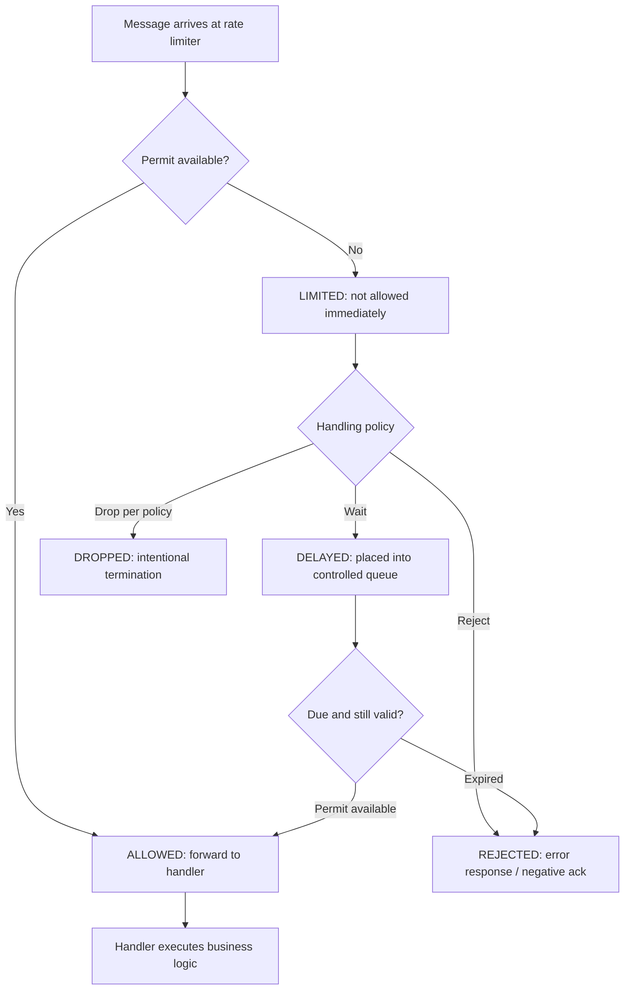
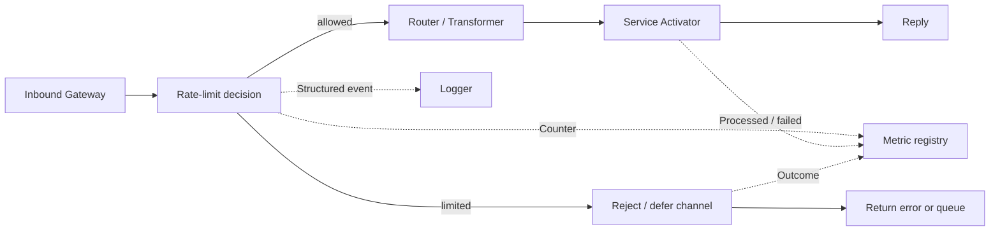
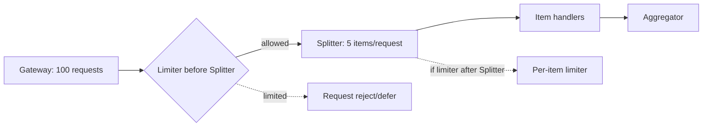
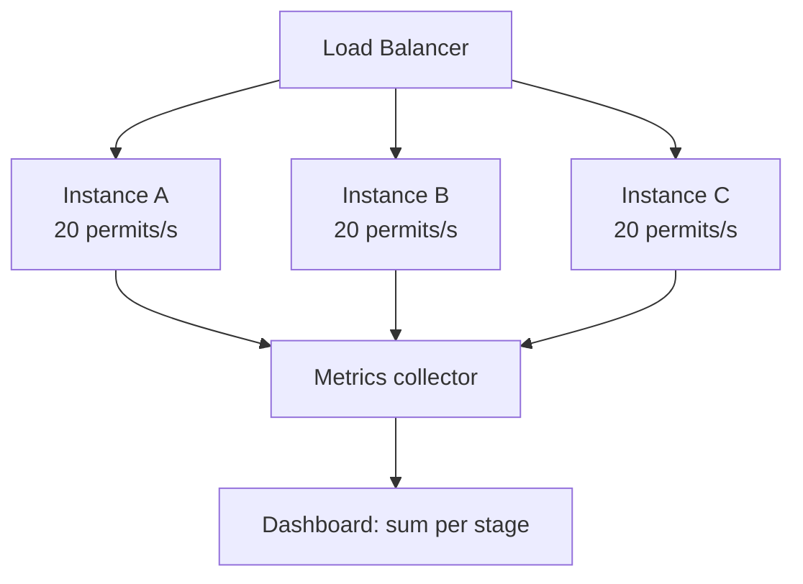

# Monitoring the Number of Rate-Limited Messages

In Spring Integration, a Rate Limiter protects an endpoint or downstream dependency when message traffic exceeds processing capacity. Yet merely setting a limit—such as "20 messages/second"—is not enough to operate: engineering teams need to know **how many messages are allowed through, how many are rate-limited, whether those messages are deferred or rejected, and the eventual business impact**.

This lesson belongs to the **Rate limiter** chapter in the **SPRING_INTEGRATION_PATTERN** module. The module focuses on implementing Enterprise Integration Patterns (EIP) with Spring Integration to build loosely coupled, extensible message flows; practicing Router, Filter, Transformer, Splitter, Aggregator, Gateway, retry, error channel, and correlation, as well as testing and monitoring processing branches. Here, we learn how to observe a rate-limiting decision rather than just looking at log lines or a rate-limiting library's internal state.

After this lesson, you can:

- Distinguish **allowed**, **limited/denied**, **delayed**, **rejected**, **dropped**, and **eventually processed**.
- Design Counter metrics and supplementary indicators to accurately measure the limiter's *decision counts*.
- Compute rate-limited throughput and rejection ratio within a window, while understanding measurement caveats under retries and multiple instances.
- Integrate a permit-check gate into Spring Integration Java DSL and record metrics using Micrometer.
- Organize handling of rate-limited messages: return appropriate responses, bounded waiting, retry/backoff, or route to another channel instead of silently losing messages.
- Build dashboards, alerts, and tests for bursts, error flows, Splitter, idempotency, and multi-replica coordination.

## 1. "Rate-Limited Message" Can Mean Several Things

A rate limiter typically checks whether a message is **granted immediate permission to execute**. If a permit is not granted, the next action depends on policy:



The diagram above is a **decision model**, not states automatically emitted by Spring Integration under these exact names.

| Concept | Meaning | Where to count? |
| --- | --- | --- |
| `attempted` | A message/attempt reached the checkpoint | Right before evaluating the limiter |
| `allowed` | Limiter granted a permit at the check | Immediately upon deciding to allow |
| `limited` or `denied` | Limiter did not grant a permit at the check | Immediately upon deciding to deny |
| `delayed` | Message was placed in a waiting area to retry | After enqueue succeeds |
| `rejected` | Message was returned to the source with a rejection code | After the error-return decision executes per contract |
| `dropped` | Message was genuinely removed from the processing path per policy | At the intentional termination point |
| `processed` | Business handler finished executing as defined | After work succeeds or completes |
| `failed` | Execution was permitted yet failed | At handler/recovery using a clearly defined unit |

**One message can be `limited` multiple times and still be `processed` later.** Thus `limited` does not equal `lost`. Conversely, an `allowed` message can fail downstream, so `allowed` does not equal `succeeded`.

### Business Meaning Example

An inbound HTTP Gateway receives 100 requests; the limiter lets 80 through and rejects 20 with a "fail fast" policy. Then there can be 80 `allowed` decisions, 20 `limited` decisions, and 20 rejection responses. Yet if the policy is "wait for a permit before processing," there can be 20 `limited` events with **zero dropped messages**; some get processed after waiting.

Before building a dashboard, write down the exact question being measured:

- How many **permit requests** were denied?
- How many **unique messages** ever hit the limit?
- How many **client requests** received an HTTP 429 response?
- How many messages **were queued, expired, or lost**?
- How many requests **eventually succeeded**?

These numbers are not interchangeable.

## 2. Identifying Measurement Points in IntegrationFlow

Spring Integration does not mandate a single way to implement a Rate Limiter across all applications. You can use a `Filter` calling a permit policy, an advice, a rate-check handler, or an external library. Depending on implementation, limiting may *drop*, *delay*, *throw*, or *route* messages.

An illustrative flow:



**The canonical measurement point for `allowed/limited` is right where the permit decision is made.** Counting at a post-Router handler misses messages dropped by a Filter or failing before the handler. Counting in a logger risks undercounting due to log levels, sampling, or async appenders.

Keep at least three layers separate:

1. **Admission**: did the limiter allow the message to proceed?
2. **Disposition**: was a non-permitted message rejected, deferred, or dropped?
3. **Execution**: did the message succeed, fail, retry, or expire?

That way, when seeing "`limited` spiked," you can distinguish healthy upstream protection from the system actually losing messages.

## 3. Foundational Metric Set

### Counter for Each Decision

You can use a Micrometer `Counter` logically named `integration.rate.limit.decisions` with a `decision` tag:

```text
integration.rate.limit.decisions{stage="ordersIngress", decision="allowed"}
integration.rate.limit.decisions{stage="ordersIngress", decision="limited"}
```

This is an **application-proposed name**, not a default meter guaranteed to be created by Spring Integration or a Rate Limiter library. When exported to Prometheus, the name may be normalized by the registry/exporter rules, such as `integration_rate_limit_decisions_total`.

Increment exactly once per **decision-function call**, in both the allowed and limited branches. Do not create a counter only for `limited` and estimate `allowed` from total Gateway messages if some messages are filtered, routed away, or fail before reaching the limiter.

### Post-Decision Metrics

| Suggested application metric | Type | Unit | When incremented/updated |
| --- | --- | --- | --- |
| `integration.rate.limit.decisions` | Counter | Permit requests | When an `allowed` or `limited` decision occurs |
| `integration.rate.limit.dispositions` | Counter | Messages/attempts | When `rejected`, `enqueued`, `expired`, or `dropped` per policy |
| `integration.rate.limit.wait` | Timer | Duration | When a message finishes waiting for a permit |
| `integration.rate.limit.queue.depth` | Gauge | Waiting messages | Queue depth at measurement time |
| `integration.rate.limit.queue.oldest.age` | Appropriate Gauge/Timer | Duration | Age of oldest message if backend exposes it |
| `integration.rate.limit.config.rate` | Gauge or config state | Permits/second | Current configured rate limit |
| `integration.handler.processed` | Counter | Messages/successful runs | After processing completes, with clear unit definition |
| `integration.handler.failed` | Counter | Business failures | At processing point or terminal failure |
| `integration.rate.limit.effective.retries` | Counter | Retry attempts | At retry admission, if tracked separately |

Metric names and counting points must be documented. `enqueued` must not be treated as `processed`; queues can fill up or messages can expire before execution.

### Metric Labels with Bounded Cardinality

Use controlled tags, such as:

```text
service = orders
stage = ordersIngress | inventoryOutbound
decision = allowed | limited
policy = standard | priority
disposition = rejected | enqueued | expired | dropped
instance_role = api | worker
```

Never attach `requestCorrelationId`, `messageId`, email, tokens, account numbers, arbitrary URLs, or verbatim exception messages as metric labels. High-cardinality IDs explode time-series counts. Those IDs belong in **structured logs** or access-controlled traces.

## 4. Calculating Limited Messages and Limited Rate

Counters normally increase monotonically over time; in Prometheus or similar systems, use **delta/increase** or **windowed rate** rather than raw cumulative counter values as a "per-minute count."

If the same limiter checkpoint has:

- `A`: allowed decisions in the window;
- `L`: limited decisions in the window;

then:

\[
\text{limitedRate} = \frac{L}{A+L}\times 100\%
\]

assuming `A + L > 0`. If there are no attempts in the window, the ratio is **undefined**, not automatically 0%.

### Illustrative Example

Over 5 minutes, a limiter checkpoint records:

```text
allowed decisions: 9,000
limited decisions: 1,000
total decisions:  10,000

limitedRate = 1,000 / 10,000 = 10%

limited throughput = 1,000 / 300 s ≈ 3.33 decisions/s
allowed throughput = 9,000 / 300 s = 30 decisions/s
```

This is the **rate-limited decision ratio**, not automatically 10% of customers losing orders. If rate-limited messages are queued and processed later, terminal rejections can be much lower or 0 over the same period.

### PromQL Examples with Application-Emitted Metrics

Assuming Micrometer exports the Counter to Prometheus as `integration_rate_limit_decisions_total` with tag `decision`:

```promql
# Number of times the limiter denied a permit over 5 minutes, summed across instances.
sum(increase(integration_rate_limit_decisions_total{
  stage="ordersIngress", decision="limited"
}[5m]))
```

```promql
# Average limited rate, in decisions/second.
sum(rate(integration_rate_limit_decisions_total{
  stage="ordersIngress", decision="limited"
}[5m]))
```

```promql
# Ratio of limited decisions to total allowed + limited, by stage.
sum by (stage) (
  rate(integration_rate_limit_decisions_total{decision="limited"}[5m])
)
/
sum by (stage) (
  rate(integration_rate_limit_decisions_total[5m])
)
```

In this example, assume **only** two decisions `allowed` and `limited` exist in this metric. If `error`, `unknown`, or other outcomes exist, adjust the denominator by definition. During zero-traffic windows, division can lack data or yield `NaN`; dashboards/alerts must handle that explicitly rather than falsely firing "100% errors."

When using Grafana/Prometheus across multiple replicas, aggregate by `stage`/`policy` before dividing. **Do not take a simple average of per-instance ratios** when instances carry unequal traffic; divide summed totals instead.

## 5. Java Example: Local Token Bucket and Micrometer Counters

An external library limiter may expose built-in metrics, yet to clearly show **counting at the decision point**, the example below implements a simple Token Bucket in the JVM. This is an **illustrative exercise**, not a full production rate limiter or distributed quota mechanism.

Assumptions:

- Each instance has its own bucket.
- Burst capacity is 40 permits.
- Refill rate is 20 permits/second.
- Each `tryAdmit()` call requests one permit without waiting.
- When the bucket is out of permits, the call returns `false`.
- Synchronization ensures each instance counts decisions in a thread-safe manner in the example.

```java
import java.util.function.LongSupplier;

import io.micrometer.core.instrument.Counter;
import io.micrometer.core.instrument.MeterRegistry;

final class AdmissionGate {

    private final LongSupplier nanoTicker;
    private final int capacity;
    private final double permitsPerNanosecond;
    private final Counter allowedCounter;
    private final Counter limitedCounter;

    private double tokens;
    private long lastRefillNanos;

    AdmissionGate(
            MeterRegistry registry,
            LongSupplier nanoTicker,
            int capacity,
            double permitsPerSecond) {

        if (capacity <= 0 || !Double.isFinite(permitsPerSecond)
                || permitsPerSecond <= 0.0) {
            throw new IllegalArgumentException("Invalid rate-limit policy");
        }

        this.nanoTicker = nanoTicker;
        this.capacity = capacity;
        this.permitsPerNanosecond = permitsPerSecond / 1_000_000_000.0;
        this.tokens = capacity;
        this.lastRefillNanos = nanoTicker.getAsLong();

        this.allowedCounter = Counter.builder("integration.rate.limit.decisions")
                .tag("stage", "ordersIngress")
                .tag("decision", "allowed")
                .register(registry);

        this.limitedCounter = Counter.builder("integration.rate.limit.decisions")
                .tag("stage", "ordersIngress")
                .tag("decision", "limited")
                .register(registry);
    }

    synchronized boolean tryAdmit() {
        long now = nanoTicker.getAsLong();
        long elapsed = now - lastRefillNanos;

        if (elapsed > 0L) {
            tokens = Math.min(capacity,
                    tokens + elapsed * permitsPerNanosecond);
            lastRefillNanos = now;
        }

        if (tokens >= 1.0) {
            tokens -= 1.0;
            allowedCounter.increment();
            return true;
        }

        limitedCounter.increment();
        return false;
    }
}
```

**Reading the semantics accurately:**

1. The `Counter` increments in **both branches** of a decision, regardless of whether the message succeeds downstream afterward.
2. `System.nanoTime()` is a monotonic time source suited for elapsed intervals within one JVM; never use system wall-clock timestamps to compute permit refills.
3. `synchronized` protects bucket state within the same process. It does **not** make the limiter a global quota across multiple pods.
4. The bucket starts full with 40 permits, so it can admit an initial burst exceeding 20/second over a very short span. That is a Token Bucket property, not a Counter bug.
5. When no permit is granted, this example **does not decide yet** whether the message returns an error, waits, or moves to a queue. The next step belongs to the `IntegrationFlow` policy.
6. Counters live in the instance's meter registry. After a process crash or restart, observed figures depend on the exporter/scraper and do not automatically form a durable audit ledger.

If the application uses Resilience4j, Bucket4j, or gateway/broker limiters, leverage their built-in events/metrics when semantics match, avoiding double counting. Always verify whether a metric measures *permit requests*, *waits*, *rejections*, or *processed runs*.

## 6. Putting the Decision Into Spring Integration Java DSL

Assume an `OrderSubmitted` processing flow (Java 17+) with a configured Micrometer backend. We use a `Filter` as an **admission gate**: permitted messages proceed to the handler; unpermitted messages go to a discard channel that is **explicitly handled**. The name "discard" in Spring Integration does not imply data is permanently deleted.

```java
import org.slf4j.Logger;
import org.slf4j.LoggerFactory;

import org.springframework.context.annotation.Bean;
import org.springframework.context.annotation.Configuration;
import org.springframework.integration.channel.DirectChannel;
import org.springframework.integration.dsl.IntegrationFlow;
import org.springframework.messaging.Message;
import org.springframework.messaging.MessageChannel;
import org.springframework.stereotype.Service;

import io.micrometer.core.instrument.MeterRegistry;

record OrderSubmitted(String orderId, int itemCount) { }

@Service
class OrderProcessor {
    public void process(OrderSubmitted order) {
        // Real order business logic.
    }
}

final class RateLimitRejectedException extends RuntimeException {
    RateLimitRejectedException() {
        super("RATE_LIMIT_EXCEEDED");
    }
}

@Service
class RateLimitRejectionHandler {
    public void reject(Message<?> message) {
        // Do not log raw payload or Authorization header.
        // In this sync example: let caller catch the exception and map to HTTP 429
        // at the HTTP boundary if using HTTP.
        throw new RateLimitRejectedException();
    }
}

@Configuration
class OrdersRateLimitConfig {

    private static final Logger log =
            LoggerFactory.getLogger("app.orders.rate-limit");

    @Bean
    AdmissionGate admissionGate(MeterRegistry meters) {
        return new AdmissionGate(meters, System::nanoTime, 40, 20.0);
    }

    @Bean
    MessageChannel ordersInput() {
        return new DirectChannel();
    }

    @Bean
    MessageChannel ordersLimited() {
        return new DirectChannel();
    }

    @Bean
    IntegrationFlow ordersFlow(AdmissionGate gate, OrderProcessor processor) {
        return IntegrationFlow.from("ordersInput")
                .filter(OrderSubmitted.class, order -> gate.tryAdmit(),
                        spec -> spec.discardChannel("ordersLimited"))
                .handle(processor, "process")
                .get();
    }

    @Bean
    IntegrationFlow rejectedOrdersFlow(RateLimitRejectionHandler handler) {
        return IntegrationFlow.from("ordersLimited")
                .handle(handler, "reject")
                .get();
    }
}
```

The scope of this example is **in-process messages arriving over `DirectChannel`**, so the exception thrown in the rejection branch can propagate synchronously to the caller. To return HTTP 429, a real application needs an inbound HTTP boundary/exception handler **mapping** `RateLimitRejectedException` to an appropriate response, including `Retry-After` if policy requires. A misconfigured request/reply `Gateway` may time out or return another error; the code above does not automatically create an HTTP server or 429 response.

For messages pulled from Kafka/JMS/RabbitMQ, throwing an exception does **not** automatically equate to returning 429. Design ack/nack, delayed retry/backoff, queues, dead-lettering, and idempotency per adapter. Otherwise, a rejected message may be redelivered endlessly, inflating both load and `limited` decisions.

### Role of Filter and Discard Channel

- `.filter(... gate.tryAdmit())` is not filtering out invalid payloads; it checks admission permission before processing.
- `gate.tryAdmit()` increments the `allowed` or `limited` Counter **as soon as the decision is made**.
- `discardChannel("ordersLimited")` routes unpermitted messages to another flow. This is the **subsequent outcome**, not a count of lost messages.
- `RateLimitRejectionHandler` illustrates a synchronous rejection policy; to defer instead, replace it with a bounded waiting channel and retry workflow.
- The business handler runs only when a permit is granted. An `allowed` message is not guaranteed to succeed; track downstream results with separate metrics/traces.

**Warning:** Do not pick `Filter` and simply drop messages if the system handles orders or payments requiring guaranteed delivery. Explicitly specify **reject, defer, or drop** semantics in the business contract and ensure errors reach the sender or have proper recovery.

### Count at Filter or in Discard Flow?

Counting only messages in `ordersLimited` measures **messages that actually reached the discard branch**. If that channel fills up, errors on send, or configuration switches to another handling path, the count can diverge from how many times the limiter denied permits.

To know **how many times limiting occurred**, count inside `tryAdmit()`. To know **how many times messages were rejected/enqueued/dropped**, count **after the corresponding handling action** using a second meter. Separating the two counts exposes stuck messages or errors inside the recovery branch itself.

## 7. Retries Can Increment Counters Multiple Times for the Same Message

A common mistake is seeing `limitedCounter` increase and concluding that many distinct messages/customers were affected.

Suppose one message is tried three times:

```text
10:00:00  try #1 -> LIMITED
10:00:01  try #2 -> LIMITED
10:00:02  try #3 -> ALLOWED -> PROCESSED
```

When counting by **permit requests**:

```text
limited decisions: +2
allowed decisions: +1
unique business messages limited at least once: 1
messages ultimately processed: 1
messages ultimately lost: 0
```

These quantities differ and can all be accurate simultaneously.

Document clearly:

- Are retries scheduled proactively by the limiter or redelivered by an adapter/broker?
- Is a limited message returned to a queue?
- Does every retry pass through the limiter again?
- Is the limiter placed before or after a Splitter?
- Does the meter count original requests, child messages, or handler attempts?

If you need to measure **unique messages ever rate-limited**, you need stable IDs, window-appropriate state/deduplication storage, and a definition of "unique." Do not add `messageId` directly as a metric label to solve this because cardinality is too high. Instead, record `requestCorrelationId` in access-controlled structured logs/audits or maintain a dedicated dedup table if officially required by the business.

## 8. Where to Limit: Before or After Splitter?

Limiter placement affects both system behavior and how Counters are interpreted.



For 100 requests, each split into 5 child messages:

- A limiter **before the Splitter** sees at most 100 permit requests for the 100 requests (assuming one check per request).
- A limiter **after the Splitter** sees at most 500 permit requests for the 500 child messages.
- If one item is limited after the Splitter, the Aggregator may have to wait, time out, or apply a different release strategy. Never drop items silently by default.

**Choose placement based on the resource being protected.** If protecting a downstream requests/second API, the limiter usually belongs on the **outbound calls** themselves, not only on inbound requests. If one request triggers 10 outbound calls, limiting at the Gateway may fail to protect the outbound dependency.

Conversely, if the quota applies per inbound order, checking after the Splitter multiplies permit checks and may reject excessively.

### Priority Branch and Standard Route Example

A Router may split into `priority` and `standard`, each branch having a different rate-limit policy. Metrics should then carry controlled `policy=priority|standard` and fixed `stage` tags, never raw client-supplied route names. When changing policies at runtime, keep configuration source and version metadata so before/after metrics compare apples to apples.

## 9. Delays, Queues, and Backpressure Need Separate Metrics

A limiter can **block and wait** for a permit instead of returning `false`. For instance, a handler-calling thread blocks for 200 ms and then receives a permit. In that case, zero "`limited`" decisions from a `tryAcquire` API does not prove rate limiting had no effect: wait time rises and throughput is throttled.

Track:

| Case | Suggested metric | Risk |
| --- | --- | --- |
| Synchronous wait for permit | `rate_limit.wait` Timer | Blocks threads, increases latency |
| Retry waiting queue | Queue depth, oldest age, enqueue/dequeue/expire Counter | Memory growth, backlog, TTL expiration |
| Full queue | `enqueue_failed` or `dropped` outcome | Messages lost without another policy |
| Broker deferral | Retry scheduled, redelivery, lag/age | Duplicate messages or expiration |
| Timeout acquiring permit | `timeout` Counter and Timer | Caller timeouts, business impact |
| Slow downstream | Handler latency, in-flight, failures | Rate limiter protects dependency yet cannot fix slowness |

### Distinguishing Blocking Threads from Blocking Messages

If `RateLimiter.acquire()` waits inside a handler on `DirectChannel`, the caller thread is held while waiting. If the system needs high throughput or requests have short timeouts, consider designed and monitored async queuing/orchestration. Never leave queues unbounded either: you will trade "429 spikes" for "RAM/latency spikes."

With `QueueChannel`, executors, pollers, or brokers, define capacity, TTL, ack, and restart recovery. A rate limiter governs processing pace; **it does not create durability** for waiting messages.

## 10. Multi-Instance: Summed Counters Are Not a Cluster-Wide Quota

The `AdmissionGate` example is a **per-instance in-memory bucket**. Running 3 replicas where each grants an average of up to 20 permits/s yields a theoretical cluster capacity approaching 60 permits/s when load is evenly spread and busy enough. That is not a shared 20 permits/s quota.



In multi-instance deployments, distinguish:

- **Local limit:** each replica grants permits independently; cluster total depends on replica count and load distribution.
- **Distributed limit:** replicas coordinate over the same quota using an appropriate store/service; handle races, network latency, failure modes, and consistency.
- **Limit at API gateway/load balancer:** enforced before messages enter the app; Counters inside Spring Integration may **not see** requests blocked at the gateway.
- **Per-tenant/key limit:** address fairness and accurate per-key quotas, while avoiding exporting every tenant ID as a raw metric tag if counts are large.

When metrics are aggregated across 3 replicas, `sum(rate(...))` gives total throughput; never conclude from summed metrics that a global quota is enforced. Metrics only reflect observed counts.

### Accurate Statistics During Autoscaling

When scaling from 3 to 6 replicas, the total allowance of local buckets also rises. Dashboards should show **replica count, configured rate/burst, allowed/s, limited/s, and downstream saturation** side by side. If the limited rate drops after scaling, it may be due to added capacity rather than lower traffic.

In-memory Counters reset on process restart; time-series systems and Prometheus `rate()/increase()` handle counter resets according to exporter behavior. Never treat freshly reset counter values as absolute audit records.

## 11. Structured Logging and Tracing to Find Specific Messages

Metrics tell you **how many**, whereas logs/traces tell you **which message** and **why**. A suitable structured event:

```json
{
  "event": "integration.rate_limited",
  "flow": "orderFulfillment",
  "stage": "inventoryOutbound",
  "policy": "standard",
  "requestCorrelationId": "req_42",
  "messageId": "a9d82998-b276-41ed-a416-53d3e61c44d7",
  "decision": "limited",
  "action": "defer",
  "attempt": 2
}
```

You do not need to log every limited message at `WARN` in high-traffic production; otherwise rate limiting itself floods logs. Use `INFO/DEBUG`, controlled sampling, and always increment counters at the decision point. However, if auditing or guaranteed final outcomes are required, use a dedicated durable persistence path.

Preserve `requestCorrelationId` or trace context when messages are deferred/requeued; when creating new messages, verify header mapping and thread context propagation. Request IDs aid log lookup, while `traceId` traces journeys when sampled. Never log emails, tokens, `Authorization`, raw payloads, or `Throwable.getMessage()` for limiter tracking.

**A `limited` decision is not automatically an exception.** Using an error channel depends on policy and endpoint: synchronous errors may propagate to the caller; async flows may emit an `ErrorMessage` if error publishing is configured. Never assume every message routed to a discard channel automatically emits an error event.

## 12. Dashboards and Alert Thresholds

A Rate Limiter dashboard can include:

| Panel | Source | Question |
| --- | --- | --- |
| `allowed/s` | `rate(allowed Counter)` | How many requests are receiving permits? |
| `limited/s` | `rate(limited Counter)` | Does load frequently exceed policy? |
| `limited percentage` | `limited/(allowed+limited)` over window | What percentage of permit requests are limited? |
| `reject/s`, `defer/s`, `drop/s` | Disposition Counters | Actual impact on messages after the decision |
| Queue depth / oldest age | Gauge/Timer | Is a backlog building up? |
| Time to permit / end-to-end latency | Timer | How long does limiting make users wait? |
| Retry/s and terminal failures | Retry/error metrics | Are messages retrying infinitely or eventually failing? |
| Configured capacity/burst | Config/metric | What is the current policy? |
| Replica count and limiter mode | Deployment/config | Is this a local or cluster-wide quota? |
| Downstream 429/503/timeout | Adapter metrics | Is an external quota or dependency overloaded? |

### Alert Examples

- **Sudden spike in limited ratio:** exceeds a defined threshold over 10 minutes, conditioned on sufficient total decisions to avoid noise on tiny sample sizes.
- **Queue depth or oldest age rising continuously:** backlog is accumulating; processing capacity lags behind arrival load.
- **Low local limited yet rising downstream 429s:** app limits do not match external quotas or traffic distribution is skewed.
- **High limited and rising errors/rejections:** many requests are unserved; check for overload, policy tuning, or scaling needs.
- **Allowed throughput near 0 despite inbound traffic:** limiter may be configured too low, permit issuance broken, or dependency stalled.

A threshold like "`limited > 10%`" is not always an incident by itself. For abuse protection, limiting many excess requests may be **the intended behavior**. Distinguish legitimate traffic, traffic sources, user policies, and SLAs. Alerts should combine ratios with volume, latency, backlog, and final outcomes.

## 13. Testing Counters for Correct Semantics

For `AdmissionGate` in section 5, you can use `SimpleMeterRegistry` and a mock clock to test **without waiting in real time**. The test below uses capacity 2, refill 1 permit/s; one limited call after two allowed calls, followed by one replenished permit.

```java
import static org.junit.jupiter.api.Assertions.assertEquals;
import static org.junit.jupiter.api.Assertions.assertFalse;
import static org.junit.jupiter.api.Assertions.assertTrue;

import java.util.concurrent.atomic.AtomicLong;

import io.micrometer.core.instrument.simple.SimpleMeterRegistry;
import org.junit.jupiter.api.Test;

class AdmissionGateTest {

    @Test
    void countsAllowedAndLimitedDecisions() {
        var registry = new SimpleMeterRegistry();
        var ticker = new AtomicLong(1_000_000_000L);
        var gate = new AdmissionGate(registry, ticker::get, 2, 1.0);

        assertTrue(gate.tryAdmit());
        assertTrue(gate.tryAdmit());
        assertFalse(gate.tryAdmit());

        ticker.addAndGet(1_000_000_000L);
        assertTrue(gate.tryAdmit());

        double allowed = registry.get("integration.rate.limit.decisions")
                .tag("stage", "ordersIngress")
                .tag("decision", "allowed")
                .counter().count();

        double limited = registry.get("integration.rate.limit.decisions")
                .tag("stage", "ordersIngress")
                .tag("decision", "limited")
                .counter().count();

        assertEquals(3.0, allowed);
        assertEquals(1.0, limited);
    }
}
```

**Unit test limitations:** it verifies permit issuance and counters in a single instance, without proving Spring Integration `Filter` routing, HTTP responses, queue durability, or distributed quotas. Add integration tests over real channels/endpoints when integrating into an application.

### Test Scenario Matrix

| Scenario | Observation required |
| --- | --- |
| N permitted messages | `allowed` Counter increments by exact N decisions |
| Burst exceeding capacity | Excess is `limited`; Counter never goes negative/wrong |
| Refill over time | After sufficient elapsed time, permits become available again |
| Multiple threads requesting permits | Total `allowed` does not exceed bucket semantics in one instance |
| Limited message routed to discard channel | `limited` Counter increments; proper disposition recorded |
| Synchronous reject | Caller receives defined error/response, no silent timeout |
| Deferred then processed | Initially `limited`, enqueued and `processed` later; not labeled `dropped` |
| Three retries on one message | Counter counts decisions, not misattributed as three unique messages |
| Business Filter before limiter | Metrics exclude messages filtered out before admission |
| Limiter after Splitter | Each item passing limiter is counted per check |
| Limiter before Splitter | Counter represents requests before fan-out |
| Counter reset on restart | Dashboard handles time-series resets properly per backend |
| Two replicas | Each replica has local quota; summed metrics reflect sum, not global enforcement |
| Payload with fake secret | No secret appears in metric tags/logs/trace attributes |
| Outbound 429 error | Measured separately as downstream error/quota, not confused with local `limited` |
| Slow metrics exporter | Business logic continues per policy; inspect overhead and telemetry loss |

### Performance and Fairness Verification

A load test should measure real traffic, permit grants, wait durations, blocked messages, queue depth, and p95/p99 latency at various rates. With priority-group quotas, verify high load on the `priority` branch does not starve `standard`. If the service guarantees per-tenant fairness, test across multiple tenants without creating unbounded-cardinality metric labels.

## 14. Common Mistakes

| Symptom | Common cause | Fix |
| --- | --- | --- |
| Reporting "20 messages lost" from 20 `limited` events | Confusing admission denied with `dropped` | Separate decisions from dispositions; track terminal outcomes |
| Counting `limited` via WARN log lines | Logs get sampled, dropped, rate-limited, or duplicated | Use a Micrometer Counter at the decision point |
| Counting `allowed` in the final handler | Messages may fail or be filtered out earlier | Count at the admission gate; count `processed` separately |
| Limiter blocks once yet Counter rises by two | Instrumenting both filter and library metrics | Pick one source of truth and define it clearly |
| Many HTTP 429s while local `limited=0` | 429 comes from an API gateway or downstream | Measure at the exact boundary where it occurs |
| Multi-instance exceeds global quota | Each pod keeps its own bucket | Use a global limiter/store or quota coordination |
| `limited` drops after autoscale | Total local capacity increased | Track replica count alongside configured rate |
| High `limited` despite few business requests | Retries/redeliveries or Splitter multiplying messages | Clarify counting unit, group/message ID |
| Queue keeps growing despite low `limited` | Deferred backlog or low downstream throughput | Track queue depth, oldest age, and `processed/s` |
| Gateway request hangs without response | Filter drops message without reply/error | Design explicit reject responses or recovery |
| Firing 100% limited alerts on tiny traffic | Small denominator, insufficient data | Require minimum traffic thresholds and sensible windows |
| Excessive metric cardinality | Putting `messageId`/`customerId` in tags | Move IDs to logs/traces, keep enum tags |
| Logs leak tokens when DEBUG enabled | Printing raw `Message`/headers | Export only allowlisted fields; run canary checks |

## 15. Hands-On Lab: Measuring Rate Limiting in an Order Flow

**Context:** Gateway receives 600 requests/s; Router splits into `priority` and `standard`; some orders are expanded by a Splitter into 1–10 items. Each item calls an inventory API with a quota limit. When quota is exceeded, it can either reject immediately or defer for retry. Aggregator gathers results by group ID using a defined release strategy.

### Requirements

1. Draw a diagram from Gateway, Filter, Router, Splitter to outbound inventory and Aggregator. Mark limiter placement and define the **unit requesting a permit**: request, item, or outbound API call.
2. Design three measurement layers: `decision` (allowed/limited), `disposition` (rejected/enqueued/expired/dropped), and `execution` (processed/failed). Name metrics, tags, and when each increments.
3. Write `AdmissionGate` using Micrometer Counters or swap in a limiter library with equivalent events/metrics. If using a library, avoid double-counting against built-in metrics.
4. Build an `IntegrationFlow` with the admission gate; messages exceeding quota must enter an explicit handling path without silent loss. If using HTTP request/reply, specify the rate-limited response; if using a broker, specify ack/nack and retry backoff.
5. Enable a test metrics exporter and build a dashboard: allowed/s, limited/s, limited%, dispositions, queue depth, processed/s, and retries/terminal failures.
6. Send a burst exceeding capacity. Compare allowed/limited Counters against permit checks in tests; use a mock clock or controlled timestamps to verify refills.
7. Send one message that is limited twice and then permitted; prove `limited=2` does not mean two messages were lost.
8. Move the limiter **before and after the Splitter** in a test setup, documenting how decision counts change.
9. Run two instances with local limiters then scale to three; compare total throughput against local quota. If a cluster-wide quota is required, propose a distributed mechanism and verify semantics.
10. Trigger upstream HTTP 429s; compare local quota metrics against outbound error metrics. Determine whether to reduce rate, adjust backoff, or increase capacity.
11. Verify data safety: no tokens/emails in labels; logs include only `event`, controlled request ID, stage, policy, and decision; enabling DEBUG does not leak canaries.
12. Write a report covering inbound traffic, allowed/limited counts, ratios, deferred/processed/expired/dropped messages, p95 latency, and retry counts.

### Completion Criteria

- Counters record **exact admission decisions** at each described point.
- Can explain discrepancies between limited decisions and unique messages or final failed requests.
- No critical business messages are silently dropped by a Filter/discard channel.
- Local quotas and cluster-wide quotas are clearly distinguished.
- Dashboards, alerts, and tests remain accurate under retries, scaling, and config changes.
- No sensitive data appears in metrics, logs, or traces.

### Self-Check Questions

1. When is `limited=100` while `dropped=0` completely normal?
2. Why increment a Counter at the permit decision instead of counting WARN log lines?
3. What does `limited/(allowed+limited)` measure, and what does it not measure?
4. Why cannot you take a simple average of limited ratios across three instances with different traffic volumes?
5. How many decisions does one message denied twice and then allowed once generate?
6. Why can placing a limiter after a Splitter multiply permit requests?
7. Does `discardChannel` in Spring Integration automatically guarantee HTTP 429 or dead-lettering?
8. Why can throwing exceptions in a broker consumer cause the `limited` Counter to rise continuously?
9. When needing a shared 20 permits/s quota across three pods, why are three 20/s buckets inappropriate?
10. Which fields belong in structured logs rather than metric labels?
11. If queues keep growing even though the limited ratio dropped, what additional signals should you inspect?
12. How should 429 errors emitted by the application be distinguished from 429 errors returned by upstream?

## 16. References

- [Spring Integration — Message Filter](https://docs.spring.io/spring-integration/reference/filter.html): message filtering and discard channels.
- [Spring Integration — Java DSL](https://docs.spring.io/spring-integration/reference/dsl.html): building IntegrationFlows, operators, and endpoints.
- [Spring Integration — Message Channels](https://docs.spring.io/spring-integration/reference/channel.html): DirectChannel, QueueChannel, and message delivery.
- [Spring Integration — Error Handling](https://docs.spring.io/spring-integration/reference/error-handling.html): exceptions, error channels, and asynchronous handling.
- [Spring Integration — Splitter](https://docs.spring.io/spring-integration/reference/splitter.html) and [Aggregator](https://docs.spring.io/spring-integration/reference/aggregator.html): fan-out, sequences, and aggregating results.
- [Micrometer — Counters](https://docs.micrometer.io/micrometer/reference/concepts/counters.html): using and understanding Counters.
- [Micrometer — Timers](https://docs.micrometer.io/micrometer/reference/concepts/timers.html): measuring wait and processing durations.
- [Prometheus — Query Functions](https://prometheus.io/docs/prometheus/latest/querying/functions/): `rate()` and `increase()` with counters.
- [Spring Boot — Metrics](https://docs.spring.io/spring-boot/reference/actuator/metrics.html): exporting and configuring application metrics.
- [OWASP Logging Cheat Sheet](https://cheatsheetseries.owasp.org/cheatsheets/Logging_Cheat_Sheet.html): keeping secrets out of telemetry.

**Remember:** to monitor rate-limited messages, first clarify **whether you are counting decisions, unique messages, or final outcomes**. Record Counters at the admission gate, track dispositions and executions separately, compute rates over time windows, and cross-check against queues, retries, downstream errors, and replica counts. Rate Limiters protect service capacity; metrics reveal policy impact; handling rate-limited messages still requires a clear business contract and recovery path.
