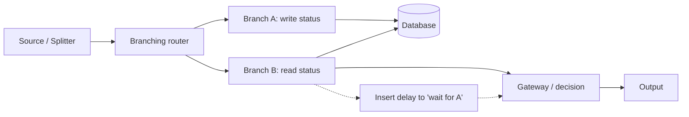
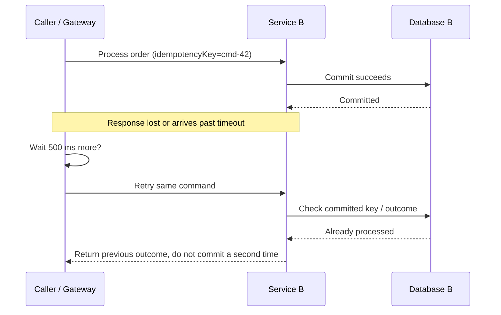

# Do not use delay to mask race conditions

In the **Delay** chapter of **SPRING_INTEGRATION_PATTERN**, Delayer is a useful Enterprise Integration Pattern when the application **intentionally wants to delay forwarding a message**. However, developers sometimes add `delay(500 ms)`, `Thread.sleep(1000)`, or increase timeouts just to "wait for the other service to finish writing data". This approach can make errors temporarily disappear during trial runs, while **the race condition remains intact** and will resurface under higher load, slower machines, retries, restarts, or multiple instances.

The lesson **"Do not use delay to mask race conditions"** explains the difference between wait durations and synchronization relationships, shows examples across Router, Filter, Transformer, Splitter, Aggregator, Gateway, retry, error channel, and correlation flows, and demonstrates how to replace "sleep a little longer" with **data invariants, coordination, transactions, idempotency, and controlled concurrency testing**.

> **Remember from the start:** Delay can change **when** an operation is executed; it **does not by itself establish a guarantee that another operation has completed**. If correctness depends on B occurring after A, model and verify that relationship rather than guessing milliseconds.

## 1. Delay and race conditions are two different concepts

### 1.1. What does delay do?

In Spring Integration, **Delayer** holds a message to forward it after a delay interval or at a configured timestamp. It serves needs such as:

- Delaying sending a notification for a specified interval.
- Waiting until a valid business processing window.
- Deferring processing according to policy, e.g., avoiding acting too early.
- Moving a message to the next stage after a precomputed scheduled mark.

A Delayer may require a scheduler and a mechanism to store pending messages. **Actual trigger timing is affected by the scheduler, system load, and the store**, so it is not a real-time clock guaranteeing execution at one exact millisecond.

### 1.2. What is a race condition?

A *race condition* arises when a program's correctness depends on **the relative ordering or uncontrolled interleaving of concurrent operations**. For example, two consumers simultaneously read inventory showing 1 item left, both assume they can reserve it, and both decrement stock.

```text
Initial stock = 1

Worker A                    Worker B
--------                    --------
read stock -> 1             read stock -> 1
"in stock"                  "in stock"
write stock = 0             write stock = 0
record reservation A        record reservation B

Result: two orders confirmed reserving the same single unit of stock.
```

Here, "adding 500 ms before B's operation" might make B arrive after A in one run, but **does not prove** the result is always right: under heavy load A could take longer than 500 ms, or another worker C could also read stock simultaneously.

### 1.3. Guarantees to distinguish

| Mechanism | What does it provide? | What it does not automatically guarantee |
| --- | --- | --- |
| `Thread.sleep` | Current thread pauses for at least roughly the requested duration per OS scheduler | Another thread has finished, memory visibility, transaction committed |
| Spring Integration Delayer | Message is forwarded after the configured delay | Other business conditions are true, race conditions eliminated |
| Retry with backoff | Delays **between retry attempts** after failure | Operation is safe when invoked repeatedly, previous request certainly didn't succeed |
| Lock / atomic operation | Contending operations are coordinated within the lock's scope | Atomicity across other services/DBs if the lock is JVM-local only |
| Transaction / unique constraint | Protects invariants inside database boundaries | Automatic exactly-once across external brokers/APIs |
| Version/CAS | Updates only when state/version still matches | Entire workflow is automatically ordered |
| Resequencer | Releases messages by sequence metadata and release strategy | Commit order at downstream consumers if still processed in parallel |
| Verified ACK/response | Evidence that a specific stage received/executed the step | All external systems have reached final state |

**A time interval is not a synchronization event.** In the Java Memory Model, `Thread.sleep` itself establishes no *happens-before* relationship proving another thread has finished writing and its values are visible. Synchronization primitives, volatile/atomics, Future completion, or transactions must be used appropriately for the state being protected.

## 2. Why does "sleeping a bit longer" seem to work?

A common mistake in development environments:

```java
// ANTI-PATTERN example: do not use for business synchronization.
sendOrderToAnotherService(orderId);

Thread.sleep(500);

OrderStatus status = queryOrderStatus(orderId);
assert status == OrderStatus.READY;
```

`sleep` cannot answer the question "has that other service finished processing?". It merely lowers the chance of querying too early **under certain conditions**. The outcome depends on network latency, schedulers, GC, transactions, queues, retries, and load on the other service.

A scenario that can happen:

```text
T=0 ms      A sends order creation event.
T=50 ms     B receives event, starts processing.
T=500 ms    A finishes delay, reads status.
T=750 ms    B finishes committing.

→ A still reads the old status despite "waiting 500 ms".
```

Increasing the delay to 2 seconds may make the failure rarer, but never eliminates it. Meanwhile every request waits longer, throughput drops, and p95/p99 latency climbs.

Reasons the bug comes back:

1. **Varying load:** the same operation can take 20 ms or several seconds.
2. **Multiple instances:** a wait in instance A does not lock B or C.
3. **Retries:** the previous call may have succeeded even though the response was lost.
4. **Uncommitted transactions:** the handler ran, but data is not yet visible at the read boundary.
5. **Reordered messages:** Delayer only shifts one message's time; another message can still overtake it.
6. **CI test environments:** slower hosts or CPU contention cause `sleep` tests to pass locally and fail on CI.

## 3. Where do races appear in Spring Integration flows?



For example, a Router sends two messages to two branches:

- Branch A updates payment status to `PAID`.
- Branch B reads payment status to send a shipping notification.

If the two branches are independent, B can run before A commits. Adding a Delayer in branch B **does not bind** B to A's transaction. A sounder design is **emitting a `PaymentCommitted` event after the write commits**, and having the shipping branch consume that event.

Common risk points:

| Pattern / component | Possible race | Invariant-based solution |
| --- | --- | --- |
| Router / Publish–Subscribe | Two independent branches act on the same entity | Define dependencies, post-commit events, transactions, or locks |
| Splitter + parallel processing | Two parts update the same total or slot | Atomic update, key-based partitioning, optimistic locking |
| Filter | Filtering decision based on stale state | Check condition right at the commit/transaction point |
| Transformer | Reading shared mutable state without synchronization | Immutable payloads or synchronized/unshared data |
| Aggregator | Same group receives multiple parts concurrently or near expiry | Properly coordinated MessageGroupStore and release/cleanup, race tests |
| Resequencer | Out-of-order arrivals, duplicates, and late arrivals | Sequence metadata, idempotency, release policy |
| Gateway | Client retries on response timeout even though server committed | Idempotency key and outcome verification |
| Retry / error channel | Retry and recovery both mutate the same record | State machine, claim/lease, transactions, and terminal states |
| Control Bus | Stopping/starting endpoints while messages are in flight | Lifecycle policy, drain/ack, and state verification |

Putting `delay(1000)` in front of every branch **does not replace** the mechanisms above.

## 4. Broken example: check-then-update without atomicity

Suppose a reservation service starts with stock equal to 1:

```java
// Intentionally broken model to explain check-then-act race.
// Do not use in production.
final class UnsafeStock {
    private int available = 1;

    boolean reserveOne() {
        if (available > 0) {
            available = available - 1;
            return true;
        }
        return false;
    }

    int remaining() {
        return available;
    }
}
```

Two threads can both read `available > 0` before either writes the new value. Both can return `true`. Adding `Thread.sleep(50)` in one thread only shifts the bug to a different schedule, without fixing the non-atomic *check-then-act* operation.

**Note:** There is no guarantee that a random two-thread test will always reproduce a race. Conversely, a test that "passes 100 times" **does not prove code is safe**. Inspect and protect invariants with the right primitives, then design controlled concurrency tests.

### 4.1. Fix: atomic operations within the same JVM

For a state variable used only inside **one Java process**, `AtomicInteger.compareAndSet` can be used:

```java
import java.util.concurrent.atomic.AtomicInteger;

public final class AtomicStock {
    private final AtomicInteger available;

    public AtomicStock(int initial) {
        if (initial < 0) {
            throw new IllegalArgumentException("Negative stock");
        }
        this.available = new AtomicInteger(initial);
    }

    public boolean reserveOne() {
        while (true) {
            int current = available.get();
            if (current == 0) {
                return false;
            }
            if (available.compareAndSet(current, current - 1)) {
                return true;
            }
            // Another thread just modified it; read and retry.
        }
    }

    public int remaining() {
        return available.get();
    }
}
```

Invariant to maintain: quantity is **non-negative**, and a single unit of inventory must not be allocated to two requests. Compare-and-set makes checking quantity and updating it a single atomic decision for this variable.

**Limitation:** `AtomicInteger` only protects a value within one JVM. If inventory lives in a database and two instances process concurrently, each holding its own `AtomicInteger` can still oversell. Move the atomicity boundary to the **shared data source**.

### 4.2. With multiple instances: conditional update in the database

An SQL pattern expressing a more atomic operation than "SELECT then UPDATE":

```sql
-- Structural example; table/column names depend on schema.
UPDATE inventory
SET available = available - 1
WHERE sku = :sku
  AND available >= 1;
```

The handler must check **the number of rows actually updated**:

- `1` row: reservation may proceed per transaction and contract.
- `0` rows: out of stock or invalid key; must not report reservation success.

If business logic also needs to insert a reservation record, protect **the entire invariant** inside an appropriate transaction, combined with an idempotency key so retries do not decrement a second time. The SQL statement above **alone** does not solve clients resending the same request or writing data across external systems.

### 4.3. Correctness with optimistic locking

With an entity having a `version` column, concurrent updates can be controlled:

```sql
UPDATE orders
SET status = 'PAID',
    version = version + 1
WHERE id = :orderId
  AND version = :expectedVersion
  AND status = 'AWAITING_PAYMENT';
```

Two handlers reading the same old version cannot both succeed under this condition. A handler receiving `0` updated rows must **re-read the state and decide**: was the request already performed earlier, is there a conflict, or should it retry? Never retry indefinitely on a stale version.

## 5. Testing concurrency: use synchronization barriers instead of sleeping

A test using `Thread.sleep(500)` to "let the other thread finish" is usually both slow and flaky. With `AtomicStock`, you can let two workers prepare, then **start them together** using `CountDownLatch`:

```java
import static org.junit.jupiter.api.Assertions.*;

import java.util.concurrent.Callable;
import java.util.concurrent.CountDownLatch;
import java.util.concurrent.ExecutorService;
import java.util.concurrent.Executors;
import java.util.concurrent.Future;
import java.util.concurrent.TimeUnit;
import org.junit.jupiter.api.Test;

class AtomicStockTest {

    @Test
    void onlyOneWorkerCanReserveLastUnit() throws Exception {
        AtomicStock stock = new AtomicStock(1);
        CountDownLatch ready = new CountDownLatch(2);
        CountDownLatch start = new CountDownLatch(1);
        ExecutorService pool = Executors.newFixedThreadPool(2);

        Callable<Boolean> task = () -> {
            ready.countDown();
            if (!start.await(2, TimeUnit.SECONDS)) {
                throw new IllegalStateException("Start was not signaled");
            }
            return stock.reserveOne();
        };

        try {
            Future<Boolean> first = pool.submit(task);
            Future<Boolean> second = pool.submit(task);

            assertTrue(ready.await(2, TimeUnit.SECONDS));
            start.countDown();

            int successes = (first.get(2, TimeUnit.SECONDS) ? 1 : 0)
                    + (second.get(2, TimeUnit.SECONDS) ? 1 : 0);

            assertEquals(1, successes);
            assertEquals(0, stock.remaining());
        }
        finally {
            start.countDown(); // Avoid leaving threads waiting if assertion fails.
            pool.shutdownNow();
            assertTrue(pool.awaitTermination(2, TimeUnit.SECONDS));
        }
    }
}
```

Advantages of this test:

1. **Clear synchronization point:** only lets workers start once both are ready.
2. **Checks final invariant:** successful reservations equal 1, remaining stock equals 0.
3. **Finite timeouts:** never hangs CI indefinitely if a task stalls.
4. **Resource cleanup:** shuts down the executor in `finally`.

One technical note: a latch makes two threads start close together, **not forcing every `get()/compareAndSet()` operation to interleave in one fixed schedule**. To reproduce a very specific bug, inject barriers at read/write points in controlled test code or use specialized concurrency testing tools; never leave debug barriers in production code.

## 6. Shifting from "wait until done" to "know for sure it is done"

Many situations are not contention over updating one variable, but **a missing causal relationship between two tasks**. Choose a mechanism based on what you need to wait for:

| What should B wait for? | Appropriate mechanism | Why better than delay |
| --- | --- | --- |
| A `Future` actually completes | `CompletableFuture.thenCompose`/`join` with proper timeout | B depends on a completion signal, not guessing time |
| A group of tasks all complete | `CountDownLatch` / `Phaser` (within JVM) | Explicit synchronization condition |
| A database change has committed | Transaction boundary + post-commit event/outbox | Downstream does not rely on uncommitted data |
| An object reaches a new version | Conditional write, bounded polling with deadline, and version check | Checks the real condition after each attempt |
| Messages arrive out of order | Resequencer with proper correlation/sequence | Restores order by data, not arrival time |
| A command in an external service is processed | Correlation ID, confirmation response/event, status query | Distinguishes success, failure, and unknown outcome |
| A task can be safely retried | Retry with backoff **and** idempotency key | Backoff only paces retries; idempotency preserves correctness |
| A message group is eligible for release | Aggregator/release strategy per contract | Condition based on data, not merely "waited long enough" |

### 6.1. Example: depending on completion rather than sleeping

```java
import java.util.concurrent.CompletableFuture;
import java.util.concurrent.TimeUnit;

public final class AfterCommitCoordinator {

    public CompletableFuture<String> processAfterCommit(
            CompletableFuture<String> committedOrderId) {

        // committedOrderId must genuinely represent a completed commit,
        // not merely that a queue/handler accepted the request.
        return committedOrderId.thenApply(orderId ->
                "Order " + orderId + " can now be published");
    }

    public String awaitResult(
            CompletableFuture<String> result) throws Exception {
        return result.get(3, TimeUnit.SECONDS);
    }
}
```

This is a **single-JVM synchronization** example. If `committedOrderId` is completed **before the database commits**, using a Future still won't fix the mistake. The completion signal must accurately reflect **the business event B depends on**.

When two services communicate via a broker, you may need an `OrderCommitted` event published via an outbox after the transaction succeeds, rather than relying on an internal Future inside the publishing service.

## 7. When should Spring Integration Delayer be used?

Delayer is suitable when **delaying itself is a requirement**, such as a notification that must not be sent before a scheduled timestamp, a scheduled reminder, or a load-spacing policy. It is unsuitable for proving that another independent operation has occurred.

### 7.1. Illustrative Java DSL example

```java
import org.springframework.context.annotation.Bean;
import org.springframework.context.annotation.Configuration;
import org.springframework.integration.dsl.IntegrationFlow;

@Configuration
public class NotificationDelayFlow {

    @Bean
    IntegrationFlow delayedNotifications() {
        return IntegrationFlow.from("acceptedNotifications")
                .delay("notificationDelayGroup",
                        spec -> spec.defaultDelay(1_000L))
                .channel("notificationsDue")
                .get();
    }
}
```

The example expresses **a delay defined in the notification delivery contract**; it does not verify that an order committed, payment was authorized, or another worker finished running. Scheduler, store, timeout, and release configuration must be verified for your Spring Integration version and specific recovery requirements.

If the requirement is "only send after payment commits", a sounder design is letting **the commit confirmation event** trigger the notification flow. You can place a Delayer *after the commit event* to defer the notification by an extra minute if that is a business rule.

### 7.2. Delay does not replace a full rate limiter or backpressure

Spacing each message by a fixed duration can reduce burstiness in some setups, but it does not automatically cap concurrency, pending message count, or total throughput across multiple instances.

If downstream is overloaded, use solutions suited to the goal: bounded queues, consumer concurrency limits, rate limiters, backpressure, circuit breakers, retry/backoff, and controlled rejection or deferral. Pushing more messages into Delayer's store may simply relocate the backlog.

## 8. Race conditions in retry and Gateway

A very common race does not involve multiple threads reading one variable, but rather **execution results and responses drifting apart**:



Here, adding `delay` **does not tell the caller** whether the first attempt committed. A stable idempotency key and outcome lookup mechanism are required. If an external operation does not support idempotency, design an `UNKNOWN` state/reconciliation or compensation; never blindly retry when duplicate effects could occur.

Some rules:

- `retry backoff` helps prevent traffic piles and gives systems time to recover, **but does not provide atomicity**.
- `errorChannel` can capture errors depending on dispatch mechanics; it **does not prove** external system operations rolled back.
- When using DLQ and replay, the same command must still carry **the original idempotency key**.
- Prevent two processes (a retry worker and a recovery worker) from both committing a final result by using conditional state transitions/appropriate locking.

## 9. Race conditions when Resequencer and Aggregator process groups

If a group needs three parts, arrival order might be `3, 1, 2`. For a Resequencer, that is valid out-of-order input; for an Aggregator, each part contributes to a group result. Riskier scenarios:

| Scenario | Potential consequence | What to test |
| --- | --- | --- |
| Final part arrives right at group timeout | Group may be processed by two competing paths | Only one final result per contract |
| Duplicate `#2` arrives concurrently | Same slot processed twice | Deduplication/idempotency per slot |
| Group released then receives late arrival | New batch mistakenly created or second result emitted | Lifecycle/retention and late-arrival policy |
| Two instances process one group simultaneously | Store or release contention | Store/transaction/locking coordination |
| Splitter/Filter drops one part | Group waits forever if sequence is incomplete | Valid skip/reindex, clear expiry/recovery |

**Do not add a delay at the Resequencer input to "wait for earlier parts".** Correlation, sequence metadata, release strategy, and `MessageGroupStore` are the mechanisms responsible for ordering correctness. If metadata or group contracts are wrong, waiting longer will not fix them.

In tests, generate missing/duplicate/late messages on an intentional schedule, rather than just adding `Thread.sleep` in each worker. Specifically check final state in the store and downstream to detect duplicate emissions.

## 10. Testing races in Spring Integration flows

A multi-layered testing strategy:

1. **Unit tests** for atomicity and state machine rules.
2. **Integration tests** with real channels, handlers, Gateways, and retries.
3. **Database tests** with separate transactions and faults at commit boundaries.
4. **Broker tests** simulating ACK failures, redeliveries, and DLQ replays.
5. **Multi-instance tests** for two processes concurrently touching the same key.
6. **End-to-end tests** confirming side effects and commit ordering.

### 10.1. Testing "event arrives before data commits"

Suppose a handler updates the database and emits `OrderReady`. Create conditions where the consumer receives the event **while the writer's transaction has not yet committed**:

```text
T1: Writer starts transaction to update order.
T2: Writer publishes event to broker (wrong boundary).
T3: Reader receives event and queries database, sees old state.
T4: Writer commits.

If adding delay to reader:
  Reader may read after T4 on this run.
  But does not prove T4 always occurs before reader.

Proper design:
  Write business state + outbox in the same transaction.
  Publisher only sends committed events to broker.
  Consumer has idempotency and safe retry handling.
```

The test should introduce a controlled pause **before commit** (e.g., a test hook or barrier in test code), then verify the consumer **never observes an event claiming commit** before the state is genuinely durable.

### 10.2. Testing order after async channels

A Resequencer may emit `#1` then `#2` in order, yet a downstream `ExecutorChannel` runs two workers concurrently and causes `#2` to commit before `#1`. No amount of fixed delay guarantees that won't happen under all loads.

Tests must clearly distinguish:

- **Emission order:** measured immediately after Resequencer.
- **Commit order:** measured at the database/API or final state ledger.
- **Business requirement:** is sequential commit per `correlationId` required?

If required, create sequential lanes per group or enforce expected versions at the datastore. Do not equate `QueueChannel` receiving messages in order with multiple consumers processing them in order.

### 10.3. Injecting faults at dangerous boundaries

| Fault injected in test | What must be asserted |
| --- | --- |
| Worker slower than expected delay | Flow remains correct without relying on guessed timings |
| Commit fails after event was created | Event is not falsely published, or recovery handles it |
| Commit succeeds but response is lost | Retry does not produce a second side effect |
| ACK fails after processing | Redelivery is idempotent |
| Two consumers update the same old version | One operation succeeds, the other retries/reconciles |
| Timer expiry and final message occur simultaneously | Two final results are never emitted |
| Restart between delay and release time | Durability matches chosen store/scheduler |
| Late part arrives from DLQ | Does not reopen batch in violation of contract |

## 11. Measure and alert instead of hiding bugs

Useful metrics/traces should reflect **causes**, not just average latency:

| Signal | What does it detect? |
| --- | --- |
| `optimisticLockConflictCount` | Two tasks attempting to update the same version |
| `idempotencyDuplicateCount` | Same command/event resent |
| `retryAttemptCount` | Retry rate and attempt count |
| `unknownOutcomeCount` | Caller unsure whether external system committed |
| `outboxPendingAge` | Event committed but not yet published |
| `groupTimeoutCount` | Aggregator/Resequencer stuck or missing parts |
| `lateArrivalCount` | Message arriving after completion/expiry |
| `delayerPendingCount` | Number of messages waiting in delay mechanism |
| `commitOrderViolationCount` | Side effects committed out of business order |
| `transactionConflictRate` | Database contention pressure |

The names above are **suggested metrics for the application to instrument**, not default names automatically emitted by Spring Integration. Avoid turning `correlationId` or `orderId` into high-cardinality metric labels; use them in logs/traces/audit tables to investigate individual cases.

When a team wants to "increase the delay to 2 seconds because it fails occasionally", demand the following evidence:

1. **Which invariant is being violated?** For example, order emitted before state committed.
2. **Which two actions are racing?** Which thread/service/instance do A and B belong to?
3. **Which observation point proves A is done?** Commit, ACK, confirmation event, version increment, or Future completion?
4. **Which data boundary needs protection?** JVM, database, broker, or external API?
5. **Which test reproduces it when delay is removed?** Use latches/barriers/fault injection instead of random waiting.
6. **After fixing, what proves correctness?** Invariants, committed state logs, idempotent outcomes, and multi-round tests.

## 12. Checklist to avoid misusing delay

1. **Separate timing requirements from data dependencies.** If "wait because the contract specifies sending after 1 minute", Delayer may be right; if "wait so another service finishes", you need a confirmation mechanism.
2. **Never treat `Thread.sleep` as synchronization.** In Java, use Futures, latches, locks, atomics, or events at the appropriate scope.
3. **Place atomicity at the source of truth.** Multiple instances need database transactions, locks, or conditional updates, not single-JVM locks.
4. **Design invariants and state machines.** Define which state transitions are legal and who has authority to commit.
5. **Preserve idempotency across retries.** The same command must keep a stable key to prevent duplicate effects when responses are lost.
6. **Separate release order from commit order.** Resequencer does not automatically ensure downstream workers finish sequentially.
7. **Handle partials, timeouts, and late arrivals.** More delay cannot fix missing messages, expired groups, or bad metadata.
8. **Publish post-commit events with a durable protocol.** Use appropriate outbox/transactions when bridging DB and broker.
9. **Write controlled concurrency tests.** Use barriers/latches, separate transactions, faults around commit/ACK, and finite timeouts.
10. **Do not use delay to handle unbounded overload.** Use bounded queues, concurrency limits, and backpressure.
11. **Track causal signals.** Metrics on retries, conflicts, timeouts, late arrivals, and transaction health are more useful than simply increasing wait durations.
12. **Reserve Delayer for requirements that genuinely need delaying.** When using it, still test the scheduler, persistence, and restart recovery.

## 13. Self-assessment questions

**Question 1:** If adding `Thread.sleep(1000)` makes a test run more stably, can we conclude the race is fixed?

**No.** Fewer test failures do not create a synchronization invariant. When load or thread scheduling changes, the race can reappear.

**Question 2:** Can a Delayer guarantee payment has committed before `OrderShipped` is emitted?

**Not by wait duration alone.** There must be a verified payment-committed event/condition, or a status check via an appropriate protocol; Delayer can only add a wait **after** that condition if business rules require it.

**Question 3:** Is `AtomicInteger` enough to protect inventory when there are three application instances?

**Not enough.** Each JVM has its own variable. Protect inventory state at the shared data source using transactions/conditional updates and idempotency.

**Question 4:** Why doesn't retry with backoff eliminate duplicate side effects?

**Because** the first attempt may have committed while the response was lost. Backoff only changes when the resend occurs; idempotency keys and outcome checks prevent executing the same command twice.

**Question 5:** Resequencer emitted `#1` then `#2`, so is the database guaranteed to commit in that order?

**No.** If asynchronous workers follow, `#2` can commit first. Verify ordering at the database and design sequential processing per group or version checks if required.

**Conclusion:** Delay is a tool for **controlling when a message is forwarded**. A race condition is a bug of **missing guarantees on causal ordering, shared state, or atomicity**. Simply increasing milliseconds usually hides symptoms and slows the system down. In Spring Integration, use Delayer for intentional deadlines, and use properly scoped synchronization, post-commit events, idempotency, contract-driven Resequencer/Aggregator, transactions, and concurrency testing to solve flow correctness at the root.
