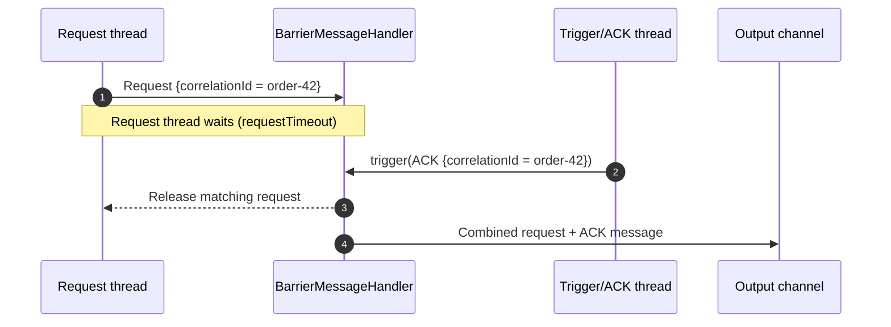

# Barrier Waiting for Messages to Meet Synchronization Conditions

## 1. Problem: A Flow Has Sent a Request but Is Not Yet Allowed to Proceed

In an integration system, a message may have already been successfully sent to the next component, yet the business process still requires **an independent confirmation event** before completing. For example: an API receives an order creation request, sends a command to a message broker, and only returns an "accepted" response when it receives the corresponding confirmation signal. Proceeding immediately after the send operation may cause the system to respond too early; writing a custom status-polling loop makes the flow hard to control.

Within **SPRING_INTEGRATION_PATTERN**, we learn *Enterprise Integration Patterns* with Spring Integration to build loosely coupled, extensible message flows. Alongside Router, Filter, Transformer, Splitter, Aggregator, Gateway, retry, error channel, and correlation, **Thread Barrier** specifically solves the problem: **pausing a processing flow until a trigger message matching a correlation condition arrives, or until a timeout expires**.

A Barrier in Spring Integration does not merely check "whether the payload is valid." It coordinates two asynchronous points in time:

- **Request message**: the message entering the Barrier that needs to wait.
- **Trigger message**: the message signaling that the corresponding request can be released.
- **Correlation key**: the key identifying which trigger belongs to which request, usually taken from the `correlationId` header.

Only when the request and trigger have the **same correlation key** does the Barrier produce an output message. "Meeting the synchronization condition" here primarily means **matching the right request–trigger pair**, rather than waiting for an arbitrary number of messages.

## 2. How It Works

Spring Integration provides `BarrierMessageHandler`, which implements `MessageTriggerAction`. When a request enters the handler, the thread processing the request pauses for at most `requestTimeout` milliseconds. Another thread calling `trigger(message)` with the same correlation key wakes up the request. If the trigger arrives before the request, **the thread calling trigger may also be blocked** for at most `triggerTimeout` waiting for the request to arrive.



**Main steps:**

1. An upstream component attaches a business-meaningful correlation key to the request, such as `order-42`, and sends it to the Barrier's `input-channel`.
2. The handler stores the waiting state under that key and holds the request thread within the timeout limit.
3. The system receives an ACK or business event from another processing path, converts it into a trigger with the same correlation key, and calls `trigger()`.
4. When pairing succeeds, the Barrier processes both messages using a `MessageGroupProcessor` and sends the result to `output-channel`.
5. When the wait expires, the Barrier handles the timeout branch instead of holding the thread indefinitely.

By default, `CorrelationStrategy` uses `IntegrationMessageHeaderAccessor.CORRELATION_ID`; `DefaultAggregatingMessageGroupProcessor` creates an output payload of type `Collection<?>` containing **two payloads** (request and trigger), while aggregating headers. If the business logic only wants to emit a confirmation DTO, you must configure a custom `MessageGroupProcessor` or a Transformer after the Barrier; you should not assume the output payload can be cast directly to the request's type.

### Both Arrival Orders Must Be Designed For

| Scenario | Important behavior |
| --- | --- |
| Request arrives first, matching trigger arrives within `requestTimeout` | The request thread is released; the message proceeds to output. |
| Trigger arrives first, matching request arrives within `triggerTimeout` | The trigger thread may wait; when the request arrives, the pair is processed. |
| Trigger has a different correlation key | It does **not** release the waiting request; each key pursues its own pair. |
| Request exceeds `requestTimeout` | No successful output; `requiresReply=false` (default) returns `null` and ends the flow, whereas `true` throws `ReplyRequiredException`. |
| Trigger arrives very late or waits past request timeout | The trigger can be routed to `discard-channel` for tracking/handling. |
| Two concurrent requests with the same correlation key | The Barrier does not allow two request threads to wait concurrently on the same key; the second request raises an exception. |

**Common misconception:** `requestTimeout` is not the maximum duration of the entire process across all layers; it is the time the request thread waits at the Barrier. Beyond it, there are timeouts at the API Gateway/HTTP layer, broker, RPC, queues, and other stages. When configuring, all timeouts must be balanced holistically.

## 3. Java Configuration with Spring Integration

The example below uses `DirectChannel` for the two input paths and `QueueChannel` so the output can be read in the exercise. Two different timeouts highlight the risk when a trigger arrives first. This configuration is for an application already using `spring-integration-core` (or Spring Boot with the appropriate Spring Integration dependency).

```java
import org.springframework.beans.factory.annotation.Qualifier;
import org.springframework.context.annotation.Bean;
import org.springframework.context.annotation.Configuration;
import org.springframework.integration.annotation.ServiceActivator;
import org.springframework.integration.aggregator.BarrierMessageHandler;
import org.springframework.integration.channel.DirectChannel;
import org.springframework.integration.channel.QueueChannel;
import org.springframework.integration.config.EnableIntegration;
import org.springframework.messaging.MessageChannel;
import org.springframework.messaging.MessageHandler;

@Configuration
@EnableIntegration
public class BarrierConfiguration {

    @Bean
    public MessageChannel barrierRequests() {
        return new DirectChannel();
    }

    @Bean
    public MessageChannel barrierTriggers() {
        return new DirectChannel();
    }

    @Bean
    public QueueChannel barrierResults() {
        return new QueueChannel();
    }

    @Bean
    public QueueChannel lateTriggers() {
        return new QueueChannel();
    }

    @Bean
    @ServiceActivator(inputChannel = "barrierRequests")
    public BarrierMessageHandler awaitConfirmation(
            @Qualifier("barrierResults") MessageChannel results,
            @Qualifier("lateTriggers") MessageChannel discarded) {
        // Request waits at most 5 seconds; early-arriving trigger waits 2 seconds.
        BarrierMessageHandler handler = new BarrierMessageHandler(5_000L, 2_000L);
        handler.setOutputChannel(results);
        handler.setDiscardChannel(discarded);
        handler.setRequiresReply(true);
        return handler;
    }

    @Bean
    @ServiceActivator(inputChannel = "barrierTriggers")
    public MessageHandler releaseOnConfirmation(BarrierMessageHandler awaitConfirmation) {
        return awaitConfirmation::trigger;
    }
}
```

Here, `@ServiceActivator(inputChannel = "barrierRequests")` feeds requests into the Barrier. `releaseOnConfirmation` is the adapter for the trigger path: it invokes `trigger(message)` on the **exact same `BarrierMessageHandler` instance**. This is the crucial point; simply sending an ACK to an ordinary channel without a handler forwarding it to `trigger()` will not release the Barrier.

Because `DirectChannel` by default runs the handler on the thread calling `send()`, sending a request directly on an HTTP serving thread can occupy that thread for the entire wait duration. In the next example, we use a dedicated executor for the request to clearly show two independent execution streams.

### Sending a Request and ACK with the Same Correlation ID

After registering `BarrierConfiguration` in the Spring context, a snippet using the beans above can be written as follows:

```java
import java.util.concurrent.ExecutorService;
import java.util.concurrent.Executors;
import java.util.concurrent.Future;
import org.springframework.beans.factory.annotation.Qualifier;
import org.springframework.integration.channel.QueueChannel;
import org.springframework.integration.IntegrationMessageHeaderAccessor;
import org.springframework.integration.support.MessageBuilder;
import org.springframework.messaging.Message;
import org.springframework.messaging.MessageChannel;
import org.springframework.stereotype.Component;

@Component
public class BarrierDemo {
    private final MessageChannel requests;
    private final MessageChannel triggers;
    private final QueueChannel results;

    public BarrierDemo(
            @Qualifier("barrierRequests") MessageChannel requests,
            @Qualifier("barrierTriggers") MessageChannel triggers,
            @Qualifier("barrierResults") QueueChannel results) {
        this.requests = requests;
        this.triggers = triggers;
        this.results = results;
    }

    public Message<?> runDemo(String orderId) throws Exception {
        Message<String> command = MessageBuilder.withPayload("PUBLISH_ORDER")
                .setHeader(IntegrationMessageHeaderAccessor.CORRELATION_ID, orderId)
                .build();
        Message<String> ack = MessageBuilder.withPayload("BROKER_ACK")
                .setHeader(IntegrationMessageHeaderAccessor.CORRELATION_ID, orderId)
                .build();

        ExecutorService workers = Executors.newSingleThreadExecutor();
        try {
            // Background thread enters the Barrier and may block while waiting for the ACK.
            Future<?> pendingSend = workers.submit(() -> requests.send(command));

            // In practice, the ACK usually comes through an independent inbound adapter/callback.
            // If the ACK arrives before the request, the trigger can wait up to 2 seconds.
            triggers.send(ack);

            Message<?> released = results.receive(5_000L);
            if (released == null) {
                throw new IllegalStateException("Synchronization result not found");
            }
            pendingSend.get(); // Also observe errors if the request branch fails.
            return released;
        } finally {
            workers.shutdownNow();
        }
    }
}
```

`BarrierDemo` is a demonstration component that can be injected/called in a Spring application containing `BarrierConfiguration`. Run the example with a unique `orderId` per invocation; when writing concurrent tests, separate result storage by correlation key to avoid reading the wrong item from the same `QueueChannel`. In a real system, the trigger source is typically an inbound flow receiving callbacks/ACKs from a broker, webhook, or another processor. Both the request and the ACK must preserve the same key across message transformations and routing.

`MessageChannel.send()` returns the status of **sending to the channel**, which does not mean the business ACK has arrived. Success must be determined from the message in `barrierResults`, not inferred from the boolean return value of `send()`.

### Customizing Correlation When the System Uses a Different Key

If both branches use an `orderId` header instead of `correlationId`, you can configure the handler for that header:

```java
import org.springframework.integration.aggregator.HeaderAttributeCorrelationStrategy;

BarrierMessageHandler handler = new BarrierMessageHandler(
        5_000L,
        2_000L,
        new HeaderAttributeCorrelationStrategy("orderId"));
```

Replace the corresponding constructor in the `awaitConfirmation` bean and attach the `orderId` header on **both messages**. You should not use each message's `message.getId()` as the pairing key because the request and ACK are created independently and have different IDs. The correlation key must be non-`null`, stable, and consistent across steps.

## 4. When Is Barrier Appropriate, and When Is It Not?

| Component | Primary decision | Appropriate when |
| --- | --- | --- |
| **Filter** | Should the message proceed based on a predicate? | Blocking messages that fail content rules. |
| **Router** | Which branch should the message be routed to? | Dispatching flows by event type, status, or tenant. |
| **Aggregator** | Have enough messages for a group been collected? | Waiting for N results or a release strategy across multiple parts. |
| **Barrier (Thread Barrier)** | Has a trigger matching the waiting request appeared? | Needing to bridge a synchronous step with an asynchronous confirmation event. |
| **Gateway** | How does the caller invoke/receive results from an integration flow? | Needing a request–reply interface; can be combined with Barrier. |

Barrier **holds a thread** during the wait, so it is suited for short interactions with bounded concurrency and clear deadlines. If you need to wait for minutes or hours, handle very high concurrency, or preserve state across restarts or multiple instances, consider an asynchronous model with persistent state storage (such as a database and callbacks/events) instead of holding a request thread at a Barrier.

Do not use the same correlation ID for two requests waiting concurrently. An ID may be reused in **different rounds** after the previous pair completes, though in practice a unique key per request attempt is safer, especially when the broker may redeliver ACKs.

## 5. Timeouts, Errors, and Late Messages

A scalable integration flow must explicitly define failure branches as well:

1. **Request timeout:** set `requestTimeout` according to the SLA. `setRequiresReply(true)` turns a missing ACK into a `ReplyRequiredException` so callers and error handlers can detect it. With the default `false`, the handler returns `null` and the flow stops there; if a Gateway sits upstream, design the Gateway's timeout as well.
2. **Trigger timeout:** set `triggerTimeout` long enough for cases where the ACK arrives early before the request enters the Barrier. Because calling `trigger()` can also block, avoid using a high-throughput listener thread to wait for long; offload to an appropriate executor if needed.
3. **Late/unmatched trigger:** configure `discard-channel` and consume that channel in a real application to record late events, update metrics, or trigger compensation. `QueueChannel` in the example is only for observation.
4. **Incorrect/missing correlation:** verify that every message passing through a Transformer, Router, or bridge preserves the required header; if using a custom strategy, standardize the key name and type.
5. **Duplicate messages:** implement idempotency and duplicate-ACK detection at the integration boundary. Barrier does not replace deduplication or broker delivery guarantees.
6. **Exceptions:** with synchronous channels like `DirectChannel`, exceptions can propagate back to the calling thread; for asynchronous entry points, configure an `errorChannel` / error flow to log and retry according to business rules. Retrying a command send does not mean you may create multiple requests waiting on the same correlation ID.

Example timeline when the request deadline is 5 seconds:

```text
t=0s    Request(order-42) arrives at Barrier -> waits
t=2s    Trigger(order-99) arrives            -> does not release order-42
t=5s    Request(order-42) times out          -> error branch, no successful output
t=7s    Trigger(order-42) arrives late       -> cannot revive the expired request
```

Do not assume arrival order between the two branches, and do not confuse "ACK emitted" with "ACK passed into `trigger()`." In multi-instance environments, ensure the request and trigger reach the same coordination mechanism; a local in-JVM Barrier does not automatically share state across instances.

## 6. Testing and Observing Each Branch

To test a Barrier, send the two flows on independent threads and use a finite timeout when reading output. Minimum test cases to include:

| Test case | Data | Expected result |
| --- | --- | --- |
| Valid match | Request and ACK both have `order-42` | One result on `barrierResults`, containing data from both sides. |
| Trigger arrives first | ACK `order-42` arrives before request within `triggerTimeout` | Still pairs successfully; does not hang indefinitely. |
| Wrong key | Request `order-42`, trigger `order-99` | Does not release request `order-42`. |
| Missing ACK | Request only | Exceeds `requestTimeout`; with `requiresReply=true`, receives an exception. |
| Late ACK | ACK appears after request has timed out | Does not produce a successful result for the old request; observe discard path if configured. |
| Duplicate request key | Two concurrent requests with the same `correlationId` | Exception on the second arriving request, preventing two threads from waiting on the same key. |

When testing timeouts, use `Future` / executors, `CountDownLatch`, or appropriate synchronization tools to control timing, avoiding reliance on `Thread.sleep()` and overly tight timing assertions. Always shut down executors after tests.

In production, attach `correlationId`, flow name, event type, pairing outcome, wait duration, and timeout cause to logs/traces; monitor the number of waiting requests, average wait time, timeout rate, and discarded trigger count. Log only necessary fields; order payloads or personal information may contain sensitive data. In multi-branch flows, these metrics help distinguish "ACK not received yet," "ACK arrived with wrong ID," and "ACK arrived past deadline."

## 7. Suggested Practice Exercise

Build a flow that sends a `PublishOrder` command and then receives `BrokerAck` from another channel:

1. Create two channels `barrierRequests`, `barrierTriggers` and a `barrierResults`; configure the Barrier with a 3-second request timeout and a 1-second trigger timeout.
2. Put `orderId` in the same header on both the command and the ACK. Use a Transformer to convert the ACK payload into an `AckResult` object before sending the trigger.
3. Try sending the ACK after the request, before the request, and with a wrong key; record the results on the output.
4. Try having the ACK arrive after 3 seconds, observe the error and discard branches; determine what status the Gateway will return to the caller.
5. Try two requests with the same ID, explain why the design must prevent concurrent waiting on duplicate keys; propose a way to generate a new key or enforce idempotency.
6. Add logging by `correlationId` and measure wait times to compare scenarios.

**Self-assessment questions:** Why can't a Filter replace a Barrier when waiting for an independent ACK? If the request and ACK run on two different application instances, how should the configuration be changed? Why is continuously increasing `requestTimeout` not a solution for a long-running task?

## 8. References

- [Spring Integration Reference — Thread Barrier](https://docs.spring.io/spring-integration/reference/barrier.html): pairing mechanism, timeouts, `requires-reply`, and Java/XML configuration.
- [Javadoc — BarrierMessageHandler](https://docs.spring.io/spring-integration/docs/current/api/org/springframework/integration/aggregator/BarrierMessageHandler.html): constructors, `trigger()`, `setDiscardChannel()`.
- [Spring Integration Reference — Aggregator](https://docs.spring.io/spring-integration/reference/aggregator.html): comparison with message grouping mechanisms and correlation strategies.

> **Takeaway:** A Barrier only proceeds when a trigger with the **matching correlation key** arrives or the timeout branch is handled; it does not infer business success merely from sending a message. A reliable design requires deadlines, error handling, discard handling, correlation keys, and observability for every branch.
