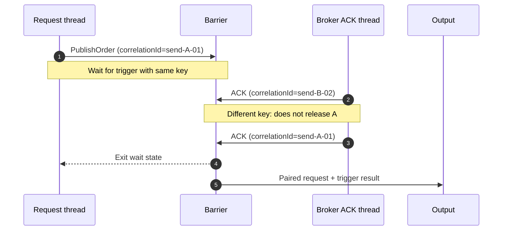

# Correlation Key for Barrier

## 1. Why Does a Barrier Need a Correlation Key?

In **SPRING_INTEGRATION_PATTERN**, Enterprise Integration Patterns such as Router, Filter, Transformer, Splitter, Aggregator, Gateway, retry, and error channel work together to create loosely coupled, extensible, and observable message flows. **Barrier** solves a very specific scenario: a request has entered the processing flow but must wait for **an independent trigger event** before it can proceed. To determine which event releases which request, the Barrier needs a **correlation key**.

Imagine a system receiving commands to send orders to a broker. The application wants to confirm dispatch only when it receives an ACK from the broker. At the same time, there are many orders, and ACKs may arrive out of order relative to requests; therefore, receiving just any ACK is not enough. The right pair must be matched:

| Request | Trigger/ACK | Correlation key | Result |
| --- | --- | --- | --- |
| Send order A, attempt 01 | ACK for A, attempt 01 | `send-A-01` | Valid match, releases A-01 |
| Send order B, attempt 02 | ACK for B, attempt 02 | `send-B-02` | Valid match, releases B-02 |
| Send order A, attempt 01 | ACK for B, attempt 02 | Different | Does not release A-01 |
| Resend order A, attempt 03 | Old ACK from attempt 01 | `send-A-03` and `send-A-01` | Does not mistakenly match old ACK with new attempt |

**A correlation key is the identity of the interaction to be synchronized**, not necessarily the ID of the business entity. In the example, `orderId` identifies the order while `sendAttemptId` identifies one specific dispatch attempt. If an order can be sent twice concurrently, choosing `orderId` alone as the key will cause conflicts or mismatched ACKs.

### Learning Outcomes

After this lesson, you will be able to:

- Identify where a Barrier obtains its correlation key and how the key determines the request–trigger pair.
- Assign a key that is stable, unique within the scope of waiting operations, and consistent in data type across both branches.
- Build messages with the `correlationId` header, or use a custom header via `CorrelationStrategy`.
- Detect scenarios involving missing keys, mismatched keys, duplicate keys, early triggers, or late triggers.
- Write tests and logs that help trace the root cause when a request times out.

## 2. How Spring Integration Pairs Messages

Spring Integration uses `BarrierMessageHandler`; when a request is sent to the handler's input channel, the request processing flow waits for the corresponding trigger, up to `requestTimeout`. An independent branch calls `trigger(Message<?>)` with the ACK. Both sides are passed through the **same `CorrelationStrategy`** to extract the key. When the request's key and the trigger's key are equal, the Barrier can release the request flow and construct the output message.

By default, the Barrier's `CorrelationStrategy` is a `HeaderAttributeCorrelationStrategy` reading the header:

```java
IntegrationMessageHeaderAccessor.CORRELATION_ID
// The header name value is "correlationId".
```

There is no need for a custom header name if both branches can attach `correlationId`. If you want to use another field, such as `commandId`, configure a strategy to read that field; Spring Integration does not automatically infer `orderId` from the payload.



In Java, the strategy contract is very concise:

```java
@FunctionalInterface
public interface CorrelationStrategy {
    Object getCorrelationKey(Message<?> message);
}
```

The returned value must be **non-`null`**. If the key cannot be determined, the strategy should throw a clear exception. Because the key is used as an identifier in a lookup structure, the key type must have consistent `equals()` and `hashCode()` implementations and must not be mutated after the message enters the Barrier. Two values that look identical in logs are not necessarily equal in Java: for example, the string `"42"` and the integer `42` are **two different keys**.

By default, Barrier uses `DefaultAggregatingMessageGroupProcessor` to combine the two payloads into a `Collection<?>` and aggregate headers. **The correlation key determines which pair is matched**, whereas `MessageGroupProcessor` decides **what shape the paired result takes**; these are two distinct responsibilities.

## 3. Designing the Key from Business Logic

### 3.1. Choosing the Right Granularity

| Candidate | Should use? | Explanation |
| --- | --- | --- |
| Request's `message.getId()` | No, if ACK is a new message | System-generated ID per message; ACK usually has an independent ID. |
| `traceId` | Only if one trace equals one waiting operation | A single trace can span multiple commands; tracing is for observability, not guaranteeing operation uniqueness. |
| `orderId` | Conditionally | Safe only if two concurrent requests for the same order never wait in the Barrier. |
| `commandId` / `sendAttemptId` | Usually appropriate | Identifies one specific request attempt; the ACK carries this exact ID back. |
| `tenantId + commandId` | Appropriate for multi-tenant systems | Prevents key collisions when command IDs are not unique across tenants. |
| Randomly generated UUID on both branches | No | Independent generation creates two different keys; the ACK must carry back the key issued for the request. |

A practical rule: **issue the key once where the command is emitted**, pass it to the receiving system, and require the callback/ACK branch to return that exact key. Do not regenerate the key as each branch passes through a Transformer or adapter.

### 3.2. Choosing the Uniqueness Scope

Suppose the system allows the same `orderId` to be sent to two partners simultaneously. The key `order-42` is insufficient because two requests waiting concurrently in a single Barrier will collide. You can choose `partnerCode + commandId` or generate a new `dispatchId` for each dispatch attempt.

For retries, you must distinguish in business terms between **retrying the same logical command** and **a new dispatch attempt**:

- Transport retry of the same command with a fixed idempotency token: the callback may continue using the same `commandId`, provided you do not create two requests waiting concurrently on one key.
- A new dispatch after the previous one expired while the old ACK might still arrive: use a new `attemptId` so the old ACK does not wake up the new request, while also storing its link to `orderId` for reconciliation.

There is no single key choice that fits all cases: the requirement is that both branches agree on **the exact same definition of one interaction**.

### 3.3. Keys Must Remain Stable Across System Boundaries

A message passing through HTTP, RabbitMQ, Kafka, or another service may not preserve all Spring Message headers. When sending a request externally, place the key in a **protocol/metadata field** that the receiver actually echoes back; when the ACK returns, recreate the `correlationId` header on the internal message before calling `trigger()`. Watch out for renaming, type normalization, string truncation, and case sensitivity. Do not assume an unmapped header will automatically travel across every transport.

Example data contract:

```json
{
  "commandId": "send-A-01",
  "orderId": "order-A",
  "operation": "publish"
}
```

ACK:

```json
{
  "commandId": "send-A-01",
  "accepted": true
}
```

The `commandId` value in both JSON payloads must match exactly. Whether the operation succeeded (`accepted`) is separate business content; **matching keys do not mean the business operation succeeded**. A rejection ACK can also be a valid trigger, after which the flow inspects the status to return a failure result.

## 4. Java Example: Using the Default `correlationId`

The following example uses Spring Integration Java configuration. Two input channels separate requests and ACKs, and results are placed in a `QueueChannel` for easy observation during practice. In a real system, the output can connect to a Transformer, Gateway, or appropriate error-handling channel.

```java
import org.springframework.beans.factory.annotation.Qualifier;
import org.springframework.context.annotation.Bean;
import org.springframework.context.annotation.Configuration;
import org.springframework.integration.annotation.ServiceActivator;
import org.springframework.integration.aggregator.BarrierMessageHandler;
import org.springframework.integration.channel.DirectChannel;
import org.springframework.integration.channel.QueueChannel;
import org.springframework.integration.config.EnableIntegration;
import org.springframework.messaging.MessageChannel;
import org.springframework.messaging.MessageHandler;

@Configuration
@EnableIntegration
public class CorrelationBarrierConfig {

    @Bean
    public MessageChannel publishRequests() {
        return new DirectChannel();
    }

    @Bean
    public MessageChannel brokerAcks() {
        return new DirectChannel();
    }

    @Bean
    public QueueChannel pairedResults() {
        return new QueueChannel();
    }

    @Bean
    public QueueChannel unmatchedTriggers() {
        return new QueueChannel();
    }

    @Bean
    @ServiceActivator(inputChannel = "publishRequests")
    public BarrierMessageHandler correlationBarrier(
            @Qualifier("pairedResults") MessageChannel resultChannel,
            @Qualifier("unmatchedTriggers") MessageChannel discardChannel) {

        // Default: uses the IntegrationMessageHeaderAccessor.CORRELATION_ID header.
        BarrierMessageHandler barrier = new BarrierMessageHandler(5_000L, 1_500L);
        barrier.setOutputChannel(resultChannel);
        barrier.setDiscardChannel(discardChannel);
        barrier.setRequiresReply(true);
        return barrier;
    }

    @Bean
    @ServiceActivator(inputChannel = "brokerAcks")
    public MessageHandler triggerOnAck(
            @Qualifier("correlationBarrier") BarrierMessageHandler barrier) {
        return barrier::trigger;
    }
}
```

Here `publishRequests` feeds the **request** branch of the handler; `brokerAcks` uses the **same handler instance** but invokes `trigger()`. The two branches must run independently, because `DirectChannel` invokes the handler on the sending thread and may block until the correlated pair arrives or the timeout expires.

The message creation snippet illustrates two different payloads sharing one correlation key:

```java
import java.util.UUID;
import org.springframework.integration.IntegrationMessageHeaderAccessor;
import org.springframework.integration.support.MessageBuilder;
import org.springframework.messaging.Message;

String commandId = UUID.randomUUID().toString();

Message<String> request = MessageBuilder.withPayload("PUBLISH:order-A")
        .setHeader(IntegrationMessageHeaderAccessor.CORRELATION_ID, commandId)
        .setHeader("orderId", "order-A")
        .build();

Message<String> trigger = MessageBuilder.withPayload("BROKER_ACK:accepted")
        .setHeader(IntegrationMessageHeaderAccessor.CORRELATION_ID, commandId)
        .setHeader("orderId", "order-A")
        .build();

// Send request to publishRequests from a worker/caller.
// Send trigger to brokerAcks from another callback/listener.
// Do not call both sequentially on the same thread when the request may block.
```

With these two messages, `CorrelationStrategy` extracts the same `commandId` string so the Barrier can emit the result when both arrive within the timeout. If the trigger contains a new UUID generated by the listener itself, the two messages will **not** match even though both payloads mention `order-A`.

## 5. Restoring the Correlation Header When Receiving a Callback

Suppose the broker sends an ACK as an object:

```java
public record BrokerAck(String commandId, boolean accepted) {}
```

An adapter at the system boundary can normalize the message before sending it to the trigger channel:

```java
import org.springframework.integration.IntegrationMessageHeaderAccessor;
import org.springframework.integration.support.MessageBuilder;
import org.springframework.messaging.Message;

public Message<BrokerAck> normalizeAck(BrokerAck ack) {
    if (ack.commandId() == null || ack.commandId().isBlank()) {
        throw new IllegalArgumentException("ACK missing commandId");
    }

    return MessageBuilder.withPayload(ack)
            .setHeader(IntegrationMessageHeaderAccessor.CORRELATION_ID, ack.commandId())
            .build();
}
```

The message returned by `normalizeAck` is sent to `brokerAcks`. Then `triggerOnAck` calls `BarrierMessageHandler.trigger()`. This is a clean way to separate **reading the external protocol** from **internal synchronization**.

When using a Transformer, Filter, or Router before a Barrier:

1. Define where the key is generated and where it is reconstructed from external data.
2. Preserve the key when building a new message, or reattach it with `MessageBuilder` / Header Enricher.
3. Never overwrite the key with another order ID, trace ID, or new message ID.
4. Treat a missing key as an error to handle before entering the Barrier; do not let it silently enter the waiting path.

## 6. Using Another Business Header: `HeaderAttributeCorrelationStrategy`

If both branches already carry a `commandId` header and you do not want to normalize it to `correlationId`, you can specify it directly:

```java
import org.springframework.integration.aggregator.BarrierMessageHandler;
import org.springframework.integration.aggregator.HeaderAttributeCorrelationStrategy;

BarrierMessageHandler barrier = new BarrierMessageHandler(
        5_000L,
        1_500L,
        new HeaderAttributeCorrelationStrategy("commandId"));
```

This is a **replacement configuration** for the `new BarrierMessageHandler(5_000L, 1_500L)` constructor in the `correlationBarrier` bean; the channels and `trigger()` path remain the same as above. Then both request and ACK must carry the same header:

```java
Message<String> request = MessageBuilder.withPayload("PUBLISH:order-A")
        .setHeader("commandId", "send-A-01")
        .build();

Message<String> trigger = MessageBuilder.withPayload("ACK:accepted")
        .setHeader("commandId", "send-A-01")
        .build();
```

**Note:** the `commandId` header is an arbitrary name chosen in this example; it is not a default header automatically generated by Spring Integration. Headers are read by the exact configured name. Changing the strategy on **only one side** is not possible/enough, because both request and trigger pass through the strategy belonging to the same handler.

## 7. Composite Keys with a Custom `CorrelationStrategy`

In a multi-tenant system, different partners may reuse the same `commandId`. In that case, a composite key of `tenantId` and `commandId` is safer. Do not concatenate `tenantId + ":" + commandId` if data could contain the delimiter and cause ambiguity; using an immutable key type is clearer.

```java
import org.springframework.integration.aggregator.BarrierMessageHandler;
import org.springframework.integration.aggregator.CorrelationStrategy;
import org.springframework.messaging.Message;

// Java 17+
record DispatchKey(String tenantId, String commandId) {}

CorrelationStrategy strategy = (Message<?> message) -> {
    Object tenant = message.getHeaders().get("tenantId");
    Object command = message.getHeaders().get("commandId");

    if (!(tenant instanceof String tenantId) || tenantId.isBlank()) {
        throw new IllegalArgumentException("Message missing tenantId");
    }
    if (!(command instanceof String commandId) || commandId.isBlank()) {
        throw new IllegalArgumentException("Message missing commandId");
    }
    return new DispatchKey(tenantId, commandId);
};

BarrierMessageHandler barrier =
        new BarrierMessageHandler(5_000L, 1_500L, strategy);
```

This snippet replaces the `BarrierMessageHandler` creation in the previous configuration. The `record DispatchKey` type automatically provides `equals()` and `hashCode()` based on both fields. What matters is that **both request and trigger** carry `tenantId` and `commandId` as strings.

Examples:

| Request headers | Trigger headers | Match? |
| --- | --- | --- |
| `tenantId=T1, commandId=C5` | `tenantId=T1, commandId=C5` | Yes |
| `tenantId=T1, commandId=C5` | `tenantId=T2, commandId=C5` | No |
| `tenantId=T1, commandId=C5` | `tenantId=T1, commandId=C6` | No |
| `tenantId=T1, commandId=C5` | `commandId=C5` | Strategy rejects trigger missing tenant |

When building a multi-part key, normalize the representation at the **system boundary** (for instance, whether tenant IDs are case-sensitive), then apply the exact same rule to both branches. Avoid ad-hoc transformations inside the strategy that could collapse two distinct operations into one.

## 8. Common Correlation Pitfalls

### 8.1. Two Requests with the Same Key Waiting Simultaneously

**A Barrier allows only one request thread waiting on a given correlation key at a time.** If a second request arrives with a duplicate key while the first is still waiting, the handler throws an exception; the two requests do not automatically form a group like an Aggregator.

```text
R1: correlationId=send-A-01  ---> Barrier (waiting)
R2: correlationId=send-A-01  ---> Error: same key already has a waiting request
ACK: correlationId=send-A-01 --> Releases matching request
```

Prevention: issue keys per operation attempt, prevent duplicate submissions, and enforce idempotency at the command-sending boundary. If you need multiple results for the same group, consider an **Aggregator** with a release strategy instead of using a Barrier to wait for N messages.

### 8.2. Request and Trigger Have Keys That Look Alike but Differ in Type

```java
request.getHeaders().get("commandId"); // String "7001"
trigger.getHeaders().get("commandId"); // Integer 7001
```

`"7001".equals(7001)` is `false`. Normalize both to a single type upon receiving the message, such as `String`, and verify with unit tests. Also guard against trailing whitespace and inconsistent Unicode normalization.

### 8.3. Losing the Key During Message Transformation

A component that constructs a new message with only the payload, or a transport adapter that drops headers, will prevent the trigger from finding its matching request. In logs, the business event appears to arrive properly, yet the Barrier still times out. Track **the key before and after each important boundary**; do not inspect only the payload.

### 8.4. Trigger Arrives Before Request

Spring Integration supports early triggers: the thread calling `trigger()` can wait up to `triggerTimeout` for the request to arrive. If the trigger expires before the request appears, it can be routed to `discard-channel`. If the handler runs directly on a listener thread, this wait also occupies listener resources; consider dispatching triggers via a `TaskExecutor` if you do not want to block the receiving thread.

### 8.5. Trigger Arrives After Request Timeout

If the request has already terminated due to `requestTimeout`, a late trigger cannot revive the expired success result. Having the right key is still not enough: **matching depends on both the key and the time window**. Late ACKs can be handled through a discard flow or a separate reconciliation process.

| Scenario | Symptom | What to check |
| --- | --- | --- |
| Wrong header | ACK exists but request still times out | Is the strategy reading `correlationId` or `commandId`? |
| Wrong key type | Logs print `7001` on both sides but no match | Java type of header value, data normalization |
| Duplicate request | Exception when second request enters | Are two concurrent dispatches sharing the same key? |
| ACK arrives too early | No paired result | `triggerTimeout` and discard channel |
| ACK arrives too late | Request times out before ACK arrives | `requestTimeout`, callback latency, upstream deadlines |
| Different instances | Each side sees the right key but they never meet | Do request and trigger go to the same Barrier/shared coordinator? |

## 9. Controlled Correlation Testing

For integration tests, use **two independent threads** because sending a request to a `DirectChannel` can block the thread. The sample below demonstrates a valid key-matching case between a request and an ACK; it uses the beans from `CorrelationBarrierConfig` in section 4. Use a fresh key for each test run to avoid leftover results in `QueueChannel`.

```java
import static org.junit.jupiter.api.Assertions.*;

import java.util.Collection;
import java.util.UUID;
import java.util.concurrent.ExecutorService;
import java.util.concurrent.Executors;
import java.util.concurrent.Future;
import java.util.concurrent.TimeUnit;
import org.junit.jupiter.api.Test;
import org.springframework.beans.factory.annotation.Autowired;
import org.springframework.beans.factory.annotation.Qualifier;
import org.springframework.boot.test.context.SpringBootTest;
import org.springframework.integration.IntegrationMessageHeaderAccessor;
import org.springframework.integration.channel.QueueChannel;
import org.springframework.integration.support.MessageBuilder;
import org.springframework.messaging.Message;
import org.springframework.messaging.MessageChannel;

@SpringBootTest
class BarrierCorrelationTest {

    @Autowired @Qualifier("publishRequests")
    MessageChannel requests;

    @Autowired @Qualifier("brokerAcks")
    MessageChannel triggers;

    @Autowired @Qualifier("pairedResults")
    QueueChannel results;

    @Test
    void releasesOnlyWhenKeysMatch() throws Exception {
        String key = "test-" + UUID.randomUUID();
        Message<String> request = MessageBuilder.withPayload("command")
                .setHeader(IntegrationMessageHeaderAccessor.CORRELATION_ID, key)
                .build();
        Message<String> ack = MessageBuilder.withPayload("ack")
                .setHeader(IntegrationMessageHeaderAccessor.CORRELATION_ID, key)
                .build();

        ExecutorService executor = Executors.newSingleThreadExecutor();
        try {
            Future<Boolean> requestSend =
                    executor.submit(() -> requests.send(request));
            // ACK may arrive before or after the worker begins waiting.
            // Both orders are supported by Barrier within their respective timeouts.
            assertTrue(triggers.send(ack));

            Message<?> completed = results.receive(4_000);
            assertNotNull(completed);
            assertInstanceOf(Collection.class, completed.getPayload());
            assertEquals(2, ((Collection<?>) completed.getPayload()).size());
            assertTrue(requestSend.get(6, TimeUnit.SECONDS));
        } finally {
            executor.shutdownNow();
        }
    }
}
```

To test other scenarios, add cases for **mismatched keys**, **missing header**, **wrong type**, **two concurrent requests with duplicate keys**, **early trigger**, and **late ACK**. Timeout tests should specify finite limits, shut down executors in `finally`, and avoid using `Thread.sleep()` to assume a thread has reached the Barrier at a specific time. When asserting a specific arrival order, add test synchronization primitives (such as a latch or a hook observing message receipt).

In negative test cases, check the error/discard branch as well rather than only asserting `results.receive() == null`. For example, `setRequiresReply(true)` causes a request timeout to throw `ReplyRequiredException` on the processing thread; if the request runs inside a `Future`, the exception is observed when calling `Future.get()`. If left at the default `requiresReply=false`, the request timeout branch returns `null` and terminates the flow.

## 10. Monitoring and Operations

To distinguish "ACK has not arrived" from "ACK arrived with a non-matching key," emit structured logs at the boundaries:

```text
event=request_entered    key=send-A-01 orderId=order-A flow=publish
event=trigger_received  key=send-B-02 ackStatus=accepted
event=request_timeout   key=send-A-01 timeoutMs=5000
event=late_ack_discard  key=send-A-01
```

The lines above are merely illustrative samples for individual scenarios, not a guaranteed event sequence that always appears together. In practice, measure **wait duration**, request timeouts, discarded triggers, duplicate-key errors, missing-key ACK rate, and matched ACK rate. Attach both `traceId` for observability and `correlationId` for pairing, keeping their distinct purposes clear. Avoid logging payloads or unnecessary customer data fields.

With multiple instances, a `BarrierMessageHandler` in one JVM **does not automatically synchronize waiting state to another instance**. Even if two messages share the same key, if the request lands on instance A while the ACK arrives at instance B, the two sides may never meet. Design consistent routing to the same coordinator or use an appropriate out-of-process state coordination mechanism. If an operation can take minutes or hours, holding a waiting thread at a Barrier is usually inappropriate; switch to an asynchronous workflow with durable state storage and emit results via callbacks/events.

## 11. Practice Exercise

Suppose an API receives commands to submit electronic invoices, and the broker returns an ACK containing `invoiceId` and `commandId`; a customer may resubmit the same invoice. Implement and explain:

1. Choose `commandId` as the key for each dispatch, attaching it to the `correlationId` header on the request. Keep `invoiceId` as business metadata.
2. Write an adapter that receives ACKs, validates `commandId`, and attaches the same key to the trigger.
3. Send two commands with the same `invoiceId` but different `commandId` values; return the ACKs in reverse order and verify there is no cross-pairing.
4. Test an old ACK from a previous dispatch arriving while a new request is waiting. Explain why `invoiceId` must not be used as the key in this case.
5. Switch to `HeaderAttributeCorrelationStrategy("commandId")`; demonstrate that both branches must carry the `commandId` header.
6. Extend for multi-tenancy with `DispatchKey(tenantId, commandId)` and verify that identical `commandId` values from two tenants do not match.
7. Add an error flow and discard flow, log the key at each stage, and count timeouts, late ACKs, and missing keys.

**Self-assessment questions**

- Why is the request's `MessageHeaders.ID` unsuitable as a correlation key for an independently created ACK?
- When is `orderId` sufficient as a key, and when is `attemptId` or `commandId` mandatory?
- If logs show the same ID yet the Barrier still times out, how would you inspect step ordering, header names, and data types?
- Why is having the same correlation key insufficient for pairing if the two branches run on Barriers in different instances?
- What synchronization/release requirement distinguishes a Barrier's correlation key from the `correlationId` used in an Aggregator group?

## 12. References

- [Spring Integration Reference — Thread Barrier](https://docs.spring.io/spring-integration/reference/barrier.html): default `CORRELATION_ID`, key-based triggering, timeouts, Java/XML configuration, and the single-waiting-request-per-key limit.
- [Spring Integration Javadoc — BarrierMessageHandler](https://docs.spring.io/spring-integration/docs/6.4.x/api/org/springframework/integration/aggregator/BarrierMessageHandler.html): constructors accepting `CorrelationStrategy`, `trigger()`, and `setDiscardChannel()`.
- [Spring Integration Javadoc — CorrelationStrategy](https://docs.spring.io/spring-integration/docs/6.5.1/api/org/springframework/integration/aggregator/CorrelationStrategy.html): `getCorrelationKey` contract and non-`null` requirement.
- [Spring Integration Reference — Aggregator](https://docs.spring.io/spring-integration/reference/aggregator.html): correlation principles, `HeaderAttributeCorrelationStrategy`, and distinction from message aggregation mechanisms.

> **Takeaway:** A Barrier pairs a request and trigger by **the same key, the same type, the same business meaning, and within the waiting window**. Designing the key right at request emission, preserving the identifier through callbacks, and validating every message transformation point is the foundation for preventing false timeouts and mismatched ACKs.
