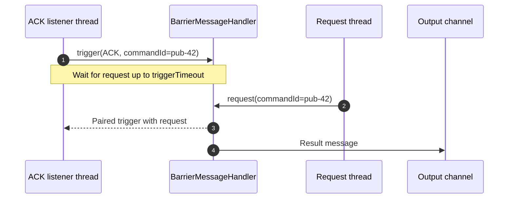

# Barrier Message and Trigger Message

## 1. Problem: Two Messages, Two Roles

In an enterprise integration flow, sending a request and receiving the signal allowing it to proceed often happen at **two different times and along two different processing paths**. For example, a system sends a command to publish an invoice to an external service; after sending, the application must wait for a confirmation event from that service before completing the synchronous step.

In the **SPRING_INTEGRATION_PATTERN** module, we learn to implement *Enterprise Integration Patterns* with Spring Integration to build message flows that are loosely coupled, extensible, testable, and observable across every branch. Router chooses the path, Filter drops messages that do not meet conditions, Transformer reshapes data, Splitter/Aggregator split and group messages, Gateway connects synchronous calls to message flows, and retry and error channels handle failure branches. **Thread Barrier** has its own specific responsibility: **waiting for a trigger message correlated with a barrier message** before releasing the waiting flow.

In this lesson:

- **Barrier message**, also called *request message*: the message sent to the primary input of `BarrierMessageHandler`, carrying the request on which the processing flow must pause.
- **Trigger message**: the message signaling the release event, passed to the `trigger(Message<?>)` method of the **same handler**.
- **Correlation key**: the key used to pair the right request with the right trigger, taken by default from the `correlationId` header.
- **Released/output message**: the message processed and emitted after the request and trigger are paired successfully; by default it contains data from both sides.

The two messages can carry completely different payloads. They do not need to have the same type, share the same channel, or arrive in a fixed order.

## 2. Distinguishing Barrier Messages and Trigger Messages

| Aspect | Barrier / request message | Trigger message |
| --- | --- | --- |
| Meaning | Requests an operation or business step awaiting confirmation | Signals that the related event has occurred |
| Entry path | Input channel of `BarrierMessageHandler` | `BarrierMessageHandler.trigger(message)`, typically via a separate input channel and service activator |
| Who creates it? | API Gateway, producer, inbound flow, or business processing step | Listener receiving ACK, callback, or processing result from another branch |
| Sample payload | `PublishInvoice(invoiceId, commandId)` | `InvoiceAck(commandId, accepted, reason)` |
| Correlation key | Has `correlationId=publish-42` | Same `correlationId=publish-42` |
| Waiting behavior | The request-processing thread can wait up to `requestTimeout` | If the trigger arrives first, the thread calling trigger can wait up to `triggerTimeout` |
| Matching condition | Waits for a trigger with the same key | Waits for a request with the same key |
| On match | Request is released, handler emits the result | Supplies data for the request–trigger pair |
| On expiration | May end with no result or throw an error depending on `requiresReply` | Unmatched trigger can be routed to `discardChannel` if configured |

The name *barrier message* does not imply that the message has a special payload type or header. **The role is determined by which handler entry path is used**: sending an `InvoiceAck` payload to the request input channel still makes it a request; sending a `PublishInvoice` payload to `trigger()` makes it act as a trigger. Therefore, clearly separating the two entry paths is essential.

### Business Example

```text
HTTP/API or producer                      External service/broker
          |                                         |
          |  PublishInvoice(commandId=pub-42)       |
          v                                         |
    requestChannel                                  |
          |                                         | ACK(pub-42, accepted=true)
          v                                         v
    +---------------------------------------------------------+
    |                    Thread Barrier                       |
    |     barrier message <-> correlation <-> trigger message |
    +---------------------------------------------------------+
                             |
                         outputChannel
                             |
             Check accepted, return business result
```

A Barrier only solves **when execution is allowed to continue**. It does not itself verify that `accepted=true` means business success: a rejection ACK with the exact correlation key can still release the request, and a downstream step then handles the business failure.

## 3. Lifecycle of a Message Pair

A Barrier can handle both arrival orders of request and trigger. Understanding both is essential when designing timeouts and thread pools.

### 3.1. Request Arrives First, Trigger Arrives Later

```mermaid
sequenceDiagram
    autonumber
    participant R as Request thread
    participant B as BarrierMessageHandler
    participant L as ACK listener thread
    participant O as Output channel
    R->>B: request(commandId=pub-42)
    Note over R,B: Waiting for trigger with matching key
    L->>B: trigger(ACK, commandId=pub-99)
    Note over B,L: Different key; does not release pub-42
    L->>B: trigger(ACK, commandId=pub-42)
    B-->>R: Release request
    B->>O: Combined request + ACK message
```

Steps:

1. A thread sends the request to the input channel; the handler extracts the correlation key and registers the waiting state.
2. If no matching trigger exists yet, the request thread waits up to `requestTimeout`.
3. An independent listener branch receives the ACK; an adapter forwards the ACK into `trigger()` on the same handler.
4. When keys match within the allowed time, the handler combines both messages and sends the result to the output channel.

Do not confuse "ACK received from broker" with "ACK passed into `trigger()`." If an ACK is only logged and then dropped by a Filter, the request will continue waiting.

### 3.2. Trigger Arrives First, Request Arrives Later



Spring Integration supports this case: a `trigger()` call can wait up to **`triggerTimeout`** for the corresponding request to arrive. This is useful when the two branches use independent executors or brokers so delivery order is not guaranteed. However, waiting still occupies the thread calling trigger. If the listener has few threads, setting `triggerTimeout` too high can reduce ACK ingestion throughput.

### 3.3. Both Directions Have Time Limits

| Timestamp | Event | Behavior |
| --- | --- | --- |
| `t=0` | Request `pub-42` arrives | Starts waiting, subject to `requestTimeout` |
| `t=1` | Trigger `pub-43` arrives | Does not match, does not release `pub-42` |
| `t=2` | Trigger `pub-42` arrives | Pair matches, output emitted |
| `t=5` | If no trigger with the right key arrives | Request expires; handled according to `requiresReply` |

A reversed-order example:

| Timestamp | Event | Behavior |
| --- | --- | --- |
| `t=0` | Trigger `pub-42` arrives | Starts waiting `triggerTimeout` |
| `t=0.5` | Request `pub-42` arrives | Pairing succeeds |
| `t=2` | If request still has not arrived and trigger timeout is 1.5 seconds | Trigger stops waiting for that pair |

These timestamps are **illustrative**; exact timing depends on thread scheduling and handler configuration. Do not use these timings as latency guarantees for a production system.

## 4. Correlation: A Request Must Meet Its Exact Trigger

Suppose there are two commands:

```text
request-1: publish invoice A, correlationId=pub-A-01
request-2: publish invoice B, correlationId=pub-B-01

trigger-1: ACK B, correlationId=pub-B-01
trigger-2: ACK A, correlationId=pub-A-01
```

The ACK for B arrives first, yet it only releases request B; the ACK for A only releases request A. By default, `BarrierMessageHandler` takes the key from `IntegrationMessageHeaderAccessor.CORRELATION_ID` (string header `correlationId`). Another `CorrelationStrategy` can be configured if an external protocol returns `commandId`, but **both request and trigger must have the same key value and type**.

Several design rules:

1. Generate `commandId` exactly once where the command is emitted and pass it to the receiver; the ACK must echo back that ID.
2. Do not use `MessageHeaders.ID`, which is generated independently on each message, as the correlation key.
3. If multiple dispatches of the same invoice can run concurrently or old ACKs may arrive late, use an ID per **dispatch attempt** rather than `invoiceId` alone.
4. When bridging across HTTP, Kafka, RabbitMQ, or JSON formats, map the ID from external metadata back into the appropriate Spring Message header.
5. Do not let messages missing a key reach the Barrier; validate early to surface clear errors.

Two requests with the same key waiting concurrently at a Barrier is a conflict; a Barrier must not be used like an Aggregator collecting multiple requests with duplicate keys. If you need to wait for multiple results, use an Aggregator with an appropriate release strategy.

## 5. Java Configuration: Two Channels, One Handler

The following configuration example uses Java 17+ and Spring Integration. Request and trigger inputs use `DirectChannel`; output and discard use `QueueChannel` so the exercise can easily read results. The beans are initialized in a Spring context with `spring-integration-core`.

```java
import org.springframework.beans.factory.annotation.Qualifier;
import org.springframework.context.annotation.Bean;
import org.springframework.context.annotation.Configuration;
import org.springframework.integration.annotation.ServiceActivator;
import org.springframework.integration.aggregator.BarrierMessageHandler;
import org.springframework.integration.channel.DirectChannel;
import org.springframework.integration.channel.QueueChannel;
import org.springframework.integration.config.EnableIntegration;
import org.springframework.messaging.MessageChannel;
import org.springframework.messaging.MessageHandler;

@Configuration
@EnableIntegration
public class MessageAndTriggerBarrierConfig {

    @Bean
    public MessageChannel commandRequests() {
        return new DirectChannel();
    }

    @Bean
    public MessageChannel confirmationTriggers() {
        return new DirectChannel();
    }

    @Bean
    public QueueChannel releasedPairs() {
        return new QueueChannel();
    }

    @Bean
    public QueueChannel discardedTriggers() {
        return new QueueChannel();
    }

    @Bean
    @ServiceActivator(inputChannel = "commandRequests")
    public BarrierMessageHandler publishBarrier(
            @Qualifier("releasedPairs") MessageChannel output,
            @Qualifier("discardedTriggers") MessageChannel discarded) {
        // Request waits at most 5 seconds; early-arriving trigger waits at most 1.5 seconds.
        BarrierMessageHandler barrier = new BarrierMessageHandler(5_000L, 1_500L);
        barrier.setOutputChannel(output);
        barrier.setDiscardChannel(discarded);
        barrier.setRequiresReply(true);
        return barrier;
    }

    @Bean
    @ServiceActivator(inputChannel = "confirmationTriggers")
    public MessageHandler forwardTrigger(
            @Qualifier("publishBarrier") BarrierMessageHandler barrier) {
        return barrier::trigger;
    }
}
```

Key lines:

- `@ServiceActivator(inputChannel = "commandRequests")` sends the **barrier message** to `publishBarrier`.
- `forwardTrigger` receives the **trigger message** and calls `barrier.trigger(message)` on the **exact same `publishBarrier` instance**. Simply sending an ACK to a channel not wired to `trigger()` will not release the request.
- `setOutputChannel(...)` specifies where the paired result goes; `setDiscardChannel(...)` lets you observe unusable triggers upon timeout.
- `setRequiresReply(true)` makes a request timeout raise `ReplyRequiredException` instead of silently ending. An error flow or caller must handle the exception.

`DirectChannel` dispatches directly to the handler on the sending thread; if you place sending the request and the trigger sequentially on the **same thread**, the request send may block so the trigger-sending code never runs in time. In a real system, provide two independent event sources/processing flows, or use an appropriate executor.

## 6. Building Two Messages with Different Payloads

Define business payloads to make the two roles clear:

```java
public record PublishInvoice(String commandId, String invoiceId) {}

public record InvoiceAck(
        String commandId,
        boolean accepted,
        String reason) {}
```

When constructing the messages, both branches attach the **same correlation key**. Below is an example inside an application component using Spring Integration:

```java
import org.springframework.integration.IntegrationMessageHeaderAccessor;
import org.springframework.integration.support.MessageBuilder;
import org.springframework.messaging.Message;

String commandId = "publish-2026-00042";

Message<PublishInvoice> request =
        MessageBuilder.withPayload(new PublishInvoice(commandId, "inv-42"))
                .setHeader(IntegrationMessageHeaderAccessor.CORRELATION_ID, commandId)
                .build();

Message<InvoiceAck> trigger =
        MessageBuilder.withPayload(new InvoiceAck(commandId, true, "ACCEPTED"))
                .setHeader(IntegrationMessageHeaderAccessor.CORRELATION_ID, commandId)
                .build();
```

Send `request` to `commandRequests` and send `trigger` to `confirmationTriggers` from two independent flows. The payloads do not need to share a name or type: the request/trigger role comes from the handler entry point, while pairing relies on correlation.

### Creating a Trigger from an External Callback

If the ACK is JSON or a DTO received from a REST callback, you cannot assume the old Spring Message header still exists. A mapper can rebuild the trigger:

```java
import org.springframework.integration.IntegrationMessageHeaderAccessor;
import org.springframework.integration.support.MessageBuilder;
import org.springframework.messaging.Message;

public Message<InvoiceAck> asTrigger(InvoiceAck ack) {
    if (ack.commandId() == null || ack.commandId().isBlank()) {
        throw new IllegalArgumentException("ACK missing commandId");
    }
    return MessageBuilder.withPayload(ack)
            .setHeader(IntegrationMessageHeaderAccessor.CORRELATION_ID, ack.commandId())
            .build();
}
```

If the ACK carries `accepted=false`, still send the trigger with the matching key to release the request, and inspect the status in a downstream step. Never treat "trigger arrived" as proof that the invoice was published successfully.

## 7. What Message Is Emitted After the Barrier Releases?

The output is by default neither the unmodified request nor just the trigger. With default configuration, `BarrierMessageHandler` uses a message group processor to build **one message** whose payload is a collection containing the payloads of both the request and the trigger. Therefore, downstream code should not cast the entire output directly to `PublishInvoice`.

Example of a safe inspection step once `Message<?> released` is received from `releasedPairs`:

```java
import java.util.Collection;
import org.springframework.messaging.Message;

public boolean isAccepted(Message<?> released) {
    if (!(released.getPayload() instanceof Collection<?> values)) {
        throw new IllegalArgumentException("Payload is not a collection");
    }
    boolean hasRequest = values.stream().anyMatch(PublishInvoice.class::isInstance);
    InvoiceAck ack = values.stream()
            .filter(InvoiceAck.class::isInstance)
            .map(InvoiceAck.class::cast)
            .findFirst()
            .orElseThrow(() -> new IllegalArgumentException("Missing ACK"));
    return hasRequest && ack.accepted();
}
```

In a real application, build a structured result DTO such as `PublishOutcome(commandId, invoiceId, accepted, reason)` using a Transformer or a custom `MessageGroupProcessor`. Do not rely on element position in the collection if the design or version does not guarantee ordering; distinguish items by explicit type or metadata.

**Point to remember:** Correlation matching only releases the flow. ACK validity, response signatures, rejection status, idempotency, and reconciliation are separate business steps.

## 8. Timeouts, Errors, Stray Triggers, and Duplicate Messages

### 8.1. No Trigger for the Request

The request can wait up to `requestTimeout`. With `requiresReply=true`, Spring Integration throws `ReplyRequiredException`; with `false` (default), the flow may terminate without an output message. If the request was sent through a Gateway, the Gateway's timeout must also align with the Barrier's timeout; do not increase timeouts indefinitely just to mask latency.

### 8.2. Trigger Does Not Meet a Request

If a trigger arrives first but the matching request does not arrive within `triggerTimeout`, the trigger call finishes without producing a successful result. You can configure `discardChannel` to route triggers that can no longer be paired to an observation or reconciliation branch. A trigger with the wrong key cannot wake up a waiting request either; never "guess" a key by comparing similar payloads.

### 8.3. Late Trigger

```text
t=0s   request(pub-42) -> Barrier waiting
t=5s   request(pub-42) -> timeout
t=7s   trigger(pub-42) -> already expired; does not revive old request
```

A late ACK can still carry business meaning: for example, the invoice was actually accepted even though the caller received a timeout. You need a durable reconciliation mechanism or post-processing callback; a local Barrier does not persist a long-running workflow to pair events after the request has expired.

### 8.4. Duplicates and Retries

Do not use a Barrier to hold two concurrent waiting requests with the same correlation ID: the second request will encounter an exception. Duplicate ACKs also require idempotency at the ingestion layer, because one valid trigger releasing a request does not mean the system should accept every late duplicate. For retries, distinguish between re-sending a packet of the same command and a new business execution; if you need to separate ACKs from two attempts, use distinct `attemptId`/`commandId` values.

### 8.5. Synchronous Errors vs. Asynchronous Errors

Because `DirectChannel` runs the handler on the calling thread, an exception can be thrown back to the `send()` call. When the input comes from an asynchronous source using an executor or adapter, configure an appropriate error flow or `errorChannel`. If the request is waiting inside a `Future`, inspect `Future.get()` so timeout errors are not missed. When implementing retries, avoid spawning another waiting request with a duplicate key.

| Scenario | Barrier output | Handling approach |
| --- | --- | --- |
| Request and ACK with matching key within timeout | Paired result produced | Check the business status of the ACK |
| ACK with matching key but `accepted=false` | Paired result can still be produced | Route to rejection/compensation flow |
| ACK with wrong key | Does not release waiting request | Check headers, mapping, discard, and timeout |
| Request expires | No successful result | Error flow, return unknown status, reconcile |
| ACK arrives past deadline | Does not make old request succeed | Record late ACK and compensate |
| Two concurrent requests with same key | Conflict / exception | Issue unique key or block duplicate submits before Barrier |

## 9. Testing with Two Threads

With the configuration from section 5 in place, you can write a Spring Boot test that sends the request on an executor and the trigger on the test thread. This test accepts either relative ordering caused by thread scheduling; both `requestTimeout` and `triggerTimeout` must be large enough for pairing.

```java
import static org.junit.jupiter.api.Assertions.*;

import java.util.Collection;
import java.util.UUID;
import java.util.concurrent.ExecutorService;
import java.util.concurrent.Executors;
import java.util.concurrent.Future;
import java.util.concurrent.TimeUnit;
import org.junit.jupiter.api.Test;
import org.springframework.beans.factory.annotation.Autowired;
import org.springframework.beans.factory.annotation.Qualifier;
import org.springframework.boot.test.context.SpringBootTest;
import org.springframework.integration.IntegrationMessageHeaderAccessor;
import org.springframework.integration.channel.QueueChannel;
import org.springframework.integration.support.MessageBuilder;
import org.springframework.messaging.Message;
import org.springframework.messaging.MessageChannel;

@SpringBootTest
class MessageTriggerBarrierTest {

    @Autowired @Qualifier("commandRequests")
    MessageChannel requests;

    @Autowired @Qualifier("confirmationTriggers")
    MessageChannel triggers;

    @Autowired @Qualifier("releasedPairs")
    QueueChannel output;

    @Test
    void correlatesRequestAndTrigger() throws Exception {
        String key = "test-" + UUID.randomUUID();
        Message<PublishInvoice> request =
                MessageBuilder.withPayload(new PublishInvoice(key, "inv-7"))
                        .setHeader(IntegrationMessageHeaderAccessor.CORRELATION_ID, key)
                        .build();
        Message<InvoiceAck> ack =
                MessageBuilder.withPayload(new InvoiceAck(key, true, "OK"))
                        .setHeader(IntegrationMessageHeaderAccessor.CORRELATION_ID, key)
                        .build();

        ExecutorService executor = Executors.newSingleThreadExecutor();
        try {
            Future<Boolean> sendResult = executor.submit(() -> requests.send(request));
            assertTrue(triggers.send(ack));
            Message<?> released = output.receive(4_000L);
            assertNotNull(released, "Expected an output when keys match");
            assertInstanceOf(Collection.class, released.getPayload());
            Collection<?> values = (Collection<?>) released.getPayload();
            assertTrue(values.stream().anyMatch(PublishInvoice.class::isInstance));
            assertTrue(values.stream().anyMatch(InvoiceAck.class::isInstance));
            assertTrue(sendResult.get(6, TimeUnit.SECONDS));
        } finally {
            executor.shutdownNow();
        }
    }
}
```

The test uses `@SpringBootTest` when the project includes `spring-boot-starter-test` and the integration configuration is scanned into the context. If the project uses plain Spring Integration without Boot, replace it with an appropriate Spring Test configuration. `PublishInvoice` and `InvoiceAck` are the two `record` types declared in section 6.

### Suggested Test Case Matrix

| Scenario | Input | What to assert |
| --- | --- | --- |
| Request first | Request A, then ACK A | Releases A within timeout |
| Trigger first | ACK A first, request A within `triggerTimeout` | Still pairs successfully |
| Wrong correlation | Request A, ACK B | No successful result for A |
| Rejected ACK | Request A, ACK A `accepted=false` | Barrier still pairs; business processor handles rejection |
| No ACK | Request A only | Timeout/exception per `requiresReply` |
| Late ACK | ACK A after request timeout | No successful result for A |
| Duplicate request key | Two requests A waiting concurrently | Conflict detected |
| ACK callback lost header | ACK has payload but no correlation header | Validation/mapping reports error; no silent pairing |
| Different instances | Request on node 1, trigger on node 2 | Coordination mechanism required for the two events to meet |

Do not write tests that rely tightly on `Thread.sleep()`. When you need to verify an exact arrival order, use `CountDownLatch` or a message-receipt hook to synchronize timing; use finite timeouts and clean up executors in `finally`. For timeout cases, verify **both the output and the error/discard branch**.

## 10. Observing Both Branches in Operations

To understand why a request has not been released, logs should include fields such as:

```text
event=request_entered   correlationId=pub-42 source=http
event=trigger_received correlationId=pub-42 source=broker ackStatus=accepted
event=pair_released    correlationId=pub-42 durationMs=178

event=request_timeout  correlationId=pub-99 requestTimeoutMs=5000
event=trigger_discard  correlationId=pub-99 reason=late_or_unmatched
```

These are log samples for **different scenarios**, not lines automatically emitted out of the box by Spring Integration. You need to instrument the flow to record them. Useful metrics: number of waiting requests, average and p95 pairing latency, timeout rate, unmatched ACKs, duplicate ACKs, missing-key errors, and rejected ACK rate. Attach the correlation ID to logs on both entry paths, while keeping a separate trace ID for call-chain observability if available.

Thread Barrier is an **in-process waiting mechanism**, so running multiple instances does not automatically create shared waiting state. If the request reaches instance A while the trigger reaches instance B, even with identical correlation keys, the two messages cannot be paired merely because both instances share the same configuration. For large numbers of waiting requests or long-running tasks, consider an asynchronous model with persistent state instead of holding a thread per waiting request.

## 11. Practice Exercise: Synchronizing Invoice Issuance

Build a flow that receives `PublishInvoice` and receives the `InvoiceAck` callback:

1. Create separate channels for request and trigger, an output channel, an error flow, and a discard channel. Set `requestTimeout=3000ms`, `triggerTimeout=1000ms`.
2. Issue `commandId` for each request and attach it to `correlationId`. At the callback boundary, validate and copy `commandId` from the ACK JSON into the same header.
3. Send three requests A, B, C; return ACKs in the order C, A, B. Prove that each ACK releases only its matching request.
4. Send a rejection ACK for D, confirm the Barrier still releases D, and verify the business processor marks it as failed.
5. Test an ACK arriving before the request, an ACK with the wrong key, an expired ACK, and two requests sharing the same key. Record the output, error, and discard branches.
6. Try using a single-thread executor for both request and trigger, then explain why concurrency must be separated to avoid blocking each other.
7. Propose how to change the design if callbacks can arrive hours later or land on a different node than the one holding the request.

**Self-assessment questions:** Is the most important difference between a barrier message and a trigger message its payload, its header, or its handler entry path? If a trigger has the same correlation ID but `accepted=false`, why can the Barrier still emit an output? If the result has already timed out and the ACK arrives later, who is responsible for updating business state?

## 12. References

- [Spring Integration Reference — Thread Barrier](https://docs.spring.io/spring-integration/reference/barrier.html): roles of input and trigger messages, both wait timeouts, correlation, output, and configuration.
- [Spring Integration API — BarrierMessageHandler](https://docs.spring.io/spring-integration/docs/current/api/org/springframework/integration/aggregator/BarrierMessageHandler.html): constructors, `trigger(Message<?>)`, output/discard channels, and handler properties.
- [Spring Integration Reference — Aggregator](https://docs.spring.io/spring-integration/reference/aggregator.html): distinguishing Barrier from grouping multiple messages via a release strategy.

> **Takeaway:** A barrier message carries a request that must wait; a trigger message carries an event allowing continuation. **Two entry paths, one handler, one correlation key, and appropriate timeouts** are the foundation for accurate pairing. After pairing, the flow must still verify the business meaning of the ACK and handle timeouts or late responses.
