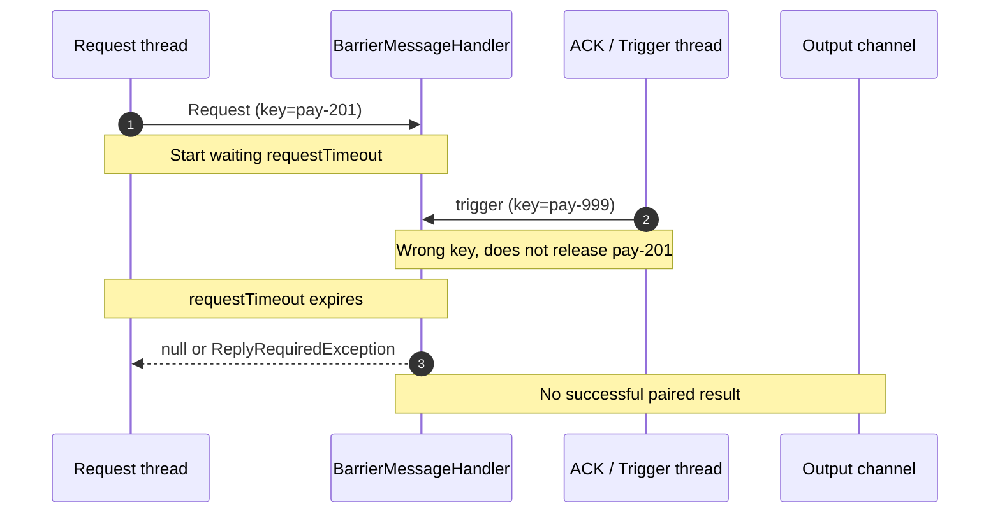
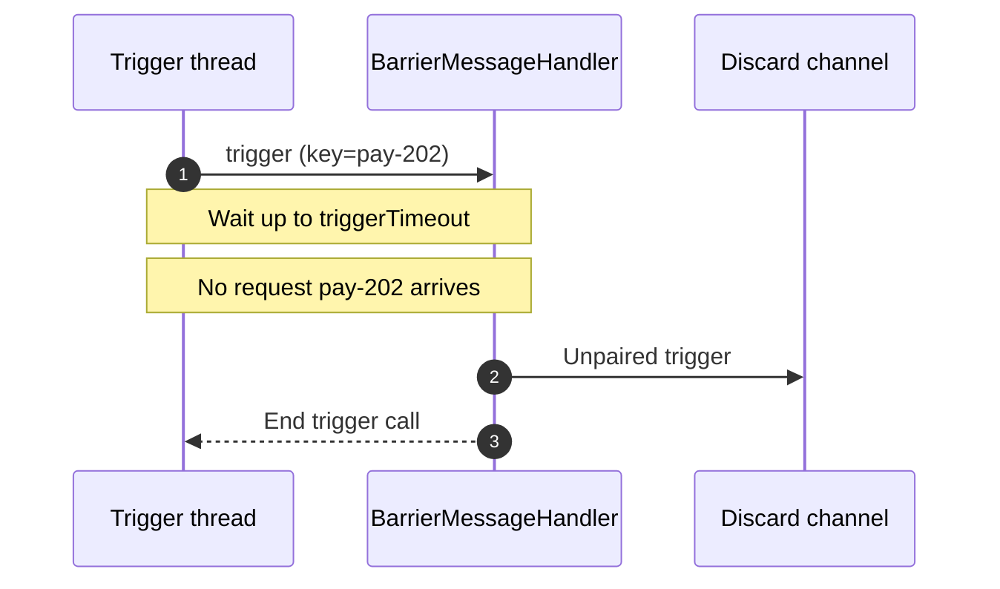

# Timeout When Synchronization Conditions Are Not Met

## 1. Problem: Waiting for Confirmation, but the Sync Condition Never Appears

In the **SPRING_INTEGRATION_PATTERN** module, we build message flows following *Enterprise Integration Patterns* with Spring Integration so components are loosely coupled and extensible. Router, Filter, Transformer, Splitter, Aggregator, Gateway, retry, error channel, and correlation handle distinct roles. **Thread Barrier** serves a specific requirement: **holding a request's processing flow until a corresponding trigger is received, or ending the wait when the deadline expires**.

For example, an API receives a payment request, sends a command to a broker, and waits for an ACK message. Normally, an ACK with the same `correlationId` releases the request. In practice, however, several things can happen:

- The broker has not emitted an ACK due to network errors or slow processing.
- The ACK arrived, but its correlation header was lost during transformation.
- The ACK carries a different `correlationId` than the request, so they cannot be paired.
- The ACK arrives after the deadline the API is allowed to wait.
- The trigger arrives too early, even before the request enters the Barrier.
- The system receives a business "rejected" response, even though the correlation key matches.

Waiting indefinitely ties up threads and connections; assuming command dispatch alone equals success returns wrong results. **A Barrier timeout is a pairing-wait time limit**, allowing the application to terminate gracefully under control when the request and trigger fail to converge within the allowed window.

> **Important distinction:** By default, the condition for a Barrier to release a request is **that a trigger with the same correlation key has appeared**. The Barrier **does not automatically check** whether the ACK has `accepted=true` or whether the business action succeeded. If a rejection ACK is also passed to `trigger()`, the request can still be released and a downstream step must handle the rejection result.

### Learning Objectives

After this lesson, you will be able to:

1. Explain when `requestTimeout` and `triggerTimeout` occur.
2. Configure time limits, `requiresReply`, and `discardChannel` in Java.
3. Distinguish a flow ending due to timeout from a business error or message delivery error.
4. Handle late triggers, mismatched correlation keys, and the concurrency limit of a Barrier.
5. Test the success, timeout, and discard branches and monitor them in production.

## 2. Two Independent Wait Windows of a Thread Barrier

Spring Integration uses `BarrierMessageHandler`. A request entering the input channel makes the request-processing thread wait for at most **`requestTimeout` milliseconds**, unless released earlier by a message passed to `trigger()` with the same correlation key. Conversely, if `trigger()` is called **before the request**, the thread calling trigger itself can wait up to **`triggerTimeout` milliseconds** for the request to arrive. These two limits can differ.

Since Spring Integration 5.4, constructors and configuration support distinguishing `requestTimeout` / `triggerTimeout`; older versions used a single shared `timeout` setting for both sides.

| Property | When does counting start? | Blocked thread | On expiration |
| --- | --- | --- | --- |
| `requestTimeout` | Request reaches Barrier, no matching trigger yet | Thread invoking the request handler | Request stops waiting; return behavior depends on `requiresReply`. |
| `triggerTimeout` | `trigger()` receives ACK but no matching request yet | Thread calling `trigger()` | Trigger stops waiting; may be routed to `discardChannel`. |
| `requiresReply` | Checked when the handler produces no reply for the request | Request flow | `false`: returns `null` and ends the flow; `true`: throws `ReplyRequiredException`. |
| `discardChannel` | Configures destination for triggers that cannot be paired within the wait window | Trigger processing path | Receives late triggers or triggers whose request wait expired; not a channel for request timeouts. |

The timeouts in this table belong to **one Barrier**, not system-wide timeouts. Gateway, HTTP client, broker, listener, database, or upstream/downstream steps may each have their own deadlines.

### 2.1. Request Arrives First, ACK Does Not Meet Pairing Conditions



Here, the fact that an ACK "arrived" does not mean the synchronization condition was satisfied. Two different keys create two independent waiting states; trigger `pay-999` may also be discarded after `triggerTimeout` if no `pay-999` request ever arrives.

### 2.2. Trigger Arrives First, Request Never Arrives



If the ACK-receiving branch uses a `DirectChannel` from a listener, the listener thread can be blocked right at `trigger()`. When ACK rates are high, setting `triggerTimeout` too long can exhaust listener resources. You can offload trigger work to an appropriate `TaskExecutor` while controlling the number of waiting tasks.

## 3. What Actually Happens in the Flow When a Request Times Out?

The default behavior of `BarrierMessageHandler` when no matching trigger arrives before `requestTimeout` is **producing no output message**.

| `requiresReply` | Result at Barrier | Impact on caller |
| --- | --- | --- |
| `false` (default) | Handler returns `null`, current flow ends | Caller may receive no reply; if a Gateway sits upstream, consider the Gateway's reply timeout as well. |
| `true` | Handler throws `ReplyRequiredException` | Caller or an appropriate error flow can detect the request timeout and return an intentional failure response. |

`ReplyRequiredException` does not prove the broker rejected the command or that the command was never processed. It only indicates **the Barrier could not produce a correlated result within the wait limit**. The broker might still complete the operation after the request has timed out.

Therefore, never automatically return "transaction definitely failed" or resend a command without idempotency. An API should normally report an honest status, such as "outcome unconfirmed, query by request ID," and perform reconciliation if needed.

### 3.1. Timeout Is Not a Normal Message on Output

If you need to produce an error DTO instead of throwing an exception, design an **error-handling path** or have the calling layer convert the exception into a strongly typed result. Do not wait on `outputChannel` expecting a default "timeout payload": Thread Barrier does not emit a synthetic success message to output when a request expires.

### 3.2. Distinguishing Deadline Layers

Suppose a system has an HTTP deadline of 6 seconds, pre-Barrier processing takes about 500 ms, and post-Barrier processing reserves 500 ms. You might start with `requestTimeout=4_000ms`, `triggerTimeout=800ms`, while choosing Gateway and HTTP deadlines consistent with the entire flow. This is a **budgeting example**, not a fixed formula for every application:

```text
HTTP client deadline             6000 ms
  |-- routing / validation        500 ms
  |-- Barrier request wait       4000 ms
  |-- transform / response        500 ms
  |-- network / scheduling       1000 ms buffer
```

Note: `requestTimeout` begins when the request **has entered the Barrier**, excluding earlier queuing or processing time. For a Gateway, check both `requestTimeout` for sending to the channel and `replyTimeout` for receiving the reply; identically named properties on different components can have different semantics. Never choose deadlines based solely on the Barrier's seconds.

## 4. Java Configuration: Timeouts, Errors, and Discard

The example below models a system dispatching payment commands and receiving ACKs from an independent callback channel. Both timeouts are configured explicitly, `requiresReply=true` helps detect the request-timeout branch, and `discardChannel` receives unmatched triggers.

```java
import org.springframework.beans.factory.annotation.Qualifier;
import org.springframework.context.annotation.Bean;
import org.springframework.context.annotation.Configuration;
import org.springframework.integration.annotation.ServiceActivator;
import org.springframework.integration.aggregator.BarrierMessageHandler;
import org.springframework.integration.channel.DirectChannel;
import org.springframework.integration.channel.QueueChannel;
import org.springframework.integration.config.EnableIntegration;
import org.springframework.messaging.MessageChannel;
import org.springframework.messaging.MessageHandler;

@Configuration
@EnableIntegration
public class TimeoutBarrierConfig {

    public static final long REQUEST_TIMEOUT_MS = 4_000L;
    public static final long TRIGGER_TIMEOUT_MS = 800L;

    @Bean
    public MessageChannel paymentRequests() {
        return new DirectChannel();
    }

    @Bean
    public MessageChannel paymentAcks() {
        return new DirectChannel();
    }

    @Bean
    public QueueChannel pairedResults() {
        return new QueueChannel();
    }

    @Bean
    public QueueChannel discardedAcks() {
        return new QueueChannel();
    }

    @Bean
    @ServiceActivator(inputChannel = "paymentRequests")
    public BarrierMessageHandler paymentBarrier(
            @Qualifier("pairedResults") MessageChannel outputChannel,
            @Qualifier("discardedAcks") MessageChannel discardChannel) {

        BarrierMessageHandler barrier =
                new BarrierMessageHandler(REQUEST_TIMEOUT_MS, TRIGGER_TIMEOUT_MS);
        barrier.setOutputChannel(outputChannel);
        barrier.setDiscardChannel(discardChannel);
        barrier.setRequiresReply(true);
        return barrier;
    }

    @Bean
    @ServiceActivator(inputChannel = "paymentAcks")
    public MessageHandler releaseOnAck(
            @Qualifier("paymentBarrier") BarrierMessageHandler barrier) {
        return barrier::trigger;
    }
}
```

**Meaning of the configuration:**

- `paymentRequests` sends messages into the request-processing branch, which may hold the thread for up to 4 seconds.
- `paymentAcks` receives ACKs from callbacks; the `releaseOnAck` handler invokes `trigger()` on the **exact same `paymentBarrier` instance**.
- `pairedResults` only receives results when a request–trigger pair is matched successfully; the default payload is a collection of both sides' payloads.
- `discardedAcks` receives triggers that could not match within the wait window, including late triggers or triggers arriving too far ahead of the request. `QueueChannel` in the example is for observation and testing; production needs an appropriate consumer and persistence/reconciliation mechanism.
- `setRequiresReply(true)` turns a request timeout into an error for the calling layer to handle. This setting does not cause a trigger timeout to throw the same exception back to the request.

Prior to Spring Integration 5.4, the single-argument constructor `new BarrierMessageHandler(timeout)` shared one timeout for both request and trigger. In versions supporting two arguments, choosing separate values prevents early triggers from occupying listeners longer than necessary.

## 5. Attaching Correlation IDs and Handling Business ACKs

By default, Barrier uses `IntegrationMessageHeaderAccessor.CORRELATION_ID`, i.e., the `correlationId` header, to pair messages. The value must be attached on both request and trigger and preserved across adapters and transformations.

```java
import org.springframework.integration.IntegrationMessageHeaderAccessor;
import org.springframework.integration.support.MessageBuilder;
import org.springframework.messaging.Message;

String attemptId = "pay-201-attempt-01";

Message<String> request = MessageBuilder.withPayload("CHARGE:order-201")
        .setHeader(IntegrationMessageHeaderAccessor.CORRELATION_ID, attemptId)
        .build();

Message<String> successAck = MessageBuilder.withPayload("ACK:ACCEPTED")
        .setHeader(IntegrationMessageHeaderAccessor.CORRELATION_ID, attemptId)
        .build();

Message<String> wrongAck = MessageBuilder.withPayload("ACK:ACCEPTED")
        .setHeader(IntegrationMessageHeaderAccessor.CORRELATION_ID, "pay-999")
        .build();
```

Request and `successAck` share the same key so they can pair; `wrongAck` cannot release the request waiting for `pay-201-attempt-01`. Even when an ACK has the right key, if it arrives after `requestTimeout`, the old request has already ended. That ACK may wait for another matching request during `triggerTimeout` and then be discarded if none is found.

**When the ACK returns a rejection status:** Do not let the request time out merely because a "rejected" answer arrived. A sound option is to **still call `trigger()` with the rejection ACK carrying the right key** so the request is released promptly; the step after the Barrier inspects the ACK status and produces a business failure result. If you only trigger on success ACKs, you need a direct error path for rejection ACKs rather than turning a known outcome into a hard-to-diagnose timeout.

### 5.1. Why Must You Not Call Both Sides Sequentially on the Same Thread?

Because `paymentRequests` is a `DirectChannel`, `paymentRequests.send(request)` runs the handler on the calling thread; if no trigger exists yet, that call blocks. The following snippet easily leads to a timeout:

```java
// Anti-example: single thread, no independent callback
paymentRequests.send(request); // Waits up to 4 seconds then throws an exception
paymentAcks.send(successAck);  // Never executes in time
```

In practice, `paymentAcks.send(...)` must originate from **an independent listener/callback or worker**, or the request side must be dispatched through a controlled executor. Simply sending to a channel (`send` returning `true`) is also not proof that business confirmation has been received.

## 6. Late Triggers and the Discard Mechanism

Distinguish three trigger arrival timings:

| Trigger arrival timing | Request state | Behavior to observe |
| --- | --- | --- |
| After request, before `requestTimeout` | Waiting on the same key | Pairs and emits output message. |
| Before request, request arrives within `triggerTimeout` | Trigger is waiting | Pairs successfully, despite reversed order. |
| Too long before request, no request before `triggerTimeout` | No matching request yet | Trigger expires and goes to discard if configured. |
| After old request has timed out | Old request has ended | Trigger cannot revive old reply; may wait for a new request with same key or be discarded. |
| Trigger arrives with different correlation key | Needed request keeps waiting | No pairing; trigger with different key has its own wait window. |

`discardChannel` only helps **observe and handle unpaired triggers**; it does not automatically issue payment reversals, guarantee the broker failed the operation, or replace a durable Dead Letter Queue. If late triggers must survive restarts, move them to durable storage chosen by the application.

### 6.1. When a Late Trigger Shares the Same Key as a New Request

This is a subtle design bug: suppose request A uses `orderId=201` as its key, times out, and then the application resends order 201 with the **same** key. An old ACK can pair with the new request if it lands in the wait window, tricking the application into thinking the new attempt was confirmed.

Prevent this by issuing a unique `attemptId` or `commandId` for each confirmation-tracked request, preserving that key across dispatch and ACK, and enforcing idempotency at the broker/destination. A correlation key identifies **one waiting interaction**, not merely a business entity.

### 6.2. Should You Retry Immediately After a Timeout?

A timeout means **no confirmation evidence arrived within the deadline**, not "the command was never executed." Unconditional retries can duplicate work. Before resending a command, check:

1. Does the receiver support an idempotency key or status lookup by `commandId`?
2. Could the previous dispatch still be running or its ACK still be in transit?
3. Is a retry treated as the same logical operation or a new attempt? Correlation and idempotency must be managed consistently.
4. When the API deadline expires, is the status returned to the caller "outcome unknown" or a verified business conclusion?

`RequestHandlerRetryAdvice`, error channels, and Dead Letter Channels are useful mechanisms in the overall flow, but retry policy must be based on operation idempotency rather than exception type alone.

## 7. Do Not Confuse Timeouts with Content Errors or Other Sync Logic

### 7.1. Incorrect or Lost Correlation

An ACK arriving before the deadline but missing the `correlationId` header cannot pair under the default strategy. In flows containing Transformers, Routers, Gateways, or RabbitMQ/HTTP integrations, check headers at **the Barrier entry boundary** and **before calling trigger**. Do not rely on `MessageHeaders.ID`, since request and ACK are normally two distinct messages.

If using a custom header, both branches must apply the **same `CorrelationStrategy`**. For example, using `commandId`:

```java
import org.springframework.integration.aggregator.BarrierMessageHandler;
import org.springframework.integration.aggregator.HeaderAttributeCorrelationStrategy;

BarrierMessageHandler barrier = new BarrierMessageHandler(
        4_000L,
        800L,
        new HeaderAttributeCorrelationStrategy("commandId"));
```

This is a **constructor replacement** in `paymentBarrier`, not a second Barrier to create. When using it, both request and ACK need the `commandId` header; values on both sides must have the same type and consistent `equals()/hashCode()` rules.

### 7.2. A Key Already Has a Waiting Request

Spring Integration allows only **one waiting request per correlation key at a time**. If a second request reuses the key while the first is still waiting, the handler throws an exception; this is a concurrency error, not a request timeout. For waiting on N results or grouping multiple messages, consider an Aggregator with an appropriate release strategy instead of a Barrier.

### 7.3. "Business Condition" Not Met Yet

A Barrier has no built-in predicate to understand `payment.status == APPROVED`. It primarily waits for a trigger **matching the key**. If the business process requires three events such as `paymentConfirmed`, `inventoryReserved`, and `shippingBooked`, design an Aggregator or a stateful process with a clear release strategy. Increasing the Barrier's `requestTimeout` will not turn it into a multi-event collector.

## 8. Handling Errors at Synchronous and Asynchronous Boundaries

`setRequiresReply(true)` reports timeouts back to the request-processing branch, but **where the exception is caught depends on how channels are wired**:

- With `DirectChannel`, the handler runs synchronously and exceptions normally propagate back to the `send()` caller or upstream Gateway.
- With `ExecutorChannel`, queue-backed flows, or async listeners, exceptions occur on worker threads. Configure an `errorChannel` / error flow for the entry point to log and respond.
- If a Gateway expects a reply, do not forget the Gateway's `replyTimeout`. A Gateway timeout does not replace `requestTimeout` inside the Barrier; they may expire at different times.
- If an HTTP client disconnects early, the Barrier may keep waiting until its own deadline unless the flow has proper cancellation. Time budgets must therefore be managed end to end.

A helpful error-handling matrix:

| Symptom | Classification | Suggested action |
| --- | --- | --- |
| `ReplyRequiredException` after ~`requestTimeout` | Expired waiting for matching ACK | Mark status "unconfirmed," return code/error per API contract, reconcile. |
| Trigger sent to `discardedAcks` | ACK found no request within `triggerTimeout` | Log correlation, latency, ACK source; check stale ACKs, wrong keys, or excessive out-of-order delay. |
| Concurrent duplicate correlation on request | Key or request coordination error | Fix key/idempotency generation, bound concurrency. |
| ACK with right key but `accepted=false` | Business rejection result | Release request and route to business failure branch; do not call this a timeout. |
| No trigger logs at application | Event never reached adapter or lost in transit | Inspect broker/listener/transport before tuning Barrier timeouts. |

Do not send entire messages containing sensitive data to logs. Log only necessary identifying fields such as `correlationId`, event type, elapsed time, processing status, and branch name.

## 9. Testing Timeout Scenarios

When testing a Barrier, drive request and trigger on **two independent threads** whenever waiting can occur. To test timeout branches, intentionally omit the counterpart; this tests the exact policy rather than depending on scheduler speed. The example below uses JUnit 5 and Spring Test, assuming `TimeoutBarrierConfig` from section 4 is in the test sources.

```java
import static org.junit.jupiter.api.Assertions.assertEquals;
import static org.junit.jupiter.api.Assertions.assertNotNull;
import static org.junit.jupiter.api.Assertions.assertNull;
import static org.junit.jupiter.api.Assertions.assertThrows;
import static org.junit.jupiter.api.Assertions.assertTrue;

import java.util.UUID;
import org.junit.jupiter.api.Test;
import org.springframework.beans.factory.annotation.Autowired;
import org.springframework.beans.factory.annotation.Qualifier;
import org.springframework.integration.IntegrationMessageHeaderAccessor;
import org.springframework.integration.channel.QueueChannel;
import org.springframework.integration.handler.ReplyRequiredException;
import org.springframework.integration.support.MessageBuilder;
import org.springframework.messaging.Message;
import org.springframework.messaging.MessageChannel;
import org.springframework.messaging.MessagingException;
import org.springframework.test.context.junit.jupiter.SpringJUnitConfig;

@SpringJUnitConfig(TimeoutBarrierConfig.class)
class TimeoutBarrierTest {

    @Autowired @Qualifier("paymentRequests")
    MessageChannel requests;

    @Autowired @Qualifier("paymentAcks")
    MessageChannel acks;

    @Autowired @Qualifier("pairedResults")
    QueueChannel results;

    @Autowired @Qualifier("discardedAcks")
    QueueChannel discarded;

    private Message<String> message(String payload, String key) {
        return MessageBuilder.withPayload(payload)
                .setHeader(IntegrationMessageHeaderAccessor.CORRELATION_ID, key)
                .build();
    }

    @Test
    void requestWithoutMatchingAckTimesOut() {
        String key = "no-ack-" + UUID.randomUUID();

        // DirectChannel allows observing the exception on the test thread.
        MessagingException error = assertThrows(
                MessagingException.class,
                () -> requests.send(message("PAY", key)));

        assertTrue(error.contains(ReplyRequiredException.class));
        assertNull(results.receive(0));
    }

    @Test
    void triggerWithoutRequestIsDiscarded() {
        String key = "early-ack-" + UUID.randomUUID();

        // trigger() waits up to 800ms per configuration.
        assertTrue(acks.send(message("ACK", key)));

        Message<?> late = discarded.receive(1_000);
        assertNotNull(late);
        assertEquals(key, late.getHeaders()
                .get(IntegrationMessageHeaderAccessor.CORRELATION_ID));
    }
}
```

These two negative tests involve real wait intervals because they verify timeouts. Do not assert timing down to the exact millisecond; runtime is affected by thread scheduling and CI machines. `requestWithoutMatchingAckTimesOut` sends no ACK, so it isolates the **unreleased request** case; `triggerWithoutRequestIsDiscarded` sends no request, so it isolates the discard path.

### Cases to Include in a Complete Test Suite

| Test case | Data setup | Expected outcome |
| --- | --- | --- |
| Paired within deadline | Request and ACK with matching `correlationId`, sent from two threads | `pairedResults` receives exactly one paired result before timeout. |
| Trigger arrives early within window | ACK first, request with same key appears shortly after | Still pairs, ACK not discarded. |
| Request without trigger | Send request only | If `requiresReply=true`, observe `ReplyRequiredException`; no success output. |
| Trigger without request | Send ACK only | After `triggerTimeout`, ACK moves to `discardedAcks`. |
| Wrong correlation | Request `A`, trigger `B` | Does not release `A`; each side ends via its respective timeout. |
| Late ACK | Wait for request `A` to time out, then send ACK `A` | Does not produce a result for the expired request; verify discard/reconciliation. |
| Rejection ACK with right key | Matching keys, ACK `accepted=false` | Barrier can release; business step produces rejection result. |
| Concurrent duplicate request key | Two requests with same `A` waiting concurrently | Handler throws an exception for the duplicate request. |
| Correlation type mismatch | Request key string `"123"`, ACK key number `123` | No match; mismatch should be caught by data normalization. |

For tests that must assert early/late arrival order, use an `ExecutorService` and test synchronization primitives (latches, observation hooks, or explicit checkpoints), always using finite timeouts when awaiting `Future`. Never use `Thread.sleep()` as proof that a request has definitely entered the Barrier. After tests, shut down workers and ensure no leftover messages remain in shared `QueueChannel` instances.

## 10. Observing Timeouts in Operations

When many requests hit `requestTimeout`, increasing the timeout value is an understandable reaction, yet it may simply mask an underlying issue. Before tuning, classify the cause:

- **Missing trigger:** the broker genuinely failed to emit an ACK or the listener stopped running.
- **Wrong correlation:** the trigger arrived, but its key did not match, the header was missing, the type differed, or it changed during message transformation.
- **Late trigger:** callback latency exceeded the budget; the old request already ended.
- **Resource exhaustion:** too many waiting threads or listeners blocked in `triggerTimeout`, slowing down new events.
- **Multi-instance routing:** request and trigger with the same key hit two different instances; an in-JVM Barrier does not automatically share waiting state across processes.

A useful set of metrics includes waiting request count, request timeout rate, wait-duration distribution until ACK, discarded trigger count, duplicate-key error count, callback processing time, and total API latency. Include the same `correlationId` in both request and ACK logs to determine whether failure happened before or after the trigger entered the application.

```text
event=request_enter key=pay-201-attempt-01 flow=payment
event=trigger_received key=pay-999 flow=payment
event=request_timeout key=pay-201-attempt-01 waitMs=4000
event=trigger_discarded key=pay-999 reason=unmatched
```

These are **illustrative logs that the application must emit itself**, not a default log format produced automatically by Spring Integration. Distinguish `request_timeout` from `gateway_reply_timeout` and `client_timeout` on dashboards, as they point to different problems.

### Timeout Decision Checklist

1. Determine caller SLA and Gateway/HTTP timeouts, subtracting time needed before and after the Barrier.
2. Measure actual ACK latency distribution; pick `requestTimeout` based on SLA targets and acceptable timeout rate.
3. Choose `triggerTimeout` based on expected skew between callback and request; evaluate listener-thread occupancy impact.
4. Use a per-interaction correlation key and normalize headers on both sides.
5. Enable request timeout detection (`requiresReply=true` where appropriate), handle the error flow, and consume the discard channel.
6. Design reconciliation, idempotency, and late-ACK handling before enabling automatic retries.

For work requiring minutes or hours of waiting, or thousands of concurrent requests, **holding a thread at a Barrier is usually unsuitable**. An asynchronous process with durable state storage, event/callback completion, and scheduled timeouts is a better fit. Barrier does not guarantee restoring waiting threads across application restarts.

## 11. Practice Exercise: Time-Bounded Publish Confirmation

Build a `PublishInvoice` → broker → `InvoiceAck` flow where the API waits for an ACK for at most 3 seconds:

1. Configure a Barrier with `requestTimeout=3000ms`, `triggerTimeout=500ms`, and `requiresReply=true`.
2. Issue a `commandId` for each dispatch; place it in the `correlationId` header of both request and ACK.
3. Create two independent channels. In the success case, deliver the ACK 300–800 ms after the request; observe the output.
4. Omit the ACK. Record the exception and how it is translated into an "unconfirmed" status for the caller.
5. Send an ACK with the wrong ID. Prove that this ACK does not release the request even when it arrives before 3 seconds.
6. Send an ACK more than 500 ms before the request. Observe `discardChannel`; then adjust timing to test an early trigger that still pairs successfully.
7. Send a rejection ACK with the same ID and explain why business rejections should be handled explicitly instead of letting them time out.
8. Simulate a retry for the same invoice: assign a new attempt key and verify that an ACK from the old attempt does not match the new attempt.

**Self-assessment questions**

- When a request has no matching trigger, what does `requiresReply` change in the outcome?
- Why can `triggerTimeout` slow down listener threads even when no request is waiting?
- When an ACK arrives late, why does a Barrier timeout not prove the broker operation failed?
- If you increase `requestTimeout` from 3 seconds to 30 seconds, what is the impact on waiting threads and Gateway/HTTP timeouts?
- Why can an ACK with `accepted=false` and the right key still release the Barrier?
- When multiple events must arrive before releasing, why is an Aggregator more suitable than a Barrier?

## 12. References

- [Spring Integration Reference — Thread Barrier](https://docs.spring.io/spring-integration/reference/barrier.html): description of `requestTimeout`, `triggerTimeout`, `requires-reply`, correlation, discard, and single-request-per-key limit.
- [Javadoc — BarrierMessageHandler](https://docs.spring.io/spring-integration/docs/6.5.x/api/org/springframework/integration/aggregator/BarrierMessageHandler.html): two-timeout constructor, `trigger()`, `setDiscardChannel()`.
- [Javadoc — ReplyRequiredException](https://docs.spring.io/spring-integration/api/org/springframework/integration/handler/ReplyRequiredException.html): meaning of the error when a handler is required to produce a reply.
- [Spring Integration Reference — Messaging Gateways](https://docs.spring.io/spring-integration/reference/gateway.html): request/reply deadlines at the Gateway boundary.

> **Takeaway:** A Barrier timeout reports that **no matching request–trigger pair formed within the wait window**, rather than asserting that the business task failed. A complete design must distinguish request timeout, trigger timeout, wrong correlation, late ACK, and rejection ACK—then handle errors, discards, observability, and reconciliation according to the business contract.
