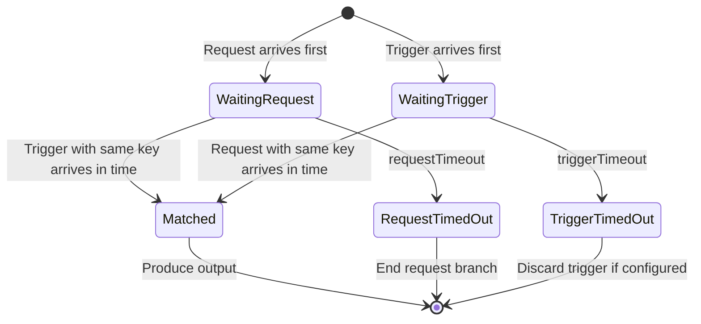
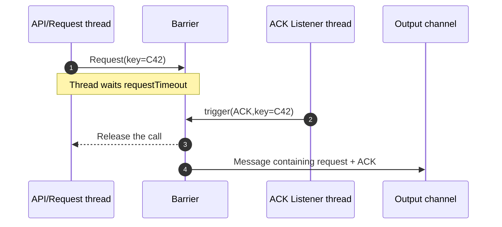
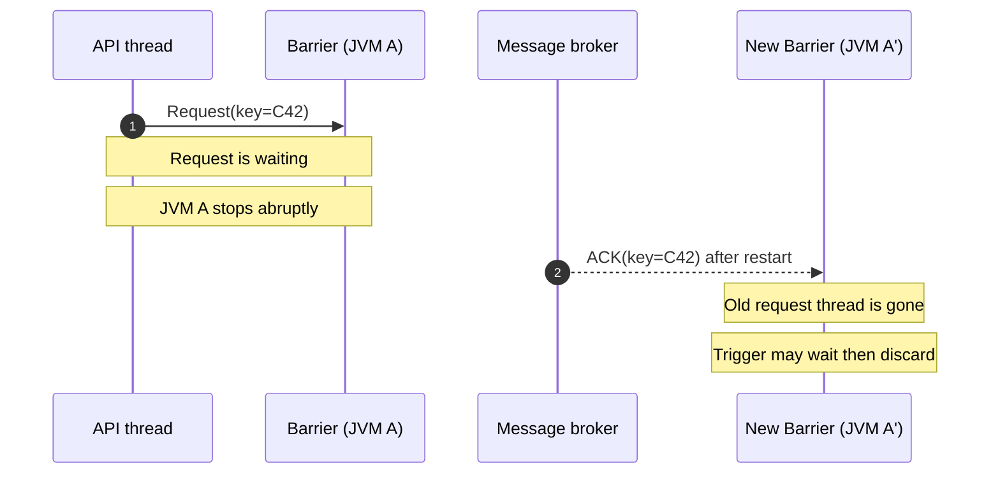
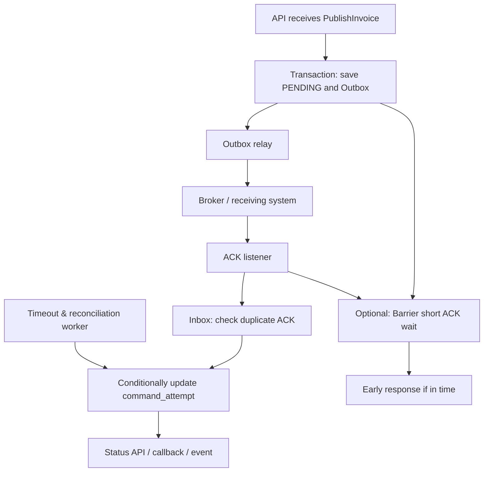
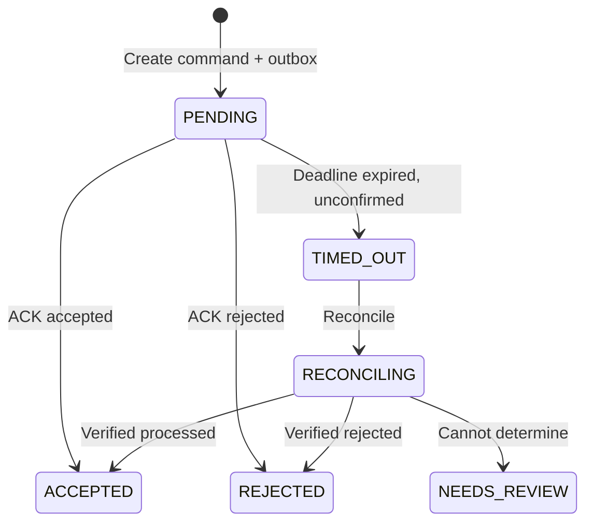

# Barrier State and Persistence

## 1. Problem: What Happens If the Application Shuts Down While Waiting for an ACK?

In the **SPRING_INTEGRATION_PATTERN** module, we practice *Enterprise Integration Patterns* with Spring Integration to build message flows that are loosely coupled, scalable, testable, and observable. Router, Filter, Transformer, Splitter, Aggregator, Gateway, retry, error channel, and correlation address different responsibilities. **Thread Barrier** creates a synchronization point between a request and an asynchronous trigger, such as an invoice-issuance command waiting for a broker ACK.

An important question when taking a Barrier into production is: **where does the waiting state live, and can it be recovered after a process failure?**

Consider the following flow:

1. The API receives a `PublishInvoice` command with `commandId=inv-42-attempt-1`.
2. The application sends the command to the broker, then routes the request into `BarrierMessageHandler`.
3. The Barrier waits for an ACK with the same `correlationId` for up to 5 seconds.
4. The application restarts after 2 seconds, before the ACK arrives.
5. The broker emits the ACK at second 3, after the application has restarted.

An ACK having the right key does not mean the old waiting thread still exists. Once the JVM stops, **the thread, call stack, and waiting session of the old Barrier are gone**. A new Barrier instance does not automatically resume the pre-restart call. This is a design constraint that directly affects reliability, deployment scale, and how the application reports status to callers.

### After This Lesson, You Will Be Able To

- Distinguish the **in-memory waiting state** of a Barrier from **durably persisted business state**.
- Explain why timeouts, restarts, crashes, or distributing requests/ACKs across multiple instances can break pairing.
- Configure a Barrier for short interactions and recognize the limitations of `BarrierMessageHandler`.
- Design a durable workflow using a database, outbox/inbox, idempotency, and reconciliation jobs.
- Test process-loss scenarios, late ACKs, duplicate ACKs, and races between timeouts and ACKs.

## 2. What Does the "State" of a Thread Barrier Mean?

Spring Integration provides `BarrierMessageHandler`, which also implements `MessageTriggerAction`. A request enters the handler; another message is passed to `trigger(message)`. The handler uses a `CorrelationStrategy` to match pairs with the same key. By default, the correlation strategy reads the `IntegrationMessageHeaderAccessor.CORRELATION_ID` header.

When the request arrives before the trigger, **the request-processing thread is blocked** until a matching trigger arrives or `requestTimeout` expires. When the trigger arrives before the request, **the thread calling `trigger()` can be blocked** for up to `triggerTimeout`. Only one request thread may wait on the same correlation key at a time; a second concurrent request using the same key triggers an exception.

The *observable lifecycle* of a message pair can be modeled as follows. This is a **conceptual model for design and operations**, not an enum of state names or a database table created by Spring Integration:



| Information | Why the Barrier needs it | Is it durable business state? |
| --- | --- | --- |
| Correlation key | Pairs the matching request and trigger | No. The key is used in pairing logic and may also be stored outside the application. |
| Waiting request/trigger | Coordinates the two calls into the handler | No. Tied directly to the thread and process lifetime. |
| Wait deadline | Stops waiting and frees resources | No. `requestTimeout`/`triggerTimeout` is wait-behavior configuration. |
| Successful pairing result | Returns a message downstream | Does not by itself guarantee durable storage or delivery. |
| Command status `PENDING`/`ACKED` | Enables business lookup and reconciliation | **Yes**, if the application explicitly writes it to durable storage. |

Do not infer from the existence of `MessageStore` or `MessageGroupStore` in Spring Integration that a Barrier automatically persists waiting sessions to a database. **The configuration API of `BarrierMessageHandler` does not provide a `MessageStore` mechanism to restore waiting threads.** Official documentation describes this component as a *suspend thread* mechanism; this is the core nature to keep in mind when choosing an architecture.

### 2.1. Lifecycle When Everything Works



By default, the output message's payload is a collection of the request and trigger payloads, built by `DefaultAggregatingMessageGroupProcessor`. The correctness of the **business outcome** still needs separate handling (a "rejected" ACK can match the key yet still not be a success).

### 2.2. Lifecycle During a Crash



If the source message is redelivered by a broker or the API client resends the request after a restart, that is **a new execution** that must be governed by an idempotency contract and persisted state; it is not the JVM "recovering" the old thread.

## 3. Persistence: Three Scopes That Must Be Separated

In messaging systems, the word "persistence" is often used for three different goals:

| Scope | Example | Data stored | What is NOT guaranteed |
| --- | --- | --- | --- |
| **Message transport** | Durable queues, persistent broker messages, queue backing via `JdbcChannelMessageStore` | Messages still in the queue, depending on transport guarantees | Does not restore the call stack or waiting thread inside a Barrier. |
| **Message aggregation** | Aggregator with `MessageGroupStore` and group management | Message group data by correlation | Does not turn Thread Barrier into a durable workflow; release mechanics differ. |
| **Business workflow** | `command_attempt` table, outbox, inbox, ACK status, and deadlines | Task identity, confirmed status, history, continuation conditions | Does not automatically send a reply to a lost HTTP connection; the application must design a notification/result channel. |

**Durably stored messages ≠ durably stored thread-wait sessions.** For example, placing a `QueueChannel` backed by JDBC before a Barrier can allow an unconsumed message to be retrieved after a restart, but it does not restore an interrupted `handleRequestMessage` call inside the JVM. You must also manage the message source's ACK/commit mechanism to know which messages will be redelivered.

### 3.1. Do Not Blindly Apply Aggregator Guidance to Barrier

An Aggregator manages **message groups** and release strategies, and can use a persistent `MessageGroupStore` as configured. A Barrier coordinates **two correlated calls and holds a thread**. They may share `CorrelationStrategy`, but they have different lifecycles and goals.

If you need to wait for all three business events such as `paymentAccepted`, `inventoryReserved`, and `shippingBooked`, an Aggregator or a stateful workflow is usually more appropriate. If you only need a very fast ACK within the same process, Barrier is a simple and clean option.

## 4. Configuring Barrier for a Short Wait Segment

The Java example below uses two message paths: requests enter the handler, and ACKs enter a `MessageHandler` that calls `trigger()` on the **same instance**. Paired results and unmatched triggers go to separate channels. This is a configuration for short in-process interactions; business persistence is designed in the following sections.

```java
import org.springframework.beans.factory.annotation.Qualifier;
import org.springframework.context.annotation.Bean;
import org.springframework.context.annotation.Configuration;
import org.springframework.integration.annotation.ServiceActivator;
import org.springframework.integration.aggregator.BarrierMessageHandler;
import org.springframework.integration.channel.DirectChannel;
import org.springframework.integration.channel.QueueChannel;
import org.springframework.integration.config.EnableIntegration;
import org.springframework.messaging.MessageChannel;
import org.springframework.messaging.MessageHandler;

@Configuration
@EnableIntegration
public class ShortWaitBarrierConfig {

    @Bean
    public MessageChannel shortWaitRequests() {
        return new DirectChannel();
    }

    @Bean
    public MessageChannel brokerAcknowledgements() {
        return new DirectChannel();
    }

    @Bean
    public QueueChannel shortWaitResults() {
        return new QueueChannel();
    }

    @Bean
    public QueueChannel lateAcknowledgements() {
        return new QueueChannel();
    }

    @Bean
    @ServiceActivator(inputChannel = "shortWaitRequests")
    public BarrierMessageHandler shortWaitBarrier(
            @Qualifier("shortWaitResults") MessageChannel results,
            @Qualifier("lateAcknowledgements") MessageChannel lateAcks) {
        // Request waits at most 3 seconds; early ACK waits at most 500ms.
        BarrierMessageHandler handler = new BarrierMessageHandler(3_000L, 500L);
        handler.setOutputChannel(results);
        handler.setDiscardChannel(lateAcks);
        handler.setRequiresReply(true);
        return handler;
    }

    @Bean
    @ServiceActivator(inputChannel = "brokerAcknowledgements")
    public MessageHandler releaseBarrier(
            @Qualifier("shortWaitBarrier") BarrierMessageHandler barrier) {
        return barrier::trigger;
    }
}
```

When a request times out, `requiresReply=true` makes the request branch throw `ReplyRequiredException`. If left at the default `false`, the handler returns `null` and the flow ends. A trigger arriving after a request timeout may still wait for a matching request for `triggerTimeout` and then be routed to `lateAcknowledgements`. **`discardChannel` helps observe late triggers; it is not persistence for unconfirmed requests.**

To pair both sides properly:

```java
import org.springframework.integration.IntegrationMessageHeaderAccessor;
import org.springframework.integration.support.MessageBuilder;
import org.springframework.messaging.Message;

String commandId = "inv-42-attempt-1";

Message<String> request = MessageBuilder.withPayload("PUBLISH_INVOICE")
        .setHeader(IntegrationMessageHeaderAccessor.CORRELATION_ID, commandId)
        .build();

Message<String> ack = MessageBuilder.withPayload("ACK:ACCEPTED")
        .setHeader(IntegrationMessageHeaderAccessor.CORRELATION_ID, commandId)
        .build();

// Both messages must be sent from independent branches/threads.
// Sending request sequentially and then ACK on the same thread may block.
```

Performance note: with `DirectChannel`, the request-sending thread may wait until matched or timed out; the thread calling `trigger()` may also wait if the ACK arrives first. A large number of waiting requests puts pressure on thread pools. If you need to decouple from the listener thread, you can offload the trigger call to a bounded executor, though this **does not** create persistence or fault tolerance across restarts.

## 5. Failure Matrix: What State Survives a Restart?

| Event | What happens to the Barrier | What the application must do |
| --- | --- | --- |
| Request waiting, JVM crash | Request thread is lost; no old call remains to release | Use the persisted `commandId` to identify the `PENDING` task and recover via business workflow. |
| Trigger waiting, JVM crash | Trigger thread is lost | Ensure the ACK source can redeliver or persist ACK data before further processing. |
| Request times out, broker still processes | Wait flow ends; business failure is not proven | Record "outcome unknown," reconcile with broker/partner, avoid retries that duplicate work. |
| Request on JVM A, ACK arrives at JVM B | Two local Barriers do not automatically see each other's pairs | Route to the same coordinator or move to a durable workflow using shared state. |
| Old ACK received after restart | New Barrier has no knowledge of the prior wait session | Use inbox/idempotency and status table to apply the ACK to the right task; never mis-pair with another attempt. |
| Two requests with same key arrive concurrently | Barrier forbids two request threads waiting on the same key | Use per-attempt keys, prevent duplicates, and enforce idempotency before the Barrier. |

### 5.1. Sticky Routing Does Not Solve Crashes

Routing the same `commandId` to one instance can help request and ACK meet **while that instance is alive**. But if the instance dies or is replaced during a rolling deployment, the waiting call is lost. Sticky routing is a coordination optimization for short wait paths, **not a durable failover mechanism**.

### 5.2. Do Not Equate `timeout` with `FAILED` Status

A Barrier timeout is a conclusion about **local synchronization state**: no pair formed during the wait window. The broker may have received the command and finished processing while the ACK was in flight. In a durable model, use a `TIMED_OUT` or `UNKNOWN` status that accurately reflects uncertainty, then reconcile before concluding failure.

## 6. Durable Architecture: Let the Database Hold Business Truth

If a transaction must continue correctly after a restart, design a **durable workflow**. The synchronous Barrier wait is then only an optimization for callers wanting an early response, not the sole source of truth.

A foundational design includes:

1. **State table** storing each `commandId`, `businessId`, `status`, `deadlineAt`, and ACK result.
2. **Transactional outbox** storing the outbound event in the same transaction that creates the `PENDING` state; a separate worker sends messages to the broker.
3. **Inbox/deduplication** receiving ACKs, recording processed markers by stable event ID, and updating state idempotently.
4. **Reconciler/timeout worker** scanning expired commands, reconciling with the receiving system, and marking appropriate states.
5. **Status API or callback/event** allowing callers to fetch results after the original HTTP request expired or the JVM restarted.



**Key point:** If `I` dies, parts `B`, `F`, `G`, and `K` can still determine the outcome from durable data. Do not promise that an old HTTP connection will automatically reconnect after a server restart.

### 6.1. Correlation and Idempotency Contract

A single request may have multiple dispatches. For example:

```json
{
  "orderId": "INV-42",
  "commandId": "inv-42-attempt-1",
  "idempotencyKey": "publish-inv-42"
}
```

- `orderId` identifies the business invoice.
- `commandId` identifies **one interaction attempt** to pair with an ACK; it also serves as the correlation key.
- `idempotencyKey` identifies the logical action so the receiver avoids duplicate execution when the broker redelivers or the client retries.

The latter two keys may coincide in simple models, but you should not assume they share the same lifecycle. If an old ACK may arrive after a new attempt is sent, `commandId` must distinguish attempts. When business deduplication across attempts is required, the receiver needs a shared idempotency contract or lookup mechanism.

### 6.2. Illustrative Data Schema

The SQL statements below illustrate the **data model concept**; column types, constraints, and timestamp syntax must be adapted to your database engine:

```sql
CREATE TABLE command_attempt (
    command_id      VARCHAR(128) PRIMARY KEY,
    business_id     VARCHAR(128) NOT NULL,
    idempotency_key VARCHAR(128) NOT NULL,
    status          VARCHAR(32) NOT NULL, -- PENDING, ACCEPTED, REJECTED, TIMED_OUT...
    ack_result      VARCHAR(32),
    deadline_at     TIMESTAMP WITH TIME ZONE NOT NULL,
    created_at      TIMESTAMP WITH TIME ZONE NOT NULL,
    updated_at      TIMESTAMP WITH TIME ZONE NOT NULL,
    version         BIGINT NOT NULL DEFAULT 0
);

CREATE TABLE outbox_event (
    event_id        VARCHAR(128) PRIMARY KEY,
    command_id      VARCHAR(128) NOT NULL,
    payload_json    TEXT NOT NULL,
    publish_state   VARCHAR(32) NOT NULL, -- NEW, SENT
    created_at      TIMESTAMP WITH TIME ZONE NOT NULL
);

CREATE TABLE processed_ack (
    ack_event_id    VARCHAR(128) PRIMARY KEY,
    command_id      VARCHAR(128) NOT NULL,
    received_at     TIMESTAMP WITH TIME ZONE NOT NULL
);
```

At a minimum, add appropriate indexes on `status` and `deadline_at` so workers can query expired pending commands. `processed_ack.ack_event_id` must be an ACK identifier **stable across redeliveries**; if the broker does not provide this ID, design a deduplication rule per the protocol contract rather than generating a new UUID on every receipt.

### 6.3. Durable State Machine



This is an **application-defined state machine**. You may add `CANCELLED` or other business states depending on the contract. Crucially, timeouts and ACKs can arrive concurrently, so state transitions must be **atomic**.

Example using a transaction and conditional update:

```sql
-- ACK branch: complete only commands still PENDING and before deadline.
UPDATE command_attempt
SET status = 'ACCEPTED',
    ack_result = 'ACCEPTED',
    updated_at = :now,
    version = version + 1
WHERE command_id = :commandId
  AND status = 'PENDING'
  AND deadline_at > :now;

-- Timeout branch: transition only expired PENDING commands.
UPDATE command_attempt
SET status = 'TIMED_OUT',
    updated_at = :now,
    version = version + 1
WHERE command_id = :commandId
  AND status = 'PENDING'
  AND deadline_at <= :now;
```

The application must check the **updated row count**. If it is 0, re-read the current state to decide: duplicate ACK, ACK after deadline, already `REJECTED`, or another worker just updated it. Late ACKs should still be recorded and routed to the appropriate reconciliation workflow; never silently ignore them just because `UPDATE` matched zero rows.

**Transaction boundary:** Inserting into `processed_ack` and updating `command_attempt` should live in the same database transaction. Emitting subsequent events should also go through an outbox if crash recovery is required. A normal database transaction does not guarantee atomicity with broker publishing; that is why the outbox pattern is useful.

### 6.4. Send Ordering and Early ACKs

If an ACK arrives before the database has the `PENDING` record, the listener will not know which command to update. One way to avoid this race is:

1. In a single transaction, insert the `PENDING` command record and the outbox event.
2. **Commit** this transaction.
3. The relay publishes only committed outbox events.
4. The ACK listener uses `commandId` to update the already existing record.

If the relay crashes after publishing but before marking `SENT`, the event may be published again. The receiver must handle duplicates idempotently; do not claim that an outbox automatically provides "exactly once" delivery. If an ACK arrives before the outbox row is marked `SENT`, that is normal: **the command state** is the source of truth for determining the outcome.

## 7. Combining Barrier with a Durable Workflow

You can combine both when most ACKs arrive quickly, while still needing recovery:

```text
API creates commandId and saves PENDING + outbox
    |
    +--> Return 202 Accepted + status URL immediately (safest for long tasks)
    |
    +--> Optional: try a short ACK wait via Barrier
                      |
                      +-- ACK in time: look up persisted state, return result
                      |
                      +-- Timeout/crash: caller polls status by commandId

ACK listener --> store/dedupe ACK + update state --> optionally trigger local Barrier
Reconciler   --> handle expired PENDING items and late ACKs
```

If you choose the "short wait" branch, **persist business state before starting to wait**. The ACK listener should update the database first (or follow a clearly guaranteed confirmation sequence), and only then call `trigger()` to wake a live request. If no request thread is waiting on the current instance, the ACK must still be processed durably and the caller later retrieves the outcome via the Status API.

In multi-instance systems, do not send an ACK to an arbitrary Barrier assuming the request is sitting there. You can use key-based sticky routing to optimize the fast-reply path, but without full coordination and failover control, treat waking the Barrier as **best effort**. The database and business state still guarantee consistency.

### 7.1. Do Not Hold Threads Too Long

Thread Barrier fits short wait times, bounded request volumes, and synchronous reply needs. For example, 100 requests/second with a 3-second average wait can result in roughly 300 concurrent waiting calls at steady state (estimated by throughput × latency, excluding queues and traffic spikes). That is a lot of threads if the entry path uses blocking threads.

For workflows waiting minutes, hours, or millions of concurrent tasks, avoid dedicating a thread per task. Using persistent state + events/callbacks/polling and recovery workers is much more suitable.

## 8. Persistence and Recovery Test Scenarios

A Barrier test that merely confirms an ACK within a few milliseconds is not enough to prove reliability. Add tests grounded in **database state**:

| Scenario | Action | What must be proven |
| --- | --- | --- |
| Normal ACK | Create `PENDING`, publish, receive ACK with right key | DB transitions to `ACCEPTED`/`REJECTED` exactly once; Barrier may return early. |
| Crash after outbox save, before publish | Stop relay then restart | Outbox event remains for relay to send after restart. |
| Crash after publish, before marking `SENT` | Publish then stop relay mid-way | Relay may resend; receiver deduplicates via idempotency key. |
| Crash while Barrier is waiting | Stop waiting instance, then receive ACK | Do not promise restoring old HTTP thread; DB receives ACK and Status API returns result. |
| ACK delivered twice | Redeliver same `ackEventId` | Does not update or notify business state twice; duplicate recorded. |
| ACK arrives after deadline | Timeout worker already marked `TIMED_OUT`, ACK arrives | Record ACK and reconcile; do not treat timeout as proof of non-processing. |
| Timeout racing with ACK | Have two workers race to update `PENDING` | Only one transition wins via `status`/`deadline` guard; the other reads and handles the state. |
| Two instances | Request on A, ACK on B | State in DB is correct; does not depend on whether Barrier A is woken. |
| ACK with wrong key | Send ACK belonging to another command | Does not update wrong record; detects missing/nonexistent key. |
| Duplicate concurrent waiting request | Two parallel requests with same correlation | Deduplicated before Barrier or exception handled and logged properly. |

To simulate restarts, use integration tests with real-lifecycle databases/brokers or suitable containers; unit tests that merely instantiate a new handler cannot simulate full transactions, redelivery, and crashes. Pin pause points using hooks/latches instead of guessing timing with `Thread.sleep()`. When testing timeouts, use finite deadlines and assert state outcomes rather than exact milliseconds.

### 8.1. Invariants to Test Automatically

1. The same `commandId` never creates two unintended concurrent business operations.
2. One `ackEventId` produces at most one accepted state transition.
3. A completed state is never overwritten by a late-running timeout worker.
4. When an ACK arrives late, a trail and reconciliation path exist; no silent event loss.
5. After a crash, every `PENDING` item has a clear mechanism to continue or expire.
6. Clients have a way to look up outcomes using a stable ID even after the initial connection closes.

## 9. Observing Waiting State and Durable State

During incidents, inspect **two distinct layers**:

| Layer | What to measure | Meaning |
| --- | --- | --- |
| Local Barrier | Waiting request count (instrumented by app if needed), wait duration, timeouts, discarded triggers | Short-term sync health and JVM resources. |
| Durable workflow | `PENDING` command count, `PENDING` age, received ACKs, unsent outbox rows, retry count | Ability to resume work across restarts. |
| Recovery | `TIMED_OUT` items needing reconciliation, late ACKs, duplicates, commands needing manual review | Error-handling quality and business outcome completeness. |

Structured log example:

```text
event=command_created    commandId=inv-42-attempt-1 status=PENDING
event=barrier_wait_start commandId=inv-42-attempt-1 timeoutMs=3000
event=barrier_timeout    commandId=inv-42-attempt-1
event=ack_received       commandId=inv-42-attempt-1 ackEventId=ack-9001
event=state_reconciled   commandId=inv-42-attempt-1 status=ACCEPTED
```

These lines illustrate a single late-ACK scenario and are **application logs you must emit explicitly**, not default logs produced by `BarrierMessageHandler`. Include `traceId` to follow request paths and `commandId` for business lookup, but avoid using `commandId` as a high-cardinality metric label. Never log payment payloads, tokens, or sensitive customer data.

**Operational warning:** Unbounded `QueueChannel` instances in the Java example are only for demonstration; without consumers reading `lateAcknowledgements`/`shortWaitResults`, messages can accumulate in memory. In production, configure capacity policies, consumers, retries, and real persistence according to your requirements.

## 10. Architectural Decisions to Answer

Before choosing Barrier, the team should clarify:

- **SLA:** How long can the caller wait? Are HTTP/Gateway/broker timeouts consistent with `requestTimeout`?
- **Durability:** If the process dies while waiting, must the task still resume/reconcile?
- **Scale:** How many threads might be waiting? Could listeners block on `triggerTimeout`?
- **Correlation:** Is the key per entity or per attempt? Could an old ACK mis-pair with a new attempt?
- **Idempotency:** If the outbox/broker redelivers, could the operation execute twice?
- **Multi-instance:** Can request and ACK hit different nodes? What is the shared state store?
- **Unknown outcomes:** On expiration, does the UI/API return `UNKNOWN`, `202 Accepted`, or another contract status?
- **Recovery:** Who runs reconciliation, monitors the `PENDING` backlog, and handles late ACKs?

A quick selection guide:

| Requirement | Approach to consider |
| --- | --- |
| Very fast ACK, caller needs an immediate reply, handled on one instance | Thread Barrier with clear timeouts, proper correlation, and error/discard paths. |
| Restarts/multi-instance exist, business outcome must not be lost | Durable state + outbox/inbox + reconciliation; Barrier is only an optional wait layer. |
| Waiting for multiple messages in the same group | Aggregator with release strategy and `MessageStore` as needed for durability. |
| Work spanning minutes or hours | Event-driven workflow, status API/callback, deadlines, and recovery workers; no waiting threads. |

## 11. Practice Exercise

Design an invoice-issuance service capable of surviving restarts while waiting for an ACK:

1. Create requests with a distinct `commandId` per dispatch attempt, persisting a `PENDING` record and an outbox event in the same transaction.
2. Have an outbox relay send the command to a simulated broker; the returned ACK contains `commandId` and `ackEventId`.
3. Configure `BarrierMessageHandler` with `requestTimeout=3000ms`, `triggerTimeout=500ms` to **optionally** return fast results to callers. Separate request and trigger threads.
4. The ACK listener first records into the inbox and updates the DB idempotently; only then does it attempt to trigger the local Barrier.
5. Stop the application while the Barrier is waiting; restart it and receive the ACK. Verify that the Status API still reads the result from the database.
6. Send the same ACK twice, race the timeout worker against the ACK listener, and verify conditional state updates prevent bad overwrites.
7. Stop the outbox relay after publishing but before marking `SENT`, then restart to verify duplicate handling.
8. Deliver an ACK after the deadline and verify history/reconciliation paths; do not automatically assume the broker failed.

**Self-assessment questions:**

1. Why does storing messages in a persistent queue not equate to persisting a waiting thread inside a Barrier?
2. If an ACK reaches instance B while the request sits on instance A, why can having the same correlation key still fail to produce output?
3. When the outbox relay resends a message after a crash, what is the role of the idempotency key?
4. Why must you check the affected row count of `UPDATE ... WHERE status='PENDING'`?
5. Why can an operation that hit `requestTimeout` still be confirmed as successful by the broker afterward?
6. When the requirement is solely a short ACK within a single JVM, when is adding a full durable workflow system unnecessary?

## 12. References

- [Spring Integration Reference — Thread Barrier](https://docs.spring.io/spring-integration/reference/barrier.html): purpose of holding threads, correlation, timeouts, `requires-reply`, discard, and the single-request-per-key limit.
- [Spring Integration Javadoc — BarrierMessageHandler](https://docs.spring.io/spring-integration/docs/6.4.x/api/org/springframework/integration/aggregator/BarrierMessageHandler.html): `trigger()` API, timeout constructors, `setDiscardChannel()`.
- [Spring Integration Reference — Aggregator](https://docs.spring.io/spring-integration/reference/aggregator.html): message group management, release strategies, MessageStore, and handling expired groups.
- [Spring Integration Reference — Message Store](https://docs.spring.io/spring-integration/reference/message-store.html): message persistence mechanisms for components that support them.

> **Takeaway:** A Barrier holds **short-lived synchronization state tied to an in-process thread**. If business operations must survive crashes, restarts, or cross-instance routing, persist **separate business state** with correlation keys, deadlines, and ACK outcomes; use outbox/inbox, idempotency, and reconciliation for recovery. Never confuse a Barrier timeout with confirmed business failure, nor confuse message persistence with restoring a waiting thread.
