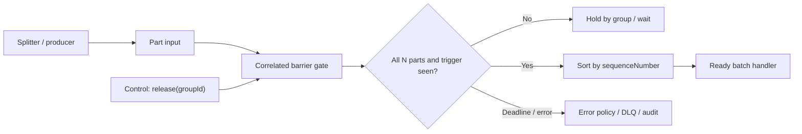
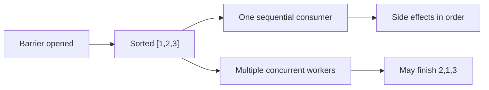

# Handling Out-of-Order Messages with Barrier in Spring Integration

> **Module:** `SPRING_INTEGRATION_PATTERN` — Learn to implement Enterprise Integration Patterns with Spring Integration to build loosely coupled and extensible message flows. Practice Router, Filter, Transformer, Splitter, Aggregator, Gateway, retry, error channel, and correlation, while testing and monitoring processing branches.
>
> **Chapter:** Barrier  
> **Topic:** Handling out-of-order messages

## 1. Problem: The Third Message Arrives Before the First

A system receives a batch of three orders, then splits each order to validate, calculate fees, and store results. Processing time varies per item:

- **Item 1:** takes 450 ms.
- **Item 2:** takes 120 ms.
- **Item 3:** takes 200 ms.

If branches run concurrently, results may arrive as **2 → 3 → 1**. Meanwhile, a control flow emits a "permission to release batch" signal once an external condition is satisfied.

Business requirements:

1. **Do not release** the batch result until all three items have arrived.
2. Release **only after** the permission signal has arrived.
3. Upon release, items must be ordered in **logical order 1 → 2 → 3**, not completion order.
4. Do not release twice if a message or signal is redelivered.
5. If an item is missing, enforce a clear deadline, alert, and handling policy; never wait forever.

This scenario combines the **Barrier** concept (waiting for a gate-opening condition) with **correlation, group completeness counting, and ordering**. A plain Barrier by itself is not a message resequencer.

### Learning Outcomes

After this lesson, you will be able to distinguish **arrival order**, **processing order**, **completion order**, and **emission order**; determine the right moment to open a Barrier; use correlation IDs and sequence metadata to collect messages; design for early or late triggers; choose Barrier, Resequencer, and Aggregator for the right purpose; write Java examples wired with Spring Integration; and test duplicates, timeouts, retries, and multiple instances.

## 2. Four Kinds of Ordering Often Conflated

| Order type | Meaning | Example |
|---|---|---|
| **Arrival order** | Order in which messages reach a channel or adapter | 2 → 3 → 1 |
| **Processing order** | Order in which handlers begin processing messages | 2 → 1 → 3 |
| **Completion order** | Order in which branches finish work | 3 → 2 → 1 |
| **Emission order** | Order in which downstream sees emitted messages/results | 1 → 2 → 3, if coordinated |

A `DirectChannel` with a single synchronous caller makes the path of each send predictable, yet **does not turn multiple concurrent producers into a global business order**. With `ExecutorChannel`, pollers, broker partitions, or retries, completion time and downstream arrival order can differ from input order.

To define "in order," there must be a **business-meaningful sequence number**. Arrival order on a thread, log timestamps, or message IDs are not always the required batch order.

Example:

```text
Batch release signal:          release(B-42)
Actual completed messages:     part 2, part 3, part 1
Desired business outcome:      [part 1, part 2, part 3]
```

You cannot satisfy the last requirement simply by "waiting 300 ms and then sending everything."

## 3. Barrier, Resequencer, Aggregator: Different Responsibilities

In Enterprise Integration Patterns, these three mechanisms are related but not equivalent.

| Mechanism | Core question | Its specific guarantee |
|---|---|---|
| **Barrier** | *When is data allowed to proceed?* | Waits for a release signal/condition under a correlation key |
| **Resequencer** | *In what order must messages be emitted?* | Buffers or orders items to emit according to a sequence rule |
| **Aggregator** | *When is a group complete and how is it combined?* | Groups multiple messages and releases per a strategy |
| **Splitter** | *Which child messages is an input message split into?* | Fan-out; can attach sequence/correlation metadata |
| **Router** | *Which branch does a message go to?* | Chooses channel/destination; does not guarantee completion order |

Spring Integration provides a Barrier mechanism for synchronizing a data flow with a release condition. Specific Barrier API usage depends on version and flow type. **Never assume a Barrier automatically orders messages by `sequenceNumber`.** When output ordering is required, combine a Resequencer, an Aggregator producing sorted output, or an explicit coordinator.

### When Is a Barrier Not Needed?

If you only need the result of three items in order without an external release signal, you can use an **Aggregator** with a correlation/release strategy and sort the output; or a **Resequencer** if downstream must receive individual messages sequentially.

If the requirement is simply "do not call the API until the partner signals readiness" without reordering, a Barrier driven by the control signal may suffice. Do not add a Resequencer merely because multiple threads exist.

## 4. Reference Topology for Out-of-Order Messages



There are **two independent sources**:

- **Data branch:** carries child messages, `correlationId`, `sequenceNumber`, and `sequenceSize`.
- **Control branch:** sends the opening signal with the same correlation key, for example after a validation/approval condition finishes.

**Output may only be emitted when both conditions hold:**

\[
\mathrm{ready}(g)
=
\mathrm{triggerSeen}(g)
\land
\mathrm{allExpectedPartsPresent}(g)
\]

If order is a business requirement, once `ready(g)` holds, build the list ordered by sequence number rather than relying on the iteration order of an unordered map.

In production applications, waiting state must not live forever: you need timeouts, limits on open groups, an appropriate message store, a late-signal policy, and restart recovery.

## 5. Using Correlation and Sequence Metadata Properly

A batch can be represented by three items:

| Payload | `correlationId` | `sequenceNumber` | `sequenceSize` |
|---|---|---:|---:|
| `order-a` | `batch-42` | 1 | 3 |
| `order-b` | `batch-42` | 2 | 3 |
| `order-c` | `batch-42` | 3 | 3 |

- `correlationId` identifies the **group**, not an individual message's ID.
- `sequenceNumber` marks the **logical** position; typically 1-based.
- `sequenceSize` is the expected item count when the total is known.
- `MessageHeaders.ID` is each message's own ID and may change across creation/deserialization steps; **it never replaces correlation ID**.
- **The trigger** must carry the matching group key, e.g., `release(batch-42)`.

When using a standard Spring Integration Splitter over a finite collection, sequence metadata can be generated during splitting. Check the `applySequence` setting and configuration of the Splitter you use. A custom Transformer or broker header mapper can drop metadata even when the Splitter emitted it properly.

### Sources Where the Total Is Unknown Upfront

If a streaming source does not know the total count upfront, `sequenceSize` may be unavailable to determine "all received." In that case, **never assume receiving up to the highest number seen so far means complete**. You may need an end marker carrying the expected count, a terminal signal with a clear contract, or a domain-specific ReleaseStrategy.

**A release signal does not implicitly tell you the item count.** If the rule is "all N items received and approved," ensure N comes from reliable metadata/manifest, or define a group-closing marker that does not drop late-arriving items.

## 6. Race Timeline: Release Arrives Before or After Data

A Barrier must define behavior on both sides of the race between data messages and the signal.

### 6.1. Release Arrives Last

```text
t0: part(B-42, seq=2/3) -> hold
t1: part(B-42, seq=3/3) -> hold
t2: part(B-42, seq=1/3) -> all 3 present, but not approved yet
t3: release(B-42)       -> open; emit [1,2,3] exactly once
```

If you only counted three items and emitted immediately at t2, you **bypassed the control Barrier**.

### 6.2. Release Arrives Before Data

```text
t0: release(B-42)       -> record trigger seen
t1: part(B-42, seq=2/3) -> incomplete
t2: part(B-42, seq=3/3) -> incomplete
t3: part(B-42, seq=1/3) -> open; emit [1,2,3]
```

If the system **drops the release signal** at t0 because no data messages have arrived yet, the batch may wait forever even though it was actually approved. You must retain the trigger by correlation key long enough, or design a handshake protocol that ensures early signals are not lost.

### 6.3. Duplicates and Late Arrivals

```text
t0: part(B-42, 1/3)
t1: part(B-42, 2/3)
t2: part(B-42, 2/3)  # broker redelivery
t3: release(B-42)
t4: part(B-42, 3/3)  # only now are 1,2,3 all present
t5: part(B-42, 1/3)  # late duplicate after emission
```

A naive counter checking "three messages received" fails because `2/3` appeared **twice**. You must distinguish **total messages received** from **distinct sequence positions present**. After emission, keep a tombstone/idempotency record so a group with the same batch ID cannot reopen and emit a second time.

## 7. Java Example: Correlated Barrier with Ordered Output

To see the opening conditions clearly, let's build a **simple single-JVM coordinator**:

- Stores data per batch by `batchId`.
- Accepts messages in any order.
- Remembers the trigger even if the trigger arrives before data.
- Produces a `ReadyBatch` only once all **unique positions** are present and release has arrived.
- Sorts via `TreeMap` by `sequenceNumber`.
- Deduplicates identical positions; rejects conflicting duplicate content.

This is a **standalone algorithmic example**, not a built-in Spring Integration Barrier API. It illustrates the business requirements in an easy-to-observe form to wire into Spring Integration; production needs a durable store, timeouts, and atomic output.

### 7.1. Coordinator in Java 17+

File `CorrelatedBatchBarrier.java`:

```java
package com.example.barrier;

import java.util.ArrayList;
import java.util.HashMap;
import java.util.HashSet;
import java.util.List;
import java.util.Map;
import java.util.Objects;
import java.util.Optional;
import java.util.Set;
import java.util.TreeMap;

public final class CorrelatedBatchBarrier {

    public record Part(
            String batchId,
            int position,
            int total,
            String payload) {

        public Part {
            if (batchId == null || batchId.isBlank()
                    || total < 1
                    || position < 1
                    || position > total
                    || payload == null) {
                throw new IllegalArgumentException("Invalid part");
            }
        }
    }

    public record ReadyBatch(
            String batchId,
            List<String> orderedPayloads) {
    }

    private static final class Pending {
        Integer expected;
        boolean releaseSeen;
        final TreeMap<Integer, String> parts = new TreeMap<>();
    }

    private final Map<String, Pending> waiting = new HashMap<>();
    private final Set<String> completed = new HashSet<>();

    private final int maxOpenGroups;
    private final int maxPartsPerGroup;

    public CorrelatedBatchBarrier(
            int maxOpenGroups, int maxPartsPerGroup) {

        if (maxOpenGroups < 1 || maxPartsPerGroup < 1) {
            throw new IllegalArgumentException("Invalid limits");
        }
        this.maxOpenGroups = maxOpenGroups;
        this.maxPartsPerGroup = maxPartsPerGroup;
    }

    public synchronized Optional<ReadyBatch> accept(Part part) {
        Objects.requireNonNull(part);

        // Do not re-emit an already completed batch within this object's lifetime.
        if (completed.contains(part.batchId())) {
            return Optional.empty();
        }

        if (part.total() > maxPartsPerGroup) {
            throw new IllegalArgumentException("Batch too large");
        }

        Pending state = stateFor(part.batchId());
        if (state.expected == null) {
            state.expected = part.total();
        } else if (state.expected != part.total()) {
            throw new IllegalArgumentException(
                    "Conflicting sequenceSize");
        }

        String previous = state.parts.putIfAbsent(
                part.position(), part.payload());

        if (previous != null && !previous.equals(part.payload())) {
            throw new IllegalArgumentException(
                    "Conflicting duplicate position");
        }

        return emitIfReady(part.batchId(), state);
    }

    public synchronized Optional<ReadyBatch> release(String batchId) {
        if (batchId == null || batchId.isBlank()) {
            throw new IllegalArgumentException("batchId required");
        }
        if (completed.contains(batchId)) {
            return Optional.empty();
        }

        Pending state = stateFor(batchId);
        state.releaseSeen = true;
        return emitIfReady(batchId, state);
    }

    private Pending stateFor(String batchId) {
        Pending state = waiting.get(batchId);
        if (state != null) {
            return state;
        }
        if (waiting.size() >= maxOpenGroups) {
            throw new IllegalStateException("Too many open batches");
        }

        state = new Pending();
        waiting.put(batchId, state);
        return state;
    }

    private Optional<ReadyBatch> emitIfReady(
            String batchId, Pending state) {

        if (!state.releaseSeen
                || state.expected == null
                || state.parts.size() != state.expected) {
            return Optional.empty();
        }

        // Required positions lie in 1..expected as validated by Part.
        List<String> ordered =
                new ArrayList<>(state.parts.values());

        waiting.remove(batchId);
        completed.add(batchId);

        return Optional.of(new ReadyBatch(
                batchId, List.copyOf(ordered)));
    }
}
```

### 7.2. Analyzing the Invariants

- `Part` validates `1 ≤ position ≤ total`, positive total, and non-null payload.
- Each group has **one consistent `sequenceSize`**. A message declaring a different total than the group's initial value is a data error and must not be silently accepted.
- `TreeMap` stores one payload per position. Duplicates with the same payload do not increase the received position count; duplicates with differing payloads are rejected cleanly.
- `releaseSeen` retains the release signal even before the first item arrives.
- `emitIfReady` opens only when both the trigger and the required position count are met. Because all positions are unique and lie in `1..expected`, having `expected` unique positions guarantees every position from 1 to N is present.
- `synchronized` makes updates and the one-shot emission decision **atomic within the same object/JVM**. It does not mean external emission or database writes are also atomic.

**Limitations that must not be overlooked:** `completed` grows forever with the number of batches; this is only a demo. Production needs tombstones with a TTL/lifecycle and a policy forbidding batch ID reuse after tombstone expiration. `waiting`/`parts` live in RAM; restarts lose state. `emitIfReady` marks completed **before actually sending the output**, so a crash between those two steps can lose the result; an outbox/transactional delivery or strong storage/recovery policy is required.

### 7.3. When Should You Not Use This Coordinator?

Do not use this prototype as-is for payments, shipping labels, or critical batches requiring durability, exactly-once effects, multi-replica coordination, strict deadlines, or large batch volumes. Use an appropriate `MessageGroupStore`/broker/coordinator and test failure modes. The sample code merely **illustrates ordering + barrier condition** in a testable way.

## 8. Wiring into Spring Integration via Gateway and ServiceActivator

We create two input channels:

- `partsIn` receives data with batch ID, position, and total.
- `releaseSignals` receives release triggers for a batch ID.

Only when completion conditions are met does a handler return `ReadyBatch` to the `readyBatches` channel. Otherwise, the handler returns `null`, producing no downstream output.

This means the Gateways send **one-way (void)**, without waiting for a reply per part. If you create a request-reply Gateway and wait for the final batch on every part send, early parts may time out because the Barrier has not opened yet.

### 8.1. Dependencies and Bootstrap Application

Gradle example (choose versions matching your project):

```groovy
dependencies {
    implementation "org.springframework.boot:spring-boot-starter-integration"
    testImplementation "org.springframework.boot:spring-boot-starter-test"
}
```

File `BarrierApplication.java`:

```java
package com.example.barrier;

import org.springframework.boot.SpringApplication;
import org.springframework.boot.autoconfigure.SpringBootApplication;
import org.springframework.integration.annotation.IntegrationComponentScan;
import org.springframework.integration.config.EnableIntegration;

@SpringBootApplication
@EnableIntegration
@IntegrationComponentScan
public class BarrierApplication {

    public static void main(String[] args) {
        SpringApplication.run(BarrierApplication.class, args);
    }
}
```

### 8.2. Channels and Coordinator Bean

File `BarrierConfiguration.java`:

```java
package com.example.barrier;

import org.springframework.context.annotation.Bean;
import org.springframework.context.annotation.Configuration;
import org.springframework.integration.channel.DirectChannel;
import org.springframework.messaging.MessageChannel;

@Configuration
public class BarrierConfiguration {

    @Bean
    public MessageChannel partsIn() {
        return new DirectChannel();
    }

    @Bean
    public MessageChannel releaseSignals() {
        return new DirectChannel();
    }

    @Bean
    public MessageChannel readyBatches() {
        return new DirectChannel();
    }

    @Bean
    public CorrelatedBatchBarrier correlatedBatchBarrier() {
        return new CorrelatedBatchBarrier(1000, 100);
    }
}
```

The maximum capacity of **1,000 open groups** and **100 items per group** is an illustrative memory limit; there is no eviction or deadline in this class. When exceeded, it throws an exception to signal overload to the sender. With untrusted producers, validate batch IDs, enforce authorization, and apply admission control/bounded queues.

### 8.3. Two Independent Gateways

File `PartGateway.java`:

```java
package com.example.barrier;

import org.springframework.integration.annotation.MessagingGateway;
import org.springframework.messaging.handler.annotation.Header;
import org.springframework.messaging.handler.annotation.Payload;

@MessagingGateway(defaultRequestChannel = "partsIn")
public interface PartGateway {

    void submit(
            @Payload String payload,
            @Header("batchId") String batchId,
            @Header("position") int position,
            @Header("total") int total);
}
```

File `BarrierReleaseGateway.java`:

```java
package com.example.barrier;

import org.springframework.integration.annotation.MessagingGateway;

@MessagingGateway(defaultRequestChannel = "releaseSignals")
public interface BarrierReleaseGateway {

    void release(String batchId);
}
```

This lesson uses `batchId`, `position`, and `total` headers **specifically for the demo** to make Gateway passing explicit. If upstream is a standard Splitter, you can map from `IntegrationMessageHeaderAccessor.CORRELATION_ID`, `SEQUENCE_NUMBER`, and `SEQUENCE_SIZE` into `Part`. Never expose these headers across external network boundaries without a proper header mapper/envelope.

### 8.4. Service Activators Connecting the Flow Parts

File `BarrierEndpoints.java`:

```java
package com.example.barrier;

import org.springframework.integration.annotation.ServiceActivator;
import org.springframework.messaging.Message;
import org.springframework.stereotype.Component;

@Component
public class BarrierEndpoints {

    private final CorrelatedBatchBarrier barrier;

    public BarrierEndpoints(CorrelatedBatchBarrier barrier) {
        this.barrier = barrier;
    }

    @ServiceActivator(
            inputChannel = "partsIn",
            outputChannel = "readyBatches")
    public CorrelatedBatchBarrier.ReadyBatch onPart(
            Message<String> message) {

        String batchId = message.getHeaders()
                .get("batchId", String.class);
        Integer position = message.getHeaders()
                .get("position", Integer.class);
        Integer total = message.getHeaders()
                .get("total", Integer.class);

        if (batchId == null || position == null || total == null) {
            throw new IllegalArgumentException("Missing part metadata");
        }

        CorrelatedBatchBarrier.Part part =
                new CorrelatedBatchBarrier.Part(
                        batchId, position, total, message.getPayload());

        return barrier.accept(part).orElse(null);
    }

    @ServiceActivator(
            inputChannel = "releaseSignals",
            outputChannel = "readyBatches")
    public CorrelatedBatchBarrier.ReadyBatch onRelease(String batchId) {
        return barrier.release(batchId).orElse(null);
    }

    @ServiceActivator(inputChannel = "readyBatches")
    public void processReady(
            CorrelatedBatchBarrier.ReadyBatch ready) {

        // Demo: print the sorted result.
        // Production: persist the result durably / push to outbox then ACK.
        System.out.println(
                "ready " + ready.batchId() +
                " -> " + ready.orderedPayloads());
    }
}
```

Usage:

```java
releaseGateway.release("batch-42");

partGateway.submit("order-2", "batch-42", 2, 3);
partGateway.submit("order-3", "batch-42", 3, 3);
partGateway.submit("order-1", "batch-42", 1, 3);

// After the third part: ReadyBatch(batch-42, [order-1, order-2, order-3]).
```

Note: in a synchronous flow using `DirectChannel`, an exception in `processReady()` can propagate back to the Gateway call that sent the final part. **There is no guarantee that barrier state will automatically roll back** if downstream fails. Production must persist results and completion status under a recoverable protocol.

### 8.5. Why Not Simply Wire a Plain Aggregator Directly?

If you only need to "wait for N parts," an Aggregator is usually the right choice. In this example there is also an **independent release signal** that can arrive before or after the data; the coordinator must remember both conditions. You can design this using a Barrier endpoint together with an aggregation/resequence flow, or a custom gate as shown above.

What matters is not the component name, but **precisely defining the release condition, correlation key, ordering, and recovery**.

## 9. JUnit 5 Testing of Tricky States

We can test the algorithm without waiting in real time or booting a Spring context.

File `CorrelatedBatchBarrierTest.java`:

```java
package com.example.barrier;

import static org.junit.jupiter.api.Assertions.*;

import java.util.List;
import org.junit.jupiter.api.Test;

class CorrelatedBatchBarrierTest {

    @Test
    void outOfOrderPartsReleaseInSequence() {
        CorrelatedBatchBarrier gate =
                new CorrelatedBatchBarrier(10, 10);

        assertTrue(gate.accept(
                new CorrelatedBatchBarrier.Part(
                        "b-1", 2, 3, "second")).isEmpty());
        assertTrue(gate.accept(
                new CorrelatedBatchBarrier.Part(
                        "b-1", 3, 3, "third")).isEmpty());
        assertTrue(gate.accept(
                new CorrelatedBatchBarrier.Part(
                        "b-1", 1, 3, "first")).isEmpty());

        var result = gate.release("b-1");
        assertTrue(result.isPresent());
        assertEquals(List.of("first", "second", "third"),
                result.orElseThrow().orderedPayloads());
        assertTrue(gate.release("b-1").isEmpty());
    }

    @Test
    void earlyReleaseIsRemembered() {
        CorrelatedBatchBarrier gate =
                new CorrelatedBatchBarrier(10, 10);

        assertTrue(gate.release("b-2").isEmpty());
        assertTrue(gate.accept(
                new CorrelatedBatchBarrier.Part(
                        "b-2", 2, 2, "second")).isEmpty());

        var result = gate.accept(
                new CorrelatedBatchBarrier.Part(
                        "b-2", 1, 2, "first"));

        assertEquals(List.of("first", "second"),
                result.orElseThrow().orderedPayloads());
    }

    @Test
    void duplicateDoesNotCountAsMissingPosition() {
        CorrelatedBatchBarrier gate =
                new CorrelatedBatchBarrier(10, 10);

        gate.release("b-3");
        assertTrue(gate.accept(
                new CorrelatedBatchBarrier.Part(
                        "b-3", 1, 2, "first")).isEmpty());

        // Duplicate seq=1 must not make the group complete with two items.
        assertTrue(gate.accept(
                new CorrelatedBatchBarrier.Part(
                        "b-3", 1, 2, "first")).isEmpty());

        var result = gate.accept(
                new CorrelatedBatchBarrier.Part(
                        "b-3", 2, 2, "second"));

        assertEquals(2, result.orElseThrow().orderedPayloads().size());
    }

    @Test
    void conflictingDuplicateIsRejected() {
        CorrelatedBatchBarrier gate =
                new CorrelatedBatchBarrier(10, 10);

        gate.accept(new CorrelatedBatchBarrier.Part(
                "b-4", 1, 2, "original"));

        assertThrows(IllegalArgumentException.class,
                () -> gate.accept(
                        new CorrelatedBatchBarrier.Part(
                                "b-4", 1, 2, "changed")));
    }

    @Test
    void groupMustNotEmitTwice() {
        CorrelatedBatchBarrier gate =
                new CorrelatedBatchBarrier(10, 10);

        gate.release("b-5");
        assertTrue(gate.accept(
                new CorrelatedBatchBarrier.Part(
                        "b-5", 1, 1, "only")).isPresent());

        assertTrue(gate.accept(
                new CorrelatedBatchBarrier.Part(
                        "b-5", 1, 1, "only")).isEmpty());
    }
}
```

These tests verify **gate opening conditions, ordering, duplicates, and single emission in RAM**. They do not yet prove crash durability, broker redelivery recovery, timeouts, native Barrier configuration, or multi-instance concurrency.

### Spring Integration Integration Testing

In an integration test, use both Gateways to send parts and triggers, and use a `QueueChannel` or test subscriber to receive `ReadyBatch`. Verify:

1. Send `2/3` then `3/3`; no output appears yet.
2. Send trigger; output still does not appear because `1/3` is missing.
3. Send `1/3`; output appears exactly once with list `[1,2,3]`.
4. Resend `2/3` and trigger; no second output appears.
5. Simulate a downstream error and verify recovery according to policy if a durable store is used.

If you switch `readyBatches` to an executor/broker, tests must not assert **arrival timing across different consumers** solely from having a sorted list. Payload order inside `ReadyBatch` and execution order across multiple side effects are two separate concerns.

## 10. Opening the Barrier Does Not Mean Messages Are Sent in Order Everywhere

Once the Barrier opens, you can:

- **Emit one message containing the sorted list:** the order of elements inside the list is deterministic. This is the pattern used in the example.
- **Emit child messages individually in sequence:** requires a sequential dispatcher/resequencer preserving emission order; if sent to multiple parallel consumers, **completion** order can still differ.
- **Fan out to multiple downstream branches:** Router/RecipientListRouter can fan out, and order across different branches is not guaranteed just because the Barrier opened.



If business logic requires side effects to happen **strictly in order** (such as updating session state), use a per-key sequential consumer, transaction locking, or a sequenced protocol with ACKs. A Barrier plus data sorting **does not automatically turn a parallel system into a sequential one**.

## 11. Missing Messages, Timeouts, and Hold-or-Release Decisions

### 11.1. Never Wait Forever

If part `2/3` never arrives, the group completeness condition is never met. If the trigger arrives yet one item permanently fails, you must have a **batch deadline** and a policy:

| Policy | Meaning | When appropriate |
|---|---|---|
| Fail entire batch | Do not emit success, transition to failed state | Batch must be strictly complete |
| Partial result | Emit received items along with missing metadata | Business permits missing items |
| Retry missing part | Bounded retry of failed item, preserving correlation | Transient, recoverable error |
| DLQ/quarantine | Store data/diagnostics for investigation | Permanent error, retries exhausted, bad source schema |
| Expire/cancel | Close batch per timeout contract | Deadline expired or user cancelled |

Never treat **timeout == complete**. If emitting partial results, the output schema must explicitly indicate `partial=true`, the list of missing positions, and the reason—never disguise it as a complete result.

### 11.2. Cleanup Can Cause Races

A cleanup job deletes batch state upon expiration, and right afterward the final part or trigger arrives. If the batch ID is reused and no tombstone was kept, the system risks opening a new group and emitting wrong results.

You must define:

- Unambiguous expiration times and group keys.
- Late arrivals are rejected, audited, or routed to reconciliation.
- Retain tombstones/terminal states longer than the redelivery/retention window.
- Coordinate cleanup with release, retry, and result persistence using an appropriate atomic/locking mechanism.

### 11.3. Do Not Hold Entire Batches Unboundedly in RAM

In the demo, `maxOpenGroups` and `maxPartsPerGroup` cap group count and group size. Yet `completed` still grows unboundedly. In production, you need TTLs, durable storage, buffer byte limits, group-age monitoring, and admission/backpressure.

If each batch has 100 parts and 10,000 batches are open concurrently, the system may have to hold up to **one million items**, excluding headers and message payloads. When payloads are large, consider storing references/IDs in state instead of holding full bodies.

## 12. Retry, Filter, Router, and Splitter Can Break Gate Conditions

| Pattern / scenario | Risk | How to design |
|---|---|---|
| **Splitter** | Emits N children but sequence headers are lost | Preserve `correlationId`, `sequenceNumber`, `sequenceSize` |
| **Filter** | Drops a child so the group never completes | Filter before Splitter or emit an explicit `SKIPPED` result |
| **Router** | Child takes a branch that never returns to coordinator | Route valid outputs back or mark branches needing no work |
| **Transformer** | Creates new message dropping headers | Forward required headers or map via envelope |
| **Retry** | A child is reprocessed, possibly creating duplicates | Deduplicate by batchId + sequenceNumber and business ID |
| **Gateway** | Each part waits for a reply before sending the next | Use one-way/async dispatch for parts; reply only on batch result |
| **Error Channel** | Exception is logged but no terminal outcome for the part | Record error/skip result or fail the group per policy |
| **Aggregator** | Physical message count reached, yet duplicate positions exist | Count **unique sequence positions** or configure duplicate-handling strategy |
| **Rate Limiter** | Branches delayed unevenly | Never rely on arrival timestamps for logical order |
| **Circuit Breaker** | Prolonged branch failure stalls the batch | Enforce timeout/failure policy; never wait forever |

For example, a Filter drops `seq=2/3`, yet the coordinator still waits for all 3 parts. A safe approach may be emitting a `SKIPPED` result at position 2 (if the business permits), or failing the entire batch. **Never arbitrarily decrement `sequenceSize` on one message** while other messages still state the total is 3.

### Ensuring Idempotency on Outbound Retries

If processing each part makes an HTTP request with side effects, retries can repeat it even if the coordinator only accepts one result. Use a stable idempotency key per **batchId + position + operation version** when the provider supports it, and enforce API quotas per outbound attempt. The Barrier only governs the **release condition**; it does not enforce rate limits or exactly-once HTTP side effects.

## 13. Multi-Instance Systems: The Same Group Must Share State

A coordinator in JVM 1 does not know the state in JVM 2. If part 1 lands on replica A, parts 2/3 land on replica B, and the trigger lands on replica C, all three may wait forever even though the system received all data.

Common approaches:

1. **Partition by correlation ID:** route all data messages and triggers for a group to the same key/consumer. You still need state recovery when consumer ownership shifts or restarts occur.
2. **Shared durable state:** store group state and triggers in a shared data store with atomic updates/locking and deduplication.
3. **Single coordinator service:** ingest all events per group, persist state durably, and emit results via an outbox.
4. **Combine `MessageGroupStore` and release coordination:** when using standard Aggregator/Resequencer, select an appropriate store; with external triggers, preserve events and one-shot emission logic.

**The step "all parts present + trigger seen + mark emitted + write output" must be coordinated safely.** In-JVM locks are insufficient across multiple replicas. With at-least-once delivery, writing output to a broker and ACKing input are typically non-atomic without a transaction/outbox, so redelivery can occur; downstream needs idempotency.

### Correlation IDs Must Be Trustworthy

An external client inventing arbitrary batch IDs could collide across tenants or deliberately exhaust waiting state. Generate tenant/operation-scoped IDs, enforce authorization, and bound payload sizes and open group counts. Never put sensitive correlation IDs or credentials into uncontrolled logs.

## 14. Observability: Measure Both Missing Parts and Late Releases

Useful metrics and traces:

| Metric | Purpose |
|---|---|
| `barrier_open_groups` | Number of groups still waiting |
| `barrier_parts_received_total` | Number of parts entering the gate |
| `barrier_unique_parts_total` | Number of unique sequence positions accepted |
| `barrier_duplicate_parts_total` | Redeliveries/duplicates |
| `barrier_release_signals_total` | Triggers received |
| `barrier_early_release_total` | Triggers arriving before all data |
| `barrier_ready_batches_total` | Batches meeting release conditions |
| `barrier_expired_batches_total` | Batches exceeding deadline |
| `barrier_conflicting_metadata_total` | Conflicting sequence size/position/payload |
| `barrier_wait_duration_seconds` | Wait time from first part to release |
| `barrier_missing_positions_count` | Missing positions per group |
| `ready_batch_delivery_failures_total` | Failures after the Barrier decided to open |

Logs should include `batchId`, `sequenceNumber`, `sequenceSize`, event kind (`PART`/`RELEASE`/`EXPIRE`), before/after states, and trace/correlation IDs. Never log sensitive payloads, tenant credentials, or raw external header objects that may contain secrets.

An important alert is **a group with `releaseSeen=true` still missing positions for too long**; this indicates approval arrived yet a part failed to arrive or process, which is distinct from a group with complete data waiting for an approval signal.

## 15. Practical Testing Checklist

| Scenario | Input | What must be verified |
|---|---|---|
| Out-of-order | 3/3, 1/3, 2/3 | Emits only when complete; output payload 1,2,3 |
| Trigger arrives last | 2/3, 3/3, 1/3, release | Does not emit before trigger |
| Trigger arrives first | release, 2/3, 3/3, 1/3 | Early release is not lost |
| Duplicate position | 1/2, 1/2, 2/2, release | Does not count as complete before 2/2 arrives |
| Conflicting position | Two 1/2 with same index, different payloads | Controlled error, no silent overwrite |
| Conflicting sequence size | 1/2 and 2/3 in same group | Conflicting data rejected |
| Repeated release | Release same group twice | Does not emit two batches |
| Late arrival | Part after group completed | Tombstone/audit policy applies, group does not reopen |
| Missing part | 2/3 never arrives | Timeout/partial/failure per contract |
| Filter discard | 2/3 dropped | Group is not assumed complete |
| Retry | Child redelivered multiple times | Idempotency by position/business ID |
| Output error | Handler after ready throws exception | Recovery/outbox prevents lost result |
| Multi-instance | Parts/triggers spread across replicas | Group still succeeds via partitioning/shared store |
| Broker restart | Incomplete group, service restarts | State/trigger recovered if durability required |
| Overlapping batches | A/B both use seq 1..N | No group mixing or wrong output emission |

When testing order, **assert logical order in the result**, never rely on `Thread.sleep(10)` timing or OS thread-scheduler order. For concurrency, use `CountDownLatch`/`ExecutorService` to induce contention, then verify exactly one result and consistent state without requiring a specific thread to win the race.

## 16. Diagnostic Procedure When Barrier Fails to Open or Opens Wrongly

1. **Identify the business group.** Do all parts share the same batch/correlation key? Did two batches collide on a key?
2. **Measure at coordinator input.** How many **unique positions** were actually received, not just physical messages?
3. **Check sequence metadata.** Is total N consistent, are positions in 1..N, and which position is missing?
4. **Check the release signal.** Was a trigger with the right key received? Did the trigger arrive before the first part and get dropped?
5. **Trace the route.** Did a Filter, Router, Transformer, or broker adapter drop parts or headers?
6. **Check errors and retries.** Is a child in an error channel, retry queue, or DLQ? Are duplicates appearing?
7. **Check deadline/cleanup.** Did the group expire, get deleted, or have its ID reused after timeout?
8. **Check where state lives.** Do replicas share the same store/partitioning by group?
9. **Check downstream.** Did the Barrier emit, yet the next handler threw, output was not saved, or ACK was lost?
10. **Add a regression test** matching the exact failure found, including early-release, missing-part, and crash cases.

A quick triage table:

| Symptom | Likely cause | First step |
|---|---|---|
| All parts present, nothing emitted | Missing trigger, or trigger has wrong key | Compare correlation IDs of data and trigger |
| Trigger seen, nothing emitted | Missing part, miscounted duplicate, or wrong total | Inspect set of sequence positions |
| Emits [2,3,1] instead of [1,2,3] | Using arrival order instead of sequence order | Sort by sequenceNumber / Resequencer |
| Emits twice | Missing tombstone/atomic completion | Check retry, release, and output paths |
| Fails only with multiple pods | Local state while messages hit multiple nodes | Route by same key or use shared durable store |
| Barrier opens but result is lost | Output lacks recovery/outbox | Check crash window between completed and send |
| Group waits forever after Filter | A part was discarded | Fix missing-part handling contract |
| Group opens wrong batch | Correlation ID collided or overwritten | Restore per-batch identity |

## 17. Practice Exercises

**Exercise 1 — Reordering.** Using `CorrelatedBatchBarrier`, send 3/3 → 1/3 → 2/3 and then `release`. Verify only one `ReadyBatch` is produced and the list is ordered 1,2,3. Explain why a Barrier alone is not a Resequencer.

**Exercise 2 — Early trigger.** Send `release(batch-early)` before any part. Then send two parts in order 2/2 then 1/2. Verify the coordinator still opens and does not lose the trigger. Describe the race if implemented using a plain boolean without correlation.

**Exercise 3 — Duplicates and conflicts.** Send part 1/3 twice with the same payload; verify it does not count as two items. Then send part 1/3 with a different payload; verify the exception and audit/DLQ policy.

**Exercise 4 — Missing part.** Omit part 2/3. Define a 30-second deadline and choose a fail, partial, or retry policy. Explain how terminal state must be recorded so a late part does not reopen the group.

**Exercise 5 — Gateway integration.** Use the two Gateway interfaces and `BarrierEndpoints`. Create an integration test with a test channel observing `ReadyBatch`, sending release before, between, and after parts; count outputs and verify ordered content.

**Exercise 6 — Multi-instance.** Two replicas both receive parts and triggers for a batch. Describe how to partition by batch ID or use a shared store; design a completion/outbox record to prevent emitting results twice when a consumer crashes after processing.

**Exercise 7 — Composite EIP flow.** A flow has Splitter → Filter → Transformer → Router → Barrier → Aggregator. Identify where `correlationId/sequenceNumber/sequenceSize` must be preserved, the policy for children discarded by Filter, and how to prevent Aggregator from counting duplicates toward completeness.

### Self-Assessment Questions

1. Why is messages arriving as 2,3,1 not an error by itself, but only an error when it violates downstream's logical order?
2. How does a Barrier's primary responsibility differ from Resequencer and Aggregator?
3. When all N parts have arrived but release has not been seen yet, may the result be emitted?
4. When release arrives before the first part, what must a correct implementation do?
5. Why is counting three received messages insufficient when a duplicate `sequenceNumber` occurs?
6. If a part is dropped by a Filter, how must `sequenceSize` and the release contract be handled?
7. When multiple workers process items from the sorted list, are side effects guaranteed to complete in order?
8. Why does an in-JVM `synchronized` lock not guarantee emitting results exactly once through a broker?
9. Which bug does a tombstone prevent, and why does it require a TTL/lifecycle policy?
10. If a barrier has marked completed but the outbound handler fails immediately afterward, how must recovery work?

## 18. References

- [Spring Integration Reference — Barrier](https://docs.spring.io/spring-integration/reference/barrier.html): mechanism for synchronizing messages on a release condition.
- [Spring Integration Reference — Resequencer](https://docs.spring.io/spring-integration/reference/resequencer.html): handling message ordering by sequence.
- [Spring Integration Reference — Aggregator](https://docs.spring.io/spring-integration/reference/aggregator.html): correlation, release strategies, and message groups.
- [Spring Integration Reference — Splitter](https://docs.spring.io/spring-integration/reference/splitter.html): sequence metadata when splitting messages.
- [Spring Integration Reference — Message Channels](https://docs.spring.io/spring-integration/reference/channel.html): DirectChannel, ExecutorChannel, and PollableChannel.
- [Spring Integration Reference — Error Handling](https://docs.spring.io/spring-integration/reference/error-handling.html): exceptions and synchronous/asynchronous error handling.
