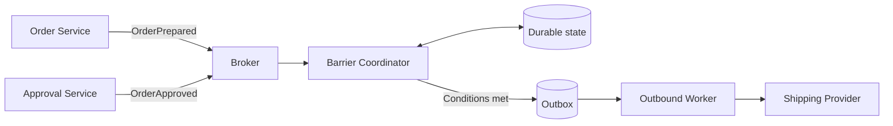
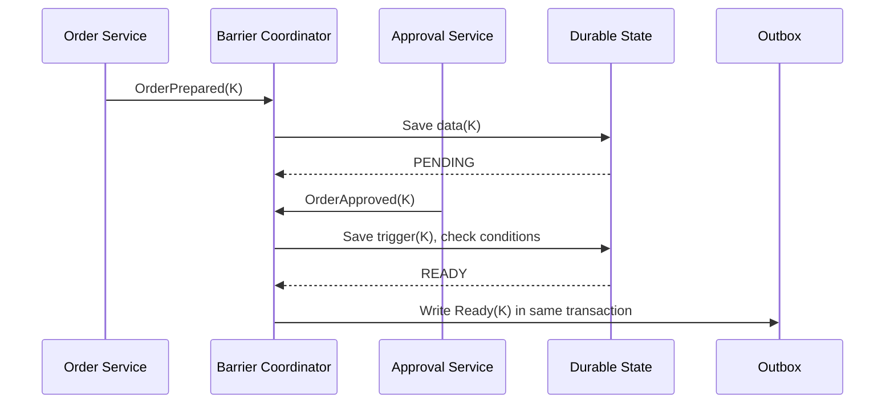
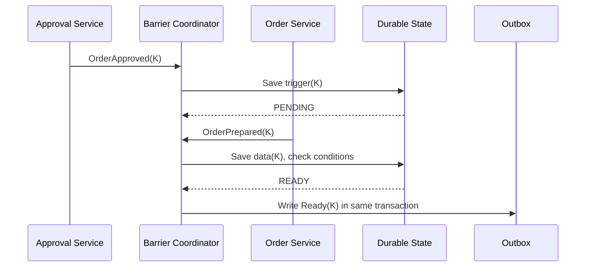
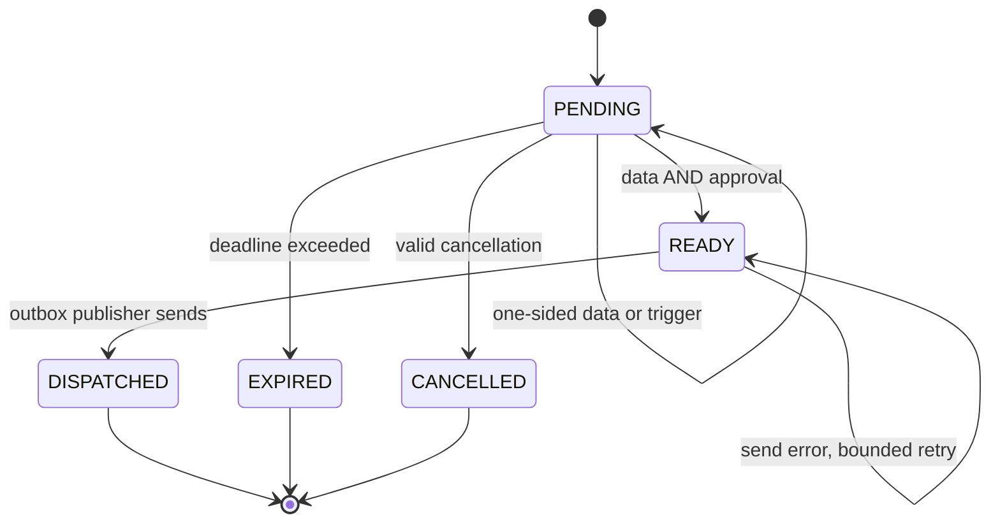
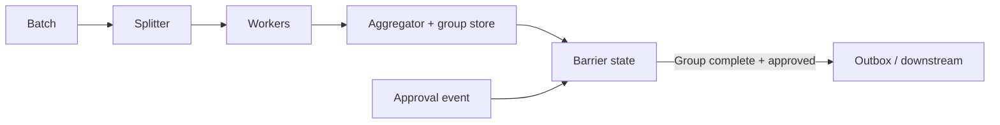

# Barrier in Distributed Flows with Spring Integration

> **Module:** `SPRING_INTEGRATION_PATTERN` — Learn to implement Enterprise Integration Patterns with Spring Integration to build loosely coupled and extensible message flows. Practice Router, Filter, Transformer, Splitter, Aggregator, Gateway, retry, error channel, and correlation, while testing and monitoring processing branches.
>
> **Chapter:** Barrier  
> **Topic:** Barrier in distributed flows

## 1. Problem: Data and the Barrier-Opening Signal Live in Different Services

In an order-processing system, the **Order Service** produces data to send to a shipping partner. The **Approval Service** confirms that the order is eligible for release. Both services run across multiple replicas, publishing events through a broker to a coordination component.

Business requirements:

- **Do not send** the shipping request until both valid data and approval exist.
- Approval may arrive **before or after** the data.
- A broker may **redeliver** an event if a consumer fails.
- An operation may be **marked ready only once**; outbound dispatch must guard against duplicate side effects.
- If a signal does not arrive within a time window, the operation must expire or route to error handling rather than waiting forever.
- A replica restart must not lose the state required to complete the operation.

This is a **distributed Barrier**: allowing an operation to proceed only once multiple conditions supplied by different components have been satisfied.



This example belongs to the `SPRING_INTEGRATION_PATTERN` module, combining the Barrier concept with Gateway, Router, Filter, Transformer, Splitter, Aggregator, retry, error channel, and correlation when designing Enterprise Integration Patterns.

**Learning objectives:** identify the right correlation key, build a state machine independent of event arrival order, explain why a `synchronized` lock or `CountDownLatch` in a single JVM does not form a distributed Barrier, demonstrate Spring Integration Gateway/ServiceActivator wiring, design durable state and outbox, handle duplicates/timeouts, and write tests for critical races.

## 2. Barrier Solves the Release Condition, Not Every Kind of Ordering

A Barrier answers the question: **"Are all conditions met for a job to proceed?"**

In this example:

\[
\operatorname{ready}(k)
=
\operatorname{prepared}(k)
\land
\operatorname{approved}(k)
\land
\neg\operatorname{terminal}(k)
\]

Where \(k\) is the **operation key**, not an individual broker event's ID. Both distinct events must point to the same \(k\).

Distinguish related concepts:

| Component | Role | Does NOT automatically guarantee |
|---|---|---|
| **Barrier** | Waits for data and a release signal/condition | Ordering messages into a sequence |
| **Aggregator** | Collects messages with the same correlation key and detects group completion | An approval from another service, unless designed |
| **Resequencer** | Orders messages by `sequenceNumber` | Business approval state |
| **Splitter** | Splits one message into multiple child messages | All children being processed successfully |
| **Router** | Chooses processing branch | Data and signal always arriving at the same replica |
| **Retry** | Retries on recoverable errors | Exactly-once side effects |
| **Idempotency** | Avoids reprocessing the same operation per contract | Durable Barrier state if kept only in RAM |

A system receiving three items in order 2 → 3 → 1 additionally needs an **Aggregator/Resequencer or sorting after verifying completeness** if the output must be 1 → 2 → 3. The Barrier only opens when the defined conditions hold; it does not automatically restore child order.

### Two Common Barrier Patterns

1. **One data message, one trigger:** data waits for a corresponding opening command. This is the primary example in this lesson.
2. **N data messages, one trigger:** requires all N items **and** the trigger. This requires adding group completion, sequence metadata, and deduplication.

All decisions about ordering, completeness, and identity must be expressed in the contract; never rely on which message happened to reach the broker earlier.

## 3. Why Is a Local Barrier Not Enough for Distributed Flows?

In Spring Integration, message handlers and channels run inside each JVM's application context. A Barrier using synchronization primitives, a state map, or waiting threads **within one instance** only sees events passing through that instance.

Suppose there are three replicas:

```text
OrderPrepared(K)  -> replica A
OrderApproved(K)  -> replica B
Outbound wait(K)  -> replica C

A knows "data exists," does not know "approved."
B knows "approved," does not know "data exists."
C has no matching state.
=> The system has both events, yet no single replica sees both.
```

Using the same `barrierChannel` name, bean name, or correlation ID string **does not share in-memory data** across JVMs.

An in-JVM Barrier mechanism can work properly when all related messages are routed to the same instance and state only needs to live for that span. For distributed flows, you need at least one of these options:

- **Key-based partitioning/routing:** every event for an operation goes to the same coordinator owning the group, plus state recovery when ownership shifts.
- **Shared durable state:** replicas read/write the same state by operation key, with atomic updates and locking/versioning.
- **Logically centralized coordination service:** persists state in a database/broker and emits release decisions via an outbox; the service itself can run multiple replicas if locking is designed properly.

**Never hold a thread waiting for a signal from another service for a long time.** Network timeouts, autoscaling, or restarts make thread-blocking wait models hard to manage. Instead, persist a durable "waiting" state and continue via events when conditions arrive.

## 4. Defining the Contract and Correlation Key

Both event sources must refer to **the same operation**, without blindly trusting arbitrary IDs supplied by external clients.

JSON event examples illustrating the contract:

```json
{
  "eventId": "evt-prepared-101",
  "eventType": "OrderPrepared",
  "tenantId": "org-17",
  "operationId": "ship-785",
  "payload": {
    "orderId": "ord-785",
    "destination": "warehouse-A"
  },
  "schemaVersion": 1
}
```

```json
{
  "eventId": "evt-approved-204",
  "eventType": "OrderApproved",
  "tenantId": "org-17",
  "operationId": "ship-785",
  "approvalId": "approval-204",
  "schemaVersion": 1
}
```

Both events have different `eventId` values yet share the pair (`tenantId`, `operationId`). In this example, that pair is the **Barrier key**.

| Attribute | Purpose | Rule |
|---|---|---|
| `tenantId` | Customer/access boundary | Trusted source, authenticated |
| `operationId` | Business identifier to synchronize | Stable across retries and redeliveries |
| `eventId` | Identifies a specific event record | Supports event deduplication |
| `approvalId` | Evidence of an approval decision | Source/authority must be verified |
| `schemaVersion` | Contract versioning | Plan compatibility during rollouts |
| `correlationId` | Group key inside Spring Integration when needed | Mapped consistently to operation key |
| `causationId` / trace ID | Causal and path observability | Never use in place of business operation ID |

**Do not use each message's `MessageHeaders.ID`** as the Barrier key: IDs can change on broker redelivery or when an adapter builds a new message. If using `IntegrationMessageHeaderAccessor.CORRELATION_ID`, derive it from the operation key consistently and verify it.

### Composite Keys Matter More Than Arbitrary String Concatenation

The key (`tenantId="a:b"`, `operationId="c"`) can collide with (`tenantId="a"`, `operationId="b:c"`) if concatenated without escaping. Production should use two separate key columns, or a consistent unambiguous encoding.

## 5. Race Between Data and Trigger: Either Order Must Work

In distributed systems, **you cannot assume a global order** between two independent producers. Even if each producer preserves order within its own topic, two separate topics or partitions establish no shared order.

### 5.1. Data Arrives First



If `OrderPrepared` is only held in RAM and the service restarts before `OrderApproved` arrives, the data can be lost. Therefore, define the state store and when the inbound source is ACKed.

### 5.2. Trigger Arrives First



If you receive a trigger before data arrives and **drop the trigger**, the operation may never open. A proper coordinator must retain early signals long enough, or use a handshake/protocol capable of querying and re-emitting signals reliably.

### 5.3. Duplicate Events and Concurrent Contention

A broker may redeliver `OrderApproved(K)` twice. Two consumers may also receive data and trigger simultaneously. A correct implementation must uphold these **invariants**:

1. Two copies of the same event must never trigger two emissions.
2. Data and approval from **different tenants/operations** must never mix.
3. Two concurrent updates must never lose a state field (*lost update*).
4. Once conditions hold, only **one valid transition** creates the release intent in the outbox.
5. Downstream errors after the transition must not permanently lose the release intent.

These invariants must be protected by transactions/locking or a recoverable sequential processing mechanism; a naive `if (data != null && approved)` check across two replicas is insufficient.

## 6. State Model for an Operation

A minimal model:

| State | Data? | Trigger? | Action |
|---|---|---|---|
| `PENDING` | No | No | Wait for either event |
| `PENDING` | Yes | No | Wait for approval |
| `PENDING` | No | Yes | Wait for data |
| `READY` | Yes | Yes | Write release intent and transition state |
| `EXPIRED` | Possibly missing | Possibly missing | Terminal failure / investigate per policy |
| `CANCELLED` | Any | Any | Do not emit; handle late events |
| `DISPATCHED` | Yes | Yes | Output sent per observable contract |

**Design note:** you can separate `READY` (an outbox record exists) from `DISPATCHED` (the outbox worker sent the event to the broker), yet **DISPATCHED does not guarantee the external partner executed the side effect exactly once**. Downstream confirmation and idempotency/reconciliation are still required.



For two independent conditions, `PENDING` must track both flags/records. Do not use a single `released` boolean and discard data, or a list keeping only the latest event.

### Terminal States and Late Events

Once an operation expires or is cancelled, a subsequent `OrderApproved` **must not automatically revive** the terminal operation. When an operation completes, retain a tombstone/terminal state long enough to recognize redeliveries. TTL policies must align with broker retention and retry schedules.

## 7. Illustrative Implementation: A Single-JVM Java Coordinator

To study the algorithm clearly, we start with a Java 17+ class using in-memory state. This class:

- Accepts data/triggers in **any order**.
- Tracks state by composite key `tenantId + operationId`.
- Ignores duplicates with identical content.
- Rejects conflicting duplicates.
- Decides `Ready` exactly once **within one instance**.
- Bounds the number of open groups to avoid unbounded RAM growth.

**This is not a production distributed Barrier.** Section 10 explains how to replace state storage with database transactions and an outbox.

### 7.1. Coordinator and Event Records

File `LocalBarrierCoordinator.java`:

```java
package com.example.distributedbarrier;

import java.util.HashMap;
import java.util.HashSet;
import java.util.Map;
import java.util.Objects;
import java.util.Optional;
import java.util.Set;

public final class LocalBarrierCoordinator {

    public record Key(String tenantId, String operationId) {
        public Key {
            if (tenantId == null || tenantId.isBlank()
                    || operationId == null || operationId.isBlank()) {
                throw new IllegalArgumentException("Invalid correlation key");
            }
        }
    }

    public record Data(Key key, String payload) {
        public Data {
            Objects.requireNonNull(key);
            Objects.requireNonNull(payload);
        }
    }

    public record Approval(Key key, String approvalId) {
        public Approval {
            Objects.requireNonNull(key);
            if (approvalId == null || approvalId.isBlank()) {
                throw new IllegalArgumentException("approvalId required");
            }
        }
    }

    public record Ready(
            Key key,
            String payload,
            String approvalId) {
    }

    private static final class Pending {
        String payload;
        String approvalId;
    }

    private final Map<Key, Pending> pending = new HashMap<>();
    private final Set<Key> completed = new HashSet<>();
    private final int maxOpenOperations;

    public LocalBarrierCoordinator(int maxOpenOperations) {
        if (maxOpenOperations < 1) {
            throw new IllegalArgumentException("Invalid state limit");
        }
        this.maxOpenOperations = maxOpenOperations;
    }

    public synchronized Optional<Ready> onData(Data event) {
        Objects.requireNonNull(event);

        if (completed.contains(event.key())) {
            return Optional.empty();
        }

        Pending state = stateFor(event.key());
        if (state.payload != null
                && !state.payload.equals(event.payload())) {
            throw new IllegalArgumentException(
                    "Conflicting data for operation");
        }

        state.payload = event.payload();
        return completeIfReady(event.key(), state);
    }

    public synchronized Optional<Ready> onApproval(Approval event) {
        Objects.requireNonNull(event);

        if (completed.contains(event.key())) {
            return Optional.empty();
        }

        Pending state = stateFor(event.key());
        if (state.approvalId != null
                && !state.approvalId.equals(event.approvalId())) {
            throw new IllegalArgumentException(
                    "Conflicting approval for operation");
        }

        state.approvalId = event.approvalId();
        return completeIfReady(event.key(), state);
    }

    private Pending stateFor(Key key) {
        Pending state = pending.get(key);
        if (state != null) {
            return state;
        }

        if (pending.size() >= maxOpenOperations) {
            throw new IllegalStateException("Too many pending operations");
        }

        state = new Pending();
        pending.put(key, state);
        return state;
    }

    private Optional<Ready> completeIfReady(Key key, Pending state) {
        if (state.payload == null || state.approvalId == null) {
            return Optional.empty();
        }

        // Atomic decision within a single JVM only; NO durable outbox yet.
        pending.remove(key);
        completed.add(key);

        return Optional.of(new Ready(
                key, state.payload, state.approvalId));
    }
}
```

### 7.2. Guarantee Scope of the Code

- `synchronized` prevents two threads in the **same coordinator object** from emitting twice concurrently.
- The composite `Key` keeps two tenants sharing an operation ID from colliding.
- `completed` ignores redeliveries after the operation is decided ready, **while the object remains alive**.
- Duplicate approvals with the same `approvalId` do not inflate condition counts.
- Duplicates with conflicting payloads or approvalIds are rejected instead of silently overwriting.

**What this code does NOT do yet:**

1. No TTL, expiry, cancellation, or cleanup.
2. Does not persist data/triggers or tombstones; restarts wipe state.
3. Does not authorize who may issue approvals; upstream steps must authenticate/authorize.
4. Does not commit state transition and send Ready to the broker in **one transaction**.
5. Insufficient for multiple replicas or exactly-once external side effects.

Point (4) is especially critical: if `completeIfReady()` marks completed yet the handler emitting Ready fails/crashes, the operation can be lost. Production needs an **atomic outbox event and state transition**.

## 8. Testing the Algorithm with JUnit 5

The demo can be tested **without real wall-clock waiting, without `Thread.sleep`**, and without a broker.

File `LocalBarrierCoordinatorTest.java`:

```java
package com.example.distributedbarrier;

import static org.junit.jupiter.api.Assertions.*;

import org.junit.jupiter.api.Test;

class LocalBarrierCoordinatorTest {

    private static LocalBarrierCoordinator.Key key(
            String tenant, String operation) {
        return new LocalBarrierCoordinator.Key(tenant, operation);
    }

    @Test
    void dataBeforeApprovalOpensOnce() {
        LocalBarrierCoordinator gate = new LocalBarrierCoordinator(10);
        var key = key("tenant-a", "op-1");

        assertTrue(gate.onData(
                new LocalBarrierCoordinator.Data(key, "order"))
                .isEmpty());

        var result = gate.onApproval(
                new LocalBarrierCoordinator.Approval(key, "approval-1"));

        assertEquals("order", result.orElseThrow().payload());
        assertTrue(gate.onApproval(
                new LocalBarrierCoordinator.Approval(key, "approval-1"))
                .isEmpty());
    }

    @Test
    void approvalBeforeDataIsRemembered() {
        LocalBarrierCoordinator gate = new LocalBarrierCoordinator(10);
        var key = key("tenant-a", "op-2");

        assertTrue(gate.onApproval(
                new LocalBarrierCoordinator.Approval(key, "approval-2"))
                .isEmpty());

        var result = gate.onData(
                new LocalBarrierCoordinator.Data(key, "shipping-request"));

        assertEquals("approval-2", result.orElseThrow().approvalId());
    }

    @Test
    void duplicatesDoNotProduceAnotherReady() {
        LocalBarrierCoordinator gate = new LocalBarrierCoordinator(10);
        var key = key("tenant-a", "op-3");

        gate.onData(new LocalBarrierCoordinator.Data(key, "payload"));
        gate.onData(new LocalBarrierCoordinator.Data(key, "payload"));

        assertTrue(gate.onApproval(
                new LocalBarrierCoordinator.Approval(key, "approval-3"))
                .isPresent());

        assertTrue(gate.onData(
                new LocalBarrierCoordinator.Data(key, "payload"))
                .isEmpty());
    }

    @Test
    void tenantsWithSameOperationIdStayIsolated() {
        LocalBarrierCoordinator gate = new LocalBarrierCoordinator(10);
        var a = key("tenant-a", "shared-id");
        var b = key("tenant-b", "shared-id");

        gate.onData(new LocalBarrierCoordinator.Data(a, "order-a"));
        gate.onData(new LocalBarrierCoordinator.Data(b, "order-b"));

        var readyB = gate.onApproval(
                new LocalBarrierCoordinator.Approval(b, "approval-b"));

        assertEquals("order-b", readyB.orElseThrow().payload());
        assertTrue(gate.onApproval(
                new LocalBarrierCoordinator.Approval(a, "approval-a"))
                .isPresent());
    }

    @Test
    void conflictingDataIsRejected() {
        LocalBarrierCoordinator gate = new LocalBarrierCoordinator(10);
        var key = key("tenant-a", "op-4");

        gate.onData(new LocalBarrierCoordinator.Data(key, "original"));

        assertThrows(IllegalArgumentException.class,
                () -> gate.onData(
                        new LocalBarrierCoordinator.Data(key, "changed")));
    }
}
```

These tests only verify **in-memory decisions**. They do not prove crash recovery, durable delivery, or that events from multiple broker partitions converge onto a shared distributed key.

## 9. Connecting with Spring Integration: Two Gateways, One Coordinator

This example shows where **adapters/endpoints** sit; it does not turn the in-memory class into a distributed service. In production, the `ServiceActivator` must invoke an implementation backed by durable state instead of `LocalBarrierCoordinator`.

### 9.1. Dependencies

Gradle example:

```groovy
dependencies {
    implementation "org.springframework.boot:spring-boot-starter-integration"
    testImplementation "org.springframework.boot:spring-boot-starter-test"
}
```

File `BarrierApplication.java`:

```java
package com.example.distributedbarrier;

import org.springframework.boot.SpringApplication;
import org.springframework.boot.autoconfigure.SpringBootApplication;
import org.springframework.integration.annotation.IntegrationComponentScan;
import org.springframework.integration.config.EnableIntegration;

@SpringBootApplication
@EnableIntegration
@IntegrationComponentScan
public class BarrierApplication {

    public static void main(String[] args) {
        SpringApplication.run(BarrierApplication.class, args);
    }
}
```

### 9.2. Channels and State Bean

```java
package com.example.distributedbarrier;

import org.springframework.context.annotation.Bean;
import org.springframework.context.annotation.Configuration;
import org.springframework.integration.channel.DirectChannel;
import org.springframework.messaging.MessageChannel;

@Configuration
public class BarrierChannels {

    @Bean(name = "barrier.data.in")
    public MessageChannel dataIn() {
        return new DirectChannel();
    }

    @Bean(name = "barrier.approval.in")
    public MessageChannel approvalIn() {
        return new DirectChannel();
    }

    @Bean(name = "barrier.ready.out")
    public MessageChannel readyOut() {
        return new DirectChannel();
    }

    @Bean
    public LocalBarrierCoordinator localBarrierCoordinator() {
        return new LocalBarrierCoordinator(1000);
    }
}
```

### 9.3. Two One-Way Gateways

```java
package com.example.distributedbarrier;

import org.springframework.integration.annotation.MessagingGateway;
import org.springframework.messaging.handler.annotation.Payload;

@MessagingGateway(defaultRequestChannel = "barrier.data.in")
public interface OrderPreparedGateway {
    void submit(@Payload LocalBarrierCoordinator.Data data);
}
```

```java
package com.example.distributedbarrier;

import org.springframework.integration.annotation.MessagingGateway;
import org.springframework.messaging.handler.annotation.Payload;

@MessagingGateway(defaultRequestChannel = "barrier.approval.in")
public interface ApprovalGateway {
    void approve(@Payload LocalBarrierCoordinator.Approval approval);
}
```

These two Gateways provide internal APIs simulating the two source branches. They are **one-way** calls; callers submit events without waiting for the Barrier to open. In a distributed system, broker inbound adapters replace or feed these channels after deserialization and data validation.

### 9.4. Coordinating Service Activators

```java
package com.example.distributedbarrier;

import org.springframework.integration.annotation.ServiceActivator;
import org.springframework.stereotype.Component;

@Component
public class BarrierEndpoints {

    private final LocalBarrierCoordinator coordinator;

    public BarrierEndpoints(LocalBarrierCoordinator coordinator) {
        this.coordinator = coordinator;
    }

    @ServiceActivator(
            inputChannel = "barrier.data.in",
            outputChannel = "barrier.ready.out")
    public LocalBarrierCoordinator.Ready onData(
            LocalBarrierCoordinator.Data data) {
        return coordinator.onData(data).orElse(null);
    }

    @ServiceActivator(
            inputChannel = "barrier.approval.in",
            outputChannel = "barrier.ready.out")
    public LocalBarrierCoordinator.Ready onApproval(
            LocalBarrierCoordinator.Approval approval) {
        return coordinator.onApproval(approval).orElse(null);
    }

    @ServiceActivator(inputChannel = "barrier.ready.out")
    public void onReady(LocalBarrierCoordinator.Ready ready) {
        // DEMO: production must persist to outbox first, then publish safely.
        System.out.println(
                "ready " + ready.key().operationId() +
                " approvedBy=" + ready.approvalId());
    }
}
```

Example:

```java
var key = new LocalBarrierCoordinator.Key("org-17", "ship-785");

approvalGateway.approve(
    new LocalBarrierCoordinator.Approval(key, "approval-204"));
preparedGateway.submit(
    new LocalBarrierCoordinator.Data(key, "order-payload"));

// The ready handler is invoked only once both events have been received.
```

**Limitations of the illustrative flow:** all channels are `DirectChannel`, state lives in one instance, and invoking `onReady` does not share a transaction with the state update. If the output handler fails, the exception propagates back over the synchronous channel, yet state has already mutated; the message is not automatically recovered.

If you want to experiment with Spring Integration's native Barrier component inside a local flow, consult the API documentation for your project's version. However, **a local native Barrier does not automatically provide distributed storage or synchronization**; you must clarify deployment mode, timeouts, and signal coordination across all failure modes.

## 10. Moving from Demo to a Distributed Barrier with Durable State

### 10.1. Database Record Design

PostgreSQL-style schema example using composite key (`tenant_id`, `operation_id`):

```sql
CREATE TABLE barrier_state (
    tenant_id         TEXT NOT NULL,
    operation_id      TEXT NOT NULL,
    prepared_payload  JSONB,
    approval_id       TEXT,
    state             TEXT NOT NULL DEFAULT 'PENDING',
    deadline_at       TIMESTAMPTZ NOT NULL,
    updated_at        TIMESTAMPTZ NOT NULL DEFAULT now(),
    PRIMARY KEY (tenant_id, operation_id)
);

CREATE TABLE barrier_outbox (
    id                BIGSERIAL PRIMARY KEY,
    tenant_id         TEXT NOT NULL,
    operation_id      TEXT NOT NULL,
    event_type        TEXT NOT NULL,
    payload           JSONB NOT NULL,
    published_at      TIMESTAMPTZ,
    created_at        TIMESTAMPTZ NOT NULL DEFAULT now(),
    UNIQUE (tenant_id, operation_id, event_type)
);
```

This is a **conceptual template**. Production requires additional constraints, payload encryption/minimization, cancellation/expiry columns, retention, schema versioning, indexes, and migration operations.

The unique constraint on the outbox prevents creating **two Ready records for the same operation and event type**. It does not prevent the broker from redelivering the same record or prevent downstream from executing duplicate side effects; receiver idempotency is still required.

### 10.2. Transaction Processing Each Event

The pseudocode below shows the order of operations inside **one database transaction**:

```text
onEvent(event):
    key = authenticateAndValidate(event.tenantId, event.operationId)

    begin transaction

    INSERT barrier_state(key, PENDING, deadline)
        ON CONFLICT DO NOTHING

    row = SELECT barrier_state WHERE key = ?
          FOR UPDATE

    if row.state in {READY, DISPATCHED, EXPIRED, CANCELLED}:
        verifyDuplicateOrLateEvent(event)
        commit transaction
        ackInboundAfterCommit()
        return

    if databaseNow >= row.deadline_at:
        UPDATE row SET state = EXPIRED
        recordTerminalFailureIfRequired()
        commit transaction
        ackInboundAfterCommit()
        return

    verifyNoConflictingValue(row, event)
    updateOnlyTheFieldProvidedBy(event)

    if row.prepared_payload is not null
       and row.approval_id is not null:
        UPDATE row SET state = READY
        INSERT INTO barrier_outbox(key, ReadyEvent)
            ON CONFLICT DO NOTHING

    commit transaction
    ackInboundAfterCommit()
```

Core ideas:

- The first event **creates the waiting row**; the second event **fills in the missing field**.
- `SELECT ... FOR UPDATE` / optimistic compare-and-set or an equivalent mechanism protects concurrent updates to the **same operation key**.
- When both conditions are met, **the state transition and outbox write must happen in the same transaction**.
- The consumer ACKs inbound only after the corresponding state **has been durably persisted**; if a crash occurs before ACK, redelivery must be safe.
- Deadlines are enforced by a trusted server/store clock; never treat unverified client timestamps as the sole source of truth.

**Important:** with many brokers, database transactions and broker acknowledgments cannot be combined into a single cross-system transaction. The common pattern is committing DB first, then ACKing; if a crash occurs in between, the broker redelivers the event, so processing must be **idempotent**.

### 10.3. What Gap Does the Transactional Outbox Close?

Two common broken write patterns:

```text
A) UPDATE state=READY; COMMIT
   crash
   publish Ready -> NEVER RUNS
   => Release signal is lost.

B) publish Ready
   crash
   UPDATE state=READY -> NEVER RUNS
   => Output emitted while state not updated; may re-publish.
```

Replace with:

```text
BEGIN
   UPDATE barrier_state SET state=READY ...
   INSERT barrier_outbox(... ReadyEvent ...)
COMMIT

Outbox publisher:
   read unpublished records
   send to broker
   mark published (may repeat if ACK lost)
```

If the broker publish succeeds yet the outbox worker crashes before marking `published_at`, the record can be published **twice**. That is normal under **at-least-once** semantics. Consumers must deduplicate/be idempotent using a stable key (e.g., event ID or operation key + action type).

**An outbox does not by itself guarantee exactly-once HTTP side effects.** If the final action calls a provider to create a shipment, you need a provider-side idempotency key or reconciliation preventing duplicate creation.

## 11. Partitioning and Ordering Across Brokers

### 11.1. Same Key Does Not Guarantee Same Consumer Across Two Topics

If `OrderPrepared` and `OrderApproved` live on **two topics** or two separate consumer groups, using the same message key does not establish a global order across topics. Both events can reach the coordinator in any order, or even hit two different replicas.

If you want per-operation sequential processing:

- Normalize both event types into **one stream partitioned by the same key** with one consumer group; or
- Route them through a coordinator with **durable shared state keyed by operation**, independent of which instance receives the event.

Even with a single keyed stream, crashes and redeliveries still require deduplication and state recovery. Ordering within a partition does not mean the entire system has total order.

### 11.2. During Consumer Rebalances

A consumer holding operation state in RAM can lose its partition during a rebalance. The new consumer will receive subsequent events without knowing prior state unless state is restored.

You must define:

1. Where state is stored and how it is checkpointed/committed.
2. How offset commits/ACKs align with persisted state.
3. Whether replaying events after a crash is idempotent.
4. When ownership moves, whether **fencing/lease/versioning** prevents an old owner from emitting stale Ready events.
5. Limits on backlog, group counts, and rebalance recovery time.

**Key-based partitioning improves locality and reduces contention; it does not replace durability.**

## 12. Timeouts, Cancellations, Late Signals, and Partial Handling

A Barrier missing one of the two conditions can wait forever. For example, data is prepared but approval never arrives because the Approval Service failed.

Define upfront:

- `deadline_at` for the operation.
- Expiration policy: `EXPIRED`, alert, investigation, compensation, or notification.
- What happens if approval arrives **after** expiry.
- Whether admins may **reopen** an operation or must create a new operation version.
- Retention/tombstones to prevent redeliveries from mutating terminal states.

### Deadline Example

```text
10:00:00  OrderPrepared(ship-785)
10:00:30  deadline not reached; waiting for approval
10:01:00  expired -> EXPIRED
10:01:15  OrderApproved(ship-785) arrives late
          -> Do not open Barrier; record late approval
```

**Never automatically transition an operation from `EXPIRED` back to `READY` simply because all events eventually arrived.** If the business permits recovery, require an authorized workflow, a new operation version, and clear evidence.

If you need to wait for **N data parts + one approval**, add a grouping component:

\[
\operatorname{ready}(k)
=
(\operatorname{receivedUniqueParts}(k)=N(k))
\land
\operatorname{approved}(k)
\land
\neg\operatorname{terminal}(k)
\]

When N is unknown upfront, define an **end-marker** contract or alternative release strategy; approval alone does not prove the group is complete. Never count duplicate children as new positions.

### Timeout Differs from Successful Release

A system may decide to emit a partial result when the deadline arrives, **but that is a separate business branch**. Never equate timeout with "all conditions satisfied." If partial results are allowed, the output event must explicitly declare `partial=true` and list missing data, rather than reusing a misleading "fully approved" schema.

## 13. Error Channel, Retry, and Dead-Letter in Distributed Barriers

### 13.1. DirectChannel vs. Asynchronous Adapters

In the `DirectChannel` demo, exceptions propagate back to the Gateway/caller. In broker inbound adapters, pollers, or executors, exceptions may route through `ErrorMessage`/error channels or follow the adapter's ACK/NACK policy. **Never assume every error automatically appears on the global `errorChannel`.**

Depending on the inbound source, specify:

- Schema/authorization errors: reject or DLQ; **never write unsafe data into state**.
- Transient database errors: retry with backoff, letting the broker redeliver safely.
- Valid duplicates: ACK after confirming the already-processed state.
- Conflicting duplicates: preserve evidence and route to quarantine/investigation.
- Terminal state: log late event/audit per policy and ACK to avoid hot requeue loops.

### 13.2. Avoiding Feedback Loops

An anti-pattern is routing failed events back to the Barrier input channel without an attempt count:

```text
barrierInbound -> coordinator -> DB timeout
                      |
                      v
                 errorChannel
                      |
                      v
                 barrierInbound (immediately resent)
```

If the DB remains down, the loop can exhaust queues or thread pools. With brokers, immediate NACK/requeue or routing DLQ back into the main queue creates a similar hot loop.

**Proper design:** bound retries by attempts/deadline, use backoff with jitter, preserve message ownership, and provide a terminal DLQ/quarantine. Never let an error handler emit a new chain of `ErrorMessage` objects back into the same `errorChannel`.

### 13.3. Retrying After the Barrier Opens

Once the Ready event is in the outbox, the outbound worker may call the provider and receive HTTP 503 or 429. Outbound retries must have their **own budget** and idempotency key. Never "close and reopen" the Barrier for each HTTP retry.

If the provider enforces per-API-key rate limits, **every HTTP attempt** must acquire a permit. Honor `Retry-After` from HTTP 429 responses when present and valid. The Barrier governs only the release condition; it does not replace a Rate Limiter or Circuit Breaker.

## 14. Interaction with Other Enterprise Integration Patterns

| Pattern | What to watch out for when distributed |
|---|---|
| **Gateway** | Do not block synchronous callers for minutes waiting on a Barrier; accept events asynchronously and return a clear accepted status |
| **Router** | Route by operation key or quota group; avoid splitting data/triggers across unshared local states |
| **Filter** | If dropping data/approval, produce a terminal outcome; never leave the group silently waiting forever |
| **Transformer** | Preserve operation key, event ID, and metadata; avoid serializing only payload and losing correlation |
| **Splitter** | All N children need sequence/correlation; group completion must count unique positions |
| **Aggregator** | Use when N parts are required; configure proper store, release strategy, and timeout |
| **Resequencer** | Use when messages must be emitted in logical order rather than arrival order |
| **Retry** | Preserve business operation ID and idempotency key; budgets must not reset across restarts |
| **Error Channel** | Distinguish sync vs. async errors; use DLQ and terminal handling instead of loops |
| **Rate Limiter** | Bound real outbound attempts; do not treat Barrier as a rate limiter |
| **Correlation** | Data, trigger, and all retries use the same key from a trusted source |
| **Circuit Breaker** | When provider is unhealthy, defer outbound calls; do not reopen Barrier to retry another path |

### Splitter and Aggregator Before Barrier

A 100-item batch can be split by a Splitter into 100 children, run through Routers and Transformers, and then be combined by an Aggregator. Even if the Approval Service sends approval early, the Barrier must not release the batch until the Aggregator produces a **valid completed group** per the business contract.



Where you place the Barrier defines **the unit requiring approval**: a single child, a batch, or the entire operation. Express this clearly in event names, keys, and transition timing.

## 15. Observability and Security

### Key Metrics

| Metric | Question answered |
|---|---|
| `barrier_pending_operations` | How many operations are currently waiting? |
| `barrier_pending_age_seconds` | How old is the longest-waiting operation? |
| `barrier_data_events_total` | How many data events have been received? |
| `barrier_approval_events_total` | How many triggers have been received? |
| `barrier_early_approval_total` | How many triggers arrived before data? |
| `barrier_ready_transitions_total` | How many transitions to READY succeeded? |
| `barrier_duplicate_events_total` | What is the redelivery/duplicate rate? |
| `barrier_conflicting_events_total` | Are there conflicting events needing investigation? |
| `barrier_expired_total` | How many operations exceeded their deadline? |
| `barrier_late_events_total` | How many events arrived after terminal state? |
| `barrier_outbox_lag_seconds` | How long from READY to publish? |
| `barrier_outbox_retry_total` | What errors is the outbox publisher encountering? |
| `barrier_downstream_duplicate_suppressed_total` | How many times did the consumer suppress duplicate side effects? |

Logs/traces should include `tenantId` (sanitized), `operationId`, `eventId`, `eventType`, `stateBefore`, `stateAfter`, `decisionReason`, and correlation/trace IDs. Never log raw credentials, tokens, sensitive payloads, or security contexts.

With multiple tenants, never create arbitrary metric labels containing millions of `operationId` values, as high cardinality can overload the metrics backend. Keep per-operation details in audit logs or traces with appropriate retention.

### Securing the Release Signal

Approval is a **security and business decision**, not merely a "open the gate" message. An unauthorized actor emitting `OrderApproved` could cause unauthorized shipment releases.

Therefore:

1. Authenticate producers/inbound adapters and approval sources.
2. Authorize against tenant, operation, order state, and version.
3. Never treat `approved=true` in an arbitrary caller-supplied header as ground truth.
4. Prevent replay of old signals onto new operations; use operation ID/version, event ID, and terminal state rules.
5. Audit who/what granted authorization, not just when the event arrived.

## 16. Mandatory Integration Testing for Distributed Models

### 16.1. Failure and Race Matrix

| Scenario | How to simulate | Must hold true |
|---|---|---|
| Data arrives first | Send Data(K), then Approval(K) | Single READY |
| Approval arrives first | Send Approval(K), then Data(K) | Single READY, trigger not lost |
| Concurrent events | Two consumers update the same key | No lost update, no duplicate outbox rows |
| Duplicate approval | Send same event twice | Single READY, no invalid state change |
| Conflicting duplicate data | Same key, different payload | Reject/quarantine |
| Different tenants, same operationId | Tenant A data, tenant B approval | Never pair the two events |
| Crash before commit | Kill consumer before transaction commits | Redelivery reprocesses safely |
| Crash after commit, before ACK | DB has state, broker not ACKed yet | Redelivery creates no extra READY |
| Crash after broker publish, before outbox mark | Outbox worker resends | Consumer is idempotent |
| Local state, multiple replicas | Data/trigger hit two instances | Bug exposed; fix via shared state or proper partitioning |
| Rebalance mid-group | Shift partition owner | State restored, no lost or doubled output |
| Approval arrives after expiry | Short deadline, send late event | Does not reopen terminal operation |
| DB connection loss | Inject transient DB failure | Retry with backoff, no hot requeue |
| HTTP 503 after READY | Outbound worker fails | Outbound-only retry, never replay Barrier transition |
| HTTP 429 | Provider sends Retry-After | Honor delay and API key limiter |
| One of N children missing | Splitter/Aggregator | Never release as a complete group |

### 16.2. Testing with a Real Database and Broker

Unit tests of `LocalBarrierCoordinator` are **insufficient** to validate a distributed system. An integration test suite should:

1. Spin up a test database with state/outbox tables and a test broker or mock adapter supporting redelivery.
2. Feed both event types into **two independent consumers/threads/instances**.
3. Pause execution right "after UPDATE state, before COMMIT" to simulate crashes.
4. Verify `UNIQUE(tenant_id, operation_id, event_type)` prevents duplicate outbox rows.
5. Deliver the same outbox event twice and verify downstream idempotency.
6. Let an operation time out, send a late event, and confirm terminal state does not reopen.
7. Verify inbound ACK happens **after** commit or via an equivalent recovery mechanism.
8. If using distributed locks/leases, test fencing when a stale owner wakes up after a long pause.

Assert **final state and side-effect counts** rather than using `Thread.sleep(10)` to guess whether a race occurred. Control synchronization points with latches/test barrier helpers and transaction hooks; never run such test hooks in production requests.

## 17. Common Pitfalls

| Pitfall | Consequence | Fix |
|---|---|---|
| Using `synchronized` as a distributed lock | Two JVMs still update/emit independently | Lock/version on shared store or single-owner partition |
| Assuming same broker key guarantees order across two topics | No cross-topic total order | Order-independent design + durable state |
| Dropping triggers when data is absent | Operation waits forever | Persist early triggers |
| Counting raw event arrivals | Duplicates fake completeness | Deduplicate by eventId and business key |
| Keeping completed set only in RAM | Restart loses tombstones | Persist terminal state |
| Updating READY and publishing separately | Crash causes lost output or duplicates | Transactional outbox + idempotency |
| ACKing input before DB commit | Crash loses event | ACK after safe persistence |
| Writing outbox without consumer deduplication | Broker redelivery duplicates side effects | Stable idempotency key |
| Blocking threads indefinitely at Barrier | Thread exhaustion and poor recovery | Event-driven state machine |
| Accepting release from untrusted actor | Unauthorized dispatch | AuthN/AuthZ and validation |
| Reopening EXPIRED on late event | Violates deadline/contract | Terminal state + operation versioning |
| Immediate infinite retry on DB errors | Feedback loop, broker overload | Bounded retry/backoff/DLQ |
| Confusing Barrier with Resequencer | Output lacks logical order | Add ordering/completeness separately |
| Using in-memory MessageGroupStore across pods | Group splits and never completes | Shared store, ownership, or partitioning |

## 18. Pre-Production Checklist

- [ ] Composite, unique, authenticated correlation key scoped by tenant/operation.
- [ ] Event contract clearly defines data, approval, cancellation, versioning, and idempotency.
- [ ] Allows data and trigger to arrive in **any order**.
- [ ] Deduplicates events and detects conflicting duplicates.
- [ ] READY state transition protected by transactions/locks/versioning.
- [ ] Writes **outbox event** in the same transaction as the state update.
- [ ] ACKs inbound broker messages only after state is safely persisted.
- [ ] Outbox publisher has retry/backoff; downstream is idempotent.
- [ ] Has deadlines, terminal states, TTL/tombstones, and a late-event policy.
- [ ] Does not hold in-RAM threads/waits for long-lived cross-service coordination.
- [ ] Partitioning/routing or shared store works correctly during rebalances/autoscaling.
- [ ] Error channel has a terminal policy without feedback loops or hot requeues.
- [ ] Outbound rate limiter/circuit breaker in place; each HTTP attempt managed individually.
- [ ] Metrics/traces distinguish pending, ready, duplicate, expired, outbox lag, and late events.
- [ ] Tested against mid-step crashes, redeliveries, and multi-replica concurrency.

## 19. Practice Exercises

**Exercise 1 — Race between two services.** Data Service and Approval Service send two events for the same operation in both arrival orders. Describe how state transitions and why early triggers must never be dropped.

**Exercise 2 — From demo to production.** Take `LocalBarrierCoordinator`, replace in-memory state with a database keyed by the composite key, and add an outbox plus a unique constraint. Specify which steps belong inside the transaction.

**Exercise 3 — Crash after READY.** Coordinator commits READY and outbox, then the worker crashes before broker ACK. Simulate broker redelivery. Explain why no extra outbox record is created and how you know the message was safely persisted.

**Exercise 4 — Crash after publish.** Outbox worker successfully sends `ReadyEvent` and crashes before recording `published_at`. Prove that downstream can receive the event twice and design an idempotency key preventing two shipments.

**Exercise 5 — Multi-instance and rebalance.** Data hits pod A, approval hits pod B. Compare a shared database against single-owner partitioning. Design a state-restoration mechanism on owner change.

**Exercise 6 — N-part Barrier.** An order is split by a Splitter into five child messages plus one Approval event. Require all five unique sequence positions, no terminal errors, and approval before releasing. Design the correlation/release strategy and test duplicating position 3.

**Exercise 7 — Cancellation and deadline.** An operation is `CANCELLED` before Approval arrives. Send a late Approval and a Data redelivery. Verify terminal state remains unchanged, audited, and not emitted.

**Exercise 8 — Securing the release.** A client belonging to tenant B spoofs an approval event for tenant A. Design source authentication, authorization, nonce/versioning, and auditing to prevent unauthorized Barrier release.

### Self-Assessment Questions

1. Why are `CountDownLatch` or `synchronized` inside one JVM insufficient for a Barrier across multiple services?
2. Does sharing a correlation ID across two broker topics guarantee processing order between them?
3. Why must a trigger be persisted if it arrives before data?
4. Across multiple replicas, how must the "data + approval complete" check-and-transition be made atomic?
5. Why can updating READY state and publishing separately lose messages?
6. Does a transactional outbox guarantee that an external HTTP provider executes a side effect only once? What is still missing?
7. How should an event arriving after `EXPIRED` be handled?
8. When do you need an Aggregator or Resequencer in addition to a Barrier?
9. Why can ACKing the broker after DB commit cause redeliveries yet remain safe when idempotent?
10. If an attacker can emit `OrderApproved`, what is the impact and at which layers must controls exist?

## 20. References

- [Spring Integration Reference — Barrier](https://docs.spring.io/spring-integration/reference/barrier.html): mechanism for controlling release at a Barrier.
- [Spring Integration Reference — Message Channels](https://docs.spring.io/spring-integration/reference/channel.html): synchronous, asynchronous channels and thread boundaries.
- [Spring Integration Reference — Message Routing](https://docs.spring.io/spring-integration/reference/router.html): routing by key/correlation and business branches.
- [Spring Integration Reference — Aggregator](https://docs.spring.io/spring-integration/reference/aggregator.html): group completion, release strategies, and `MessageGroupStore`.
- [Spring Integration Reference — Splitter](https://docs.spring.io/spring-integration/reference/splitter.html): message fan-out and sequence metadata.
- [Spring Integration Reference — Error Handling](https://docs.spring.io/spring-integration/reference/error-handling.html): error channels and sync/async failure handling.
- [Spring Integration Reference — Messaging Gateways](https://docs.spring.io/spring-integration/reference/gateway.html): Gateways receiving messages and request-reply semantics.
- [Microservices Patterns — Transactional Outbox](https://microservices.io/patterns/data/transactional-outbox.html): persisting events alongside business state transactions.
