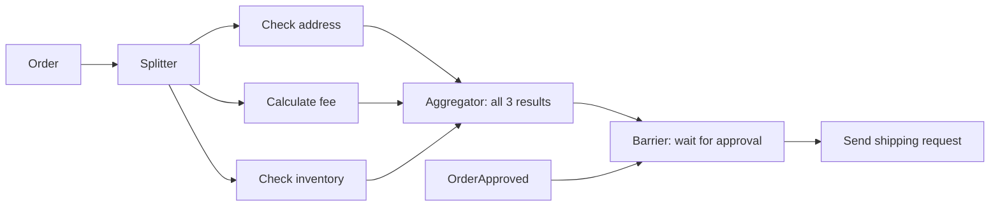
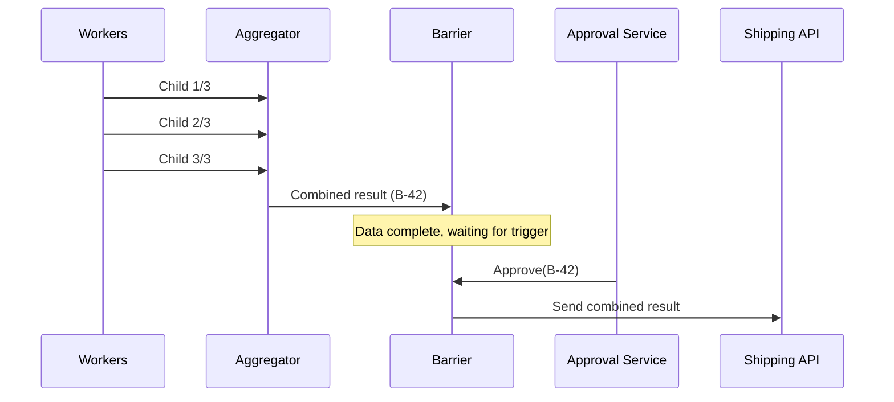
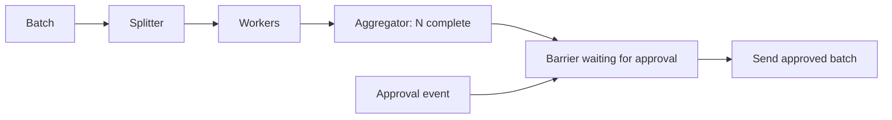
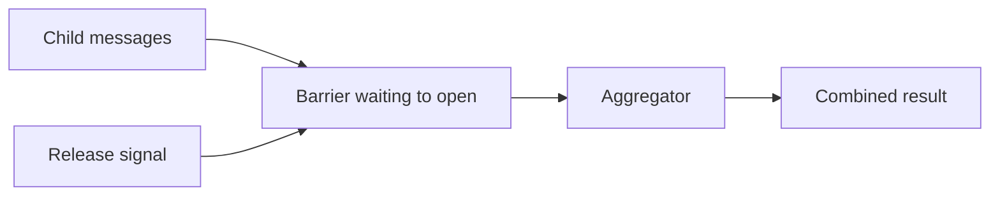
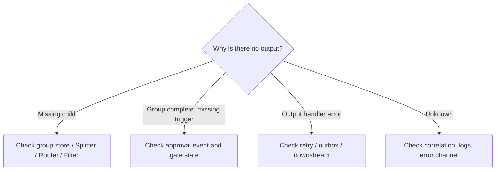
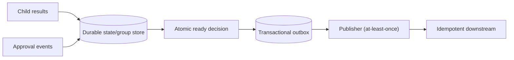

# Distinguishing Barrier from Aggregator in Spring Integration

> **Module:** `SPRING_INTEGRATION_PATTERN` — Learn to implement Enterprise Integration Patterns with Spring Integration to build loosely coupled and extensible message flows. Practice Router, Filter, Transformer, Splitter, Aggregator, Gateway, retry, error channel, and correlation, while testing and monitoring processing branches.
>
> **Chapter:** Barrier  
> **Topic:** Distinguishing barrier from aggregator

## 1. Two Requirements That Sound Similar but Have Different Natures

A shipment-creation system needs to perform two tasks:

1. **Result aggregation:** split an order into three tasks—address verification, fee calculation, and inventory check; only once the required tasks complete does the system have a complete result.
2. **Waiting for release authorization:** even when the data is complete, the system must not send the shipment creation request to the partner before receiving an `OrderApproved` event from the approval service.

The first question is **"Have all members of a group arrived, and what should they be combined into?"** — this is the **Aggregator** problem.

The second question is **"May an already-ready message/result pass through a gate?"** — this is the **Barrier** problem.



In this diagram, **Aggregator produces the group result**, while **Barrier decides when that result may proceed**. Both components can appear together; they are not interchangeable names for the same thing.

This lesson focuses on directly comparing the two patterns, pointing out the exception where a customized Aggregator can act as a gate, avoiding confusion between correlation and triggers, and examining the consequences for threads, state, retries, and durability.

### Learning Outcomes

After this lesson, learners will be able to:

- State the exact responsibilities of Barrier and Aggregator.
- Choose a pattern based on the **release condition** and **unit of data** being processed.
- Distinguish `correlationId`, `sequenceNumber`, and `sequenceSize` from the event authorizing a Barrier to open.
- Read a Splitter → Aggregator → Barrier diagram and predict behavior when data and triggers arrive out of order.
- Understand the limitations of synchronous/in-memory flows versus multiple replicas.
- Write an Aggregator example in Java DSL and an illustrative Barrier gate using Gateway/ServiceActivator.
- Test missing children, early/late triggers, duplicates, timeouts, and post-release errors.

## 2. Core Definitions

### 2.1. Aggregator: Combining Multiple Messages into One Logical Result

In Enterprise Integration Patterns, an **Aggregator** receives multiple related messages, holds them by group, and emits a result when a **release strategy** indicates the group can be completed. It must define:

- **Correlation:** which messages belong to the same group?
- **Release:** when is a group considered complete?
- **Aggregation:** how are payloads/messages combined into a result?
- **Message group state:** where are waiting messages stored and how is expiry handled?

A common example: receiving all three children from a Splitter and combining them into a list or a business result.

```text
Input:
  result(group=G1, seq=2/3, payload="fee")
  result(group=G1, seq=1/3, payload="address")
  result(group=G1, seq=3/3, payload="stock")

Aggregator:
  waits for all items per release strategy
  combines payloads

Output:
  combined(G1, address, fee, stock)
```

The output is **one aggregated result** in this example. The framework allows customizing the processor and release strategy; not every Aggregator always builds a list or preserves the same output order.

### 2.2. Barrier: Holding a Message Until a Release Condition Arrives

A **Barrier** acts as a **synchronization gate**. A message may already be ready to process, yet must wait for a **signal** or **condition** before proceeding.

```text
Input:
  readyShipment(operation=G1, payload="shipment data")

Barrier:
  waits for release(operation=G1)

Output after release:
  readyShipment(operation=G1, payload="shipment data")
```

In this Barrier model, a message is **held/blocked** and then let through; the Barrier does not necessarily aggregate N children into a new payload. Depending on implementation, the signal may come from an independent control flow, a scheduler, or a business event.

Spring Integration provides components supporting Barriers and synchronization. Exact APIs, emission conditions, thread blocking, and handling of triggers arriving before data depend on endpoint type, configuration, and version. **Do not assume a native Barrier automatically provides durable queues, global ordering, or distribution.** The code in section 8 is a business-clear gate model, not a pretense of being the framework's native API.

## 3. Pattern Selection Comparison Matrix

| Criterion | Barrier | Aggregator |
|---|---|---|
| Core question | *When is continuation allowed?* | *Which group is complete and how is it combined?* |
| Primary unit | One message/work item awaiting a condition | Multiple messages forming a group |
| Inputs | Data message and release signal/condition | Messages sharing a correlation key |
| Typical output | Message allowed to proceed or Ready event | Combined group result |
| Opening condition | Trigger, approval, resource ready, keyed latch | Release strategy: N items, marker, timeout, business rule |
| Requires `sequenceSize`? | No, when simply waiting for one trigger for one message | Usually useful when waiting for N children; not mandatory with custom release strategies |
| Requires external signal? | Not necessarily; depends on sync contract | No; can release purely on data, or integrate custom signals |
| Orders messages? | Not automatically | Does not guarantee business order by default in all configurations |
| State to retain | Waiting message and release condition | Group messages plus metadata/release status |
| Common pitfalls | Lost trigger, infinite wait, opening on wrong key | Missing child, wrong correlation, duplicates, premature release |
| With multiple replicas | State/signal must share an owner or common store | Group must share an owner or use an appropriate group store |

**Quick rule of thumb:** if the problem is about **data completeness and combination**, start with Aggregator. If the problem is about **permission/conditions allowing a result to proceed**, start with Barrier. If you need both, state both conditions explicitly and compose the two patterns.

### An Important Exception

A **custom Aggregator** can receive both data and an approval event in the same group and release only when all required event types are present. In that case, the Aggregator is being used as **a multi-condition coordinator**, solving a business problem similar to a Barrier.

This **does not make the two patterns synonymous**. You had to design custom correlation, event types, release strategy, and group store so the Aggregator implements gate logic; a default Aggregator that merely collects data does not natively understand approval signals.

## 4. Timeline 1: Data Complete, but Release Permission Missing

Suppose batch B-42 requires three results:

```text
t0: AddressChecked(B-42, seq=1/3)
t1: FeeCalculated(B-42, seq=2/3)
t2: StockVerified(B-42, seq=3/3)
t3: Aggregator releases -> ReadyShipment(B-42)
t4: No approval yet -> Barrier holds it
t5: OrderApproved(B-42)
t6: Barrier opens -> sends ReadyShipment(B-42)
```

If you only used an Aggregator emitting straight to the outbound API at `t3`, the rule "must be approved before sending" is violated even though the data group is complete.

If you only used a Barrier waiting for `OrderApproved` on **each child**, you might release three separate messages without ever producing a combined result. The aggregation requirement remains unsolved.



**Key takeaway:** Aggregator satisfies the **group completion condition**; Barrier satisfies the **permission to proceed condition**; the two conditions can be independent in time.

## 5. Timeline 2: Approval Arrives Before Data Is Complete

```text
t0: OrderApproved(B-42)
t1: AddressChecked(B-42, seq=1/3)
t2: StockVerified(B-42, seq=3/3)
t3: FeeCalculated(B-42, seq=2/3)
t4: Aggregator releases -> ReadyShipment(B-42)
t5: Barrier sees stored approval -> opens
```

A proper design must **explicitly specify how early triggers are retained**. If the trigger receiver merely checks "is a message already waiting?" and discards the signal when none is present, the Barrier may never open even after all conditions are eventually satisfied.

In native implementations, never blindly assume early triggers are always remembered: that behavior depends on the correlation mechanism, state storage, and registration order. For business protocols that must guarantee "approval before or after both work," design a **coordinator that persists trigger state**, or use an event/store system capable of replaying or recovering signals.

### State Table for a One-Data + One-Approval Barrier

| Data | Approval | Outcome |
|---|---|---|
| Absent | Absent | PENDING |
| Present | Absent | PENDING, retain data |
| Absent | Present | PENDING, retain approval |
| Present | Present | READY exactly once within state scope |
| Already READY | Duplicate trigger/message | Do not produce a second result |
| Already EXPIRED/CANCELLED | Late signal | Do not automatically reopen |

This is a **business state machine**; it can be implemented by a coordinating component, rather than promising that every Barrier implementation provides these states out of the box.

## 6. Correlation and Sequence Metadata: Do Not Confuse Groups with Triggers

For a Splitter → Aggregator flow, common headers are:

| Header | Meaning | Example |
|---|---|---|
| `correlationId` | Group key for related children | `batch-42` |
| `sequenceNumber` | Logical position in the sequence | 1, 2, 3 |
| `sequenceSize` | Expected total children when size is known | 3 |
| `MessageHeaders.ID` | Individual message ID, which may change when messages are recreated | different per child |

Spring Integration identifies the relevant headers via `IntegrationMessageHeaderAccessor`:

```java
import org.springframework.integration.IntegrationMessageHeaderAccessor;
import org.springframework.messaging.Message;

Object key = message.getHeaders().get(
        IntegrationMessageHeaderAccessor.CORRELATION_ID);
Integer number = message.getHeaders().get(
        IntegrationMessageHeaderAccessor.SEQUENCE_NUMBER, Integer.class);
Integer total = message.getHeaders().get(
        IntegrationMessageHeaderAccessor.SEQUENCE_SIZE, Integer.class);
```

An Aggregator needs a **group key** and a **completion rule**. With a Splitter over a finite Collection and sequence headers enabled, `sequenceSize` tells the default Aggregator how many children are expected. When using an Iterator/stream of unknown size, `sequenceSize` may not express a clear count N; an end marker or custom release strategy is needed.

In the Barrier model, the trigger usually carries a **business key** matching the waiting message:

```json
{
  "type": "OrderApproved",
  "tenantId": "tenant-7",
  "operationId": "batch-42",
  "approvalId": "ap-91"
}
```

Do not use the trigger's own `MessageHeaders.ID` as the lookup key for data, since that ID bears no relation to the data message's ID. Map `operationId` into the correlation key on both branches instead.

**Security:** if a trigger can unlock a sensitive action, the emitter must be authenticated and authorized per tenant/operation. Never trust `approved=true` or `tenantId` sent by an arbitrary client.

## 7. Aggregator Example in Spring Integration Java DSL

First, let's illustrate **aggregation only**, without approval. The flow accepts a list of codes, splits them into child messages, transforms them, and aggregates them into one result.

### 7.1. Dependencies and Application

Example using Spring Boot/Spring Integration and Java 17+. Choose dependency versions matching your project:

```groovy
dependencies {
    implementation "org.springframework.boot:spring-boot-starter-integration"
    testImplementation "org.springframework.boot:spring-boot-starter-test"
}
```

```java
package com.example.barriervsaggregator;

import org.springframework.boot.SpringApplication;
import org.springframework.boot.autoconfigure.SpringBootApplication;
import org.springframework.integration.annotation.IntegrationComponentScan;
import org.springframework.integration.config.EnableIntegration;

@SpringBootApplication
@EnableIntegration
@IntegrationComponentScan
public class PatternDemoApplication {

    public static void main(String[] args) {
        SpringApplication.run(PatternDemoApplication.class, args);
    }
}
```

### 7.2. Aggregation Flow

```java
package com.example.barriervsaggregator;

import java.util.Locale;
import org.springframework.context.annotation.Bean;
import org.springframework.context.annotation.Configuration;
import org.springframework.integration.dsl.IntegrationFlow;

@Configuration
public class AggregationFlowConfig {

    @Bean
    public IntegrationFlow batchAggregationFlow() {
        return IntegrationFlow.from("aggregationInput")
                .split()       // For collection input: emit individual items.
                .transform(String.class,
                        value -> value.toUpperCase(Locale.ROOT))
                .aggregate()   // Group per correlation/release strategy.
                .get();
    }
}
```

A synchronous `@MessagingGateway` illustrating request-reply:

```java
package com.example.barriervsaggregator;

import java.util.List;
import org.springframework.integration.annotation.MessagingGateway;

@MessagingGateway(defaultRequestChannel = "aggregationInput")
public interface AggregationGateway {
    List<String> combine(List<String> values);
}
```

Suppose you call `aggregationGateway.combine(List.of("a","b","c"))`; the Splitter/Transformer/Aggregator flow returns a collection of normalized results per the Aggregator's mechanism. **Exact result type and ordering should be verified with an integration test on your project version.** If business logic requires preserving original order under executors or parallel processing, control ordering using sequence metadata, reordering, or an appropriate group processor; never assume every Aggregator always emits in arrival order.

### 7.3. How Does an Aggregator Release a Group?

Every group needs a **CorrelationStrategy** and a **ReleaseStrategy**. In the Splitter example over a finite collection, child messages carry correlation/sequence metadata so the default Aggregator knows the group. With a custom Splitter, a Filter dropping a child, a broker stripping headers, or an unbounded stream source, the group may never release.

```text
Group G:
  seq 1/3 -> received
  seq 2/3 -> received
  seq 3/3 -> received

ReleaseStrategy sees group complete -> aggregate payloads -> output
```

If a child is discarded by a Filter, the Aggregator may wait because it expects all three members. The fix is to adjust the expected-member contract, emit an explicit `SKIPPED` result, or use a release strategy aware of missing states; **never arbitrarily mutate `sequenceSize` on individual children**.

**An Aggregator does not automatically turn an external approval event into a release condition** merely because both appear in the same module.

## 8. Barrier Example via Java Coordinator, Without Data Aggregation

Let's build a gate with **one data event and one approval** for the same operation. This Java 17+ code illustrates the Barrier concept, separate from the Aggregator flow in section 7.

Goals:

1. If data arrives first, wait for approval.
2. If approval arrives first, wait for data without dropping the signal.
3. Once both exist, emit one `Ready`.
4. Duplicates with identical content do not open twice; conflicting duplicates are rejected.
5. Never mix an operation from one tenant with another tenant.
6. Cap waiting groups in RAM.

**This is an in-memory learning coordinator, not Spring Integration's native Barrier class.** The code has no timeouts, persistent store, distributed locking, outbox, or crash recovery policy.

### 8.1. `LocalApprovalBarrier` Class

```java
package com.example.barriervsaggregator;

import java.util.HashMap;
import java.util.HashSet;
import java.util.Map;
import java.util.Objects;
import java.util.Optional;
import java.util.Set;

public final class LocalApprovalBarrier {

    public record Key(String tenantId, String operationId) {
        public Key {
            if (tenantId == null || tenantId.isBlank()
                    || operationId == null || operationId.isBlank()) {
                throw new IllegalArgumentException("Invalid key");
            }
        }
    }

    public record Prepared(Key key, String payload) {
        public Prepared {
            Objects.requireNonNull(key);
            Objects.requireNonNull(payload);
        }
    }

    public record Approved(Key key, String approvalId) {
        public Approved {
            Objects.requireNonNull(key);
            if (approvalId == null || approvalId.isBlank()) {
                throw new IllegalArgumentException("Invalid approval");
            }
        }
    }

    public record Ready(
            Key key, String payload, String approvalId) {}

    private static final class Pending {
        String payload;
        String approvalId;
    }

    private final Map<Key, Pending> awaiting = new HashMap<>();
    private final Set<Key> completed = new HashSet<>();
    private final int maxPending;

    public LocalApprovalBarrier(int maxPending) {
        if (maxPending < 1) {
            throw new IllegalArgumentException("maxPending must be > 0");
        }
        this.maxPending = maxPending;
    }

    public synchronized Optional<Ready> accept(Prepared prepared) {
        Objects.requireNonNull(prepared);
        Key key = prepared.key();

        if (completed.contains(key)) {
            return Optional.empty();
        }

        Pending state = findOrCreate(key);

        if (state.payload != null
                && !state.payload.equals(prepared.payload())) {
            throw new IllegalArgumentException("Conflicting data");
        }

        state.payload = prepared.payload();
        return releaseIfReady(key, state);
    }

    public synchronized Optional<Ready> approve(Approved approved) {
        Objects.requireNonNull(approved);
        Key key = approved.key();

        if (completed.contains(key)) {
            return Optional.empty();
        }

        Pending state = findOrCreate(key);

        if (state.approvalId != null
                && !state.approvalId.equals(approved.approvalId())) {
            throw new IllegalArgumentException("Conflicting approval");
        }

        state.approvalId = approved.approvalId();
        return releaseIfReady(key, state);
    }

    private Pending findOrCreate(Key key) {
        Pending state = awaiting.get(key);
        if (state != null) {
            return state;
        }
        if (awaiting.size() >= maxPending) {
            throw new IllegalStateException("Too many pending operations");
        }

        state = new Pending();
        awaiting.put(key, state);
        return state;
    }

    private Optional<Ready> releaseIfReady(Key key, Pending state) {
        if (state.payload == null || state.approvalId == null) {
            return Optional.empty();
        }

        // Atomic within this JVM only; NO durable output yet.
        awaiting.remove(key);
        completed.add(key);

        return Optional.of(
                new Ready(key, state.payload, state.approvalId));
    }
}
```

### 8.2. Why This Is a Barrier Rather Than an Aggregator

- Both events represent **two distinct conditions**: payload present and approved.
- Upon release, the gate does not assemble a sequence-ordered list of children; it **opens the path** for the ready payload.
- `approvalId` is evidence/metadata of the opening condition, not a "second item" to merge into order content.
- There is no `sequenceNumber` or `sequenceSize`; they are unnecessary for a one-data + one-approval contract.
- `synchronized` protects the emit-once decision in one JVM; it does not guarantee exactly-once external side effects.

If replaced by an Aggregator with a group containing `Prepared` and `Approved`, the same business goal can still be achieved **if** a custom release strategy understands both event types. Yet the code has effectively added a two-condition gate—meaning Barrier logic was embedded into an Aggregator structure.

### 8.3. Limitations That Must Be Stated Clearly

`LocalApprovalBarrier` **must not be used as-is in production** because:

- After a restart, `awaiting` and `completed` vanish.
- `completed` grows unboundedly with operation count; TTL/tombstones and a non-reuse ID policy are required.
- If data and trigger arrive at two different replicas, each replica holds separate state.
- If downstream throws an exception **after** `releaseIfReady()` marks completed, output can be lost.
- There is no deadline, cancellation, or quarantine for operations missing triggers.
- `approvalId` is treated as plain input data; approval sources require real AuthN/AuthZ.

To process critical business data in distributed flows, use shared durable state with transaction/version locking, write an outbox event in the same transaction when transitioning to READY, and keep downstream idempotent.

## 9. Integrating the Illustrative Barrier with Spring Integration Gateways

To clearly separate the data and control ports, use channel names **distinct** from `aggregationInput` in section 7:

```text
PreparedGateway ---> preparedInput ----+
                                       +--> LocalApprovalBarrier --> readyOutput
ApprovedGateway ---> approvedInput ----+                          |
                                                                  v
                                                             ReadyHandler
```

### 9.1. Channel Configuration

```java
package com.example.barriervsaggregator;

import org.springframework.context.annotation.Bean;
import org.springframework.context.annotation.Configuration;
import org.springframework.integration.channel.DirectChannel;
import org.springframework.messaging.MessageChannel;

@Configuration
public class BarrierChannelConfig {

    @Bean
    public MessageChannel preparedInput() {
        return new DirectChannel();
    }

    @Bean
    public MessageChannel approvedInput() {
        return new DirectChannel();
    }

    @Bean
    public MessageChannel readyOutput() {
        return new DirectChannel();
    }

    @Bean
    public LocalApprovalBarrier localApprovalBarrier() {
        return new LocalApprovalBarrier(1_000);
    }
}
```

### 9.2. Two One-Way Gateways

```java
package com.example.barriervsaggregator;

import org.springframework.integration.annotation.MessagingGateway;
import org.springframework.messaging.handler.annotation.Payload;

@MessagingGateway(defaultRequestChannel = "preparedInput")
public interface PreparedGateway {
    void submit(@Payload LocalApprovalBarrier.Prepared event);
}
```

```java
package com.example.barriervsaggregator;

import org.springframework.integration.annotation.MessagingGateway;
import org.springframework.messaging.handler.annotation.Payload;

@MessagingGateway(defaultRequestChannel = "approvedInput")
public interface ApprovedGateway {
    void signal(@Payload LocalApprovalBarrier.Approved event);
}
```

Both Gateways accept events **one-way**, returning without waiting for the Barrier to open. If you designed a request-reply Gateway for each `Prepared` event and waited for an approval arriving minutes later, callers would easily time out and hold threads needlessly.

### 9.3. ServiceActivators Feeding the Gate

```java
package com.example.barriervsaggregator;

import org.springframework.integration.annotation.ServiceActivator;
import org.springframework.stereotype.Component;

@Component
public class ApprovalBarrierEndpoints {

    private final LocalApprovalBarrier barrier;

    public ApprovalBarrierEndpoints(LocalApprovalBarrier barrier) {
        this.barrier = barrier;
    }

    @ServiceActivator(
            inputChannel = "preparedInput",
            outputChannel = "readyOutput")
    public LocalApprovalBarrier.Ready onPrepared(
            LocalApprovalBarrier.Prepared event) {
        return barrier.accept(event).orElse(null);
    }

    @ServiceActivator(
            inputChannel = "approvedInput",
            outputChannel = "readyOutput")
    public LocalApprovalBarrier.Ready onApproved(
            LocalApprovalBarrier.Approved event) {
        return barrier.approve(event).orElse(null);
    }

    @ServiceActivator(inputChannel = "readyOutput")
    public void onReady(LocalApprovalBarrier.Ready ready) {
        // Demo: consumer receiving the opened Barrier result.
        // Production: write outbox / durable publish + idempotency.
        System.out.println(
                "Approved operation: " + ready.key().operationId());
    }
}
```

When `onPrepared` or `onApproved` returns `null`, the ServiceActivator emits no output. Once both conditions exist, a `Ready` object is sent to `readyOutput`.

**Note:** all channels are `DirectChannel`. If `onReady` throws an exception, the error can propagate back to the Gateway that sent the final event. However, the in-memory state already moved to completed **before downstream succeeded**; this gap must be solved with durable state/outbox, not by blindly retrying the Gateway.

### 9.4. Testing Both Arrival Orders

```java
var key = new LocalApprovalBarrier.Key("tenant-7", "op-101");

// Data first, approval later.
preparedGateway.submit(
        new LocalApprovalBarrier.Prepared(key, "shipment"));
approvedGateway.signal(
        new LocalApprovalBarrier.Approved(key, "approval-101"));

// Another operation: approval first, data later.
var otherKey = new LocalApprovalBarrier.Key("tenant-7", "op-102");
approvedGateway.signal(
        new LocalApprovalBarrier.Approved(otherKey, "approval-102"));
preparedGateway.submit(
        new LocalApprovalBarrier.Prepared(otherKey, "shipment-2"));
```

Both sequences pass through the Barrier once data and approval are present, yet `aggregationInput` of the Aggregator flow **never participates**. This highlights the boundary between *group completion* and *permission to proceed*.

## 10. Unit Tests Proving the Two Distinct Conditions

### 10.1. Testing the Barrier Gate

File `LocalApprovalBarrierTest.java`:

```java
package com.example.barriervsaggregator;

import static org.junit.jupiter.api.Assertions.*;

import org.junit.jupiter.api.Test;

class LocalApprovalBarrierTest {

    private static LocalApprovalBarrier.Key key(String operationId) {
        return new LocalApprovalBarrier.Key("tenant-7", operationId);
    }

    @Test
    void dataAloneDoesNotRelease() {
        LocalApprovalBarrier gate = new LocalApprovalBarrier(10);
        var result = gate.accept(
                new LocalApprovalBarrier.Prepared(
                        key("x1"), "payload"));

        assertTrue(result.isEmpty());
    }

    @Test
    void dataThenApprovalReleases() {
        LocalApprovalBarrier gate = new LocalApprovalBarrier(10);
        var k = key("x2");

        assertTrue(gate.accept(
                new LocalApprovalBarrier.Prepared(k, "payload"))
                .isEmpty());

        var ready = gate.approve(
                new LocalApprovalBarrier.Approved(k, "ap-1"));

        assertEquals("payload", ready.orElseThrow().payload());
        assertTrue(gate.approve(
                new LocalApprovalBarrier.Approved(k, "ap-1"))
                .isEmpty());
    }

    @Test
    void approvalBeforeDataIsRemembered() {
        LocalApprovalBarrier gate = new LocalApprovalBarrier(10);
        var k = key("x3");

        assertTrue(gate.approve(
                new LocalApprovalBarrier.Approved(k, "ap-2"))
                .isEmpty());

        var ready = gate.accept(
                new LocalApprovalBarrier.Prepared(k, "payload"));

        assertEquals("ap-2", ready.orElseThrow().approvalId());
    }

    @Test
    void conflictingDuplicateIsRejected() {
        LocalApprovalBarrier gate = new LocalApprovalBarrier(10);
        var k = key("x4");

        gate.accept(new LocalApprovalBarrier.Prepared(k, "original"));

        assertThrows(IllegalArgumentException.class,
                () -> gate.accept(
                        new LocalApprovalBarrier.Prepared(k, "changed")));
    }

    @Test
    void tenantsDoNotShareAnOperation() {
        LocalApprovalBarrier gate = new LocalApprovalBarrier(10);
        var a = new LocalApprovalBarrier.Key("tenant-a", "shared-op");
        var b = new LocalApprovalBarrier.Key("tenant-b", "shared-op");

        gate.accept(new LocalApprovalBarrier.Prepared(a, "A-data"));
        gate.approve(new LocalApprovalBarrier.Approved(b, "B-approval"));

        // Neither tenant has both data and approval yet.
        assertTrue(gate.accept(
                new LocalApprovalBarrier.Prepared(a, "A-data"))
                .isEmpty());

        assertEquals("A-data",
                gate.approve(
                        new LocalApprovalBarrier.Approved(a, "A-approval"))
                        .orElseThrow().payload());
    }
}
```

These tests focus on the **gate condition**, with no sequence metadata or N-child aggregation. These assertions do not yet prove crash durability or interactions with the native Barrier framework.

### 10.2. Testing Aggregator Separately

An integration test for `batchAggregationFlow()` should:

1. Send a finite `List` of three values to `aggregationInput`.
2. Observe **one** result after the group is released.
3. Verify the result payload contains all three transformed values.
4. Ensure correlation/sequence headers are present on splitter children per configuration.
5. When using a custom Splitter or a Filter dropping a child, verify the appropriate timeout/release behavior.

Thus, **Aggregator tests verify group completeness**, while **Barrier tests verify signal conditions**. Mixing both test sets can obscure the root cause when a flow produces no output.

## 11. When You Need to Combine Aggregator and Barrier in the Same Flow

### 11.1. Aggregator Before Barrier: Most Expressive



**Advantages:**

- Group collection is concentrated in the Aggregator.
- Business release conditions are concentrated in the Barrier.
- Retrying one child does not necessarily require re-emitting the entire batch.
- Error metrics can distinguish `GROUP_INCOMPLETE` from `APPROVAL_MISSING`.
- Easier to reason about timeout impact: a complete group missing approval differs from an incomplete group missing members.

**Drawbacks:** both components may hold state; consistent correlation, deadlines, and storage must be defined. If the Aggregator finishes yet the Barrier never receives approval, you need storage for the combined result and an expiry policy.

### 11.2. Barrier Before Aggregator: Sometimes Right, Different Semantics



This pattern fits when **no child may reach the Aggregator** before a shared trigger. However, it has consequences:

- If waiting in memory/threads, N children are held instead of one aggregated result.
- If the Barrier holds one message per key or one wait session, verify how multiple children are supported so data is not overwritten or lost.
- After opening, the Aggregator still needs all N children and a valid release strategy.
- If the trigger arrives early or a child arrives late, clarify whether the trigger applies to the entire group or only a single block.

Never swap the order of the two patterns merely to "make the flow run" without clarifying what each condition means.

### 11.3. One Aggregator Accepting Both Data and Approval

You can build a group containing `AddressChecked`, `FeeCalculated`, `StockVerified`, and `OrderApproved` events, then use a custom `ReleaseStrategy` that releases only once every required type has been seen.

```text
groupKey = (tenantId, operationId)

release if:
    has AddressChecked
    AND has FeeCalculated
    AND has StockVerified
    AND has OrderApproved
```

This is a **valid design** when you intentionally build the coordinator with an Aggregator. Keep in mind:

- `sequenceSize=4` alone does not prove four *distinct event types* arrived; duplicates can skew the count.
- A correlation strategy must cover all four sources.
- Approval may arrive early; the group store must retain it.
- Idempotency and terminal state are still required after release.
- Never treat approval as an order payload item if it is purely release authorization.
- With distributed brokers, group store and ownership remain separate concerns.

**Conclusion:** the two-step architecture is usually clearer in intent; a customized Aggregator can make sense when consolidating multiple event types into a single state machine and owning the entire contract.

## 12. Timeouts: What Does Waiting Expiration Mean?

Both Barrier and Aggregator may have to wait, yet **the reasons for waiting differ**, so their timeout policies should not be mechanically identical.

| Scenario | Unmet constraint | Reference action |
|---|---|---|
| Aggregator still missing child `2/3` | Group lacks complete data | Retry child, wait within deadline, or fail group |
| Aggregator has all children, merge fails | Result processing error | Fix data, bounded retry, or DLQ |
| Barrier has data, missing approval | Not authorized to emit yet | Wait for event, expire/cancel, or return PENDING status |
| Barrier has approval, missing data | Waiting message absent | Retain trigger, enforce deadline, alert if needed |
| Result is ready, outbound fails | Post-release error, not aggregation error | Retry outbound with idempotency; do not reopen Barrier |
| Message arrives after group terminal | Late/duplicate event | Audit, suppress, or reconcile per policy |

**Timeout does not equal successful release.** If business rules allow emitting incomplete data, the output must set `partial=true` and list missing parts. If approval has not arrived, never auto-release on timeout unless an explicit business rule permits it.

An example deadline pairing:

- Data group must complete within **30 seconds**.
- Approval is awaited for up to **10 minutes** from operation creation.
- Outbound dispatch after release has its own **2-minute** retry budget.

These numbers are only examples; they must be derived from SLAs, real latencies, and application operational procedures.

## 13. Error Channel, Retries, and Duplicate Handling

### 13.1. Do Not Lump Two Error Types Together

An Aggregator can hit **correlation errors** or **missing children**. A Barrier can hit **missing triggers** or **invalid approvals**. Both can happen together, yet their remediation paths differ.



### 13.2. Do Not Assume `errorChannel` Automatically Catches Every Exception

With `DirectChannel` and synchronous Gateways, exceptions can propagate straight back to the caller. With pollers, executors, or broker adapters, errors may turn into `ErrorMessage` sent to a configured error channel or be handled by the adapter's ACK/NACK policy. The error path depends on the flow and endpoint type.

An error handler **must not endlessly route failed messages back to the input channel**. If a group lacks a child or approval has not arrived, hot requeuing creates a feedback loop without fixing the missing condition.

### 13.3. How Retries Affect Groups and Gates

- A child is redelivered by the broker: the Aggregator may see duplicate sequences; deduplicate by group + logical member key.
- Approval is redelivered: the Barrier must avoid emitting Ready a second time.
- A batch finishes processing yet outbound HTTP times out: retries can cause duplicate side effects even though the Barrier opened once.
- An error causes the entire parent batch to be resent before the Splitter: risks recreating N children and causing unnecessary load.
- If retries sit inside an HTTP handler, **one invocation** can trigger multiple outbound attempts; if the provider enforces quotas, each attempt needs a limiter.

Idempotency keys should bind to a **stable business operation**, or (`operationId`, `partId`) when individual children cause side effects, never to a fresh message ID generated per redelivery.

## 14. Durability, Multiple Replicas, and Delivery Guarantees

A diagram working in a single JVM may pass tests yet fail in deployment:

```text
Replica A: receives child 1, child 2
Replica B: receives child 3
Replica C: receives approval

No replica sees complete local state, even though the whole system has everything.
```

Both Aggregator and Barrier must address:

- **Ownership/correlation routing:** all events for an operation reach one owner capable of recovering state, or use a shared store.
- **Durability:** messages, groups, triggers, and tombstones survive restarts if business requires it.
- **Concurrency:** transactions, locking, optimistic versioning, or partition ownership prevent races on release.
- **Duplicates:** redeliveries can occur, so event ingestion and release decisions must be idempotent.
- **Late arrivals:** events arriving after terminal state must not recreate a group and emit twice.
- **Outbox:** if state transitioned to READY yet output publishing fails, the release intent must be durably persisted.



### Why Use an Outbox?

If a coordinator writes `COMPLETED`/`READY` state and crashes **before sending the Ready event**, the system can lose the emission even though the group finished. If it publishes before writing state, a crash can cause the next run to publish again.

Writing the **state transition and outbox record in the same transaction** prevents losing the release intent. The outbox publisher can still send duplicates if it crashes after broker publish but before marking published; downstream needs deduplication/idempotency. **Never promise exactly-once HTTP side effects solely from Barrier/Aggregator/outbox.**

### When Is a Native `MessageGroupStore` Appropriate?

When using Spring Integration's standard Aggregator, pick a `MessageGroupStore` matching your persistence and concurrency needs. When data crosses multiple replicas, verify shared storage, group locking, ownership, timeout/expiry, and late messages. Simply swapping an in-memory map for a JDBC store does not magically grant exactly-once output.

For a Barrier using an independent trigger, a native Barrier endpoint does not inherently provide a distributed state machine with an outbox. You may need a durable custom coordinator or an event protocol combining group store and explicit trigger persistence.

## 15. Performance and Backpressure: What Is Held, and Where?

When selecting patterns, examine **where data is buffered**:

| Design | What is held | Risk |
|---|---|---|
| Synchronous thread-blocking Barrier | Message and thread awaiting trigger | Thread exhaustion / Gateway timeouts when trigger is slow |
| Stateful Barrier with async processing | Message or reference in store | Backlog growth; requires capacity, TTL, and recovery |
| In-memory child-collecting Aggregator | N messages in group | Heap growth, state loss on restart |
| Aggregator with persistent store | Group in DB/message store | I/O, contention, cleanup, and retention |
| Aggregator first, then Barrier | One combined result awaiting trigger | Fewer buffered objects, still needs durable state |
| Barrier before Aggregator | N children held before grouping | Large pending item count, easy bottlenecking |

Suppose 1,000 groups are waiting concurrently, each with 100 children averaging 2 KiB payload. Raw payload memory alone if holding all children is roughly:

\[
1000 \times 100 \times 2\,\mathrm{KiB} = 200{,}000\,\mathrm{KiB}
\approx 195{,}3\,\mathrm{MiB}
\]

This figure **excludes headers, object overhead, map entries, thread stacks, and retry state**. Therefore, enforce bounded group counts, byte limits, expiration, backpressure, and explicit admission rejection under overload.

Similarly, if a Gateway holds 2,000 threads waiting 10 minutes for approval, the design can exhaust resources even without losing messages. For long waits, prefer **event-driven wait states** over thread blocking.

## 16. Observability: Knowing Whether You Are Waiting for Data or a Signal

Metrics to monitor:

| Metric | How to read it |
|---|---|
| `aggregator_open_groups` | How many data groups are still waiting? |
| `aggregator_missing_members` | How many logical children have not arrived yet? |
| `aggregator_group_age_seconds` | How old is the oldest waiting group? |
| `aggregator_released_total` | How many groups completed data collection? |
| `aggregator_duplicate_members_total` | Are there redeliveries/duplicates within groups? |
| `barrier_pending_operations` | How many results are awaiting a trigger? |
| `barrier_trigger_received_total` | How many control signals have been received? |
| `barrier_early_trigger_total` | How often did triggers arrive before data? |
| `barrier_ready_total` | How many operations passed the Barrier? |
| `barrier_expired_total` | How many operations expired before meeting conditions? |
| `ready_event_delivery_failure_total` | Ready outputs that failed to dispatch? |
| `outbox_lag_seconds` | Time from READY state to publish? |

Do not treat `aggregator_released_total` and `barrier_ready_total` as the same metric. If data groups finish while approvals lag behind, the two numbers can diverge over an observation window.

Logs should include `tenantId`, `operationId/correlationId`, `sequenceNumber`, `eventType`, `groupState`, `triggerState`, `decisionReason`, and `attempt`, while avoiding credentials, personal data, or sensitive payloads. With high cardinality, never put arbitrary `operationId` values into metric labels.

## 17. Integration Test Matrix

| Scenario | Aggregator expectation | Barrier expectation |
|---|---|---|
| All 3 children arrived, no approval yet | Releases combined result | Remains PENDING |
| Approval arrives before all children | Not enough data to aggregate yet | Remembers trigger per contract |
| Children arrive 2 → 3 → 1 | Aggregates all three without treating arrival order as logic | Opens only once group result and trigger exist |
| Child 2 dropped by Filter | Group may remain incomplete | Never treats batch as complete |
| Child 1 redelivered twice | Deduplicates/counts logical members properly | Never opens if data is still missing |
| Approval redelivered | Does not alter data group | Never produces a second Ready |
| Mismatched correlation ID | Wrong or split group | Trigger never opens a different operation |
| Child wait timeout expires | Handles partial/failure per policy | Never assumes data is complete |
| Approval wait timeout expires | Group may already be complete | EXPIRED/CANCELLED, never emits without authorization |
| Crash after release before output | Needs store/outbox if critical | Needs corresponding outbox/recovery |
| Data/trigger hit two replicas | Group store/partitioning must align | Gate state/partitioning must align |
| Downstream HTTP 503 | No need to rerun full aggregation | Outbound-only retry, never reopens gate |
| Forged approval | Outside data-group release logic | Must authenticate/authorize trigger source |

### Test Contracts Must Be Split into Two Layers

**Aggregator layer:** send N data items; assert **data completeness / group result emission** per release strategy. If using a standard Splitter, assert correlation/sequence headers survive Transformers; test missing children and duplicates separately.

**Barrier layer:** send one Ready result and one approval in both orders; assert **only one output** proceeds. Also test duplicate triggers, wrong tenants, cancel/expire, and crashes/downstream failures (when the implementation persists state durably).

When combining both layers, test **group complete first, approval later** and **approval first, group complete later**; both must emit only once for the same business operation.

## 18. Common Design Mistakes

| Mistake | Why it is wrong | Fix |
|---|---|---|
| Using Aggregator to "wait for approval" without approval in release strategy | Group can release once children arrive even if unapproved | Separate Barrier or write an approval-aware strategy |
| Using Barrier instead of Aggregator for N children | Trigger arrives without collecting/counting all children | Put Aggregator before gate or use explicit group coordinator |
| Assuming default Aggregator always preserves output order | Concurrent processing alters arrival/completion | Test ordering; use resequence/appropriate group processor |
| Setting `correlationId` to each child's own message ID | Children split into separate groups | Use a stable group ID |
| Sending approval with a different key than data | Trigger never matches group | Use a unified composite operation key |
| Dropping triggers arriving before data | Barrier waits forever | Persist triggers or design a handshake |
| Counting duplicate children toward N | Releases incomplete group | Deduplicate by logical member/sequence |
| Filter drops a child while waiting for old `sequenceSize` | Group never completes | Define skipped/failure and release policy |
| Waiting on Barrier via sync Gateway for minutes | Holds threads, times out callers | Async admission and durable wait state |
| Using in-RAM state across multiple replicas | Data and signals scatter | Shared state or keyed owner + recovery |
| Marking READY and publishing separately | Crash can lose output | Transactional outbox and idempotency |
| Error flow endlessly sending back to input | Feedback loop and duplicate messages | Bounded retries, delay, terminal DLQ |
| Confusing release with exactly-once side effects | HTTP may succeed then lose ACK | Stable idempotency key and reconciliation |

## 19. Practice Exercises

**Exercise 1 — Choosing the pattern.** Given requirements: (a) combine three check results, (b) wait for manager approval, (c) emit events in sequence 1 → 2 → 3—choose Aggregator, Barrier, or Resequencer. Explain why a single pattern should not be forced to do all three.

**Exercise 2 — Group complete, not yet approved.** Run `aggregationInput` with three items. Once the group result emerges, feed it to `preparedInput` without sending approval. Verify `readyOutput`'s handler has not been invoked.

**Exercise 3 — Early approval.** Send `approvedInput` before data arrives. Send data afterward; verify exactly one output. Explain why a native barrier without trigger persistence requires separate behavior verification.

**Exercise 4 — Dropping one child.** Splitter creates three children, but Filter drops `seq=2/3`. Predict whether Aggregator releases or waits under the default strategy; design a `SKIPPED` output or appropriate release strategy. How must the Barrier respond when the group is not confirmed complete?

**Exercise 5 — Nested splits and triggers.** A batch has three orders, each with multiple line items. Design an inner Aggregator combining items, an outer Aggregator combining orders, and a Barrier that opens only once the batch is approved. Specify distinct group keys at each level.

**Exercise 6 — Crash after release.** Simulate the coordinator transitioning to READY before publishing the event. Point out the flaw in the in-memory version and sketch the transaction saving state/outbox plus downstream idempotency.

**Exercise 7 — Multi-instance.** Data and approval land on different replicas. Propose partitioning by operation ID or shared state; explain how retries and redeliveries are handled without double emission.

**Exercise 8 — Separate timeouts.** Set a 30-second group timeout and a 10-minute approval deadline. When a child never arrives, when approval never arrives, and when the provider returns HTTP 503 after release, define the three distinct failure classes and retry policies.

### Self-Assessment Questions

1. Why does an Aggregator emit a result when a group completes while a Barrier may still hold that result?
2. Must a Barrier always receive `sequenceSize`? When is it needed?
3. Under what circumstances can an Aggregator act as an approval gate?
4. An approval event arrives before the final child: where must it be stored and why?
5. Why can using each child's `MessageHeaders.ID` as the correlation key prevent an Aggregator from ever releasing?
6. Does a Ready result emitted from a Barrier prove that an external API executed its side effect exactly once?
7. Why can retrying an entire batch before the Splitter cause duplicate dispatches when only one child failed?
8. If you use a shared store for Aggregator and Barrier, is that enough to call the system exactly-once?
9. When should you prefer Aggregator before Barrier, and when is Barrier before Aggregator needed?
10. Which metrics help distinguish "waiting for data" from "waiting for signal"?

## 20. Implementation Checklist

- [ ] Each pattern has a clear responsibility: group completeness or permission to proceed.
- [ ] Correlation keys are consistent, isolating tenant and operation.
- [ ] For Aggregator: correlation, release, group processor, ordering, and duplicate policy defined.
- [ ] For Barrier: opening condition, trigger authorization, early triggers, and terminal states defined.
- [ ] Synchronous threads are never held indefinitely while waiting for slow approvals.
- [ ] Separate timeouts/expiry for group vs. approval if SLAs differ.
- [ ] Backpressure and limits on buffered groups/messages in place.
- [ ] Multi-replica deployments use partition ownership or shared durable state.
- [ ] State transitions and output intents are crash-safe (outbox).
- [ ] Downstream is idempotent; retries are bounded and avoid error flow loops.
- [ ] Tests cover missing children, duplicates, early/late triggers, and post-release errors.
- [ ] Metrics track group waiting and gate waiting separately without exposing sensitive data.

## 21. References

- [Spring Integration Reference — Barrier](https://docs.spring.io/spring-integration/reference/barrier.html): synchronization and release conditions.
- [Spring Integration Reference — Aggregator](https://docs.spring.io/spring-integration/reference/aggregator.html): correlation, release strategies, `MessageGroupStore`, and timeout handling.
- [Spring Integration Reference — Resequencer](https://docs.spring.io/spring-integration/reference/resequencer.html): logical ordering of messages.
- [Spring Integration Reference — Splitter](https://docs.spring.io/spring-integration/reference/splitter.html): message splitting and sequence headers.
- [Spring Integration Reference — Message Channels](https://docs.spring.io/spring-integration/reference/channel.html): synchronous and asynchronous channels.
- [Spring Integration Reference — Messaging Gateways](https://docs.spring.io/spring-integration/reference/gateway.html): request-reply and one-way Gateways.
- [Spring Integration Reference — Error Handling](https://docs.spring.io/spring-integration/reference/error-handling.html): `ErrorMessage`, error channels, and error handling.
- [Microservices Patterns — Transactional Outbox](https://microservices.io/patterns/data/transactional-outbox.html): persisting state and message emission intent in the same transaction.
