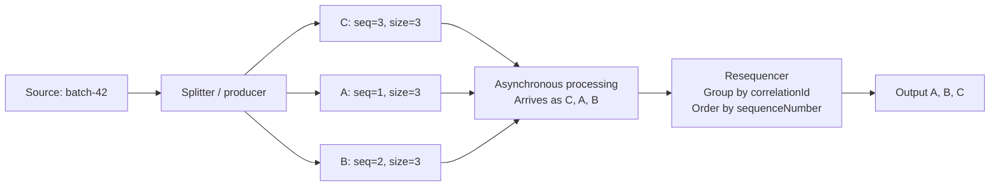

# Where Does the Sequence Number Originate From?

In **SPRING_INTEGRATION_PATTERN**, Enterprise Integration Patterns such as Splitter, Router, Transformer, Aggregator, and Resequencer help build loosely coupled, scalable message flows. When a task is split into multiple messages and processed in parallel, the branches may complete in a different order than the original one. **Resequencer** receives related messages and restores them to the order declared by `sequenceNumber`.

Key takeaway: **`sequenceNumber` is assigned by the producer or the component splitting the message sequence; Resequencer reads that value to sort, and does not infer the correct order from arrival time.** In Spring Integration, the most common source is a **Splitter** configured to generate sequence information. For messages arriving from external systems, the application must carry or map the sequence number from business data.

## 1. Sequence number is the order within a group, not a global identifier

Three headers need to be considered together:

| Spring Integration Header | Role | Example |
| --- | --- | --- |
| `correlationId` | Identifies messages belonging to **the same sequence/group** | `batch-42` |
| `sequenceNumber` | Indicates the position of the message **within the group**, usually starting at `1` | `2` |
| `sequenceSize` | Total expected number of messages in the sequence, if known | `3` |

The corresponding Java constant names are in `org.springframework.integration.IntegrationMessageHeaderAccessor`: `CORRELATION_ID`, `SEQUENCE_NUMBER`, and `SEQUENCE_SIZE`. Distinguish these headers from `MessageHeaders.ID`: `id` identifies **a single message**, whereas `correlationId` identifies **a group of messages**. Two messages with different `id`s can share the same `correlationId`.

Example of a source producing three parts of `batch-42`:

| Message | correlationId | sequenceNumber | sequenceSize | Payload |
| --- | --- | ---: | ---: | --- |
| Part A | `batch-42` | 1 | 3 | `A` |
| Part B | `batch-42` | 2 | 3 | `B` |
| Part C | `batch-42` | 3 | 3 | `C` |

If network conditions and parallel processing cause them to arrive in the order **C → A → B**, Resequencer can emit **A → B → C** once the group release conditions are met. It knows the expected order from the headers, not from the payloads `A`, `B`, `C` or the actual arrival order.



All parts in the diagram share `correlationId=batch-42`; only `sequenceNumber` changes. For `batch-43`, sequence numbers can start again from `1` without conflict.

## 2. Common sources of `sequenceNumber`

### 2.1. Splitter: the most common automatic source

**Splitter** transforms a message containing a collection of elements into multiple child messages. When **`applySequence`** is enabled, it attaches sequence metadata to the child messages:

1. **`correlationId`**: identifies the set of child messages originating from the same split; typically derived from the input message identifier.
2. **`sequenceNumber`**: increments according to the position of the element emitted by the Splitter, usually `1, 2, 3, ...`.
3. **`sequenceSize`**: the number of elements in the collection if the Splitter knows the size.

For example, given an input list `["A", "B", "C"]`, one split produces three messages with sequence numbers `1, 2, 3`. **This order reflects the order in which the Splitter traverses the data at split time**, and does not automatically reflect chronological order, priority, or a business key. If the input list is already out of order, Resequencer still follows the numbering assigned by the Splitter.

The following Java DSL snippet illustrates a flow that splits a list and a flow that receives and resequences it (for example, in a Spring Integration 6 configuration style):

```java
import org.springframework.context.annotation.Bean;
import org.springframework.context.annotation.Configuration;
import org.springframework.integration.dsl.IntegrationFlow;

@Configuration
class SequenceFlows {

    @Bean
    IntegrationFlow splitFlow() {
        return IntegrationFlow.from("batchInput")
                .split()
                .channel("partOutbound")
                .get();
    }

    @Bean
    IntegrationFlow resequenceFlow() {
        return IntegrationFlow.from("partInbound")
                .resequence()
                .channel("partOrdered")
                .get();
    }
}
```

`partOutbound` and `partInbound` represent the two sides of a processing/forwarding stage, such as asynchronous workers. They must be connected over transport infrastructure appropriate for the real system; the two channel names here merely represent boundaries. If there is only a single synchronous flow preserving order, you might not observe out-of-order situations to test the Resequencer.

**Note on unknown size:** not every splitting source knows the number of elements in advance. An iterator/stream-based source may prevent `sequenceSize` from reflecting the exact total. In that case, you must design an appropriate sequence-ending or group-release condition; do not assume Resequencer always knows when all messages have arrived.

### 2.2. Multi-branch fan-out components

Some fan-out components, such as **`PublishSubscribeChannel`** with `applySequence` enabled, can also attach sequence information to messages sent to multiple subscribers. The mechanism and default values depend on the endpoint/configuration type, so you must **verify `applySequence` directly on the fan-out component**.

Do not assume that every Router, Filter, or Transformer generates `sequenceNumber`:

- **Router** usually decides where to send a message; sequence generation only happens if the specific component/configuration supports and enables that mechanism.
- **Filter** mainly allows or discards messages and does not turn an arbitrary flow into an ordered sequence.
- **Transformer** mainly alters the payload; if the message/headers are preserved, sequence metadata can carry over, but a transformer does not inherently determine business order.

A valid sequence must have **a single party responsible for consistent numbering**. Do not let multiple branches independently assign `1, 2, 3` and feed them into the same `correlationId`.

### 2.3. Application-assigned numbering when data arrives from Kafka, RabbitMQ, HTTP, files, etc.

If elements sent by an external system already carry `batchId`, `partIndex`, and `partCount`, an adapter or mapping step can convert them into Spring Integration headers. Example:

```json
{
  "batchId": "batch-42",
  "partIndex": 2,
  "partCount": 3,
  "content": "B"
}
```

The receiving side builds the message:

```java
import org.springframework.integration.IntegrationMessageHeaderAccessor;
import org.springframework.messaging.Message;
import org.springframework.messaging.support.MessageBuilder;

record IncomingPart(String batchId, int partIndex, int partCount, String content) {}

static Message<String> toMessage(IncomingPart part) {
    if (part.partCount() < 1
            || part.partIndex() < 1
            || part.partIndex() > part.partCount()) {
        throw new IllegalArgumentException("Invalid sequence information");
    }

    return MessageBuilder.withPayload(part.content())
            .setHeader(IntegrationMessageHeaderAccessor.CORRELATION_ID, part.batchId())
            .setHeader(IntegrationMessageHeaderAccessor.SEQUENCE_NUMBER, part.partIndex())
            .setHeader(IntegrationMessageHeaderAccessor.SEQUENCE_SIZE, part.partCount())
            .build();
}
```

This mapping **does not invent an order**: it translates the order provided by the data contract into headers that Resequencer understands. You must clearly agree on whether `partIndex` starts at `0` or `1`; if the external system numbers from `0`, convert it before assigning `sequenceNumber`.

Do not mechanically substitute the following values:

| Value | Why it is not equivalent to `sequenceNumber` |
| --- | --- |
| `MessageHeaders.ID` | It is an individual message identifier, not a position in a sequence. |
| `timestamp` or arrival time | Can vary due to latency, retries, clock skew, and parallel processing. |
| Kafka `offset` | Ordered within **a single partition**, but not inherently `1..N` of **a business group**; multiple groups may interleave. |
| RabbitMQ delivery tag / JMS message ID | Used for identification, transport, or acknowledgment; not the part's position in a batch. |
| List index after parallel processing | May reflect completion order rather than the original order. |

If the source lacks a reliable order, you need to establish a **business ordering rule** upstream (for example `eventVersion` within the same aggregate, `lineNumber` in a file) and convert it into appropriate contiguous positions. Simply adding a Resequencer at the end of a flow cannot recover ordering information that never existed.

## 3. How Resequencer uses the headers

With a typical Resequencer configuration, the high-level lifecycle is:

1. **Receive the message** and use the correlation key (usually `correlationId`) to find the right group in `MessageGroupStore`.
2. **Store and track `sequenceNumber`** of messages in the group; detect missing positions.
3. **Check the release condition**. Waiting for the full group, whether partial contiguous sequences can be released early, timeouts, and handling incomplete groups depend on configuration.
4. **Emit messages in numbered order** when the release condition is satisfied. Different groups are processed independently without forming a global order.

For example, with `sequenceSize=4`, group `G1` receives the order `3, 1, 4, 2`. When waiting for the full sequence before releasing, the output is `1, 2, 3, 4`. If releasing contiguous partial sequences is allowed, individual messages may be emitted earlier, but **never past a missing position** within the same group.

An important consequence: a wrong `correlationId` can mix two batches together or split one batch into multiple groups; a wrong `sequenceNumber` produces wrong output even when the resequencing engine operates strictly as configured.

## 4. Challenging scenarios in advanced Resequencer

### Missing elements or unknown total element count

With `1, 3, 4` and an expected `1..4`, position `2` has not appeared yet. Resequencer cannot fabricate part `2`. The design needs to define:

- **A reliable `sequenceSize`**, or an end signal and dedicated release strategy when the total is unknown.
- **`groupTimeout`**, an expiration policy, and a destination for errors/unprocessed elements so groups do not remain forever.
- How to monitor `correlationId`, missing numbers, and the count of received messages.

Never treat a timeout as proof that the sequence is complete; it is only an operational policy for incomplete sequences.

### Duplicate sequence numbers, replays, and retries

Message number `2` may be delivered twice due to at-least-once delivery or retries. **Resequencer does not replace business deduplication**. You must attach a stable element identifier, choose an idempotency policy, and decide how to handle two different payloads sharing the same `correlationId + sequenceNumber`. Do not assign a new sequence number for each retry; doing so turns one element into two phantom positions in the sequence.

### Nested splits and multiple fan-outs

A message that already has `correlationId` and `sequenceNumber` may be split again by another Splitter. When designing nested sequences, you must determine **which level is being ordered**: parts of the parent batch or parts of a child branch. Inspect actual headers at each boundary and preserve correlation metadata for each level using a supported mechanism; do not reuse a single `correlationId/sequenceNumber` pair for two levels with different numbering schemes.

### Across a message broker or service boundary

Headers must survive serialization/deserialization and adapter mapping. Check data types: `sequenceNumber` and `sequenceSize` should be restored as appropriate integer values, not arbitrarily stored as strings like `"2"`. If a broker or mapper strips these headers, the Resequencer in the downstream service will lack the required information.

Using a persistent `MessageGroupStore`, concurrency handling, timeouts, and cleaning up completed groups must also be configured according to restart and message-volume requirements. These mechanisms preserve and manage group state; they **do not automatically fix sequence numbers assigned incorrectly by the source**.

## 5. Testing and observability workflow

With a batch having `correlationId=test-100`, `sequenceSize=3`, intentionally send `sequenceNumber` in the order **3 → 1 → 2** to `partInbound`. When configured to wait for the full group, expect to receive **1 → 2 → 3** from `partOrdered`. Add test cases to verify actual behavior of the configuration:

| Test Case | Input Data | What to Verify |
| --- | --- | --- |
| Out-of-order | `3, 1, 2` | Output is ordered as `1, 2, 3`. |
| Two interleaved groups | `A:2, B:1, A:1, B:2` | Each group keeps its own order without mixing payloads. |
| Missing part | `1, 3`, `size=3` | Group is held/timed out per configured policy; not silently treated as complete. |
| Duplicate position | `1, 2, 2, 3` | Observe duplicate handling and verify downstream idempotency. |
| Invalid metadata | `sequenceNumber=0` or mismatched `sequenceSize` | Invalid input data is detected and rejected/quarantined. |
| Header lost across broker | Message missing `correlationId` | Mapping bug is caught before losing proper grouping capability. |

In logs/metrics, record at least **correlationId, sequenceNumber, sequenceSize**, arrival time, release time, group wait duration, and timeout reason. There is no need to log full sensitive payloads. With this data, you can distinguish between: wrong source numbering, a missing message in transit, duplicates from retries, or Resequencer waiting according to its release strategy.

## 6. Checklist for determining sequence number origin

1. **Locate where a sequence is formed**: Splitter, fan-out with `applySequence` enabled, or an external producer.
2. **Verify the numbering convention**: starts at `1`, increments in exact business order, no duplicate positions.
3. **Verify the group key**: all parts of a batch share the same `correlationId`; different batches use different keys.
4. **Verify how completion is known**: an accurate `sequenceSize` or a clearly defined termination/release strategy.
5. **Inspect across all branches and adapters**: headers are not overwritten, stripped, or changed in type.
6. **Test out-of-order, missing, duplicate, and interleaved group messages** before using Resequencer in an asynchronous flow.

**Remember:** The source of ordering must be defined **before the Resequencer**. A Splitter typically assigns `sequenceNumber` automatically when configured with sequencing; for external messages, the application derives it from data with a clear convention. Resequencer performs **reordering based on the already-assigned sequence**, together with `correlationId` and the release strategy, rather than deciding business order on behalf of the source.
