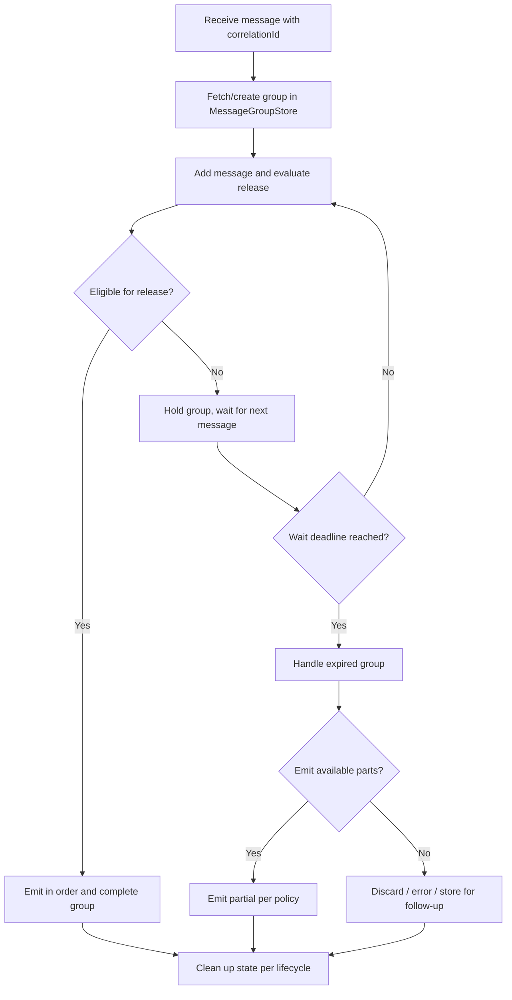
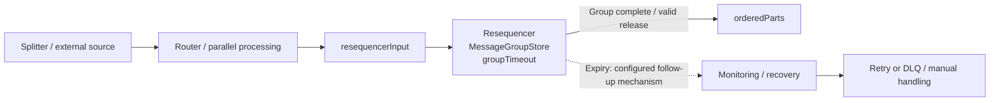

# Sequence Group Expiration

In the **Advanced Resequencer** chapter of **SPRING_INTEGRATION_PATTERN**, a group (*sequence group*) may receive part of its messages and never receive the rest. If you do not specify when to stop waiting, the system will retain group state in memory or in a store indefinitely. Conversely, if it stops too early, a valid delayed message may be dropped or treated as a new group.

This article explains what **sequence group expiration** is, how Spring Integration manages groups, how to choose a timeout policy, how to handle incomplete results, and how to test late-arriving messages. The topic connects directly to Splitter, Aggregator, Router, Filter, Transformer, Gateway, retries, error channels, and correlation in loosely coupled, scalable message flows.

> **Design principle:** Expiration is **a decision about timing and group-handling policy**, not proof that all elements have arrived. Resequencer cannot generate missing messages on its own.

## 1. What is a sequence group, and when is it considered expired?

Resequencer receives messages belonging to the same sequence, identifies the group by a correlation key, and orders the parts by sequence number. Three common headers are:

| Header | Meaning | Example |
| --- | --- | --- |
| `correlationId` | Key identifying the group | `order-781` |
| `sequenceNumber` | Position of the part within the group | `3` |
| `sequenceSize` | Expected total parts, if known | `4` |

Suppose a Splitter creates four parts of an order: `#1/4`, `#2/4`, `#3/4`, `#4/4`. Workers run in parallel, so Resequencer receives `#3`, then `#1`, then `#4`. If `#2` gets stuck in a queue or fails processing, the group still does not have all four positions.

A **group timeout** lets the system decide that the group has waited too long according to the configured policy. At that point, the endpoint can attempt to release the available parts, discard the group, or hand it off to an error workflow, depending on the design. **Expiry** describes the event where a group is handled under a timeout policy; **completion** describes the state where a group satisfies its release condition according to release rules. These two concepts are not synonymous.



Note: this is a **conceptual diagram**. At implementation time, the exact ordering among release evaluation, timeout scheduling, expired group handling, and store cleanup depends on the Spring Integration endpoint and configuration. A new message may arrive right as the timeout executes, so race conditions must also be tested.

## 2. Why might a group fail to complete?

Common causes and diagnostic indicators:

| Cause | Example | What to verify |
| --- | --- | --- |
| Lost/delayed message | Part `#2` has not arrived due to network or broker backlog | Queue lag, retries, dead-letter queue, actual publish timestamps |
| Slow asynchronous processing | Transformer calls an external service past deadline | Latency, downstream timeouts, worker limits |
| Filter drops a message | Splitter numbered `1..4` but Filter dropped `#2` | Intentional drop or bug? Is there a skip indicator? |
| Inconsistent metadata | Same group has differing `sequenceSize` or duplicate numbers | Header mapping, grouping logic, retries |
| Unknown endpoint | Streaming source has no end marker | Is there a group-closing contract? |
| Process restart | In-memory group state was lost | Is `MessageGroupStore` persistent and recoverable? |
| Wrong correlation | Final message carries a different group key | Producer, adapter, key type, and tenant/session isolation |

**Timeouts do not fix root causes.** They bound waiting time and resources, and provide a trigger for follow-up handling. If a Filter intentionally removed a position in the sequence, redesign the numbering or represent the skipped position explicitly. Increasing the timeout alone will not make that position appear.

## 3. Three distinct decisions: release, timeout, and cleanup

### 3.1. Release strategy: when can messages be emitted?

A *release strategy* decides when a group or part of a group is eligible for emission. For a Resequencer with reliable sequence metadata, the processor examines `sequenceNumber` positions and group state to determine output order.

In flows requiring the entire batch, the right policy is to wait until the group meets the completeness condition. In latency-sensitive flows, **partial sequences** may be permitted—releasing a contiguous ordered prefix early if configured to do so. However, **"being able to emit a segment" does not mean "the entire batch is complete"**.

For example, with arrival order `3, 1, 4, 2` and size `4`: when `1` arrives, a partial configuration may release a valid prefix if the release condition holds; a wait-for-full configuration releases after `2` appears. Actual behavior must be verified by tests for the release strategy in use.

### 3.2. Group timeout: how long to wait?

The **`groupTimeout`** property or **`groupTimeoutExpression`** expression on the correlation endpoint sets the group wait deadline. For example, setting `30_000` milliseconds establishes a policy of waiting roughly 30 seconds before handling timeout via the endpoint's scheduler mechanism.

Do not assume this parameter is always a **strict 30-second deadline from the first message**: the start time, rescheduling behavior when the group changes, scheduler execution time, and concurrency must be verified on your exact configuration/version. If the business requires an absolute wall-clock cutoff (e.g., "the order must close before 10:00"), store the business deadline separately and design an appropriate enforcement mechanism.

Timeouts determine *when to act*; they do **not** alter `sequenceSize`, automatically detect the exact count of missing messages when metadata is incomplete, or guarantee downstream processing finished.

### 3.3. Cleanup: how long to retain group state?

Resequencer/Aggregator uses **`MessageGroupStore`** to store active groups and lifecycle state. This is separate from release timing:

- A **completed** group may need to leave a trace (an empty group or completion metadata) to handle late-arriving messages consistently.
- An **expired** group needs a policy to remove, retain, or transition state while recording the failure reason.
- **Old inactive** groups can be cleaned up per store policy, such as using an old-group reaper (**`MessageGroupStoreReaper`**) where appropriate.

Distinguish **endpoint timeout events** from **store/reaper cleanup schedules**. Scheduling a sweep every minute does not mean business deadlines are enforced to the second. If monitoring or failure marking is required, explicitly design where expiration notifications go, because store cleanup is not inherently a complete business notification.

## 4. Choosing how to handle an expired group

Group `order-781` has `sequenceSize=4` but has only received positions `1, 3, 4`. Upon expiry, several policies are possible.

### Policy A — Do not emit incomplete results

Choose when **completeness matters more than latency**, such as financial totals, transaction processing, or state updates requiring all parts. When the group expires, do not send a result missing `#2` downstream as if it were complete.

The system must record the failed group, missing position details, store data for reprocessing, or execute compensation. Depending on configuration, expired group messages may be dropped from the normal output stream; therefore, you must **proactively configure observability, a discard/error branch, or business handling so incidents are never lost silently**.

### Policy B — Emit partial results by contract

Choose when the business **tolerates incomplete data**, such as updating monitoring dashboards, provisional summaries, or returning available data before a deadline. In Spring Integration, the **`sendPartialResultOnExpiry`** property is part of the expired-group handling policy.

For example, the group has `#1, #3, #4`. Downstream may receive the available parts per the resequencing mechanism, but **position `#2` is not recreated**. Establish a clear contract for partial results: is it provisional or final, can it be written to the authoritative store, and can it be amended if the late part arrives?

Never just enable partial emission and implicitly treat the batch as "successful". Depending on the flow, explicitly record a `PARTIAL` status, missing position numbers, and deadline via business data or events so downstream distinguishes it from complete results.

### Policy C — Route the group to recovery handling

Choose when completeness is required but the main flow cannot wait:

1. Mark the batch `TIMED_OUT` in the state management system.
2. Record `correlationId`, missing numbers, and elapsed wait time.
3. Trigger bounded retries, re-query upstream, or route to a dead-letter/recovery flow.
4. Once all parts arrive, allow recovery/completion only per business rules; avoid duplicate emission of already-processed parts.
5. If recovery window expires, close with an error state or create a compensation task.

This is an **application-level workflow**, not an automatic feature guaranteed by a single Resequencer property. Spring Integration's error channel can receive processing exceptions, but **a normal timeout does not necessarily throw an exception to the error channel**; if you want business timeout events emitted, configure and test them explicitly.

| Criterion | No partial emission | Partial emission | Recovery flow |
| --- | --- | --- | --- |
| Immediate outcome on expiry | No incomplete result on success branch | May emit received data | Event indicating follow-up needed |
| Completeness | Protected as priority | May be incomplete | Aims for completeness after retry/recovery |
| Downstream complexity | Needs failure tracking | Needs partial awareness | Needs state, idempotency, and lifecycle |
| Best fit | Batches requiring full set | Monitoring, provisional data | Distributed transactions, critical batches |

## 5. Illustrative Java DSL configuration

An example Resequencer flow configured **not to proactively emit partial results on group expiry**:

```java
import org.springframework.context.annotation.Bean;
import org.springframework.context.annotation.Configuration;
import org.springframework.integration.dsl.IntegrationFlow;

@Configuration
public class ResequencerTimeoutFlow {

    @Bean
    public IntegrationFlow resequenceOrders() {
        return IntegrationFlow.from("receivedParts")
                .resequence(spec -> spec
                        // Endpoint-level wait timeout; verify timeout scheduling
                        // semantics for the Spring Integration version in use.
                        .groupTimeout(30_000)
                        // Do not emit incomplete parts as normal output
                        // when group expiry occurs.
                        .sendPartialResultOnExpiry(false)
                        // Completed-group retention policy:
                        // consider impact on late-arriving messages.
                        .expireGroupsUponCompletion(false))
                .channel("orderedParts")
                .get();
    }
}
```

**How to read the configuration:**

- `receivedParts` is the input channel receiving parts tagged with `correlationId`, `sequenceNumber`, and, if known, `sequenceSize`.
- `groupTimeout(30_000)` sets the wait duration for handling incomplete groups via the endpoint mechanism.
- `sendPartialResultOnExpiry(false)` prevents proactively emitting partial results on expiry; you still need to build proper error tracking, discard handling, or recovery paths.
- `expireGroupsUponCompletion(false)` illustrates not immediately erasing the trace of a completed group. Its value and interaction with group cleanup must be tested against your state retention policy; it **does not replace business deduplication**.

The code above illustrates the **group timeout mechanism**, not a complete recovery pipeline. Production systems must configure `MessageGroupStore`, schedulers, restart persistence, expired-group monitoring, and error flows as required. To test partial emission, change `sendPartialResultOnExpiry(false)` to `true`, then verify exactly which messages are sent and how downstream records the incomplete state. Flipping a single flag does not guarantee business requirements are met.

A typical deployment diagram:



The dashed line is **a design element you must build**; Spring Integration does not automatically route every timeout to `errorChannel` or a dead-letter queue.

## 6. Messages arriving after a group has expired

This is one of the most dangerous edge cases for an asynchronous Resequencer.

Example:

```text
T+0s      Receive #1/4, group G is created.
T+2s      Receive #3/4 and #4/4, still missing #2.
T+30s     Timeout policy triggers for G.
T+35s     Worker retry succeeds; #2/4 finally arrives.
```

At `T+35s`, how does the system handle `#2`? There is no single answer unless post-expiry group lifecycle is defined:

- **If completion/expiry state is still retained:** the processor can recognize the group has ended; whether late messages are rejected, ignored, or processed depends on configuration. Test this explicitly.
- **If group data was deleted:** the late message may be treated as starting a new group with the same `correlationId`. The result is a group missing previously processed parts, or duplicated output if the group key was reused.
- **If a dedicated recovery flow exists:** the late message should be reconciled against batch state in the business store, then accepted, compensated, or routed to manual handling.

Therefore, cleanup policies must coordinate with **late arrival** and **idempotency** policies. Never rely solely on whether a group has been deleted to determine whether a business event was processed.

### Do not reuse correlation keys too early

If `correlationId="order-781"` was used for an old batch, do not reuse it immediately for a new batch while the broker might still hold delayed messages from the old one. You can use a composite key like `orderId + runId`, provided it is a stable identifier used consistently by all parts of the same run.

### Do not renumber on retries

Message `#2/4` when retried must remain `#2/4`, with the same batch ID and element identifier. If a retry turns it into `#5/5`, the system may wait for a nonexistent sequence or emit out of order. Resequencer is a tool for restoring order **by assigned metadata**, not validating whether that metadata is business-accurate.

## 7. Timeouts, `MessageGroupStore`, and multi-instance deployments

At high message volumes, each incomplete group consumes memory, storage records, and lookup overhead. Group expiry is part of system resource management.

**Storage:** An in-memory group store may be unsuitable if messages must survive restarts. You can consider persistent `MessageGroupStore` implementations supported by Spring Integration, but you must verify message serialization format, transactions, and recovery behavior. If a restart drops groups while the broker redelivers messages, you need an appropriate reprocessing strategy.

**Multiple instances:** Two instances can receive messages with the same `correlationId`. You must ensure they coordinate storage, group locking, timeout scheduling, and release so they neither emit the same group twice nor delete state while another instance is processing it. Sharing a store is only part of the solution; verify locking, coordination, and version-specific configuration.

**Group cleanup:** If retaining completion/expiry traces to guard against late redeliveries, define a retention period and purge policy for old data. Purging too early loses history; keeping forever grows storage. A mechanism like `MessageGroupStoreReaper` can help clean up old groups per configuration, but verify how it interacts with endpoint timeouts to avoid surprising double-expiry paths.

**Scheduler:** Group timeout is not a hard real-time clock. Under heavy group counts, scheduler overload, application pauses, or slow stores, actual execution time may lag behind the configured deadline. Measure and alert on timeout lag if SLAs depend on it.

## 8. Designing group expiry tests

In integration tests, send messages with explicit headers and observe not only output, but also group state, timeout events, and recovery paths. Do not only assert the ordering of happy-path results.

| Test case | Data and timing | Expected outcome to verify |
| --- | --- | --- |
| Complete before deadline | `3/3, 1/3, 2/3` before timeout | Emitted in order per release strategy; group completed |
| Missing one part | `1/4, 3/4, 4/4` then expires | Batch not treated as complete; partial/discard/recovery policy applied |
| Part arrives near deadline | `#2` arrives as timer fires | No duplicate emission, no lost state; outcome follows agreed concurrency rules |
| Late arrival after timeout | `#2` arrives after group expiry | Handled per late-message policy; does not create a second "successful" batch |
| Duplicate retry | `2/3` sent twice | Downstream does not apply business side effects twice |
| Filter intentionally drops part | `1..4`, Filter drops `#2` | Verify skip/renumber policy; do not mask gaps with timeout |
| Two interleaved groups | `A:1/2, B:2/3, A:2/2` then B expires | A completes; B undergoes timeout handling independently |
| Restart with open group | Receive `#1`, restart, then `#2` | Outcome aligns with store durability and replay policy |
| Heavy scheduler load | Many groups expiring together | No duplicate emissions; monitor lag and resource usage |
| Invalid size | `1/4, 2/3, 3/4` | Conflicting metadata detected and routed to error handling |

Where possible, isolate timeout detection/marking logic into testable components, use a controllable clock, or configure short timeouts in test environments. Avoid relying purely on long sleeps that slow down tests and cause flakiness. Always test events occurring right at the deadline, since that is where race conditions frequently surface.

## 9. Observability and operations

For each group, include the following information in logs/metrics, keyed by `correlationId` without needing to log sensitive payloads:

| Field / metric | Reason |
| --- | --- |
| `correlationId`, `sequenceSize` | Identify the batch and expected part count |
| Set of received `sequenceNumber`s | Detect gaps, duplicates, or misnumbering |
| `firstReceivedAt`, `lastReceivedAt` | Distinguish stalled groups from active ones |
| `deadline` or applied timeout | Explain why the group expired |
| `groupStatus` | Such as OPEN, COMPLETE, TIMED_OUT, PARTIAL, RECOVERED |
| `expiryReason` and missing parts list | Support retries, manual resolution, and root-cause analysis |
| Count of open / expired groups | Detect backlog buildup |
| Count of late / duplicate messages | Assess flow resilience and deduplication policy |
| Time from expected timeout to actual handling | Monitor scheduler pressure and system load |

The status field names above are **suggestions for business observability**, not default headers or metrics automatically produced by Spring Integration. Log when a group is created, completed, expired, and when a late message arrives; this helps distinguish **producer errors** from **transport failures or release-policy issues**.

## 10. Checklist before taking Resequencer to production

1. **Define when a group is considered complete:** full `sequenceSize`, an end marker, or partial release permitted.
2. **Define timeouts per SLA:** business deadlines, endpoint timeouts, and store cleanup schedules have distinct responsibilities.
3. **Finalize expiry behavior:** no emission, provisional partial emission, or route to recovery; identify who/what receives the signal.
4. **Finalize late-message behavior:** reject, reconcile with batch state and amend, or compensate; enforce idempotency.
5. **Ensure reliable correlation and sequencing:** each batch has a distinct key; retries preserve sequence numbers; intentional Filters are handled explicitly.
6. **Configure `MessageGroupStore` and cleanup appropriately:** account for restarts, multiple instances, storage capacity, and group-trace lifecycle.
7. **Monitor timeouts as operational events:** alert on incomplete groups, deadline lag, and growing open-group backlogs.
8. **Test concurrency:** final message arriving right at timeout, retries after expiry, restarts, and interleaved groups.

**Remember:** A sequence group expires when **the system's waiting policy decides to handle an incomplete group**. Setting `groupTimeout` is only the first step; combine release strategy, `sendPartialResultOnExpiry`, `MessageGroupStore` management, late-message handling, retries, and error observability so incomplete data is never mistaken for complete data.
