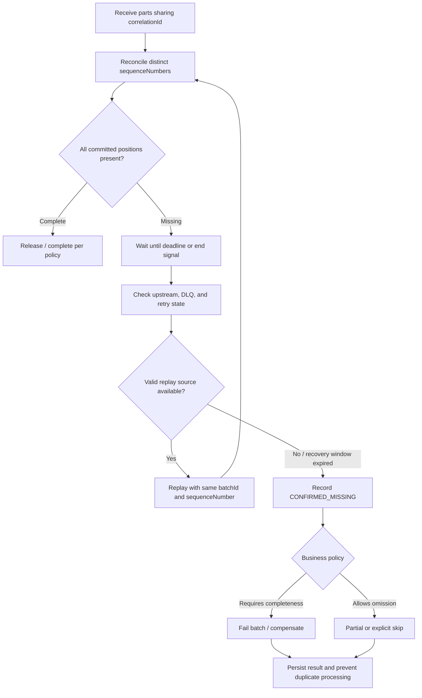
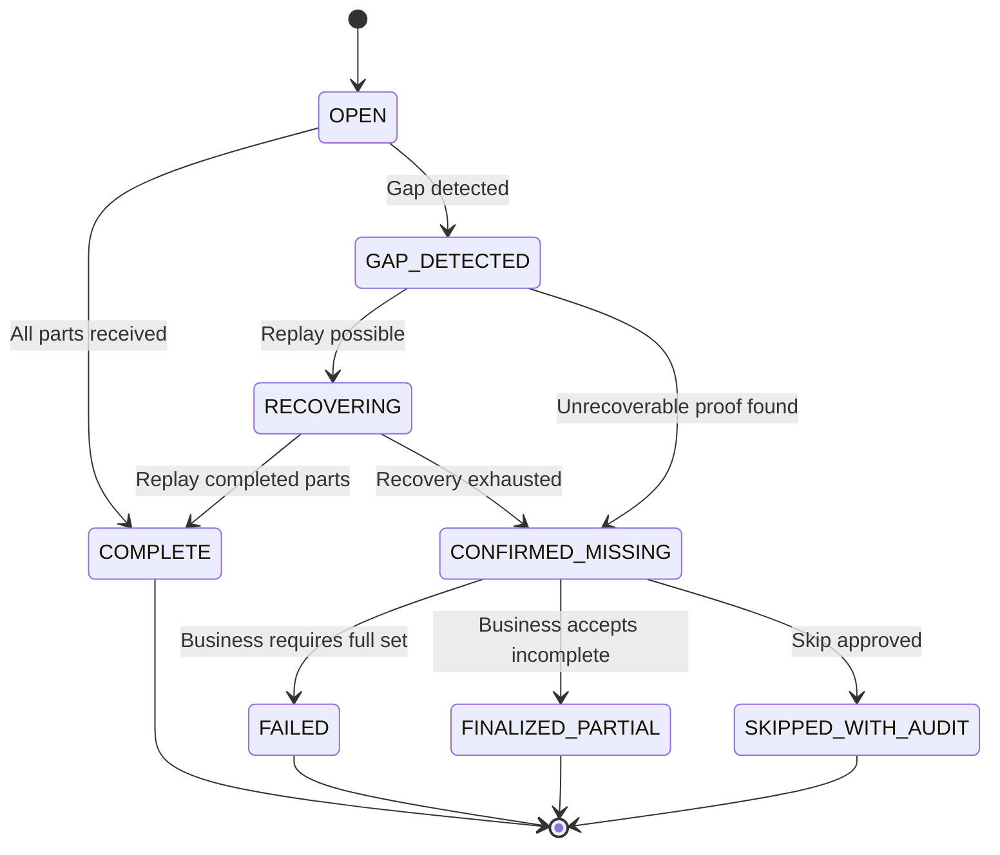
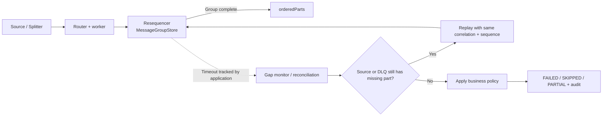

# Handling Permanently Missing Sequence Elements

In the **Advanced Resequencer** chapter of **SPRING_INTEGRATION_PATTERN**, a difficult scenario is when an element of a sequence never appears. For example, a Splitter creates five messages, yet element number 3 is unexpectedly dropped, lost after exhausting retries, or the source confirms it can no longer be replayed. The remaining parts still reach the Resequencer, but **no ordering algorithm can reconstruct the content of a lost element on its own**.

Spring Integration helps connect Router, Filter, Transformer, Splitter, Aggregator, and Gateway branches using message channels, correlation, retries, and error channels. However, when a *sequence* element is permanently missing, the application must make a **business decision**: re-fetch it, skip it with an audit record, accept an incomplete result, or fail the entire group. This lesson focuses on how to detect, classify, handle, and test those decisions.

> **Core point:** Not receiving a sequence element before a timeout **does not prove it is permanently lost**. "Permanently lost" should only be confirmed by reliable data or business procedures; a timeout is usually only the threshold to transition into verification or recovery.

## 1. Understanding the exact problem

A message group is typically identified by three Spring Integration headers:

| Header | Role | Example |
| --- | --- | --- |
| `correlationId` | Which messages belong to the same group? | `batch-2026-51` |
| `sequenceNumber` | Position of the message in the group | `4` |
| `sequenceSize` | Expected total parts when known | `5` |

Suppose the source finalized a five-part batch: `#1/5`, `#2/5`, `#3/5`, `#4/5`, `#5/5`. The receiver only sees:

```text
Actual arrival order:      #4 → #1 → #5 → #2
Expected positions:         1    2    3    4    5
Received positions:         ✓    ✓    ?    ✓    ✓
Gap:                                 #3
```

If the Resequencer applies a policy of waiting for **the full group** before emitting, the group cannot complete because position `#3` is missing. If releasing a contiguous segment (*partial sequence*) is permitted, the endpoint can emit the valid prefix according to the configured policy, but still cannot prove the remainder is complete.

Three concepts must be kept distinct:

1. **Late (*late*):** `#3` still exists and is in transit, retrying, or processing. It may arrive later.
2. **Temporarily missing or unknown (*missing/unknown*):** `#3` has not been seen and there is no evidence yet of whether the source can recover it.
3. **Confirmed unrecoverable by contract (*confirmed unrecoverable*):** the source or reconciliation system confirms `#3`'s data no longer exists and no valid replay path remains.

In many distributed systems, it is impossible to prove with absolute certainty that a message will *never* arrive. Thus, "permanently missing" is usually a **policy-bounded conclusion**, such as the source having deleted original records, retries being exhausted, and the reconciliation window having elapsed. Record the reason and evidence to distinguish a business conclusion from clock-based guesswork.

## 2. Why can a position be lost?

| Cause | Example | Recoverable? |
| --- | --- | --- |
| Intentional Filter drop | Splitter numbered first, Filter dropped `#3` | May require **redesigning the sequence** or recording the skipped part; do not retry pointlessly |
| Source record does not exist | Command generating `#3` was skipped due to upstream error | Depending on the source, may be regenerated from original data |
| Processing failure after retries | Worker for `#3` repeatedly fails | Root cause may be fixed and replayed; or it may be unrecoverable |
| Correlation mapping bug | `#3` carries the wrong `correlationId` | Metadata can be fixed, but avoid adding the same part twice |
| Message sits in DLQ | Broker moved `#3` to a dead-letter queue | Can usually be inspected and replayed under safety rules |
| Data purged / retention expired | Source file or broker event is gone | May genuinely be unrecoverable |
| Wrong sequence numbers | Two parts assigned `#3`, or index jumps from `2` to `4` | Must clarify business meaning of the parts before renumbering |
| End marker arrived with gaps | Source confirms total is 5, receiver only has 4 | Known that **group is incomplete**; still need to investigate cause and replay options |

A common real-world mistake is confusing "intentional Filter drop" with "packet loss". If a part is never meant to travel downstream, the sequence after the Filter must be redefined under a new contract, or carry an **explicit skip signal**. Keeping `sequenceSize=5` and hoping Resequencer skips `#3` on its own can stall the group indefinitely.

## 3. Detecting gaps without jumping to premature conclusions

### 3.1. Prerequisites

To declare a position missing, the receiver needs to know **which positions are expected**. The cleanest case is:

- `correlationId` is stable for exactly one batch or one run.
- `sequenceNumber` is issued in business order, typically `1..N`.
- `sequenceSize=N` is reliable and consistent across the entire group.
- Messages carry a distinct element identifier to handle retry duplicates.

When `sequenceSize` is unknown, merely observing `1, 2, 4` is **not enough** to conclude that `3` was lost or that the batch ended at `4`. You need a manifest, end marker, original ID list, or an authoritative group-closing rule. If a source intentionally uses sparse numbering, a missing `3` might **not be an error at all**; apply the right contract instead of forcing a contiguous `1..N` rule.

### 3.2. Detection and confirmation workflow



A timeout merely brings the group into **inspection and decision-making**. Many systems must also verify: have workers finished processing, is there a queue backlog, does the original source record still exist, does the DLQ hold the missing part, and has the business recovery deadline passed?

### 3.3. Computing the set of missing positions

The following Java snippet validates metadata and returns missing positions from a **snapshot of received state**. This is monitoring/reconciliation logic, not a built-in Resequencer API:

```java
import java.util.Collection;
import java.util.HashSet;
import java.util.List;
import java.util.Set;
import java.util.stream.IntStream;

public final class MissingSequenceDetector {

    private MissingSequenceDetector() { }

    public static List<Integer> missingPositions(
            int sequenceSize,
            Collection<Integer> receivedPositions) {

        if (sequenceSize < 1) {
            throw new IllegalArgumentException(
                    "sequenceSize must be positive and known");
        }

        Set<Integer> received = new HashSet<>(receivedPositions);
        boolean invalid = received.stream()
                .anyMatch(n -> n == null || n < 1 || n > sequenceSize);
        if (invalid) {
            throw new IllegalArgumentException("Invalid sequence number");
        }

        return IntStream.rangeClosed(1, sequenceSize)
                .filter(n -> !received.contains(n))
                .boxed()
                .toList();
    }
}
```

For example, `missingPositions(5, List.of(4, 1, 5, 2))` returns `[3]`. This list represents **the gap at snapshot time**, and does not by itself distinguish late arrival from permanent loss.

In practice, reading the received list must be consistent with messages currently being written to `MessageGroupStore`. A gap report generated concurrently with receiving `#3` may already be stale. Before marking a part permanently lost, verify current state using transactions, locking, or an equivalent reconciliation mechanism.

## 4. Choosing a policy for permanently missing parts

No single policy fits every system. Choose based on business tolerance for missing data, replay feasibility, and ordering requirements.

| Policy | Action | Best fit | Safety conditions |
| --- | --- | --- | --- |
| **Replay/recovery** | Re-fetch `#3` from source; keep original metadata | Source still has data or DLQ holds it | Idempotency, bounded retries, identifier checks |
| **Fail entire group** | Terminate with business error; do not emit result as complete | Payments, reconciliation, transactions needing full data | Record failed batch, compensation, or intervention |
| **Explicit skip** | Record `#3` as skipped by authorized decision | Pipelines tolerant of dropping a known part | Skip evidence and clear ordering rules |
| **Partial output** | Emit valid parts and mark result incomplete | Dashboards, provisional data, best-effort processing | Downstream understands partial status and never treats it as complete |
| **Substitute with business data** | Generate a replacement record per approved rules | Domain has valid defaults or derivation rules | Replacement record is clearly flagged, audited, never hides data loss |

**Do not fabricate an empty message for `#3` just to make Resequencer release the group.** This falsifies data, breaks audits, and produces wrong results. Only use a placeholder/tombstone when **the business contract explicitly defines** its semantics and downstream recognizes it.

### 4.1. Replay and recovery

If the missing part is found in a DLQ or the source system can regenerate it, prefer restoring the original:

1. Confirm the exact `correlationId` and `sequenceNumber` of the part to replay.
2. Verify payload, element identifier, and version; do not accidentally replay newer data under an old position.
3. Replay with **the same batch ID and same position**—do not assign a new sequence number just because it is a retry.
4. Check whether the group is still open or already expired. If the group was deleted, invoke a dedicated recovery workflow.
5. Record an idempotency marker so an already-applied part is never processed again.

If a timeout fires while replay remains a valid option, you can mark status `RECOVERING` and continue waiting under a separate recovery deadline. A Spring Integration wait timeout does not necessarily mean the business deadline prohibits all replays.

### 4.2. Fail the entire group and compensate

When a financial amount or critical operation requires all five parts, missing `#3` must make **the batch fail**. Resequencer must not emit a four-part group and label it a complete result.

Also implement at the application layer:

- Persist an error record with `batchId`, expected count, received count, missing positions, and unrecoverable evidence.
- Trigger compensation if earlier parts already caused external side effects (e.g., inventory was reserved but the order is canceled).
- Prevent emitting completion events twice if a timeout and a retry thread update the batch concurrently.
- Delete group state and temporary data only after audit and recovery details are safely persisted.

Do not rely solely on `errorChannel` to catch timeouts. Message processing exceptions and group expiry events can follow separate paths; to publish `BATCH_FAILED`, **explicitly design and test** the emission point for that event.

### 4.3. Explicit skip and changing ordering rules

Suppose a Filter intentionally drops `#3` because its data does not qualify:

```text
Original sequence:        #1/5   #2/5   #3/5   #4/5   #5/5
Filter drops purposely:   #1/5   #2/5          #4/5   #5/5
```

Two valid approaches:

**Approach A: filter first, create a new sequence.** For the remaining parts, produce a resulting batch with contiguous positions `1/4, 2/4, 3/4, 4/4`. Renumbering must occur **at a single consistent boundary**, with an appropriate batch/version identifier. Never edit `sequenceSize` on a few individual messages while leaving old numbers `1,2,4,5`.

**Approach B: preserve original sequence and confirm skip.** The producer emits an authoritative `PartSkipped(batchId, sequenceNumber=3, reason=...)` event. A dedicated coordinator treats position `#3` as resolved in `SKIPPED` status and makes release decisions per application rules. If a tombstone travels as a message in the sequence, downstream must distinguish **real data** from **skipped positions**; never assume Resequencer natively understands tombstone payloads or handles skips automatically.

The choice depends on your goal: whether original position numbers must be preserved for auditing, or you only need a new sequence of valid parts.

### 4.4. Controlled partial emission

Some domains allow proceeding with incomplete data, provided the result is **marked as missing parts**. For example, a monitoring system can publish "4/5 messages processed; missing position 3" in a provisional data snapshot.

Resequencer emits **individual messages in order**, unlike Aggregator which typically produces a combined result. When configuring partial emission on expiry, explicitly test which parts the endpoint sends, in what order, and what state the group retains. Marking `PARTIAL` is the responsibility of business design or downstream; never assume a custom header like `batchStatus=PARTIAL` is automatically generated by Spring Integration.

Partial emission is **unsuitable** if downstream strictly needs all parts to compute a valid result. Some workflows need to send both the missing-position list and version, then emit an adjustment event if the data is found later.

## 5. Group timeout and expiry do not resolve missing sequences on their own

In correlation endpoints such as Resequencer, Spring Integration can store groups in `MessageGroupStore`, apply a release strategy, and handle expired groups. A Java DSL example illustrating a wait configuration:

```java
import org.springframework.context.annotation.Bean;
import org.springframework.context.annotation.Configuration;
import org.springframework.integration.dsl.IntegrationFlow;

@Configuration
public class ResequencerMissingSequenceFlow {

    @Bean
    IntegrationFlow resequenceParts() {
        return IntegrationFlow.from("incomingParts")
                .resequence(spec -> spec
                        .groupTimeout(20_000L)
                        .sendPartialResultOnExpiry(false))
                .channel("orderedParts")
                .get();
    }
}
```

This snippet illustrates **the endpoint timeout mechanism**, without implementing "permanent loss" detection or recovery. Meaning of each part:

- `incomingParts` receives messages already carrying `correlationId`, `sequenceNumber`, and appropriate `sequenceSize`.
- `groupTimeout(20_000L)` configures the wait duration for handling groups that have not met the release condition. Actual scheduler timing and timeout reset behavior on group updates must be verified against your endpoint/version; do not assume a strict 20-second deadline from the first message.
- `sendPartialResultOnExpiry(false)` chooses not to proactively emit partial results on the expiry path. This does **not automatically send a business alert**, guarantee persistence of missing-part evidence, or imply retries are exhausted.
- `orderedParts` is the output channel for messages emitted according to the resequencing policy.

When the design permits partial emission, you can consider `sendPartialResultOnExpiry(true)`, but you **must test the actual flow** with gapped sequences to verify output, state, and late-message policies. A configuration flag does not replace the application's definition of "success".

### 5.1. Do not confuse three kinds of timeout

| Concept | Role | What does it answer? |
| --- | --- | --- |
| Single-message / Gateway timeout | Limits how long one call or task waits | "Is this call taking too long?" |
| Resequencer group timeout | Triggers handling for an unreleased group | "Has this group waited too long per configuration?" |
| Business recovery deadline | Defines until when the system may still find/replay missing parts | "Are we still allowed to repair this batch?" |

You need a durable source of state if you want reconciliation across restarts or multiple instances. `MessageGroupStore` holds endpoint group state; a business table can additionally store deadlines, recovery state, retry counts, skip authorizers, and evidence. Deleting a group from the store should never wipe out the entire business decision history.

### 5.2. Cleanup schedules and late messages

Old-group cleanup mechanisms such as `MessageGroupStoreReaper` and endpoint-managed timeouts have distinct responsibilities. Sweeping a group too early can cause a late message with the same `correlationId` to be treated as a brand-new group. Retaining groups or completion markers forever inflates storage.

For a batch already finalized as `FAILED` or `FINALIZED_PARTIAL`, a late `#3` must follow the recorded state: enter an adjustment workflow, be stored for audit, or be rejected with an explanation. **Never accidentally create a second completed batch**. Use stable idempotency keys, terminal states, and appropriate data retention rules.

## 6. Business state model for permanent gaps

A reference state model:



These are **recommended application states**, not built-in enums in Spring Integration. Meanings:

- `OPEN`: the batch is still accepting new parts.
- `GAP_DETECTED`: missing position(s) observed; not yet concluded permanently lost.
- `RECOVERING`: querying source, executing retries, or replaying.
- `CONFIRMED_MISSING`: evidence recorded and recovery capability ended.
- `FAILED` / `FINALIZED_PARTIAL` / `SKIPPED_WITH_AUDIT`: terminal decision persisted and published to stakeholders.

**Use atomic operations** when transitioning to a terminal state. For example, if a timer confirms missing data at the same moment a worker redelivers `#3`, the system must not both mark `FAILED` and emit `COMPLETE`. In multi-instance environments, use database transactions, optimistic locking, and an outbox for terminal events; the exact choice depends on your data store.

### 6.1. Example audit record structure

A record supporting investigation and retries might contain:

```json
{
  "batchId": "batch-2026-51",
  "status": "CONFIRMED_MISSING",
  "expectedSize": 5,
  "receivedSequences": [1, 2, 4, 5],
  "missingSequences": [3],
  "lastCheckedAt": "2026-11-21T08:30:00Z",
  "reason": "source_record_unavailable",
  "replayAttempts": 3,
  "recoveryDecision": "FAIL_BATCH"
}
```

This is an **illustrative application-defined schema**, not data emitted automatically by Resequencer. In production, add source identifier, data version, and idempotency processing key; store only necessary data and avoid logging sensitive payloads.

## 7. Recovery architecture and error notification

A sound structural layout:



The dashed line indicates **the application mechanism you must implement to observe timeouts**. Do not assume expiry events are automatically pushed to `errorChannel` by default. Before implementing the monitor, verify where expiration events can be observed for your endpoint and store; when needed, publish a dedicated business event via an appropriate channel.

Several principles:

- **Bounded retries:** cap attempt count, backoff, and deadline. Do not retry forever against a source record confirmed nonexistent.
- **DLQ is quarantine, not a permanent recovery store by default:** establish procedures for inspection, validation, and safe replay, including TTL/retention.
- **Stable correlation:** do not reuse `batchId` for a new run while old messages might still arrive late. Combine `businessId` and `runId` if needed.
- **Idempotency:** element identifiers and batch outcomes must prevent the same sequence element from being applied multiple times after retries.
- **Do not silence alerts by shrinking `sequenceSize`:** if the source committed to five parts, changing it to four just to make the group release masks data loss.
- **Know where loss occurred:** trace across Splitter → Filter/Router → Gateway/worker → adapter → Resequencer. If upstream has a Filter, distinguish intentional filtering from real failures.

## 8. Testing difficult scenarios

Tests must observe **outputs, group state, business decisions, and late-message behavior**. Asserting only the order of emitted messages is insufficient.

| Test case | Condition | Expected outcome to verify |
| --- | --- | --- |
| Out-of-order but complete | `4/5, 1/5, 5/5, 2/5, 3/5` | Not concluded lost; output ordered per configuration |
| Temporarily missing | `#3` missing before timeout, then retry succeeds | Completes successfully once, preserving original sequence |
| Genuinely missing | Source confirms `#3` no longer exists | `CONFIRMED_MISSING` recorded and chosen policy applied |
| Message sitting in DLQ | `#3` in DLQ | Reconciled and replayed accurately, idempotently |
| Intentional Filter drop | Split five parts, Filter drops `#3` | Not stalled like a transport error; reindexed or explicitly skipped |
| Partial allowed | Receive `1/4, 2/4, 4/4` and deadline expires | Downstream knows `#3` is missing; never marked complete |
| Batch requiring completeness | `#3/5` lost unrecoverably | Never emits "success"; business error and compensation triggered |
| Message arrives after terminal decision | `#3` arrives after `FAILED`/`PARTIAL` | Follows late-arrival policy; never creates a second success result |
| Duplicate from retry | `#2` duplicated, `#3` still missing | Raw message count never treated as group completion |
| Interleaved groups | Group A complete, B missing `#2` | A completes independently; B handles its gap separately |
| Two processes finishing concurrently | Timer and replay arrive simultaneously | Only one terminal state transition and one result event |
| Mid-flight restart | Incomplete group, application restarts | Recovers accurately per chosen store and state table |
| Invalid sequence metadata | Inconsistent `sequenceSize`, out-of-range `sequenceNumber` | Bad data detected; never silently "auto-corrected" |

To test timeouts, use short timeouts, controllable synchronization points when needed, and assert final outcomes; avoid relying on repeated `Thread.sleep` calls that make tests slow and flaky. Always test right at the timeout boundary, because the race between "expiry" and "final message arrival" is where duplicates or drops most often happen.

### Example test for gap-detection logic

```java
import static org.junit.jupiter.api.Assertions.assertEquals;

import java.util.List;
import org.junit.jupiter.api.Test;

class MissingSequenceDetectorTest {

    @Test
    void findsMissingPositionButDoesNotInferPermanentLoss() {
        List<Integer> missing =
                MissingSequenceDetector.missingPositions(
                        5, List.of(4, 1, 5, 2));

        assertEquals(List.of(3), missing);
        // Proof of "unrecoverable" must be confirmed at the business layer.
    }

    @Test
    void considersAllPositionsPresentAfterReplay() {
        List<Integer> missing =
                MissingSequenceDetector.missingPositions(
                        5, List.of(4, 1, 5, 2, 3));

        assertEquals(List.of(), missing);
    }
}
```

These two tests only verify **the gap-finding algorithm**; Resequencer integration tests must still verify release strategy, timeouts, real channels, and state-store durability.

## 9. Observability so loss never turns into silent failure

Collect and correlate by `correlationId`:

- Committed total (`sequenceSize`), distinct received positions, missing positions, and duplicate positions.
- First/last message arrival times, timeouts, business deadlines, and `CONFIRMED_MISSING` timestamps.
- Queue lag, retries, DLQ status, and upstream re-query results.
- Counts of `OPEN`, `RECOVERING`, `FAILED`, and `PARTIAL` batches, plus successfully repaired batches.
- Late messages arriving after batch completion and attempts to emit duplicate result events.
- Skip or failure reasons, confirmation source, and the person or service making the decision.

Alert on **incomplete-group rate, age of open groups, failed-batch count, and recovery latency**, not just total messages received. A system can show high throughput while an important business group stays stuck indefinitely.

## 10. Design checklist

1. **Confirm sequence numbering rules:** `correlationId`, `sequenceNumber`, `sequenceSize`, and element IDs have an explicit contract.
2. **Distinguish late arrival from true loss:** timeouts trigger verification, not automatic assumption of permanent loss.
3. **Establish the source of truth:** know how to query manifests, DLQs, original data sources, or worker status for missing parts.
4. **Choose a business-driven policy:** replay, fail, transparent skip, partial, or authorized substitution.
5. **Never alter metadata to hide gaps:** reindex only when genuinely constructing a new consistent sequence.
6. **Separate endpoint timeouts from business deadlines:** both must be configured, monitored, and tested.
7. **Protect terminal state and idempotency:** prevent emitting two outcomes for the same batch when timeouts and retries race.
8. **Design late-message handling:** define rules for deleted, failed, or partially finalized groups.
9. **Observe all decisions thoroughly:** retain records of lost parts, reasons, and recovery or compensation actions.
10. **Test abnormal paths:** permanent loss, temporary loss, Filter drops, DLQ, restarts, concurrency, and malformed metadata.

**Remember:** When a sequence element is permanently missing, Resequencer only indicates that the group cannot achieve contract order/completeness. Proper handling lies in **recovery or an audited business decision**, combining timeouts, `MessageGroupStore`, correlation, retries, idempotency, and appropriate error handling. Never let a gap turn into "complete" data simply because you waited long enough.
