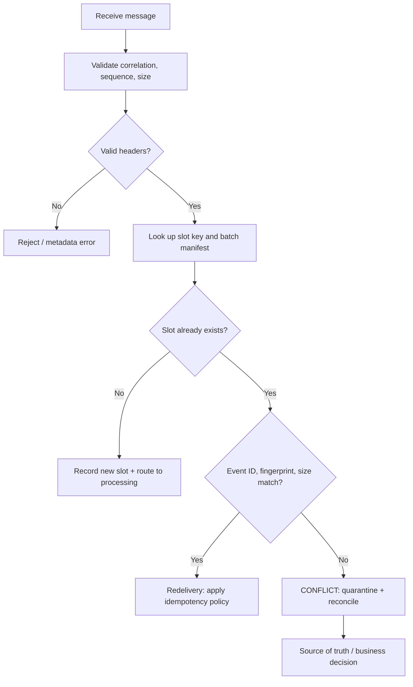
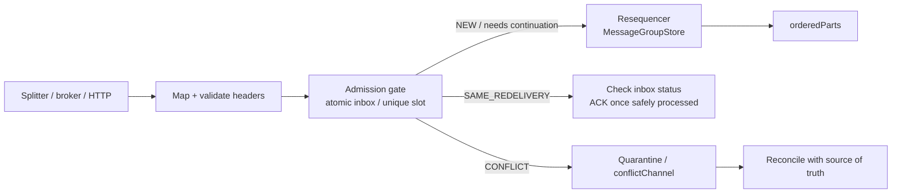

# Duplicate and Conflicting Sequences

In the **Advanced Resequencer** chapter of **SPRING_INTEGRATION_PATTERN**, a message sequence may arrive out of order, arrive multiple times, or carry contradictory ordering metadata. **Resequencer sorts based on sequence metadata; it does not decide on its own whether two messages sharing a position are a valid redelivery or two distinct business payloads.**

When building flows with Splitter, Router, Filter, Transformer, Aggregator, Gateway, retries, error channels, and asynchronous processing branches, clearly distinguish:

- **Duplicate sequence**: a position reappears, usually due to retry/redelivery or two branches emitting simultaneously.
- **Conflicting sequence**: the same position or the same group, yet messages carry **inconsistent business values or metadata**.
- **Out-of-order**: distinct positions arriving out of order; this is the case Resequencer is designed to solve.

The first two require **detection rules, idempotency, quarantine, and reconciliation** at the data boundary. Without them, the flow can emit duplicate business side effects or pick the wrong version of an element.

## 1. Three headers describing a sequence

Related messages typically use the following header set:

| Header | Function | Example |
| --- | --- | --- |
| `correlationId` | Identifies a group of messages | `invoice-42:run-7` |
| `sequenceNumber` | Position within the group | `2` |
| `sequenceSize` | Expected total parts, if known by the source | `4` |

For example, a four-part batch where workers return results in the order `#3/4, #1/4, #2/4, #4/4`: this is **valid out-of-order arrival**. If `#2/4` later appears again, you must check why position 2 appeared twice.

The logical key for detecting contention on the same position is typically:

```text
(tenantId, batchRunId/correlationId, sequenceNumber)
```

In practice, you need a non-reused `batchRunId` or execution identifier, because a business job can run multiple batches and each run has `sequenceNumber=1`. In a single-tenant system, `tenantId` may be omitted, but unrelated flows must never be merged by mistake.

**`MessageHeaders.ID` is not equivalent to `sequenceNumber` or a business element identifier.** A retry can create a new Spring Message with a new `id` and `timestamp`, even though its business content and position are identical to before.

## 2. How do duplicates and conflicts differ?

Suppose a source sends three parts for `batch-42`:

| Message | Correlation | Sequence | Source event ID | Content | Conclusion |
| --- | --- | ---: | --- | --- | --- |
| A | `batch-42` | 1/3 | `event-A` | `A` | New part |
| B | `batch-42` | 2/3 | `event-B` | `B` | New part |
| B' | `batch-42` | 2/3 | `event-B` | `B` | Redelivery of B |
| B'' | `batch-42` | 2/3 | `event-X` | `X` | **Conflict**: two events claim position 2 |
| B''' | `batch-42` | 2/4 | `event-B` | `B` | **Conflict**: group total changed from 3 to 4 |

A **semantically identical duplicate** occurs when the same position is redelivered with matching source identifier and immutable payload. If the position is the same but the payload, source event ID, or `sequenceSize` differs, it is a **conflict requiring investigation**. Never automatically label it a "harmless duplicate" just because the sequence number matches.

Specifically, **the same payload does not guarantee the same event**: if two different sources both emit `"OK"` at position 2 with distinct business event IDs, clarify the position contract. Conversely, the same event ID with altered content may reflect an illegal mutation/version change and must be treated as a conflict unless the domain allows versioned updates.

### Common real-world situations

| Symptom | Received data | Interpretation |
| --- | --- | --- |
| Out-of-order arrival | `3, 1, 2` | Resequencer can reorder to `1, 2, 3` |
| Retry of same part | `1:A, 2:B, 2:B, 3:C`, same source ID | Identity-valid duplicate; prevent double processing |
| Same position, different content | `1:A, 2:B, 2:X, 3:C` | Conflict; do not arbitrarily pick B or X |
| Same position, different size | `1/3, 2/3, 2/4, 3/3` | Inconsistent metadata within the same batch |
| Retry as a new batch | `run-1:2` and `run-2:2` | Not a duplicate if these are two distinct runs |
| Duplicate numbers from multiple Splitters | Two branches independently start `1,2,…` with the same correlation | Sequence-scoping design bug |
| Message arrives after group expiry | `#2` arrives after previous group was cleaned up | Reconcile lifecycle to avoid creating a second batch |

## 3. Where do duplicates usually come from?

**At-least-once transport.** A broker or consumer may redeliver a message when processing finishes but ACK fails, the process restarts, or a timeout occurs. This is normal in distributed systems; you cannot assume each business message arrives only once.

**Retries after Gateway/worker.** A worker completes an external side effect, but returning the response to the Gateway fails. Retrying regenerates the result for the same `sequenceNumber`. If downstream is not idempotent, the outcome can be written twice.

**Fan-out and parallel processing.** Two branches re-emit the same part, or one branch sends multiple times when completion signals are ambiguous. Router and `PublishSubscribeChannel` do not automatically guarantee that messages seen downstream are unique by business key.

**Re-invoked Splitter.** Splitting the same batch twice can produce two sets of parts. If `correlationId` is unstable or regenerated, the two sets become two separate groups; if the same correlation is reused without version control, parts collide on positions.

**Incorrect metadata mapping.** Using offsets from different partitions as a shared sequence number, using `0`-based indices without conversion, or letting multiple systems assign `sequenceNumber` independently can create conflicts even when the broker never retries.

A Resequencer only sees what remains in headers and payload. **Do not assume the `MessageGroupStore`, release strategy, or Resequencer implementation will detect and deduplicate all business duplicates.** A message store may key by internal message ID, where two messages with different IDs share the same `sequenceNumber`; behavior must be verified with tests on your specific configuration.

## 4. How to reliably detect duplicates

### 4.1. Choosing business keys and fingerprints

Explicitly define a sequence *slot* and an *event signature*:

- **Slot key**: `tenantId + batchRunId + sequenceNumber`.
- **Source event ID**: immutable identifier assigned by the source to the event at that slot.
- **Content fingerprint**: checksum or hash of canonicalized content, including schema/version if needed.
- **Sequence metadata**: validated `correlationId`, `sequenceNumber`, and `sequenceSize`.
- **Provenance**: producer, topic/partition/offset, or delivery attempt for diagnostics, not a replacement for slot key.

If the payload is JSON, hashing raw bytes directly can sometimes fail because field ordering, whitespace, and timestamp formatting may vary without changing meaning. Canonicalize per contract before hashing, or compare immutable business fields. Use a sufficiently strong hash algorithm; when conflicts are critical, retain enough data for full reconciliation rather than relying solely on the hash.

### 4.2. Decision rules



Decisions must be consistent across instances. If two consumers receive part `#2` simultaneously, a separate **check-then-write** sequence can make both believe they are first. In production, use an atomic operation such as a database unique key, conditional insert, or transactional inbox store with proper processing states.

### 4.3. Java code: classifying a slot before admission

The following example uses Java 17 to illustrate the policy. It is suitable for demonstration and single-JVM unit tests; it is **not sufficient for production** because state lives in memory, does not survive restarts, and is not transactionally coordinated with downstream.

```java
import java.util.concurrent.ConcurrentHashMap;
import java.util.concurrent.ConcurrentMap;

public final class SequenceAdmission {

    public enum Decision {
        NEW, SAME_REDELIVERY, CONFLICT
    }

    public record Part(
            String tenantId,
            String batchRunId,
            int sequenceNumber,
            int sequenceSize,
            String sourceEventId,
            String contentFingerprint) {
    }

    private record Slot(
            String tenantId, String batchRunId, int sequenceNumber) {
    }

    private record Signature(
            int sequenceSize, String sourceEventId,
            String contentFingerprint) {
    }

    private record BatchKey(String tenantId, String batchRunId) {
    }

    private final ConcurrentMap<BatchKey, Integer> expectedSizes =
            new ConcurrentHashMap<>();
    private final ConcurrentMap<Slot, Signature> acceptedSlots =
            new ConcurrentHashMap<>();

    public Decision classify(Part part) {
        if (part == null
                || blank(part.tenantId())
                || blank(part.batchRunId())
                || blank(part.sourceEventId())
                || blank(part.contentFingerprint())
                || part.sequenceSize() < 1
                || part.sequenceNumber() < 1
                || part.sequenceNumber() > part.sequenceSize()) {
            throw new IllegalArgumentException("Invalid sequence metadata");
        }

        BatchKey batch = new BatchKey(part.tenantId(), part.batchRunId());
        Integer existingSize =
                expectedSizes.putIfAbsent(batch, part.sequenceSize());

        // The same batch must declare the same total number of parts.
        if (existingSize != null && existingSize != part.sequenceSize()) {
            return Decision.CONFLICT;
        }

        Slot slot = new Slot(
                part.tenantId(), part.batchRunId(), part.sequenceNumber());
        Signature candidate = new Signature(
                part.sequenceSize(), part.sourceEventId(),
                part.contentFingerprint());

        Signature original = acceptedSlots.putIfAbsent(slot, candidate);
        if (original == null) {
            return Decision.NEW;
        }
        return original.equals(candidate)
                ? Decision.SAME_REDELIVERY
                : Decision.CONFLICT;
    }

    private static boolean blank(String value) {
        return value == null || value.isBlank();
    }
}
```

**Explanation:**

1. Every valid message is checked before entering the order-sensitive flow.
2. A previously unseen slot returns `NEW`.
3. The same slot with the same immutable attributes returns `SAME_REDELIVERY`, even if the Spring Message has a different `MessageHeaders.ID`.
4. The same slot with a different event ID, fingerprint, or sequence size returns `CONFLICT`.
5. The same batch with a `sequenceSize` differing from the previously recorded total also returns `CONFLICT`.

**Critical limitation:** `classify()` marks the slot as "seen" *before* proving the new message was durably persisted or handed off downstream. If processing fails right after returning `NEW`, an identical retry could be classified as `SAME_REDELIVERY` and dropped, losing the element. In a real system, tie inbox recording, processing state, and ACK into a durable, retryable workflow; `SAME_REDELIVERY` must sometimes **resume an in-progress operation** rather than simply dropping the message.

This snippet also does not address batch lifecycle, cache eviction, multiple instances, terminal group transitions, external payload identification, or update conflicts. Those belong to dedicated storage/idempotency design.

## 5. Designing the Spring Integration flow

A pipeline can place an **admission gate before the Resequencer**, after mapping and validating metadata. In Java DSL, a custom service activator/router can perform classification:



This flow cleanly separates the three decisions. Create dedicated diagnostic headers or messages such as `duplicateReason`, `originalEventId`, or `conflictType` **at the application layer**, avoiding confusion with built-in Spring Integration headers.

A minimal Resequencer configuration, assuming only accepted messages reach `validatedParts`:

```java
import org.springframework.context.annotation.Bean;
import org.springframework.context.annotation.Configuration;
import org.springframework.integration.dsl.IntegrationFlow;

@Configuration
class ValidatedResequencerFlow {

    @Bean
    IntegrationFlow resequenceValidatedParts() {
        return IntegrationFlow.from("validatedParts")
                .resequence()
                .channel("orderedParts")
                .get();
    }
}
```

This snippet **does not implement the admission gate** and does not guarantee duplicates/conflicts are handled; it only shows where Resequencer belongs behind an ingress control boundary. When running multiple instances, a persistent inbox with unique constraints and a state protocol is what enforces data invariants.

### Roles of Splitter, Filter, and Transformer

- **Splitter** can attach `correlationId`, `sequenceNumber`, and `sequenceSize` when sequencing is enabled. If the same batch is re-split, clarify whether it is a retry of the old batch or a new run.
- **Filter** may intentionally drop parts. A gap after a Filter does not mean a duplicate, though it can stall waiting groups. If renumbering, construct a new consistent sequence at the chosen boundary.
- **Transformer** can alter the payload. If the content fingerprint is computed **before** the Transformer, fingerprint the immutable input data; comparing payloads after transformation may differ even for the same original event.
- **Router/fan-out** can create different replay paths. All branches must follow the same slot contract; if each branch redefines positions, use separate correlation.
- **Aggregator and Resequencer** have different output goals, yet both depend on group-metadata integrity for release decisions.

## 6. Conflicting sequences: never blindly apply "first wins" or "last wins"

Two different messages both claiming to be `batch-42, sequenceNumber=2` represent a **data conflict**. Picking the first arrival can select a corrupted payload if the first was defective. Picking the last arrival can invert business semantics and produce non-reproducible results across runs.

Make one of the following explicit decisions:

| Policy | Selection condition | Execution requirement |
| --- | --- | --- |
| **Quarantine + investigate** | No trusted arbitration mechanism exists | Retain both versions; pause group release if needed |
| **Authoritative source** | Clear source of truth and version exist | Re-query; log the decision and the rejected version |
| **Versioned correction** | Business permits amending past events | Create a correction with new version/event; never assume two messages are identical |
| **Fail batch** | Conflict could cause severe erroneous side effects | Lock group, raise business error, recover/compensate if needed |
| **Deterministic precedence** | Contract specifies source/version priority | Stable, audited rule; never depends on message arrival time |

**A conflict cannot be resolved by Resequencer alone**, because identical sequence numbers give no clue which version is right. Applying an arbitrary choice can also cause different nodes to produce different outcomes.

### Conflicting group size

For example, `#1/5` and `#2/6` sharing `correlationId`: this is a **group-wide metadata issue**, even when `sequenceNumber` differs. If the total part count can legitimately change under business rules, require a new manifest/batch version or an explicit adjustment protocol; do not mix messages from two versions in the same group expecting the release strategy to figure it out.

### Conflict between a completed group and a late message

After a group completes or expires, a message may arrive with a previously used position and a different payload. If `MessageGroupStore` has purged the state, Resequencer may no longer have enough information to detect the contradiction. **Never rely solely on group presence in the store as proof a batch has not been processed.** Reconcile against a durable business lifecycle record with appropriate TTL/retention.

## 7. Idempotency must protect both ingress and downstream side effects

An **inbox/idempotency store** can persist slot key, source identifier, checksum, processing status, and final outcome. In a database, define a matching unique constraint:

```sql
-- Illustrative inbox table; exact syntax and locking mechanism
-- depend on the database management system in use.
CREATE TABLE sequence_inbox (
    tenant_id VARCHAR(100) NOT NULL,
    batch_run_id VARCHAR(160) NOT NULL,
    sequence_number INTEGER NOT NULL,
    sequence_size INTEGER NOT NULL,
    source_event_id VARCHAR(200) NOT NULL,
    content_fingerprint VARCHAR(128) NOT NULL,
    processing_status VARCHAR(40) NOT NULL,
    PRIMARY KEY (tenant_id, batch_run_id, sequence_number)
);
```

A safe flow typically performs:

1. Validate metadata and look up the batch manifest.
2. Record the slot via conditional insert/transaction; if already present, read signature and status before classifying.
3. ACK the input message only once handoff or processing output is **durable** per contract.
4. If signature matches and status is incomplete, allow resume/retry; if completed, use status to prevent applying side effects twice.
5. On conflict, quarantine both events, keep data needed for reconciliation, and never silently overwrite the slot.
6. If downstream has external side effects (DB writes, API calls), use an appropriate idempotency key, transaction/outbox, or compensation protocol to avoid duplicate effects when ACK fails.

A unique key ensures **each slot has one source-of-truth record**, yet by itself does not guarantee end-to-end "exactly once" across multiple stores, brokers, and services. Define transaction boundaries and crash-recovery procedures.

### Retention and group cleanup

Do not delete the dedup table immediately after Resequencer releases if the broker can still redeliver old messages. Keep records long enough to cover the retry/redelivery and late-arrival window. For long-running or auditable batches, output metadata may need to outlive groups in `MessageGroupStore`.

When retention expires, clearly define whether an old position may be accepted again. A non-reused `batchRunId` reduces the risk of old messages being mistaken for new batch data.

## 8. Thorough and adversarial testing

### 8.1. Unit tests for classification rules

For the `SequenceAdmission` class above:

```java
import static org.junit.jupiter.api.Assertions.assertEquals;

import org.junit.jupiter.api.Test;

class SequenceAdmissionTest {

    @Test
    void distinguishesRedeliveryFromConflict() {
        var admission = new SequenceAdmission();

        var original = new SequenceAdmission.Part(
                "tenant-1", "batch-42", 2, 3, "event-B", "sha256-B");
        var sameAgain = new SequenceAdmission.Part(
                "tenant-1", "batch-42", 2, 3, "event-B", "sha256-B");
        var conflicting = new SequenceAdmission.Part(
                "tenant-1", "batch-42", 2, 3, "event-X", "sha256-X");

        assertEquals(SequenceAdmission.Decision.NEW,
                admission.classify(original));
        assertEquals(SequenceAdmission.Decision.SAME_REDELIVERY,
                admission.classify(sameAgain));
        assertEquals(SequenceAdmission.Decision.CONFLICT,
                admission.classify(conflicting));
    }

    @Test
    void detectsGroupSizeConflict() {
        var admission = new SequenceAdmission();
        admission.classify(new SequenceAdmission.Part(
                "tenant-1", "batch-42", 1, 3, "event-A", "sha-A"));

        assertEquals(SequenceAdmission.Decision.CONFLICT,
                admission.classify(new SequenceAdmission.Part(
                        "tenant-1", "batch-42", 2, 4, "event-B", "sha-B")));
    }
}
```

These are **illustrative in-memory tests**. They do not verify crash conditions, multi-instance behavior, or ACK states; integration tests against real brokers, inbox stores, and channels are still needed.

### 8.2. Integration test matrix

| Test case | Input | Expected outcome |
| --- | --- | --- |
| Normal out-of-order | `3:C, 1:A, 2:B` | Output ordered properly per release strategy |
| Identical redelivery | `2:B` received twice, same source event ID | Single business effect; duplicate status recorded |
| Different message UUID, same event | Same slot/payload/event ID, different Spring `id` | Classified as redelivery, not a false conflict |
| Same slot, different payload | `2:B` and `2:X` | Conflict quarantined; neither picked arbitrarily |
| Same slot, different source ID | Two separate events both numbered 2 | Conflict even if payloads happen to match |
| Conflicting size within group | `1/3, 2/4, 3/3` | Invalid metadata blocked/quarantined |
| Duplicate before ACK | Processing finishes but ACK fails | Idempotent retry; side effects not written twice |
| Crash after inbox write | Inbox written, downstream not yet processed | Retry can resume the in-progress message |
| Two concurrent consumers | Same slot arrives at two nodes | One slot confirmed atomically; no double side effects |
| Group already cleaned up | Old message arrives after short retention | Late-arrival behavior follows business state |
| Filter drops part | Splitter produces `1..4`, Filter drops 2 | Intentional skip not confused with duplicate |
| Two interleaved batches | `A:1, B:1, A:2, B:2` | B's position 1 not blocked because A already has position 1 |
| Retry with amended data | Same source ID, different payload/version | Classified as conflict or correction per contract, not silently overwritten |

To test concurrency, start multiple consumers simultaneously and inspect final state in **the idempotency store** and **downstream**, rather than only counting classifier return values. For timeouts, create a test where redelivery arrives right as the group expires to confirm no duplicate batch emission occurs.

## 9. Observability and incident handling

Track at minimum:

- `correlationId`/`batchRunId`, `sequenceNumber`, `sequenceSize`, and source event ID.
- Classification outcome: `NEW`, `SAME_REDELIVERY`, `CONFLICT`, `INVALID_METADATA`.
- Fingerprint or checksum for reconciliation, while avoiding logging payloads and sensitive data.
- Duplicate count by source, conflicting slot count, quarantined group count, and conflict resolution time.
- Inbox/outbox state, un-ACKed messages, retry counts, DLQ, and late arrivals.
- Downstream duplicate-effect preventions and cases requiring compensation.

A sample diagnostic log:

```json
{
  "batchRunId": "invoice-42:run-7",
  "sequenceNumber": 2,
  "sequenceSize": 4,
  "decision": "CONFLICT",
  "originalEventId": "event-B",
  "incomingEventId": "event-X",
  "reason": "same_slot_different_business_event",
  "action": "QUARANTINE"
}
```

The names `decision`, `reason`, and `action` are **suggested business fields**, not built-in Resequencer headers. Never dump full sensitive message contents into logs merely to tell two redeliveries apart.

## 10. Pre-deployment checklist

1. **Define slot key and run identifier.** Never share one `correlationId` across independent batches.
2. **Enforce a consistent sequence rule.** Validate `sequenceNumber`, `sequenceSize`, and source metadata before resequencing.
3. **Pick an immutable business fingerprint.** Never rely solely on Spring Message ID or arrival time.
4. **Separate redelivery from conflict.** Same slot with differing event ID, content, or group total must have an explicit policy.
5. **Tie dedup to processing state.** Never mark "processed" before durable handoff/result.
6. **Make slot admission atomic.** Use an inbox store/unique constraint and transactions suitable for multi-instance runs.
7. **Never silently apply first-wins/last-wins.** Have an authoritative source or audited precedence rule for conflicting data.
8. **Design timeouts and late arrivals.** Retain dedup records long enough for retries, DLQs, and post-expiry messages.
9. **Test all branches concurrently.** Cover out-of-order, duplicates, conflicts, crashes, retries, multiple consumers, group cleanup, and invalid metadata.
10. **Observe and support recovery.** Provide a conflict channel/quarantine, conflict position reporting, and a final resolution workflow.

**Remember:** Resequencer restores **order based on metadata**. Duplicate sequences require **idempotency based on business identity and processing state**, whereas conflicting sequences require **source-of-truth verification, quarantine, and audited resolution**. Handling both properly before the resequencing boundary keeps the message flow from emitting duplicate or corrupted data even when brokers and workers operate with at-least-once delivery.
