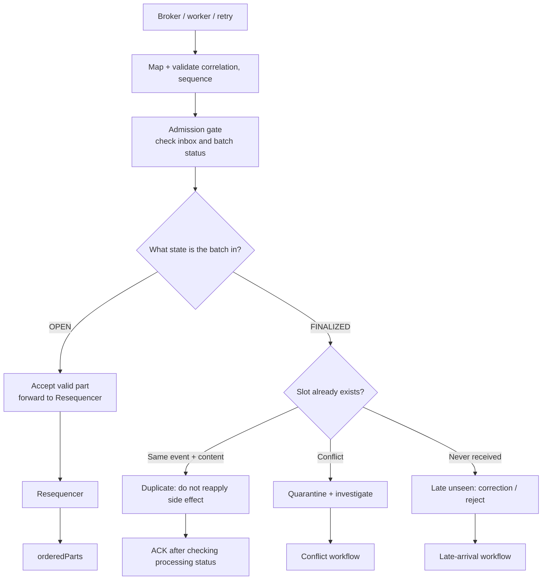
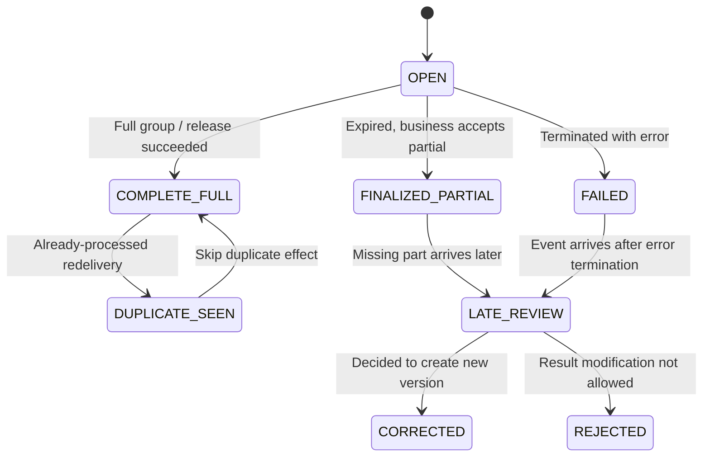

# Late Arrival After Group Completion

In the **Advanced Resequencer** chapter of **SPRING_INTEGRATION_PATTERN**, a message group may have already been ordered and emitted downstream, yet an old message still shows up afterward. This frequently happens when a broker redelivers after an acknowledgment failure, a worker runs slowly, a retry executes after a timeout, or parallel branches have different latencies.

**Late arrival after group completion** is the scenario where a message belonging to a `correlationId` that already has a final decision or emitted final result is only received or processed afterward. The key question is not merely "is it still in order?" but also: **in what state did the group complete, is the old state still retained, and is modifying the published result permitted?**

This article covers how to distinguish late messages from duplicates and conflicts, the impact of `MessageGroupStore`, `expireGroupsUponCompletion`, timeouts, late-arrival handling policies, Java DSL, and test scenarios. The goal is to build Enterprise Integration Patterns flows with clear correlation, safe retries, observable error handling, and no duplicate result emissions.

## 1. What does "group completion" mean?

Spring Integration uses common sequence metadata:

| Header | Meaning | Example |
| --- | --- | --- |
| `correlationId` | Identifies the group of messages in a sequence | `invoice-42:run-9` |
| `sequenceNumber` | Position of a message in the sequence | `2` |
| `sequenceSize` | Expected total parts if known by the source | `3` |

For a three-part group, the source numbers `#1/3`, `#2/3`, `#3/3`. Because workers run in parallel, Resequencer may receive `#3` first, followed by `#1` and `#2`, and then emit in order `1 → 2 → 3`.

```text
Time          Events for group G (size=3)
T+00s         Receive #3/3
T+01s         Receive #1/3
T+02s         Receive #2/3
T+02s         Release condition met, output: #1 → #2 → #3
T+09s         Broker redelivers #2/3 (same business event)
              → Message arrives after G's result was already emitted.
```

Here, at least three concepts must be kept distinct:

1. **Release:** Resequencer emitted one or more messages according to the release strategy condition.
2. **Completion:** the group was marked complete according to the endpoint lifecycle; a completion trace may remain in the group store or be removed depending on configuration.
3. **Business finalization:** the application recorded the final outcome and decided it will no longer accept direct modifications to that outcome.

These three events can be related, yet **they do not always happen at the same time**. A configuration allowing *partial sequences* may release a contiguous prefix early while the rest of the group is still waiting for later parts. In that case, the next message arriving after a release is **not necessarily** a late arrival after *completion*.

### Distinguishing normal completion from timeout termination

A group can reach different business states:

| Application status (suggested) | What happened | Implication when a message arrives later |
| --- | --- | --- |
| `OPEN` | Group is waiting or still accepting parts | May still accept valid new messages |
| `COMPLETED_FULL` | All positions confirmed and final result emitted | Late message is usually a retry/duplicate or conflict |
| `FINALIZED_PARTIAL` | Decided to emit/close while missing parts | A missing part arriving later is a **late unseen part**, requiring its own policy |
| `FAILED` | Group terminated with a business error | Must not automatically "reopen" and publish success |
| `CANCELLED` | Group intentionally canceled | Late messages must be rejected/logged per contract |

These states are a **reference business model**, not built-in default states or constants in Spring Integration. In particular, *group expiry* from a timeout does not prove a message is permanently lost; it simply triggers configured handling.

## 2. Why do messages still arrive after a group has closed?

### 2.1. Retry or redelivery after an ACK failure

The consumer successfully passed `#2` into the Resequencer, yet failed to ACK the broker in time. After a restart, the broker redelivers `#2`. The new Spring Message may carry a different `MessageHeaders.ID`, yet it is still **the same business event**.

### 2.2. One processing branch runs slower than the rest

A Splitter emits multiple parts; a Router sends them through workers, each branch with its own latency. If the group closes at a deadline and allows partial output, the slow part may arrive after the partial result has been published. This is a **previously unseen message**, distinct from redelivery of an already-processed part.

### 2.3. A retry or dead-letter branch is replayed

An error in a Transformer, Gateway, or external service sends part `#3` to a retry queue / dead-letter queue. By the time operations fixes the issue and replays it, the corresponding group may already be finalized or cleaned up. Replay handling needs to know how far the old result progressed.

### 2.4. The same group is regenerated upstream

A job is re-run with the same `correlationId` and sequence numbers starting at `1`. Without distinguishing runs via `runId`, the system cannot tell whether this is a **retry of an old batch** or a **new batch**. Two runs must not share a key while messages from the old run may still exist.

### 2.5. Multi-instance coordination and race conditions

One instance may be completing the group while another receives the final message or a duplicate. If checking "has the group completed?" and writing the result are two separate operations, both instances can believe their message is valid. Design atomic state updates and test concurrently.

## 3. Classifying late arrivals: not all are duplicates

Suppose a system has `batchRunId=invoice-42:run-9` and `sequenceSize=3`.

| Incoming message after close | Group history | Classification | Suggested handling |
| --- | --- | --- | --- |
| `#2/3`, same source event ID and fingerprint | `#2` already processed | **Same redelivery** | Skip duplicate side effects; ACK once safe |
| `#2/3`, different event ID or fingerprint | `#2` already has an accepted version | **Conflicting late event** | Quarantine/reconcile; never overwrite arbitrarily |
| `#3/3` arrives after group closed partially with `#1, #2` | `#3` was never received | **Late unseen part** | Correction/recovery or reject per contract |
| `#4/3` | Group committed size `3` | **Invalid metadata** | Reject/quarantine producer bug |
| `#1/4` with same batch ID | Earlier parts committed size `3` | **Conflicting group metadata** | Reconcile manifest/version |
| `#1/3` of `run-10` | Old group was `run-9` | **Different batch** | Process separately if new run key is valid |

The position key is typically `tenantId + batchRunId + sequenceNumber`. Also use **source event ID** and a **canonicalized content fingerprint** to distinguish an identical redelivery from two distinct events competing for the same position.

**Never rely solely on `MessageHeaders.ID` to detect duplicates**, because retries can generate new IDs. Likewise, do not rely on arrival order or timestamps: they reflect transport and processing, not which event is authoritative.

## 4. `MessageGroupStore` and `expireGroupsUponCompletion`

Resequencer belongs to the correlating endpoint family and stores messages of a group in a `MessageGroupStore`. This store participates in grouping, releasing, and managing group lifecycle.

An important setting is **`expireGroupsUponCompletion`**. Design-wise, there are two ways to manage state after completion:

- **Retain a trace of the completed group**: lets the system recognize that the same `correlationId` already finished. With configurations supporting this, the group can be kept in a completed marker state rather than deleting all traces immediately.
- **Remove the group upon completion**: saves storage state, but loses group completion information in the store. When an old message arrives later, the endpoint may treat it as a new group or apply other behavior depending on configuration.

Exact handling of late messages after group completion depends on **Spring Integration version, release strategy, endpoint configuration, store characteristics, discard channel, and cleanup policy**. Never assume every late message is always dropped, always throws an exception, or always starts a new group.

More importantly, **a completed marker in `MessageGroupStore` does not by itself replace a business-level inbox/idempotency store**. If the group is purged by retention, the application still needs to know that this batch already produced a final result, avoiding a second success emission upon broker redelivery.

### Java DSL example

The example below shows a Resequencer configured to intentionally retain completion traces in the endpoint while not emitting partial results on timeout:

```java
import org.springframework.context.annotation.Bean;
import org.springframework.context.annotation.Configuration;
import org.springframework.integration.dsl.IntegrationFlow;

@Configuration
class OrderedPartsFlow {

    @Bean
    IntegrationFlow resequence() {
        return IntegrationFlow.from("validatedParts")
                .resequence(spec -> spec
                        .expireGroupsUponCompletion(false)
                        .groupTimeout(30_000L)
                        .sendPartialResultOnExpiry(false))
                .channel("orderedParts")
                .get();
    }
}
```

Meaning:

1. `validatedParts` is a channel receiving only messages whose correlation/sequence and admission policy have already been validated.
2. `expireGroupsUponCompletion(false)` chooses not to immediately delete the completed-group trace via the endpoint mechanism; verify actual behavior with your store and group-cleanup setup.
3. `groupTimeout(30_000L)` handles groups waiting too long via the endpoint's scheduler mechanism. This value is not a hard guarantee of an exact 30-second deadline from the first message.
4. `sendPartialResultOnExpiry(false)` avoids proactively emitting partial data on expiry; it **does not automatically build a business error notification branch**.
5. `orderedParts` receives parts released in order.

This code illustrates endpoint-level Resequencer settings; it **does not yet implement an admission gate, business finalization state, durable dedup, or late-arrival handling**. Those belong in the surrounding application flow or supporting services. Specifically test messages arriving after completion on the exact Spring Integration version you use.

### What about `MessageGroupStoreReaper`?

An application may use an old-group scanning and cleanup mechanism such as `MessageGroupStoreReaper`. However, distinguish:

- **Group completion:** the endpoint satisfied the completion/release condition.
- **Group timeout/expiry:** the endpoint handles a long-waiting group per configuration.
- **Store cleanup/reaping:** a policy reclaiming stored state by group age.

These mechanisms serve different purposes and trigger at different times. Reaping groups too early can erase completed-group traces; retaining them forever inflates storage. Calculate retention based on **retry windows, broker/DLQ retention, business rules, and audit requirements**.

## 5. Deciding late-arrival handling at the business boundary

Instead of letting arbitrary messages enter the Resequencer directly and hoping the endpoint handles them properly, you can place an **admission gate** ahead of this channel.



Each branch must decide explicitly: whether to ACK the input message, store it in a DLQ or quarantine store, emit an event updating the previous outcome, and which person or service holds decision authority.

### Policy A — Ignore completed duplicate

Choose when the message is merely a redelivery of an event whose downstream side effects already completed durably. Log the redelivery count and ACK per broker protocol to avoid infinite retries. If the previous attempt only recorded "received" and downstream has not completed, you must **resume processing** rather than blindly ignoring it.

### Policy B — Quarantine conflict

Choose when `correlationId + sequenceNumber` matches, yet payload, source event ID, or manifest differs from accepted history. Retain enough information for reconciliation and emit an explicit business error event. Never apply "last wins" merely because a message arrived later.

### Policy C — Reject late unseen part

Choose when the batch completed under an immutable decision, such as finalized settlement or transmission to a third party that does not support amendments. Record the late message and handle it via recovery/compensation if needed; never silently reopen a closed group.

### Policy D — Versioned correction

Choose when the business allows amending published results, such as provisional reports or dashboards. Instead of silently mutating history, emit a new versioned **correction event** linked to the prior outcome:

```json
{
  "batchRunId": "invoice-42:run-9",
  "originalResultVersion": 1,
  "correctionVersion": 2,
  "lateSequenceNumber": 3,
  "reason": "late_part_after_partial_finalization",
  "decision": "RECALCULATE_AND_REPUBLISH"
}
```

This is an illustrative business schema, **not a built-in Spring Integration event**. Downstream must distinguish original results from updates and enforce idempotency by `batchRunId + correctionVersion`.

### Policy E — Recover a batch closed by timeout

If a group was marked `FINALIZED_PARTIAL` due to a deadline, you may allow opening a recovery workflow within a separate window. Recovery rules must check business cutoffs, already-exported data, and amendment compatibility. Do not simply drop the late part into the old group's Resequencer channel and assume it fixed the batch; the endpoint may have already cleared prior state.

## 6. Java code example for classifying late messages

The snippet below illustrates **pure logic** taking a batch-state snapshot and a new incoming part. It does not persist state itself; the goal is to separate business decisions from internal Resequencer behavior.

```java
import java.util.Map;
import java.util.Objects;

public final class LateArrivalPolicy {

    private LateArrivalPolicy() { }

    public enum Decision {
        ACCEPT_ACTIVE,
        IGNORE_CONFIRMED_DUPLICATE,
        QUARANTINE_CONFLICT,
        ROUTE_LATE_UNSEEN,
        REJECT_INVALID
    }

    public record Signature(
            String sourceEventId,
            String contentFingerprint) {
    }

    public record BatchSnapshot(
            String batchRunId,
            int expectedSize,
            boolean finalized,
            Map<Integer, Signature> acceptedSlots) {
    }

    public record IncomingPart(
            String batchRunId,
            int sequenceNumber,
            int sequenceSize,
            Signature signature) {
    }

    public static Decision classify(
            BatchSnapshot batch, IncomingPart part) {

        if (batch == null || part == null
                || batch.batchRunId() == null
                || !batch.batchRunId().equals(part.batchRunId())
                || batch.expectedSize() < 1
                || part.sequenceNumber() < 1
                || part.sequenceNumber() > batch.expectedSize()
                || part.signature() == null
                || blank(part.signature().sourceEventId())
                || blank(part.signature().contentFingerprint())
                || batch.acceptedSlots() == null) {
            return Decision.REJECT_INVALID;
        }

        if (part.sequenceSize() != batch.expectedSize()) {
            return Decision.QUARANTINE_CONFLICT;
        }

        Signature existing =
                batch.acceptedSlots().get(part.sequenceNumber());

        if (existing != null) {
            return Objects.equals(existing, part.signature())
                    ? Decision.IGNORE_CONFIRMED_DUPLICATE
                    : Decision.QUARANTINE_CONFLICT;
        }

        return batch.finalized()
                ? Decision.ROUTE_LATE_UNSEEN
                : Decision.ACCEPT_ACTIVE;
    }

    private static boolean blank(String value) {
        return value == null || value.isBlank();
    }
}
```

Examples:

- Batch still `OPEN`, position `#3` not yet present: `ACCEPT_ACTIVE`.
- Batch `finalized=true`, position `#2` already present and signature matches: `IGNORE_CONFIRMED_DUPLICATE`.
- Batch finalized, `#2` has a different event ID: `QUARANTINE_CONFLICT`.
- Batch finalized partially with positions `1, 2`, part `#3` arrives later: `ROUTE_LATE_UNSEEN`.

**Limitation of the example:** the snapshot must reflect **committed** state, not merely "seen" state before an unfinished operation. If `#2` was written to the inbox but has not yet been successfully delivered downstream, classifying it as a duplicate and dropping it immediately will lose the message. In production, add processing status, transactions/unique keys, and resume capability from the inbox.

In particular, "read snapshot → decide → write state/ACK" must be coordinated atomically or via safe retry mechanics in multi-consumer environments. `classify()` alone **does not guarantee exactly-once processing**.

## 7. Protecting final state and idempotency across multiple instances

A business state model might look like this:



This is an application-layer diagram, not Resequencer's internal state machine. One implementation option is persisting:

| Business table field | Purpose |
| --- | --- |
| `batchRunId`, `tenantId` | Non-reused batch key |
| `status` | `OPEN`, `COMPLETE_FULL`, `FINALIZED_PARTIAL`, `FAILED`... |
| `expectedSize` | Part count committed by the source |
| `acceptedSlots` | Committed positions and source signatures |
| `resultVersion` | Published result version |
| `finalizedAt` | Business finalization timestamp |
| `retentionUntil` | Metadata retention deadline for retries/late arrivals |
| `lastLateDecision` | Most recent handling decision for a late message |

When multiple consumers handle the same batch, ensure **only one terminal transition** commits per version, e.g., via transactions/optimistic locking. If emitting result events to a broker, consider an outbox or equivalent mechanism to prevent a "completed" record existing without the event being published, or publishing the same event twice after a retry.

A message idempotency key can be `tenantId + batchRunId + sequenceNumber + sourceEventId`. However, also enforce a **unique slot** `tenantId + batchRunId + sequenceNumber` to catch two different events contending for the same position, rather than treating them as two valid messages just because their event IDs differ.

Retain group metadata long enough to cover maximum retry duration, broker/DLQ retention, and valid processing delays. Purging too early makes an old part appear unseen; retaining indefinitely grows storage. Reflect retention decisions explicitly in data and operational contracts.

## 8. Testing late arrivals across time and state

Test across **output channels, `MessageGroupStore` state, finalization records, and ACK/retry policies**. A test asserting only "output was ordered properly" will miss bugs that emit a batch a second time.

| Case | Event sequence | Outcome that must be verified |
| --- | --- | --- |
| Complete group, duplicate arrives later | `3/3, 1/3, 2/3`, then `2/3` with same source event ID | Downstream effect not applied twice; redelivery logged |
| Complete group, same slot different payload | After completion, receive `2/3` with different content | Conflict quarantined; committed data not overwritten |
| Partial finalized, missing part arrives late | Group closes partially at `1/3, 2/3`; then `3/3` arrives | Late unseen routed per correction/reject policy |
| Expired, not yet business-finalized | Timeout occurs, recovery still open | Endpoint timeout not confused with final decision |
| Partial release while group still open | Early release of `#1`, then `#2` and `#3` arrive | Valid group continues; not misclassified as late after completion |
| Group cleaned up | Completed trace deleted, broker redelivers `#2` | Business inbox/lifecycle still blocks reprocessing |
| Crash after inbox before downstream | Record `#2` then restart before sending | Retry can resume, not dropped as completed duplicate |
| ACK failure after downstream | Downstream succeeds yet broker redelivers | Idempotency blocks second side effect |
| Multiple consumers get late message | Two instances receive `#2` concurrently | Decision/state write does not emit two results |
| Two batches with same positions | `run-9:#1` and `run-10:#1` | Not misclassified as duplicate across two runs |
| Message with wrong total size | Group `size=3`, later message carries `size=4` | Metadata conflict detected |
| Out-of-range message | After full completion of `1..3`, receive `#4/3` | Invalid metadata rejected |
| Delayed message from DLQ | Replay `#3` after batch already failed | Routed to late-arrival workflow; never emits `COMPLETE` |

To test race conditions, trigger the final message and completion action nearly simultaneously, as well as replay right around cleanup. Use synchronization barriers or short timeouts in integration tests instead of long sleeps that yield flaky timing.

### Unit test example for classification policy

```java
import static org.junit.jupiter.api.Assertions.assertEquals;

import java.util.Map;
import org.junit.jupiter.api.Test;

class LateArrivalPolicyTest {

    @Test
    void recognizesSameRedeliveryAfterFinalization() {
        var sig = new LateArrivalPolicy.Signature("evt-2", "hash-B");
        var batch = new LateArrivalPolicy.BatchSnapshot(
                "batch-42", 3, true, Map.of(1, sig, 2, sig));
        var late = new LateArrivalPolicy.IncomingPart(
                "batch-42", 2, 3, sig);

        assertEquals(
                LateArrivalPolicy.Decision.IGNORE_CONFIRMED_DUPLICATE,
                LateArrivalPolicy.classify(batch, late));
    }

    @Test
    void routesPreviouslyUnseenPartAfterPartialFinalization() {
        var sig = new LateArrivalPolicy.Signature("evt-3", "hash-C");
        var batch = new LateArrivalPolicy.BatchSnapshot(
                "batch-42", 3, true, Map.of());
        var late = new LateArrivalPolicy.IncomingPart(
                "batch-42", 3, 3, sig);

        assertEquals(
                LateArrivalPolicy.Decision.ROUTE_LATE_UNSEEN,
                LateArrivalPolicy.classify(batch, late));
    }

    @Test
    void flagsDifferentEventInCommittedSlotAsConflict() {
        var original = new LateArrivalPolicy.Signature("evt-2", "hash-B");
        var changed = new LateArrivalPolicy.Signature("evt-X", "hash-X");
        var batch = new LateArrivalPolicy.BatchSnapshot(
                "batch-42", 3, true, Map.of(2, original));
        var late = new LateArrivalPolicy.IncomingPart(
                "batch-42", 2, 3, changed);

        assertEquals(
                LateArrivalPolicy.Decision.QUARANTINE_CONFLICT,
                LateArrivalPolicy.classify(batch, late));
    }
}
```

Unit tests only verify classification logic on snapshots. Integration tests must still verify **persistent stores, real channels/adapters, cleanup, timeouts, and idempotency across restarts**.

## 9. Observability and incident handling

In logs and metrics, correlate each late arrival with batch state without logging sensitive payloads:

- `batchRunId/correlationId`, `sequenceNumber`, `sequenceSize`, source event ID, and content hash.
- Batch status before/after receiving the late message, completion timestamp, redelivery timestamp, and resulting lag.
- Classification `DUPLICATE`, `CONFLICT`, `LATE_UNSEEN`, `INVALID_METADATA`.
- Action `IGNORE`, `QUARANTINE`, `CORRECT`, `REJECT`, along with reason.
- Counts of post-completion duplicates, conflicts, messages arriving after partial/failed closure, and published correction versions.
- Reprocessing counts from crashes or ACK failures, plus idempotency blocks preventing duplicate emissions.
- Retention duration of completed markers, store/inbox size, and count of reaped groups.

Example of an application-generated observability event:

```json
{
  "batchRunId": "invoice-42:run-9",
  "sequenceNumber": 3,
  "expectedSize": 3,
  "batchStatus": "FINALIZED_PARTIAL",
  "classification": "LATE_UNSEEN",
  "decision": "ROUTE_TO_CORRECTION",
  "resultVersion": 1
}
```

The field names above are **suggested application conventions**; do not assume all of them exist by default in Spring Integration. To send timeout/conflict events to a separate channel, explicitly declare and wire the corresponding handling branch. `errorChannel` handles errors emitted via error-messaging mechanics; it **does not inherently receive every late arrival or group expiry**.

## 10. Implementation checklist

1. **Define "complete" clearly.** Distinguish partial release, group completion, group timeout, and business finalization.
2. **Persist batch state durably.** A completed `correlationId` must not lose its entire history solely because `MessageGroupStore` ran cleanup.
3. **Classify late messages by slot and business signature.** Identical duplicates, conflicts, and previously unseen parts must take distinct branches.
4. **Decide whether corrections are allowed.** If yes, emit a new version and enforce downstream idempotency.
5. **Keep run identifiers stable.** Never reuse a batch ID across different runs while old messages might still arrive.
6. **Coordinate `expireGroupsUponCompletion`, timeouts, and store cleanup.** Test late-arrival behavior on your exact Spring Integration version.
7. **Bind ACK to commit status.** Never drop an in-progress message just because its slot is already in the inbox.
8. **Test concurrency and restarts.** Include ACK failures, cleanup, DLQ replays, and two instances receiving the same position.
9. **Monitor late-arrival reasons.** Alert when conflicts or late unseen arrivals spike unexpectedly.
10. **Enforce output contracts.** Downstream must know whether an output is final or a correction; never record the same business effect twice.

**Remember:** Late arrival after group completion is a problem of **lifecycle and result consistency**, not merely reordering. Resequencer uses `correlationId` and `sequenceNumber` to release in order, while the application must manage completion state, retention, duplicates/conflicts, corrections, retries, and idempotency. When both layers are designed together, delayed messages will not silently produce a second wrong or duplicate final result.
