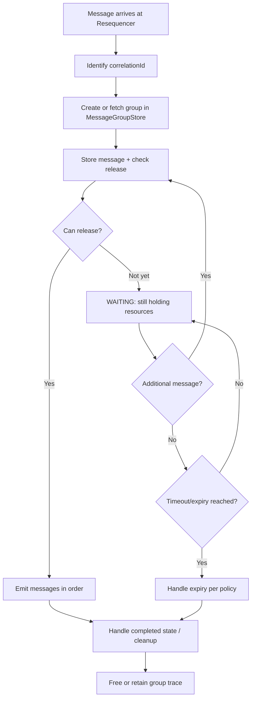
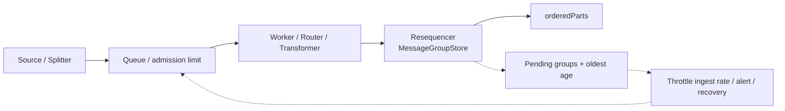

# Memory of Waiting Groups

In **SPRING_INTEGRATION_PATTERN**, Resequencer helps restore the order of messages arriving from Router, Splitter, Filter, Transformer, Gateway, or asynchronous worker branches. To do that, Resequencer must **hold the state of groups that cannot yet be fully released**. If messages arrive slowly, go missing, or have correlation bugs, this retained state can grow continuously.

The **"Memory of Waiting Groups"** topic in the **Advanced Resequencer** chapter focuses on an operational question: **how many messages are being held, where are they stored, and how do we prevent indefinitely waiting groups from exhausting resources?** This lesson combines Enterprise Integration Patterns thinking with Spring Integration configuration, timeouts, error handling, retries, and load testing.

> **Principle:** Resequencer may need to buffer messages to restore order. Group memory is part of the cost of ordering guarantees; controlling it requires managing **group count**, **messages per group**, **payload size**, **wait duration**, and **post-completion lifecycle** together.

## 1. What does a "waiting group" store?

A sequence group is identified by a correlation key, typically read from the `correlationId` header. Messages in the group carry `sequenceNumber` to mark position and may carry `sequenceSize` when the source knows the total number of parts.

For example, a Splitter produces four parts of `batch-42`:

| Message | `correlationId` | `sequenceNumber` | `sequenceSize` |
| --- | --- | ---: | ---: |
| A | `batch-42` | 1 | 4 |
| B | `batch-42` | 2 | 4 |
| C | `batch-42` | 3 | 4 |
| D | `batch-42` | 4 | 4 |

Workers process in parallel and return in the order `C, A, D`. Depending on the release strategy, Resequencer may not be able to emit some parts yet because `B` is still missing.

```text
Group store at a point in time:

Group batch-42
  expected: [1, 2, 3, 4]
  arrived:  [1, -, 3, 4]
  missing:  [2]
  state:    WAITING

Group batch-43
  expected: [1, 2, 3]
  arrived:  [-, 2, 3]
  missing:  [1]
  state:    WAITING
```

This is a **logical diagram**: the fields `expected`, `arrived`, and `missing` do not necessarily exist verbatim inside a `MessageGroupStore`. In practice, a group may contain:

- Received messages still needed for ordering or release, including payloads and headers.
- Group identification details, creation metadata, and modification metadata.
- Release/completion state, depending on the endpoint and storage configuration.
- Objects, indexes, locks, or serialization overhead used by the store implementation.

Spring Integration uses the **`MessageGroupStore`** interface for correlating endpoints such as Aggregator and Resequencer. Where groups live—JVM heap, a database, or another backend—depends on **the configured store**.

### How does it differ from a channel queue?

A **channel queue** holds messages waiting to be pulled by consumers. A **`MessageGroupStore`** holds the state of messages that already entered the correlating endpoint but must be retained to manage the group. Both can consume resources simultaneously.

If a flow passes through a `QueueChannel` into a Resequencer, you must measure **queue depth** and **pending group volume** separately. Seeing an empty queue does not prove the system has no waiting messages: messages may have left the queue and still be held inside the store.

## 2. Group lifecycle determines resource footprint



The diagram shows conceptual states; actual timing of release, timeout, expiry, and deleting/retaining groups depends on the API, release strategy, and Spring Integration version used.

Several important rules:

1. **Out-of-order yet complete:** Resequencer may hold messages briefly and then release them; pending memory returns to low levels under normal traffic.
2. **Missing a position:** the group may continue holding state, especially when released only after the entire sequence arrives.
3. **Partial release:** a configuration permitting early release of contiguous segments can reduce latency and buffered messages, but does not mean the group is complete or all state is cleaned up.
4. **Group timeout:** the endpoint can process an incomplete group after a configured duration. A timeout is a policy for resolving long-waiting groups, **not proof that missing messages will never arrive**.
5. **Completion and cleanup:** a completed group may still retain a marker to recognize late messages, depending on `expireGroupsUponCompletion` and store cleanup policies.

From a memory perspective, separate **active groups**, **pending message payloads**, and **completed markers**. An application with very few waiting messages that keeps millions of completed-group markers can still consume substantial resources.

## 3. Factors affecting group storage footprint

An initial estimate can use:

```text
raw_payload_bytes ≈ Σ(payload_size of each stored message)

heap_or_store_usage ≈ raw_payload_bytes
                    + headers_and_message_objects
                    + group_metadata_and_indexes
                    + serialization/implementation_overhead
```

Suppose there are **200 incomplete groups**, each holding an average of **10 messages** with **16 KiB** payloads; raw payloads alone total roughly **31.25 MiB**. Actual heap or database usage will be higher due to message objects, headers, group metadata, indexes, copies, and concurrency overhead.

Do not treat the estimate "groups × messages × payload size" as exact heap usage. Variables to measure in a live system:

| Variable | Meaning | Impact |
| --- | --- | --- |
| Open group count | Number of incomplete `correlationId`s | Increases metadata, lock, and timeout-scheduler overhead |
| Pending messages per group | Received parts not yet eligible for release | Increases buffered payload volume |
| Payload size | Especially files, byte arrays, large JSON | Can dominate metadata cost |
| Header size | Metadata, trace context, custom headers | Multiplies by message count |
| Wait duration | How long groups stay incomplete | Higher accumulation of open groups |
| Group creation rate | New batches per second | May exceed group completion rate |
| Incomplete group ratio | Groups with gaps, Filter drops, worker errors | Creates long-lived backlog groups |
| Completion policy | Retain marker vs delete immediately | Affects stored closed-group count |
| Store implementation | Heap, JDBC, or durable backend | Shifts where resources and latency occur |
| Retries and duplicates | Redelivered messages or repeated runs | Can increase storage and contention |

### Accumulation effect over time

Suppose 100 new batches arrive every minute, yet only 95 batches complete or close properly. If the remaining five batches keep waiting without effective expiry/cleanup, open groups accumulate over time. A short benchmark may look fine, while after several hours the system hits heap pressure, GC pauses, or database growth.

Therefore monitor **group open rate**, **group close rate**, **current open group count**, and **age of the oldest group**. Actual wait duration matters just as much as message processing speed.

## 4. Choosing an appropriate `MessageGroupStore`

### 4.1. In-JVM-memory store

A familiar example is `SimpleMessageStore`, suitable for demonstrating mechanics in lessons or single-process testing.

Advantages:

- Fast access, simple setup.
- Convenient for basic tests with small groups.

Limitations:

- Heap state depends on process lifecycle and can be lost on application restart.
- Payloads and metadata occupy heap; if groups wait indefinitely, GC pressure or out-of-memory risk rises.
- Does not by itself guarantee coordination across multiple instances, even when those instances process messages with the same `correlationId`.

Using an in-memory store requires explicit **stop conditions, timeouts, load limits, and recovery scenarios**. Do not treat it as a durable queue when messages must survive restarts.

### 4.2. Durable or external stores

Spring Integration provides `MessageGroupStore` implementations backed by databases or other storage systems. An appropriate option can be used when:

- Group state must survive restarts.
- Total buffered payload is large and keeping everything on the heap is unsuitable.
- Processing or tracking groups must coordinate across multiple instances.

However, **switching to JDBC/Redis or another external backend does not make the problem disappear automatically**:

- Payloads may still be deserialized onto the heap during processing/release.
- The backend needs capacity, indexes, retention, transactions, latency monitoring, and data purging.
- Multiple instances need coordination/locking and release rules to prevent emitting the same group twice.
- Connection failures or aborted transactions can keep groups open longer or trigger reprocessing.

When selecting a store, weigh **durability, recoverability, latency, concurrency, and state-cleanup policy** together.

### 4.3. Illustrative Java DSL configuration

A Spring Integration example explicitly declaring an in-memory store so it is clear where groups reside:

```java
import org.springframework.context.annotation.Bean;
import org.springframework.context.annotation.Configuration;
import org.springframework.integration.dsl.IntegrationFlow;
import org.springframework.integration.store.MessageGroupStore;
import org.springframework.integration.store.SimpleMessageStore;

@Configuration
public class ResequencerStorageFlow {

    @Bean
    MessageGroupStore resequencerGroupStore() {
        // Illustrative only; state is lost when the JVM stops.
        return new SimpleMessageStore();
    }

    @Bean
    IntegrationFlow resequenceFlow(MessageGroupStore resequencerGroupStore) {
        return IntegrationFlow.from("partsInput")
                .resequence(spec -> spec
                        .messageStore(resequencerGroupStore)
                        .groupTimeout(30_000L)
                        .sendPartialResultOnExpiry(false)
                        .expireGroupsUponCompletion(true))
                .channel("orderedParts")
                .get();
    }
}
```

**Meaning of the options:**

- `messageStore(...)` explicitly specifies where groups are managed. When swapping stores, review additional backend configuration and recovery behavior.
- `groupTimeout(30_000L)` establishes a policy for handling long-waiting groups via the endpoint scheduler. It **does not guarantee** a group always closes at exactly 30 seconds after its first message arrives.
- `sendPartialResultOnExpiry(false)` avoids proactively emitting incomplete parts as partial results on expiry. Design a business error observation/notification path unless failed groups are allowed to vanish silently.
- `expireGroupsUponCompletion(true)` expresses intent to clean up the group upon completion. If you need to retain a completed marker for late arrivals, evaluate another policy alongside a separate business state store.

This is an **illustrative** configuration; it lacks missing-message recovery, capacity bounds, operational alerting, and full deduplication. Exact behavior of release/expiry options must be verified against the Spring Integration version in your project.

## 5. Timeouts, expiry, and cleaning up old groups

Pending messages building up simply because one part is missing is a common reason groups live too long. Three timing layers must be distinguished:

| Mechanism | Goal | Limitation |
| --- | --- | --- |
| Release strategy | Defines conditions for emitting ordered data | If parts are missing, may never complete |
| Group timeout / expiry | Sets when to handle an incomplete group | Does not recover missing messages; not necessarily a business deadline |
| `MessageGroupStore` cleanup / reaper | Purges old state by age or storage policy | Can affect detection of late arrivals and retries |

A mechanism such as `MessageGroupStoreReaper` can help inspect old groups depending on store and expiry configuration. **A reaper does not replace the release strategy or business decisions for missing data.** It must also be coordinated with the endpoint's group timeout to avoid unexpected behavior from two separate expiry mechanisms.

### When a Filter causes group backlog

```text
Splitter produces 5 parts:  #1/5 #2/5 #3/5 #4/5 #5/5
Filter drops #3:            #1/5 #2/5      #4/5 #5/5

Downstream waits for 1..5 → never sees #3.
```

If position 3 is dropped intentionally, adding wait time does not solve the issue. Either **filter before assigning a new sequence** or carry an explicit skip signal per contract. When missing parts are known, choose a transparent fail/partial/repair policy rather than hoping the group shrinks its size automatically.

### Timeouts may not shrink heap as expected

If expiry marks a group yet retains a marker or history record in the store, groups reported as "expired" can still occupy resources. Conversely, deleting the group completely frees memory but loses state tracking for late messages. Therefore measure **post-expiry resource usage** and maintain a separate retention plan for dedup metadata.

## 6. Backpressure and protecting the system when many groups are waiting

If downstream processes slower than upstream, new groups can be created faster than old ones are released. A resilient architecture manages work **before** memory runs out.



Throttling approaches depending on your environment:

1. **Limit concurrent in-flight batches** upstream using semaphores, worker counts, request limits, or bounded queues.
2. **Control payload size**: move large data to object storage and carry reference keys in messages if business rules permit. Ensure objects remain alive until the group completes.
3. **Bound retention of incomplete groups**, paired with bounded retries and clear error handling.
4. **Control concurrency** so too many open groups are not started simultaneously.
5. **Throttle based on store health**: if pending groups or backend latency cross thresholds, slow down producers/consumers or offload work to a durable queue.
6. **Purge completed markers by retention** once the redelivery window closes, with business dedup retaining enough history.

Do not arbitrarily drop input messages under load without error handling/recovery. When using a broker, coordinate acknowledgments and retries so unaccepted messages are never "ACKed and lost" while the store is overloaded.

### An important pitfall: unbounded queues

Merely shifting pressure from `MessageGroupStore` to an unbounded `QueueChannel` does not eliminate the problem. You may avoid holding many groups in the Resequencer temporarily while increasing memory/latency in the queue. The goal is to **bound total work-in-progress** and define how to reject or pause intake when the system is full.

## 7. How correlation, duplicates, and retries affect group storage

### 7.1. Wrong correlation creates junk groups

If every message in the same batch receives a fresh `correlationId`, Resequencer sees many fragmented groups, each with just a few parts. None ever meets completion. This inflates group count in a way neither larger heap nor swapping stores can fix.

Conversely, if two distinct batches share the same `correlationId`, parts can mingle in one group, causing wrong ordering or `sequenceNumber` collisions. Use a composite key containing business identity and a stable `runId` whenever runs must be separated.

### 7.2. Duplicates can consume resources

A message redelivered after an ACK failure can carry a different Spring `MessageHeaders.ID` despite having the same business position. Resequencer should not be treated as a general-purpose idempotency layer. Validate beforehand:

- Same `correlationId + sequenceNumber` and same source event ID/fingerprint: likely valid redelivery.
- Same position with different payload/event ID: conflict to quarantine.
- Same batch with different `sequenceSize`: metadata requiring reconciliation.

A durable inbox/dedup store prevents duplicate processing and keeps replays safe. Yet recording "message seen" does not mean processing succeeded: after a crash, allow resuming an interrupted operation instead of dropping the redelivery and leaving the group permanently incomplete.

### 7.3. Infinite retries can prolong group retention

A persistently failing part can keep a group waiting indefinitely. Separate **message retries**, **batch deadlines**, and **terminal unrecoverable decisions**. Record missing positions, retry counts, and expiry reasons to feed an application-level error channel/DLQ or recovery flow.

Never shrink `sequenceSize` just to force a release when the source declared a clear total. Doing so reduces pending messages at the cost of data correctness.

## 8. Observing memory and group health in production

Useful metrics should be wired from the store and actual instrumentation, depending on endpoint/backend capabilities:

| Metric | Operational meaning | Signal to investigate |
| --- | --- | --- |
| `openGroupCount` | Count of incomplete groups | Grows steadily under steady traffic |
| `pendingMessageCount` | Total messages currently held | Grows faster than output throughput |
| `oldestGroupAge` | Age of the longest-waiting group | Exceeds SLA or processing deadline |
| `p95/p99GroupWait` | Wait-time distribution | Drifts upward with load |
| `groupCompletionRate` | Groups completed over time | Trails group creation rate over sustained periods |
| `groupTimeoutRate` | Groups hitting timeout handling | Rises due to missing messages or slow downstream |
| `duplicate/conflictCount` | Redeliveries or slot collisions | ACK/retry bugs or source data issues |
| `storeLatency` | Group store read/write latency | Bottleneck or overloaded backend |
| `heapUsed/GC pause` | JVM memory pressure | Rising heap and long GC pauses with in-memory store |
| `storeSize/recordAge` | Durable store footprint and record age | Ineffective cleanup/retention |

**The metric names above are suggested application naming conventions, not a guarantee that Spring Integration emits all metrics with these exact names.** Measure via Micrometer, Actuator, store metrics, and instrumentation suited to your runtime version.

Beyond pending group counts, diagnostic logs/events should include:

- `correlationId`, group creation time, last update time, and completion/expiry time.
- `sequenceSize`, distinct received positions, and missing positions if total is known.
- Release, timeout, partial-output policies, and failed-group handling.
- Queue lag, retry counts, DLQ metrics, and stalled downstream tasks.
- Payload and header size distributions, avoiding logging sensitive payloads just to debug.

With this data, you can distinguish a system with **many groups due to high load** from one **accumulating groups because a part never arrives**.

## 9. Load and data-lifecycle testing

Combine channel/store-level integration tests with longer load tests to catch accumulation trends. A baseline matrix:

| Test case | Data / condition | What to verify |
| --- | --- | --- |
| Out-of-order yet complete | `3/3, 1/3, 2/3` | Group releases properly; resources return to baseline |
| Missing part never arrives | `1/4, 3/4, 4/4` | Group waits per policy; expiry/recovery recorded |
| Many interleaved groups | 1,000 open batches, staggered finishes | No cross-group mixing; memory/store stays bounded |
| Filter drops a position | Splitter `1..5`, Filter drops `#3` | Error/skip resolved; group not held forever |
| Repeated redeliveries | `#2` resent with different ID | No duplicate side effects or corrupt state |
| Group complete then late arrival | `1..3` complete, then `#2` redelivered | Handled properly whether marker remains or was cleaned up |
| Timeout racing final part | Final message arrives as timer runs | No double emission, no leaked group |
| Restart with in-memory store | Incomplete group, then restart | State loss detected and replay plan executes |
| Restart with durable store | Incomplete group, then restart | Group recovered without duplicate emission |
| Multi-instance same correlation | Two consumers process same batch | Writes and release coordinated safely per design |
| Backend failure | Slow store or lost connection | Backpressure/retry/error flow does not drop ACKs |
| Long retention | Many completed groups | Old markers purged per policy; record count stays bounded |

### Testing accumulation

A useful test sustains steady ingress long enough while intentionally dropping the final part of a small fraction of groups. Watch the charts:

1. Does **open group count** stabilize or grow without bound?
2. Do **p95/p99 wait times** return to baseline once load subsides?
3. Does **heap/GC pressure** drop after groups undergo expiry?
4. Does **store size** shrink after cleanup within the retention window?
5. Are **downstream outputs** free of silent duplicates or silent omissions?

You do not need a massive benchmark to spot the cause: even a small failure rate steadily builds a backlog if the system lacks a closing policy.

### Java capacity estimation example

The snippet below calculates **raw payload only** as a rough initial estimate. It excludes object/header/index overhead and backend serialization:

```java
public final class GroupPayloadEstimator {

    private GroupPayloadEstimator() { }

    public static long estimatedRawBytes(
            long openGroups,
            long averageMessagesPerGroup,
            long averagePayloadBytes) {

        if (openGroups < 0
                || averageMessagesPerGroup < 0
                || averagePayloadBytes < 0) {
            throw new IllegalArgumentException("Inputs must be non-negative");
        }

        return Math.multiplyExact(
                Math.multiplyExact(openGroups, averageMessagesPerGroup),
                averagePayloadBytes);
    }
}
```

If a payload is a reference to object storage rather than full content, this figure only reflects bytes of buffered messages, excluding external object size and access cost. Measure against **actual size distributions**, not averages alone, because a small share of huge payloads can spike memory abruptly.

## 10. Operational checklist for waiting groups

1. **Know where groups live.** Identify the actual `MessageGroupStore` and separate it from queue/channel backlogs.
2. **Measure pending groups and payloads.** Track `openGroupCount`, `pendingMessageCount`, group age, and message sizes.
3. **Define exact release conditions.** Do not let bad metadata, Filters, or missing sequences create uncompletable groups.
4. **Design timeouts and expiry.** Have partial/fail/recovery policies so expired groups do not become unobservable data loss.
5. **Separate cleanup from business retention.** Deleting groups saves memory, yet history is still needed for late arrivals and duplicates.
6. **Bound ingress and concurrent open batches.** Use bounded queues, admission control, or broker-compatible backpressure.
7. **Pick a store matching recovery needs.** In-memory fits cases tolerating state loss; durable stores need transactions, locks, and capacity planning.
8. **Block duplicates/conflicts at the source.** Ensure correct correlation and slot keys plus idempotent retries.
9. **Test restarts, races, and sustained load.** Watch heap, store size, and business outputs together.
10. **Alert early.** Set thresholds on oldest group age, timeout rate, backlog growth rate, and store latency.

**Remember:** Memory usage of waiting groups is not merely a sizing parameter. It reflects **the balance among ordering guarantees, wait duration, state durability, and recoverability**. Using `MessageGroupStore` appropriately, clear release strategies, intentional group timeouts/cleanup, backpressure, and metrics keeps Resequencer stable even when processing branches run at vastly different speeds.
