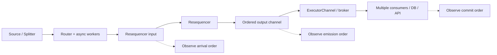
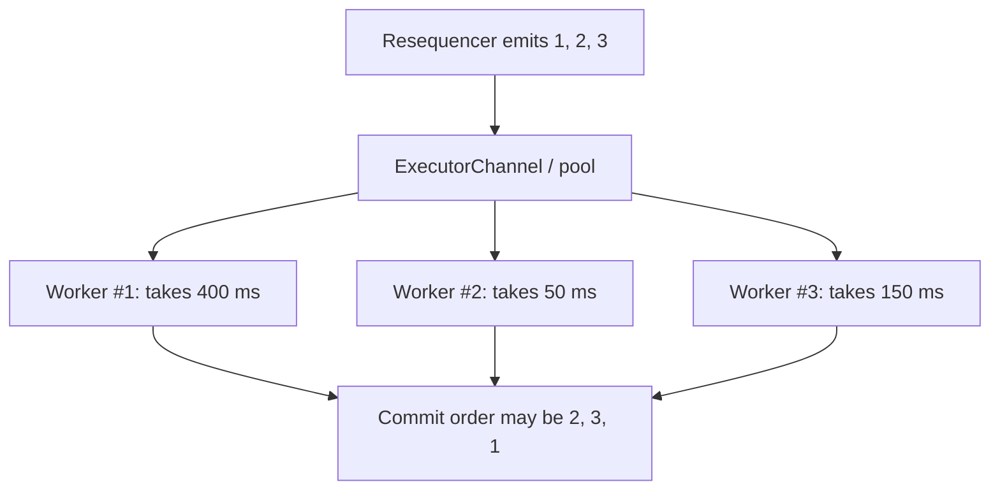

# Verifying Output Order

In the **Advanced Resequencer** chapter of **SPRING_INTEGRATION_PATTERN**, configuring the Resequencer only solves half the problem. The remaining half is **proving that the output is genuinely in order** when messages arrive out of order, multiple groups interleave, retries happen, or downstream continues processing asynchronously.

Spring Integration lets you compose Enterprise Integration Patterns such as Router, Filter, Transformer, Splitter, Aggregator, and Gateway into loosely coupled message flows. Resequencer restores order based on sequence metadata assigned by the producer; however, the order seen in logs, the order emitted from the endpoint, and the order in which side effects commit in external services **are not necessarily identical**. Therefore, you need to define measurement boundaries, ordering contracts, testing strategies, and production failure monitoring.

> **Verification goal:** For each group with its own `correlationId`, accepted messages observed at the chosen output boundary must follow the exact `sequenceNumber` order, with no omissions, duplicate emissions, or payload swaps violating the business contract.

## 1. Define "correct order" before writing tests

Three headers typically define a sequence:

| Header | Meaning | Example |
| --- | --- | --- |
| `correlationId` | Key identifying messages belonging to one group | `order-42:run-3` |
| `sequenceNumber` | Position of a message within the group | `2` |
| `sequenceSize` | Expected total parts when known upfront by the producer | `4` |

Suppose a Splitter creates four parts in business order `A, B, C, D` numbered `1, 2, 3, 4`. After parallel processing, the Resequencer input might be `C, A, D, B`. The observed output must be `A, B, C, D` matching the assigned sequence numbers.

```text
Group G, sequenceSize = 4

Resequencer input:       C(#3) → A(#1) → D(#4) → B(#2)
                                │
                                ▼
                           Resequencer
                                │
                                ▼
Output at test channel:  A(#1) → B(#2) → C(#3) → D(#4)
```

Distinguish three kinds of requirements:

1. **Per-group ordering:** within the same `correlationId`, a lower position must be emitted before a higher position whenever both are emitted.
2. **Completeness and uniqueness:** if the contract requires all `1..N`, the result must contain exactly `N` positions, each appearing once. This complements ordering checks.
3. **Business side-effect ordering:** database writes, API calls, or downstream broker sends must apply effects in the required order. Resequencer's emission order **does not automatically guarantee** completion order across multiple asynchronous downstream tasks.

**Do not require global ordering across independent groups** if the contract only requires *per-group* ordering. Group `G1` might emit `#1` before `G2:#1` or vice versa depending on arrival speed and release conditions; both can be valid.

### 1.1. Output invariants to assert

For a group `G` with `sequenceSize=N`, when only complete results are accepted, one specification is:

```text
outputSequenceNumbers(G) == [1, 2, ..., N]
outputCorrelationIds(G)  == [G, G, ..., G]
outputEventIds(G)        == expected event IDs at each exact position
```

If configuration allows **partial results**, a single release may emit only a contiguous segment or ordered subset. In that case, do not assume every release contains all `1..N`. Separate checking "order within what was emitted" from "batch completed per contract".

Another check when output may omit positions yet **must never invert order**:

```text
For every consecutive pair of emitted messages in the same group:
    current.sequenceNumber > previous.sequenceNumber
```

This rule only applies when duplicates have already been prevented or the contract forbids repetition. If duplicates may appear at that boundary, decide beforehand whether equal numbers are allowed; never accidentally count duplicate emissions as "in order".

## 2. Place observation points at the right boundaries

A typical pipeline:



Three measurement points answer three different questions:

| Measurement point | What it verifies | What it does not prove on its own |
| --- | --- | --- |
| Before Resequencer | Actual arrival order and whether metadata is missing | That the endpoint sorted properly |
| Immediately after Resequencer, before another async branch | Message order **emitted** by Resequencer | That remote consumers complete in order |
| Where business results commit | Order in which side effects take effect | Whether the bug originated in Resequencer or downstream |

**Counter-intuitive example:** Resequencer emits `#1` then `#2` into an `ExecutorChannel`, yet `#2`'s worker runs faster, so the database writes `#2` before `#1`. Tests on the channel right after Resequencer pass, while commit-order checks fail.

When end-to-end ordering is required, define the downstream execution path: one sequential consumer per group, partitioning by `correlationId`, database version checks, or an equivalent ordered coordinator. Never just drop in a Resequencer and assume all downstream stages will stay ordered forever.

## 3. Configuring a directly testable flow

The Java DSL example below uses a `DirectChannel` input and a `QueueChannel` output so tests can read messages in the exact order they enter the queue. This setup illustrates an observation point right after Resequencer; it is not a mandatory production topology.

```java
import org.springframework.context.annotation.Bean;
import org.springframework.context.annotation.Configuration;
import org.springframework.integration.channel.DirectChannel;
import org.springframework.integration.channel.QueueChannel;
import org.springframework.integration.config.EnableIntegration;
import org.springframework.integration.dsl.IntegrationFlow;
import org.springframework.messaging.MessageChannel;

@Configuration
@EnableIntegration
public class ResequencerOrderConfig {

    @Bean
    MessageChannel incomingParts() {
        return new DirectChannel();
    }

    @Bean
    QueueChannel orderedParts() {
        return new QueueChannel();
    }

    @Bean
    IntegrationFlow resequenceFlow() {
        return IntegrationFlow.from(incomingParts())
                .resequence()
                .channel(orderedParts())
                .get();
    }
}
```

**Why choose this setup for tests?**

- `DirectChannel` keeps sending into the endpoint simple without introducing another asynchronous handoff at the input of the example.
- `resequence()` uses sequence/correlation headers to buffer and release parts per endpoint policy.
- `QueueChannel` lets tests actively call `receive(timeout)` on each message after Resequencer emits it.
- Only one test thread reads the queue, so read order reflects enqueue order. If multiple consumers pull and process concurrently, their **completion order** can still vary.

For Resequencer to sort, the producer must supply valid metadata. For example, using constants from `IntegrationMessageHeaderAccessor`:

```java
import org.springframework.integration.IntegrationMessageHeaderAccessor;
import org.springframework.messaging.Message;
import org.springframework.messaging.support.MessageBuilder;

record OrderPart(String batchRunId, int position, String value) {}

final class PartMessages {
    private PartMessages() { }

    static Message<OrderPart> part(
            String group, int position, int total, String value) {
        return MessageBuilder
                .withPayload(new OrderPart(group, position, value))
                .setHeader(
                        IntegrationMessageHeaderAccessor.CORRELATION_ID,
                        group)
                .setHeader(
                        IntegrationMessageHeaderAccessor.SEQUENCE_NUMBER,
                        position)
                .setHeader(
                        IntegrationMessageHeaderAccessor.SEQUENCE_SIZE,
                        total)
                .build();
    }
}
```

In this example, `position` is placed in both the sample payload and header. This lets tests verify **data identity/meaning at each position** even if a downstream component mutates certain headers. In real systems, carry an immutable `sourceEventId` and do not rely on Spring `MessageHeaders.ID` to represent business identity.

## 4. Integration test: send out of order, read in order

A JUnit 5 integration test with Spring Integration can be written as follows (assuming `ResequencerOrderConfig` and `OrderPart` above reside in the appropriate source set):

```java
import static org.junit.jupiter.api.Assertions.*;

import java.util.ArrayList;
import java.util.List;
import java.util.UUID;

import org.junit.jupiter.api.Test;
import org.springframework.beans.factory.annotation.Autowired;
import org.springframework.beans.factory.annotation.Qualifier;
import org.springframework.integration.IntegrationMessageHeaderAccessor;
import org.springframework.messaging.Message;
import org.springframework.messaging.MessageChannel;
import org.springframework.messaging.PollableChannel;
import org.springframework.messaging.support.MessageBuilder;
import org.springframework.test.context.junit.jupiter.SpringJUnitConfig;

@SpringJUnitConfig(ResequencerOrderConfig.class)
class ResequencerOrderIntegrationTest {

    @Autowired
    @Qualifier("incomingParts")
    MessageChannel incoming;

    @Autowired
    @Qualifier("orderedParts")
    PollableChannel ordered;

    private void send(
            String group, int number, int size, String value) {
        Message<OrderPart> message = MessageBuilder
                .withPayload(new OrderPart(group, number, value))
                .setHeader(
                        IntegrationMessageHeaderAccessor.CORRELATION_ID,
                        group)
                .setHeader(
                        IntegrationMessageHeaderAccessor.SEQUENCE_NUMBER,
                        number)
                .setHeader(
                        IntegrationMessageHeaderAccessor.SEQUENCE_SIZE,
                        size)
                .build();

        assertTrue(incoming.send(message));
    }

    private List<OrderPart> receiveExactly(int count) {
        List<OrderPart> parts = new ArrayList<>();
        for (int i = 0; i < count; i++) {
            Message<?> message = ordered.receive(2_000);
            assertNotNull(message, "Missing output message " + i);
            parts.add((OrderPart) message.getPayload());
        }
        return parts;
    }

    @Test
    void emitsOneGroupInSequenceOrder() {
        String group = "order-" + UUID.randomUUID();

        send(group, 3, 4, "C");
        send(group, 1, 4, "A");
        send(group, 4, 4, "D");
        send(group, 2, 4, "B");

        List<OrderPart> output = receiveExactly(4);

        assertEquals(List.of(1, 2, 3, 4),
                output.stream().map(OrderPart::position).toList());
        assertEquals(List.of("A", "B", "C", "D"),
                output.stream().map(OrderPart::value).toList());
        assertTrue(output.stream()
                .allMatch(p -> p.batchRunId().equals(group)));

        // With this configuration and sample source, no further
        // output beyond the four parts is expected.
        assertNull(ordered.receive(100));
    }
}
```

Notice that the test **intentionally sends inputs out of order**. If you only send `1, 2, 3, 4`, the test can pass even if the Resequencer is not actually restoring order.

The four assertions each verify a distinct property:

1. Exact expected message count at the observation boundary.
2. `position` values increase in the expected order.
3. Payload/value matches each position, catching bugs where headers are adjusted while payloads are swapped.
4. No extra messages are emitted within the specified observation window.

`receive(100)` returning `null` **does not prove forever that no extra message will arrive**. Negative assertions always cover a finite time window. With retries, timers, brokers, or asynchronous processing, observe the full contract window and/or inspect durable state to catch late duplicates.

## 5. Testing when multiple groups interleave

Resequencer orders **within each correlation group**, without imposing a single global order across batches. Suppose the input is:

```text
G1:#2, G2:#2, G2:#1, G1:#1
```

A valid output is `G2:#1, G2:#2, G1:#1, G1:#2`. Another interleaving can also be valid, as long as each group maintains its internal order.

To test this, group received messages by `batchRunId` and validate each sequence individually:

```java
import static org.junit.jupiter.api.Assertions.assertEquals;

import java.util.ArrayList;
import java.util.HashMap;
import java.util.List;
import java.util.Map;

static void assertPerGroupOrder(List<OrderPart> emitted) {
    Map<String, List<Integer>> observed = new HashMap<>();

    for (OrderPart part : emitted) {
        observed.computeIfAbsent(
                part.batchRunId(), ignored -> new ArrayList<>())
                .add(part.position());
    }

    for (List<Integer> positions : observed.values()) {
        List<Integer> sorted = new ArrayList<>(positions);
        sorted.sort(Integer::compareTo);
        assertEquals(sorted, positions,
                "Output was reordered inside a group");
    }
}
```

The helper above only checks **non-decreasing order** within each group. It **does not verify completeness, uniqueness, or correctness of each payload**. When the contract requires completeness, also check against the group's manifest: each `correlationId` must contain `[1, 2, ..., sequenceSize]` with the right event identity in each slot.

**Be careful:** Do not hardcode an assertion that `G1` must finish emitting before `G2` just because `G1` was sent first. That introduces a new global-order requirement, which Resequencer does not promise by default.

## 6. Property-based ordering checks instead of a single example

A single out-of-order example is just a starting point. Strong tests vary part counts, arrival permutations, and branch timing.

For a group with `N` valid parts, verify these invariants:

```text
Given:
  unique groupId for each trial
  expected positions = [1..N]
  payload at each position tagged with an immutable eventId

For each permutation of input positions (or a seeded random sample):
  send parts in permutation order
  collect all N output messages
  assert output positions == [1..N]
  assert output event IDs == expected event IDs
  assert no extra output within the defined window
```

For small groups, you can test all permutations. For larger groups, include patterns likely to expose bugs:

- Completely reversed: `N, N-1, ..., 1`.
- First part arrives last: `2, 3, ..., N, 1`.
- Last part arrives first: `N, 1, 2, ..., N-1`.
- Middle part heavily delayed: `1, 3, 4, 2, 5`.
- Multiple interleaved groups with varying processing durations.
- A group with `sequenceSize=1` alongside a large group.

When using randomized inputs, **record the seed** so failing runs are reproducible. Use a fresh `correlationId` per trial, or clean up group state via a valid test mechanism; reusing keys before old groups are cleaned up causes tests to interfere with one another.

### Do not check only "in order": measure timing and group state

A group may wait forever for missing parts, so **zero output** does not prove correctness. Every test needs deadlines and explicit checks: how long waiting is allowed, when the group must complete, and how failures are represented if a part never arrives.

If downstream expects early release of contiguous segments, write dedicated tests for **partial release policy**; do not assume the endpoint buffers everything until `sequenceSize` is reached.

## 7. Scenarios that frequently trip up assertions

| Scenario | Test data | What to check |
| --- | --- | --- |
| Out-of-order, full group | `3/3, 1/3, 2/3` | Group output is `1, 2, 3` |
| Two interleaved groups | `A:2/2, B:2/2, B:1/2, A:1/2` | Each group is `1, 2`; do not require A before B |
| Missing one position | `1/4, 3/4, 4/4` | Do not treat batch as complete; check release/timeout policy |
| Duplicate position | `1/3, 2/3, 2/3, 3/3` | Classify redelivery; do not double side effects |
| Duplicate position, different payload | `2:B` and `2:X` | Conflict quarantined; neither chosen arbitrarily |
| Inconsistent total size | `1/3, 2/4, 3/3` | Validate metadata checks at ingress |
| Wrong `correlationId` | One part of A carries B's key | Do not treat two mixed groups as a success |
| Filter drops a part | Splitter creates `1..5`, Filter drops `#3` | Add explicit skip rule or valid renumbering |
| Timeout then final part arrives | `1/3, 2/3`; timeout; `3/3` arrives late | Follow late-arrival policy; no duplicate final result |
| Partial release | `#1` arrives, subsequent parts trickle in | Emitted output is ordered; completion state checked separately |
| Downstream `ExecutorChannel` | Endpoint emits `1, 2`, worker for `2` finishes faster | Emission order is right, yet commit order may break |
| Multi-partition broker | Parts of same group land on different partitions | Verify end-to-end key-based ordering |
| Mid-group restart | Receive `#2`, restart, then receive `#1, #3` | Verify `MessageGroupStore`, replay, and idempotency |
| Multiple instances | Same group received concurrently | No duplicate emission, no lost group, right order |

**Never treat a missing part as a bug in the sorting algorithm.** Resequencer cannot invent `#2` when the producer only sent `#1` and `#3`. If testing completion, supply full inputs or define business-valid termination/skip and release rules.

## 8. Verifying order after asynchronous processing

Suppose Resequencer emits `1 → 2 → 3`, and each message is handed to an API processed in parallel:



This can happen whenever downstream runs multiple independent tasks writing results concurrently. Tests observing only the channel right after Resequencer will miss this completely.

Three common solution families:

1. **Per-group serialization:** messages sharing `correlationId` flow through a sequential consumer; independent groups can still run in parallel. If using a broker with per-partition ordering, ensure a stable partition key so every part of a group hits the same partition.
2. **Version check at commit:** downstream only accepts a message whose position/version matches the business entity's current state. If `#2` arrives before `#1` commits, retry/buffer per contract rather than silently overwriting order.
3. **Idempotent, order-independent operations:** only when the domain truly allows it. Never use this as a blanket workaround for order-sensitive updates such as state-dependent accumulation.

In end-to-end tests, record a **commit log per business entity** containing `batchRunId`, `sequenceNumber`, before/after version, commit timestamp, and idempotency outcome. Then assert commit order per key instead of comparing console log lines interleaved across threads.

## 9. Observing ordering failures in production

Diagnostic logs or observability events can be keyed by group:

```json
{
  "batchRunId": "order-42:run-3",
  "sequenceNumber": 2,
  "sequenceSize": 4,
  "sourceEventId": "event-B",
  "stage": "resequencer-output",
  "observedAt": "2026-11-21T08:00:00Z",
  "result": "EMITTED"
}
```

This is an **illustrative application-defined schema**, not fields automatically emitted by Spring Integration out of the box. Prioritize tracking:

| Metric / signal | Used to detect |
| --- | --- |
| `lastEmittedSequence[group]` | Emitting a number less than or equal to an already-emitted position when repeats are forbidden |
| Missing or duplicate position counts | Gaps from source, retries, or metadata bugs |
| `groupWaitTime` | Wait duration before ordered emission becomes possible |
| Timed-out group count | Batches failing to complete on time |
| `lateArrivalCount` | Messages arriving after completion/expiry |
| `conflictCount` | Two messages contending for the same position with differing data |
| Per-aggregate commit order | Downstream async bugs or broker partitioning issues |
| Retry / DLQ rate | Slow upstream producer or dropped parts in the flow |

Place measurements at **clear boundaries** and distinguish `RECEIVED`, `EMITTED`, and `COMMITTED` events. Seeing `RECEIVED #3` before `RECEIVED #1` in logs can be completely normal. Only when `EMITTED #3` appears before `EMITTED #1` **within the same group under the same ordering contract** do you investigate the Resequencer or measurement boundary configuration.

### Avoid false conclusions from observability tools

Logs from multiple instances or asynchronous exporters can be collected **out of true execution order**. Clocks across machines can also drift. To assert output order reliably, use an ordered recorder at a well-defined boundary, application-assigned emission sequence numbers, or versioned commit records. Relying solely on line order in a centralized log dashboard can trigger false alarms.

**Never log sensitive payloads** just for debugging. `correlationId`, position, source event ID, group state, fingerprint, and timing details suffice for most reconciliation work.

## 10. Diagnostic workflow when output order is wrong

When a test detects `1, 3, 2` instead of `1, 2, 3`, check in this order:

1. **Verify the measurement point:** is it the direct output of Resequencer, a downstream `ExecutorChannel`, or worker commit results?
2. **Inspect headers and payloads:** do they share `correlationId`, are `sequenceNumber` values properly typed and valid, and is `sequenceSize` consistent?
3. **Inspect source data:** did the Splitter number elements in true business order, and did any Transformer drop headers or alter content?
4. **Check endpoint configuration:** release strategy, partial sequences, group timeout, expiry handling, `MessageGroupStore`, and retention.
5. **Isolate duplicates/conflicts:** repeated messages at the same position can fail assertions even when distinct positions are ordered; handle them at the admission/idempotency layer.
6. **Check concurrent branches:** does a Router, Gateway, broker, or worker introduce another layer of reordering after the Resequencer?
7. **Check retries and crashes:** was output re-emitted after an ACK failure or restart without durable deduplication?
8. **Reproduce deterministically:** strip down to one group, three clearly numbered parts, and one consumer at the measurement point; then reintroduce concurrency incrementally to isolate where order breaks.

Any failure report should capture **group, input permutation, expected output, actual output, observation boundary, seed/test case, release config, and wait timings**. These details distinguish sequencing defects from transport or observation artifacts.

## 11. Checklist for completing output-order verification

1. **Define the contract:** per-group ordering, completeness, uniqueness, and business side-effect ordering.
2. **Validate metadata:** reliable `correlationId`, `sequenceNumber`, and `sequenceSize`; payload/event ID traceable to position.
3. **Measure immediately after Resequencer:** pick a test channel and consumer that do not introduce extra reordering.
4. **Send deliberately out-of-order inputs:** test multiple permutations, interleaved groups, and latency skews.
5. **Verify content as well:** assert not just numbers `1..N`, but that the right payload sits at each position.
6. **Do not confuse partial release with completion:** explicitly specify behavior for missing parts, timeouts, and late arrivals.
7. **Test duplicates and conflicts:** idempotency and inconsistent-data quarantine must work properly.
8. **Measure end-to-end when needed:** after `ExecutorChannel`/broker/API, assert commit order per business key.
9. **Test failures and concurrency:** retries, ACK failures, restarts, multiple instances, cleanup, and deadline races.
10. **Maintain production metrics:** log per group, alert on out-of-order events, group age, timeout rate, and duplicate/conflict counts.

**Remember:** "Correct output order" is only meaningful when you specify **where output is measured** and **which key defines order**. Resequencer provides the mechanism to emit messages by sequence metadata within each group; verification must prove completeness, position accuracy, payload integrity, and exception handling. If downstream continues running in parallel, commit order is a separate invariant that must be designed and verified on its own.
