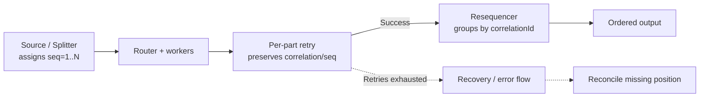

# Sequence Boundaries Across Retries

In the **Advanced Resequencer** chapter of **SPRING_INTEGRATION_PATTERN**, retries help recover when a processing branch fails transiently. However, if a retry mutates `correlationId`, reassigns `sequenceNumber`, or re-runs an entire batch without tracking prior state, Resequencer may wait on the wrong group, emit duplicate messages, or wrongly conclude a sequence is complete.

**Sequence boundaries across retries** define the contract specifying **which unit is being retried** and **which ordering identifiers must remain invariant** throughout those attempts. That unit might be one processing step for a message, one broker delivery attempt, one part of a batch, or an entire batch split into multiple parts by a Splitter.

In Spring Integration, Enterprise Integration Patterns such as Splitter, Router, Filter, Transformer, Aggregator, Gateway, retries, error channels, and correlation must work together to uphold this contract. **Retries re-execute work; Resequencer restores part order; idempotency prevents duplicate side effects.** These three responsibilities are related, yet none replaces another.

## 1. Identifying what the ordering belongs to

A message sequence typically carries three headers:

| Header | Meaning | Example |
| --- | --- | --- |
| `correlationId` | Key identifying the group | `order-42:run-7` |
| `sequenceNumber` | Position within the group | `2` |
| `sequenceSize` | Committed total parts, if known upfront | `4` |

Suppose order `order-42:run-7` is split by a Splitter into four parts:

```text
Original batch:
  A → #1/4
  B → #2/4
  C → #3/4
  D → #4/4

All parts share correlationId = order-42:run-7.
```

If part `#2/4` fails and is retried three times, **all three attempts still belong to position 2 of the same batch**. Changing `sequenceNumber` to `5` because it is the next attempt turns a retry attempt into a phantom element in the sequence.

A useful logical key model is:

```text
batch identity = tenantId + businessId + runId
sequence slot  = batch identity + sequenceNumber
event identity = sourceEventId (immutable for a business element)
attempt        = processing or delivery attempt count, NOT sequence position
```

Do not confuse Spring-generated `MessageHeaders.ID` or `timestamp` with the business identity of a slot. When a broker redelivers, a new Spring Message can have a new `id` while still representing the same `sourceEventId` and `sequenceNumber`.

### 1.1. Invariants across a retry boundary

When an element is retried **within the same logical batch**, ensure:

1. `correlationId` remains stable.
2. `sequenceNumber` remains stable.
3. `sequenceSize` stays consistent with the batch manifest.
4. `sourceEventId` or idempotency key remains stable.
5. Retry count, processing timestamps, stack traces, and transport metadata are tracked **separately**; they may vary across attempts.
6. If payloads are transformed between steps, know whether comparisons check **original data** or **processed output**, avoiding false conflict classification on retries.

You do not necessarily preserve every technical header across every adapter; you must **preserve or faithfully map the metadata used by the ordering contract**. Crossing HTTP, Kafka, or RabbitMQ may require converting header names and data types.

## 2. Four retry scopes and their sequence implications

| Scope | Example | Sequence boundary to preserve |
| --- | --- | --- |
| **In-handler retry** | Worker retries an API call up to three times before returning | Still **one element** at the same position |
| **Message redelivery** | Broker resends `#2` after an ACK failure | Same batch and slot; requires dedup or resume |
| **Replay of one part from DLQ** | Fix bug then resend `#3` for an incomplete batch | Keep original position; check whether group is open or closed |
| **Full-batch rerun** | Ingestion job reprocesses all four parts | Decide whether this **recovers the old run** or starts a **new run** |
| **Post-Resequencer retry** | Endpoint emitted `#1, #2`; API handling `#1` fails | Can affect **downstream commit order**, even though emission order was right |

The most common pitfall is confusing the two "batch retry" scenarios:

- **Resuming an incomplete run:** still aiming to finish missing positions of that exact old batch. You may reuse the original `batchRunId` if the system maintains durable state, knows which parts committed, and supports idempotent replay.
- **Starting a new business run:** issue a new `runId` and define a new sequence. The old batch must be closed/marked explicitly so late messages from the old run do not mix into the new run.

Unconditionally generating a new `runId` on every attempt breaks correlation across retrying parts. Conversely, reusing an old batch ID for an independent business job can merge two distinct sequences.

## 3. Where should retries sit in the flow?

### 3.1. Retries upstream of Resequencer

This is a common pattern when parts execute asynchronously and only emit results upon success:



For example, `#2` takes three attempts while `#1, #3, #4` finish first. Resequencer receives `3, 1, 4, 2` and emits `1, 2, 3, 4` when the release strategy allows. **Condition:** the success path for a part emits only one accepted result; failed attempts must never leak as extra distinct items in the same group.

If processing still fails permanently, Resequencer may be left waiting for the missing part. Define **group timeout**, replay options, or batch termination rules when unrecoverable. Handler retries and group timeouts must be designed together.

### 3.2. Retries inside or right at Resequencer ingress

If the same message enters the input channel multiple times due to ACK or forwarding failures, the system may see **two messages with different `MessageHeaders.ID`s sharing the same slot**. Resequencer is an ordering stage, not a general-purpose business idempotency boundary.

An **admission/inbox** layer before Resequencer can check `batchRunId + sequenceNumber` alongside `sourceEventId`:

- Slot unseen and batch still open: accept.
- Slot exists with matching immutable data: recognize redelivery; resume if prior processing did not finish, or avoid duplicate side effects if committed.
- Slot exists with differing event ID, fingerprint, or size: quarantine conflict.
- Batch closed: apply late-arrival policy rather than silently feeding a new group.

### 3.3. Retries downstream of Resequencer

This detail is often missed: the order Resequencer **emits** messages is not automatically the order **business work completes** afterward.

```text
Resequencer emits:     #1 ───────→ #2 ───────→ #3

Downstream workers:    #1 fails, retrying
                       #2 succeeds and commits
                       #3 succeeds and commits
                       #1 succeeds last

Actual commit order:   #2 → #3 → #1
```

If business rules only require **ordered emission on a channel**, this behavior may be acceptable. If they require **strict per-entity commit order**, add a solution: sequential consumer per `correlationId`, key-based partitioning, version checks on write, or a coordinator allowing `#k+1` to commit only after `#k`. Retries with long backoffs make commit-order inversion even more pronounced.

### 3.4. Retries upstream of Splitter

When a retry wraps **the entire split**, it can regenerate multiple child messages. If the second attempt's input has a different message ID, Splitter may generate new correlation metadata or different part ordering depending on configuration. Specify clearly:

- Input must reflect the exact same data snapshot if replaying the old run.
- Mapping to the business `batchRunId` must be deterministic.
- Part counts and ordering must come from a manifest, never from arbitrary iteration order of an unstable collection.
- Parts already processed in the first attempt must be deduplicated/resumed rather than replaying all external side effects.

If the source generates a new batch with a different list of parts, publish a **new version/run** rather than stuffing two versions into one sequence.

## 4. Code: preserving sequence metadata across a retry

A retryable operation may produce a new result message after transforming the payload. Actively carry ordering metadata forward from the original message. Java example using Spring Messaging and Spring Integration:

```java
import org.springframework.integration.IntegrationMessageHeaderAccessor;
import org.springframework.messaging.Message;
import org.springframework.messaging.support.MessageBuilder;

public final class SequenceResultMapper {

    private SequenceResultMapper() { }

    public static Message<String> resultOf(
            Message<String> original,
            String processedPayload) {

        Object correlation = original.getHeaders().get(
                IntegrationMessageHeaderAccessor.CORRELATION_ID);
        Integer number = original.getHeaders().get(
                IntegrationMessageHeaderAccessor.SEQUENCE_NUMBER,
                Integer.class);
        Integer size = original.getHeaders().get(
                IntegrationMessageHeaderAccessor.SEQUENCE_SIZE,
                Integer.class);

        if (correlation == null || number == null
                || size == null || size < 1
                || number < 1 || number > size) {
            throw new IllegalArgumentException(
                    "Missing or invalid sequence metadata");
        }

        return MessageBuilder.withPayload(processedPayload)
                .setHeader(
                        IntegrationMessageHeaderAccessor.CORRELATION_ID,
                        correlation)
                .setHeader(
                        IntegrationMessageHeaderAccessor.SEQUENCE_NUMBER,
                        number)
                .setHeader(
                        IntegrationMessageHeaderAccessor.SEQUENCE_SIZE,
                        size)
                .build();
    }
}
```

This helper demonstrates **the three sequence headers** and does not copy other business headers. In real systems, also preserve `sourceEventId`, tenant, trace context, and required idempotency keys, while avoiding copying stale transport headers that no longer apply to the new message.

A retrying processor can re-invoke on the same input message and build the result only once on success:

```java
import org.springframework.messaging.Message;
import org.springframework.retry.support.RetryTemplate;

// The Spring Retry dependency must be declared in the application.
final class RetryingPartService {

    private final RetryTemplate retry = RetryTemplate.builder()
            .maxAttempts(3)
            .fixedBackoff(200)
            .build();

    Message<String> process(Message<String> original) {
        return retry.execute(context -> {
            String output = callExternalService(original.getPayload());
            return SequenceResultMapper.resultOf(original, output);
        });
    }

    private String callExternalService(String input) {
        // Replace with real logic; transient errors must throw an exception
        // so RetryTemplate retries according to policy.
        return input.toUpperCase();
    }
}
```

**Understand this accurately:** `maxAttempts(3)` is the total callback invocations per this configuration (initial attempt plus retries); **it does not create three sequence numbers**. Wrapping a callback in retries increases attempts to *process a single part*, not the batch's `sequenceSize`.

An external service call may **already have succeeded** before the client times out. Thus even when retries run inside one handler, downstream still needs idempotency or an operation key capable of recognizing repeated calls.

### 4.1. Verifying metadata after a retry

```java
import static org.junit.jupiter.api.Assertions.assertEquals;

import org.junit.jupiter.api.Test;
import org.springframework.integration.IntegrationMessageHeaderAccessor;
import org.springframework.messaging.Message;
import org.springframework.messaging.support.MessageBuilder;

class SequenceResultMapperTest {

    @Test
    void preservesSequenceSlotAfterProcessing() {
        Message<String> original = MessageBuilder
                .withPayload("part-B")
                .setHeader(
                        IntegrationMessageHeaderAccessor.CORRELATION_ID,
                        "batch-42:run-7")
                .setHeader(
                        IntegrationMessageHeaderAccessor.SEQUENCE_NUMBER, 2)
                .setHeader(
                        IntegrationMessageHeaderAccessor.SEQUENCE_SIZE, 4)
                .build();

        Message<String> processed =
                SequenceResultMapper.resultOf(original, "result-B");

        assertEquals("batch-42:run-7", processed.getHeaders().get(
                IntegrationMessageHeaderAccessor.CORRELATION_ID));
        assertEquals(2, processed.getHeaders().get(
                IntegrationMessageHeaderAccessor.SEQUENCE_NUMBER));
        assertEquals(4, processed.getHeaders().get(
                IntegrationMessageHeaderAccessor.SEQUENCE_SIZE));
        assertEquals("result-B", processed.getPayload());
    }
}
```

This test checks **metadata preservation after transformation**; it does not test live retries or Resequencer. Even when using `MessageBuilder.fromMessage(...)` or relying on framework header propagation at a given step, always verify state across every adapter/serializer boundary.

## 5. Preserving order across retries, brokers, and error channels

Boundaries that can alter identifying metadata include:

| Boundary | Risk | What to verify |
| --- | --- | --- |
| Splitter → Router | Multiple branches emit colliding positions or wrong group keys | Single numbering authority, stable correlation |
| Transformer → retry | Constructing a new message drops headers | Sequence headers and event ID stay intact |
| Worker → broker | Mapper omits or changes header types | `Integer` type, group key, and manifest at consumer |
| Broker → consumer redelivery | Part redelivered with a new message ID | Slot key/idempotency rather than Spring ID |
| Gateway → retry | Reply fails after downstream actually succeeded | Persist outcome durably and guard against duplicate effects |
| Retry exhausted → error flow | Part never enters success branch | Group marked missing; proper retry/recovery triggered |
| DLQ → replay | Group may have timed out or completed | Reconcile batch lifecycle before re-injecting |
| Resequencer → async downstream | Emission order differs from commit order | Enforce serialization/versioning if contract requires it |

### 5.1. Error channels do not equate to delayed success

Exhausted retries may throw an exception or route to a recovery flow per configuration. In Spring Integration, an error channel can receive `ErrorMessage` instances when errors are published along message-flow mechanics. **Do not assume every failure, every retry, or every group timeout automatically lands on the same `errorChannel`.**

When failures become error messages, the payload is typically an exception/error detail, **not a successful element of the sequence**. Never feed `ErrorMessage`s directly as normal payloads into Resequencer and count them as `#2/4`, unless the business explicitly defines an error-result type and release semantics for failed parts.

A useful recovery flow should carry at minimum:

- `batchRunId/correlationId`, `sequenceNumber`, `sequenceSize`, `sourceEventId`.
- Failure reason, attempt count, last attempt time, and replay eligibility.
- Group status (open, timed out, partial finalized, failed, completed).
- Selected action: keep retrying, replay from source, quarantine, approved skip, or fail batch.

### 5.2. Timeout while a part is still retrying

Suppose `groupTimeout=30s` while part `#2` needs 45s of retries. This can happen:

```text
T+0s     Group has #1/3, #3/3; #2 begins processing.
T+30s    Expiry policy fires while #2 is still missing.
T+45s    #2 retry succeeds and arrives at Resequencer input.
```

The outcome at `T+45s` depends on release, cleanup, and **late-arrival** policies. If the group was deleted, resending `#2` may fail to recover history of `#1` and `#3`. If the group was finalized partially or failed at the business layer, never automatically convert it to complete success just because the late part arrived.

Therefore, when sizing backoffs and retry counts, align them with **batch deadlines**, **group expiry**, and **replay acceptance windows**. Unlimited retries can hold groups too long; closing groups too early pushes valid retrying parts into complex recovery paths.

## 6. Exactly-once, duplicates, and processing state

Retry boundaries typically imply **at-least-once** delivery: a task can execute more than once even though the business wants a single outcome.

To avoid duplicate emissions or lost parts, an **inbox/idempotency store** should track slots and processing states:

| Reference status | Meaning | When a redelivery for the same slot arrives |
| --- | --- | --- |
| `RECEIVED` | Accepted, not yet durably processed | Resume/continue; do not blindly drop |
| `PROCESSING` | A worker is actively handling it | Coordinate lock/lease so two workers never commit together |
| `COMMITTED` | Outcome or handoff is durable | Do not reapply side effects; ACK per contract |
| `FAILED_RETRYABLE` | Eligible for another attempt | Controlled retry |
| `FAILED_FINAL` | Batch/slot terminated with error | Quarantine or authorized recovery |
| `CONFLICT` | Same slot with differing source data | Reconcile before proceeding |

These status values are **application design conventions**, not built-in Spring Integration enums.

A subtle bug: recording "seen `#2`" before `#2` is actually delivered durably into the ordered flow. If the system crashes right afterward, a redelivery gets dropped because dedup thinks it was processed. Resequencer then **permanently misses part 2 because of the deduplication layer itself**.

Coordinate inbox state, broker ACKs, transactions, and reprocessing according to infrastructure capabilities. Never claim end-to-end exactly-once solely because a Resequencer or unique table exists. Across multiple stores and external APIs, durability may require idempotency keys, outboxes, and compensation.

### 6.1. Conflict when replay has different content

If a replay of `batch-42:run-7, #2/4` carries a payload differing from the committed one, treat it as a **conflict** unless the domain allows an explicitly versioned amendment event.

Never pick "last wins" because a message arrived later, or "first wins" because an earlier message entered the group first. Require a source of truth, manifest/version, and audit trail of the decision. For retries of the same part, source data should be immutable; if corrections are needed, define a correction event or a new run.

## 7. Example topology for testing sequences across retries

A simple flow to observe the order of successfully processed parts:

```java
import org.springframework.context.annotation.Bean;
import org.springframework.context.annotation.Configuration;
import org.springframework.integration.dsl.IntegrationFlow;

@Configuration
class ResequenceRetryResultsFlow {

    @Bean
    IntegrationFlow resequenceSuccessfulParts() {
        return IntegrationFlow.from("successfulParts")
                .resequence()
                .channel("orderedParts")
                .get();
    }
}
```

`successfulParts` must receive only **accepted successful results**, carrying the original part's sequence metadata. This is an **illustrative configuration snippet**: sources, retry policies, error branches, dedup, and a durable `MessageGroupStore` must be added per application needs.

The key test is not simply sending `1,2,3` in order, but intentionally delaying one part via retries:

```text
Source:        #1/3       #2/3       #3/3
Worker:        OK         FAIL       OK
                           ↳ retry 1: FAIL
                           ↳ retry 2: OK
To Reseq:     #3    →    #1    →    #2
Expected:     #1    →    #2    →    #3

Test assertions:
  unique positions = 3
  output positions = [1, 2, 3]
  sourceEventId of #2 unchanged across retries
  downstream commits exactly one side effect per position
```

Depending on the release strategy, Resequencer may release valid segments before receiving everything; assert against **the contract of the configuration under test**, rather than assuming every endpoint waits for the full group by default.

### System testing when retrying an entire batch

Suppose the first run emitted `#1` and `#3` properly, then failed on `#2`. After a restart, the job reprocesses all three parts. A thorough test checks:

1. Which positions of the old batch run already committed?
2. Is the retry job **resuming the old run** or creating a **new run**?
3. Are input data and ordering still identical to the first manifest?
4. Are duplicate results created for `#1` or `#3`?
5. How are messages from the old run classified if they arrive after the new run starts?

If resuming, metadata must stay consistent and already-completed slots must trigger no new side effects. If starting a new run, assign a new correlation identifier and define clear business rules regarding the old run's outputs.

## 8. Test matrix for retry boundaries

| Test case | Condition | Expected outcome |
| --- | --- | --- |
| Handler retry succeeds | `#2` fails twice, then succeeds | Still slot `#2/N`; one result accepted |
| Retry exhaustion | `#2` always fails | Error branch observed; group never treated as complete |
| Out-of-order from backoff | `#3, #1` arrive before `#2` | Output ordered per release strategy |
| Broker redelivery | `#2` arrives twice with different message IDs | Recognized as same event; no double commit |
| Crash between inbox and processing | Slot recorded, handoff not yet durable | Redelivery can resume rather than blindly dropping |
| ACK failure after success | Downstream committed, broker redelivers | Idempotency blocks second side effect |
| Payload conflict | Retry on same slot with different content fingerprint | Quarantined; neither version picked arbitrarily |
| Retry before Splitter | Splitter re-invoked for whole batch | Already-committed slots do not replay side effects |
| Retry after Resequencer | `#1` retrying, `#2` commits first | Violation caught if contract demands sequential commit |
| Timeout during retry | `#2` succeeds after group expiry | Late-arrival/recovery applied; no second batch emitted |
| DLQ replay | Replay part of an already-closed batch | Lifecycle and replay eligibility checked |
| Two interleaved groups | Both batch A and B have `#2` | No cross-group mis-dedup |
| Multiple workers on same slot | Two consumers process `#2` concurrently | Only one transition/commit succeeds; locking/transactions enforced |
| `sequenceSize` changes | First `#2/4`, retry becomes `#2/5` | Metadata conflict caught |
| Header lost across adapter | `correlationId` or `sequenceNumber` stripped | Rejected/quarantined before resequencing |

**Verify order at two boundaries:** immediately after Resequencer and at final commit whenever business rules require both. Log line ordering across workers can skew due to asynchronous collection; rely on system-recorded emission/commit numbers grouped by batch.

## 9. Tracking retries, gaps, and group lifecycle

Fields that should appear in observability events:

```json
{
  "batchRunId": "order-42:run-7",
  "sourceEventId": "line-B",
  "sequenceNumber": 2,
  "sequenceSize": 4,
  "attempt": 3,
  "stage": "worker-before-resequencer",
  "outcome": "SUCCESS",
  "batchStatus": "OPEN"
}
```

This is an **illustrative application-defined schema**, not headers/metrics emitted automatically by Spring Integration.

Metrics to maintain:

- Attempts per `sourceEventId` and retry success/failure rates.
- Open group count, oldest group age, and missing positions.
- Slot-duplicate redeliveries, payload/metadata conflicts, and post-completion late arrivals.
- Duration from first emission to part success, and until Resequencer emits it.
- Groups timing out while still retrying, DLQ replays, and failed/partial/recovered batch counts.
- Prevented duplicate downstream side effects and commit-ordering violations.

When a group waits too long, first identify **which slot has not arrived**, then inspect the source, retry queues, and DLQ. Increasing timeouts without finding the root cause merely piles up waiting state. Conversely, timeouts that are too short force healthy retrying parts into complex late-arrival recovery.

## 10. Design checklist

1. **Fix retry scope.** Single handler, single delivery, single batch part, or entire batch?
2. **Stabilize sequence identity.** Within the same logical run, `correlationId`, `sequenceNumber`, `sequenceSize`, and `sourceEventId` never change across attempts.
3. **Decouple attempts from sequence.** Never use retry attempt count as a new sequence number.
4. **Choose retry placement carefully.** Before Resequencer delivers successful parts to the right slot; after Resequencer requires protecting commit order.
5. **Control full-batch replays.** Decide between resuming the old run or starting a new run; keep manifests consistent and deduplicate completed slots.
6. **Protect across adapters.** Verify headers and business IDs are never lost or type-changed across HTTP, brokers, and channels.
7. **Align timing parameters.** Backoff, retry counts, group timeout, and business deadlines must have an explicitly designed relationship.
8. **Enforce durable idempotency.** Never mark complete too early; allow crash recovery and block duplicate side effects.
9. **Classify failures after retry exhaustion.** Provide error/recovery flows and incomplete-group policies; do not assume timeouts emit `ErrorMessage`.
10. **Test races, late arrivals, and end-to-end ordering.** Cover ACK failures, DLQ replays, multiple workers, conflicts, and commit order.
11. **Measure per group and per slot.** Track attempts, gaps, aged groups, retry queues, and terminal decisions.

**Remember:** Retries **do not create new sequence positions** when re-executing the same business element. Resequencer can only restore order if correlation and sequence metadata stay intact across retries and transport boundaries. To make the whole batch both properly ordered and free of duplicate side effects, combine idempotency, timeout policies, error handling, and order verification at the exact point where business state commits.
