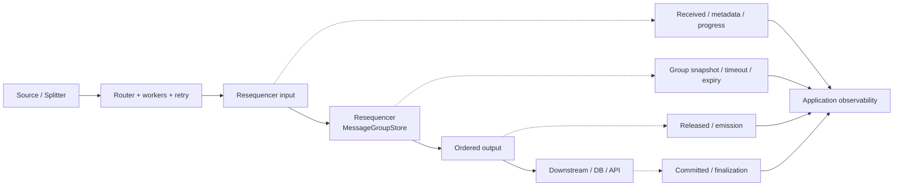

# Monitoring Incomplete Groups

In the **Advanced Resequencer** chapter of **SPRING_INTEGRATION_PATTERN**, a message group may have received several parts without yet qualifying for complete, ordered emission. When the number of such groups rises, the problem stops being mere sorting and becomes **observability, diagnostics, and operations**: which group is waiting normally, which group is stalled, which group has expired, and which element needs recovery?

In **Enterprise Integration Patterns** flows built with Spring Integration, Splitter can split batches, Router distributes across branches, Filter drops elements, Transformer and Gateway call external services, and retries/error channels handle failures. Resequencer needs consistent correlation and sequence metadata to restore order. **Monitoring incomplete groups must connect visibility across all of these stages**, rather than merely reading the count of messages sitting in a store.

> **Key point:** "Incomplete" does not automatically mean "failed". Distinguish business status, expected positions, received positions, wait time, and retry status before raising alerts or intervening.

## 1. What is an incomplete group?

Common headers used to describe a sequence:

| Header | Meaning | Example |
| --- | --- | --- |
| `correlationId` | Key identifying messages belonging to the same group | `shipment-42:run-3` |
| `sequenceNumber` | Position of the message within the group | `4` |
| `sequenceSize` | Total parts expected by the source, if known | `5` |

Suppose a five-part batch is processed in parallel by workers and sent to Resequencer in order `4, 1, 5, 2`:

```text
Group shipment-42:run-3
Expected sequenceSize:   5
Received positions:      1, 2, 4, 5
Missing positions:       3
Distinct positions:      4
Monitoring status:       OPEN / WAITING
```

Position 3 might be retrying, stuck in a broker, sitting in a DLQ, or dropped by a Filter. Resequencer **cannot guess the cause on its own**. If the source has not provided `sequenceSize`, the system may not even know the full set of positions to wait for.

A group is considered *incomplete* in monitoring tools when the application does not yet have evidence or a decision that the group's lifecycle has ended. However, distinguish:

- **Not yet released:** the endpoint is holding messages or has not yet emitted enough parts per the release strategy.
- **Partially released, not yet ended:** when partial sequences are permitted, some parts may have emitted while the group remains open.
- **Timed out/expired:** the wait policy triggered; the group may undergo partial emission, discard, recovery, or cleanup depending on configuration.
- **Endpoint-complete, not yet business-complete:** messages were emitted in order, yet downstream is still writing to a database or calling an API.
- **Business-complete:** the application has a committed final result, along with rules for retries and late arrivals.

Therefore, **the number of groups in `MessageGroupStore` does not inherently equal the number of unfinished business batches**. Some stores/configurations retain completed-group markers; conversely, a group purged from the store was not necessarily processed successfully.

## 2. Distinguishing normally waiting groups from stalled groups

Suppose two groups both have four of five parts, yet differ in context:

| Case | First received | Last update | Upstream state | Assessment |
| --- | --- | --- | --- | --- |
| A | 2 seconds ago | 1 second ago | `#3` is actively processing | Usually still within normal wait window |
| B | 40 minutes ago | 35 minutes ago | `#3` absent from queues, retries exhausted | Needs reconciliation or intervention |
| C | 12 minutes ago | 1 second ago | Still receiving stream parts | Long-lived group, not necessarily inactive |
| D | 10 minutes ago | 10 minutes ago | Filter intentionally dropped `#3` | Needs sequence-contract fix or recorded skip |

Never alert merely because "a group has fewer positions than expected". A healthy Resequencer **can always have open groups** at any point when parts arrive staggered.

Combine at least four signals:

1. **Age:** elapsed time since the group was first observed.
2. **Idle time:** elapsed time since the last meaningful progress update.
3. **Gap:** count or list of unreceived positions, when total and numbering rules are known.
4. **Progress/dependency:** whether the source is still emitting, retries remain active, queues are backlogged, or unrecoverability is confirmed.

A group with high age that is still making progress may indicate a performance tuning need; a group with high idle time and reliable loss confirmation likely needs immediate recovery.

### Do not treat timeout as permanent loss automatically

Timeout is a **policy threshold**, not proof that a message will never appear. A group can expire while the final part sits in a broker or retries; later, that message still arrives. Monitoring must track **expiry timestamp** and **expiry outcome** separately from missing status.

## 3. Minimum data needed to track a group

An application-level observation record can use these fields:

| Field | Purpose | Notes |
| --- | --- | --- |
| `batchRunId` / `correlationId` | Uniquely identify one group | Avoid reusing across batches while late messages may exist |
| `expectedSize` | Expected total positions | May be unknown |
| `receivedPositions` | Set of distinct positions received | Never use raw message count as distinct position count |
| `firstSeenAt` | When group observation began | Used to compute age |
| `lastProgressAt` | Most recent real progress | Same-slot redelivery should not necessarily refresh this |
| `lastAttemptAt` | Most recent processing/retry attempt | Can change even without progress |
| `status` | OPEN, WAITING, RECOVERING, TIMED_OUT, COMPLETE... | Application convention |
| `deadline` | Business cutoff if any | Distinguish from endpoint group timeout |
| `missingPositions` | Unseen numbers when size is known | Compute from committed state at snapshot time |
| `sourceStatus` | Status of missing part in upstream/broker | Separates slowness, loss, and active replay |
| `lastDecision` | Retry, skip, fail, partial, complete | Used for investigation and auditing |

**These field names are a recommended observation model**, not a built-in header set automatically produced by Spring Integration. With durable storage, define who writes these fields and keep them synchronized with message receipt and release.

### Distinguishing different kinds of "counts"

```text
rawReceivedCount      = total message deliveries received (including redeliveries)
uniquePositionCount   = count of distinct accepted sequenceNumbers
expectedSize          = committed part count from source, when known
missingCount          = expectedSize - uniquePositionCount
                        valid only if positions are 1..expectedSize
                        and metadata is consistent
releasedCount         = parts emitted per endpoint policy
committedCount        = downstream business side effects committed
```

A group with `expectedSize=3` receiving `#1, #2, #2` **does not have all three positions**. Tracking only raw message count equal to 3 can make dashboards falsely mark it complete.

Similarly, `releasedCount=3` does not guarantee three committed effects: downstream may retry or fail after receiving the messages.

## 4. Where to measure in Spring Integration?

Effective monitoring requires layered instrumentation:



| Measurement point | What to collect | What not to infer |
| --- | --- | --- |
| Before Resequencer | Correlation, sequence, late arrivals, duplicates, metadata errors | That output order is right |
| `MessageGroupStore` | Stored groups, current part count, group age per implementation | That every batch in the store is OPEN |
| After Resequencer | Emitted messages, wait time, released positions | That downstream has committed |
| Retry/error flow | Attempts, last error, DLQ, replay eligibility | That the group has definitely failed |
| Downstream finalization | Commit outcome, version, finalization time | That endpoint memory was cleaned up |

**Choose your source of truth explicitly:** use the store for **technical** endpoint state and a business table/log for **final processed** state. Never blend them into one poorly defined metric.

### 4.1. `MessageGroupStore` and actual lifecycle

Endpoints such as Resequencer use `MessageGroupStore` to store and manage groups. An in-memory example is `SimpleMessageStore`; for systems needing restart recovery, consider durable backends supported by Spring Integration for your version.

When monitoring the store, account for:

- **Completion markers:** a finished group may still leave a trace in the store if configured to retain it.
- **Expiry:** an expired group may be emitted partially or discarded per policy; state cleanup behavior is not necessarily identical to successful completion.
- **Reaper:** a mechanism such as `MessageGroupStoreReaper` can sweep old groups per configuration, yet does not equate to a business deadline.
- **Persistence:** a durable store can recover groups after restarts, yet still requires monitoring capacity, latency, and contention.
- **Multi-instance:** instances sharing a backend must coordinate state and release; aggregated metrics must not double-count groups simply because two nodes see them.

Do not call a total-group-count method and assume all of them are waiting. Check **exact status semantics and actual data** provided by your project's store, then filter to genuinely open groups per contract.

### 4.2. Do not expect every timeout event to enter `errorChannel`

`errorChannel` handles exceptions published along Spring Integration's error-message flow; **group expiry is not automatically a business exception**. If you want alerts like "group incomplete after deadline" sent to a dedicated channel, design the event producer and consumer path explicitly.

Example of an application-generated event:

```json
{
  "type": "RESEQUENCER_GROUP_STALLED",
  "batchRunId": "shipment-42:run-3",
  "expectedSize": 5,
  "receivedPositions": [1, 2, 4, 5],
  "missingPositions": [3],
  "ageSeconds": 420,
  "idleSeconds": 380,
  "decision": "RECONCILE_UPSTREAM"
}
```

This is an **illustrative schema**, not a built-in default event. When handling sensitive data, emit only identifiers, state, and necessary diagnostics; never dump full payloads into logs or metrics.

## 5. Computing health metrics from a group snapshot

A diagnostic helper can take a snapshot supplied by the application or state store and classify **investigation urgency**. It does not replace the release strategy, delete groups, or declare a part permanently lost.

The following Java 17 snippet computes group age, idle time, and missing positions. Use `Instant`/`Duration` to avoid mixing milliseconds and seconds.

```java
import java.time.Duration;
import java.time.Instant;
import java.util.Collection;
import java.util.HashSet;
import java.util.List;
import java.util.Set;
import java.util.stream.IntStream;

public final class PendingGroupDiagnostics {

    private PendingGroupDiagnostics() { }

    public record Snapshot(
            String correlationId,
            Integer expectedSize,
            Collection<Integer> receivedPositions,
            Instant firstSeenAt,
            Instant lastProgressAt) {
    }

    public record Report(
            String correlationId,
            int uniquePositions,
            boolean sizeKnown,
            List<Integer> missingPositions,
            boolean allExpectedPositionsPresent,
            Duration age,
            Duration idle,
            boolean exceedsAgeLimit,
            boolean exceedsIdleLimit) {
    }

    public static Report inspect(
            Snapshot snapshot,
            Instant now,
            Duration maxAge,
            Duration maxIdle) {

        if (snapshot == null || now == null
                || maxAge == null || maxIdle == null
                || maxAge.isNegative() || maxIdle.isNegative()
                || snapshot.correlationId() == null
                || snapshot.correlationId().isBlank()
                || snapshot.receivedPositions() == null
                || snapshot.firstSeenAt() == null
                || snapshot.lastProgressAt() == null
                || snapshot.firstSeenAt().isAfter(snapshot.lastProgressAt())
                || snapshot.lastProgressAt().isAfter(now)) {
            throw new IllegalArgumentException("Invalid group snapshot");
        }

        Integer expected = snapshot.expectedSize();
        if (expected != null && expected < 1) {
            throw new IllegalArgumentException("Invalid expectedSize");
        }

        Set<Integer> unique = new HashSet<>();
        for (Integer n : snapshot.receivedPositions()) {
            if (n == null || n < 1 || (expected != null && n > expected)) {
                throw new IllegalArgumentException("Invalid position");
            }
            unique.add(n);
        }

        boolean sizeKnown = expected != null;
        List<Integer> missing = sizeKnown
                ? IntStream.rangeClosed(1, expected)
                        .filter(n -> !unique.contains(n))
                        .boxed()
                        .toList()
                : List.of();

        Duration age = Duration.between(snapshot.firstSeenAt(), now);
        Duration idle = Duration.between(snapshot.lastProgressAt(), now);

        return new Report(
                snapshot.correlationId(),
                unique.size(),
                sizeKnown,
                missing,
                sizeKnown && missing.isEmpty(),
                age,
                idle,
                age.compareTo(maxAge) > 0,
                idle.compareTo(maxIdle) > 0);
    }
}
```

**Proper usage:**

- `uniquePositions` counts distinct positions, not redeliveries.
- `missingPositions` is meaningful only when total count is **known and trusted**. If `sizeKnown=false`, an empty list here means **not yet computable**, not **complete**.
- `allExpectedPositionsPresent=true` only confirms positions per the snapshot; **it does not prove Resequencer has released or downstream has committed**.
- `age` and `idle` drive policy-based alerting; exceeding thresholds triggers reconciliation, never an automatic assumption of permanent loss.
- The method expects consistent timestamps where `now` is no earlier than last progress; in distributed systems, account for clock skew and propagation lag when building snapshots.

This code is **application-built diagnostic logic**. It does not read groups from `MessageGroupStore`, handle races between snapshots and arriving messages, or track completed/expired states. Add those according to your store, Spring Integration version, and domain design.

### 5.1. Scenario example

```java
import java.time.Duration;
import java.time.Instant;
import java.util.List;

Instant now = Instant.parse("2026-11-21T09:10:00Z");

var snapshot = new PendingGroupDiagnostics.Snapshot(
        "shipment-42:run-3",
        5,
        List.of(4, 1, 5, 2, 2), // #2 appears twice
        now.minusSeconds(420),
        now.minusSeconds(380));

var report = PendingGroupDiagnostics.inspect(
        snapshot,
        now,
        Duration.ofMinutes(5),
        Duration.ofMinutes(2));

// uniquePositions == 4, missingPositions == [3]
// exceedsAgeLimit == true, exceedsIdleLimit == true
// Should only route to reconciliation/alerting; do not delete the group yet.
```

Once a valid `#3` arrives, recomputing the snapshot may yield `missingPositions=[]`. Yet if the group remains stuck waiting because release failed, monitoring must still inspect the endpoint or store; **"all positions present" differs from "processed successfully"**.

## 6. Designing operational metrics and dashboards

Define and expose the following metrics from application/store observability sources. Do not assume Spring Integration exports all of them under these exact names by default.

| Suggested metric | Type | Meaning |
| --- | --- | --- |
| `app.resequencer.groups.open` | Gauge | Business/technical groups currently open by unified definition |
| `app.resequencer.messages.pending` | Gauge | Messages/slots currently awaiting release |
| `app.resequencer.groups.oldest.age.seconds` | Gauge | Age of the longest-waiting open group |
| `app.resequencer.groups.idle.p95.seconds` | Distribution/Aggregated gauge | Idle duration of waiting groups |
| `app.resequencer.groups.started.total` | Counter | Total groups created in the observation window |
| `app.resequencer.groups.completed.total` | Counter | Groups completed per defined condition |
| `app.resequencer.groups.expired.total` | Counter | Groups handled via expiry/timeout |
| `app.resequencer.groups.recovery.total` | Counter | Transitions into investigation/recovery |
| `app.resequencer.sequence.duplicates.total` | Counter | Detected same-slot redeliveries |
| `app.resequencer.sequence.conflicts.total` | Counter | Conflicting metadata or payloads on the same slot |
| `app.resequencer.store.operation.duration` | Timer | Store access latency |

**Use low-cardinality labels** such as `flow`, `status`, `outcome`, `tenantTier`, or `errorCategory`; **never put `correlationId`, event ID, or individual sequence numbers as labels on time series**. Millions of groups will create millions of metric series and overload your monitoring system.

Per-group details belong in **structured logs, traces, diagnostic tables, or paginated investigation UIs**, searchable by batch ID when needed.

### 6.1. Micrometer example: exporting open-group metrics

Suppose the application has a `GroupStateReader` service efficiently reading aggregated snapshots from business state or the store. Gauges can be registered as follows:

```java
import io.micrometer.core.instrument.Gauge;
import io.micrometer.core.instrument.MeterRegistry;

interface GroupStateReader {
    long countOpenGroups();
    long countPendingMessages();
    double oldestOpenGroupAgeSeconds();
}

public final class GroupMetrics {

    public GroupMetrics(
            MeterRegistry registry, GroupStateReader reader) {

        Gauge.builder("app.resequencer.groups.open",
                        reader, r -> r.countOpenGroups())
                .description("Number of currently open sequence groups")
                .register(registry);

        Gauge.builder("app.resequencer.messages.pending",
                        reader, r -> r.countPendingMessages())
                .description("Messages awaiting release")
                .register(registry);

        Gauge.builder("app.resequencer.groups.oldest.age.seconds",
                        reader, GroupStateReader::oldestOpenGroupAgeSeconds)
                .description("Oldest open group age in seconds")
                .register(registry);
    }
}
```

This is **sample observability code**: `GroupStateReader` has no implementation here because accurate retrieval depends on the store in use. In production, read metrics from a **controlled aggregated snapshot/cache**, avoiding running a full scan over all pending groups on every Prometheus scrape.

Another note: if multiple nodes share one database and each reads group counts, summing gauges across all nodes can **multiply-count all groups**. Use a single aggregation point, clear ownership sharding, or query from the shared source appropriately.

### 6.2. What questions should dashboards answer?

A useful dashboard progresses from high-level overview to investigation:

| View | Required data | Operational question |
| --- | --- | --- |
| Current backlog | Open groups, pending messages, oldest age | Is work accumulating? |
| Throughput & progress | Per-minute group creation vs completion rate | Is completion keeping up with ingress? |
| Age and latency | p50/p95/p99 wait time, idle age | Are delays widespread or isolated outliers? |
| Errors | Timeouts, missing slots, duplicates, conflicts, DLQ | Which groups need recovery? |
| Store | Capacity, access latency, locks/contention | Is the backend the bottleneck? |
| Downstream | Output emission, commits, post-resequence retries | Are groups finishing at the endpoint yet stalling downstream? |

When `openGroups` rises, check **group creation rate**, **completion rate**, **store latency**, and **queue lag** together. Rising group counts can stem from brief ingress spikes, slow downstream consumers, or failures preventing groups from completing.

## 7. Designing actionable alerts

Good alerts do not merely say "groups are waiting"—they point to **the next intervention point**. Example starter policy (thresholds below are illustrative and must be tuned to real SLAs and data distributions):

| Condition | Suggested priority | Action |
| --- | --- | --- |
| Group age over 5 min, normal SLA 1 min | Warning | Check missing positions and queues/retries |
| Group idle over 10 min, no active workers | High | Reconcile source, DLQ, and manifest state |
| Timeout rate spikes sharply | Warning/High | Check system errors or recent config changes |
| Open groups rise steadily while completion rate stays flat | High | Check bottlenecks, group leaks, store/workers |
| Same-slot conflict or inconsistent size | High | Quarantine bad producer and investigate |
| Store slow or near capacity | High/Critical | Throttle ingress, prioritize message durability |

An alert rule can combine multiple conditions:

```text
candidateForInvestigation(group) =
    group.status == OPEN
    AND group.age > policy.maxAge
    AND group.idle > policy.maxIdle
    AND NOT alreadyInRecovery(group)

candidateForReconciliation(group) =
    candidateForInvestigation(group)
    AND (
        knownMissingPositions(group) > 0
        OR upstreamDeclaresBatchClosed(group)
        OR expectedSizeIsUnknownTooLong(group)
    )
```

This is **policy pseudo-code**, not a built-in Spring Integration release/timeout expression. If automating handling, transition recovery state atomically so multiple instances do not launch duplicate reconciliation workflows for one group.

### Avoiding alert storms

- Group alerts by `flow`, error category, service, and time window; drill down by `correlationId` during investigation.
- Alert on **sustained trends**, not a single sample during a brief traffic spike.
- Apply cooldowns/hysteresis and track alert acknowledgment/resolution.
- Distinguish "no new messages" due to **planned source inactivity** from "stalled" due to failure.
- Allow a small grace buffer for metric scraping and clock skew before declaring SLA breaches.

In multi-tenant systems, prevent one tenant with many pending groups from masking another tenant's outage; aggregate by service tier or tenant tier with bounded cardinality.

## 8. Runbook when an incomplete group triggers an alert

An investigation workflow can follow these steps:

1. **Confirm identity:** gather `correlationId/batchRunId`, data source, `sequenceSize`, start time, and business status.
2. **Verify the measurement layer:** is this group genuinely unreleased, or just a completed marker lingering in the store?
3. **Identify gaps:** compare distinct `sequenceNumber` values against the manifest; if size is unknown, look for end markers or source total confirmation.
4. **Trace upstream:** did the Splitter produce the missing part, did a Filter intentionally drop it, or did a Router misroute it?
5. **Inspect workers and brokers:** queue lag, retry attempts, worker crashes, ACK failures, DLQ, and correlation headers after adapters.
6. **Inspect release/timeout:** is the group waiting per the configured strategy, did partial release emit any prefix, and is expiry scheduling running?
7. **Inspect the store:** latency, transactions/locks, restarts, multi-instance state, and cleanup policies.
8. **Take authorized action:** replay missing parts, record a skip, finalize partial, fail the batch, or compensate; never edit `sequenceSize` just to force a group closed quickly.
9. **Check late arrival and idempotency:** if replaying after expiry/completion, reconcile against terminal state to avoid emitting a second outcome.
10. **Document findings:** root cause, affected positions, timeline, remediation, and recurrence prevention.

Never manually edit or delete group rows directly in the store database to "unstick" things without understanding endpoint locking and lifecycle semantics. Raw intervention can lose unreleased data or create duplicates upon broker redelivery.

### Scenario: Filter drops a part

```text
Splitter assigns:  #1/4   #2/4   #3/4   #4/4
Filter drops #2:   #1/4          #3/4   #4/4
Resequencer:       receives 1,3,4; still expects all 4 parts
Monitoring:        missingPositions=[2], idle time rising
```

The real fix lies in **the data contract**: filter before assigning a new sequence or send a reliable skip signal; for an old malformed batch already in flight, apply the business decision to fail/repair/partial. Simply increasing timeouts keeps the group consuming resources.

## 9. Testing incomplete-group monitoring

Test **two things independently**: (1) Resequencer and store behave properly; (2) monitoring accurately reflects state at the defined boundaries.

| Case | Scenario | Monitoring expectation |
| --- | --- | --- |
| Normally open group | Receive `#1/3`, 1s later `#2/3` | Open, valid missing count, no alert before SLA |
| Completed group | Receive `3/3, 1/3, 2/3` | All positions present and completion recorded; no longer reported pending |
| Missing one part | Receive `1/4, 3/4, 4/4` | Missing `#2`; age/idle increase over time |
| Duplicate | Receive `1/3, 2/3, 2/3` | Unique positions = 2; never treated as 3 complete |
| Unknown size | `#1, #2` present without manifest | Never reports `missingCount=0` as complete |
| Intentional Filter drop | Generate `1..4` then drop `#2` | Gap detected; Filter/sequence rule investigated |
| Retries still active | `#2` absent while worker backs off | Dependency tracked; not prematurely marked permanently lost |
| Retry exhaustion | Worker exhausts retries and sends to DLQ | Group moves to investigation/recovery branch |
| Group timeout | Incomplete group hits deadline | Expiry and action recorded; never auto-marked `COMPLETE` |
| Partial release | `#1` emitted early while `#2` missing | Released count tracked separately from completion |
| Retained completed marker | Group completed, record still in store | Not miscounted as an open group |
| Crash/restart | Waiting group, then instance restarts | Reports state accurately per store durability |
| Late arrival | Missing part arrives after expiry | Accept/reject/correct decision observed without duplicates |
| Two interleaved groups | A missing parts, B completes | Only A triggers alert; B unaffected |
| Slow store | Store queries/writes lag | Store metrics and alerts surface the bottleneck |

### Unit test for age and missing-position calculation

You can test `PendingGroupDiagnostics` independently of Resequencer:

```java
import static org.junit.jupiter.api.Assertions.*;

import java.time.Duration;
import java.time.Instant;
import java.util.List;
import org.junit.jupiter.api.Test;

class PendingGroupDiagnosticsTest {

    private static final Instant NOW =
            Instant.parse("2026-11-21T09:10:00Z");

    @Test
    void reportsUniquePositionsAndMissingSlot() {
        var snapshot = new PendingGroupDiagnostics.Snapshot(
                "batch-42", 5, List.of(4, 1, 2, 2, 5),
                NOW.minusSeconds(420), NOW.minusSeconds(380));

        var report = PendingGroupDiagnostics.inspect(
                snapshot, NOW,
                Duration.ofMinutes(5),
                Duration.ofMinutes(2));

        assertEquals(4, report.uniquePositions());
        assertEquals(List.of(3), report.missingPositions());
        assertTrue(report.sizeKnown());
        assertFalse(report.allExpectedPositionsPresent());
        assertTrue(report.exceedsAgeLimit());
        assertTrue(report.exceedsIdleLimit());
    }

    @Test
    void doesNotTreatUnknownSizeAsComplete() {
        var snapshot = new PendingGroupDiagnostics.Snapshot(
                "stream-7", null, List.of(1, 2),
                NOW.minusSeconds(10), NOW.minusSeconds(1));

        var report = PendingGroupDiagnostics.inspect(
                snapshot, NOW,
                Duration.ofMinutes(5),
                Duration.ofMinutes(2));

        assertFalse(report.sizeKnown());
        assertFalse(report.allExpectedPositionsPresent());
        assertTrue(report.missingPositions().isEmpty());
    }

    @Test
    void reportsAllPositionsPresentWithoutClaimingCommit() {
        var snapshot = new PendingGroupDiagnostics.Snapshot(
                "batch-43", 3, List.of(3, 1, 2),
                NOW.minusSeconds(20), NOW.minusSeconds(1));

        var report = PendingGroupDiagnostics.inspect(
                snapshot, NOW,
                Duration.ofMinutes(5),
                Duration.ofMinutes(2));

        assertTrue(report.allExpectedPositionsPresent());
        assertEquals(List.of(), report.missingPositions());
        // Endpoint completion and business commit are verified separately.
    }
}
```

These are **observability-layer unit tests**; full integration tests still need to send messages into a real Resequencer, verify `MessageGroupStore`, release, timeouts, errors, and downstream state. Use a controllable clock in diagnostic logic and test deadline boundary scenarios to prevent flaky tests.

## 10. Common mistakes when monitoring groups

**1. Using only total messages in the store.** It may include completed markers or duplicates and does not reflect truly waiting groups.

**2. Counting every raw message as a new position.** Retries can produce multiple messages sharing `sequenceNumber`; check distinct positions and source event IDs.

**3. Relying on idle time while treating retries as progress.** A failing, retrying worker may refresh `lastAttemptAt` while valid positions remain unchanged. Separate `lastProgressAt` from `lastAttemptAt`.

**4. Assuming an empty store means success.** A group may have expired, been reaped, or been lost on restart with an in-memory store. Track business state separately.

**5. Forgetting async downstream effects.** Resequencer emitted in order, yet downstream effects have not committed. Never mark the entire business transaction complete solely from the output channel.

**6. Using `correlationId` as a metric label.** Metric series explode with group count and overload observability infrastructure. Use logs/tracing for per-group detail.

**7. Scanning the entire store on every scrape.** Heavy queries can add latency to the Resequencer itself. Use aggregated counters or time-bounded snapshot caches.

**8. Intervening on a stale snapshot.** The final message may have arrived between measurement and a retry/fail decision. Re-verify state atomically before irreversible actions.

**9. Lacking retention policies for completed and expired groups.** Storage can explode even when open group count is tiny.

**10. Failing to distinguish per-instance counters.** Two nodes reading the same store may report the same group count; naively summing gauges doubles the reported numbers.

## 11. Checklist for implementing incomplete-group monitoring

1. **Define states explicitly:** OPEN, WAITING, RECOVERING, TIMED_OUT, COMPLETED, FAILED, and which parts represent business state.
2. **Enforce valid metadata:** `correlationId` isolates batches, `sequenceNumber` follows a clear convention, and `sequenceSize`/end markers are reliable.
3. **Count accurately:** separate raw messages, unique positions, released messages, and committed effects.
4. **Measure age and idle separately:** treat progress as occurring only when valid positions or actual processing state advances.
5. **Separate endpoint store from business tables:** do not treat records lingering in the store as unfinished work.
6. **Monitor timeout/expiry/cleanup:** oversee release strategies, group timeouts, `MessageGroupStore`, and reaper sweeps.
7. **Provide reconciliation paths:** link incomplete groups directly to upstream, retries, DLQ, and manifests.
8. **Protect observability resources:** low-cardinality metrics, efficient snapshot queries, and appropriate caching/retention.
9. **Make alerts actionable:** use SLAs, group age, idle time, completion rate, and source status to cut false positives.
10. **Test abnormal states:** duplicate retries, missing positions, unknown size, partial release, late arrivals, restarts, and timeout races.
11. **Never infer permanent loss automatically:** timeouts trigger verification; fail/partial/skip/replay decisions belong to the business contract.
12. **Reconcile downstream as well:** when end-to-end guarantees are required, verify committed effects rather than just Resequencer release.

**Remember:** Monitoring incomplete groups is a problem of **defining progress and state**, not just counting groups in memory. Combining `MessageGroupStore`, source data, correlation/sequence metadata, arrival timestamps, retry/error flows, and business state lets you spot genuinely stalled groups, prioritize recovering the exact missing parts, and keep Spring Integration flows stable under heavy load.
