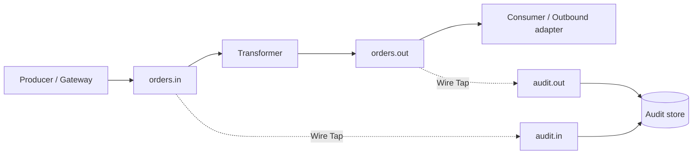

# Auditing Inbound and Outbound Flow Messages in Spring Integration

## 1. Objectives and Scope

In an integration system, a message can pass through multiple `MessageChannel`, `Transformer`, `Filter`, `Router`, `Splitter`, `Aggregator`, and outbound adapter components. When an incident occurs or reconciliation is needed, the operations team must be able to answer concrete questions: **which messages did the flow receive, when, and from where; which messages reached the output boundary; which cases were rejected, failed, or retried?**

**Message auditing** is the recording of structured events at defined points along the processing journey. With Enterprise Integration Patterns (EIP), auditing helps verify message traversal in a loosely coupled architecture, but audit records must be designed independently of business logic and of ordinary logging mechanisms.

After this lesson, you will be able to:

- Precisely identify the **input and output boundaries** of an `IntegrationFlow`, distinguishing intake/handoff events from the final processing outcome.
- Use Spring Integration's **Wire Tap** to send a reference copy of a message to an audit branch without modifying the core business logic.
- Design audit records with a `flowExecutionId`, business key, status, timestamp, and safe metadata.
- Weigh synchronicity, durability, deduplication capability, and information security before production deployment.
- Verify the success, filtered, error, retry, and missing output event paths.

## 2. Placing Audit Boundaries in the Right Places

For example, a system receives an order, normalizes the data, and sends it to a channel for another component to consume:



In this example, the semantics must be agreed upon before recording events:

| Location | Suggested Event | What Can Be Concluded | What **Cannot** Yet Be Concluded |
| --- | --- | --- | --- |
| Wire Tap on `orders.in` | `FLOW_INPUT_OBSERVED` | The message reached the input channel and was observed by the audit branch | The Transformer/flow completed successfully |
| Wire Tap on `orders.out` | `FLOW_OUTPUT_OBSERVED` | The message reached the output handoff point | The external system received or processed it successfully |
| After validation/Filter step | `FLOW_REJECTED` | The message was rejected according to a defined rule | The message reached the output successfully |
| Error flow | `FLOW_FAILED` | A processing error was recorded | The error has been resolved or the transaction rolled back completely |
| After ACK/response from target system | `DELIVERY_CONFIRMED` | There is confirmation evidence per the target contract | All business processing on the target side is complete if the ACK only confirms receipt |

Event names should describe **what was actually observed**, avoiding naming an event `DELIVERED` when a message was only sent to a `MessageChannel`. `WireTap` is a channel interceptor: it runs when a message is sent through the channel; at that point, dispatching, enqueuing, or calling an external system can still fail. To prove successful delivery, record the result after an outbound adapter or an appropriate ACK mechanism.

If a flow has multiple output branches, each branch needs a dedicated output audit point with its own `channel`, `route`, or `destination`. For request–reply, distinguish between `REQUEST_IN`, `REPLY_OUT`, and downstream delivery confirmation. Do not assume each inbound message corresponds to exactly one outbound message: a Filter may drop messages, a Splitter produces multiple messages, an Aggregator combines multiple messages, and a Router can send a message to multiple branches.

## 3. Designing the Audit Record

Good auditing starts from an **event contract**, not from a `log.info(message.toString())` statement.

| Field | Meaning | Recommendation |
| --- | --- | --- |
| `auditEventId` | Unique identifier of the recorded event | UUID/ULID generated per event |
| `eventType` | `FLOW_INPUT_OBSERVED`, `FLOW_OUTPUT_OBSERVED`, `FLOW_FAILED`, ... | Stable, documented list of names |
| `occurredAt` | Time the system observed the event | ISO-8601 UTC; also store `recordedAt` if persisted asynchronously |
| `flowName`, `channel`, `direction` | Context in which the event originated | Intentional names, not dependent on random bean names |
| `flowExecutionId` | Identifier for **one logical processing execution** | Assigned at ingress and propagated across steps/branches |
| `messageId` | `MessageHeaders.ID` of the message at audit time | Useful for local tracing; may change when transforming the message |
| `correlationId`, `causationId` | Parent/child message, request/reply, split/aggregate relationship | Do not equate with `messageId` or business key |
| `businessKey` | Order ID, transaction ID, document ID, etc. | Prefer normalized IDs; avoid PII |
| `attempt`, `outcome`, `errorCode` | Attempt number, outcome, and controlled error code | Do not include stack traces or secrets in audit by default |
| `payloadType`, `schemaVersion`, `payloadDigest` | Data type and fingerprint | Digest from an appropriate canonical representation; do not log the entire payload |
| `traceId`, `spanId` | Link to distributed tracing if available | Do not use trace IDs as a replacement for durable audit identifiers |

An illustrative record (values are examples only):

```json
{
  "auditEventId": "evt-000187",
  "eventType": "FLOW_OUTPUT_OBSERVED",
  "occurredAt": "2026-11-21T08:30:15.230Z",
  "flowName": "orderNormalizationFlow",
  "channel": "orders.out",
  "direction": "OUT",
  "flowExecutionId": "flow-7294",
  "messageId": "cf44d8fe-3d55-40b8-8dd0-cf0e6d74aa46",
  "businessKey": "order-42",
  "attempt": 1,
  "outcome": "OBSERVED",
  "payloadType": "java.lang.String",
  "schemaVersion": 1
}
```

`MessageHeaders.ID` is managed by Spring Messaging; when a Transformer creates a new message, the ID can change. Therefore, **do not use the message ID as the sole key to join the entire journey**. The receiving system should assign `flowExecutionId` once, preserve it across required headers, and clearly record parent/child relationships when using a Splitter, Aggregator, or redelivery. For a message reprocessed due to retry, `attempt` and `auditEventId` must make the different attempts visible. Do not directly persist headers like `replyChannel` or `errorChannel` if they are internal objects or carry data unsuitable for serialization.

## 4. Implementing Wire Tap at Input and Output

The following example uses Spring Integration Java DSL (for a Spring Boot project using Spring Integration 6.x). To illustrate the boundaries, the flow receives a string, normalizes it, and sends it to an output `QueueChannel`. The audit branches only receive metadata; the audit store is represented by the `AuditStore` interface so the application can implement it according to its storage policy.

```java
import java.time.Instant;
import java.util.UUID;

import org.springframework.context.annotation.Bean;
import org.springframework.context.annotation.Configuration;
import org.springframework.integration.annotation.EnableIntegration;
import org.springframework.integration.channel.DirectChannel;
import org.springframework.integration.dsl.IntegrationFlow;
import org.springframework.integration.dsl.MessageChannels;
import org.springframework.messaging.Message;
import org.springframework.messaging.MessageChannel;
import org.springframework.messaging.PollableChannel;

@Configuration
@EnableIntegration
class OrderAuditConfig {

    // Input channel; the tap observes the message when it is sent to this channel.
    @Bean("orders.in")
    MessageChannel ordersInput() {
        return MessageChannels.direct()
                .wireTap("audit.in")
                .get();
    }

    // Output channel of the flow; sending to the queue is not yet an external ACK.
    @Bean("orders.out")
    PollableChannel ordersOutput() {
        return MessageChannels.queue()
                .wireTap("audit.out")
                .get();
    }

    @Bean("audit.in")
    MessageChannel auditInputChannel() {
        return new DirectChannel();
    }

    @Bean("audit.out")
    MessageChannel auditOutputChannel() {
        return new DirectChannel();
    }

    @Bean
    IntegrationFlow orderNormalizationFlow() {
        return IntegrationFlow.from("orders.in")
                .transform(String.class, String::strip)
                .channel("orders.out")
                .get();
    }

    @Bean
    IntegrationFlow inputAuditFlow(AuditStore auditStore) {
        return IntegrationFlow.from("audit.in")
                .handle(message -> auditStore.append(
                        AuditEvent.from("FLOW_INPUT_OBSERVED", "orders.in", message)))
                .get();
    }

    @Bean
    IntegrationFlow outputAuditFlow(AuditStore auditStore) {
        return IntegrationFlow.from("audit.out")
                .handle(message -> auditStore.append(
                        AuditEvent.from("FLOW_OUTPUT_OBSERVED", "orders.out", message)))
                .get();
    }

    interface AuditStore {
        void append(AuditEvent event);
    }

    record AuditEvent(
            String auditEventId,
            Instant occurredAt,
            String eventType,
            String channel,
            String flowExecutionId,
            String messageId,
            String businessKey,
            String payloadType) {

        static AuditEvent from(String type, String channel, Message<?> message) {
            var headers = message.getHeaders();
            return new AuditEvent(
                    UUID.randomUUID().toString(),
                    Instant.now(),
                    type,
                    channel,
                    headers.get("flowExecutionId", String.class),
                    headers.getId().toString(),
                    headers.get("orderId", String.class),
                    message.getPayload().getClass().getSimpleName());
        }
    }
}
```

**Key points to note when reading the example:**

1. `.wireTap("audit.in")` and `.wireTap("audit.out")` attach interceptors to **two defined channels**, observing messages at the boundary. The business branch does not need to call `AuditStore` directly.
2. `AuditStore` is *a contract that requires an implementation*; in practice it can write to an append-only table, a durable queue, or an event store. The example intentionally records only safe metadata, without copying the entire payload or all headers into the audit record.
3. A `DirectChannel` for auditing executes **synchronously** within the message send call in this example. If `append` is slow or throws an exception, the main flow can slow down or fail. This is a decision with business impact and must be chosen deliberately in the design.
4. `QueueChannel` at the output is used for easy observation in this exercise. If a real application uses HTTP, Kafka, AMQP, or JMS outbound adapters, the point for recording ACK/success/failure must be defined separately according to the adapter's characteristics.

On the producer/gateway side, send a message with a durable reconciliation key:

```java
import org.springframework.messaging.MessageChannel;
import org.springframework.messaging.support.MessageBuilder;

void submit(MessageChannel ordersInput) {
    boolean accepted = ordersInput.send(
            MessageBuilder.withPayload("  new-order-42  ")
                    .setHeader("flowExecutionId", "flow-7294")
                    .setHeader("orderId", "order-42")
                    .build());

    if (!accepted) {
        throw new IllegalStateException("Failed to send to orders.in");
    }
}
```

When this message runs through the flow, the audit typically records two events, `FLOW_INPUT_OBSERVED` and `FLOW_OUTPUT_OBSERVED`, with the same `flowExecutionId`, while the output payload has whitespace stripped via `strip()`. If the Transformer creates a new message, the two records may carry different `messageId` values. A successful `send()` call only confirms the channel's send contract; it does not mean an external system has completed the business operation.

### Where to Record Audits When a Flow Has Multiple Branches?

- **Router:** place a tap at ingress and at each output channel that actually requires reconciliation. Store `routeName` or `destination`; a single message can produce multiple output events.
- **Filter/validation:** attach a dedicated branch to `discardChannel` or record an event at the rejection point to distinguish `REJECTED` from `LOST`.
- **Splitter/Aggregator:** use Spring Integration's `correlationId`, `sequenceNumber`, and `sequenceSize` when appropriate, while maintaining a stable business/flow correlation ID. One inbound message can spawn many child messages, or many inbound messages can produce one result.
- **Request–reply gateway:** attach auditing on both the request and reply directions, explicitly recording timeouts, errors, and missing replies; do not infer a successful response from the request having been received.
- **Outbound adapter:** if delivery auditing is required, record the adapter's or broker's return result/ACK alongside the event that the message was sent to the outbound channel.

## 5. Synchronicity, Asynchronicity, and Reliability

Wire Tap separates the processing branch structurally, but **does not automatically make audit writing asynchronous or durable**. The choice depends on reconciliation requirements:

| Strategy | Benefits | Risks / Conditions of Use |
| --- | --- | --- |
| `DirectChannel` + synchronous audit write | Easy to reason about; can require audit success before proceeding | Increases latency; audit failures can break the flow; synchronicity alone does not guarantee atomicity |
| `ExecutorChannel`/executor for the audit branch | Reduces processing time on the business thread while resources are available | In-memory queues can be lost on process shutdown; queue full/rejection still must be handled |
| Dedicated durable queue/broker for auditing | Can survive restarts and process independently | Requires retry, idempotency, backlog monitoring, and dead-letter handling; not automatically atomic with business logic |
| Same DB transaction or **transactional outbox** | Suitable when business changes and audit/outbox events must be synchronized | Guaranteed only within the configured transaction boundary; the outbox dispatcher can still send duplicates |

In systems where audit storage is mandated by compliance/regulations, explicitly choose one of two policies:

- **Fail closed:** if a mandatory record cannot be written, reject or roll back the business transaction according to the contract. This is truly safe only when transaction boundaries and failure modes are controlled.
- **Fail open:** prioritize keeping business processing running when auditing is temporarily degraded; must accept evidence gaps and provide compensation/recovery mechanisms, alerting, and tracking of missing records. Do not choose this policy for data requiring strict reconciliation unless approved.

**Transactional outbox** is a common choice when the same transaction can persist business data and an outbox row into the same database: a dispatcher reads the outbox and forwards events to the audit system, retrying on error. The audit consumer must be idempotent because an outbox record may be replayed. If business processing spans multiple independent resources or external APIs, global atomicity cannot be inferred from `@Transactional` alone.

A common mistake is calling `log.info("{}", message)` and treating it as auditing. Logs can rotate or be lost when log shipping is interrupted; the string representation of `message` can also print sensitive data. Separate the audit store from operational logs and establish appropriate retention, access control, and immutability policies.

## 6. Detecting Errors, Retries, and Duplicate Messages

Recording only `IN`/`OUT` milestones leaves blind spots: a message that entered without exiting could still be in flight, dropped by a Filter, waiting in an Aggregator, failed, or moved to a dead-letter destination. Therefore, record state at **decision points**:

```text
INPUT_OBSERVED
   |-- validation failed ------> REJECTED
   |-- handler error ----------> FAILED / RETRY_SCHEDULED
   |                                |-- retry --> ATTEMPT_STARTED ...
   |                                '-- retries exhausted --> DEAD_LETTERED
   '-- processed --------------> OUTPUT_OBSERVED
                                        '-- real ACK --> DELIVERY_CONFIRMED
```

For `errorChannel`, `ErrorMessage` contains the exception and usually indicates the failed message. The audit handler should extract only an allowlisted `errorCode`, exception name, and processing stage, while correlating via `flowExecutionId` from the failed message when present. Do not assume every exception goes through `errorChannel`: with a synchronous `DirectChannel`, exceptions can propagate back to the caller; with asynchronous endpoints, errors may be published to the configured error channel. Test the actual error-catching behavior of each endpoint.

With retries/redeliveries, two seemingly identical events can be two **valid attempts**. Distinguish:

- `auditEventId`: unique for **each recorded occurrence**.
- `businessEventId` or source key: identifies the **same original event** even when redelivered.
- `flowExecutionId`: identifies a logical processing execution per application convention; clearly define whether it is preserved or regenerated on redelivery.
- `attempt`: attempt number for the same operation; `step`/`destination` may also be needed if retrying per stage.

Audit store idempotency must not mistakenly discard every event with a duplicate `messageId`: doing so can lose valuable retry history. Key deduplication on the **same logical audit event** (for example `sourceEventId + stage + attempt + eventType`) and preserve genuinely distinct attempts.

## 7. How Auditing and Observability Complement Each Other

| Mechanism | Best Answers | Caveats |
| --- | --- | --- |
| Structured **audit event** | "Which boundaries did business message X cross, with what outcome, and when?" | Must be durable, reconcilable, and access-controlled |
| Application log | "Why did the code fail at this step?" | Format may change, rotates, contains many ephemeral details |
| **Micrometer metrics** | "Where are error rates, throughput, or latency increasing?" | Do not use business IDs/message IDs as metric tags due to high cardinality |
| Distributed tracing | "Which services/spans did a request traverse?" | Traces can be sampled; not complete audit evidence |
| Spring Integration message history | "Which tracked components did the message pass through?" | Metadata in headers; does not automatically replace an audit store |

Spring Integration 6.x supports Micrometer Observation for configured managed components such as channels, handlers, and gateways. You can use `@EnableIntegrationManagement(observationPatterns = "*")` together with a configured `ObservationRegistry` to collect observations; scope patterns and tags as needed. `@EnableMessageHistory` helps track a message's path using the `history` header, which is useful when investigating failures, though it adds overhead and only covers tracked components. Both tracing and message history serve diagnostics and **do not replace durably persisted audit records**.

When designing dashboards, useful metrics include `flow_input_total`, `flow_output_total`, `flow_failed_total`, in-flight message count, ingress-to-egress latency, pending/unpersisted audit record count, and outbox lag. Compare input and output counts only after accounting for Filters, Splitters, Aggregators, timeouts, waiting branches, and asynchronous behavior. A simple `IN - OUT` difference does not automatically prove message loss.

## 8. Data Security and Auditability

Messages often carry PII, access tokens, payment details, or payloads containing confidential data. An audit branch can leak data if it copies raw payloads/headers and serializes them. A practical policy should include:

1. **Field allowlisting**: store only classified business IDs, message type, timestamps, status, digest, and metadata needed for reconciliation; mask/redact sensitive data. Do not log tokens, credentials, or full request contents by default.
2. **Access control**: separate write and read permissions for audits; protect data in transit and at rest, and log sensitive accesses.
3. **Integrity**: append-only store, restricted updates/deletes; consider signatures, hash chains, or tamper-evident storage depending on requirements. Payload hashing is only useful when canonicalization rules and algorithms are consistent; confidential data may require HMAC to resist brute-force/dictionary reversal.
4. **Data lifecycle**: define retention, partitioning/archival, and deletion procedures when legally required. Do not default to infinite retention.
5. **Performance**: use queues/backpressure, sensible batching, and backlog alerts; apply sampling only to diagnostic telemetry if appropriate—never arbitrarily sample mandatory audit events.

If the payload is a `mutable` object, an asynchronously processed audit branch should not keep a reference to the payload and read it at a later time. Instead, immediately extract an **immutable metadata snapshot** or serialize safely at a controlled boundary to prevent the record from reflecting data mutated after the tap.

## 9. Verification Practice

For the example flow, you can build a test `AuditStore` backed by a thread-safe list, send messages via `MessageChannel` `orders.in`, and read from `PollableChannel` `orders.out`. Verify the following criteria:

| Scenario | Verification Expectation |
| --- | --- |
| Send string `"  new-order-42  "` | Output is `"new-order-42"`; one IN event and one OUT event, with matching `flowExecutionId` and business key |
| Missing `flowExecutionId` | Warning or rejection per the chosen ingress contract; never silently lose reconciliation capability |
| Add a Filter that rejects the message | IN and REJECTED recorded; no OUT for the dropped message |
| Transformer throws an exception | IN recorded; FAILED recorded at the configured error-handling mechanism; do not infer a successful OUT |
| Retry or redelivery of the same business event | Attempt history is preserved; still deduplicates duplicate writes of the exact same event by the audit store |
| Audit store slow, failing, or queue full | Fail-open/fail-closed behavior matches the design; alerts and backlog metrics are emitted |
| Payload contains sensitive information | Audit contains only allowlisted fields; no secret payload/headers present |

In tests with synchronous flows, you can use direct assertions. For asynchronous auditing, wait for conditions within a bounded timeout and verify both correctness and backpressure behavior. Do not write tests based on fixed `Thread.sleep()` delays when you can await an observable condition.

### Production Readiness Checklist

- [ ] Clearly define `IN`, `OUT`, `ACK`, `REJECTED`, and `FAILED` boundaries for each flow and branch.
- [ ] Assign a stable correlation ID right at ingress; provide a way to link parent/child messages and retries.
- [ ] Have a sufficiently durable audit store and a policy for handling audit write failures.
- [ ] Have tests covering missing/duplicate records, restarts, retries, queue full conditions, and data leaks.
- [ ] Monitor event counts, backlog, write latency, error rates, and lag alerts.
- [ ] Establish retention, security, access controls, and reconciliation procedures aligned with real requirements.

## 10. References

- [Spring Integration — Java DSL Wire Tap](https://docs.spring.io/spring-integration/reference/dsl/java-wiretap.html)
- [Spring Integration — Configuring Message Channels / Wire Tap](https://docs.spring.io/spring-integration/reference/channel/configuration.html)
- [Spring Integration — Message History](https://docs.spring.io/spring-integration/reference/message-history.html)
- [Spring Integration — Metrics and Management / Micrometer Observation](https://docs.spring.io/spring-integration/reference/metrics.html)

When implementing EIP with Spring Integration, true auditing is **evidence of events that occurred at defined boundaries**. Wire Tap is a convenient tool for collecting that data, while reliability, integrity, delivery status, and access control must be ensured by the overall system design.
