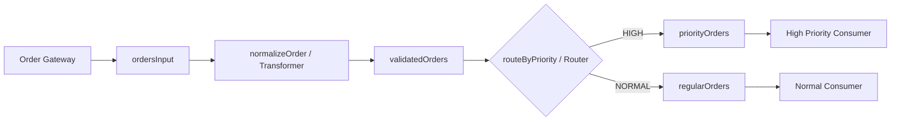

# Message History and Endpoint Location in Spring Integration

## 1. Why Do We Need to Know Which Endpoints a Message Traversed?

One advantage of **Enterprise Integration Patterns (EIP)** is that processing steps communicate via messages and channels rather than calling each other directly. In Spring Integration, this allows flexible composition of `Router`, `Filter`, `Transformer`, `Splitter`, `Aggregator`, `Gateway`, and endpoints connecting to external systems. However, when an order fails to appear at the output, the first question is usually:

> How far did the message get? Which component saw it last? Where is the next processing branch?

**Message history** provides part of the answer. Spring Integration can automatically add a `history` header as a message passes through components enabled for tracking. From this header, we can read the component name, component type, and recorded timestamp to reconstruct the **logical journey** of a message in a flow.

This lesson belongs to the **Audit and observability** chapter of the `SPRING_INTEGRATION_PATTERN` module, focusing on implementing loosely coupled and extensible message flows, observing processing branches, and supporting testing and troubleshooting. After this lesson, you will know how to:

- Enable message history using `@EnableMessageHistory` and select the right components to track.
- Understand the structure of the `history` header and read it via the `MessageHistory.read()` API.
- Distinguish between **channel**, **endpoint**, **handler**, and the logical location of a processing step.
- Infer how far a message progressed through a Router/Filter/Transformer, while recognizing limitations when a flow has multiple branches or executes asynchronously.
- Combine history with error channels, correlation, logs, metrics, and tracing to pinpoint failures reliably.

## 2. What Components Form a "Location" in a Flow?

In Spring Integration, do not equate **one line of DSL** with **one running endpoint**. Java DSL is a declaration style; when the application starts, the framework registers the corresponding channels, message handlers, and endpoints in the Spring application context.

| Concept | Role | Example | What You Need to Know When Troubleshooting |
| --- | --- | --- | --- |
| `MessageChannel` | Transports messages between producers and consumers | `ordersInput`, `validatedOrders` | Was the message sent to this channel? |
| Message handler | Performs business/technical work upon receiving a message | Transformer, Router, Service Activator | How did the handler receive and process the message? |
| Consumer endpoint | Connects a channel to a handler and manages message receipt | Event-driven consumer, polling consumer | Is the endpoint running, polling, or stopped? |
| Inbound endpoint | Receives data from an external or internal source | HTTP gateway, JDBC inbound adapter | When did the system actually receive the data? |
| Outbound endpoint | Sends data to a destination | Kafka, AMQP, HTTP outbound adapter | Was it handed off to the channel or confirmed by the external party? |
| Flow | Configuration of a sequence of integration steps | `IntegrationFlow` | Which logical branches can a message take? |

Here, **endpoint location** means the **logical location in the message processing graph**: which component, which channel, which branch. Message history does not automatically provide the Java filename, source line number, stack trace, or target hostname. To map an entry back to source code, give endpoints clear names and know which flow/bean declares them.

Consider an order processing pipeline:



A message on the `HIGH` branch can have a history containing names such as `ordersInput`, `normalizeOrder`, `validatedOrders`, `routeByPriority`, `priorityOrders` (depending on which components are named and configured for tracking). This helps narrow down where the message passed, but **does not** guarantee that the message was successfully processed by an external system.

## 3. How Does Message History Work?

Spring Integration tracks selected named components (`id`/bean name). When a message passes through a tracked component, the framework writes an entry into the message's `history` header. Each entry has three important properties:

| Property | Meaning | Illustrative Example |
| --- | --- | --- |
| `name` | Name of the tracked component | `normalizeOrder` |
| `type` | Spring Integration component type | `transformer`, `channel`, `gateway`... |
| `timestamp` | Time recorded (epoch milliseconds) | `1795250400123` |

The header value has a `List<Properties>`-compatible structure. Spring Integration provides `org.springframework.integration.history.MessageHistory` to read this list; there is no need to manually cast directly from the header.

Illustrative example of the data format (actual entry names and types depend on bean registration):

```text
history = [
  {name=ordersInput, type=channel, timestamp=1795250400123},
  {name=normalizeOrder, type=transformer, timestamp=1795250400125},
  {name=ordersOutput, type=channel, timestamp=1795250400128}
]
```

**Important note:** history describes **the points recorded by the framework**, not a complete map of every method invocation. A missing entry does not necessarily mean the message was lost: that component might not be tracked, might sit after the failure point, might not have received the message yet, or a custom processing step might have dropped the header.

`MessageHeaders.ID` and `history` serve different purposes. The ID identifies a specific message; history is the list of components a message has traversed. If a Transformer creates a new message, the message ID may change, whereas history is typically forwarded by the framework via its reply message creation mechanism. To link the entire business journey across multiple messages and services, propagate a stable, application-defined **correlation ID**.

## 4. Enabling History and Giving Endpoints Clear Names

The simplest approach in Java configuration is the `@EnableMessageHistory` annotation:

```java
import org.springframework.context.annotation.Configuration;
import org.springframework.integration.annotation.EnableIntegration;
import org.springframework.integration.config.EnableMessageHistory;

@Configuration
@EnableIntegration
@EnableMessageHistory
class MessageHistoryConfiguration {
}
```

When no names are specified, Spring Integration tracks all eligible named components in the application context. In large applications, tracking every component can produce many entries and add processing overhead. You can restrict tracking by name or pattern:

```java
@Configuration
@EnableIntegration
@EnableMessageHistory({
        "ordersInput",
        "normalizeOrder",
        "ordersOutput",
        "routeByPriority",
        "*Gateway"
})
class SelectiveHistoryConfiguration {
}
```

Use only **one `@EnableMessageHistory` configuration (or one XML equivalent) in the same application context**; the two snippets above are **two alternatives**, not two classes to enable simultaneously. In XML, the corresponding element is `<int:message-history tracked-components="ordersInput,normalizeOrder,ordersOutput"/>` in the Integration namespace.

Benefits of intentional naming:

- `normalizeOrder` indicates a step with business meaning; auto-generated default names are usually hard to relate back to the design.
- `routeByPriority` distinguishes the Router location from the two output channels `priorityOrders` and `regularOrders`.
- `ordersInput` and `ordersOutput` can serve as observation milestones for reconciliation.
- Stable names make searching logs and alerts easier, though tests and documentation still need updating when the flow structure changes.

With Java DSL, you can name an endpoint via `.id(...)` on the endpoint configuration overload:

```java
import org.springframework.context.annotation.Bean;
import org.springframework.context.annotation.Configuration;
import org.springframework.integration.annotation.EnableIntegration;
import org.springframework.integration.channel.DirectChannel;
import org.springframework.integration.channel.QueueChannel;
import org.springframework.integration.config.EnableMessageHistory;
import org.springframework.integration.dsl.IntegrationFlow;
import org.springframework.messaging.MessageChannel;
import org.springframework.messaging.PollableChannel;

@Configuration
@EnableIntegration
@EnableMessageHistory({"ordersInput", "normalizeOrder", "ordersOutput"})
class OrderFlowWithHistory {

    @Bean("ordersInput")
    MessageChannel ordersInput() {
        return new DirectChannel();
    }

    @Bean("ordersOutput")
    PollableChannel ordersOutput() {
        return new QueueChannel();
    }

    @Bean
    IntegrationFlow orderFlow() {
        return IntegrationFlow.from("ordersInput")
                .transform(String.class, String::trim,
                        endpoint -> endpoint.id("normalizeOrder"))
                .channel("ordersOutput")
                .get();
    }
}
```

This example uses Java 17 and Spring Integration 6.x. `DirectChannel` dispatches messages synchronously to the subscriber; `QueueChannel` lets us receive the output for observation. `normalizeOrder` is the endpoint name assigned through the DSL; selecting it in `@EnableMessageHistory` ensures the message history carries a meaningful name.

When using Spring Boot, the application needs the appropriate Spring Integration dependencies (such as `spring-boot-starter-integration`). If the project already has integration or history configuration, integrate this code into the existing configuration and avoid registering duplicate bean names.

## 5. Reading History on the Output Message

After sending a message to `ordersInput`, read the message from `ordersOutput` and retrieve its history using the Spring Integration API:

```java
import java.util.List;
import org.springframework.integration.history.MessageHistory;
import org.springframework.messaging.Message;

record HistoryHop(String component, String type, String timestamp) {}

final class HistoryInspector {

    static List<HistoryHop> snapshot(Message<?> message) {
        MessageHistory history = MessageHistory.read(message);
        if (history == null) {
            return List.of();
        }

        return history.stream()
                .map(entry -> new HistoryHop(
                        entry.getProperty(MessageHistory.NAME_PROPERTY),
                        entry.getProperty(MessageHistory.TYPE_PROPERTY),
                        entry.getProperty(MessageHistory.TIMESTAMP_PROPERTY)))
                .toList();
    }
}
```

`MessageHistory.read(message)` can return `null` if the message has no history yet. Possible reasons include: tracking is not enabled, the message has not passed through an eligible component, or the header was not preserved. The snippet returns an empty list so the caller handles the missing-history case explicitly. In a system requiring diagnostics, you can emit a warning or attach the reason to logs instead of printing an empty list and silently treating it as normal.

Example usage in a test or an observation service:

```java
import org.springframework.messaging.Message;
import org.springframework.messaging.MessageChannel;
import org.springframework.messaging.PollableChannel;
import org.springframework.messaging.support.MessageBuilder;

void inspect(MessageChannel ordersInput, PollableChannel ordersOutput) {
    Message<String> request = MessageBuilder.withPayload("  order-42  ")
            .setHeader("flowExecutionId", "flow-7294")
            .build();

    boolean sent = ordersInput.send(request);
    if (!sent) {
        throw new IllegalStateException("Failed to send to input channel");
    }

    Message<?> result = ordersOutput.receive(1_000);
    if (result == null) {
        throw new IllegalStateException("Failed to receive output message");
    }

    System.out.println(result.getPayload());     // "order-42"
    HistoryInspector.snapshot(result).forEach(System.out::println);
}
```

In a test environment, inspect the printed `component` names and compare them with the `orderFlow` configuration. In particular, verify that names assigned via `@Bean`/`.id(...)` appear as expected before writing brittle assertions against the full list. Framework-generated components may add entries or have different names across configurations and versions.

### Reading the "Last Point" in History

To get the **last recorded point** observed for the message:

```java
List<HistoryHop> hops = HistoryInspector.snapshot(result);
HistoryHop lastObserved = hops.isEmpty() ? null : hops.get(hops.size() - 1);
```

`lastObserved` is the **last entry in the history snapshot**, not automatically the endpoint that caused an error or the final business endpoint. Correlate it with the flow topology, Router branches, and actual processing outcome. Entry order is the order recorded; timestamps can collide at millisecond resolution.

## 6. Pinpointing Endpoint Location When a Message Does Not Reach Its Destination

Suppose a message is expected to pass through:

```text
ordersInput -> normalizeOrder -> validatedOrders
            -> routeByPriority -> priorityOrders
            -> priorityConsumer
```

Yet the history only shows:

```text
ordersInput -> normalizeOrder -> validatedOrders
```

We can form the hypothesis that the message reached `validatedOrders`, while there is not yet evidence for the Router step. However, **there is insufficient data to conclude that the Router lost the message**. Investigate in order:

1. **Check tracking:** is `routeByPriority` named and matched by the `@EnableMessageHistory` pattern?
2. **Check flow topology:** which Router endpoint is `validatedOrders` actually wired to? Is a consumer registered, or are there multiple subscribers?
3. **Check channel type:** `DirectChannel` may hand off immediately to a handler; `QueueChannel` requires a consumer/poller; `ExecutorChannel` dispatches to another thread and may still be queued.
4. **Check business conditions:** a Filter may drop the message; a Router may route to another branch; an Aggregator may be waiting for more messages in the group; a gateway may have timed out.
5. **Check exceptions and retries:** was an error propagated synchronously, sent to `errorChannel`, retried, or dead-lettered?
6. **Check output:** the message may have crossed the internal channel while the outbound adapter has not yet received confirmation from the target service.

| Symptom | Reasonable Hypothesis | Additional Evidence Needed |
| --- | --- | --- |
| Ingress present, history missing at next endpoint | Component is untracked, message is stopped, or waiting | Bean names, channel subscribers, lifecycle, error logs |
| History stops before Filter | Predicate returned false or Filter has not run | `discardChannel`, rejected branch logs, predicate test |
| Router present, expected branch missing | Routed to a different branch or blocked | Routing header/payload, channel mapping configuration |
| Splitter present, multiple child messages | One inbound message produced multiple branches and histories | Correlation/sequence, child message IDs |
| Aggregator present, no output yet | Group incomplete, timeout not reached, or release strategy not satisfied | `MessageGroupStore`, group key, release/expiry |
| `ordersOutput` present, no external ACK | Reached internal output channel only | Outbound adapter result, broker ACK or response |
| History stops abruptly when handler throws | Exception occurred before the next step | `ErrorMessage`, stack trace, failed message, error span |

### Inspecting Failed Messages via the Error Channel

If an error is sent to `errorChannel`, an `ErrorMessage` carries a `Throwable`; with a `MessagingException`, you can usually obtain the failed message to inspect its history prior to failure:

```java
import org.springframework.integration.history.MessageHistory;
import org.springframework.messaging.Message;
import org.springframework.messaging.MessagingException;
import org.springframework.messaging.support.ErrorMessage;

void examine(ErrorMessage errorMessage) {
    Throwable error = errorMessage.getPayload();

    if (error instanceof MessagingException messagingError) {
        Message<?> failedMessage = messagingError.getFailedMessage();
        if (failedMessage != null) {
            MessageHistory history = MessageHistory.read(failedMessage);
            System.out.println(history == null ? "No history" : history);
        }
    }
}
```

This is a **snippet for analyzing a received `ErrorMessage`**, not a complete error flow configuration. Exceptions may be wrapped or lack a `failedMessage`; do not assume every error arrives at a single shared `errorChannel`. With `DirectChannel`, errors are typically rethrown to the caller; with asynchronous endpoints, errors may be published to a configured error channel. To identify **the endpoint that threw the exception**, combine history with the exception, endpoint names in logs, and traces if available.

## 7. Complex Scenarios: Router, Filter, Splitter, Aggregator, and Gateway

### Router and Publish-Subscribe

A Router can send to one or multiple channels. No single linear history chain describes every branch. Observe the **actual message at each output** and use `correlationId`, `flowExecutionId`, or a business ID to reconcile. In publish-subscribe, two branches may process the same payload while their histories diverge after the fork.

### Filter

A Filter that intentionally drops a message typically produces no downstream output. History before the Filter shows the message reached the observed point; to know the message **was intentionally rejected**, add a discard flow or dedicated `REJECTED`/`FILTERED` events. A short history alone cannot distinguish an intentional drop from a failure.

### Splitter and Aggregator

A Splitter creates child messages; an Aggregator combines correlated messages into a result. To link histories, use both business ID, `correlationId`, `sequenceNumber`/`sequenceSize` where applicable, and conventions for parent-child IDs. A post-Aggregator message does not necessarily preserve the original ID or the entire history of every input; this depends on message creation and header aggregation strategies.

### Gateway and Request–Reply

A gateway may wait for a response or time out while the request has already passed through multiple components. Distinguish request history from reply history. History is not a signal that the remote call succeeded or that a downstream transaction committed.

### ExecutorChannel, QueueChannel, and Poller

Asynchronous channels decouple when a message is sent from when a consumer runs. History may already record passage through a channel while the subsequent endpoint has not yet processed it. Combine history with pending message counts, poller/thread pool state, and queue depth. A later recorded entry does not guarantee earlier processing committed if transactions, retries, or rollbacks are involved.

## 8. Being Careful with Versions and Header Copying

**Spring Integration 6.3 introduced an important change in how history is maintained:** prior to 6.3, recording history generally created a new message with a new history; starting in 6.3, history is updated in an **append-only** manner after initial creation, reducing copying overhead. The framework clones history when fanning out through built-in components such as `PublishSubscribeChannel`, routers, Wire Tap, or Splitter to prevent branches from mixing histories. For custom components that construct multiple messages, verify how headers are copied; the `AbstractIntegrationMessageBuilder.cloneMessageHistoryIfAny()` API is recommended in newer documentation for custom multi-output cases.

Implications when writing diagnostic code:

- Do not mutate the `history` list directly to add names or remove entries; it is framework-managed metadata.
- When taking a snapshot to persist or verify asynchronously, **extract the needed fields into an independent object** at observation time. Do not retain a reference to the history and assume its contents will never change.
- If you rebuild a message manually and replace all headers, history can disappear; prefer Spring Integration's standard builder APIs and header propagation rules.
- Do not depend on exact entry counts across all versions. Test **key business milestones** and verify against the running Spring Integration version.

Depending on the transport technology, the `history` header may **not be preserved across network/broker boundaries**, or should not be sent externally because it exposes internal topology. Across microservices, use correlation IDs and distributed tracing, and store independent audit records at reconciliation points.

## 9. How Message History Differs from Audits, Logs, Metrics, and Traces

| Tool | Best-Suited Question | Limitations |
| --- | --- | --- |
| **Message history** | "Which named components in the flow did this message pass through?" | Lives in headers; depends on tracking and header propagation |
| **Audit event** | "With what evidence was business item X received/transferred/delivered?" | Requires durable storage, state design, and security policy |
| Application log | "In which code did the handler fail?" | Can rotate and lack correlation if poorly configured |
| Micrometer metrics | "Which endpoint's throughput, latency, or error rate is rising?" | Does not fully explain individual messages |
| Distributed trace | "Which services/spans did a request traverse and where is it slow?" | Can be sampled; does not guarantee every transaction is captured |

A good practice is to share the **same `flowExecutionId` or business correlation ID** across audits, logs, and traces (with appropriate security rules), while `traceId`/`spanId` serve as distributed observability identifiers. Avoid using order IDs or message IDs as throughput metric tags because of high cardinality.

Example of an incident investigation:

1. Metrics show endpoint `normalizeOrder` has an elevated error rate.
2. Logs carrying `flowExecutionId` point to an exception from the Transformer.
3. The failed message's history confirms the milestones recorded before the error.
4. The audit store confirms the business event was received at input without a confirmed output event.
5. Tracing links the journey across external services if the request left the application.

Combining multiple signals like this is far more reliable than treating the last entry in history as the sole conclusion.

## 10. Testing Endpoint Tracking

For the `OrderFlowWithHistory` flow, write an integration test: send a message with `flowExecutionId`, receive the result from `ordersOutput`, and assert the traversed points. Example assertions using JUnit 5 and AssertJ:

```java
import static org.assertj.core.api.Assertions.assertThat;

import java.util.List;
import org.junit.jupiter.api.Test;
import org.springframework.beans.factory.annotation.Autowired;
import org.springframework.boot.test.context.SpringBootTest;
import org.springframework.integration.history.MessageHistory;
import org.springframework.messaging.Message;
import org.springframework.messaging.MessageChannel;
import org.springframework.messaging.PollableChannel;
import org.springframework.messaging.support.MessageBuilder;

@SpringBootTest(classes = OrderFlowWithHistory.class)
class OrderFlowHistoryTest {

    @Autowired
    MessageChannel ordersInput;

    @Autowired
    PollableChannel ordersOutput;

    @Test
    void messageKeepsNamedComponentHistory() {
        Message<String> input = MessageBuilder.withPayload("  order-42  ")
                .setHeader("flowExecutionId", "flow-7294")
                .build();

        assertThat(ordersInput.send(input)).isTrue();

        Message<?> output = ordersOutput.receive(1_000);
        assertThat(output).isNotNull();
        assertThat(output.getPayload()).isEqualTo("order-42");

        MessageHistory history = MessageHistory.read(output);
        assertThat(history).isNotNull();

        List<String> componentNames = history.stream()
                .map(hop -> hop.getProperty(MessageHistory.NAME_PROPERTY))
                .toList();

        assertThat(componentNames).contains("ordersInput", "ordersOutput");
        assertThat(componentNames).contains("normalizeOrder");
    }
}
```

This test fits when the test context contains only the example configuration, Spring Boot test dependencies, and properly named components. If the framework records names differently in your actual version, print the snapshot first, inspect the bean configuration, and adjust assertions to match the flow contract. Do not turn tests into brittle checks on every entry or exact timestamps; those details can change without breaking business behavior.

Add the following test cases as the flow grows:

| Test Case | Expectation |
| --- | --- |
| Tracking disabled | `MessageHistory.read()` returns `null` or has no newly tracked entries |
| Pattern enabled only for selected components | History contains only matching components, not relying on generated names |
| Transformer succeeds | Tracked milestones appear in logical order; output payload is correct |
| Filter drops message | Do not infer output; separate evidence of discard or rejection exists |
| Router selects two different branches | Messages received on each branch have corresponding paths and consistent correlation |
| Handler throws exception | Ability to obtain failed message/logs to locate failure without mistaking last entry as conclusion |
| Async channel or stopped poller | Ingress history exists while downstream endpoint has not run; observe backlog |
| Splitter / parallel branches | Branch histories do not bleed together; parent-child linkage is possible |
| Custom message creation | Required headers preserved; intentional history stripping is recognized |

### Extended Practice Exercise

Try replacing the Transformer with a `Filter` + `Router` and two channels `priorityOrders` and `regularOrders`. Assign the names `filterInvalidOrder` and `routeByPriority`, and enable history for those names. Send three messages: valid/high priority, valid/normal priority, and invalid. For each message, record `flowExecutionId`, the `HistoryHop` entries, the channel that received the result, and rejection evidence if applicable.

Next, replace one branch with an `ExecutorChannel` or a polled consumer and observe the difference between when a `channel` entry appears and when the handler finishes processing. The goal is to distinguish **"the message reached an observation point"** from **"business processing at that point completed"**.

## 11. Project Checklist

- [ ] Important channel and endpoint names have business meaning, remain stable, and are documented in the flow docs.
- [ ] There is a single source of `@EnableMessageHistory` configuration; tracking patterns fit the system volume.
- [ ] A safe `MessageHistory.read()` helper handles missing headers cleanly.
- [ ] `flowExecutionId`/business correlation spans all key steps.
- [ ] On failure, inspect `ErrorMessage`/exceptions and endpoint state before drawing conclusions from history.
- [ ] For Router/Splitter/Aggregator, there is a way to join multiple messages/branches and header propagation rules are understood.
- [ ] For asynchronous endpoints, monitor queue backlog, pollers, thread pools, timeouts, and retries.
- [ ] Do not expose history containing internal topology externally without a clear need and appropriate controls.
- [ ] Test essential milestones without depending on exact entry counts or absolute timestamps.

## 12. References

- [Spring Integration Reference — Message History](https://docs.spring.io/spring-integration/reference/message-history.html)
- [Spring Integration Java DSL — DSL Basics](https://docs.spring.io/spring-integration/reference/dsl/java-basics.html)
- [Spring Integration Java DSL — Endpoint Configuration](https://docs.spring.io/spring-integration/reference/dsl/java-basics.html)
- [Spring Integration Javadoc — MessageHistory](https://docs.spring.io/spring-integration/docs/6.5.7/api/org/springframework/integration/history/MessageHistory.html)
- [Spring Integration Reference — Error Handling](https://docs.spring.io/spring-integration/reference/error-handling.html)

**Remember:** message history shows **the points recorded along a message's path**. To pinpoint a failing endpoint, you must name components intentionally, check topology and channel types, and cross-reference exceptions along with branch state. History is a valuable diagnostic tool in Spring Integration, but it does not by itself replace durable auditing or target-system completion confirmation.
