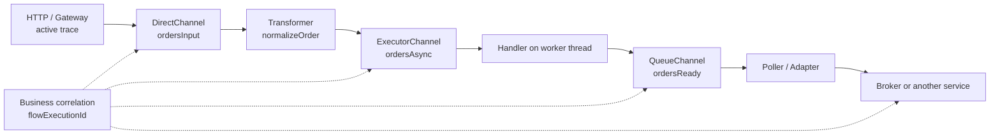
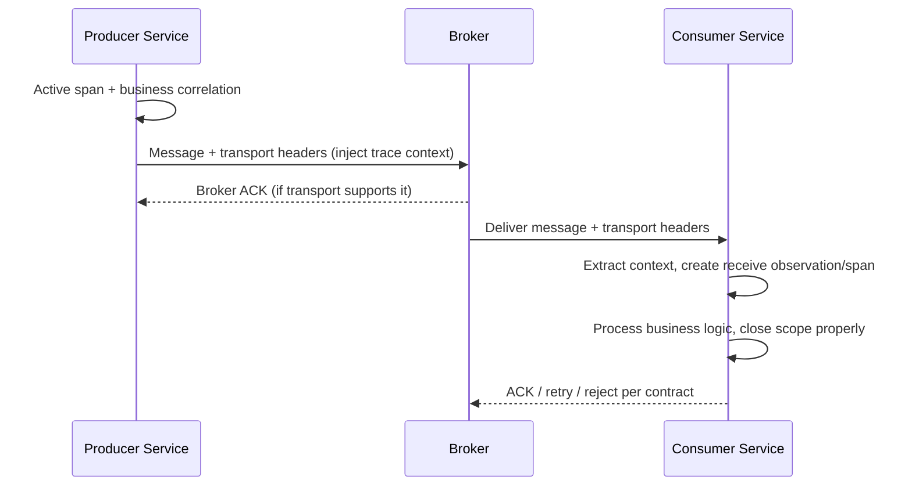

# Trace Context Across Channels in Spring Integration

## 1. The Problem: One Business Operation Crossing Multiple Execution Flows

In **Enterprise Integration Patterns (EIP)**, processing steps are connected via messages and channels to reduce coupling between components. An order-creation request may traverse a Gateway, Transformer, Router, Filter, Aggregator, retry endpoints, and an outbound adapter. Sometimes the entire process runs on the same thread; other times the message is handed off to a thread pool, buffered in a queue, or sent to another service.

When investigating latency or failures, we often need to answer:

- Which trace did the initial request start, and which steps belong to the same trace?
- Why do logs at the Gateway contain `traceId`, while logs from a handler after an `ExecutorChannel` do not?
- Was a message placed into a queue already processed, or only accepted for later processing?
- How should the trace be propagated to Kafka, AMQP, HTTP, or another service?
- When a Router branches, a Splitter creates multiple messages, or a retry reruns, how should the relationship between spans be interpreted?

This is the topic **trace context across channels** in the *Audit and observability* chapter of the `SPRING_INTEGRATION_PATTERN` module. The lesson combines Spring Integration practice, correlation, branch tracking, and system observability testing.

**Objective:** understand where trace context is preserved, where it can break, how to use Micrometer Observation/Tracing, and what verifications are needed when a message crosses different channel types.

## 2. Distinguishing Trace Context, Message Headers, MDC, and Correlation

The following concepts are related, but not interchangeable:

| Concept | What Is It Used For? | Lifecycle and Caveats |
| --- | --- | --- |
| **Trace** | Links operations belonging to the same observed journey | Usually identified by `traceId`; can span multiple spans and services |
| **Span** | Describes a single operation/duration with parent, timing, and outcome | Has `spanId`; child spans typically inherit `traceId` |
| **Trace context** | Information required to link a new span to a prior span | Includes trace ID, span ID, sampling flags, and optionally `tracestate` |
| **Current observation/span** | The active context on the current thread or execution context | May be implemented via `ThreadLocal`/scope; does not automatically follow to another thread |
| **Spring `MessageHeaders`** | Metadata carried with a message | Can carry business correlation or mapped metadata; not all of the current span automatically turns into headers |
| **MDC** | Attaches metadata, typically `traceId`/`spanId`, to logs on the current thread | Does not propagate automatically to thread pools; must be restored and cleaned up per scope |
| **Business correlation ID** | Joins steps of the same transaction or order | Defined by the application; often needs to outlive a trace's lifespan |
| **Audit ID** | Identifies a durably stored audit event | Do not use `spanId` or `traceId` as a business deduplication key |

A single trace can have many spans. A message can carry a stable `flowExecutionId` while the current span changes at each handler. Conversely, a transaction spanning multiple days, reprocessed via dead-letter or replayed manually, may cross **multiple distinct traces** yet still belong to the same business correlation ID.

Illustrative example of a trace with three spans:

```text
traceId = aaaaaaaaaaaaaaaaaaaaaaaaaaaaaaaa

span A: HTTP /orders          [spanId=1111111111111111]
  └─ span B: ordersInput     [spanId=2222222222222222, parent=A]
       └─ span C: transform  [spanId=3333333333333333, parent=B]
```

When crossing an asynchronous or broker boundary, the subsequent span may be a child span or use a **span link** instead of parent–child, depending on the telemetry model, context transfer mechanism, and tooling. What matters is preserving meaningful causal relationships, not forcing every step into one long span.

## 3. Channels as Context Propagation Boundaries

The diagram below depicts a flow that receives an order, processes it on another thread, and sends it to a broker:



| Message Handoff Type | Thread Context | Common Misconceptions |
| --- | --- | --- |
| `DirectChannel` | By default, the handler is invoked on the sending thread | The active observation can continue on the same thread; exceptions can propagate back to the caller |
| `ExecutorChannel` | The handler runs on a thread provided by the executor | `ThreadLocal`/MDC do not follow thread switches automatically; a propagation mechanism is needed |
| `QueueChannel` | Producer writes the message; consumer/poller receives it at a different time | Successful enqueueing does not prove consumer processing; context must be reattached upon dequeue |
| `PublishSubscribeChannel` | Can process subscribers synchronously by default; becomes asynchronous with an executor | Multiple branches need separate scopes/contexts; do not arbitrarily share the same current span |
| `PriorityChannel` or backed channel | Consumer timing and processing order may differ from producer | Trace timing must distinguish wait time from processing time |
| HTTP/Kafka/AMQP/JMS adapter | Crosses into another process or service | Requires *inject/extract* of context via transport protocol headers |

A message crossing a channel and context crossing an execution boundary are **two separate things to verify**. A message can reach the right destination while the current tracing scope on the worker thread remains empty. Conversely, a trace can be fully recorded at the send site while the message has not yet been ACKed by the target.

## 4. Micrometer Observation and Micrometer Tracing in Spring Integration

The Spring ecosystem supports observability via **Micrometer Observation**. An Observation describes a named operation with timing and key–value pairs. When an application configures a **Micrometer Tracing bridge** (such as OpenTelemetry or Brave), observations can be represented as spans and exported to a tracing backend.

Keep these configuration layers in mind:

1. **`ObservationRegistry`** manages observations. Having a registry **does not automatically guarantee** trace IDs or exported spans; tracing handlers/bridges and an exporter are required to view distributed traces.
2. **Spring Integration management instrumentation** determines which channels/handlers are observed. Bean names and configuration patterns affect collection scope.
3. **Context propagation** carries the current observation/span across thread or transport boundaries. Instrumenting one endpoint does not mean every custom thread or external adapter propagates context properly.
4. **Trace backend** (Zipkin, Jaeger, Tempo, an OTLP collector, etc.) receives data if configured. Sampling and telemetry export failures can cause some traces not to appear in the backend.

For a Spring Boot 3.x application using Spring Integration 6.x, typical dependencies (Gradle example) are:

```groovy
dependencies {
    implementation("org.springframework.boot:spring-boot-starter-integration")
    implementation("org.springframework.boot:spring-boot-starter-actuator")

    // Choose a tracing bridge compatible with your telemetry system.
    implementation("io.micrometer:micrometer-tracing-bridge-otel")

    // Required if using ContextPropagatingTaskDecorator on an executor.
    implementation("io.micrometer:context-propagation")
}
```

In many Boot projects, Actuator auto-configures `ObservationRegistry` and tracing components when the corresponding dependencies/configuration are present. Without Spring Boot auto-configuration, the application must register the registry and tracing handlers itself. Do not add both the OpenTelemetry and Brave bridges without an explicit multi-tracer design.

### 4.1. Sample Configuration Across DirectChannel and ExecutorChannel

This example intentionally names channels for easy visibility on dashboards and establishes a clear asynchronous boundary:

```java
import org.springframework.context.annotation.Bean;
import org.springframework.context.annotation.Configuration;
import org.springframework.core.task.TaskExecutor;
import org.springframework.core.task.support.ContextPropagatingTaskDecorator;
import org.springframework.integration.annotation.EnableIntegration;
import org.springframework.integration.channel.DirectChannel;
import org.springframework.integration.channel.ExecutorChannel;
import org.springframework.integration.channel.QueueChannel;
import org.springframework.integration.config.EnableIntegrationManagement;
import org.springframework.integration.dsl.IntegrationFlow;
import org.springframework.messaging.MessageChannel;
import org.springframework.messaging.PollableChannel;
import org.springframework.scheduling.concurrent.ThreadPoolTaskExecutor;

@Configuration
@EnableIntegration
@EnableIntegrationManagement(
        observationPatterns = {"ordersInput", "ordersAsync", "ordersReady"})
class OrderTraceFlowConfiguration {

    @Bean("ordersInput")
    MessageChannel ordersInput() {
        return new DirectChannel();
    }

    @Bean("integrationTaskExecutor")
    TaskExecutor integrationTaskExecutor() {
        ThreadPoolTaskExecutor executor = new ThreadPoolTaskExecutor();
        executor.setCorePoolSize(2);
        executor.setMaxPoolSize(4);
        executor.setQueueCapacity(100);
        executor.setThreadNamePrefix("orders-worker-");
        executor.setTaskDecorator(new ContextPropagatingTaskDecorator());
        executor.initialize();
        return executor;
    }

    @Bean("ordersAsync")
    MessageChannel ordersAsync(TaskExecutor integrationTaskExecutor) {
        return new ExecutorChannel(integrationTaskExecutor);
    }

    @Bean("ordersReady")
    PollableChannel ordersReady() {
        return new QueueChannel();
    }

    @Bean
    IntegrationFlow orderTraceFlow() {
        return IntegrationFlow.from("ordersInput")
                .transform(String.class, String::trim)
                .channel("ordersAsync")
                .transform(String.class, String::toUpperCase)
                .channel("ordersReady")
                .get();
    }
}
```

**How to read this example:**

- `ordersInput` is a `DirectChannel`: message delivery to the Transformer in the flow occurs synchronously.
- `ordersAsync` uses `ExecutorChannel`: the message is handed to the executor and subsequent handlers run on a worker thread. Completing `send()` **does not prove** that the Transformer after the asynchronous boundary has finished running.
- `ContextPropagatingTaskDecorator` in Spring Framework 6.1+ captures a context snapshot when the task is submitted and restores it on the worker thread according to registered `ThreadLocalAccessor` instances. It requires Micrometer Context Propagation and appropriate tracing configuration; the decorator **only covers tasks executed through that executor**.
- `ordersReady` is a `QueueChannel`: messages wait for a poller/consumer. In this example, no poller is defined; another consumer must pull messages from the queue.
- `observationPatterns` selects which components are observed. Check actual component names and telemetry in your Spring Integration version; if the pattern misses a needed handler/endpoint, observations will be missing at that point.

When an application has multiple `TaskExecutor` beans, decorating only one executor is not enough to preserve context on the others. For `@Async`, `CompletableFuture`, schedulers, manually spawned threads, or external library callbacks, inspect the boundary of each mechanism individually.

### 4.2. Creating an Observation at Ingress

You can wrap the intake/send operation at the application's input boundary in an observation:

```java
import java.util.UUID;

import io.micrometer.observation.Observation;
import io.micrometer.observation.ObservationRegistry;
import org.springframework.beans.factory.annotation.Qualifier;
import org.springframework.messaging.Message;
import org.springframework.messaging.MessageChannel;
import org.springframework.messaging.support.MessageBuilder;
import org.springframework.stereotype.Service;

@Service
class OrderSubmissionService {

    private final MessageChannel ordersInput;
    private final ObservationRegistry observations;

    OrderSubmissionService(
            @Qualifier("ordersInput") MessageChannel ordersInput,
            ObservationRegistry observations) {
        this.ordersInput = ordersInput;
        this.observations = observations;
    }

    void submit(String orderId, String rawPayload) {
        Observation.createNotStarted("orders.accept", observations)
                .lowCardinalityKeyValue("flow", "orders")
                .observe(() -> {
                    Message<String> message = MessageBuilder
                            .withPayload(rawPayload)
                            .setHeader("flowExecutionId", UUID.randomUUID().toString())
                            .setHeader("orderId", orderId)
                            .build();

                    if (!ordersInput.send(message)) {
                        throw new IllegalStateException(
                                "Failed to send message to ordersInput");
                    }
                });
    }
}
```

Here, `orders.accept` describes the **submit operation**. Because the flow contains an `ExecutorChannel`, the observation wrapping `send()` may finish before the worker thread steps complete. Channel/handler instrumentation creates observations/spans corresponding to the tracked points, if enabled. Do not stretch an HTTP request span just to wait for the entire queue to finish processing.

In a real project, `flowExecutionId` should follow the ingress contract: it might be newly generated, continue an ongoing execution ID, or link to an event ID sent from upstream. Define clear rules for retries and redeliveries; you should not blindly generate a new random ID every time.

### 4.3. Reading the Trace ID in a Handler

When a Micrometer Tracing bridge is active, you can read the current span from `Tracer`:

```java
import io.micrometer.tracing.Span;
import io.micrometer.tracing.Tracer;

final class TraceContextReader {
    static String currentTraceId(Tracer tracer) {
        Span span = tracer.currentSpan();
        return span == null ? null : span.context().traceId();
    }

    static String currentSpanId(Tracer tracer) {
        Span span = tracer.currentSpan();
        return span == null ? null : span.context().spanId();
    }
}
```

Inspect the IDs on both sides of the asynchronous boundary using an observation handler or a test probe. When propagation works and the same trace continues, `traceId` should stay the same, while `spanId` may differ because each point has its own span. If `currentSpan()` is `null`, the tracing bridge may not be configured, there may be no current span, or scope was lost across the thread handoff. **Do not infer a lost message solely from an empty span**.

## 5. Why Are ThreadLocal and MDC Easily Lost Across Thread Switches?

During synchronous processing, `Tracer`, observation scopes, and many MDC mechanisms rely on the current thread's context. When `ExecutorChannel` hands work to a worker thread, the new thread does not automatically inherit all `ThreadLocal` values from the sending thread. Furthermore, thread pools reuse threads, so a context that is set and not cleaned up properly can cause logs to misattribute relationships between two requests.

Example:

```text
http-nio-8080-exec-3
    currentTraceId = T1
    send -> ordersAsync

orders-worker-2
    currentTraceId = null       (without propagation)
    or currentTraceId = T1      (when context is captured/restored properly)
```

**Do not manually copy `traceId` via `MDC.put(...)` and forget to remove it.** A raw string in MDC only makes logs display the same ID; it does not restore the parent span, sampling flags, `tracestate`, or the real tracer context. If manual MDC usage is unavoidable, manage scope and cleanup with `try/finally` or the appropriate scope API. The preferred approach is to use official Spring/Micrometer instrumentation and propagation.

When an application uses multiple asynchronous mechanisms, distinguish:

1. **Executor task:** capture context on task submission, restore on the worker, and close the scope after task completion. `ContextPropagatingTaskDecorator` helps within the scope of the configured executor.
2. **Queue/poller:** does not share a single submit–execute call in all cases. Context may need to be saved/restored with the message and endpoint observation instrumentation; measure queue wait time separately from processing time.
3. **Reactor/WebFlux:** context can be managed via Reactor Context; do not assume manual `ThreadLocal` values are always populated inside every operator.
4. **Out-of-JVM processes:** requires inject/extract via protocol carriers; `TaskDecorator` cannot carry traces over HTTP or a broker.

## 6. Trace Context Across Specific Message Channels

### 6.1. DirectChannel

`DirectChannel` normally invokes the subscriber on the sending thread. If the caller has an active observation/span, synchronous handler code can read that context. Configured observable components can create child spans for instrumented operations.

However, if the handler **itself** spawns a new thread or calls an uninstrumented asynchronous library, the trace can still break inside the handler. `DirectChannel` does not guarantee that every downstream callback preserves the same context.

### 6.2. ExecutorChannel

`ExecutorChannel` uses a `TaskExecutor` to dispatch. A worker receiving the right payload while losing its trace scope is a very common scenario. Check:

- Which executor actually runs the task, and does it use `ContextPropagatingTaskDecorator` or an equivalent mechanism?
- Are Micrometer Context Propagation and the required context accessors present?
- Was a parent observation/span active when dispatching the task?
- Is the handler instrumented with the right name and pattern?
- Is the thread pool full, rejecting tasks, or shutting down, preventing the message from being processed?

Tracing does not replace load measurement: if the executor's internal queue is full, failures can occur before the handler even starts, even when the ingress trace looks complete.

### 6.3. QueueChannel and Poller

`QueueChannel` stores messages for later retrieval. If another thread calls `receive()`, that thread does not automatically have the sending thread's current span. Additionally, the message may be processed after the caller's observation has already closed.

Therefore, observe **at least two milestones**: `enqueuedAt`/received into the queue and `processingStartedAt`/when the consumer actually starts processing. The delta shows queue wait latency; upon completion, record `processedAt`, an ACK, or a concrete outcome.

If building a custom poller or message store, check the library's context propagation/restoration APIs and header mappers; do not assume a trace will connect merely because the message still carries a `traceparent` header. *Extracting* and opening a span scope on the consumer is a separate step.

### 6.4. PublishSubscribeChannel, Router, and Splitter

When there are multiple subscribers or a Router fans out to multiple channels, one trace can have multiple spans representing the branches. Each branch must be observed independently. If one branch fails, another branch succeeding still does not mean the entire flow completed.

If a Splitter produces multiple child messages, they can share the same business correlation ID while having different `MessageHeaders.ID` values and corresponding spans. With an Aggregator, a single result may be formed from multiple messages arriving at different times; simple parent–child links do not always accurately express many-to-one relationships. In such cases, use **span links** or auditing with explicit correlation/causation depending on tracer and collector capabilities.

### 6.5. Request–Reply Gateway

A gateway typically corresponds to a request operation and a reply. If the flow contains asynchronous branches, the request may be sent successfully while the reply fails to arrive before timeout. Record request sent, reply received, and timeout/error milestones with appropriate spans and correlation.

Do not treat the completion of a gateway span as proof that a downstream service committed its business work. Delivery/commit facts must come from the application or transport contract.

## 7. Crossing Processes and Brokers: W3C-Standard Inject/Extract

In distributed systems, trace context must be encoded into a protocol **carrier** such as HTTP headers or Kafka/AMQP/JMS headers/properties, and then decoded by the receiver.

The W3C Trace Context standard defines two primary headers:

- `traceparent`: version, trace ID, parent ID, and trace flags. Illustrative example:

  ```text
  traceparent: 00-4bf92f3577b34da6a3ce929d0e0e4736-00f067aa0ba902b7-01
  ```

- `tracestate`: vendor/system-specific tracing metadata participating in the trace, if any.

`baggage` is a separate mechanism for propagating related metadata across hops; do not put personal data, secrets, or high-cardinality values into baggage by default.



Key considerations when using Spring Integration outbound adapters:

1. **Do not assume `MessageHeaders` are sent verbatim over the wire.** HTTP headers, Kafka record headers, and AMQP message properties each have their own mapping rules. An adapter may filter, rename, or drop headers.
2. **Do not just add a raw `traceId` string to the payload.** A consumer needs full context and an extract/instrumentation step to create a properly linked child span, not merely print the ID in a log.
3. **Prefer instrumented clients/consumers.** Appropriate Micrometer Tracing/OpenTelemetry transport instrumentation can perform standard inject/extract; verify configuration separately for the actual producer and consumer.
4. **Do not equate a broker ACK with business completion.** A producer ACK may only confirm the broker received the message; consumer processing outcome is a separate event.
5. **Always keep business correlation separate.** When traces are sampled out, messages move to a dead-letter queue, get reprocessed, or pass through an uninstrumented system, the business ID still enables reconciliation.

Example of two services sharing a `flowExecutionId`:

```text
Service A:
  business correlation: flow-7294
  traceId: T1
  send -> Kafka orders.request

Service B:
  business correlation: flow-7294
  if extracted properly: traceId = T1, new span = S2
  if context lost: new traceId or no traceId
```

If a trace breaks, business correlation still links audit records across both systems, while the tracing issue should be investigated via carrier headers, mapping, sampling, and instrumentation.

## 8. Retries, Error Channels, and Span Creation

Retries and error handling are critical points in Enterprise Integration Patterns because they alter both the execution path and timing.

| Scenario | Trace Perspective | Additional Details to Record |
| --- | --- | --- |
| Handler fails immediately on `DirectChannel` | Exception may propagate back within the same call and same trace scope | Error code, endpoint, failed message |
| Handler fails after `ExecutorChannel` | Failure occurs on a worker thread; scope must propagate so the trace does not fragment | `errorChannel`, task rejection, executor metrics |
| Synchronous retry within the same execution | Multiple attempts/spans may appear within one trace | Attempt number, retryable error, wait time |
| Scheduled retry or broker redelivery | May run at a different time and in a different trace; can link to the previous attempt | Durable message/event ID, causation, attempt |
| Sent to dead-letter | A span on publish does not guarantee further processing will occur | Dead-letter destination, reason, reconciliation status |
| Aggregator holding waiting messages | The original request's trace may already have ended | Group key, expiry time, release strategy |

When handling an `ErrorMessage`, try inspecting `MessagingException.getFailedMessage()` to read existing business correlation and metadata, and check the current span where the error handler runs. Do not assume every exception goes to `errorChannel`; behavior depends on synchronous/asynchronous endpoints and error-handling configuration.

**Do not use trace ID as an idempotency key** for retries. A resent request can start a new trace; a single trace can also contain multiple distinct operations. Deduplication keys should be based on a business event ID or a business identifier with an explicit contract.

## 9. Testing Context Across Threads and Channels

For testing, separate **correct payload/routing** from **correct trace propagation**. These two can pass or fail independently.

### 9.1. Testing Message Delivery Across `ExecutorChannel`

With `OrderTraceFlowConfiguration` above, a simple test can send a string, wait for output, and assert that the correlation header is preserved:

```java
import static org.assertj.core.api.Assertions.assertThat;

import org.junit.jupiter.api.Test;
import org.springframework.beans.factory.annotation.Autowired;
import org.springframework.boot.test.context.SpringBootTest;
import org.springframework.messaging.Message;
import org.springframework.messaging.MessageChannel;
import org.springframework.messaging.PollableChannel;
import org.springframework.messaging.support.MessageBuilder;

@SpringBootTest(classes = OrderTraceFlowConfiguration.class)
class OrderTraceFlowTest {

    @Autowired
    MessageChannel ordersInput;

    @Autowired
    PollableChannel ordersReady;

    @Test
    void retainsBusinessCorrelationAcrossExecutorChannel() {
        Message<String> input = MessageBuilder.withPayload("  order-42  ")
                .setHeader("flowExecutionId", "flow-7294")
                .build();

        assertThat(ordersInput.send(input)).isTrue();

        Message<?> output = ordersReady.receive(2_000);
        assertThat(output).isNotNull();
        assertThat(output.getPayload()).isEqualTo("ORDER-42");
        assertThat(output.getHeaders().get("flowExecutionId"))
                .isEqualTo("flow-7294");
    }
}
```

This test verifies that the payload and business header cross the asynchronous boundary. **It does not yet prove trace context is propagated.** To test tracing, add a test handler/probe placed **after `ordersAsync`**, read `tracer.currentSpan()` on the worker thread itself, and record `traceId`/span ID into a thread-safe structure; compare against the trace ID captured at submit time once a tracing bridge is configured.

To avoid false conclusions, propagation tests need:

1. An `ObservationRegistry` wired to a tracing bridge/test tracer; simply calling `ObservationRegistry.create()` is not enough to populate `Tracer.currentSpan()`.
2. An active parent span/observation when sending the message, plus a downstream child observation if testing span hierarchy.
3. Realistic configuration for `ContextPropagatingTaskDecorator` or supported instrumentation, along with the corresponding context accessors.
4. A probe using `CountDownLatch`, `BlockingQueue`, or condition-based waiting with a timeout; do not rely on fixed `Thread.sleep()`.
5. Assertions on **same-lineage trace ID** and valid span IDs; do not force every point to share the same span ID, as they may be distinct spans.

### 9.2. Scenario Verification Matrix

| Test Case | What to Verify |
| --- | --- |
| Synchronous `DirectChannel` | Observation has a valid scope inside the handler; sensible component/trace names |
| `ExecutorChannel` with decorator | Downstream worker sees the expected trace lineage and does not leak context to the next task |
| Decorator or instrumentation removed | Test reveals the exact boundary where scope is lost, in a controlled environment |
| `QueueChannel` with delayed consumer | Distinguish enqueue, dequeue, and wait time; verify context extraction |
| `PublishSubscribeChannel` with executor | Each branch gets its own span without mixing context between subscribers |
| `Router` to multiple channels | Spans/tags reflect the chosen branch; correlation ID stays unchanged as intended |
| `Splitter`/`Aggregator` | Sufficient correlation and causation exist to link child messages/groups |
| Retry and redelivery | Proper attempt/error tracking; trace ID is not used to deduplicate processing |
| Sending via broker or HTTP | Producer injects headers; consumer extracts and creates a properly linked new span |
| Low sampling or exporter failure | Business processing still retains audit and correlation when the trace backend lacks data |
| Worker thread reuse | Previous request's `traceId` never bleeds into a subsequent request |

### 9.3. Troubleshooting Process When a Trace Breaks

Suppose logs at `ordersInput` show `traceId=T1`, while logs after `ordersAsync` have no `traceId`. Proceed as follows:

1. Confirm the message still reaches downstream via payload, business correlation, and channel state.
2. Check `Tracer.currentSpan()` right before sending and inside the handler invoked on the worker thread. Do not rely solely on MDC log patterns.
3. Verify the right executor bean is used, the decorator is applied, and required dependencies/accessors are present.
4. Verify Spring Integration observation patterns match actual bean/endpoint names.
5. If the break occurs after a queue or broker, inspect inject/extract/mapping at the exact transport boundary.
6. When seeing two different trace IDs, check whether a new trace was intentionally started or linked via a span link before immediately concluding context was lost.

## 10. Operations and Security When Tracing Messages

Tracing provides diagnostic capability, but also carries cost and limitations. Design telemetry around these principles:

- **Low-cardinality tags:** use `flow=orders`, `channel=ordersAsync`, `outcome=success|failure`; do not put `orderId`, `messageId`, tokens, or payload contents into metric tags. For trace attributes, still bound size, classify, and protect data.
- **Minimal baggage:** baggage can propagate across many services; allow only approved fields. Never store credentials, JWTs, PII, or leak-prone data.
- **Intentional sampling:** sampling reduces cost, yet a missing trace in the backend **does not** mean the message went unprocessed. Mandatory audits and critical business events require a separate recording mechanism.
- **Bound duration and length:** queues can hold messages longer than an HTTP span's lifetime. Create appropriate spans for enqueue and process rather than keeping a single scope active throughout the wait time.
- **Monitor telemetry failures:** watch drop/export failures, collector configuration, sampling rate, and backend availability. Exporter errors must not by default fail a business transaction unless the system contract specifies so.
- **Do not mix control with diagnostics:** `traceId` is an observability ID; routing decisions, access control, idempotency, and retries should rely on verified business/contract data.

For multi-channel flows, maintain dashboards for throughput, error rate, queue depth, handler duration, and channel wait time. Traces show an example of a specific path; metrics show how widespread an issue is; audits enable reconciling durably recorded business outcomes.

## 11. Implementation Checklist

- [ ] Clearly distinguish business correlation ID, message ID, trace ID, and span ID.
- [ ] Configure `ObservationRegistry`, tracing bridge, and exporter aligned with observability goals.
- [ ] Enable observation for required components; use meaningful channel/endpoint names.
- [ ] Audit boundaries of `DirectChannel`, `ExecutorChannel`, `QueueChannel`, pollers, and schedulers.
- [ ] For thread pools, configure propagation on the right executor and verify context cleanup.
- [ ] For HTTP/brokers, verify W3C context inject/extract and header mapping on both sides.
- [ ] Test Router, Splitter, Aggregator, Gateway, error channels, retries, and dead-letter paths across multiple branches.
- [ ] Distinguish message-send telemetry from ACKs, commits, and actual business completion.
- [ ] Keep PII, credentials, and sensitive business IDs out of baggage and metrics.
- [ ] Keep auditing and correlation independent so reconciliation works even when traces are sampled or disrupted.

## 12. References

- [Spring Integration Reference](https://docs.spring.io/spring-integration/reference/)
- [Spring Integration — Metrics and Management](https://docs.spring.io/spring-integration/reference/metrics.html)
- [Micrometer Observation](https://docs.micrometer.io/micrometer/reference/observation.html)
- [Micrometer Tracing](https://docs.micrometer.io/tracing/reference/)
- [Micrometer Context Propagation](https://docs.micrometer.io/context-propagation/reference/)
- [W3C Trace Context](https://www.w3.org/TR/trace-context/)

**Conclusion:** successfully sending a message through a channel does not mean the trace context remains active on the receiving side. When a flow switches threads, buffers messages in a queue, or sends across a broker, use a propagation mechanism suited to that boundary, test real span relationships, and maintain an independent business correlation ID so you can both diagnose and reconcile the entire journey.
