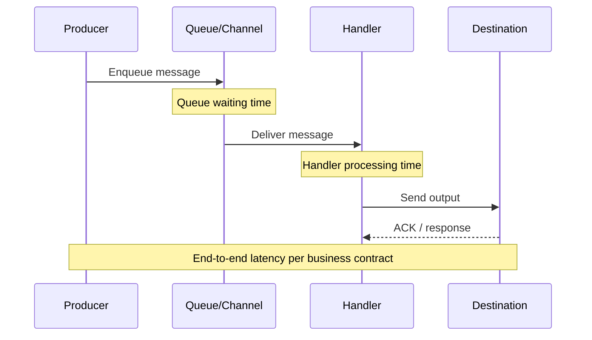

# Per-Pattern Metrics in Spring Integration

## 1. From Observing Messages to Operational Measurement

A flow built with **Enterprise Integration Patterns (EIP)** may receive requests through a Gateway, normalize data with a Transformer, drop invalid entries via a Filter, route with a Router, split with a Splitter, and aggregate with an Aggregator before sending to another system. As system load increases, merely knowing "messages are flowing through" is not enough. The operations team needs to know **how many, how long it takes, where bottlenecks occur, which branch is failing, and when to alert**.

In the **Audit and observability** chapter of the `SPRING_INTEGRATION_PATTERN` module, this lesson guides you in designing **per-pattern metrics** when building loosely coupled and extensible message flows with Spring Integration. The focus is on Router, Filter, Transformer, Splitter, Aggregator, Gateway, retry, error channel, and correlation; other patterns are also included in the reference tables for easy extension.

After this lesson, you will be able to:

- Choose the right **unit of counting** and emission point for each EIP pattern.
- Distinguish `Counter`, `Timer`, `DistributionSummary`, and `Gauge` in Micrometer.
- Use Spring Integration's built-in instrumentation and add business metrics where needed.
- Name metrics and tags with bounded cardinality; avoid using payloads, message IDs, or order IDs as labels.
- Avoid miscalculating success rates when one message fans out into multiple branches, is retried, or is held waiting by an Aggregator.
- Design dashboards, alerts, and tests based on **consistent definitions**.

## 2. Define What Is Measured Before Writing Code

Before calling `meterRegistry.counter(...).increment()`, answer three questions:

1. **What are we counting?** A message sent to a channel, a message received by a handler, a processing attempt (*attempt*), a completed Aggregator group, or a final business event?
2. **When are we counting?** Right when a message arrives, when a handler finishes, after sending to the output channel, or after an ACK/commit from the destination system?
3. **What is the denominator?** A Filter's rejection rate is divided by evaluated messages; retry success rate is divided by operations that needed retries; Splitter throughput is often measured in *fragments*, not original requests.

Easily confused concepts:

| Concept | Counting Milestone | Example |
| --- | --- | --- |
| `received` | The component observed the message at the ingress boundary | Ingress channel receives a message |
| `accepted` / `rejected` | Predicate/validation made a decision | Filter accepts or drops |
| `selected` | Router selected a branch | Selected `priority`; does not prove the branch finished processing |
| `dispatched` | Message sent successfully to a channel/transport per its contract | Does not mean downstream committed |
| `processed` | Handler completed the defined operation | If transactional, state clearly whether before or after commit |
| `attempted` | A single execution attempt that may be retried | One business operation can have multiple attempts |
| `confirmed` | Received ACK/response per the destination contract | A broker ACK is not necessarily the consumer's business outcome |
| `completed` | A logical unit finished per business rules | Aggregator releases a group |

Never name a metric `message_success_total` for an "enqueued" event and then use it to compute completed transaction rate. **Metric names must reflect what was actually observed**.

## 3. Four Metric Types to Use

| Micrometer Type | When to Use | Examples |
| --- | --- | --- |
| `Counter` | Monotonically increasing cumulative events | Inbound messages, errors, Filter drops, retry attempts |
| `Timer` | Measure execution duration and count | Transformer duration, Gateway request–reply, Aggregator wait duration |
| `DistributionSummary` | Measure distribution of **non-time values** | Fragments per split, payload size, items per group |
| `Gauge` | Current value that can go up or down | Queue depth, open Aggregator groups, in-flight requests |

A Micrometer `Timer` already records `count` and total time for samples. Avoid creating an extra `Counter` with the **same meaning** without an explicit design reason; that easily causes discrepancies across dashboards.

For `Gauge`, measure **true state** from the queue, executor, broker, or message group store. Calling `increment` on enqueue and `decrement` on dequeue drifts easily across restarts, exceptions, or concurrent consumers; such a counter variable is only trustworthy when it genuinely reflects the backing storage and is verified.

### Timing Boundaries to Distinguish



**Handler** latency covers only when the handler is actively executing. **Queue** latency covers waiting time before the consumer picks up the message. **End-to-end** latency can encompass queuing, retries, backoff, and external systems. Do not lump all three measurements together and call them "processing time" without stating start and end milestones.

## 4. Metric Reference Tables by Pattern

### 4.1. Ingress, Processing, and Routing

| Pattern | Suggested Metrics | Meaning and Notes |
| --- | --- | --- |
| **Message Channel** | `channel_send`, `channel_receive`, `channel_send_duration` | Measures channel sends/receives and operation time; distinct from completed transactions |
| **Messaging Gateway** | `gateway_requests`, `gateway_duration`, `gateway_timeouts` | Counts requests, replies, timeouts, and errors; distinguish valid responses from request send success |
| **Filter** | `filter_decisions{outcome=accepted\|rejected}`, `filter_duration` | Denominator is decisions made; predicate errors need a separate outcome |
| **Router / Dynamic Router** | `router_decisions{route=...}`, `router_duration`, `router_dispatch_failures` | One routing decision may target multiple branches; `selected` differs from `delivered` |
| **Transformer / Message Translator** | `transform_duration`, `transform_errors`, `payload_size` | Measures success/errors and input/output sizes within safe bounds |
| **Content Enricher / Service Activator** | `enrichment_duration`, `handler_errors`, `dependency_requests` | Separate internal time from external dependency wait time |
| **Normalizer** | `normalizer_outputs{format=...}`, `normalizer_errors` | Format tag should be a fixed allowlist, not arbitrary filenames or headers |
| **Publish–Subscribe** | `subscriber_delivery_attempts{subscriber=...}`, `subscriber_errors` | One message has multiple subscribers; do not compare subscriber-deliveries 1:1 with ingress |

### 4.2. Splitting, Aggregating, and Ordering Control

| Pattern | Suggested Metrics | Meaning and Notes |
| --- | --- | --- |
| **Splitter** | `split_operations`, `split_fragments`, `fragments_per_split` | Count **split operations** and **fragments** separately; one input can produce many outputs |
| **Aggregator** | `groups_created`, `groups_released{reason=complete\|timeout\|forced}`, `group_wait_duration`, `groups_inflight` | Track releases, timeouts/expiries, and waiting groups; do not treat missing output as lost data |
| **Resequencer** | `resequencer_reordered`, `resequencer_expired`, `resequencer_pending` | Measure out-of-order, waiting, expired, and released messages |
| **Scatter–Gather** | `scatter_targets`, `gather_duration`, `gather_partial_results` | One request hits multiple targets; distinguish complete/partial/timeout |
| **Correlation** | `correlation_misses`, `late_messages`, `groups_expired` | **Aggregate** metrics; real correlation IDs belong in traces/logs/audits, not metric tags |
| **Barrier** | `barrier_wait_duration`, `barrier_timeouts`, `barrier_waiting` | Measure wait/release duration and current waiting count |

### 4.3. Reliability, Errors, Protection, and External Integration

| Pattern | Suggested Metrics | Meaning and Notes |
| --- | --- | --- |
| **Retry** | `retry_attempts`, `retry_exhausted`, `retry_success_after_failure` | Attempt count differs from original message/transaction count; agree on whether the initial try counts as attempt 1 |
| **Error Channel** | `error_events{stage=...}`, `error_handler_failures` | One error may be wrapped, retried, or published multiple times; error event count is not necessarily failed business operations |
| **Dead Letter** | `dead_letter_published`, `dead_letter_replayed`, `dead_letter_backlog` | Count DLQ publishes and replays; a DLQ ACK differs from successful processing |
| **Idempotent Receiver** | `dedup_accepted`, `dedup_rejected`, `dedup_store_errors` | Distinguish legitimate duplicates from idempotency store failures |
| **Circuit Breaker** | `circuit_state`, `circuit_not_permitted`, `circuit_failures` | If using Resilience4j, prefer its official meter binder; state is a gauge |
| **Rate Limiter** | `permits_granted`, `permits_denied`, `rate_limit_wait` | Measure denials and wait time; do not fold throttling into business errors |
| **Delayer** | `delayed_messages`, `scheduled_delay`, `actual_delay` | Compare requested delay with actual delay; detect backlog |
| **Transactional Messaging** | `transaction_committed`, `transaction_rolled_back`, `outbox_pending` | Measure per **transaction**; sending to a channel is not a commit |
| **Channel Adapter / Broker** | `adapter_send_duration`, `broker_ack`, `consumer_lag`, `adapter_errors` | Use native client/broker metrics when available; define exact ACK semantics |
| **Wire Tap / Audit Store** | `audit_events_written`, `audit_write_failures`, `audit_backlog` | The audit branch can be slow or fail independently of the main flow |

Names in these tables are **application metric design suggestions**, not a claim that Spring Integration emits all of them automatically. Some libraries (such as broker clients or Resilience4j) already ship meter binders and their own naming conventions: prefer official metrics to avoid double-counting.

## 5. Naming and Tagging for Long-Term Observability

An internal metric suite can use names such as:

```text
eip.flow.events                     Counter
eip.flow.handler.duration           Timer
eip.flow.items.per.operation        DistributionSummary
eip.flow.queue.depth                Gauge
eip.flow.inflight                   Gauge
```

`eip.flow.events` can carry **pre-bounded tags**:

| Tag | Example Valid Values | Should You Use It? |
| --- | --- | --- |
| `flow` | `orders`, `payments` | Yes, from configuration |
| `pattern` | `filter`, `router`, `transformer`, `retry` | Yes, finite set |
| `stage` | `validate`, `normalize`, `routeByPriority` | Yes, from code/config |
| `outcome` | `accepted`, `rejected`, `success`, `error`, `selected` | Yes, clearly defined |
| `route` | `priority`, `regular`, `none` | Yes, if small and fixed list |
| `exception` | `timeout`, `validation`, `other` | Yes, if normalized/allowlisted |
| `messageId`, `orderId` | Per-message UUID/ID | **No** |
| `correlationId`, `traceId` | Per-request ID | **No** |
| `payload`, `destinationUrl` | Free-form data, potentially sensitive | **No** |

Reason: time-series monitoring distinguishes series by the combination of metric name and tags. Attaching `orderId` per message can create millions of series, increasing memory usage, storage cost, and slowing dashboards. Put granular IDs in **structured logs, traces, or audit events**, and correlate by ID during investigations.

Beyond cardinality, tag keys on a meter must be consistent. For instance, if all `eip.flow.events` series carry `route`, use `route=none` on Filter/Transformer instead of omitting the tag in some places. When changing the semantics of a metric, rename/version it and update dashboards: never reuse an old name with different semantics.

## 6. Spring Integration Built-In Instrumentation vs. Custom Metrics

With Spring Boot 3.x, Spring Integration 6.x, and Micrometer, a typical base setup includes:

```groovy
dependencies {
    implementation("org.springframework.boot:spring-boot-starter-integration")
    implementation("org.springframework.boot:spring-boot-starter-actuator")

    // Only when exposing metrics in Prometheus format:
    runtimeOnly("io.micrometer:micrometer-registry-prometheus")
}
```

Spring Boot can auto-configure `MeterRegistry` and `ObservationRegistry` when the corresponding dependencies are present. Spring Integration supports management/observation for configured components. For example, in an application with existing integration configuration:

```java
import org.springframework.context.annotation.Configuration;
import org.springframework.integration.annotation.EnableIntegration;
import org.springframework.integration.config.EnableIntegrationManagement;

@Configuration
@EnableIntegration
@EnableIntegrationManagement(
        observationPatterns = {"ordersInput", "ordersAsync", "priorityOrders"})
class IntegrationMonitoringConfiguration {
}
```

This is an example configuring **observation for named components**. With a tracing bridge, observations can create spans; with appropriate metrics handlers, timing/count metrics can be emitted per configuration. To see which metrics actually appear, inspect `MeterRegistry` or the `/actuator/metrics` endpoint on the running version. **Do not assume** the annotation above automatically generates business metrics such as messages dropped by a Filter, fragment counts, or released Aggregator groups.

To obtain metrics on **per-pattern business decisions**, place meters where the outcome is known for certain and name them consistently. You can combine framework-provided metrics with custom metrics, but clearly separate what measures handler/channel mechanics from what measures business outcomes.

## 7. Practical Example: Measuring Filter, Transformer, and Router

Suppose a system receives text orders, normalizes them, drops blank strings, and selects either `priorityOrders` or `regularOrders`. The following example uses Spring Integration Java DSL and Micrometer, compatible with Java 17 and Spring Integration 6.x.

### 7.1. Micrometer Meters at Decision Points

```java
import io.micrometer.core.instrument.MeterRegistry;
import io.micrometer.core.instrument.Timer;

final class OrderFlowMetrics {
    private final MeterRegistry registry;

    OrderFlowMetrics(MeterRegistry registry) {
        this.registry = registry;
    }

    private void event(String pattern, String stage,
                       String outcome, String route) {
        registry.counter(
                "eip.flow.events",
                "flow", "orders",
                "pattern", pattern,
                "stage", stage,
                "outcome", outcome,
                "route", route
        ).increment();
    }

    void inputObserved() {
        event("channel", "ordersInput", "observed", "none");
    }

    String normalize(String input) {
        Timer.Sample sample = Timer.start(registry);
        String outcome = "success";
        try {
            return input.strip();
        } catch (RuntimeException exception) {
            outcome = "error";
            throw exception;
        } finally {
            event("transformer", "normalize", outcome, "none");
            sample.stop(Timer.builder("eip.flow.handler.duration")
                    .description("Duration of instrumented handler execution")
                    .tags("flow", "orders",
                          "pattern", "transformer",
                          "stage", "normalize",
                          "outcome", outcome)
                    .register(registry));
        }
    }

    boolean accept(String normalized) {
        boolean accepted = !normalized.isBlank();
        event("filter", "validate",
                accepted ? "accepted" : "rejected", "none");
        return accepted;
    }

    String chooseRoute(String normalized) {
        String route = normalized.startsWith("VIP:")
                ? "priority" : "regular";
        event("router", "routeByPriority", "selected", route);
        return route;
    }
}
```

**Meaning of each measurement point:** `inputObserved()` counts messages reaching the input handler step; `accept()` counts the Filter predicate outcome; `chooseRoute()` counts the **selected branch**. Selecting a branch does not guarantee successful delivery to that channel. `normalize()` records duration and outcome specifically for the Transformer; if you need to measure commit/downstream outcomes, place a meter at a different point.

In this example, pattern, stage, outcome, and route are finite values determined by code. **Never take arbitrary tag values from payloads or headers**.

### 7.2. IntegrationFlow with Two Result Channels

```java
import io.micrometer.core.instrument.MeterRegistry;
import org.springframework.context.annotation.Bean;
import org.springframework.context.annotation.Configuration;
import org.springframework.integration.annotation.EnableIntegration;
import org.springframework.integration.channel.DirectChannel;
import org.springframework.integration.channel.QueueChannel;
import org.springframework.integration.dsl.IntegrationFlow;
import org.springframework.messaging.MessageChannel;
import org.springframework.messaging.PollableChannel;

@Configuration
@EnableIntegration
class MeasuredOrderFlow {

    @Bean
    OrderFlowMetrics orderFlowMetrics(MeterRegistry registry) {
        return new OrderFlowMetrics(registry);
    }

    @Bean("ordersInput")
    MessageChannel ordersInput() {
        return new DirectChannel();
    }

    @Bean("priorityOrders")
    PollableChannel priorityOrders() {
        return new QueueChannel();
    }

    @Bean("regularOrders")
    PollableChannel regularOrders() {
        return new QueueChannel();
    }

    @Bean
    IntegrationFlow measuredOrderFlow(OrderFlowMetrics metrics) {
        return IntegrationFlow.from("ordersInput")
                .handle((payload, headers) -> {
                    metrics.inputObserved();
                    return payload;
                })
                .transform(String.class, metrics::normalize)
                .filter(String.class, metrics::accept)
                .route(String.class, metrics::chooseRoute,
                        mapping -> mapping
                                .channelMapping("priority", "priorityOrders")
                                .channelMapping("regular", "regularOrders"))
                .get();
    }
}
```

A real application must supply a `MeterRegistry` (for example via Spring Boot Actuator or a `SimpleMeterRegistry` bean in tests). The two `QueueChannel` beans only hold outputs to read back in the example; no business consumer is attached yet. If you want to count `processed`, place the metric in the handler reading from each queue **after processing succeeds**. Never call the Router's `selected` count the number of completed orders.

With 3 sample messages:

```text
"  VIP:42  " -> normalize "VIP:42" -> accepted -> selected priority
"  REG:43  " -> normalize "REG:43" -> accepted -> selected regular
"     "     -> normalize ""       -> rejected -> not routed
```

Expected metric values for the example:

| Counter | Value |
| --- | ---: |
| `pattern=channel,stage=ordersInput,outcome=observed` | 3 |
| `pattern=transformer,stage=normalize,outcome=success` | 3 |
| `pattern=filter,stage=validate,outcome=accepted` | 2 |
| `pattern=filter,stage=validate,outcome=rejected` | 1 |
| `pattern=router,stage=routeByPriority,route=priority` | 1 |
| `pattern=router,stage=routeByPriority,route=regular` | 1 |

This is the expected count of **events at the instrumented points**, not proof that all three messages completed an external transaction.

## 8. Metrics for Splitter, Aggregator, Retry, and Asynchronous Flows

### 8.1. Splitter: One Message Is No Longer One Output

For example, 100 inbound orders arrive, each with an average of 4 line items. The Splitter is invoked 100 times and may emit around 400 fragments:

```text
split_operations = 100
split_fragments = 400
fragments_per_split (DistributionSummary): 100 samples, mean 4
```

However, some orders may emit zero fragments or varying fragment counts. Measure actual emitted fragments rather than hardcoding `split_fragments = 4 × input`. To compute line-item error rates, the denominator is processed fragments; to compute order success rates, the denominator must be original orders identified via correlation logic.

### 8.2. Aggregator: Measuring Groups, Wait Time, and Expiry

An Aggregator groups fragments by correlation key. Measure:

- `groups_created`: number of newly opened groups.
- `groups_released{reason=complete|timeout|forced}`: number of groups released.
- `groups_expired`: number of groups that expired and were handled by the expiry strategy.
- `group_wait_duration`: time from when a group starts waiting until release/expiry per the measurement contract.
- `groups_inflight`: number of groups currently waiting (gauge backed by `MessageGroupStore` or actual source).

If there is no output yet because the release strategy still needs more messages, that may be a **valid waiting state**. Alerts should look at expired groups and wait times exceeding thresholds, rather than simply subtracting `input - output`.

### 8.3. Retry: Distinguishing Business Operations from Attempts

Suppose there are 100 transactions: 90 succeed immediately; 10 fail on the first try, of which 8 succeed on the second try and 2 exhaust retries. Counting **attempts** with the first try as attempt 1:

```text
logical_operations = 100
handler_attempts = 110        (100 initial + 10 retries)
retry_attempts = 10           (only attempts after the first)
retry_success_after_failure = 8
retry_exhausted = 2
logical_success = 98
```

Using `handler_attempts` as the denominator for business success rate gives the wrong result. Likewise, `errorChannel` may receive multiple errors for a single transaction; counting error events as failed business operations is also wrong.

Attach metrics on the retry advice/listener or handler using the actual API of your retry mechanism. Clearly document whether `retry_attempts` means **retries only** or **all attempts**, and reflect that consistently in docs and tests.

### 8.4. Queues, Executors, and Pollers: Measuring System Pressure

For `ExecutorChannel`, `QueueChannel`, polling consumers, or message brokers, combine:

| Metric | Type | Operational Value |
| --- | --- | --- |
| Queue depth / pending | Gauge | Detects accumulation, measured from the real queue source |
| Oldest message age | Gauge/Timer depending on source | Detects stuck messages even when overall throughput remains high |
| Enqueue-to-dequeue latency | Timer | Detects queuing delays |
| Handler processing duration | Timer | Detects slow code or dependencies |
| Executor active threads / rejected tasks | Gauge/Counter | Detects thread pool saturation |
| Poll errors / receive timeout | Counter | Detects poller failures and source issues |
| Redelivery / duplicate attempts | Counter | Detects retry loops or ACK failures |

At the send point, `send()` returning true only reflects **the channel's contract at that moment**. For asynchronous channels, a handler may not even have started; for outbound adapters, broker ACKs or responses need separate metrics.

## 9. From Metrics to Dashboards and Alerts

An effective dashboard should answer three tiers of questions:

1. **Traffic and rates:** inbound messages, Filter rejections, Router distribution, completed business operations.
2. **Latency and backlog:** handler p50/p95/p99, queue wait time, pending groups/queues.
3. **Errors and recovery:** handler failures, retry attempts/exhausted, dead-letter rate, and replay lag.

For example, when exporting Micrometer to Prometheus, the Counter `eip.flow.events` is typically exposed as `eip_flow_events_total` (verify the exact name at your metrics/exporter endpoint). You can compute the Filter rejection rate over 5 minutes:

```promql
sum(rate(eip_flow_events_total{
  flow="orders",pattern="filter",outcome="rejected"
}[5m]))
/
clamp_min(
  sum(rate(eip_flow_events_total{
    flow="orders",pattern="filter",outcome=~"accepted|rejected"
  }[5m])),
  0.000001
)
```

The denominator above **includes only messages evaluated by the Filter**, excluding messages that failed before the Filter. Also display request volume so a couple of requests in a window do not trigger false alarms.

Comparing Router branch distribution:

```promql
sum by (route) (
  rate(eip_flow_events_total{
    flow="orders",pattern="router",outcome="selected"
  }[5m])
)
```

If you want a `Timer` p95 from Prometheus, enable histograms on the relevant timer, for example adding `.publishPercentileHistogram()` to `Timer.builder(...)` or equivalent distribution config. Then query:

```promql
histogram_quantile(
  0.95,
  sum by (le) (
    rate(eip_flow_handler_duration_seconds_bucket{
      flow="orders",stage="normalize"
    }[5m])
  )
)
```

With histogram-enabled timers, p95 is a **statistical estimate over the window**; it does not replace measuring a specific transaction via traces. Enabling histograms across all tags/stages can substantially increase time series count, so target critical endpoints.

### Practical Alert Examples

| Signal | Alert to Consider | How to Reduce False Positives |
| --- | --- | --- |
| `filter_rejected / filter_decisions` spikes unusually | Input data changed or validation issue | Set a minimum volume threshold and per-flow baselines |
| Gateway/handler p95 rises | Slow dependency or congested handler | Combine with volume, error rate, and backlog |
| Queue depth and oldest age rise together | Consumer cannot keep up with producer | Check in/out rates, poller, executor, broker |
| Expired Aggregator groups increase | Missing fragments, bad correlation, or inappropriate timeout | Compare with `groups_created` and `groups_released`; inspect group store |
| Retry exhausted / dead-letter rises | Hard-to-recover errors | Separate transient errors from validation/permanent errors |
| Outbox backlog grows | Slow dispatcher or audit sink | Measure oldest record age, not just queue size |

Do not apply a single global threshold across every pattern. A synchronous Gateway may require a tight p95, while an Aggregator may **intentionally** wait several minutes for a batch. Thresholds must come from processing SLAs and operational data.

## 10. Testing: Verifying Metric Semantics

Metric tests must verify **actual behavior and recording locations**. For the flow in section 7, high-value test cases include:

| Scenario | What to Assert |
| --- | --- |
| Send a priority order | Input counter +1, Filter accepted +1, Router priority selected +1 |
| Send whitespace string | Input counter +1, Filter rejected +1, no new router decision |
| Transformer throws exception | Timer records sample with `outcome=error`; downstream success not recorded |
| Route selected but target channel fails | `selected` may increment; separate dispatch failure metric required |
| Splitter emits 5 fragments | `split_operations` +1, `split_fragments` +5, summary records 5 |
| Aggregator holds incomplete group | Inflight group gauge increases; `groups_released` has not increased |
| Retry succeeds on third attempt | One completed operation, three handler attempts, and two retry attempts |
| Queue waiting for poller | Enqueued increases, processed has not; backlog reflects real state |
| Resent / duplicate message | Attempt counter and logical outcome follow two distinct conventions |
| Two orders with different IDs | Time-series count does not grow from using order ID or trace ID as a tag |

When using `SimpleMeterRegistry` in unit/component tests, read Counter/Timer values like this:

```java
import static org.assertj.core.api.Assertions.assertThat;
import io.micrometer.core.instrument.simple.SimpleMeterRegistry;

void verifyFilterMetric() {
    try (SimpleMeterRegistry registry = new SimpleMeterRegistry()) {
        OrderFlowMetrics metrics = new OrderFlowMetrics(registry);

        assertThat(metrics.accept("  ")).isFalse();

        double rejected = registry.get("eip.flow.events")
                .tags("flow", "orders",
                      "pattern", "filter",
                      "stage", "validate",
                      "outcome", "rejected",
                      "route", "none")
                .counter()
                .count();

        assertThat(rejected).isEqualTo(1.0);
    }
}
```

This tests **the metrics class in isolation**; you still need integration tests running messages through `IntegrationFlow` to prove the Filter never routes dropped messages and the Router delivers to the intended channel. For asynchronous flows, await an observable condition with a timeout; avoid fixed `Thread.sleep()`.

In integration tests against real wiring, if Spring Integration's automatic instrumentation emits metrics, verify actual meters instead of hardcoding guessed names. Avoid brittle assertions on timestamps, span counts, or framework-internal meter counts unless those details are part of the contract being verified.

## 11. Common Pitfalls

1. **Counting every fragment as a new request.** Post-Splitter throughput is not 1:1 with ingress; keep two separate units.
2. **Counting attempts as transactions.** Retries inflate attempts and error counts while original business items stay unchanged.
3. **Treating a Router decision as successful delivery.** Measure delivery from the actual adapter, consumer, or ACK.
4. **Mistaking Filter/Aggregator differences for lost messages.** Messages may have been intentionally dropped or are waiting for a complete group.
5. **Putting dynamic IDs into tags.** `messageId`, `correlationId`, `orderId`, and `traceId` explode time-series cardinality and can leak sensitive data.
6. **Backing a Gauge with an inaccurate counter variable.** Across multiple consumers or restarts, gauges must reflect authoritative source state.
7. **Enabling both built-in and custom metrics with the same meaning.** Two sources can drift in definition or double-count; document the source of truth.
8. **Confusing audits with metrics.** Metrics are aggregated statistics; structured audits prove individual business events. Traces/logs help find specific root causes.
9. **Ignoring sample volume.** A 50% error rate across two messages means something very different from 50% across two million messages.
10. **Forgetting sampling/retention policies.** Trace sampling does not necessarily affect counters, but it does affect the ability to inspect individual examples.

## 12. Production Metrics Checklist

- [ ] Every metric has a clear name, type, unit, recording point, and outcome meaning.
- [ ] Messages, fragments, groups, attempts, operations, and transactions are clearly distinguished.
- [ ] Denominators for reject/error/success rates are defined, with minimum-volume guards.
- [ ] Reviewed Router, Filter, Transformer, Splitter, Aggregator, Gateway, retry, error channel, and correlation patterns.
- [ ] Bounded tags only; no business IDs, payloads, or sensitive info as labels.
- [ ] No double-counting between framework/broker/Resilience4j metrics and application metrics.
- [ ] For queues/executors, measure backlog, oldest age, wait time, and dispatch/consumer errors.
- [ ] For outbound adapters, distinguish channel send, broker ACK, and destination business outcome.
- [ ] Integration tests cover accepted/rejected, retry, fan-out/fan-in, error, and timeout paths.
- [ ] Dashboards/alerts align with operational goals; metric names verified in the backend.
- [ ] Preserve correlation IDs in logs/traces/audits to investigate anomalies seen in aggregated metrics.

## 13. References

- [Spring Integration Reference — Metrics and Management](https://docs.spring.io/spring-integration/reference/metrics.html)
- [Spring Integration Reference — Message Channels](https://docs.spring.io/spring-integration/reference/channel.html)
- [Micrometer Reference — Concepts, Counters, Timers, and Gauges](https://docs.micrometer.io/micrometer/reference/concepts.html)
- [Micrometer Reference — Distribution Summaries](https://docs.micrometer.io/micrometer/reference/concepts/distribution-summaries.html)
- [Spring Boot Reference — Metrics](https://docs.spring.io/spring-boot/reference/actuator/metrics.html)

**Key takeaway:** every EIP pattern has a distinct **unit of work** and **outcome milestone**. Measuring both accurately, keeping names and tags bounded, and verifying them on real flows makes metrics genuinely useful for alerting, optimization, and troubleshooting instead of producing pretty but misleading ratios.
