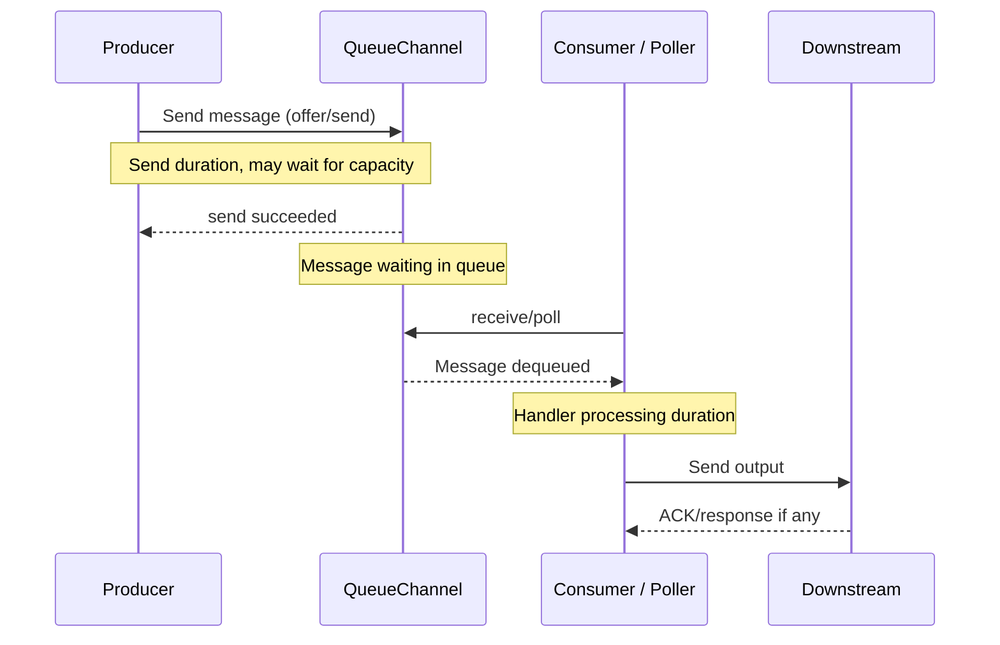

# Measuring Queue Depth and Wait Time in Spring Integration

## 1. Why Do These Two Metrics Matter?

In systems built on **Enterprise Integration Patterns (EIP)**, messages are often not processed immediately when a producer sends them. A `QueueChannel` can buffer messages for a poller to read later; an `ExecutorChannel` hands work to a thread pool; an Aggregator holds elements until a group is complete; an outbound adapter may wait on a broker or external service. These mechanisms decouple producers from consumers and improve scalability, but they also create **accumulation points**.

Suppose an order flow in Spring Integration receives 120 messages/second while the consumer can only process 100 messages/second. Even if every handler works functionally correctly, the backlog tends to grow by roughly 20 messages/second during that load period. Over time, customers experience slow responses, the queue hits its capacity limit, producers get blocked, or messages are rejected.

This lesson, **"Measuring Queue Depth and Wait Time,"** belongs to the **Audit and observability** chapter of the `SPRING_INTEGRATION_PATTERN` module. The goal is to monitor Router, Filter, Transformer, Splitter, Aggregator, Gateway, retry, error channel, and correlation flows with meaningful metrics so bottlenecks can be located in loosely coupled messaging architectures.

After this lesson, you will be able to:

- Distinguish **queue depth**, **wait time**, **processing time**, and **end-to-end latency**.
- Read the depth and remaining capacity of a `QueueChannel` using Spring Integration APIs.
- Measure `Gauge`, `Timer`, and `Counter` with Micrometer, and understand when the framework already provides built-in metrics.
- Measure **offer-to-poll** latency with an explicit timestamp and understand the measurement error bounds of this approach.
- Design dashboards/alerts for growing backlogs, nearly full queues, or oldest queued messages lingering too long.
- Test poller behavior, retries, backpressure, and EIP branches reproducibly.

## 2. Precisely Defining Timing Milestones

Start from a single message passing through a queue:



Each concept has a distinct meaning:

| Metric | Unit | Start → End Milestone | Question Answered |
| --- | --- | --- | --- |
| **Queue depth** | messages | Number of messages currently sitting in the queue at observation time | How many messages are waiting to be picked up? |
| **Remaining capacity** | slots | Remaining slots available in a bounded queue | How much room is left in the queue? |
| **Enqueue latency** | duration | `send` begins → `send` completes | How long did it take the producer to put the message into the queue? |
| **Queue residence / wait** | duration | Confirmed enqueue → dequeue | How long did the message sit waiting? |
| **Offer-to-poll latency** | duration | Producer starts sending → consumer receives | Total time from send attempt to receipt; may include enqueue latency |
| **Processing duration** | duration | Handler starts → processing finishes | How slow is the handler/dependency? |
| **End-to-end latency** | duration | Business ingress milestone → defined business completion milestone | How long did a transaction take including queuing, retries, and downstream? |
| **Oldest pending age** | duration | Enqueue time of the longest-waiting message → now | Is any message stuck waiting without being picked up? |

**Key point:** queue depth decreases when a consumer **picks up** a message from the queue, not necessarily when the consumer **finishes processing** it. A system can have near-zero depth while many requests are running slowly inside handlers or waiting on downstream responses. Therefore, dashboards need queue depth, in-flight processing, processing duration, and error counts together.

### Distinguishing Queue Size from Unfinished Work

For example, suppose a queue holds 8 messages, and the consumer has dequeued 4 messages and is actively processing them. Then:

```text
queue_depth           = 8
in_flight_processing  = 4
unfinished_work       = 12 (assuming a single queue and no other state)
```

You cannot look at `queue_depth = 8` and conclude only 8 items remain. If the flow includes an Aggregator, retry scheduler, or dead-letter queue, unfinished work also spans those states and requires dedicated reconciliation rules.

## 3. Which Channels Have Queue Depth?

Spring Integration provides several `MessageChannel` types. Not all of them have a queue whose size can be read:

| Component | Where Does Waiting Data Live? | Appropriate Way to Observe |
| --- | --- | --- |
| `DirectChannel` | Typically invokes subscriber synchronously; no `QueueChannel`-style internal queue | `send`/handler duration, in-flight count, errors |
| **`QueueChannel`** | Internal queue or configured `MessageStore` | `getQueueSize()`, `getRemainingCapacity()`, enqueue/dequeue and wait |
| `PriorityChannel` | Priority-ordered queue | Total depth, wait time by priority class if bounded labels exist, starvation |
| `ExecutorChannel` | Underlying `TaskExecutor` queue if the executor configures a queue | Executor queue size, active threads, rejected tasks, task wait |
| `PublishSubscribeChannel` with executor | Executor queue/thread pool, potentially multiple subscribers | Depth and duration per subscriber/executor |
| Polling endpoint / `MessageSource` | External data source or database, depending on adapter | Source lag/backlog, poll duration, empty polls |
| Aggregator / Resequencer | Message group store or pending message sequence | Group count, group sizes, oldest age, expiry |
| Kafka, AMQP, JMS | External broker/queues, consumer groups, unacked messages | Lag/ready/unacked from broker and consumer metrics |

An `ExecutorChannel` does not expose `getQueueSize()` the way `QueueChannel` does. When using `ThreadPoolTaskExecutor`, the executor's queue is what needs measuring; if tasks are rejected, queue depth may stop growing while the application still fails. With external brokers or durable stores, local JVM metrics may only reflect part of the overall state.

## 4. Starting with Built-In Metrics

According to Spring Integration documentation, `QueueChannel` can expose two Micrometer gauges when metrics integration is configured:

| Spring Integration Metric | Meaning | Notes |
| --- | --- | --- |
| `spring.integration.channel.queue.size` | Number of messages in the queue | Gauge, with component tags such as `type=channel` and `name` |
| `spring.integration.channel.queue.remaining.capacity` | Remaining capacity | Gauge; understand queue bounds and the running version |

Do not re-register **the exact same metric name and tag set** if the framework already provides it. Inspect `/actuator/metrics`, `MeterRegistry`, or exporter output in the running environment before adding custom metrics. Business-defined time-to-dequeue metrics often still need custom instrumentation because queue size alone does not tell how long individual messages wait.

With Spring Boot 3.x and Spring Integration 6.x, suggested dependencies:

```groovy
dependencies {
    implementation("org.springframework.boot:spring-boot-starter-integration")
    implementation("org.springframework.boot:spring-boot-starter-actuator")
    // Only needed if the application exposes metrics in Prometheus format.
    runtimeOnly("io.micrometer:micrometer-registry-prometheus")
}
```

Example creating a bounded `QueueChannel`:

```java
import org.springframework.context.annotation.Bean;
import org.springframework.context.annotation.Configuration;
import org.springframework.integration.annotation.EnableIntegration;
import org.springframework.integration.channel.QueueChannel;

@Configuration
@EnableIntegration
class OrdersQueueConfiguration {

    @Bean("ordersQueue")
    QueueChannel ordersQueue() {
        return new QueueChannel(100);
    }
}
```

`QueueChannel(100)` holds up to 100 messages under this queue contract. At read time:

```java
int depth = ordersQueue.getQueueSize();
int remaining = ordersQueue.getRemainingCapacity();
double occupancy = depth / 100.0;
```

For example, when `depth=80` and `remaining=20`, the queue is at roughly 80% capacity. This is a **point-in-time snapshot**; values can change immediately as producers/consumers run. Calling `QueueChannel()` without a capacity creates an effectively unbounded queue limited only by memory, so configure explicit bounds in systems needing backpressure. The default in-memory queue is also not durable across restarts; if durability is required, consider a `MessageGroupStore` or a proper broker.

## 5. Measuring Gauge and Timer with Micrometer

When you need custom-named metrics for dashboards, you can register application meters:

```text
app.queue.depth                 Gauge    messages currently in the queue
app.queue.remaining.capacity    Gauge    free capacity
app.queue.offer.to.poll         Timer    offer starts -> consumer receives message
app.queue.enqueued              Counter  accepted sends
app.queue.rejected              Counter  rejected or failed sends
app.queue.dequeued              Counter  receives returning a message
app.queue.wait.invalid          Counter  missing/invalid timestamp or clock anomaly
```

### 5.1. Complete Example: QueueChannel and Meters

The following code uses Java 17, Spring Integration 6.x, and Micrometer. This is **an in-JVM queue**; the producer calls `offer()`, and the consumer calls `pollOnce()`. In production, these two methods must be invoked at the flow's actual send/receive boundaries.

```java
import java.time.Clock;
import java.time.Duration;
import java.time.Instant;
import java.time.format.DateTimeParseException;

import io.micrometer.core.instrument.Counter;
import io.micrometer.core.instrument.Gauge;
import io.micrometer.core.instrument.MeterRegistry;
import io.micrometer.core.instrument.Timer;
import org.springframework.beans.factory.annotation.Qualifier;
import org.springframework.context.annotation.Bean;
import org.springframework.context.annotation.Configuration;
import org.springframework.integration.annotation.EnableIntegration;
import org.springframework.integration.channel.QueueChannel;
import org.springframework.messaging.Message;
import org.springframework.messaging.support.MessageBuilder;

@Configuration
@EnableIntegration
class QueueMonitoringConfiguration {

    @Bean("ordersQueue")
    QueueChannel ordersQueue() {
        return new QueueChannel(100);
    }

    @Bean
    Clock queueClock() {
        return Clock.systemUTC();
    }

    @Bean
    OrdersQueueMonitor ordersQueueMonitor(
            @Qualifier("ordersQueue") QueueChannel queue,
            MeterRegistry registry,
            Clock queueClock) {
        return new OrdersQueueMonitor(queue, registry, queueClock);
    }
}

final class OrdersQueueMonitor {
    private static final String OFFER_AT = "queueOfferAt";

    private final QueueChannel queue;
    private final Clock clock;
    private final Timer offerToPoll;
    private final Counter enqueued;
    private final Counter rejected;
    private final Counter dequeued;
    private final Counter invalidTime;

    OrdersQueueMonitor(QueueChannel queue, MeterRegistry registry, Clock clock) {
        this.queue = queue;
        this.clock = clock;

        // Gauge reads QueueChannel state directly when the registry scrapes.
        Gauge.builder("app.queue.depth", queue, QueueChannel::getQueueSize)
                .description("Number of messages waiting in the queue")
                .tags("queue", "ordersQueue")
                .register(registry);
        Gauge.builder("app.queue.remaining.capacity",
                      queue, QueueChannel::getRemainingCapacity)
                .tags("queue", "ordersQueue")
                .register(registry);

        offerToPoll = Timer.builder("app.queue.offer.to.poll")
                .description("From send attempt until receive returns a message")
                .tags("queue", "ordersQueue")
                .publishPercentileHistogram()
                .register(registry);
        enqueued = registry.counter("app.queue.enqueued",
                "queue", "ordersQueue");
        rejected = registry.counter("app.queue.rejected",
                "queue", "ordersQueue");
        dequeued = registry.counter("app.queue.dequeued",
                "queue", "ordersQueue");
        invalidTime = registry.counter("app.queue.wait.invalid",
                "queue", "ordersQueue");
    }

    // Timeout 0: try sending immediately without waiting for queue capacity.
    boolean offer(String payload, String flowExecutionId) {
        Message<String> message = MessageBuilder.withPayload(payload)
                .setHeader("flowExecutionId", flowExecutionId)
                .setHeader(OFFER_AT, clock.instant().toString())
                .build();
        try {
            boolean accepted = queue.send(message, 0);
            if (accepted) {
                enqueued.increment();
            } else {
                rejected.increment();
            }
            return accepted;
        } catch (RuntimeException exception) {
            rejected.increment();
            throw exception;
        }
    }

    // Called by the consumer, or from an application-configured poller.
    Message<?> pollOnce() {
        Message<?> message = queue.receive(0);
        if (message == null) {
            return null;
        }
        dequeued.increment();

        String time = message.getHeaders().get(OFFER_AT, String.class);
        if (time == null) {
            invalidTime.increment();
            return message;
        }

        try {
            Duration elapsed = Duration.between(
                    Instant.parse(time), clock.instant());
            if (elapsed.isNegative()) {
                invalidTime.increment();
            } else {
                offerToPoll.record(elapsed);
            }
        } catch (DateTimeParseException exception) {
            invalidTime.increment();
        }
        return message;
    }
}
```

Example invocation:

```java
boolean accepted = monitor.offer("order-42", "flow-7294");
if (!accepted) {
    // Handle backpressure per contract: bounded retry,
    // route to durable storage, or return an explicit error.
}

Message<?> next = monitor.pollOnce();
if (next != null) {
    // At this point the message has just been dequeued.
    // Business processing duration and ACK must be measured separately.
    handleOrder(next);
}
```

**How to interpret the measurements in this example:**

1. `app.queue.depth` and `app.queue.remaining.capacity` are **current-state gauges**; Micrometer invokes the getter at collection time. The Spring context holds a reference to the queue, preventing the gauge from losing its observed object.
2. `app.queue.offer.to.poll` measures from creating the timestamp **before** `send` until after `receive`; that is *offer-to-poll latency*, **not an exact measure from confirmed enqueue completion**. With `send(message, 0)`, send time is usually short, though minor error remains. If using `send` with a large timeout, this metric also includes how long the producer waited for queue space.
3. The Timer here stops at **dequeue**; it does not cover `handleOrder()` or delivery to an external system. You need a separate `Timer` around the handler or endpoint instrumentation to measure processing.
4. The timestamp is stored as an ISO-8601 string for illustration. Before sending messages externally, govern header mapping; do not blindly forward diagnostic metadata over every protocol.
5. If another producer sends directly to `ordersQueue` or another consumer calls `receive()` outside the wrapper, the custom Counter/Timer meters will **undercount**, even though the gauge still reflects the queue. In real flows, place instrumentation at shared boundaries or via controlled interceptors/adapters.
6. System clocks can jump or be adjusted. When negative or invalid timestamps are detected, the example increments `app.queue.wait.invalid` instead of recording negative samples. For intra-process latency that does not need persistence across restarts, `System.nanoTime()` is more monotonic; that value **cannot** be used across processes or restarts.

For durable queues, to measure **exact queue residence**, record the confirmed enqueue timestamp within the same transaction/operation or use broker/store metadata, then subtract at dequeue time under a clear clock convention. If messages cross machines, account for clock skew and which side stamped the timestamp.

### 5.2. Why Use a Timer Instead of a Wait-Time Gauge?

`Gauge` fits **current state** such as depth or the age of the oldest waiting message. `Timer` fits **duration distributions** of dequeued messages: sample count, total time, histograms, and percentiles. Do not use a `Gauge` updated with "the wait time of the most recently received message" to represent p95, because intermediate values can vanish between scrapes.

Remember that a Timer only observes **messages that have been pulled**. If the consumer hangs and stops dequeuing, the Timer's p95 can remain flat even as backlog and oldest pending age climb sharply. That is why you must examine Timer, queue depth, and oldest age together.

## 6. Measuring Wait Time More Accurately in Real Flows

There are three precision tiers depending on requirements:

| Measurement Approach | How It Works | Best For | Limitations |
| --- | --- | --- | --- |
| **Offer-to-poll** | Stamp before `send`, read at `receive` | Learning, quick monitoring of a controlled producer | Can include enqueue latency |
| **Confirmed enqueue-to-dequeue** | Persist confirmed enqueue timestamp at the queue/store or use broker metadata; measure until dequeue | Measuring queue residence per contract | Requires reliable hooks/metadata, clear clock and transaction semantics |
| **End-to-end business latency** | Record ingress timestamp/business correlation and measure when business work completes | Product SLOs | Includes queuing, retries, processing, and downstream; cannot all be blamed on the queue |

Do not assume `MessageHeaders.TIMESTAMP` is the enqueue timestamp: it normally reflects when the message was created, which could be long before entering the current queue. Similarly, timestamps in traces/spans are not automatically transaction commit times.

If using a **poller**:

- Measure wait time per message at the `receive` boundary, then measure the handler separately.
- Measure time from when the poller starts polling until results arrive if diagnosing the adapter/source.
- Distinguish `receive(0)` returning no message from `receive` timeouts and errors; count `empty_poll` at an appropriate rate without generating noisy logs.
- With `fixedDelay`, `fixedRate`, or a task executor, poller configuration governs pickup cadence; a message may wait extra time even if the handler is fast.

If using an **external broker** (Kafka, AMQP, JMS), cross-reference client/broker metrics: consumer lag, queue ready, unacked, in-flight, redelivery, and message age. Do not copy full headers just for measurement if doing so risks exposing sensitive data. For fan-out or retries, define for each re-enqueue whether it keeps the original timestamp or stamps a new one for the **new wait cycle**.

## 7. Designing Metrics and Dashboards

### 7.1. Naming and Tagging Conventions

A practical tag set:

| Tag | Example Values | Rule |
| --- | --- | --- |
| `flow` | `orders`, `payments` | Small, fixed set from configuration |
| `queue` | `ordersQueue`, `priorityOrders` | Logical channel name, never randomly generated |
| `outcome` | `accepted`, `rejected`, `processed`, `error` | Clear counting milestone definitions |
| `priority` | `normal`, `high` | Use only when genuinely needed for comparison and finite |
| `messageId`, `orderId`, `traceId` | Per-message IDs | **Never use as metric tags** |

Correlation IDs are still needed in audits/logs/traces to investigate individual messages; metrics serve aggregate analysis. Store high-cardinality metadata in structured logs or traces under an appropriate data policy.

### 7.2. Prometheus Query Examples

Micrometer typically converts dots in metric names to underscores when exporting to Prometheus. **Verify the exact exported name** in `/actuator/prometheus` before relying on queries.

Queue depth recorded by our example:

```promql
app_queue_depth{queue="ordersQueue"}
```

If using only the gauge provided by Spring Integration, the expected Prometheus name looks like:

```promql
spring_integration_channel_queue_size{
  type="channel",name="ordersQueue"
}
```

Enqueue/dequeue rates per minute or second:

```promql
rate(app_queue_enqueued_total{queue="ordersQueue"}[5m])
```

```promql
rate(app_queue_dequeued_total{queue="ordersQueue"}[5m])
```

Because `Timer.builder(...).publishPercentileHistogram()` enables histograms, you can estimate p95 **offer-to-poll** latency in Prometheus:

```promql
histogram_quantile(
  0.95,
  sum by (le) (
    rate(app_queue_offer_to_poll_seconds_bucket{
      queue="ordersQueue"
    }[5m])
  )
)
```

This is the p95 of messages dequeued within the 5-minute window, **not** representative of messages still waiting in the queue. Do not enable histograms for thousands of dynamic queues/tags without evaluating series cost.

### 7.3. Combining Signals to Diagnose Root Cause

| Queue Depth | Measured Wait Time | In-Flight / Handler | Hypothesis to Verify |
| --- | --- | --- | --- |
| Low | Low | Low | Flow is likely healthy if throughput and error rate are normal |
| Rising | Rising | High, slow handler | Consumer or dependency cannot keep up |
| Rising | Few new Timer samples | Possibly 0 | Poller stopped, consumer not receiving, connection errors |
| Low | High | Low | May have just drained an old backlog; inspect timing and rates over windows |
| Near full | Any | Producers rejected or blocked | Backpressure, saturation, capacity configuration |
| Low | Low | Very high | Messages are dequeued but stuck downstream; check processing/in-flight |

Never draw conclusions from a single chart alone. For example, low queue depth right after a restart might mean an in-memory queue was wiped, not that the backlog was processed.

## 8. Backpressure, Saturation, and Alert Thresholds

With finite queue capacity `C`, occupancy can be calculated as:

\[
\text{occupancy} = \frac{\text{queue depth}}{C}
\]

If a producer averages \(\lambda\) messages/second and the consumer processes \(\mu\) messages/second, when \(\lambda > \mu\) the backlog tends to grow. During a relatively steady interval, the growth rate is approximately \(\lambda - \mu\) (assuming no discards, retries, or branching).

For example, with queue capacity 1,000, producer at 120 messages/second, and consumer at 100 messages/second, starting from an empty queue it would theoretically take about 50 seconds to fill if those rates stayed constant without jitter. This model **only illustrates the trend**, not an exact forecast for traffic bursts or production numbers.

When the queue fills up, options include:

1. **Bounded backpressure**: `send` with an explicit timeout and return an appropriate error/response when no more items can be accepted.
2. **Slow down producers**: rate limiting, pull throttling, adjusting producer or consumer counts.
3. **Increase consumer capacity**: safe parallelization, faster dependencies, batch or I/O optimization.
4. **Use a durable queue** when messages cannot be lost, paired with retries, idempotency, and dead-lettering.
5. **Handle traffic spikes**: capacity and autoscaling must be sized to backlog recovery time, not just waiting item count.

Do not alert only when `depth == C`: by then messages may already be getting rejected. Consider alerting on **sustained high occupancy across multiple windows**, **oldest pending age exceeding SLO**, **sustained positive queue growth rate**, **rising rejection rate**, and **falling consumer throughput**.

Threshold values must reflect the flow's SLO. A 5-minute batch queue can tolerate intentional waiting, whereas a request–reply Gateway with a few-second budget needs much earlier alerting.

## 9. Impact of Enterprise Integration Patterns

Measuring backlog in a complex flow requires understanding each pattern's unit of work:

| Pattern | Behavior Affecting Depth/Wait | Extra Metrics Needed |
| --- | --- | --- |
| **Router** | Sends messages to different queues; may skew distribution | Depth/wait per statically named branch, routing decisions |
| **Filter** | Intentionally drops messages, reducing downstream output | Accepted/rejected, `discardChannel`; do not treat rejected as lost |
| **Transformer** | Can be slow, applying backpressure to upstream channels | Handler timer, errors, input/output sizes |
| **Splitter** | One input generates many fragments, rapidly filling downstream queues | Fragments/split, fragment-level throughput |
| **Aggregator** | Messages sit in a group store rather than necessarily in a queue | Pending groups, oldest group age, release/expiry duration |
| **Gateway** | Request–reply can time out even if earlier enqueue succeeded | Gateway in-flight, reply timeout, end-to-end latency |
| **Retry** | One business item has multiple attempts and may re-enqueue | Attempts, backoff wait, redelivery, dead-letter |
| **Error Channel** | Failed messages move to a separate flow, possibly a different queue | Error backlog, error-handling duration and rate |
| **Correlation** | Groups related messages across queues/branches | Business correlation in audits/traces; not a metric tag |
| **Resequencer / Priority Channel** | Messages may wait for ordering or priority conditions | Age per priority class, starvation, out-of-order |

For example, if a Splitter receives 100 orders and each yields 10 line items, the post-Splitter queue may receive 1,000 messages even though ingress only saw 100 orders. Comparing `input_count - output_count` across two points without normalizing units leads to wrong conclusions.

With an Aggregator, queue depth may be 0 while many **unreleased groups** exist. With a retry scheduler, messages waiting on backoff might not yet sit in a `QueueChannel`. With `PublishSubscribeChannel`, a single message can build backlog across multiple executors, so one branch's numbers do not represent the entire flow.

## 10. Testing Queue Depth and Wait Time Measurement

Tests should distinguish **registered meters** from **operational conditions that drive those measurements**.

### 10.1. Simple Test with `SimpleMeterRegistry`

The following test verifies that queue depth changes for real, the Timer records a sample on dequeue, and the corresponding Counters update:

```java
import static org.assertj.core.api.Assertions.assertThat;

import java.time.Clock;
import org.junit.jupiter.api.Test;
import io.micrometer.core.instrument.simple.SimpleMeterRegistry;
import org.springframework.integration.channel.QueueChannel;
import org.springframework.messaging.Message;

class OrdersQueueMonitorTest {

    @Test
    void measuresDepthAndOfferToPoll() {
        try (SimpleMeterRegistry registry = new SimpleMeterRegistry()) {
            QueueChannel queue = new QueueChannel(2);
            OrdersQueueMonitor monitor =
                    new OrdersQueueMonitor(queue, registry, Clock.systemUTC());

            assertThat(monitor.offer("order-42", "flow-7294")).isTrue();
            assertThat(queue.getQueueSize()).isEqualTo(1);
            assertThat(queue.getRemainingCapacity()).isEqualTo(1);
            assertThat(registry.get("app.queue.depth")
                    .tag("queue", "ordersQueue")
                    .gauge().value()).isEqualTo(1.0);

            Message<?> dequeued = monitor.pollOnce();
            assertThat(dequeued).isNotNull();
            assertThat(dequeued.getPayload()).isEqualTo("order-42");
            assertThat(queue.getQueueSize()).isZero();
            assertThat(registry.get("app.queue.offer.to.poll")
                    .tag("queue", "ordersQueue")
                    .timer().count()).isEqualTo(1);
            assertThat(registry.get("app.queue.dequeued")
                    .tag("queue", "ordersQueue")
                    .counter().count()).isEqualTo(1.0);
        }
    }
}
```

Because the code measures elapsed time using `Clock.systemUTC()`, the test only asserts **one valid sample** was recorded. To test exact durations without `Thread.sleep()`, inject a controllable `Clock` in the test, advance the simulated time between `offer()` and `pollOnce()`, and compare `Timer.totalTime(...)` against the configured duration.

### 10.2. Recommended Test Matrix

| Scenario | Expectation |
| --- | --- |
| Empty queue, no messages | Depth = 0, `pollOnce()` returns `null`, Timer does not increment |
| Queue capacity = 2, send 2 messages | Depth = 2, remaining capacity = 0 |
| Send another when queue is full with timeout 0 | Rejected/exception per send contract; not counted as success |
| Dequeue one message | Depth decreases by 1, dequeued increments by 1, Timer records one sample |
| Slow consumer processing after dequeue | Depth may be low while processing/in-flight rises; separate metric needed |
| Missing or invalid timestamp header | Increments `wait.invalid` without breaking message processing |
| Poller stopped | Depth/oldest age rises or stays high; Timer lacks new samples |
| Retry re-enqueue | Clear rule for stamping new wait cycles; attempts not conflated |
| Splitter creates multiple fragments | Backlog measured per fragment; correlation still links back to original order |
| External producer sends directly to queue | Gauge stays accurate; wrapper Counter/Timer may undercount |
| Restart while in-memory queue holds items | Test clarifies potential data loss and does not call depth=0 "processed" |
| Durable queue / broker | Cross-check message age, depth/lag, and timestamps from the authoritative source |

When using an async executor/poller, wait on an observable condition with a timeout (`CountDownLatch`, `Awaitility`, or channel receive with timeout) rather than fixed sleeps to "wait" for metrics to update.

## 11. Common Observation Mistakes

1. **Using queue depth as end-to-end backlog.** Dequeued messages still running in handlers are no longer in the queue.
2. **Unconditionally treating `MessageHeaders.TIMESTAMP` as enqueue time.** That header is usually created before the message enters the measured queue.
3. **Stamping before `send` and calling it exact queue residence.** That can include time the producer was blocked waiting before enqueue.
4. **Looking only at p95 of dequeued messages.** When consumers stop pulling, the Timer falls silent while queued messages grow steadily older.
5. **Registering duplicate gauges alongside Spring Integration's built-ins.** Check existing meter names/tags before adding custom instrumentation.
6. **Putting message IDs, order IDs, or correlation IDs into tags.** This explodes metric cardinality and storage cost.
7. **Counting successful `send()` as downstream completion.** Queue acceptance differs from consumer commit or broker ACK.
8. **Using depth from a single JVM to infer cluster-wide backlog.** Inspect all partitions/instances and broker/store metrics where applicable.
9. **Conflating attempts with logical operations.** Retries and redeliveries increase sends/receives without necessarily increasing original business operations.
10. **Configuring an unbounded queue while monitoring only percent occupancy.** Without finite capacity, occupancy percentage is meaningless; track depth, memory, and growth rate.

## 12. Production Deployment Checklist

- [ ] Clearly identify which queues need observation and their true backing stores (RAM, store, broker, executor).
- [ ] Pick exact definitions for depth, enqueue latency, queue wait, processing duration, and end-to-end latency.
- [ ] Track depth, remaining capacity (if bounded), enqueued/dequeued, and errors/rejects.
- [ ] Configure a wait Timer with explicit start/end milestones; measure oldest pending age if possible.
- [ ] Check built-in Spring Integration meters before registering custom gauges with the same meaning.
- [ ] Bound queues/workers and define behavior when capacity runs out: wait, reject, retry, or durable spillover.
- [ ] Test full queues, stopped pollers, slow consumers, restarts, retries, fan-out, and Aggregators.
- [ ] Build dashboards showing depth, wait p95/p99, handler duration, throughput, and oldest age.
- [ ] Set alerts on SLOs, backlog growth rate, and error signals—do not just wait until the queue is full.
- [ ] Never use payloads, tokens, order IDs, or trace IDs as metric tags.
- [ ] Keep correlation in audits/logs/traces to trace business items when aggregate metrics show anomalies.

## 13. References

- [Spring Integration — Configuring Message Channels / QueueChannel](https://docs.spring.io/spring-integration/reference/channel/configuration.html)
- [Spring Integration — Metrics and Management](https://docs.spring.io/spring-integration/reference/metrics.html)
- [Spring Integration — QueueChannelOperations Javadoc](https://docs.spring.io/spring-integration/docs/6.5.0/api/org/springframework/integration/channel/QueueChannelOperations.html)
- [Micrometer — Gauges](https://docs.micrometer.io/micrometer/reference/concepts/gauges.html)
- [Micrometer — Timers](https://docs.micrometer.io/micrometer/reference/concepts/timers.html)
- [Spring Boot — Metrics](https://docs.spring.io/spring-boot/reference/actuator/metrics.html)

**Remember:** queue depth answers **"how many messages are still waiting?"**, while wait time answers **"how long did messages wait before being picked up?"**. To monitor Spring Integration accurately, measure both, distinguish enqueue/dequeue milestones from processing completion, and add metrics tailored to each Enterprise Integration Pattern.
