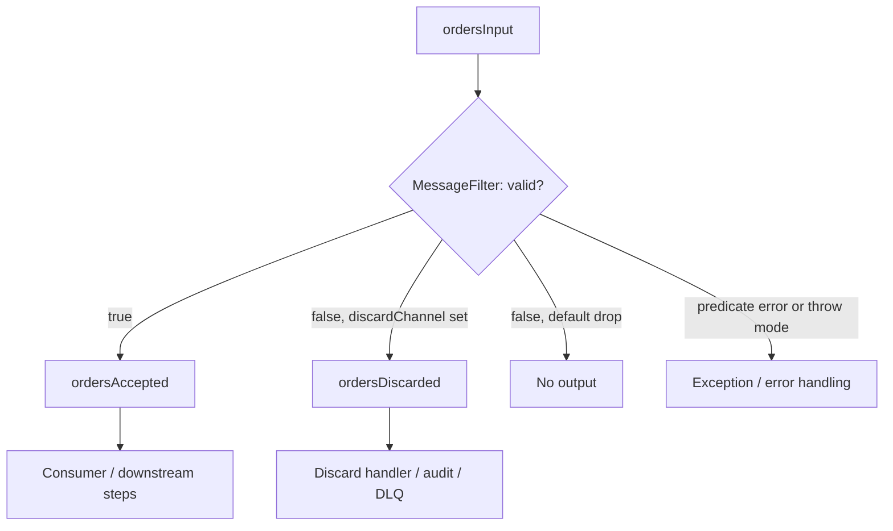

# Measuring Filtered or Discarded Messages in Spring Integration

## 1. Why Measure Dropped Messages?

In an integration system, **not every message entering a flow needs to reach the output**. A `Filter` may drop an invalid order, skip an out-of-scope event, or prevent unqualified data from entering a target system. This is intentional behavior in **Enterprise Integration Patterns (EIP)**, yet without measurement, the operations team struggles to tell apart:

- A message **legitimately rejected by a Filter** vs. a message **lost due to an error**.
- A Filter deciding to reject a message vs. the message **actually reaching the discard channel**.
- A message reaching the discard channel vs. the discard branch **having processed or persisted it successfully**.
- A single business message being rejected vs. **multiple re-evaluations** caused by retries, redeliveries, or passing through multiple Filters.

This lesson belongs to the **Audit and observability** chapter of the `SPRING_INTEGRATION_PATTERN` module: building loosely coupled, extensible Spring Integration flows while tracking Router, Filter, Transformer, Splitter, Aggregator, Gateway, retry, error channel, and correlation. The focus here is **measuring filtered or discarded messages** using clear milestones, combining Micrometer and testing.

After this lesson, you will be able to:

1. Explain the message path when `MessageFilter` returns `true`, `false`, or throws an exception.
2. Record metrics for **Filter decisions**, **discard channel arrivals**, and **discard processing outcomes**.
3. Choose appropriate metrics/tags, compute the rejection ratio with the right denominator, and avoid cardinality growth.
4. Analyze causes of count discrepancies when there are multiple branches, retries, chained Filters, or asynchronous consumers.
5. Test the accepted, rejected, and error paths without confusing `send()` status with acceptance.

## 2. Lifecycle of a Message at a Filter

A `MessageFilter` evaluates a selection condition (selector/predicate) to decide whether to forward a message to the next output channel. Depending on configuration, a rejected message may **be silently dropped**, **routed to `discardChannel`**, or trigger a rejection exception.



**Three distinct event types to separate**:

| Observation Milestone | Example Metric Name | What Is Proven | What Is Not Yet Proven |
| --- | --- | --- | --- |
| Filter finishes predicate evaluation | `app.eip.filter.decisions{outcome=accepted\|rejected}` | An accept/reject decision occurred at the Filter | The message reached the output or discard consumer |
| Handler receives message on `discardChannel` | `app.eip.discard.observed` | The message reached the discard observation point | The message was durably persisted or fully handled |
| Discard sink confirms write | `app.eip.discard.persisted` | The store/sink confirmed success per contract | Another system consumed it if only written to a broker |

Add `outcome=error` for **errors during predicate evaluation** or inside the instrumented filter scope. Do not count predicate errors as `rejected`: a rejection is a **determined outcome**, whereas an error leaves the system unsure whether the message was valid.

### Path Example

Suppose the flow receives three strings:

```text
"order-42"  -> accepted -> ordersAccepted
"   "       -> rejected -> ordersDiscarded
"order-43"  -> accepted -> ordersAccepted
```

When the Filter evaluates each message once and the discard flow runs steadily:

```text
filter_decisions{outcome="accepted"} = 2
filter_decisions{outcome="rejected"} = 1
discard_observed                      = 1
```

These are **evaluation/observation counts in the example**, not the number of unique business orders in a data store. If the same message is resent and passes through the Filter again, the counters will increment again.

## 3. Discard Configuration Styles and How They Affect Metrics

### 3.1. Filter Without a Discard Channel

Java DSL example:

```java
IntegrationFlow flow = IntegrationFlow.from("ordersInput")
        .filter(String.class, value -> !value.isBlank())
        .channel("ordersAccepted")
        .get();
```

With a standard Filter configuration, messages failing the predicate **do not continue** to `ordersAccepted`. Without a `discardChannel` and without throwing on rejection, messages are legitimately dropped. Thus, to get a counter for rejected evaluations, you must **record it where the Filter decides** or attach an observable discard branch. A consumer on `ordersAccepted` sees only accepted messages and cannot infer total rejections on its own.

### 3.2. Filter With a Discard Channel

```java
IntegrationFlow flow = IntegrationFlow.from("ordersInput")
        .filter(String.class, value -> !value.isBlank(),
                endpoint -> endpoint.discardChannel("ordersDiscarded"))
        .channel("ordersAccepted")
        .get();
```

When the predicate returns `false`, the Filter sends the message to `ordersDiscarded`. Another integration flow can record the rejection reason, emit metrics, or forward the message for reconciliation.

**A discard channel is not the same as a dead-letter queue (DLQ).** Discarding can be a normal business decision, whereas a DLQ typically holds failed messages after processing/retries can no longer continue. If rejected messages must be stored durably, configure an appropriate sink/transaction/ACK in the **step after** the discard channel.

### 3.3. Throwing an Exception on Rejection

`MessageFilter` also supports `throwExceptionOnRejection`. When enabled, rejection is signaled via an exception according to the chosen handling policy. Whether the message then enters `errorChannel` depends on synchronous/asynchronous channels and the endpoint's error handling configuration.

Do not design metrics assuming **every rejection goes through `errorChannel`**. If you need to distinguish `rejected`, `error`, and `discard observed` simultaneously, design one consistent path explicitly and verify it with an integration test.

### 3.4. Other Sources of Discards

`Filter` is not the only place a message stops in Spring Integration:

| Mechanism | Why Expected Output Is Absent | Where to Place Meters? |
| --- | --- | --- |
| **Filter** | Predicate returns `false` | At accept/reject decision; at discard channel if configured |
| **Router** | No matching route or routed to default channel | At routing decision and default/reject branch |
| **`nullChannel`** | Intentionally drops the message | Before sending to `nullChannel` or at business decision; expect no consumer after `nullChannel` |
| **Gateway** | Request times out or reply is missing | At gateway timeout/error; do not infer from ingress |
| **Aggregator** | Not enough messages yet to release | Pending/released/expired groups; missing output is not necessarily a discard |
| **Error flow / DLQ** | Error handling or retries exhausted | At error handling, DLQ publish/ACK, replay |

To compare across patterns, the word `discard` must have **consistent meaning** system-wide: either "rejected by a business rule" or "sent to a discard channel." Never mix the two meanings and compute a combined rate.

## 4. Choosing Counter, Timer, and Tags in Micrometer

### Counter as the Primary Measurement

Counts of Filter accepts, rejects, and discards should use **`Counter`** because they are cumulative events. Examples:

```text
app.eip.filter.decisions{flow="orders",stage="validate",outcome="accepted"}
app.eip.filter.decisions{flow="orders",stage="validate",outcome="rejected"}
app.eip.filter.decisions{flow="orders",stage="validate",outcome="error"}
app.eip.discard.observed{flow="orders",source="validate"}
app.eip.discard.persisted{flow="orders",source="validate"}
app.eip.discard.persist_failed{flow="orders",source="validate"}
```

`Timer` fits predicate execution duration, discard processing duration, or audit write latency, while `Gauge` fits current state such as messages waiting in a discard queue. A `Timer` already tracks measurement count; avoid registering a duplicate counter with the same meaning unless specifically needed.

### Low-Cardinality Tags

| Tag | Example Valid Values | Rule |
| --- | --- | --- |
| `flow` | `orders`, `billing` | Fixed set from configuration |
| `stage` | `validate`, `deduplicate` | Stable Filter/endpoint name |
| `outcome` | `accepted`, `rejected`, `error` | Fixed list; never raw exception text |
| `reason` | `empty`, `invalid_format`, `unsupported_type` | Use only when normalized and bounded |
| `source` | `validate`, `deduplicate` | Discard branch name from configuration |
| `messageId`, `orderId`, `correlationId` | Per-message UUID/ID | **Never use as metric tags** |
| `payload`, `exceptionMessage` | Arbitrary or sensitive strings | **Never use as metric tags** |

When there are multiple rejection reasons, prefer **controlled enums/codes**. Avoid putting raw validation messages into `reason`, because per-user messages can create unbounded time series and leak data.

## 5. Implementation Example: Counting Filter Decisions and Observed Discards

The following example is written in Java 17, Spring Boot 3.x / Spring Integration 6.x, using **Spring Integration Java DSL** and **Micrometer**. The flow accepts `String`, drops empty/blank strings, sends valid messages to a `QueueChannel` for test observation, and routes invalid messages to a discard flow.

### 5.1. Counters at the Exact Boundaries

```java
import io.micrometer.core.instrument.Counter;
import io.micrometer.core.instrument.MeterRegistry;
import org.springframework.messaging.Message;

final class OrderFilterCounters {
    private final Counter accepted;
    private final Counter rejected;
    private final Counter errors;
    private final Counter discardObserved;

    OrderFilterCounters(MeterRegistry registry) {
        accepted = registry.counter("app.eip.filter.decisions",
                "flow", "orders",
                "stage", "validate",
                "outcome", "accepted");
        rejected = registry.counter("app.eip.filter.decisions",
                "flow", "orders",
                "stage", "validate",
                "outcome", "rejected");
        errors = registry.counter("app.eip.filter.decisions",
                "flow", "orders",
                "stage", "validate",
                "outcome", "error");
        discardObserved = registry.counter("app.eip.discard.observed",
                "flow", "orders",
                "source", "validate");
    }

    boolean accept(String payload) {
        try {
            boolean valid = !payload.isBlank();
            if (valid) {
                accepted.increment();
            } else {
                rejected.increment();
            }
            return valid;
        } catch (RuntimeException exception) {
            errors.increment();
            throw exception;
        }
    }

    // This handler counts that the message reached the discard branch.
    // It does NOT confirm the message was durably persisted.
    void onDiscard(Message<?> message) {
        discardObserved.increment();
    }
}
```

**Scope of these counters:**

- `accept()` is called **each time the selector evaluates**. Retries/redeliveries can cause the same business event to be re-evaluated and increment the counter again.
- `rejected` is incremented **before** the Filter attempts to send to the discard channel. If forwarding to discard fails, `rejected` may still have incremented; that is why `discardObserved` must be measured separately.
- `onDiscard()` is invoked when the message reaches the discard handler; it has not yet performed persistence or ACKs.
- In this simple example, `String.isBlank()` almost only fails on incompatible input. With complex business selectors, `error` helps distinguish exceptions from legitimate rejections.

### 5.2. IntegrationFlow and Channels

```java
import io.micrometer.core.instrument.MeterRegistry;
import org.springframework.context.annotation.Bean;
import org.springframework.context.annotation.Configuration;
import org.springframework.integration.annotation.EnableIntegration;
import org.springframework.integration.channel.DirectChannel;
import org.springframework.integration.channel.QueueChannel;
import org.springframework.integration.dsl.IntegrationFlow;
import org.springframework.messaging.MessageChannel;
import org.springframework.messaging.MessageHandler;
import org.springframework.messaging.PollableChannel;

@Configuration
@EnableIntegration
class MeasuredFilterConfiguration {

    @Bean
    OrderFilterCounters orderFilterCounters(MeterRegistry registry) {
        return new OrderFilterCounters(registry);
    }

    @Bean("ordersInput")
    MessageChannel ordersInput() {
        return new DirectChannel();
    }

    @Bean("ordersAccepted")
    PollableChannel ordersAccepted() {
        return new QueueChannel();
    }

    @Bean("ordersDiscarded")
    MessageChannel ordersDiscarded() {
        return new DirectChannel();
    }

    @Bean
    IntegrationFlow ordersFilterFlow(OrderFilterCounters metrics) {
        return IntegrationFlow.from("ordersInput")
                .filter(String.class, metrics::accept,
                        endpoint -> endpoint.discardChannel("ordersDiscarded"))
                .channel("ordersAccepted")
                .get();
    }

    @Bean
    IntegrationFlow ordersDiscardFlow(OrderFilterCounters metrics) {
        return IntegrationFlow.from("ordersDiscarded")
                .handle((MessageHandler) metrics::onDiscard)
                .get();
    }
}
```

Example dependencies for a Spring Boot project:

```groovy
dependencies {
    implementation("org.springframework.boot:spring-boot-starter-integration")
    implementation("org.springframework.boot:spring-boot-starter-actuator")
    testImplementation("org.springframework.boot:spring-boot-starter-test")
    testImplementation("org.springframework.integration:spring-integration-test")
}
```

The application needs a `MeterRegistry`; Spring Boot Actuator normally provides auto-configuration when the right dependencies are present. In unit/integration tests with plain configuration, you can provide a dedicated `SimpleMeterRegistry`.

**Key takeaway from the example:** `ordersDiscarded` uses a `DirectChannel`, so `onDiscard()` runs synchronously when the Filter forwards the message to the channel with a subscriber. If replaced with a `QueueChannel` or broker, `discardObserved` must be recorded on the **consumer**, because successful enqueueing does not prove the consumer received it. You can add `discardEnqueued` at the outbound adapter and `discardPersisted` after persistence confirmation.

### 5.3. Sending Samples and Reading Output

```java
import org.springframework.messaging.MessageChannel;
import org.springframework.messaging.PollableChannel;
import org.springframework.messaging.support.MessageBuilder;

void sendSamples(MessageChannel ordersInput,
                 PollableChannel ordersAccepted) {
    ordersInput.send(MessageBuilder.withPayload("order-42")
            .setHeader("flowExecutionId", "flow-42")
            .build());
    ordersInput.send(MessageBuilder.withPayload("   ")
            .setHeader("flowExecutionId", "flow-rejected")
            .build());

    // Only valid messages produce output on ordersAccepted.
    var accepted = ordersAccepted.receive(1_000);
    if (accepted == null) {
        throw new IllegalStateException("Missing valid message");
    }
}
```

Since `ordersInput` is a `DirectChannel`, `send()` returning true only confirms **dispatch to the subscriber**, not that the Filter accepted the message. Therefore, **never use `send() == true` to count `accepted`**. Predicate outcomes, messages on the accepted channel, and messages in the discard flow are separate observation points.

## 6. Testing Metrics and the Discard Branch

The example uses Spring Test + JUnit 5 and AssertJ. The test configuration creates a `SimpleMeterRegistry` for the example's business counters:

```java
import static org.assertj.core.api.Assertions.assertThat;

import io.micrometer.core.instrument.MeterRegistry;
import io.micrometer.core.instrument.simple.SimpleMeterRegistry;
import org.junit.jupiter.api.Test;
import org.springframework.beans.factory.annotation.Autowired;
import org.springframework.beans.factory.annotation.Qualifier;
import org.springframework.context.annotation.Bean;
import org.springframework.context.annotation.Configuration;
import org.springframework.messaging.Message;
import org.springframework.messaging.MessageChannel;
import org.springframework.messaging.PollableChannel;
import org.springframework.messaging.support.MessageBuilder;
import org.springframework.test.context.junit.jupiter.SpringJUnitConfig;

@SpringJUnitConfig(classes = {
        MeasuredFilterConfiguration.class,
        MeasuredFilterTest.TestMeters.class
})
class MeasuredFilterTest {
    @Configuration
    static class TestMeters {
        @Bean
        MeterRegistry testMeterRegistry() {
            return new SimpleMeterRegistry();
        }
    }

    @Autowired
    @Qualifier("ordersInput")
    MessageChannel input;

    @Autowired
    @Qualifier("ordersAccepted")
    PollableChannel accepted;

    @Autowired
    MeterRegistry registry;

    @Test
    void countsAcceptedRejectedAndDiscardObserved() {
        assertThat(input.send(MessageBuilder.withPayload("order-42")
                .build())).isTrue();
        assertThat(input.send(MessageBuilder.withPayload("   ")
                .build())).isTrue();

        Message<?> output = accepted.receive(1_000);
        assertThat(output).isNotNull();
        assertThat(output.getPayload()).isEqualTo("order-42");
        assertThat(accepted.receive(0)).isNull();

        assertThat(decision("accepted")).isEqualTo(1.0);
        assertThat(decision("rejected")).isEqualTo(1.0);
        assertThat(decision("error")).isZero();
        assertThat(registry.get("app.eip.discard.observed")
                .tags("flow", "orders", "source", "validate")
                .counter().count()).isEqualTo(1.0);
    }

    private double decision(String outcome) {
        return registry.get("app.eip.filter.decisions")
                .tags("flow", "orders",
                      "stage", "validate",
                      "outcome", outcome)
                .counter().count();
    }
}
```

This test verifies both **behavior** (only one message reaches the accepted channel) and **metrics** (two decisions, one discard). In real test suites, ensure other tests do not mutate the same registry/queue via context caching. If using `@SpringBootTest`, declare configuration and registry beans matching your actual project to avoid duplicate registries.

Additional scenarios to test:

| Scenario | Expectation |
| --- | --- |
| Predicate returns `true` | `accepted +1`, output reaches the right branch, `discardObserved` does not increment |
| Predicate returns `false` | `rejected +1`, no accepted output, discard event recorded if configured |
| No discard channel | `rejected` still increments when measured in predicate; no automatic `discardObserved` |
| Predicate throws exception | `error +1`; do not count errors as rejected |
| Discard handler throws exception | `rejected` is still recorded; `persisted` does not increment if incomplete; exception handled per endpoint mechanism |
| Multiple chained Filters | Only Filters that actually run increment counters, distinguished by `stage` |
| Retry re-evaluates | Increments **evaluation attempts**; logical business rejects need a separate definition |
| Filter after Splitter | Filtered count is per **fragment**, not automatically equal to orders |
| `discardChannel` is an async queue | Temporary lag may appear between `rejected` and `discardObserved` |
| Header contains PII | Metrics contain no payloads, users, tokens, or per-message IDs |

Do not write tests that only compare two counters and call it done. A bug can simultaneously drop output and increment a counter in the wrong place. Tests should observe the **actual channels**, **predicate outcomes**, and **meters**.

## 7. Calculating Reject Ratio and Comparing Counters

### 7.1. Choosing the Right Denominator

For a Filter, define:

```text
accepted_decisions = number of times predicate returned true
rejected_decisions = number of times predicate returned false
error_decisions    = number of times predicate threw an exception (if measured)
```

To calculate the **rejection ratio among valid decisions**:

\[
\text{Reject ratio} =
\frac{\text{rejected decisions}}
     {\text{accepted decisions} + \text{rejected decisions}}
\]

To calculate the **evaluation error ratio**:

\[
\text{Evaluation error ratio} =
\frac{\text{error decisions}}
     {\text{accepted} + \text{rejected} + \text{error}}
\]

The two ratios answer different questions. Never take `input - accepted` as rejected if messages may still be queued, retried, failing in the predicate, or multiplied by a Splitter.

For example, given 1,000 evaluations: 930 accepted, 50 rejected, 20 errors. The reject ratio over valid outcomes is `50 / (930 + 50) ≈ 5.10%`; the error ratio is `20 / 1,000 = 2%`. If 50 were rejected yet the discard handler observed only 45 messages, **a gap of 5** is an investigation signal (not yet dispatched, queue still draining, error, or missing metric write), not automatic proof that 5 messages were lost.

### 7.2. Prometheus Queries

Micrometer typically exports the Counter `app.eip.filter.decisions` as `app_eip_filter_decisions_total` in Prometheus, though you must **verify the exact name in your application's exporter**. Reject ratio of `orders/validate` over a 5-minute window:

```promql
sum(rate(app_eip_filter_decisions_total{
  flow="orders",stage="validate",outcome="rejected"
}[5m]))
/
clamp_min(
  sum(rate(app_eip_filter_decisions_total{
    flow="orders",stage="validate",outcome=~"accepted|rejected"
  }[5m])),
  0.000001
)
```

Decision rate by outcome:

```promql
sum by (outcome) (
  rate(app_eip_filter_decisions_total{
    flow="orders",stage="validate"
  }[5m])
)
```

Comparing rejection rate against messages reaching the discard handler:

```promql
sum(rate(app_eip_filter_decisions_total{
  flow="orders",stage="validate",outcome="rejected"
}[5m]))
-
sum(rate(app_eip_discard_observed_total{
  flow="orders",source="validate"
}[5m]))
```

**Do not immediately read the difference above as "lost messages"**. The two counters sit at two observation points and can skew in time (especially with asynchronous channels); counters also reset on restarts and pods have differing uptimes. Examine queue backlog, dispatch error counts, wait times, retries, and data access permissions alongside it during investigations.

## 8. How Retry, Splitter, Aggregator, and Correlation Alter Count Semantics

### Retry and Redelivery

If the same message is evaluated by a Filter three times due to retry or redelivery, `filter.decisions` can increment three times. This is an **evaluation-attempt counter**, suited to throughput and processing load. If you need the count of **unique** rejected business events, you need a durable business ID, a reliable event/idempotency store, and an explicit definition of how a single unique rejection is counted. **Do not put that ID into a metric tag**.

### Splitter and Aggregator

After a Splitter, one order may become ten child messages; a Filter dropping three items means **three rejected fragments**, not three rejected orders. An Aggregator may be waiting on a group or discarding elements under a different policy. To report order completion rates, count by **business operation** with correlation rather than summing Filter fragment counts directly.

### Router, Publish–Subscribe, and Chained Filters

A message can pass through two sequential Filters or two parallel branches. In that case:

- **Per stage:** `validateOrder` and `checkFraud` have separate counters; the flow total may exceed ingress.
- **Per route:** one branch may reject an item while another branch succeeds; do not automatically call the whole business transaction failed.
- **By final outcome:** if you only want to count a message rejected **once for the whole transaction**, you need a final consolidation source and explicit correlation/outcome rules.

### Error Channel and Dead-Letter

Predicate/handler errors may travel to `errorChannel` (depending on endpoint and configuration), be retried, and eventually land in a DLQ. Do not add `filter.rejected`, `errorChannel.events`, and `dead_letter.published` to compute "total failed messages": those measurements may refer to the **same** business event at different stages. For reconciliation, use structured audits or a business state store.

## 9. Recording Discard Reasons Without Exploding Metrics

In production, knowing only "rejected" may not be enough. For example:

```text
reason=empty_payload
reason=invalid_schema
reason=duplicate
reason=unsupported_version
reason=other
```

If the business needs reasons, one design pattern is having a validator return a **structured result** like `ValidationResult(accepted, reasonCode)`. The Filter or a pre-Filter service records the metric by enum reason before routing/dropping. When using a `boolean` selector, capturing detailed reasons requires obtaining the reason from the same evaluation to avoid running validation twice and getting inconsistent outcomes/counters.

Never use `exception.getMessage()`, payloads, email addresses, tokens, or order IDs as a `reason` tag. Detailed data (where permitted for storage) belongs in an **audit event** or access-controlled, retention-managed logs.

An audit event for a rejected message might look like:

```json
{
  "eventType": "FLOW_REJECTED",
  "flowName": "orders",
  "stage": "validate",
  "reasonCode": "empty_payload",
  "flowExecutionId": "flow-7294",
  "occurredAt": "2026-11-21T08:00:00Z",
  "outcome": "REJECTED"
}
```

This is only a **sample payload**, not a claim that the framework generates audit records automatically. Durable, reconcilable records require an append-only store, idempotency, retention, and write-failure handling.

## 10. Dashboards and Alerts

A Filter/discard dashboard should include:

| Chart / Metric | Question Supported |
| --- | --- |
| Accepted/rejected/error per second by Filter | At which stage did traffic behavior change? |
| Reject ratio over 5–15 minutes | Did input quality or validation rules shift? |
| Discard observed vs. rejected decisions | Is the discard branch falling behind or failing? |
| Discard queue depth / oldest pending age | Are rejected messages piling up waiting for handling? |
| Discard persisted / persist failed | Was evidence/durable storage written successfully? |
| Top bounded reason codes | Which category of rejection spiked? |
| Error channel events, retry exhausted | Are technical errors being miscounted as rejections? |

**Behavior-driven** alert suggestions:

1. Reject ratio spikes unusually **and** message volume is large enough to be statistically meaningful.
2. `rejected` keeps rising while `discard.observed`/persisted stays flat for an extended period, after ruling out queue lag and collector issues.
3. Discard backlog or oldest pending age exceeds service thresholds.
4. Predicate errors/dispatch failures rise; investigate technical root causes rather than treating them as validation rejects.
5. Mandatory audit records are incomplete; alert according to the data contract.

Alert thresholds must be context-aware: in a spam-filtering flow, a high rejection rate may be normal; in an order-validation flow, a sudden spike may signal an upstream schema break. A single static threshold across all Filters is rarely meaningful.

## 11. Common Design Mistakes

1. **Counting rejected as `input - output`.** In flows with Filters, Splitters, Aggregators, queues, and retries, the two points may count different units.
2. **Counting `send() == true` as Filter accepted.** `DirectChannel` can dispatch successfully to a Filter even when the Filter drops the message.
3. **Measuring only the discard channel.** Default Filter drops have no discard output, so `rejected` can exceed `discard observed`.
4. **Treating discard observed as discard persisted.** Handler invocation does not mean the sink ACKed/committed.
5. **Conflating rejections and errors.** Thrown predicates must be categorized separately; technical failures are not business decisions.
6. **Counting retries as separate business events.** Per-evaluation counters and unique business rejections must be defined separately.
7. **Putting `messageId`, `orderId`, or `traceId` in tags.** This creates high cardinality, increases costs, and risks data exposure.
8. **Sending to `nullChannel` and expecting visibility into reasons.** Instrument before the discard point if you want metrics.
9. **Registering both framework metrics and custom metrics with the same meaning from different points.** Dashboards will display two seemingly equivalent but diverging numbers; establish one clear definition.
10. **Skipping the discard flow in tests.** A Filter counting `rejected` properly while the discard channel lacks a subscriber or fails downstream is still an incident waiting to happen.

## 12. Implementation Checklist

- [ ] Clearly define `accepted`, `rejected`, `predicate error`, `discard observed`, and `discard persisted`.
- [ ] Pick the right counting unit: message evaluation, fragment, attempt, or business operation.
- [ ] Record the decision counter where the Filter decides; record the discard counter where discard is truly observed.
- [ ] Define an explicit policy for Filter drops, discard channels, or throwing exceptions.
- [ ] Keep `flow`, `stage`, `outcome`, and `reason` in finite allowlists; never use dynamic IDs as tags.
- [ ] Test accepted/rejected/error, discard handler failures, retries, and asynchronous queues.
- [ ] With chained Filters, Routers, and Splitters, account for a single message being evaluated multiple times.
- [ ] Build dashboards for reject ratio, error rate, discard backlog, and lag/skew between milestones.
- [ ] For mandatory audits, durably store reasons/correlation and handle storage errors per contract.
- [ ] Verify actual metric names in `MeterRegistry`/exporter before creating alerts.

## 13. References

- [Spring Integration — Filtering Messages](https://docs.spring.io/spring-integration/reference/filter.html)
- [Spring Integration — Java DSL](https://docs.spring.io/spring-integration/reference/dsl/java-basics.html)
- [Spring Integration — Message Channels](https://docs.spring.io/spring-integration/reference/channel.html)
- [Spring Integration — Error Handling](https://docs.spring.io/spring-integration/reference/error-handling.html)
- [Spring Integration — Metrics and Management](https://docs.spring.io/spring-integration/reference/metrics.html)
- [Micrometer — Counters](https://docs.micrometer.io/micrometer/reference/concepts/counters.html)

**Remember:** measuring Filter-dropped messages means measuring the **Filter's decision**; measuring discards means measuring a **separate milestone on the branch after that decision**. By keeping the two concepts separate, controlling tags, and testing retries, routing, and error flows, your system can explain metric deltas accurately instead of mistaking legitimately filtered messages for lost ones.
