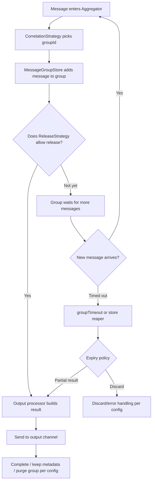

# Tracking Aggregator Groups in Spring Integration

## 1. The Problem: Messages Arrived, Yet the Aggregator Has No Output

In **Enterprise Integration Patterns (EIP)**, an `Aggregator` combines multiple related messages into a single result. For instance, an order consisting of three line items is processed in parallel; the Aggregator must wait for all items before emitting the result. A message that arrived at the input channel without appearing at the output might be **legitimately waiting**, missing a part, failing in the release strategy, or timed out.

To handle this scenario, we must observe **individual message group state**, while measuring total waiting groups, group sizes, wait duration, released groups, expired groups, and late arrivals.

This is the lesson **"Tracking Aggregator Groups"** in the **Audit and observability** chapter of the `SPRING_INTEGRATION_PATTERN` module. The module focuses on practicing Router, Filter, Transformer, Splitter, Aggregator, Gateway, retry, error channel, and correlation, alongside testing and tracking branches in loosely coupled, extensible flows.

After this lesson, you will be able to:

- Describe the `MessageGroup` lifecycle from receiving the first element through release, timeout, and expiry.
- Distinguish **total groups in the store** from **genuinely waiting groups**.
- Use `MessageGroupStore`, `MessageGroup`, and Micrometer to measure backlog and group age.
- Choose the right milestones to count created groups, built outputs, and downstream-confirmed outputs.
- Investigate missing fragments, bad correlation, duplicates, late arrivals, timeouts, and leftover groups after restarts.
- Write integration tests for incomplete groups, complete groups, and expired-group policies.

## 2. Lifecycle of a Message Group



**Three independent decisions** are commonly confused:

1. **Correlation:** which group does a message belong to? By default, the Aggregator uses Spring Integration's correlation header; the application can configure a custom `CorrelationStrategy`.
2. **Release:** is the group ready to emit a result? By default, `SimpleSequenceSizeReleaseStrategy` relies on sequence metadata; you can also define release by count, state, or group contents.
3. **Expiry:** what happens if a group never meets the release condition in time? It can emit a partial result or be discarded, and then purge the group or retain metadata depending on configuration.

A group can be *waiting*, *ready to release*, *output built*, *completed with retained metadata*, or *removed*. A `MessageGroupStore` record does not necessarily prove the message was successfully processed by an external application.

### Three-Part Order Illustration

Suppose `batchId=order-42`, expecting three fragments:

| Time | Incoming Data | Group in Store | Behavior |
| --- | --- | --- | --- |
| T1 | item A | size = 1 | Not released yet |
| T2 | item B | size = 2 | Continues waiting |
| T3 | item C | size = 3 | Release strategy allows building output |
| T4 | Aggregate output sent | Group completed or deleted | Depends on `expireGroupsUponCompletion` |
| T5 | item D arrives late with same ID | May be discarded or open a new group | Depends on metadata/expiry retention policy |

You cannot conclude that item A or B "was lost" just because there is no output at T2. If three fragments are expected and item C never arrives, the group can wait indefinitely without an appropriate timeout or cleanup policy.

## 3. Correlation ID, Group ID, and Sequence

To track groups accurately, distinguish:

| Field | Meaning | Scope |
| --- | --- | --- |
| `MessageHeaders.ID` | ID of a single specific message | Can change when Transformer/Splitter creates a new message |
| `CORRELATION_ID` | Groups related messages | Can serve as the Aggregator's group key |
| `SEQUENCE_NUMBER` | Position of a message in a sequence | E.g., 1, 2, 3 |
| `SEQUENCE_SIZE` | Expected sequence length | E.g., 3; not every flow knows this upfront |
| `batchId` / business key | Group identifier per business contract | Often needs to stay stable across services and retries |
| `traceId`, `spanId` | Tracing/observability linkage | Do not use as group ID or default deduplication key |

If a **Splitter** precedes the Aggregator, Spring Integration usually attaches sequence/correlation headers so the Aggregator recognizes child messages. With `PublishSubscribeChannel` or a recipient list router, check `applySequence` configuration if using the default sequence-based release strategy.

If choosing a custom `batchId` key, ensure:

- Two distinct processing sessions never accidentally share the same key when they must not merge.
- Every fragment belonging to the same batch carries the exact ID across Filters, Routers, Gateways, and asynchronous channels.
- A clear strategy exists for late fragments, redeliveries, or duplicates.
- Business IDs may appear in **access-controlled audits/logs**, but **never** put raw IDs into metric tags.

A mis-correlated group can look like two separate issues: one group stuck missing a message, and another group holding unexpected messages. When investigating, cross-check the business key, expected fragment count, and ingress audit milestones.

## 4. Reading State from MessageGroupStore

Spring Integration uses `MessageGroupStore` to hold group state while awaiting release. Useful APIs:

| API | Value | How to Interpret |
| --- | --- | --- |
| `getMessageGroup(groupId)` | `MessageGroup` for one key | Inspect a specific group during investigation |
| `getMessageGroupCount()` | Number of stored groups | **May include completed groups still retaining metadata** |
| `getMessageCountForAllMessageGroups()` | Total messages across all groups | Optional API; implementations may not support it |
| `messageGroupSize(groupId)` | Size of one group | Useful when the group ID is known |
| `MessageGroup.size()` | Number of messages in the group when read | Not automatically equal to distinct business parts |
| `MessageGroup.isComplete()` | Group metadata marked complete | Does not prove downstream ACKed |
| `MessageGroup.getTimestamp()` | Group creation time (epoch milliseconds) | Indicates how long the group has existed |
| `MessageGroup.getLastModified()` | Last update time | Distinguishes stalled groups from actively growing groups |
| `MessageGroup.getSequenceSize()` | Expected sequence size if known | May be 0 when unknown |

Example inspecting a single group during investigation:

```java
import java.time.Duration;
import java.time.Instant;
import java.time.Clock;
import org.springframework.integration.store.MessageGroup;
import org.springframework.integration.store.MessageGroupStore;

void inspectGroup(MessageGroupStore store, Object batchId, Clock clock) {
    MessageGroup group = store.getMessageGroup(batchId);
    if (group == null || group.size() == 0) {
        return; // Group may not exist yet or was already removed/completed.
    }

    Duration age = Duration.between(
            Instant.ofEpochMilli(group.getTimestamp()),
            clock.instant());
    Duration idle = Duration.between(
            Instant.ofEpochMilli(group.getLastModified()),
            clock.instant());

    System.out.println("group size=" + group.size());
    System.out.println("expected sequence size=" + group.getSequenceSize());
    System.out.println("complete=" + group.isComplete());
    System.out.println("age=" + age);
    System.out.println("idle=" + idle);
}
```

This is a **diagnostic snippet**: it prints size/age info without logging the group ID or payload contents. With durable stores, `getMessageGroup()` may load all messages; when only metadata is needed, prefer `getGroupMetadata(groupId)` if the implementation supports it. Never scan all groups and load all payloads on every metrics scrape cycle.

### Group Count Differs from Pending Group Count

Under default settings, a normally completed group can keep empty group metadata to recognize and drop late-arriving messages. In that case:

```text
group_count_in_store = 120
group_pending        = 10
completed_tombstones = 110
```

Charting `getMessageGroupCount()` labeled as `pending_groups` in this situation will trigger false alerts. To use group count as backlog, establish an explicit retention rule: for example, purge groups right after normal release with `expireGroupsUponCompletion(true)`, or use a verified incomplete-group filter. Removing metadata early allows **late messages** to start a new group; that is an idempotency and business-policy trade-off.

## 5. Metric Suite to Monitor

| Suggested Metric | Type | Measurement Point | What to Watch Out For |
| --- | --- | --- | --- |
| `app.aggregator.groups.in.store` | Gauge | `MessageGroupStore.getMessageGroupCount()` | Includes completed-group metadata if the store retains it |
| `app.aggregator.messages.in.groups` | Gauge | Total messages remaining in the group store | Optional API; can be expensive on a DB |
| `app.aggregator.group.output.built` | Counter | Output processor builds result | Does not prove channel send or ACK succeeded |
| `app.aggregator.group.age.at.output` | Timer | Group created → output processor runs | Excludes downstream processing |
| `app.aggregator.group.size.at.output` | DistributionSummary | Message count when output is built | Unit is **messages in group**, not batch count |
| `app.aggregator.group.expired` | Counter | Categorized expiry callback/handler | Must separate partial release from discard |
| `app.aggregator.group.late.discarded` | Counter | Flow rejecting confirmed late messages | Do not infer solely from duplicate IDs |
| `app.aggregator.output.confirmed` | Counter | Downstream ACK/commit per contract | Must not increment from output channel send |
| `app.aggregator.oldest.pending.age` | Gauge | Greatest age among truly pending groups | Needs appropriate snapshot/metadata; DB scans can be costly |

The names above are **recommended application conventions**, not a guarantee that Spring Integration emits every meter automatically. Micrometer Observation for handlers/channels reports operation timing, but does not define business outcomes like *group expired due to missing fragment*.

### Choosing Tags

Appropriate tags:

```text
flow=orders
aggregator=orderItems
outcome=normal|partial|discard|error
reason=timeout|missing_part|invalid_sequence|other
```

Do not use `groupId`, `orderId`, `correlationId`, `messageId`, `traceId`, or payloads as tags because each distinct value creates a new time series and risks leaking data. Those IDs belong in logs, traces, or audit events with proper access controls and retention.

## 6. Java DSL Example: Tracking Accumulating Groups

This example uses Java 17, Spring Boot 3.x, Spring Integration 6.x, and Micrometer. The flow aggregates **three messages** sharing the same `batchId` into a `BatchSummary` object. The goal is to illustrate group tracking, not to imply every production application always has three fragments.

### 6.1. Store, Meters, and Flow Configuration

```java
import java.time.Clock;
import java.time.Duration;
import java.util.List;

import io.micrometer.core.instrument.Counter;
import io.micrometer.core.instrument.DistributionSummary;
import io.micrometer.core.instrument.Gauge;
import io.micrometer.core.instrument.MeterRegistry;
import io.micrometer.core.instrument.Timer;
import org.springframework.beans.factory.annotation.Qualifier;
import org.springframework.context.annotation.Bean;
import org.springframework.context.annotation.Configuration;
import org.springframework.integration.annotation.EnableIntegration;
import org.springframework.integration.channel.DirectChannel;
import org.springframework.integration.channel.QueueChannel;
import org.springframework.integration.dsl.IntegrationFlow;
import org.springframework.integration.store.MessageGroup;
import org.springframework.integration.store.MessageGroupStore;
import org.springframework.integration.store.SimpleMessageStore;
import org.springframework.messaging.MessageChannel;
import org.springframework.messaging.PollableChannel;

@Configuration
@EnableIntegration
class AggregationMonitoringConfiguration {

    @Bean("batchInput")
    MessageChannel batchInput() {
        return new DirectChannel();
    }

    @Bean("batchOutput")
    PollableChannel batchOutput() {
        return new QueueChannel();
    }

    @Bean("batchGroupStore")
    MessageGroupStore batchGroupStore() {
        // In-memory store for demo/testing only; lost on process restart.
        return new SimpleMessageStore();
    }

    @Bean
    BatchGroupMetrics batchGroupMetrics(
            @Qualifier("batchGroupStore") MessageGroupStore store,
            MeterRegistry registry) {
        return new BatchGroupMetrics(store, registry, Clock.systemUTC());
    }

    @Bean
    IntegrationFlow batchAggregationFlow(
            @Qualifier("batchGroupStore") MessageGroupStore store,
            BatchGroupMetrics metrics) {
        return IntegrationFlow.from("batchInput")
                .aggregate(a -> a
                        .messageStore(store)
                        .correlationStrategy(
                                message -> message.getHeaders().get("batchId"))
                        .releaseStrategy(group -> group.size() >= 3)
                        .outputProcessor(metrics::buildSummary)
                        // Keep store group count reflecting unreleased groups
                        // in this example; weigh trade-off with late messages.
                        .expireGroupsUponCompletion(true))
                .channel("batchOutput")
                .get();
    }
}

record BatchSummary(String batchId, List<String> items) {}

final class BatchGroupMetrics {
    private final Counter outputBuilt;
    private final Timer ageAtOutput;
    private final DistributionSummary sizeAtOutput;
    private final Clock clock;

    BatchGroupMetrics(
            MessageGroupStore store, MeterRegistry registry, Clock clock) {
        this.clock = clock;

        // Use a dedicated store for this aggregator.
        Gauge.builder("app.aggregator.groups.in.store",
                      store, MessageGroupStore::getMessageGroupCount)
                .description("Number of groups currently retained in the store")
                .tag("aggregator", "orderItems")
                .register(registry);

        // Message-count API may not be supported by every store.
        // For this example's SimpleMessageStore, this API is supported.
        Gauge.builder("app.aggregator.messages.in.groups",
                      store, MessageGroupStore::getMessageCountForAllMessageGroups)
                .tag("aggregator", "orderItems")
                .register(registry);

        outputBuilt = registry.counter(
                "app.aggregator.group.output.built",
                "aggregator", "orderItems");
        ageAtOutput = Timer.builder("app.aggregator.group.age.at.output")
                .description("Time from group creation to output generation")
                .tag("aggregator", "orderItems")
                .register(registry);
        sizeAtOutput = DistributionSummary.builder(
                        "app.aggregator.group.size.at.output")
                .baseUnit("messages")
                .tag("aggregator", "orderItems")
                .register(registry);
    }

    BatchSummary buildSummary(MessageGroup group) {
        // This is when output is *built*, not downstream ACK.
        long ageMillis = Math.max(
                0L, clock.millis() - group.getTimestamp());
        ageAtOutput.record(Duration.ofMillis(ageMillis));
        sizeAtOutput.record(group.size());
        outputBuilt.increment();

        // Build a new payload detached from the store's internal collection.
        List<String> items = group.getMessages().stream()
                .map(message -> (String) message.getPayload())
                .toList();
        return new BatchSummary(String.valueOf(group.getGroupId()), items);
    }
}
```

**Takeaways from the example:**

1. `SimpleMessageStore` lives in process memory; it is suitable only for demos, unit tests, and cases where losing state on restart is acceptable. Production systems must evaluate a durable `MessageGroupStore` per requirements.
2. `correlationStrategy` groups by the `batchId` header. At ingress, validate this header is **non-null**, properly typed, and sufficiently unique; the example assumes the producer already did so.
3. `releaseStrategy(group -> group.size() >= 3)` applies only to fixed counts and does not guard against a fragment arriving twice with different message IDs. When *unique* parts must be guaranteed, use sequence/event IDs and proper idempotency.
4. `outputProcessor` runs when the framework builds the group's output. `output.built` and the Timer do not prove `batchOutput` succeeded or the consumer ACKed.
5. `expireGroupsUponCompletion(true)` deletes normally released groups from the store so backlog is easy to see in the demo. This changes **late arrival** behavior: a later message with the same group ID can open a new group. Adjust configuration when business rules require blocking late messages.
6. `getMessageGroupCount()` and `getMessageCountForAllMessageGroups()` measure state at scrape time. On distributed stores, performance/semantics may differ; never use these reads to drive business transactions.

### 6.2. Sending Three Fragments in the Same Batch

```java
import org.springframework.messaging.MessageChannel;
import org.springframework.messaging.support.MessageBuilder;

void sendItem(MessageChannel batchInput, String batchId, String item) {
    boolean accepted = batchInput.send(
            MessageBuilder.withPayload(item)
                    .setHeader("batchId", batchId)
                    .build());
    if (!accepted) {
        throw new IllegalStateException("Failed to send fragment to Aggregator");
    }
}
```

Suppose `A`, `B`, `C` are sent with `batchId=order-42`: after A and B, the store holds one group with sizes 1 and 2 respectively; after C, `BatchSummary` is built. Because completion expiry is enabled, the group count returns to 0 once processing finishes. **Item ordering in `items` must not be assumed to match send order** without an explicit sequence/ordering policy; tests should verify the set of items.

## 7. Monitoring Timeouts, Partial Results, and Expired Groups

A group may never satisfy its release strategy due to a missing fragment, a Filter drop, a Router sending to the wrong branch, or a producer outage. An appropriate expiry policy is then needed.

In Java DSL, you can add options to the Aggregator configuration:

```java
.aggregate(a -> a
        .messageStore(store)
        .correlationStrategy(message -> message.getHeaders().get("batchId"))
        .releaseStrategy(group -> group.size() >= 3)
        .outputProcessor(metrics::buildSummary)
        .groupTimeout(30_000)
        .sendPartialResultOnExpiry(true)
        .expireGroupsUponCompletion(true)
        .expireGroupsUponTimeout(true))
```

This is an **alternative configuration** for `.aggregate(...)` in section 6, not a second Aggregator chained onto the flow. With a positive `groupTimeout`, if a group still does not qualify for release when the timeout elapses after the last update, the framework schedules a check/force completion; the release strategy may be consulted again. If still incomplete and `sendPartialResultOnExpiry(true)`, the framework can emit a **partial** result. If `false` (default), incomplete groups may be discarded per expiry policy. `expireGroupsUponTimeout` controls removing metadata after timeout handling per config.

**Do not label every `buildSummary()` call as `normal`** when partial results are enabled: the output processor can run on timeout as well. To maintain `normal_released`, `partial_released`, and `expired_discarded` counters, use completion data and callbacks/discard flows at the **exact boundary**; you can also attach business status on the result payload or instrument force-completion points. Do not infer the cause merely from `group.size() < 3` when a release strategy has multiple conditions.

### GroupTimeout vs. MessageGroupStoreReaper

| Mechanism | How It Triggers | When Appropriate? |
| --- | --- | --- |
| `groupTimeout` | Schedules per group when updated without releasing | Avoid waiting indefinitely after the last arriving message |
| `groupTimeoutExpression` | Expression computing timeout/delay per group | Need dynamic timeouts based on group state |
| `MessageGroupStoreReaper` | Periodic job invoking expiry callbacks on the store | Clean up old/orphaned groups and lingering empty metadata |
| `expireTimeout` / `expireDuration` on correlation handler | Periodic purge tied to the handler in supporting versions | Clean up stale groups after restart with durable stores |

If you need a timeout measured from **when the group was created**, do not assume `groupTimeout(30_000)` means "30 seconds from the first fragment." With duration-based group timeouts, the schedule can reset whenever a new message arrives; use an expression based on `MessageGroup.getTimestamp()` or an absolute deadline policy if the contract requires it.

With a reaper running every minute and a 30-second timeout, a group can expire **later** than 30 seconds due to scan intervals. When combining mechanisms, avoid premature cleanup and explicitly define timeout/late-message handling.

## 8. Late Messages, Duplicates, and Durability

### 8.1. Late Arrivals

If `expireGroupsUponCompletion(false)`, a normally completed group can retain **empty metadata** to block late messages sharing the same ID. This increases stored group count even when no fragments are waiting. You need a `MessageGroupStoreReaper` or controlled cleanup to avoid unbounded metadata growth.

If `expireGroupsUponCompletion(true)`, metadata is removed right upon completion; a late message with the same correlation key can start a new group. In order flows, that can produce duplicate outputs or phantom waiting groups. Add an idempotent receiver, business event IDs, or completed-batch state in a durable store if late messages must be blocked.

### 8.2. Duplicate Fragments and Phantom Counts

Suppose a batch expects `A`, `B`, `C`, but upstream sends `A`, `A`, `B` under distinct `MessageHeaders.ID` values. A release strategy checking `group.size() >= 3` could release even though `C` is missing. Consider:

- Using `SEQUENCE_NUMBER`/`SEQUENCE_SIZE` per contract with a sequence-aware release strategy.
- Using idempotency keyed by business fragment ID if redelivery can generate new message IDs.
- Defining policies for duplicate, missing, or mismatched sequence sizes.
- Recording audits for duplicate/late fragments with business correlation; never use them as metric tags.

### 8.3. Durable Stores and Multiple Instances

In-memory `SimpleMessageStore` loses groups across restarts. To recover state, use JDBC, Redis, MongoDB, or another store compatible with your version and infrastructure. However, **a durable store does not automatically solve concurrency**:

- Multiple instances require proper locking to avoid races updating/releasing the same group.
- Persisting state, building output, and downstream ACKs may span different transactions; failures can still cause retries/duplicates.
- Do not share the exact same `MessageGroupStore` instance across independent aggregators with expiry callbacks; the framework warns/restricts multiple correlation handlers running expiry on one store.
- When sharing a database resource, partition/assign distinct regions and prevent group key collisions.
- Plan recovery for leftover groups after restart; in-memory timeout schedules may need rescheduling or store scanning.

## 9. Dashboards and Alerts for Stuck Groups

An Aggregator dashboard should examine simultaneously:

1. **Groups/messages in store**: is the count growing steadily?
2. **Oldest pending age** and overdue groups: is any group sitting far too long without release?
3. **Output build latency** p50/p95/p99: how long do released groups take from creation?
4. **Output built / output confirmed**: are results built but failing downstream?
5. **Expiry/partial/discard/late**: how many groups hit timeouts and why?
6. **Input fragment rate vs. group release rate**: is there an abnormal gap relative to expected group size?

With a Prometheus exporter, the example metrics from section 6 typically appear as:

```promql
# Total groups still retained by the store (do not assume all are pending).
app_aggregator_groups_in_store{aggregator="orderItems"}
```

```promql
# Rate of group outputs built, in groups/second.
rate(app_aggregator_group_output_built_total{
  aggregator="orderItems"
}[5m])
```

When histograms are enabled on `app.aggregator.group.age.at.output` via `.publishPercentileHistogram()` or equivalent distribution config, you can compute p95:

```promql
histogram_quantile(
  0.95,
  sum by (le) (
    rate(app_aggregator_group_age_at_output_seconds_bucket{
      aggregator="orderItems"
    }[5m])
  )
)
```

**The p95 query works only when histograms are exported**; the snippet in section 6 registers a plain Timer. Moreover, this p95 covers only groups **that reached the output processor**, excluding groups stuck waiting indefinitely. Always pair it with oldest pending age and group backlog.

| Signal | Question to Investigate | Additional Evidence |
| --- | --- | --- |
| Store group count rising steadily | Unreleased groups or accumulating empty metadata? | `isComplete`, expiry config, pending count |
| Group size stays below expected | Missing fragment or wrong correlation? | Sequence headers, ingress audit, Filter/Router |
| Oldest pending age spikes | Consumer, timeout, or reaper stopped? | Scheduler, task errors, group store |
| Partial/discard rising | Upstream losing fragments or timeout too tight? | Retries, Filter, error channel, branch latency |
| Output built rising while confirmed stays flat | Downstream slow/failing or missing ACKs? | Output channel, adapter errors, broker lag |
| Store write latency rising | Backend store bottleneck? | DB pool, lock waits, store metrics |
| Late messages rising | Premature timeout, redelivery, or duplicate IDs? | Producer logs, business key, dedup state |

When suspecting stuck groups, investigate in order: **input fragments → correlation key → store group size → release strategy → timeout/scheduler → output/ACK**. Never conclude a group lost messages merely from `input_count - output_count`: a Splitter multiplies fragments, a Filter legitimately drops items, and an Aggregator performs fan-in.

## 10. Testing Group State and Metrics

### 10.1. Integration Test: Incomplete Group Then Release

This test uses JUnit 5, AssertJ, and Spring Test. Because the example configuration has no Spring Boot auto-configuration, it provides a `SimpleMeterRegistry` in the test:

```java
import static org.assertj.core.api.Assertions.assertThat;

import io.micrometer.core.instrument.MeterRegistry;
import io.micrometer.core.instrument.simple.SimpleMeterRegistry;
import org.junit.jupiter.api.Test;
import org.springframework.beans.factory.annotation.Autowired;
import org.springframework.beans.factory.annotation.Qualifier;
import org.springframework.context.annotation.Bean;
import org.springframework.context.annotation.Configuration;
import org.springframework.integration.store.MessageGroupStore;
import org.springframework.messaging.Message;
import org.springframework.messaging.MessageChannel;
import org.springframework.messaging.PollableChannel;
import org.springframework.messaging.support.MessageBuilder;
import org.springframework.test.context.junit.jupiter.SpringJUnitConfig;

@SpringJUnitConfig(classes = {
        AggregationMonitoringConfiguration.class,
        AggregatorGroupTest.TestMeterConfiguration.class
})
class AggregatorGroupTest {

    @Configuration
    static class TestMeterConfiguration {
        @Bean
        MeterRegistry meterRegistry() {
            return new SimpleMeterRegistry();
        }
    }

    @Autowired
    @Qualifier("batchInput")
    MessageChannel input;

    @Autowired
    @Qualifier("batchOutput")
    PollableChannel output;

    @Autowired
    @Qualifier("batchGroupStore")
    MessageGroupStore store;

    @Autowired
    MeterRegistry registry;

    private void send(String batchId, String value) {
        assertThat(input.send(MessageBuilder.withPayload(value)
                .setHeader("batchId", batchId)
                .build())).isTrue();
    }

    @Test
    void groupIsPendingUntilThreeMessagesArrive() {
        send("order-42", "A");
        send("order-42", "B");

        assertThat(store.getMessageGroupCount()).isEqualTo(1);
        assertThat(store.getMessageGroup("order-42").size()).isEqualTo(2);
        assertThat(output.receive(0)).isNull();

        send("order-42", "C");

        Message<?> result = output.receive(1_000);
        assertThat(result).isNotNull();
        BatchSummary summary = (BatchSummary) result.getPayload();
        assertThat(summary.batchId()).isEqualTo("order-42");
        assertThat(summary.items())
                .containsExactlyInAnyOrder("A", "B", "C");

        // Example configuration expires the group upon completion.
        assertThat(store.getMessageGroupCount()).isZero();
        assertThat(registry.get("app.aggregator.group.output.built")
                .tag("aggregator", "orderItems")
                .counter().count()).isEqualTo(1.0);
        assertThat(registry.get("app.aggregator.group.age.at.output")
                .tag("aggregator", "orderItems")
                .timer().count()).isEqualTo(1);
    }
}
```

This test verifies the example's **three-message policy**, output build milestone, and group cleanup. It does not prove downstream broker or database processing succeeded. When using a durable store in production, add dedicated restart/recovery and transaction tests.

### 10.2. Test Matrix to Add

| Test Case | Expectation and Reason |
| --- | --- |
| Two fragments in same batch | Group size = 2, no output yet |
| Third fragment arrives | Group releases once; output contains all three items |
| Two interleaved batches | Each batch gets its own group ID; messages never mix |
| Missing fragment, timeout expires | Emits partial or discards per contract; expiry metric recorded |
| Fragment arrives near deadline | Timeout/release neither loses nor duplicates output per policy |
| Late fragment after completion | Rejected or starts a new group **according to chosen config** |
| Duplicate fragment with new ID | Do not assume `group.size() >= 3` prevents duplicates |
| Filter drops one fragment | Can leave group waiting; cross-check Filter and aggregator metrics |
| Router splits across branches | Group receives only fragments routed to it |
| Store does not support group-count API | Meters do not break business flow; fallback or alternative metric exists |
| Durable store + restart | Remaining groups recover; timeout/orphan cleanup works |
| Multiple concurrent producers | No duplicate release or race condition; verify locking |
| Downstream send fails | Distinguish `output.built` from `output.confirmed` |
| Group completed with metadata retained | Group count must not be mislabeled as pending |

For timeout tests, use a controllable `TaskScheduler` in the test environment or bounded condition waits instead of fixed `Thread.sleep()`. For retry and transaction tests, ensure assertions check exact post-commit or post-rollback state according to the flow's policy.

## 11. Common Design Mistakes

1. **Using `getMessageGroupCount()` as pending count in every configuration.** Completed tombstones may still be retained to block late messages.
2. **Assuming every group has a fixed fragment count.** For scatter-gather or incomplete sequence metadata, release strategies may need other conditions.
3. **Treating `groupTimeout` as deadline from group creation.** Duration-based schedules can reset whenever a new message arrives.
4. **Counting every `ReleaseStrategy` invocation as a group release.** The strategy can be evaluated many times before releasing and consulted again on timeout.
5. **Counting output construction as an ACK.** Running the output processor does not mean downstream committed.
6. **Looking only at p95 of released groups.** Stuck groups produce no output and never enter the Timer; track oldest pending age.
7. **Putting group ID into metric tags.** This creates very high cardinality and can expose business data.
8. **Scanning all groups and loading payloads on every scrape.** Can overload JDBC/Redis stores, spike CPU, and cause lock contention.
9. **Expiring metadata too early without idempotency.** Late fragments can open a new group and emit duplicate output.
10. **Sharing one store across multiple aggregators with expiry.** Another handler's callback can affect the wrong group; enforce clear partitioning and ownership.

## 12. Production Checklist

- [ ] Define group key, sequence contract, and uniqueness rules for each Aggregator.
- [ ] Track groups in store, messages in groups, and outputs built/confirmed.
- [ ] Define pending vs. completed tombstones and how metadata is excluded from backlog numbers.
- [ ] Track oldest pending age and expired groups; measure unreleased groups too.
- [ ] Measure release latency, size distribution, and partial/discard counts by reason.
- [ ] Configure `groupTimeout`, `MessageGroupStoreReaper`, or orphaned-group cleanup policies.
- [ ] Define late arrival, duplicate, retry, and dead-letter behavior per business contract.
- [ ] With durable stores / multiple instances, verify lock registry, transactions, and recovery.
- [ ] Never put correlation IDs, payloads, or message IDs into metric tags.
- [ ] Write integration tests for complete/incomplete groups, timeouts, late arrivals, duplicates, and downstream errors.
- [ ] Build dashboards showing backlog, oldest age, output rate, expiry, timeouts, and store errors.
- [ ] Keep audits/logs/traces to reconcile individual batches when aggregate metrics look abnormal.

## 13. References

- [Spring Integration Reference — Aggregator](https://docs.spring.io/spring-integration/reference/aggregator.html)
- [Spring Integration Reference — Metrics and Management](https://docs.spring.io/spring-integration/reference/metrics.html)
- [Spring Integration Javadoc — MessageGroupStore](https://docs.spring.io/spring-integration/docs/6.5.x/api/org/springframework/integration/store/MessageGroupStore.html)
- [Spring Integration Javadoc — MessageGroup](https://docs.spring.io/spring-integration/docs/6.5.x/api/org/springframework/integration/store/MessageGroup.html)
- [Spring Integration Javadoc — AggregatorSpec](https://docs.spring.io/spring-integration/docs/6.5.x/api/org/springframework/integration/dsl/AggregatorSpec.html)
- [Micrometer Reference — Meters](https://docs.micrometer.io/micrometer/reference/concepts.html)

**Remember:** monitoring an Aggregator requires watching both **waiting groups** and **built outputs**. Group counts must be interpreted alongside metadata retention policies; timeouts, late arrivals, and duplicates must be governed by explicit contracts. Combining group store visibility, metrics, correlation, and auditing pinpoints true bottlenecks without mistaking legitimately waiting groups for lost messages.
