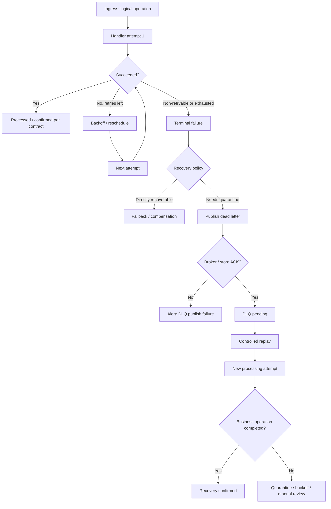

# Tracking Retries, Dead Letters, and Recovery in Spring Integration

## 1. A Failed Message Can Traverse Multiple States

In systems built with **Enterprise Integration Patterns (EIP)**, an error in a handler does not necessarily mean the message is lost. Spring Integration can retry the operation via **Retry**, route the failure to an **Error Channel**, retain unprocessable messages in a **dead-letter queue (DLQ)**, and later run a **Recovery** or replay workflow once the root cause is fixed.

For example, an order flow goes through `Gateway → Transformer → Router → Service Activator → Outbound Adapter`. The inventory API experiences a transient outage; the first and second attempts fail, and the third succeeds. In another case, the payload violates the schema and should not be retried; the message must be quarantined for repair or investigation. If you only count exceptions, the operations team will not know **how many business operations ultimately failed**, **how many messages sit in the DLQ**, and **how many replayed messages succeeded**.

This lesson belongs to the **Audit and observability** chapter of the `SPRING_INTEGRATION_PATTERN` module, where we practice designing loosely coupled, extensible flows and testing Router, Filter, Transformer, Splitter, Aggregator, Gateway, retry, error channel, and correlation branches.

After this lesson, you will be able to:

- Distinguish **attempt**, **logical operation**, **terminal failure**, **DLQ publish**, **replay**, and **recovery confirmed**.
- Choose where to record metrics across `RequestHandlerRetryAdvice`, error channels, DLQ publishers, and replay consumers.
- Understand when an exception propagates back to the caller vs. when it is wrapped into an `ErrorMessage`.
- Record data that reconciles a message across attempts without creating high-cardinality metric tags.
- Design dashboards/alerts for retry storms, poison messages, DLQ backlog, and failed recoveries.
- Test retry success, retry exhaustion, duplicate replays, DLQ publish failures, and downstream errors.

## 2. Distinguishing Milestones to Avoid Miscounting



| Concept | Unit of Count | Observation Milestone and Meaning |
| --- | --- | --- |
| **Logical operation** | One identified business request | Can span multiple attempts, traces, and deliveries |
| **Handler attempt** | One actual handler invocation | Includes the first try and retries; may fail |
| **Retry attempt** | One attempt **after** the initial try | With 3 total attempts, there are typically 2 retries |
| **Attempt failure** | One attempt throwing an exception | May belong to a business operation that eventually succeeds |
| **Terminal failure** | Failure not resolved within the current policy | Either non-retryable or retry budget exhausted |
| **Recovery callback invoked** | Recovery callback ran | Does not yet prove DLQ write or fallback completed |
| **DLQ publish acknowledged** | Broker/store confirmed receipt of the failure record | Does not mean the replay consumer processed it |
| **Replay started** | Consumer picked up / initiated replay | May be redelivered and execute multiple times |
| **Recovery confirmed** | Business operation completed per defined milestone | Requires a real completion signal from handler/transaction/destination |

**Example:** One request failing twice and succeeding on the third try produces `handler_attempts=3`, `attempt_failures=2`, `retry_attempts=2`, `logical_success=1`, and `terminal_failures=0`. Using handler invocation count as the denominator for business success rate produces the wrong percentage.

## 3. Error Classification Determines Retry vs. Dead Letter

Not every exception should be retried:

| Error Category | Examples | Suggested Policy |
| --- | --- | --- |
| **Transient** | Network timeout, temporary HTTP 503, recoverable deadlock | Bounded retry with appropriate backoff and jitter |
| **Permanent** | Schema mismatch, missing required field, deterministic validation failure | Do not retry pointlessly; reject/quarantine per contract |
| **Unknown** | Unfamiliar exception, insufficient classification info | Conservative policy; record error code and inspect before replay |
| **Rate-limited** | HTTP 429 or missing permit | Respect `Retry-After`/rate limits; avoid causing retry storms |
| **Partial side effect** | Target committed, yet client timed out before receiving ACK | Handle idempotency/reconciliation before resending |

In Spring Integration, an endpoint exception may be wrapped in a `MessagingException` or another exception. **Retry policies must classify along the full exception cause chain**, not just match the outer exception class. Test retryable and non-retryable failure types against your real adapters and handlers.

Operational principles:

1. Cap total attempts and total retry duration according to your SLO.
2. Use exponential backoff and jitter when many producers hit a degraded dependency concurrently.
3. Do not block business threads sleeping through long retries; switch to scheduled retries or durable queues.
4. When side effects are not idempotent, add an idempotency key and state check prior to retrying.
5. Clearly define whether a retry happens **within the same execution** or as a **new redelivery** after rollback/restart.

## 4. How RequestHandlerRetryAdvice, Error Channel, and DLQ Differ

**`RequestHandlerRetryAdvice`** is an advice attachable to a Spring Integration endpoint handler to re-invoke that handler via a `RetryTemplate`. It operates within **the scope of the advised handler**. If an error happens before reaching the handler, inside a router, or in another unadvised adapter, that handler's retry advice does not cover it.

**`errorChannel`** is a `MessageChannel` receiving `ErrorMessage` payloads when error reporting publishes to it. In synchronous flows using `DirectChannel`, exceptions may propagate back to the caller; in asynchronous endpoints/pollers, errors may be sent to a configured error channel. Therefore, never assume every failure lands on the global `errorChannel`.

**DLQ/dead-letter store** holds unprocessable messages and error metadata for investigation or replay. Sending an `ErrorMessage` to a `recoveryEvents` channel only emits an **internal recovery event**. If that channel is an in-memory `QueueChannel`, it is **not yet** durable dead-letter storage. To confirm a dead letter is persisted, you need an outbound adapter/broker/database and an explicit ACK/commit milestone.

| Component | Role | What Not to Infer |
| --- | --- | --- |
| `RequestHandlerRetryAdvice` | Retries the handler's operation | That it retries every error across every endpoint |
| `RetryTemplate` | Decides whether to retry and how long to wait | That a retry is always safe for side effects |
| `ErrorMessageSendingRecoverer` | Uses a recovery callback to publish an `ErrorMessage` to a target channel | That the record is already safely in a durable DLQ |
| `errorChannel` | Message-based error-handling path | That all synchronous exceptions arrive here |
| DLQ publisher/consumer | Stores error info for quarantine and replay | That a broker ACK confirms business recovery |
| Replay worker | Pulls and reprocesses per policy | That each replay is guaranteed to run only once |

Subtle detail: when `RecoveryCallback` handles retry exhaustion by **sending an error message to a channel**, it can **return normally** to the endpoint. Thus, `input.send(...) == true` or no thrown exception does not mean the handler completed the business work. Measure business outcomes where completion evidence actually exists.

## 5. Essential Metric Suite

A well-defined metric suite can be structured as follows:

| Suggested Application Metric | Type | Unit and Milestone |
| --- | --- | --- |
| `app.eip.retry.handler.attempts` | Counter | One handler invocation, including the initial attempt |
| `app.eip.retry.attempt.outcomes` | Counter | One attempt returning `success` or `error` |
| `app.eip.retry.attempt.duration` | Timer | Execution duration of **each attempt**, excluding backoff |
| `app.eip.retry.recovery.invoked` | Counter | Recovery callback starts running |
| `app.eip.retry.terminal.errors` | Counter | One logical processing cycle ends in unrecovered failure |
| `app.eip.dlq.publish.acked` | Counter | Dead-letter sink ACKed per protocol |
| `app.eip.dlq.publish.failed` | Counter | Failed to send/persist to DLQ |
| `app.eip.dlq.pending` | Gauge | Actual backlog from broker/store |
| `app.eip.dlq.oldest.age` | Gauge | Age of oldest waiting message from a trusted timestamp |
| `app.eip.replay.started` | Counter | A replay attempt started |
| `app.eip.replay.outcomes` | Counter | Outcome of a replay attempt: `success\|error\|skipped` |
| `app.eip.recovery.confirmed` | Counter | Business operation confirmed complete after recovery |

These are **custom application metric names**, not all emitted automatically by Spring Integration. Spring Integration/Micrometer can provide channel/handler observations and metrics, while broker clients and Spring Retry may have their own telemetry. Before adding custom instrumentation, check `MeterRegistry` or your exporter to avoid registering two counters with the same meaning but conflicting definitions.

### Safe Tagging Conventions

| Tag | Valid Examples | Notes |
| --- | --- | --- |
| `flow` | `orders`, `inventory` | Fixed name in configuration |
| `stage` | `reserveStock`, `publishOrder` | Bounded handler name |
| `outcome` | `success`, `error`, `recovered`, `skipped` | Fixed value set |
| `error_class` | `timeout`, `validation`, `dependency`, `other` | Use an allowlist; never use `exception.getMessage()` |
| `destination` | `ordersDlq`, `manualReview` | Logical name, no URLs/tokens |
| `attempt` | `first`, `retry`, `exhausted` | Finite bucketing if truly needed |
| `messageId`, `orderId`, `traceId`, `correlationId` | Per-message values | **Never use as metric tags** |

To investigate a specific message, use the business ID or `flowExecutionId` in **controlled audits/logs/traces**, not in metric labels. Likewise, never put stack traces, raw payloads, JWTs, or personal data into tags or baggage.

## 6. Java DSL Example: Handler Retry and Terminal Error Routing to a Recovery Channel

This example uses Java 17, Spring Integration 6.x, Spring Retry 2.x, and Micrometer. A simulated handler processes orders; `retry-ok-42` fails twice and then succeeds, while `always-fail-43` fails all three attempts. `terminalEvents` is an **in-memory queue to demonstrate the error path**, which must be replaced by a durable sink in production.

### 6.1. Advice, Flow, and Counter Configuration

```java
import java.util.concurrent.ConcurrentHashMap;
import java.util.concurrent.ConcurrentMap;
import java.util.concurrent.TimeUnit;
import java.util.concurrent.atomic.AtomicInteger;

import io.micrometer.core.instrument.MeterRegistry;
import org.springframework.beans.factory.annotation.Qualifier;
import org.springframework.context.annotation.Bean;
import org.springframework.context.annotation.Configuration;
import org.springframework.integration.annotation.EnableIntegration;
import org.springframework.integration.channel.DirectChannel;
import org.springframework.integration.channel.QueueChannel;
import org.springframework.integration.dsl.IntegrationFlow;
import org.springframework.integration.handler.advice.ErrorMessageSendingRecoverer;
import org.springframework.integration.handler.advice.RequestHandlerRetryAdvice;
import org.springframework.messaging.MessageChannel;
import org.springframework.messaging.MessageHandler;
import org.springframework.messaging.PollableChannel;
import org.springframework.retry.policy.SimpleRetryPolicy;
import org.springframework.retry.backoff.FixedBackOffPolicy;
import org.springframework.retry.support.RetryTemplate;

@Configuration
@EnableIntegration
class RetryObservationConfiguration {

    @Bean("ordersInput")
    MessageChannel ordersInput() {
        return new DirectChannel();
    }

    @Bean("terminalEvents")
    PollableChannel terminalEvents() {
        // Used to observe ErrorMessage in this exercise.
        // Not yet a durable DLQ.
        return new QueueChannel(100);
    }

    @Bean
    DemoOrderService demoOrderService() {
        return new DemoOrderService();
    }

    @Bean
    RetryTemplate orderRetryTemplate() {
        RetryTemplate template = new RetryTemplate();
        template.setRetryPolicy(new SimpleRetryPolicy(3));
        FixedBackOffPolicy backoff = new FixedBackOffPolicy();
        backoff.setBackOffPeriod(25L);
        template.setBackOffPolicy(backoff);
        return template;
    }

    @Bean
    RequestHandlerRetryAdvice orderRetryAdvice(
            RetryTemplate orderRetryTemplate,
            @Qualifier("terminalEvents") MessageChannel terminalEvents,
            MeterRegistry registry) {
        RequestHandlerRetryAdvice advice = new RequestHandlerRetryAdvice();
        advice.setRetryTemplate(orderRetryTemplate);
        ErrorMessageSendingRecoverer recoverer =
                new ErrorMessageSendingRecoverer(terminalEvents);
        advice.setRecoveryCallback(context -> {
            // Only confirms the callback was invoked.
            registry.counter("app.eip.retry.recovery.invoked",
                    "flow", "orders").increment();
            return recoverer.recover(context);
        });
        return advice;
    }

    @Bean
    MessageHandler meteredOrderHandler(
            DemoOrderService service, MeterRegistry registry) {
        return message -> {
            registry.counter("app.eip.retry.handler.attempts",
                    "flow", "orders").increment();
            String outcome = "success";
            long started = System.nanoTime();
            try {
                service.process((String) message.getPayload());
            } catch (RuntimeException exception) {
                outcome = "error";
                throw exception;
            } finally {
                registry.counter("app.eip.retry.attempt.outcomes",
                        "flow", "orders", "outcome", outcome).increment();
                registry.timer("app.eip.retry.attempt.duration",
                        "flow", "orders", "outcome", outcome)
                        .record(System.nanoTime() - started, TimeUnit.NANOSECONDS);
            }
        };
    }

    @Bean
    IntegrationFlow orderFlow(
            MessageHandler meteredOrderHandler,
            RequestHandlerRetryAdvice orderRetryAdvice) {
        return IntegrationFlow.from("ordersInput")
                .handle(meteredOrderHandler, endpoint ->
                        endpoint.advice(orderRetryAdvice))
                .get();
    }

    static class DemoOrderService {
        private final ConcurrentMap<String, AtomicInteger> invocations =
                new ConcurrentHashMap<>();

        void process(String orderId) {
            int number = invocations.computeIfAbsent(
                    orderId, key -> new AtomicInteger()).incrementAndGet();

            if (orderId.startsWith("always-fail")
                    || (orderId.startsWith("retry-ok") && number < 3)) {
                throw new IllegalStateException(
                        "Simulated error at attempt " + number);
            }
        }
    }
}
```

**How to read this example:**

1. `SimpleRetryPolicy(3)` allows at most **three total attempts**, meaning up to two retries after the first try. The illustrative policy retries exceptions by default; **in production, restrict retries to transient errors**, checking the exception cause chain and total elapsed time.
2. `FixedBackOffPolicy(25 ms)` keeps tests fast; in production, select backoff, jitter, and timeouts based on your SLO/dependencies instead of blindly copying 25 ms.
3. `RequestHandlerRetryAdvice` is attached to the `meteredOrderHandler` endpoint; each retry re-invokes this handler. `app.eip.retry.handler.attempts` therefore counts handler invocations, while `app.eip.retry.attempt.outcomes` records success/error per attempt.
4. The recovery callback increments `recovery.invoked` and delegates to `ErrorMessageSendingRecoverer`. This counter **does not** prove the error message was durably stored; even if sending to the channel fails, the callback was still invoked.
5. `terminalEvents` is an in-memory `QueueChannel`. Upon receiving an `ErrorMessage`, a dedicated consumer should classify and persist it to a durable DLQ. Do not label the count of `terminalEvents.send()` calls as committed dead letters.
6. `DemoOrderService` only simulates controlled failures in tests. Never use an in-memory `ConcurrentMap` keyed by business ID for deduplication or long-lived state; production needs real persistence/idempotency.

For Spring Boot applications, common dependencies are:

```groovy
dependencies {
    implementation("org.springframework.boot:spring-boot-starter-integration")
    implementation("org.springframework.boot:spring-boot-starter-actuator")
    implementation("org.springframework.retry:spring-retry")
    testImplementation("org.springframework.boot:spring-boot-starter-test")
    testImplementation("org.springframework.integration:spring-integration-test")
}
```

When Spring Boot dependency management is active, avoid pinning individual library versions manually; use the versions compatible with your application's Spring Integration and Spring Retry releases.

### 6.2. Expected Results Across Both Paths

| Message Sent to `ordersInput` | Handler Attempts | Attempt Failures | Terminal Recovery Callback |
| --- | ---: | ---: | ---: |
| `retry-ok-42` | 3 | 2 | 0 |
| `always-fail-43` | 3 | 3 | 1 |
| **Total** | **6** | **5** | **1** |

If the recovery callback sends an `ErrorMessage` to `terminalEvents` and returns normally, `always-fail-43` may not cause `ordersInput.send()` to throw an exception. That means it **transitioned to the error-handling path**, not that the order business operation completed.

### 6.3. Inspecting `ErrorMessage` After Retry Exhaustion

```java
import org.springframework.messaging.Message;
import org.springframework.messaging.MessagingException;
import org.springframework.messaging.PollableChannel;
import org.springframework.messaging.support.ErrorMessage;

void inspectTerminalError(PollableChannel terminalEvents) {
    Message<?> event = terminalEvents.receive(1_000);
    if (!(event instanceof ErrorMessage errorMessage)) {
        throw new IllegalStateException("ErrorMessage not received");
    }

    Throwable failure = errorMessage.getPayload();
    System.out.println("error type=" + failure.getClass().getSimpleName());

    if (failure instanceof MessagingException messagingFailure) {
        Message<?> failedMessage = messagingFailure.getFailedMessage();
        if (failedMessage != null) {
            System.out.println("messageId=" + failedMessage.getHeaders().getId());
            // If flowExecutionId is present, extract it for reconciliation; do not put it into metric tags.
        }
    }
}
```

`ErrorMessage` carries the exception; `failedMessage` may be absent or nested inside a wrapped exception chain. Never dump raw payloads/headers/stack traces into metrics or uncontrolled logs. In practice, extract allowlisted fields such as normalized error code, `flowExecutionId`, timestamp, stage name, attempt count, and sanitized error details.

## 7. Turning Terminal Failures into Replayable Dead-Letter Records

A DLQ record should hold **enough data for controlled replay** while complying with security policies. Example intermediate event:

```json
{
  "eventType": "PROCESSING_TERMINAL_FAILURE",
  "sourceFlow": "orders",
  "stage": "reserveStock",
  "sourceEventId": "src-event-8841",
  "flowExecutionId": "flow-7294",
  "originalMessageId": "msg-2394",
  "occurredAt": "2026-11-21T08:55:00Z",
  "attemptCount": 3,
  "errorClass": "dependency_timeout",
  "destination": "ordersDlq",
  "schemaVersion": 1,
  "payloadReference": "secure-object-ref-91"
}
```

The JSON sample above is only a **reference application contract**, not a framework-generated format. `payloadReference` should point only to data stored under proper retention, encryption, and access control; sometimes a controlled copy of the payload is stored for replay. Never store raw access tokens, passwords, JWTs, PII, or arbitrary stack traces.

### Separating Three Publishing Milestones

1. **`DLQ_PUBLISH_REQUESTED`**: decided to send to the dead-letter sink.
2. **`DLQ_PUBLISH_ACKNOWLEDGED`**: broker/database confirmed per contract; only now increment `app.eip.dlq.publish.acked`.
3. **`DLQ_CONSUMED`**: a worker or operator begins reprocessing the record; does not mean the business operation has recovered yet.

If writing to the DLQ fails, **never silently drop the message** and merely increment an attempt counter. Depending on reliability requirements, roll back the transaction, write to an outbox in the same business transaction, spill over to backup storage, or retain an intervention-required state with alerts. Sending to a DLQ on the business thread **does not automatically create an atomic transaction** across database and broker.

### Dead Letters vs. Filter-Discarded Messages

A Filter can drop messages under normal business rules, such as an event outside the sync scope. That is `REJECTED` or `DISCARDED`, **not automatically error handling**. If policy requires retaining those messages, keep `filter.rejected` separate from `dlq.published` and record the reason clearly. A message entering a DLQ may stem from validation failures, external timeouts, retry exhaustion, or dead-letter routing; each source requires a different recovery strategy.

## 8. Recovery and Replay: When Is It Truly Complete?

**Recovery** is an end-to-end remediation process after failure: fallback, compensation, data repair, replay, or manual review. **Replay** is merely the act of re-injecting a message into a processing flow. Replay alone does not prove recovery succeeded.

```text
DLQ_PENDING
    |
    +-- inspect / classify
    |      +-- PERMANENT -> QUARANTINED / MANUAL_REVIEW
    |      '-- RETRYABLE -> REPLAY_REQUESTED
    |                            |
    |                            '-- REPLAY_STARTED
    |                                  +-- FAILED -> RETRY_SCHEDULED / DLQ_PENDING
    |                                  '-- SUCCEEDED -> RECOVERY_CONFIRMED
    '-- retention / security policy
```

To replay safely:

1. **Classify root cause:** was the bug/schema/permission fixed or did the dependency recover? Never bulk-replay while the original fault persists.
2. **Preserve lineage:** store `sourceEventId`, `originalMessageId`, `flowExecutionId`, `replayJobId`, `attempt`, and `replayedFrom` in audits. Keep these IDs out of metric labels.
3. **Idempotency:** downstream may have committed before its ACK arrived; check idempotency keys and business state before reprocessing.
4. **Throttle load:** use small batches, rate limits, concurrency caps, and backoff so you do not knock over a newly recovered dependency.
5. **Confirm outcome:** mark recovery confirmed after contract-verified business completion/commit/ACK, not merely after `channel.send() == true`.
6. **Prevent DLQ loops:** cap redrive attempts and quarantine poison messages for manual review.
7. **Have a kill switch:** monitor replay failure rate and pause replay batches automatically or manually when thresholds are exceeded.

A replayed message may start a **new trace**, yet must preserve business correlation. `traceId` is not an idempotency key; replay runs can have different trace IDs while belonging to the same original event.

## 9. Auditing, Retries, and Transactions

Metrics show only aggregate counts. To answer *"How many times was order 42 retried and where is it now?"*, you need structured audit events, correlation, and durable storage.

| Audit Event | When Emitted? | Key Fields |
| --- | --- | --- |
| `PROCESSING_ATTEMPTED` | Handler begins an attempt | `flowExecutionId`, stage, attempt |
| `ATTEMPT_FAILED` | Attempt throws an error | `errorCode`, attempt, timestamp |
| `RETRY_SCHEDULED` | Decided to retry after backoff | Scheduled retry time, reason |
| `TERMINAL_FAILURE` | No further retries under current policy | Terminal reason, stage |
| `DEAD_LETTER_CONFIRMED` | DLQ storage/broker ACKed | Destination, DLQ record ID |
| `REPLAY_REQUESTED` | Replay command issued | Operator/system, job ID, lineage |
| `REPLAY_STARTED` | Worker actually begins reprocessing | Replay attempt |
| `RECOVERY_CONFIRMED` | Business outcome confirmed | Business outcome, commit/ACK |

If a system uses JDBC transactions to persist business state and outbox rows, both can be saved in **the same transaction** with a dispatcher publishing the outbox after commit. However, when the dispatcher resends after a crash, consumers still need idempotency. If a flow spans brokers, HTTP, and databases across multiple systems, `@Transactional` on one service does not provide end-to-end exactly-once semantics.

Distinguishing Spring Integration behaviors:

- Synchronous handlers may throw errors back to the caller; retry advice can loop on the same thread.
- With polling consumers, rollback/redelivery can cause **the entire message to be reprocessed from scratch**, unlike in-advice retries.
- `ErrorMessageSendingRecoverer` emits an `ErrorMessage`, while durable dead-letter storage and recovery status must be handled by a dedicated step.
- When a Router/Splitter creates multiple child messages, one fragment's outcome is not automatically the whole order's outcome; correlate group status at the aggregation point.

## 10. Dashboards and Alerts for Retries, DLQ, and Recovery

A dashboard becomes actionable when placing **processing health** next to **recovery capability**:

| Signal | How to Read | When to Alert |
| --- | --- | --- |
| Handler attempts and attempt error rate | Are transient errors rising? | Attempts spike anomalously while baseline traffic is steady |
| Terminal failure rate | How many executions end in failure? | Exceeds SLO or spikes suddenly |
| Retry latency/backoff | Are retries stretching requests or pinning threads? | p95/p99 climbs, worker exhaustion |
| DLQ publish failures | Are we losing ability to isolate errors? | DLQ write errors occur or outbox backlog grows |
| DLQ pending and oldest age | How large and how old is the backlog? | Count or age exceeds operational thresholds |
| Replay success/error rate | Is the recovery batch working? | Error rate climbs; pause/throttle replay |
| Recovery confirmed | How many items truly recovered? | Confirmations lag behind terminal failures |
| Duplicate/idempotency conflicts | Are redeliveries causing repeated effects? | Conflict count rises or duplicate side effects appear |

### PromQL Examples

With Prometheus, the Counter `app.eip.retry.handler.attempts` is typically exported as `app_eip_retry_handler_attempts_total`. **Always verify the exact metric name** in your exporter before copying queries.

Handler invocation rate per second:

```promql
sum(rate(app_eip_retry_handler_attempts_total{
  flow="orders"
}[5m]))
```

Attempt error ratio (not **business** failure ratio):

```promql
sum(rate(app_eip_retry_attempt_outcomes_total{
  flow="orders",outcome="error"
}[5m]))
/
clamp_min(
  sum(rate(app_eip_retry_attempt_outcomes_total{
    flow="orders",outcome=~"success|error"
  }[5m])),
  0.000001
)
```

Rate of terminal retry recovery callbacks:

```promql
sum(rate(app_eip_retry_recovery_invoked_total{
  flow="orders"
}[5m]))
```

This metric means **the recovery callback was invoked**, not that the DLQ write succeeded or replay worked. To track DLQ rate, use `app.eip.dlq.publish.acked` at the callback/adapter that receives real confirmation.

### Example Numbers to Read Correctly

Over 10 minutes, suppose:

```text
logical_operations               = 1.000
handler_attempts                 = 1.180
attempt_errors                   =   200
terminal_failures                =    20
dlq_publish_acked                =    20
replays_started                  =    15
replays_succeeded                =    12
replays_failed                   =     3
recovery_confirmed               =    12
dlq_pending                      =     8  (assuming no other inflows/outflows)
```

These numbers make sense if there were 180 retries and 20 operations ultimately failed. **Never** assume `logical_operations = handler_attempts`; nor treat `replays_started=15` as 15 recovered items. `dlq_pending=8` holds only when the queue model, ACKs, retries, inflows/outflows, and measurement window actually reconcile that way.

## 11. Testing Retries and the Terminal Error Path

### 11.1. Integration Test Verifying Attempt Counts

This example uses the configuration from section 6, JUnit 5, AssertJ, and Spring Test. The test creates a `SimpleMeterRegistry` to read metrics in the same context:

```java
import static org.assertj.core.api.Assertions.assertThat;

import io.micrometer.core.instrument.MeterRegistry;
import io.micrometer.core.instrument.simple.SimpleMeterRegistry;
import org.junit.jupiter.api.Test;
import org.springframework.beans.factory.annotation.Autowired;
import org.springframework.beans.factory.annotation.Qualifier;
import org.springframework.context.annotation.Bean;
import org.springframework.context.annotation.Configuration;
import org.springframework.messaging.Message;
import org.springframework.messaging.MessageChannel;
import org.springframework.messaging.PollableChannel;
import org.springframework.messaging.support.ErrorMessage;
import org.springframework.messaging.support.MessageBuilder;
import org.springframework.test.context.junit.jupiter.SpringJUnitConfig;

@SpringJUnitConfig(classes = {
        RetryObservationConfiguration.class,
        RetryObservationTest.TestMetrics.class
})
class RetryObservationTest {
    @Configuration
    static class TestMetrics {
        @Bean
        MeterRegistry testRegistry() {
            return new SimpleMeterRegistry();
        }
    }

    @Autowired
    @Qualifier("ordersInput")
    MessageChannel input;

    @Autowired
    @Qualifier("terminalEvents")
    PollableChannel terminalEvents;

    @Autowired
    MeterRegistry meters;

    @Test
    void measuresAttemptsAndTerminalRecovery() {
        input.send(MessageBuilder.withPayload("retry-ok-42").build());
        assertThat(terminalEvents.receive(0)).isNull();

        input.send(MessageBuilder.withPayload("always-fail-43").build());
        Message<?> terminal = terminalEvents.receive(1_000);
        assertThat(terminal).isInstanceOf(ErrorMessage.class);

        assertThat(meters.get("app.eip.retry.handler.attempts")
                .tag("flow", "orders")
                .counter().count()).isEqualTo(6.0);
        assertThat(meters.get("app.eip.retry.attempt.outcomes")
                .tags("flow", "orders", "outcome", "success")
                .counter().count()).isEqualTo(1.0);
        assertThat(meters.get("app.eip.retry.attempt.outcomes")
                .tags("flow", "orders", "outcome", "error")
                .counter().count()).isEqualTo(5.0);
        assertThat(meters.get("app.eip.retry.recovery.invoked")
                .tag("flow", "orders")
                .counter().count()).isEqualTo(1.0);
    }
}
```

The test proves both the **succeed after retry** and **terminate via recovery callback** paths, along with exact handler invocation counts. It **does not yet test durable DLQ persistence or replay**; test those against real brokers/stores and assert post-commit/ACK state.

### 11.2. Essential Test Matrix

| Scenario | Expectation |
| --- | --- |
| Handler succeeds on first try | 1 attempt, 0 retries, no recovery callback |
| Transient failure then success | N attempts, N − 1 failures, final outcome succeeds |
| Permanent non-retryable error | No pointless retries; clear single terminal failure |
| Attempts exhausted | Recovery callback runs per policy; terminal event emitted |
| Recovery channel full / no subscriber | Reports publish/recovery error; does not mark DLQ ACK |
| DLQ publisher fails | `dlq.publish.failed` increments; fallback save or rollback runs |
| Broker ACKed, not yet replayed | DLQ pending remains; `recovery.confirmed` has not incremented |
| Replay succeeds | Records replay outcome success with business completion evidence |
| Replay fails again | Records new attempt; enforces redrive cap/quarantine |
| Duplicate / redelivery | Idempotency prevents duplicate side effects while preserving attempt audits |
| Downstream committed but ACK lost | Retry does not duplicate business work; relies on idempotency/reconciliation |
| Splitter / Aggregator | Distinguishes fragment failure from whole group/batch |
| Trace context broken | Business correlation still links audits across retries/replays |

For asynchronous flows, await bounded conditions rather than fixed `Thread.sleep()`. Assert metrics alongside payloads, outputs, and error channels so you never get green counters while business items are misrouted.

## 12. Common Mistakes

1. **Counting every exception as a failed message.** One business operation may fail two attempts and succeed on the third.
2. **Thinking `SimpleRetryPolicy(3)` means three retries after the first try.** It means three total attempts in the example configuration.
3. **Retrying validation or permanent errors.** Wastes capacity and can mask upstream schema breaks.
4. **Treating an `ErrorMessage` sent to a `QueueChannel` as a durable DLQ.** In-memory queues vanish on restart.
5. **Treating `send() == true` as logical success.** A recovery callback may have diverted the error and returned normally.
6. **Counting DLQ publish requested as acknowledged.** If the broker or database fails, the message is not yet safe.
7. **Marking replay started as recovered.** Only a verified business outcome/commit/ACK proves recovery.
8. **Leaving replay unbounded.** Poison messages can spin in endless DLQ loops.
9. **Using trace ID or message ID as an idempotency key.** They can change across executions; use a durable business ID.
10. **Putting dynamic IDs and error messages into metric tags.** Causes cardinality explosion, higher costs, and data leaks.
11. **Ignoring errors from the error flow or DLQ publisher.** Secondary failures can break reconciliation.
12. **Forgetting partial side effects.** Timeouts do not prove the target never committed; enforce idempotency.

## 13. Production Checklist

- [ ] Clearly define logical operation, attempt, retry attempt, terminal failure, DLQ ACK, and recovery confirmed.
- [ ] Classify transient vs. permanent errors and handle Spring Integration/Spring Retry exception wrappers.
- [ ] Cap attempts, configure backoff/jitter, bound total retry time, and enforce rate limits.
- [ ] Record metrics on the real handler, recovery callback, DLQ publisher, and replay consumer at exact milestones.
- [ ] Emit audit events with correlation, attempt, source event ID, outcome, and timestamp for reconciliation.
- [ ] Back the DLQ with durable storage, bounds, access control, retention, encryption, and publish-failure handling.
- [ ] Gate replays with proper permissions/approvals, idempotency, rate limits, quarantine, and kill switches.
- [ ] Build dashboards for retry attempts/errors, terminal failures, DLQ pending/oldest age, replay outcomes, and confirmed recoveries.
- [ ] Test retry success, exhaustion, non-retryable faults, DLQ failures, duplicates, redeliveries, and lost ACKs.
- [ ] Never confuse Filter discards with dead letters; never conflate fragments with logical operations.
- [ ] Never put order IDs, message IDs, trace IDs, payloads, or exception messages into metric tags.
- [ ] Check built-in framework and broker client telemetry before registering duplicate meters.

## 14. References

- [Spring Integration — Handler Advice and Retry Advice](https://docs.spring.io/spring-integration/reference/handler-advice/classes.html)
- [Spring Integration — Error Handling](https://docs.spring.io/spring-integration/reference/error-handling.html)
- [Spring Integration — Metrics and Management](https://docs.spring.io/spring-integration/reference/metrics.html)
- [Spring Retry Reference](https://docs.spring.io/spring-retry/reference/)
- [Micrometer — Counters](https://docs.micrometer.io/micrometer/reference/concepts/counters.html)
- [Micrometer — Timers](https://docs.micrometer.io/micrometer/reference/concepts/timers.html)

**Remember:** tracking retries, dead letters, and recovery requires separating **attempts executed**, **terminal failure ending an execution**, **dead letters durably persisted**, and **business operations genuinely recovered**. Combining metrics, audits, traces, correlation, and idempotency gives clear visibility into failure handling without mistaking error-path routing for business success.
