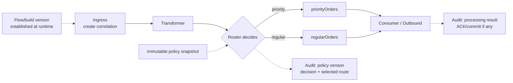

# Recording Flow or Route Versions in Spring Integration

## 1. Why Is Versioning Part of Auditing?

An application implementing **Enterprise Integration Patterns (EIP)** may run steadily for months, yet its flows never stay static. The development team updates Filter predicates, adds Router branches, upgrades a Transformer, tunes retry policies, or deploys another Gateway. During a rolling deployment, two application versions can even process messages **concurrently**.

Suppose at 09:00 order `VIP:42` enters the `priorityOrders` branch, while at 10:00 a similar order enters `regularOrders`. That can be completely valid if a new routing policy was just activated. If logs record only `route=regular` without recording **the routing rule version that made the decision**, operators struggle to explain why two identical messages produced different outcomes.

This lesson, **"Recording Flow or Route Versions,"** belongs to the **Audit and observability** chapter of the `SPRING_INTEGRATION_PATTERN` module. Toward the goal of building loosely coupled, extensible Spring Integration flows while testing and tracking Router, Filter, Transformer, Splitter, Aggregator, Gateway, retry, error channel, and correlation branches, **versioning** links observed behavior to the exact configuration and rules that produced it.

After this lesson, you will be able to:

- Distinguish versions of the **flow definition**, **routing policy**, **deployment**, **message schema**, and **business workflow**.
- Decide what versions to record at ingress, when a Router picks a branch, when a handler finishes, and at the audit sink.
- Stamp versions into message headers safely without trusting upstream-supplied claims.
- Capture the version used at decision time, even when routing policies change dynamically at runtime.
- Query logs, traces, audits, and metrics to compare behavior across deployments.
- Design tests for rollouts, rollbacks, replays, queued messages, and routing-rule changes.

## 2. Version Concepts That Must Not Be Conflated

| Version Type | What Does It Identify? | Example | When Can It Change? |
| --- | --- | --- | --- |
| **Flow definition version** | Endpoint/channel graph, step order, published processing contract | `orders-flow/3.2.0` | When flow structure, handlers, or flow-bound rules change |
| **Routing policy version** | Rule set / decision table the Router uses to pick branches | `routing-orders/r17` | When governed rules, mappings, or decision data change |
| **Deployment revision** | Software/container/config build deployed to an instance | `build-2026.11.21.1` | On each build, release, or policy-driven redeploy |
| **Message schema version** | Payload/event structure and data contract | `order-event/v2` | When the payload schema changes |
| **Business workflow version** | Approved business process version | `fulfillment-policy/2026-11` | Can change independently of technical deployments |
| **Trace/span ID** | Instrumented execution/operation instance | `traceId`, `spanId` | Every trace/span; **not a version** |
| **Message/correlation ID** | One message or one business processing execution | `messageId`, `flowExecutionId` | Per message or business execution; **not a version** |

A single build can run **multiple routing policy versions** if rules can change via a config store or dynamic decision table. Conversely, two deployment revisions may share the same `flowDefinitionVersion` if only logging or unrelated details changed.

### Recommended Naming Convention

In this lesson, we use **application-defined headers**:

```text
flowDefinitionVersion   = "orders-flow/3.2.0"
routingPolicyVersion    = "routing-orders/r17"
deploymentRevision      = "build-2026.11.21.1"
selectedRoute           = "priority"
routeDecidedAt          = "2026-11-21T09:00:00Z"
flowExecutionId         = "flow-7294"
messageSchemaVersion    = "order-event/v2"
```

These are **not built-in Spring Integration reserved headers**. The application must set, validate, and propagate them per contract. Avoid using a single generic `version` name because it leaves unclear whether it refers to schema, flow, or routing policy.

## 3. When Should Versions Be "Stamped"?



Distinguish these milestones:

1. **Ingress accepted:** the application admits a message into processing; it can stamp `flowDefinitionVersion`, `deploymentRevision`, and a validated correlation ID.
2. **Route decided:** the Router uses a **consistent snapshot** of the policy, selects a branch, and stamps `routingPolicyVersion`, `selectedRoute`, and `routeDecidedAt`.
3. **Route dispatched:** Spring Integration delivers the message to the channel chosen by the Router. This milestone differs from *route decided*, because dispatch can fail.
4. **Handler processed:** the endpoint completed its handler contract; if asynchronous, this milestone can occur after upstream `send()` returns.
5. **External delivery confirmed:** downstream/broker/service confirms per contract. A broker ACK is not automatically a consumer business transaction commit.

**Key principle:** the version must be recorded **at the moment the decision takes effect**. If right before writing the audit record the code queries "get current policy version," it may get a newer version that **no longer matches the rule that actually chose the route**.

### Example of Changing Rules While a Flow Is Running

```text
09:00:00  Active policy = routing-orders/r17
09:00:01  Message M1 reads snapshot r17 -> selectedRoute=priority
09:00:02  Operator activates policy r18
09:00:03  Message M2 reads snapshot r18 -> selectedRoute=regular
09:00:04  M1 is finally processed by consumer (after queuing)
```

Since M1 was routed under r17, **never overwrite** M1's `routingPolicyVersion` with r18 just because r18 is active by the time the consumer picks it up. The consumer may record `consumerDeploymentRevision` and `processedAt`, while preserving M1's decision history.

## 4. Source of Truth for Versions and Update Rules

### 4.1. Flow Version from Release Artifacts

`flowDefinitionVersion` should come from an **immutable release artifact or configuration** tied to the deployment. Some projects use semantic versioning; others use a revision or hash of a flow specification. What matters is not the string format, but being able to retrieve **the exact logic that ran**.

To make versions useful in audits:

- Maintain a changelog covering topology, endpoints, channel mappings, retry policies, and payload contracts.
- Link each version to the commit/artifact and environment configuration at deployment time.
- Never reuse the same version identifier for **two** different sets of logic.
- When rolling back to an older artifact, revert to the flow version matching that artifact while recording a separate deployment/rollback event.

### 4.2. Routing Policy Version Must Travel With an Immutable Content Snapshot

If routes are driven by a config/decision table updatable at runtime, `routingPolicyVersion` must identify an **immutable rule set**. For example, store:

```text
policyId: orders-priority
policyVersion: routing-orders/r17
policyChecksum: sha256:...
activatedAt: 2026-11-21T09:00:00Z
activatedBy: approved-deployment
```

`policyChecksum` helps catch content edits made without bumping the version name; do not copy long checksums into metric tags. Full rules and approval trails belong in a config/audit store.

During hot reloads, swap the **entire snapshot** atomically instead of updating `routeA`, `routeB`, and finally `version` piecemeal. Otherwise, a message could read half old rules and half new rules, making the recorded version impossible to explain.

### 4.3. Distinguishing "Activated" from "Used"

A `ROUTING_POLICY_ACTIVATED` event announcing r18 is active does not prove message M2 used r18. During multi-instance rolling deployments, each pod may run a different policy revision. Record the **per-message decision version** in addition to environment-level activation logs.

## 5. Designing Audit Data for Versions and Routes

An audit record for a routing decision might look like this:

```json
{
  "eventType": "ROUTE_DECIDED",
  "eventId": "evt-9081",
  "flowName": "orders",
  "flowExecutionId": "flow-7294",
  "messageId": "msg-42",
  "flowDefinitionVersion": "orders-flow/3.2.0",
  "routingPolicyVersion": "routing-orders/r17",
  "deploymentRevision": "build-2026.11.21.1",
  "messageSchemaVersion": "order-event/v2",
  "selectedRoute": "priority",
  "plannedChannel": "priorityOrders",
  "occurredAt": "2026-11-21T09:00:01Z",
  "decisionOutcome": "SELECTED"
}
```

This is an **illustrative application-defined schema**; Spring Integration does not emit this JSON automatically. Keep separate records for:

| Event | When Recorded? | Meaning |
| --- | --- | --- |
| `FLOW_INGRESS_ACCEPTED` | Ingress accepts message | Confirms the message entered processing |
| `ROUTING_POLICY_ACTIVATED` | Operator/config controller activates a rule revision | Tracks environment policy changes |
| `ROUTE_DECIDED` | Rules select a routing result | Confirms the rule version **actually used** |
| `ROUTE_DISPATCHED` | Send to channel succeeds per channel contract | Does not prove consumer completion |
| `ROUTE_DISPATCH_FAILED` | Error sending / resolving target channel | Needs investigation; may retry |
| `MESSAGE_PROCESSED` | Handler finishes defined operation | Internal processing outcome |
| `DELIVERY_CONFIRMED` | Destination confirms per contract | Distinguish broker ACK from business commit |
| `MESSAGE_REPLAYED` | Original message re-enters processing | Records old/new rule versions and links attempt |

If audits must be durable, persist records via transactions/outbox or a sink with an explicit retry policy. Calling `auditStore.append(...)` before the Router dispatches only proves **the decision was recorded**; it does not prove dispatch succeeded. Conversely, if the Router dispatches and the audit write fails, provide recovery via correlation/transactions rather than silently treating the audit as complete.

## 6. Java DSL Example: Stamping Versions at Decision Time

This example uses **Java 17, Spring Integration 6.x**. The flow receives a `String` payload, uses an immutable routing policy snapshot to choose `priority` or `regular`, and stamps the policy version **together** with the routing decision. Two output `QueueChannel` beans make messages easy to inspect in practice.

### 6.1. Versioned Policy and Stamper

```java
import java.time.Clock;
import java.util.Map;
import java.util.Objects;
import java.util.concurrent.atomic.AtomicReference;

import org.springframework.messaging.Message;
import org.springframework.messaging.support.MessageBuilder;

record RoutingPolicySnapshot(String version, boolean vipUsesPriority) {
    RoutingPolicySnapshot {
        Objects.requireNonNull(version, "version");
    }

    String chooseRoute(String payload) {
        boolean isVip = payload.startsWith("VIP:");
        return (isVip && vipUsesPriority) ? "priority" : "regular";
    }
}

final class RoutingPolicyRegistry {
    private final AtomicReference<RoutingPolicySnapshot> active =
            new AtomicReference<>(
                    new RoutingPolicySnapshot("routing-orders/r17", true));

    RoutingPolicySnapshot snapshot() {
        return active.get();
    }

    void activate(RoutingPolicySnapshot next) {
        // Demo: atomically swap the snapshot.
        // Production needs revision, permission, checksum, and activation audit checks.
        active.set(Objects.requireNonNull(next));
    }
}

final class VersionedRouteDecision {
    private final RoutingPolicyRegistry registry;
    private final Clock clock;

    // These two values represent metadata of the running release.
    // Production should obtain them from managed build/config.
    private final String flowVersion = "orders-flow/3.2.0";
    private final String deploymentRevision = "build-2026.11.21.1";

    VersionedRouteDecision(RoutingPolicyRegistry registry, Clock clock) {
        this.registry = registry;
        this.clock = clock;
    }

    Message<String> stamp(String payload, Map<String, Object> inputHeaders) {
        RoutingPolicySnapshot snapshot = registry.snapshot();
        String route = snapshot.chooseRoute(payload);
        String target = route.equals("priority")
                ? "priorityOrders" : "regularOrders";

        // Before the flow, validate/filter headers from untrusted sources.
        // setHeader overwrites any version/route values claimed by upstream.
        return MessageBuilder.withPayload(payload)
                .copyHeaders(inputHeaders)
                .setHeader("flowDefinitionVersion", flowVersion)
                .setHeader("routingPolicyVersion", snapshot.version())
                .setHeader("deploymentRevision", deploymentRevision)
                .setHeader("selectedRoute", route)
                .setHeader("plannedChannel", target)
                .setHeader("routeDecidedAt", clock.instant().toString())
                .build();
    }
}
```

On every call to `stamp()`, the local `snapshot` variable is read **once**. Both `route` and `routingPolicyVersion` come from that exact snapshot. Even if another thread swaps the policy immediately after `snapshot()`, the current message still carries the exact revision that decided its path.

Note: `copyHeaders(inputHeaders)` is for an internal demo. With HTTP, brokers, or untrusted sources, **allowlist** accepted headers and validate `flowExecutionId`, schema version, and payload. A client must never be allowed to assert an authoritative `routingPolicyVersion` or `selectedRoute`. In the code above, those critical headers are overwritten on the server side.

### 6.2. Spring Integration Flow Configuration

```java
import java.time.Clock;
import org.springframework.context.annotation.Bean;
import org.springframework.context.annotation.Configuration;
import org.springframework.integration.annotation.EnableIntegration;
import org.springframework.integration.channel.DirectChannel;
import org.springframework.integration.channel.QueueChannel;
import org.springframework.integration.dsl.IntegrationFlow;
import org.springframework.messaging.MessageChannel;
import org.springframework.messaging.PollableChannel;

@Configuration
@EnableIntegration
class VersionedRoutingConfiguration {

    @Bean
    RoutingPolicyRegistry routingPolicyRegistry() {
        return new RoutingPolicyRegistry();
    }

    @Bean
    VersionedRouteDecision versionedRouteDecision(
            RoutingPolicyRegistry policies) {
        return new VersionedRouteDecision(policies, Clock.systemUTC());
    }

    @Bean("ordersInput")
    MessageChannel ordersInput() {
        return new DirectChannel();
    }

    @Bean("priorityOrders")
    PollableChannel priorityOrders() {
        return new QueueChannel();
    }

    @Bean("regularOrders")
    PollableChannel regularOrders() {
        return new QueueChannel();
    }

    @Bean
    IntegrationFlow versionedOrderFlow(VersionedRouteDecision decision) {
        return IntegrationFlow.from("ordersInput")
                .handle((payload, headers) ->
                        decision.stamp((String) payload, headers))
                // Expression reads the header just stamped by the server.
                .route("headers['selectedRoute']", router -> router
                        .channelMapping("priority", "priorityOrders")
                        .channelMapping("regular", "regularOrders"))
                .get();
    }
}
```

**Observations:**

- `ordersInput` is a `DirectChannel`, so `stamp()` usually runs synchronously on the sending thread.
- `RoutingPolicyRegistry` is injected as a bean and can be updated by a controlled admin service.
- `.route("headers['selectedRoute']", ...)` uses a SpEL expression to read the decision header and dispatch to the declared channel.
- `priorityOrders` and `regularOrders` are `QueueChannel` beans; a message arriving in the queue **does not yet mean the consumer processed it successfully**.
- `plannedChannel` in the header represents **routing intent** at decision time. It is not dispatch confirmation; if you need a `ROUTE_DISPATCHED` event, record it where successful send evidence exists.

When an invalid route key occurs, configure `defaultOutputChannel`, `resolutionRequired`, or an appropriate error-handling policy. Never silently drop messages just because a policy picked an unmapped key.

### 6.3. Testing Two Policy Revisions

```java
import org.springframework.messaging.MessageChannel;
import org.springframework.messaging.PollableChannel;
import org.springframework.messaging.Message;
import org.springframework.messaging.support.MessageBuilder;

void tryTwoPolicies(
        MessageChannel ordersInput,
        PollableChannel priorityOrders,
        PollableChannel regularOrders,
        RoutingPolicyRegistry policies) {

    ordersInput.send(MessageBuilder.withPayload("VIP:42")
            .setHeader("flowExecutionId", "flow-42")
            .build());
    Message<?> first = priorityOrders.receive(1_000);
    if (first == null) {
        throw new IllegalStateException("Missing result for r17");
    }
    System.out.println(first.getHeaders().get("routingPolicyVersion"));
    // routing-orders/r17

    policies.activate(new RoutingPolicySnapshot("routing-orders/r18", false));

    ordersInput.send(MessageBuilder.withPayload("VIP:43")
            .setHeader("flowExecutionId", "flow-43")
            .build());
    Message<?> second = regularOrders.receive(1_000);
    if (second == null) {
        throw new IllegalStateException("Missing result for r18");
    }
    System.out.println(second.getHeaders().get("routingPolicyVersion"));
    // routing-orders/r18
}
```

`r17` sends `VIP:42` to priority; `r18` in the example changes the rule to send `VIP:43` to regular. The change shows up in **both the routing result and the version**, not just in policy activation logs.

## 7. How Message History, Logs, Traces, Metrics, and Audits Retain Versions

| Observability Source | How Is Version Used? | Limitations |
| --- | --- | --- |
| **Message headers** | Carries `flowDefinitionVersion`, `routingPolicyVersion` to downstream steps | May be stripped at boundaries/adapters; not durable by itself |
| **Message history** | Shows named endpoints/channels traversed | Does not record rule versions automatically; endpoint name does not replace revision |
| **Structured logs** | Logs `route_decided`, `flow`, `version`, `selectedRoute`, and correlation | Not guaranteed durable; subject to sampling/retention |
| **Distributed traces** | Attaches flow/route revision as span attributes at decision points | Not all traces are stored; subject to sampling |
| **Micrometer metrics** | Compares requests/latency/errors per flow/route; add version only with bounded cardinality | Unsuitable for dynamic IDs or continuously changing versions |
| **Audit store** | Stores versions, decisions, event/causation, and confirmation status | Requires retention, consistency, idempotency, and access control |

Do not treat `MessageHistory` as a rule-version audit system. History records the Spring Integration components traversed; a Router bean is still named `routeByPriority` in both r17 and r18. To know **which rule** was applied, record `routingPolicyVersion` at decision time.

### Structured Log Example

```json
{
  "event": "route_decided",
  "flow": "orders",
  "routingPolicyVersion": "routing-orders/r18",
  "flowDefinitionVersion": "orders-flow/3.2.0",
  "selectedRoute": "regular",
  "flowExecutionId": "flow-7294",
  "traceId": "4bf92f3577b34da6a3ce929d0e0e4736"
}
```

In logs/traces, dynamic IDs may be logged under security policies to trace individual transactions. In **metric tags**, never include `flowExecutionId`, `messageId`, `orderId`, `traceId`, payloads, or arbitrary URLs because they inflate cardinality and can leak information.

### Metrics for Version Rollouts

You can define application metrics such as:

```text
app.eip.route.decisions{flow="orders",route="priority"}  Counter
app.eip.route.decisions{flow="orders",route="regular"}   Counter
app.eip.route.dispatch.errors{flow="orders"}            Counter
app.eip.flow.handler.duration{flow="orders",stage="reserve"} Timer
```

When only a few versions run concurrently, you can add an **allowlisted** `flow_version` or `policy_version` tag to compare canary/rollback behavior. However, if revisions change per message or every commit generates a new build hash, a version tag causes high cardinality. Use `release_track=stable|canary` in metrics instead, keeping exact revisions in audits/logs/traces.

Example Prometheus query for route distribution:

```promql
sum by (route) (
  rate(app_eip_route_decisions_total{flow="orders"}[5m])
)
```

With a bounded version tag:

```promql
sum by (policy_version, route) (
  rate(app_eip_route_decisions_total{
    flow="orders",policy_version=~"r17|r18"
  }[5m])
)
```

**Do not assume** Spring Integration automatically emits `app.eip.route.decisions`: this is a custom meter explicitly recorded at the decision point. Prometheus may alter naming formatting; always verify in your live exporter.

## 8. Which Versions Do Router, Filter, Splitter, Aggregator, Gateway, and Retry Need?

| Pattern / Scenario | Where to Record Version? | Notes |
| --- | --- | --- |
| **Router** | At route selection, record policy snapshot revision and selected route | Dynamic routers changing rules require capturing the snapshot at decision time |
| **Filter** | When predicate yields accepted/rejected, record filter-rule revision | `rejected` must remain distinct from predicate errors |
| **Transformer** | At the transform step, record transform/schema revision when contract changes | Message schema version is not the same as flow version |
| **Splitter** | When spawning child messages, keep lineage/version on parent and children | One parent yields many outputs; correlation/sequence must be clear |
| **Aggregator** | Store processing policy / group rule version on group creation or release | A group may be created under r17 and released when r18 is active |
| **Gateway** | Record ingress deployment/flow revision and request–reply milestones | A gateway timeout does not prove the request went unprocessed |
| **Retry** | Each attempt must know which policy/handler version applied | In-process retries vs. post-deploy replays can run different versions |
| **Error channel / DLQ** | Record the failing flow/rule revision alongside error stage/reason | Do not overwrite with the current version as if it ran on the old message |
| **Recovery / replay** | Keep both `originalRuleVersion` and `replayRuleVersion` | Reprocessing under a newer rule may be intentional |
| **Correlation** | Links messages of the same logical operation; not a version | Never use trace IDs as a substitute for business correlation |

### Aggregator Group Spanning a Rule Update

Suppose fragments A and B enter group `order-42` under policy r17; fragment C arrives after r18 is activated. There are at least two valid policies:

1. **Pin to group:** the group stores `groupRuleVersion=r17` upon creation and applies r17 group logic to the entire group.
2. **Evaluate at release:** the group releases under r18 if permitted by contract; audits record both `groupCreatedRuleVersion=r17` and `releaseRuleVersion=r18`.

Never silently assume the Aggregator "knows" which rule version to use. This is an **application business and technical decision**; test it against incomplete groups, timeouts, late arrivals, and restarts.

### Retries and Replays Are Not the Same

Synchronous retry advice may re-invoke the same handler within one deployment, typically using the same configuration unless hot-reloaded. In contrast, a message sent to a DLQ and replayed three days later may traverse a different flow release. Decide explicitly between:

- **Reprocess under original rules:** retrieve the saved r17 policy snapshot, if permitted and still available.
- **Reprocess under current rules:** intentionally apply r18; audits must preserve both r17 on the original attempt and r18 on the replay.
- **Manual migration:** transform the payload/schema or rule via an approved procedure before replaying.

To prevent duplicate processing, use a business event ID / idempotency key and real state checks—**never** `routingPolicyVersion` or `traceId` as a default unique key.

## 9. Rolling Deployments, Canaries, and Rollbacks

During a rollout, instances can run different versions:

```text
09:00  pod-A: flow 3.1, routing r17
09:01  pod-B: flow 3.2, routing r18 (canary)
09:02  pod-C: flow 3.1, routing r17
09:10  rollout complete: majority of pods running 3.2 / r18
```

Between 09:01 and 09:10, two messages with identical payloads taking different branches **can be completely valid**. Accurate analysis requires `deploymentRevision`, `flowDefinitionVersion`, `routingPolicyVersion`, and route outcome **per message**.

Before a rollout:

1. Write a changelog covering branch/behavior changes, policy revisions, schema compatibility, and rollback steps.
2. Test both old and new rules; ensure new workers still understand messages already sitting in queues.
3. Bound canary exposure with steady traffic, watching route distribution, Filter rejections, retries, handler latency, and errors.
4. Ensure every policy version traces back to an approved artifact.
5. Define how Aggregator/group-store state is preserved or migrated across version boundaries.

On rollback, **the deployment reverts to the prior version**, yet messages still in queues or traces may already have been decided by the newer version. Never "rewrite" old audits to make every message look processed by the rolled-back build. Instead, emit a `ROLLBACK_ACTIVATED` event and let each message retain the version stamped at its own milestones.

## 10. Header Propagation and Trust Boundaries

Within a single Spring Integration flow, custom headers are usually forwarded when the framework builds reply messages via standard mechanisms. However, **never assume they are immutable or transmitted everywhere**.

### Boundaries to Verify

- **Transformers or custom handlers:** manually building a new `Message` without copying required metadata can drop version headers.
- **Router / Splitter:** child messages share lineage, yet each branch can produce additional route/version decisions; do not overwrite earlier versions when multiple milestones need auditing.
- **Aggregator:** the aggregated output may pick headers from one message or apply a header aggregation strategy; do not assume all fragments shared the same rule version.
- **ExecutorChannel / QueueChannel:** headers can travel with the message, while current tracer/MDC scope is separate; verify context propagation independently.
- **Kafka/AMQP/JMS/HTTP adapters:** each transport has different header mappers and serialization rules; custom headers do not automatically cross the wire.
- **Untrusted ingress:** a client can spoof a `routingPolicyVersion` header; the server must stamp the decision version from its authoritative policy.

### Single Header vs. Decision History?

A message may pass through **multiple Routers**. If every Router writes to the same `routingPolicyVersion`, later Routers overwrite earlier ones. Better designs:

1. **Stage-named headers:** `priorityPolicyVersion`, `regionPolicyVersion`; works when stages are few and stable.
2. **Append-only audit records:** `ROUTE_DECIDED` with `stage`, `policyVersion`, `selectedRoute`, `occurredAt`; fits many branches and high reliability.
3. **Structured lineage metadata:** a list of decision records inside internal messages if truly needed, bounding header size and protecting against spoofing.

In large systems, **dedicated audit events** are far more reliable than a single header overwritten at every step.

## 11. Testing Versioning and Routing in Java

With the two channels in section 6, the most important test verifies that **identical payloads** route according to the active policy revision and that already-stamped versions do not change when a new revision is activated.

```java
import static org.assertj.core.api.Assertions.assertThat;

import org.junit.jupiter.api.Test;
import org.springframework.beans.factory.annotation.Autowired;
import org.springframework.beans.factory.annotation.Qualifier;
import org.springframework.messaging.Message;
import org.springframework.messaging.MessageChannel;
import org.springframework.messaging.PollableChannel;
import org.springframework.messaging.support.MessageBuilder;
import org.springframework.test.context.junit.jupiter.SpringJUnitConfig;

@SpringJUnitConfig(VersionedRoutingConfiguration.class)
class VersionedRoutingFlowTest {
    @Autowired
    @Qualifier("ordersInput")
    MessageChannel input;

    @Autowired
    @Qualifier("priorityOrders")
    PollableChannel priority;

    @Autowired
    @Qualifier("regularOrders")
    PollableChannel regular;

    @Autowired
    RoutingPolicyRegistry policies;

    @Test
    void stampsPolicyUsedAtTheTimeOfDecision() {
        assertThat(input.send(MessageBuilder.withPayload("VIP:42")
                .setHeader("flowExecutionId", "flow-42")
                .build())).isTrue();

        Message<?> first = priority.receive(1_000);
        assertThat(first).isNotNull();
        assertThat(first.getHeaders().get("selectedRoute"))
                .isEqualTo("priority");
        assertThat(first.getHeaders().get("routingPolicyVersion"))
                .isEqualTo("routing-orders/r17");
        assertThat(first.getHeaders().get("flowDefinitionVersion"))
                .isEqualTo("orders-flow/3.2.0");

        policies.activate(
                new RoutingPolicySnapshot("routing-orders/r18", false));

        assertThat(input.send(MessageBuilder.withPayload("VIP:43")
                .setHeader("flowExecutionId", "flow-43")
                .build())).isTrue();

        Message<?> second = regular.receive(1_000);
        assertThat(second).isNotNull();
        assertThat(second.getHeaders().get("selectedRoute"))
                .isEqualTo("regular");
        assertThat(second.getHeaders().get("routingPolicyVersion"))
                .isEqualTo("routing-orders/r18");

        // Message decided under r17 is not mutated when the policy changes.
        assertThat(first.getHeaders().get("routingPolicyVersion"))
                .isEqualTo("routing-orders/r17");
    }
}
```

This test proves routing decisions and header stamping inside the demo process. It **does not prove** audit events were durably stored, headers crossed a broker, or downstream committed. Write dedicated tests for those boundaries.

### Recommended Test Matrix

| Test Case | Expectation |
| --- | --- |
| Policy r17 selects priority | `selectedRoute=priority`, `routingPolicyVersion=r17` |
| Activate r18 then send new message | New message uses rule/version r18 |
| Message from r17 waiting in `QueueChannel` | Version header r17 is untouched by r18 activation |
| Policy updated while multiple threads send | Each message uses one consistent snapshot; never mixes r17 route with r18 label |
| Ingress sends spoofed `routingPolicyVersion=r999` | Server overwrites with authoritative revision |
| Unmapped route key | Error or default route per contract; diagnostic event emitted |
| Filter has its own revision | Audit records Filter rule separately without borrowing Router version |
| Splitter creates child messages | Preserves lineage and original snapshot version; never confuses fragments with requests |
| Aggregator holds group across deploy | Pins or releases per explicitly specified and tested policy |
| Message crosses HTTP/broker | Header mapper/metadata preserves required version or audit replaces it |
| Replay after rollback | Records both original and replay versions without erasing history |
| Trace sampling drops spans | Audit/correlation still explains which version decided |
| Bump version string without rule change | Activation trail exists without faking behavioral differences |
| Change rule without bumping version | Blocked by checksum/revision controls and config tests |

For concurrency tests, use multiple producer threads, a `CountDownLatch`, and thread-safe result collection to assert that **every `(route, version)` pair is consistent**. Do not assert which exact message lands before vs. after activation without external synchronization; simply ensure no message ever carries "r17 route + r18 version."

## 12. Investigation Runbook When Routing Shifts Unexpectedly

Scenario: after a deployment, VIP messages entering `regularOrders` jumped from 1% to 30%.

1. **Check metric definition:** is the chart measuring `ROUTE_DECIDED` or consumer-processed messages? Does it include retries/duplicates?
2. **Find policy activations:** which revision was activated, when, and on which instances?
3. **Sample audit events:** compare `flowDefinitionVersion`, `routingPolicyVersion`, `selectedRoute`, and `routeDecidedAt` against deployment revisions.
4. **Inspect representative inputs:** did a Transformer alter data before the Router read it? Did the schema version change?
5. **Check channel mappings:** did the Router pick the right key while a channel mapping or default route changed?
6. **Check async/retries:** were queued messages decided under the old policy and processed after the new activation? Were there replays/redeliveries?
7. **Cross-check errors/ACKs:** was the route dispatched successfully? Did consumers process it or did items land in DLQ/retry?
8. **Conclude from version and outcome:** separate intentional shifts caused by r18 from bugs in routing or consumers.

You cannot conclude root cause solely from `traceId`, endpoint name, or deployment timestamp because they do not prove which exact rule ran for each message.

## 13. Common Mistakes

1. **Using the application version in place of the routing policy version.** One deployment may swap rules dynamically, or multiple deployments may share one policy.
2. **Reading the current version at audit-write time**, when the decision actually used an earlier snapshot.
3. **Stamping a version at ingress and assuming every Router uses that rule.** Each Router can have an independent policy version.
4. **Trusting an upstream-supplied version header as truth.** Easily spoofed, buggy, or stale.
5. **Treating `selectedRoute` as `deliveryConfirmed`.** A decision is not dispatch or ACK.
6. **Overwriting history during replays.** Keep separate original and replay versions for investigation.
7. **Putting every version into a single `version` header.** Makes it impossible to tell schema, topology, policy, and deployment apart.
8. **Changing rules while keeping the same revision.** When audits store only the revision, historical logic cannot be reconstructed.
9. **Putting per-message IDs or rapidly changing commit hashes into metric tags.** Causes high cardinality.
10. **Ignoring messages waiting in queues and Aggregators during rollback.** Old and new messages can coexist across a single deployment.
11. **Relying solely on Message History.** Component names do not prove which routing policy version executed.
12. **Assuming broker header propagation works by default.** Verify mapping, trust boundaries, and stripped headers.

## 14. Implementation Checklist

- [ ] Define clear ownership and semantics for `flowDefinitionVersion`, `routingPolicyVersion`, `deploymentRevision`, and `messageSchemaVersion`.
- [ ] Each revision identifies immutable content with traceable changelog/artifact/checksum.
- [ ] Routing policy is read from one consistent snapshot per message decision.
- [ ] Server stamps authoritative versions and never trusts external version headers.
- [ ] Emit an audit event for `ROUTE_DECIDED`, keeping dispatch/handler/ACK separate when reconciliation requires it.
- [ ] Include correlation, causation, and timestamps at key milestones; never use version strings as business IDs.
- [ ] Verify version propagation across Transformer, Router, Splitter, Aggregator, async channels, and broker adapters.
- [ ] Define group pinning/migration rules when Aggregators span deployments.
- [ ] Retries/replays preserve original versions, record new processing versions, and enforce idempotency.
- [ ] Canary/rollback dashboards break down by route and release track with bounded-cardinality tags.
- [ ] Test activation, concurrency, spoofed headers, queued messages, mapping errors, and cross-version replays.
- [ ] Apply appropriate access controls and retention to audit rules, event IDs, and deployment metadata.

## 15. References

- [Spring Integration Reference — Routers](https://docs.spring.io/spring-integration/reference/router.html)
- [Spring Integration Reference — Java DSL](https://docs.spring.io/spring-integration/reference/dsl/java-basics.html)
- [Spring Integration Reference — Message History](https://docs.spring.io/spring-integration/reference/message-history.html)
- [Spring Integration Reference — Message Headers](https://docs.spring.io/spring-integration/reference/message.html)
- [Spring Integration Reference — Metrics and Management](https://docs.spring.io/spring-integration/reference/metrics.html)
- [Spring Integration Reference — Aggregator](https://docs.spring.io/spring-integration/reference/aggregator.html)
- [Micrometer — Observation](https://docs.micrometer.io/micrometer/reference/observation.html)

**Remember:** to explain *why* a message took a specific route, you must record the **decision**, the **exact policy snapshot version applied**, and **downstream milestone outcomes**. Flow version, deployment revision, and message schema version add essential context, but never replace the routing rule's own version. Recording versions at the right moments keeps audits, tests, canaries, rollbacks, and replays explainable even when multiple flow versions run concurrently.
