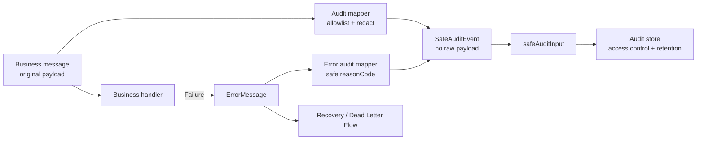
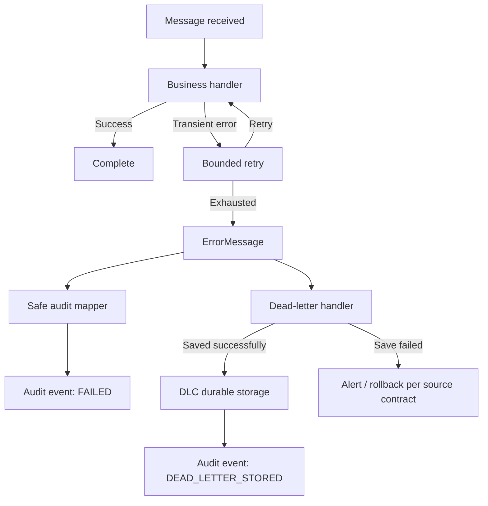

# Masking Payloads When Auditing

In the **SPRING_INTEGRATION_PATTERN** module, Spring Integration helps implement **Enterprise Integration Patterns** (Router, Filter, Transformer, Splitter, Aggregator, Gateway, retry, and error channel) as loosely coupled and extensible message flows. Auditing and observability help answer: *which message passed through which step, when did it fail, who intervened, and what was the final outcome?* However, if raw payloads and headers are written directly into audit logs, the observability system itself can become a data leak vector.

This lesson, **"Masking Payloads When Auditing,"** guides you through designing structured audit events, masking or omitting sensitive data **before sending to the audit channel**, protecting success/error/replay branches, preserving correlation for investigations, and testing to ensure sensitive data never leaks via logs, databases, metrics, or traces.

> **Principle:** Audits must record **what happened in a verifiable way**, not blindly capture the entire message content. Keep only genuinely required fields; apply an **allowlist**, mask/encrypt where permitted, and drop secrets entirely. Never rely on "we will mask it after logging."

## 1. Why Mask Payloads Before Auditing?

Suppose a flow receives a payment request:

```json
{
  "eventType": "PAYMENT_REQUESTED",
  "orderId": "ORD-908712",
  "email": "customer@example.invalid",
  "phone": "0900000000",
  "paymentToken": "tok-EXAMPLE-SECRET",
  "amount": 125000
}
```

A handler calls an external service and fails after retries. An unsafe approach is:

```java
// NOT RECOMMENDED: can put sensitive payload and headers into logs.
log.info("Incoming message: {}", message);
log.error("Processing failed: {}", errorMessage);
```

Here, `Message.toString()` can expose the payload and headers, while `ErrorMessage` contains the `Throwable` and may reference the failing message. Exception messages from external libraries can also contain URLs, tokens, query strings, HTTP parameters, or user data.

When logs are aggregated across multiple systems, a single failure can create copies of sensitive data across:

- Application logs and developer terminals.
- Centralized log dashboards, analytics pipelines, and alerting systems.
- Audit/dead-letter tables or queues used for reprocessing.
- Trace spans, attributes, baggage, and metric labels.
- CSV exports, customer support tools, and backups.

**Masking payloads before emitting audit events** shrinks the leak surface. Note: the business flow itself still processes the original data as required by business logic; this lesson covers what data **enters the audit/observability systems**.

### Distinguishing Audits, Logs, Metrics, and Dead Letters

| Component | Primary Purpose | What It Should Carry |
| --- | --- | --- |
| **Audit event** | Record actions and outcomes for traceability/compliance | Event code, flow, timestamp, safe identifiers, outcome, verified actor |
| **Application log** | Diagnose application behavior | Error code, component, trace/correlation ID; avoid raw payloads |
| **Metric** | Measure trends, counts, latency | Counters/gauges/histograms with low-cardinality labels; no PII |
| **Trace** | Track paths across endpoints | Span/trace IDs, status, duration; attributes must be controlled |
| **Dead Letter Channel** | Isolate unprocessable messages for investigation/replay | Error metadata and protected payload references; never dump raw data into audits by default |

An audit record can state which `correlationId` an `ORDER_PROCESSING_FAILED` event belongs to; any payload needed for recovery, if mandatory, is kept in a separate access-controlled store with retention policies. **Audit logs are not full-message backup archives.**

## 2. Data Handling Techniques: Omit, Redact, or Safely Reference

No single regex works for every payload. The choice depends on data type and intended use:

| Strategy | Example | When to Apply |
| --- | --- | --- |
| **Omit** | Exclude `password`, `Authorization`, `paymentToken` | Secrets, data unnecessary for investigations |
| **Redact completely** | `email: "[REDACTED]"` | Need to know the field existed without exposing its value |
| **Mask partially** | `orderId: "***8712"` | Policy permits showing a partial identifier to aid lookup |
| **Tokenize / reference** | `payloadRef: "obj-..."` | Need to recover original data from a separate access-controlled store |
| **Keyed hash (HMAC)** | Non-reversible `customerLookupKey` | Need deterministic matching without exposing source values; manage keys carefully |
| **Aggregate** | `amountBucket: "100k–500k"` | Need trend analysis without exact values |

**Masking does not automatically make data harmless.** The last four characters of an account number, a partially masked email, or an order identifier may still be sensitive when combined with other sources. For high-risk PII, prefer `[REDACTED]` or omitting the field. The masked `orderId` in the example is purely for technical illustration; each project needs a policy deciding whether trailing characters may be retained.

Do not use plain SHA-256 as guaranteed anonymization for emails/phone numbers with guessable domains: an attacker can dictionary- or brute-force-test candidate values. If deterministic matching is needed, consider HMAC with a separately managed, rotated, access-restricted key, or tokenization.

### Audit Record Before and After Applying Policy

**Unsafe:**

```json
{
  "action": "PAYMENT_FAILED",
  "payload": "{...raw user JSON...}",
  "headers": {"Authorization": "Bearer ..."},
  "exception": "POST /payment?token=..."
}
```

**Safer for monitoring purposes:**

```json
{
  "action": "PAYMENT_FAILED",
  "flowId": "orders",
  "correlationId": "corr-1007",
  "payloadView": {
    "eventType": "PAYMENT_REQUESTED",
    "orderId": "***8712",
    "email": "[REDACTED]",
    "otherFields": "[OMITTED]"
  },
  "reasonCode": "DOWNSTREAM_TIMEOUT",
  "result": "FAILED"
}
```

The second record **contains no token, phone number, exact amount, or exception message**. `correlationId` must also come from a trusted source with bounded length and character rules. JSON values are purely illustrative, not real data.

## 3. Building a Schema-Based Allowlist Policy with Default Deny

Two common models:

- **Blocklist:** log every field except `password`, `token`, `secret`. When a DTO adds a new field such as `nationalId`, sensitive data can be logged before developers update the blocklist.
- **Allowlist:** emit only explicitly approved fields. When a schema adds a new field, it **does not** appear in audits until explicitly approved.

Therefore, for audits containing message data, default to **allowlist and default deny**. An explicit policy should define:

1. **Scope:** by flow, event type, schema version, and environment.
2. **Data paths:** only approved fields/JSON paths, including nested data.
3. **Transformations:** omit, redact, mask, tokenize, aggregate.
4. **Limits:** payload size, JSON depth, string length, field count, and output size.
5. **Parsing errors:** record a code like `PAYLOAD_UNPARSEABLE`; never fall back to logging raw JSON.
6. **Policy ownership:** version, review cadence, and schema-change testing.
7. **Storage:** access control, retention, and storage tier matching residual sensitivity.

Do not implement masking by simply replacing `"password"` with `"***"` in raw JSON strings: there may be differently named fields, nested objects, arrays, escaped strings, or exceptions holding copies of the payload.

## 4. Java 17 Example: Emitting Only a Masked Payload View

The example below assumes the inbound business payload is a **JSON `String`** and parses it with Jackson. It extracts only `eventType` from an allowed set, masks `orderId`, replaces email with `[REDACTED]`, and drops all other fields completely. For malformed payloads or non-JSON objects, it returns only a safe status.

Dependency: `com.fasterxml.jackson.core:jackson-databind`; Spring Boot projects typically include Jackson via standard dependencies.

```java
package demo.integration;

import java.util.Collections;
import java.util.LinkedHashMap;
import java.util.Map;
import java.util.Set;

import com.fasterxml.jackson.core.JsonProcessingException;
import com.fasterxml.jackson.databind.JsonNode;
import com.fasterxml.jackson.databind.ObjectMapper;

public final class AuditPayloadRedactor {
    private static final int MAX_INPUT_CHARS = 64 * 1024;

    private static final Set<String> ALLOWED_EVENT_TYPES = Set.of(
            "PAYMENT_REQUESTED", "ORDER_CREATED", "ORDER_CANCELLED");

    private final ObjectMapper mapper;

    public AuditPayloadRedactor(ObjectMapper mapper) {
        this.mapper = mapper;
    }

    public Map<String, String> redact(String json) {
        if (json == null) {
            return Map.of("payload", "[ABSENT]");
        }
        if (json.length() > MAX_INPUT_CHARS) {
            // Do not excerpt the head or tail of an oversized string for logging.
            return Map.of("payload", "[OVERSIZE_OMITTED]");
        }

        try {
            JsonNode root = mapper.readTree(json);
            if (root == null || !root.isObject()) {
                return Map.of("payload", "[UNSUPPORTED_FORMAT]");
            }

            Map<String, String> safe = new LinkedHashMap<>();

            JsonNode eventType = root.get("eventType");
            if (eventType != null && eventType.isTextual()
                    && ALLOWED_EVENT_TYPES.contains(eventType.textValue())) {
                safe.put("eventType", eventType.textValue());
            }

            if (root.has("orderId")) {
                safe.put("orderId", maskOrderId(root.get("orderId")));
            }
            if (root.has("email")) {
                safe.put("email", "[REDACTED]");
            }

            // All remaining fields (phone, paymentToken, nested objects,
            // arbitrary metadata...) are dropped by default.
            safe.put("otherFields", "[OMITTED]");
            return Collections.unmodifiableMap(safe);
        } catch (JsonProcessingException exception) {
            // Never log exception.getMessage():
            // the parser may echo part of the raw JSON content.
            return Map.of("payload", "[UNPARSEABLE]");
        }
    }

    private static String maskOrderId(JsonNode node) {
        if (!node.isTextual()) {
            return "[REDACTED]";
        }

        String value = node.textValue();
        // Only mask IDs matching the illustrative business format;
        // never allow arbitrary values to be emitted raw.
        if (!value.matches("[A-Za-z0-9-]{6,64}")) {
            return "[REDACTED]";
        }
        return "***" + value.substring(value.length() - 4);
    }
}
```

Example usage:

```java
var redactor = new AuditPayloadRedactor(new ObjectMapper());

Map<String, String> safe = redactor.redact("""
    {
      "eventType": "PAYMENT_REQUESTED",
      "orderId": "ORD-908712",
      "email": "customer@example.invalid",
      "phone": "0900000000",
      "paymentToken": "tok-EXAMPLE-SECRET"
    }
    """);

// safe.get("orderId") = "***8712"
// safe.get("email") = "[REDACTED]"
// safe.containsKey("paymentToken") = false
// safe.containsKey("phone") = false
```

This is a **policy sample for one illustrative schema**. With multiple event types, design versioned policies and dedicated tests for each schema. For `byte[]`, Protobuf, or Avro, use a format-appropriate parser/serializer; never call `String.valueOf(byte[])` and treat that as masking. For records needing full payload recovery, store raw bytes in an encrypted store separate from audits and let the audit carry only an opaque, access-checked reference.

**Example limitation:** capping `MAX_INPUT_CHARS` does not replace Jackson's structural/depth constraints when parsing untrusted input. Production apps must configure appropriate parser constraints, resource limits, and dedicated monitoring for oversized or unparseable payloads.

## 5. Emit Structured Audit Events; Never Send Raw Messages to the Audit Sink

In Spring Integration, you may encounter a `WireTap` design copying the entire `Message` to a logging channel. If a downstream subscriber calls `message.toString()` or forwards the whole message to another queue, the raw payload has already entered the audit pipeline before masking.

A safer path is to **build a record containing only controlled fields**, and only then send that record to the audit channel:



The diagram shows logical design; a production endpoint must hook audit creation at the exact boundary and define transaction timing. **Never place a raw `Message` or `ErrorMessage` onto an asynchronous audit queue and mask only at the downstream consumer**, because the raw payload already lives in the queue, broker, traces, or intermediate backups.

### 5.1. Safe Audit Event and Publisher

The following example uses `SafeAuditEvent` as the message payload on `safeAuditInput`. The publisher constructs a new message solely from approved fields and **does not copy source message headers**.

```java
package demo.integration;

import java.time.Clock;
import java.time.Instant;
import java.util.Map;
import java.util.Objects;
import java.util.UUID;

import org.springframework.messaging.Message;
import org.springframework.messaging.MessageChannel;
import org.springframework.messaging.MessagingException;
import org.springframework.messaging.support.ErrorMessage;
import org.springframework.messaging.support.MessageBuilder;

public final class SafeAuditPublisher {
    private final AuditPayloadRedactor redactor;
    private final MessageChannel safeAuditInput;
    private final Clock clock;

    public record TrustedAuditScope(String tenantId, String flowId) {
        public TrustedAuditScope {
            Objects.requireNonNull(tenantId);
            Objects.requireNonNull(flowId);
        }
    }

    public record SafeAuditEvent(
            UUID auditId,
            Instant occurredAt,
            String tenantId,
            String flowId,
            String action,
            String messageId,
            String correlationId,
            String reasonCode,
            Map<String, String> payloadView) {
        public SafeAuditEvent {
            payloadView = Map.copyOf(payloadView);
        }
    }

    public SafeAuditPublisher(
            AuditPayloadRedactor redactor,
            MessageChannel safeAuditInput,
            Clock clock) {
        this.redactor = redactor;
        this.safeAuditInput = safeAuditInput;
        this.clock = clock;
    }

    public void recordReceived(
            Message<?> source, TrustedAuditScope scope) {
        publish(source, scope, "RECEIVED", "NONE");
    }

    public void recordFailure(
            ErrorMessage error, TrustedAuditScope scope) {
        Message<?> source = findFailedMessage(error);
        // Reason code is derived from error type, never taken from the raw message.
        String reason = classify(error.getPayload());
        publish(source, scope, "FAILED", reason);
    }

    private void publish(
            Message<?> source, TrustedAuditScope scope,
            String action, String reasonCode) {
        Objects.requireNonNull(scope);

        Map<String, String> payloadView =
                source != null && source.getPayload() instanceof String json
                        ? redactor.redact(json)
                        : Map.of("payload", "[NON_TEXT_OR_UNAVAILABLE]");

        var event = new SafeAuditEvent(
                UUID.randomUUID(),
                clock.instant(),
                scope.tenantId(), // From trusted context, never from external headers
                scope.flowId(),
                action,
                source == null || source.getHeaders().getId() == null
                        ? null : source.getHeaders().getId().toString(),
                safeOpaqueHeader(source, "correlationId"),
                reasonCode,
                payloadView);

        // New message contains only SafeAuditEvent; DO NOT copy original headers.
        boolean accepted = safeAuditInput.send(
                MessageBuilder.withPayload(event).build());
        if (!accepted) {
            throw new IllegalStateException("AUDIT_SEND_REJECTED");
        }
    }

    private static Message<?> findFailedMessage(ErrorMessage error) {
        if (error.getOriginalMessage() != null) {
            return error.getOriginalMessage();
        }
        for (Throwable current = error.getPayload();
                current != null; current = current.getCause()) {
            if (current instanceof MessagingException me
                    && me.getFailedMessage() != null) {
                return me.getFailedMessage();
            }
        }
        return null;
    }

    private static String classify(Throwable failure) {
        // Sample classification rules; real projects need their own taxonomy.
        for (Throwable current = failure;
                current != null; current = current.getCause()) {
            if (current instanceof java.net.SocketTimeoutException) {
                return "DOWNSTREAM_TIMEOUT";
            }
            if (current instanceof IllegalArgumentException) {
                return "VALIDATION_FAILED";
            }
        }
        return "UNCLASSIFIED_FAILURE";
    }

    private static String safeOpaqueHeader(
            Message<?> source, String name) {
        if (source == null) {
            return null;
        }
        Object value = source.getHeaders().get(name);
        return value instanceof String s
                && s.matches("[A-Za-z0-9][A-Za-z0-9._:-]{0,127}")
                ? s : null;
    }
}
```

`TrustedAuditScope` must come from **verified identity/tenant context and trusted flow configuration**. Never take `tenantId`, `flowId`, or read permissions from headers that a client can supply. The regex checking `correlationId` validates syntax only; if input might contain personal data or attacker-chosen strings, map it to a trusted internal correlation ID or drop the field.

### 5.2. Channel and Store Accepting Only SafeAuditEvent

```java
package demo.integration;

import java.time.Clock;

import com.fasterxml.jackson.databind.ObjectMapper;
import org.springframework.beans.factory.annotation.Qualifier;
import org.springframework.context.annotation.Bean;
import org.springframework.context.annotation.Configuration;
import org.springframework.integration.channel.DirectChannel;
import org.springframework.integration.config.EnableIntegration;
import org.springframework.integration.dsl.IntegrationFlow;
import org.springframework.messaging.MessageChannel;

@Configuration
@EnableIntegration
public class SafeAuditFlowConfiguration {
    @Bean
    MessageChannel safeAuditInput() {
        return new DirectChannel();
    }

    @Bean
    AuditPayloadRedactor auditPayloadRedactor(ObjectMapper mapper) {
        return new AuditPayloadRedactor(mapper);
    }

    @Bean
    SafeAuditPublisher safeAuditPublisher(
            AuditPayloadRedactor redactor,
            @Qualifier("safeAuditInput") MessageChannel auditChannel,
            Clock clock) {
        return new SafeAuditPublisher(redactor, auditChannel, clock);
    }

    @Bean
    IntegrationFlow safeAuditFlow(AuditStore store) {
        return IntegrationFlow.from("safeAuditInput")
                .handle(store, "append")
                .get();
    }

    // The application must supply a bean implementing AuditStore.
    public interface AuditStore {
        void append(SafeAuditPublisher.SafeAuditEvent event);
    }
}
```

This is a **configuration fragment whose dependencies are supplied by the application**: it requires `ObjectMapper`, `Clock`, and `AuditStore` beans. The business flow can call `publisher.recordReceived(...)` at ingress or post-validation, and the error/recovery flow can call `publisher.recordFailure(...)` upon receiving an `ErrorMessage`. The example intentionally uses a `DirectChannel` so sink write failures surface immediately; with asynchronous channels, ensure messages put onto the queue **are already sanitized** and design audit ACKs, retries, and error handling explicitly.

If auditing is mandatory for the transaction, define a **fail-closed** policy (do not confirm the transaction when the audit cannot be written) along with durable persistence/transactions. If auditing is strictly diagnostic and allowed to **fail open**, make a formal decision regarding acceptable audit loss, independent alerting, and loss bounds. Never catch exceptions and silently ignore them.

**Do not register a competing subscriber on an existing recovery `DirectChannel` solely for auditing.** On a `DirectChannel`, each send is typically handled by one subscriber, not broadcast. Inside the error flow tasked with handling failures, call the audit publisher at the right point before classifying/storing the dead letter. If multiple branches must receive the event, choose explicit broadcast channel semantics and transactions.

## 6. Auditing Both Success and Failure Without Breaking Error Handling

A single transaction/message can emit several audit events:

1. `MESSAGE_ACCEPTED`: message admitted with valid identifiers/correlation.
2. `PROCESSING_STARTED`: handler began work, without logging sensitive payload data.
3. `RETRY_SCHEDULED`: retry planned, recording attempt count and a safe reason code.
4. `PROCESSING_FAILED`: handler could not complete, recording error category and trace ID.
5. `DEAD_LETTER_STORED`: data saved according to the dead-letter store's guarantees.
6. `REPLAY_APPROVED` / `REPLAY_DISPATCHED` / `REPLAY_RESOLVED`: replay action and outcome.

**Never use a "success" audit event to claim the entire system succeeded** after merely calling `MessageChannel.send()`. With `DirectChannel`, the call may be synchronous, whereas with other channels/adapters `send()` only proves acceptance at one step. Define `COMPLETED` according to the business contract and emit the final event only when evidence exists.

For post-retry failures, `ErrorMessage` usually carries the exception as its payload, while the source message may live in `getOriginalMessage()` or `MessagingException.getFailedMessage()`. **Never log `errorMessage.toString()` or `Throwable.getMessage()`** to get "complete info": extract exact IDs, error category, and normalized reason codes instead.

In flows with a **Router** or **Splitter/Aggregator**, you can include `routeId`, `correlationId`, `sequenceNumber`, and `sequenceSize` when needed for tracing. Validate them and assess sensitivity; never let unverified headers dictate audit routing or access rights. Flow/component names belong in metric labels; message IDs and correlation IDs belong in protected logs/traces rather than metric labels.

### Relationship With Retries and Dead Letters



If writing the audit and writing to the DLC both fail, ordering and handling must follow the reliability contract. Some systems use a transactional outbox so audit events and business state changes commit in the same database transaction before async dispatch. Regardless of strategy, **never send raw payloads to an audit queue** to "sanitize later."

## 7. Masking Payloads in Logs, Traces, and Metrics

Masking records in the audit database is not enough if other observability tools still collect raw messages.

### Application Logs

- Never log `Message.toString()`, `ErrorMessage.toString()`, full `MessageHeaders`, or raw input JSON.
- Do not log HTTP adapter or client request/response bodies at debug level by default.
- Log according to a schema: `flowId`, `component`, `reasonCode`, `auditId`, trace ID, and timestamp.
- If stack traces are required, send them to a tightly access-controlled system with field controls and retention; never expose them directly to general dashboard viewers.
- When the JSON parser fails, log only `PAYLOAD_UNPARSEABLE`; never log malformed JSON fragments from parser exception messages.

Intentional logging example:

```java
// Only controlled values from SafeAuditEvent.
log.info("auditId={} flow={} action={} reason={}",
        audit.auditId(),
        audit.flowId(),
        audit.action(),
        audit.reasonCode());
```

### Tracing

Trace/span attributes, baggage, and span events can all be exported to external backends. Never put `Authorization`, emails, order payloads, or body data into attributes. To link branches, use safely generated trace/correlation IDs and enforce trace access controls. Sampling is not a security control: a sampled trace can still leak sensitive data.

### Metrics

Examples of useful metrics:

| Metric | Suggested Safe Labels | What Not to Do |
| --- | --- | --- |
| `audit_event_total` | `flow`, `action`, `result` | Put email or event ID into labels |
| `audit_redaction_total` | `flow`, `policyVersion` | Put the redacted field value into labels |
| `audit_sink_failure_total` | `flow`, `errorCategory` | Log raw payload alongside sink errors |
| `dead_letter_created_total` | `flow`, `reasonCode` | Put arbitrary exception messages into labels |
| `audit_payload_oversize_total` | `flow` | Attach payload excerpts for analysis |

These are **suggested metric names**, not default Spring Integration auto-generated metrics. Bound label values; avoid high cardinality and personal data. You can use Micrometer alongside existing logging/tracing systems, provided the same redaction policy is enforced at every collection layer.

## 8. Access Control and Retention for Masked Audits

Even partially masked data can still be sensitive. Therefore, the audit store must enforce:

- **Role- and scope-based access control:** reading metadata, viewing masked payloads, approving replays, and reading raw payloads in a separate store are distinct permissions.
- **Tenant/flow isolation:** verify which tenant and flow an authenticated user belongs to; never trust client-supplied `tenantId`/`flowId`.
- **Protection in transit and at rest:** TLS, restricted DB/object-storage permissions, encryption at rest, and protected backups.
- **Clear retention:** keep audits according to audit/compliance requirements and business timelines; never default to infinite retention.
- **Auditing sensitive operations:** track who viewed, exported, changed policies, or approved replays; secondary audit logs must also avoid raw payloads.
- **Deletion/anonymization procedures:** purge expired data or valid erasure requests across databases, search indexes, replicas, and monitoring systems per applicable policy.

Never let someone with summary-table access grab a `payloadRef` and read raw payloads directly from object storage. Reference lookups must enforce authorization on access—never store long-lived pre-signed URLs or credentials inside audits.

## 9. Testing Payload Masking: Verify Both What Is Kept and What Never Leaks

Beyond unit-testing the redactor, verify that **records entering the audit sink carry no original sensitive data**. This section uses JUnit 5, AssertJ, and Spring Messaging APIs. The snippets illustrate the rules and have not been executed in this repository.

### 9.1. Testing the Redactor with Nested Payloads and New Fields

```java
package demo.integration;

import static org.assertj.core.api.Assertions.assertThat;

import com.fasterxml.jackson.databind.ObjectMapper;
import org.junit.jupiter.api.Test;

class AuditPayloadRedactorTest {
    private final AuditPayloadRedactor redactor =
            new AuditPayloadRedactor(new ObjectMapper());

    @Test
    void masksAndOmitsSensitiveFields() {
        var safe = redactor.redact("""
            {
              "eventType": "PAYMENT_REQUESTED",
              "orderId": "ORD-908712",
              "email": "customer@example.invalid",
              "phone": "0900000000",
              "paymentToken": "tok-EXAMPLE-SECRET",
              "customer": {
                "nationalId": "PRIVATE-NATIONAL-ID"
              }
            }
            """);

        assertThat(safe)
                .containsEntry("eventType", "PAYMENT_REQUESTED")
                .containsEntry("orderId", "***8712")
                .containsEntry("email", "[REDACTED]")
                .containsEntry("otherFields", "[OMITTED]");

        assertThat(safe)
                .doesNotContainKeys("phone", "paymentToken", "customer");

        assertThat(safe.toString()).doesNotContain(
                "customer@example.invalid",
                "0900000000",
                "tok-EXAMPLE-SECRET",
                "PRIVATE-NATIONAL-ID");
    }

    @Test
    void malformedJsonIsNotCopiedToAudit() {
        var safe = redactor.redact("{ token=SECRET-INVALID ");
        assertThat(safe).containsEntry("payload", "[UNPARSEABLE]");
        assertThat(safe.toString()).doesNotContain("SECRET-INVALID");
    }

    @Test
    void unknownFieldIsNotAutomaticallyIncluded() {
        var safe = redactor.redact("""
            {"eventType":"ORDER_CREATED","newPrivateField":"SECRET-NEW"}
            """);

        assertThat(safe).containsEntry("eventType", "ORDER_CREATED");
        assertThat(safe).doesNotContainKey("newPrivateField");
        assertThat(safe.toString()).doesNotContain("SECRET-NEW");
    }
}
```

### 9.2. Testing That Channel-Sent Records Do Not Retain Raw Messages

```java
package demo.integration;

import static org.assertj.core.api.Assertions.assertThat;

import java.time.Clock;
import java.time.Instant;
import java.time.ZoneOffset;
import java.util.concurrent.atomic.AtomicReference;

import com.fasterxml.jackson.databind.ObjectMapper;
import org.junit.jupiter.api.Test;
import org.springframework.integration.channel.DirectChannel;
import org.springframework.messaging.Message;
import org.springframework.messaging.support.ErrorMessage;
import org.springframework.messaging.support.MessageBuilder;

class SafeAuditPublisherTest {
    @Test
    void failureAuditEmitsOnlySanitizedRecord() {
        DirectChannel auditChannel = new DirectChannel();
        AtomicReference<Message<?>> received = new AtomicReference<>();
        auditChannel.subscribe(received::set);

        var publisher = new SafeAuditPublisher(
                new AuditPayloadRedactor(new ObjectMapper()),
                auditChannel,
                Clock.fixed(Instant.parse("2026-11-21T10:00:00Z"),
                        ZoneOffset.UTC));

        var original = MessageBuilder
                .withPayload("""
                    {"eventType":"PAYMENT_REQUESTED",
                     "orderId":"ORD-908712",
                     "email":"private@example.invalid",
                     "paymentToken":"SECRET-TOKEN"}
                    """)
                .setHeader("Authorization", "Bearer SECRET-HEADER")
                .setHeader("correlationId", "corr-42")
                .build();

        var error = new ErrorMessage(
                new IllegalStateException("password=SECRET-EXCEPTION"),
                original);

        publisher.recordFailure(error,
                new SafeAuditPublisher.TrustedAuditScope(
                        "tenant-verified", "orders"));

        Message<?> auditMessage = received.get();
        assertThat(auditMessage).isNotNull();
        assertThat(auditMessage.getPayload()).isInstanceOf(
                SafeAuditPublisher.SafeAuditEvent.class);

        var event = (SafeAuditPublisher.SafeAuditEvent)
                auditMessage.getPayload();

        assertThat(event.flowId()).isEqualTo("orders");
        assertThat(event.tenantId()).isEqualTo("tenant-verified");
        assertThat(event.correlationId()).isEqualTo("corr-42");
        assertThat(event.reasonCode()).isEqualTo(
                "UNCLASSIFIED_FAILURE");
        assertThat(event.payloadView())
                .containsEntry("orderId", "***8712");

        // Also verify audit message headers: not copied from the source.
        assertThat(auditMessage.getHeaders())
                .doesNotContainKey("Authorization");

        assertThat(event.toString()).doesNotContain(
                "private@example.invalid",
                "SECRET-TOKEN",
                "SECRET-HEADER",
                "SECRET-EXCEPTION");
    }
}
```

**Test scope limitation:** `toString()` is only an initial check. In a real project, also verify JSON serializers, JDBC/queue records, stdout/stderr, logging frameworks, tracing exporters, and dashboards all enforce the same policy.

### 9.3. Integration Test Matrix

| Test Case | Expected Result |
| --- | --- |
| Valid JSON payload with token/email/phone | Audit event contains only allowlisted and masked fields |
| Payload adds a new sensitive field | New field does not automatically appear in audits |
| Payload with nested JSON and arrays | Nested sub-objects are not dumped raw |
| Malformed or oversized JSON | Records only safe status code, never raw content |
| `byte[]` payload or unserialized DTO | Does not call `toString()` to log audits |
| `ErrorMessage` with exception carrying a token in its message | Token never appears in audits, logs, or traces |
| Missing `originalMessage` or `failedMessage` | Audit still records bounded error metadata without throwing NPE |
| Source `Authorization`/`cookie` headers | Never copied to audit messages |
| `correlationId` header contains an email or abnormal string | Dropped or mapped to a controlled ID |
| Tenant A user queries tenant B audit | Denied, and the access decision is audited |
| Audit sink fails when policy requires fail-closed | Transaction is not confirmed as successfully audited |
| Audit sink fails under approved fail-open policy | Alert and audit-loss metric emitted; never dumps raw payloads as "backup" |
| Replaying a dead letter | Audits action and trusted actor; never replays old tokens/headers |
| HTTP debug logging or wiretap enabled in test environment | Verify no out-of-policy raw body logging path exists |

## 10. Common Pitfalls and How to Prevent Them

| Pitfall | Consequence | Fix |
| --- | --- | --- |
| Logging `Message.toString()` or `ErrorMessage.toString()` | Leaks payload, headers, and exceptions | Emit schema-based audit events; log only safe metadata |
| Masking only fields named `password` | Misses new fields, nested fields, renamed tokens | Schema-based allowlist with default deny |
| Masking after pushing raw messages onto an audit queue | Queue/backups already hold sensitive data | Sanitize before sending to the audit channel |
| Assuming `****1234` is always harmless | May still be identifying data | Data classification policy and read permissions for masked values |
| Using unkeyed SHA-256 on emails for "anonymization" | Vulnerable to brute-force/dictionary attacks | Keyed HMAC with key management or tokenization |
| Logging JSON parser exception messages | Can leak fragments of invalid payloads | Emit only a fixed `UNPARSEABLE` code |
| Copying all `MessageHeaders` | Exposes `Authorization`, cookies, and channel objects | Allowlist individual headers; re-establish routing on replay |
| Treating `send()=true` as business completion | Incorrect success audit status | Track final completion evidence, never guess |
| Using `eventId`/email as metric labels | High cardinality and data exposure | Label by `flow`/`component`/`reasonCode` |
| Testing only the redactor while ignoring logs/traces | Data still leaks through other observability channels | Test end-to-end against sinks/exporters |
| Catching audit write failures silently | Missing evidence with nobody noticing | Choose fail-open/closed by policy with alerting |
| Retaining audits and raw payloads indefinitely | Increases breach impact and storage cost | Enforce retention and deletion across all copies |

## 11. Self-Check Questions

1. Why should audits avoid storing full payloads even when dead letters must support replay?
2. What is the difference between **omit**, **redact**, **mask**, **HMAC**, and **tokenize**? When should each be used?
3. Why does an allowlist prevent leaks when a DTO/JSON adds a new field?
4. When `ErrorMessage.getPayload()` is a `Throwable`, should `Throwable.getMessage()` go straight into the audit?
5. Why does masking a payload **after** putting the message onto an audit queue still leave risk?
6. If the payload is not a JSON `String`, how should the sample redactor react?
7. Should `MessageHeaders.ERROR_CHANNEL` or `replyChannel` be copied into audit or replay events? Why or why not?
8. If a trace span carries `customerEmail`, is masking emails in the audit database enough to prevent leakage?
9. Why is plain SHA-256 insufficient to protect emails with predictable domains?
10. If `auditChannel.send()` returns `true`, what does that prove and what does it not prove?
11. How should a system requiring an audit before completing payment handle audit sink failures?
12. Which tests are needed to prove tokens in payloads, headers, and exceptions never enter events, logs, metrics, or traces?
13. In a Splitter/Aggregator flow, which metadata supports traceability without copying every fragment into audits?
14. How do permissions to view masked audits differ from permissions to access raw payloads for replay?

## References

- [Spring Integration Reference — Message Publishing / Wire Tap](https://docs.spring.io/spring-integration/reference/message-publishing.html): publishing mechanisms and observation channels; verify data policies before using.
- [Spring Integration Reference — Error Handling](https://docs.spring.io/spring-integration/reference/error-handling.html): `ErrorMessage`, error dispatch paths, and error channels.
- [Spring Integration Reference — Observability](https://docs.spring.io/spring-integration/reference/observability.html): observing endpoints/messages in Spring Integration.
- [Spring Framework API — ErrorMessage](https://docs.spring.io/spring-framework/docs/current/javadoc-api/org/springframework/messaging/support/ErrorMessage.html): API for retrieving `originalMessage`.
- [OWASP Cheat Sheet Series — Logging](https://cheatsheetseries.owasp.org/cheatsheets/Logging_Cheat_Sheet.html): what not to log and how to protect logs.
- [OWASP Cheat Sheet Series — Authorization](https://cheatsheetseries.owasp.org/cheatsheets/Authorization_Cheat_Sheet.html): resource- and action-level access control.
- [Micrometer Documentation — Meter Filters / Naming](https://docs.micrometer.io/micrometer/reference/concepts/meter-filters.html): controlling labels/metrics in observability systems.

**Remember:** masking payloads when auditing means **designing from the event emission point**: define which fields to keep, use allowlists, drop secrets, mask PII per policy, emit **`SafeAuditEvent`** instead of raw `Message` objects, and govern exceptions, headers, logs, traces, metrics, and replays. Tests must prove not only that audit records are masked, but that no related observability output leaks sensitive information.
