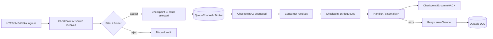
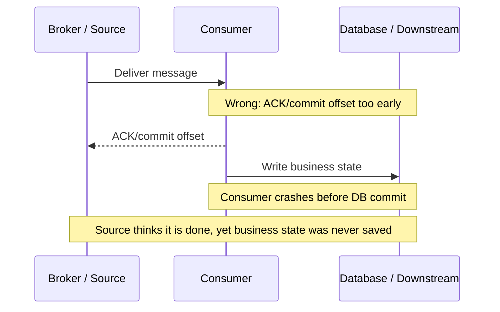

# Pinpointing Where Messages Are Lost in a Spring Integration Flow

## 1. Is a "Missing Message" Actually Data Loss?

In a system using **Enterprise Integration Patterns (EIP)**, a producer reports having sent a message yet downstream sees no result. This is a symptom, **not proof that the message was lost**. Depending on the channel type and pattern, the message might be:

- Dropped **by design** by a `Filter` or routed to a `discardChannel`.
- Routed by a `Router` to another branch, `defaultOutputChannel`, or `nullChannel`.
- Sitting inside a `QueueChannel`, executor queue, or broker.
- Already dequeued by a consumer, currently executing or blocked on I/O.
- Held by an `Aggregator` in `MessageGroupStore` awaiting remaining fragments.
- Undergoing retries, routed through `errorChannel`, or stored in dead-letter storage.
- Already **committed** by the destination system, with the ACK/response lost so upstream thinks it failed.
- Genuinely lost due to non-durable storage, misconfigured ACKs, transaction bugs, TTL/retention expiry, or crashes.

To locate the fault, you must **trace across processing boundaries**, identifying which milestones are confirmed and which still lack evidence.

This lesson, **"Pinpointing Where Messages Are Lost in a Flow,"** belongs to the **Audit and observability** chapter of the `SPRING_INTEGRATION_PATTERN` module. It supports learning Spring Integration to build loosely coupled, extensible flows—practicing Router, Filter, Transformer, Splitter, Aggregator, Gateway, retry, error channel, and correlation while testing and monitoring branches.

After this lesson, you will be able to:

1. Distinguish **genuine loss**, **intentional discard**, **pending/in-flight**, **delivered but uncommitted**, and **unknown outcome**.
2. Design checkpoints from ingress to downstream and define what evidence each milestone proves.
3. Trace messages across transformations, fan-out/fan-in, queues, retries, and process boundaries.
4. Use `ChannelInterceptor`, Micrometer, structured logs, Message History, and audits to isolate suspicious points.
5. Avoid false conclusions drawn solely from `input_count - output_count` or `send() == true`.
6. Write integration and fault-injection tests to verify paths, ACK states, and recovery capability.

## 2. Four Categories to Classify Before Debugging

| Classification | Example | How to Conclude? |
| --- | --- | --- |
| **Intentional discard** | Filter rejects `HEARTBEAT` as out of scope | Not loss if compliant with contract and required outcome is recorded |
| **Pending / in-flight** | 20 messages in queue; Aggregator missing one fragment | Not finished yet; measure wait age and processing deadlines |
| **Failed / quarantined** | Retries exhausted; record confirmed stored in DLQ | Not processed normally, yet evidence remains for recovery |
| **Unknown / potentially lost** | Producer timed out after broker might already have committed | Reconcile source and target; never assume "not received" |
| **Confirmed loss** | Evidence shows source ACKed, yet message is absent from queues, stores, consumers, or sinks after deadlines and full reconciliation | Substantiated data-loss incident; handle per incident policy |

Final classification must rest on delivery/retention contracts and verifiable evidence. **Missing logs or missing traces do not automatically prove message loss**: sampling, log retention, app crashes, and missing instrumentation can all create observability blind spots.

## 3. Checkpoint Map of a Message

Consider an order intake flow:



Milestones A–E are not interchangeable:

| Checkpoint | Proven Evidence | Cannot Yet Conclude |
| --- | --- | --- |
| A — ingress observed | Adapter or flow saw the inbound message | Message was persisted or processed successfully |
| B — route decided | Filter/Router chose accepted/rejected/route key | Target channel actually received the message |
| C — channel accepted | `send()` succeeded per channel contract or matching broker ACK | Consumer ran and business work committed |
| D — dequeued / delivered | Consumer pulled the message from the queue | Handler completed or had no duplicate side effects |
| E — business confirmed | Database commit, verified API result, or downstream ACK per contract | Steps outside contract scope also completed |
| F — source ACK/offset committed | Broker/adapter recorded consumer progress | That E completed, unless ordering/transactions guarantee it |

**Write down exact definitions for each checkpoint:** `CHANNEL_POST_SEND` on a `QueueChannel` is not `BROKER_PERSIST_ACK`, `HANDLER_RETURNED` is not automatically `BUSINESS_COMMITTED`, and `source offset committed` does not guarantee downstream received the work if the offset committed too early.

### Timeline for Narrowing Down

```text
10:00:00.001  SOURCE_RECEIVED     src-event-42
10:00:00.004  FILTER_ACCEPTED     src-event-42
10:00:00.006  ORDERS_QUEUE_ACCEPT src-event-42
10:00:10.000  [QUEUE_DEQUEUED not seen]
```

With this sequence, the first hypothesis is that the message is **sitting in the queue** or the consumer is not polling—not yet that it was lost. Check queue depth, oldest age, pollers, thread pools, and error handling. If queue depth is 0, investigate transactions/TTL, another instance consuming it, or missing instrumentation.

## 4. Using a Stable ID to Connect Boundaries

Spring Messaging provides `MessageHeaders.ID` per message, yet whenever a Transformer, Splitter, Enricher, or adapter creates a new `Message`, that ID can change. Trace IDs can also change on replay or fail to cross process boundaries. Therefore, maintain **business-level source keys and correlation**:

| Field | Role | Caveats |
| --- | --- | --- |
| `sourceEventId` | Stable event ID issued by the source | Preserve across retries/redeliveries/replays; validate origin and uniqueness |
| `flowExecutionId` | ID of one processing run | May change on replay; preserve lineage back to source event |
| `messageId` | Spring Messaging message ID at one step | Can change across transformation steps |
| `correlationId` | Groups fragments or request/reply of an operation | Does not automatically replace an idempotency key |
| `causationId` | Which record/event caused this event | Helpful for fan-out, Splitter, and sagas |
| `sequenceNumber` / `sequenceSize` | Fragment order and total count | Needed if Aggregator relies on sequence metadata |
| `traceId` / `spanId` | Distributed trace linkage | Not guaranteed in every trace due to sampling |
| `flowVersion` / `routePolicyVersion` | Rule actually applied at decision time | Record version at decision time; never re-read current version later |

Example single-step audit metadata:

```json
{
  "eventType": "MESSAGE_CHECKPOINT",
  "sourceEventId": "src-order-42",
  "flowExecutionId": "flow-7294",
  "checkpoint": "ordersQueue",
  "outcome": "ENQUEUED",
  "route": "priority",
  "flowVersion": "orders-flow/3.2.0",
  "occurredAt": "2026-11-21T10:00:00.006Z"
}
```

This is an **application-defined sample**, not a built-in Spring Integration schema. Never put `sourceEventId`, `orderId`, `flowExecutionId`, or raw payloads into **metric tags**; dynamic IDs belong in logs/traces/audits with proper access controls, retention, and security policies.

### Fan-Out: Same Source Event, Multiple Child Messages

If one order is split by a Splitter into five line items, ingress sees **one operation** while output produces **five fragments**. Each fragment needs lineage such as:

```text
sourceEventId=src-order-42
correlationId=batch-42
fragmentKey=item-1 ... item-5
sequenceNumber=1 ... 5
sequenceSize=5
```

Then, a missing fragment #3 must be investigated along fragment #3's branch—never compare `input=1` against `output=4` and conclude "three extra messages."

## 5. Where Messages Commonly "Disappear" by Pattern

| EIP / Component | Symptom | Proper Investigation |
| --- | --- | --- |
| **Filter** | Ingress present, no output | Predicate accepted/rejected/error, `discardChannel`, `throwExceptionOnRejection` |
| **Router** | Message misses expected branch | Route key, mapping, `defaultOutputChannel`, rule version, send outcome |
| **nullChannel** | Message stops right after a channel | Was it intentionally sent to `nullChannel`? Cannot replay from it |
| **Transformer** | Different ID or new payload type | Preserve `sourceEventId`/correlation; inspect exceptions and header propagation |
| **Splitter** | Output count differs from input count | Fragment count, sequence, per-fragment filters, and fan-out branches |
| **Aggregator** | No output even though fragments arrived | `MessageGroupStore`, group size, release strategy, timeout, expiry, late arrivals |
| **Publish–Subscribe** | One subscriber misses or fails | Per-subscriber stats, executor, `ignoreFailures`, and delivery contract |
| **QueueChannel / PriorityChannel** | Producer got accepted, consumer sees nothing | Queue depth, receive/poller, capacity, priority, transaction/expiry |
| **ExecutorChannel** | Dispatched yet task never runs | Executor queue, active pool, rejections, thread shutdown |
| **Gateway** | Caller times out while downstream keeps running | Request/reply correlation, reply channel, timeout, business ACK |
| **Retry / Delayer** | Message does not exit immediately | Backoff, scheduled retry, attempt count, terminal failure |
| **Error Channel / DLQ** | Absent from success path | `ErrorMessage`, DLQ publish ACK, backlog, replay/repair |
| **Transactional flow** | Handler ran yet record is gone | Rollback, commit boundary, source ACK/offset, outbox/inbox |
| **Broker Adapter** | Source thinks it sent; consumer sees nothing | Broker publish confirm, queue/topic/partition, consumer lag, TTL, ACL |

### 5.1. Filter and Router: "Not Continuing" Can Be Right

A Filter returning `false` is a rejection decision. Without a discard channel and without throw-on-rejection enabled, the message legitimately terminates at the Filter. Thus, to distinguish loss from valid rejection, count **rejected decisions** at the Filter boundary or capture and persist events on the discard channel as required.

A Router can send a message to another branch or the default branch. Cross-check **routing policy version**, route key, and channel mapping; logs showing only the Router bean name are not enough to prove which specific rule executed.

### 5.2. Queues: "Sent" Is Not "Processed"

With `QueueChannel`, a successful `send()` mainly proves the queue accepted the message per contract. A consumer must `receive()` or poll to pull it. If queue depth climbs, inspect poller scheduling, `maxMessagesPerPoll`, task executors, locks, transactions, and slow handlers.

An in-memory `QueueChannel` loses messages on JVM restart. When messages must survive restarts, consider a broker or durable `MessageStore`. With brokers, distinguish **ready**, **unacked/in-flight**, consumer lag, and retention TTL—never look at a single depth figure alone.

### 5.3. Aggregator: No Output Does Not Mean Lost

An Aggregator holds messages by correlation key in `MessageGroupStore`. If the release strategy expects five fragments and only four arrive, the group may wait until timeout or expiry. Monitor group size, missing sequence numbers, group age, pending group count, partial release policy, and cleanup.

`getMessageGroupCount()` may include **metadata of completed groups** retained to catch late messages; never blindly treat that number as pending group count. To locate a missing fragment, you need lineage on each child message, not just group totals.

### 5.4. Retry, Error Channel, and DLQ

A handler may fail two attempts and succeed on the third. That is **two attempt errors and one successful business operation**, not two lost messages. If retries are exhausted, `ErrorMessageSendingRecoverer` can publish an `ErrorMessage` to a channel; that milestone **does not yet prove** the failure record was persisted in a DLQ.

Track three distinct milestones:

1. `TERMINAL_FAILURE`: processing stops in the current execution cycle.
2. `DLQ_PUBLISH_ACKED`: broker/store confirmed persistence per contract.
3. `RECOVERY_CONFIRMED`: replay/repair achieved a verified business outcome.

If the DLQ publisher fails, roll back, use an outbox/durable fallback, and alert; never treat that failure as a "valid discard."

## 6. ACK and Transaction Boundaries Are Where Real Loss Happens Most

With broker sources, many incidents stem from **commit ordering**:



Conversely, committing the database **before** ACKing the broker avoids losing business work on a post-commit crash, though it can cause **duplicate deliveries**. Protect the consumer with idempotency/inbox tracking inside the same transaction as the business state change when sharing the same DB.

| Event Ordering | Risk | Mitigation |
| --- | --- | --- |
| ACK source, then commit business | **Data loss** on crash between steps | Avoid premature ACKs; enforce transaction/commit discipline |
| Commit business, then ACK source | **Duplicates** if ACK is lost | Idempotent consumer, business key, inbox |
| Write DB, then publish to broker from app | "DB committed but event never published" | Transactional outbox and retrying dispatcher |
| Publish event, then write DB | "Event exists yet business state never committed" | Fix ordering/contract; never assume two systems share one transaction |
| External API commits, then caller times out | **UNKNOWN** outcome | Target-side idempotency key or reconcile before retrying |

A `@Transactional` block around JDBC does not automatically create an atomic transaction with external HTTP services or brokers. **Exactly-once effects** must be engineered at business boundaries using explicit mechanisms—never assumed from a transport's "exactly once" flag.

## 7. Observability Toolkit: Message History, Wire Tap, Interceptors, and Audits

### 7.1. Message History Shows Traversed Endpoints

Spring Integration provides **Message History** to record participating components when enabled/configured. It helps answer "which endpoints did the message traverse?" within these limits:

- History entries appear only when enabled and properly propagated via message headers.
- Custom Transformers/adapters may fail to preserve desired metadata.
- History records component traversal—it **does not** prove database commits, broker ACKs, or specific routing rules.
- A message lost before history is recorded, or traces/logs dropped by sampling, leaves an incomplete trail.

Use history as a **diagnostic clue**, never as sole proof of durable transaction completion.

### 7.2. Wire Tap Inspects Branches Without Altering Business Intent

`WireTap` sends a copy of a message to an observation channel. However, taps have their own failure modes: the audit channel can overload, write duplicates, or drop events; tapping can also affect latency or error paths depending on configuration. Never treat a `WireTap` writing to an in-memory queue as an authoritative, zero-loss audit trail. When auditing is mandatory, pair it with a durable sink and proper transaction/outbox semantics.

### 7.3. ChannelInterceptor Fits Technical Checkpoints

`ChannelInterceptor` provides hooks such as `preSend`, `postSend`, `afterSendCompletion`, and `postReceive` to observe channels. Understand their exact semantics:

- `preSend`: message is **about** to be sent; no send outcome yet.
- `postSend(..., sent=true)`: the channel reported a successful send under its contract; for a queue, call this **enqueued**, not processed.
- `postReceive(message != null)` on a pollable channel: the consumer received/dequeued the message; not yet committed.
- `afterSendCompletion(..., ex)`: observes exceptions from the send operation; **does not** represent downstream failures arriving later in asynchronous flows.

Attach interceptors to meaningful boundary channels; avoid putting payloads/IDs into tags or injecting heavy synchronous I/O into every send under high load.

## 8. Java DSL Example: Marking Checkpoints Before and After QueueChannel

The following example uses **Java 17**, **Spring Integration 6.x**, and **Micrometer**. The flow reads a `String` from `ordersInput`, uses a Filter to accept only messages starting with `ORDER:`, routes valid messages to `ordersQueue`, and sends the rest to `ordersDiscarded`.

We attach `ChannelInterceptor` instances to the channels to observe **send accepted**, **send failure**, and **dequeue**. `CheckpointRecorder` in the example holds records **in memory for learning and testing**; production systems must use a durable audit store when post-crash reconciliation is required.

### 8.1. Checkpoint Recorder and Interceptor

```java
import java.time.Clock;
import java.time.Instant;
import java.util.Queue;
import java.util.concurrent.ConcurrentLinkedQueue;

import io.micrometer.core.instrument.MeterRegistry;
import org.springframework.messaging.Message;
import org.springframework.messaging.MessageChannel;
import org.springframework.messaging.support.ChannelInterceptor;

record CheckpointEvent(
        String sourceEventId,
        String flowExecutionId,
        String checkpoint,
        String outcome,
        Instant occurredAt) {}

final class CheckpointRecorder {
    private final MeterRegistry meters;
    private final Clock clock;
    private final Queue<CheckpointEvent> events =
            new ConcurrentLinkedQueue<>();

    CheckpointRecorder(MeterRegistry meters, Clock clock) {
        this.meters = meters;
        this.clock = clock;
    }

    void record(String checkpoint, String outcome, Message<?> message) {
        String sourceEventId = message.getHeaders()
                .get("sourceEventId", String.class);
        String flowExecutionId = message.getHeaders()
                .get("flowExecutionId", String.class);

        // Data with IDs is stored only in diagnostic records, never as meter tags.
        events.add(new CheckpointEvent(
                sourceEventId, flowExecutionId,
                checkpoint, outcome, clock.instant()));

        // checkpoint/outcome is a fixed set defined by configuration.
        meters.counter("app.flow.checkpoint.events",
                "flow", "orders",
                "checkpoint", checkpoint,
                "outcome", outcome).increment();
    }

    boolean observed(
            String sourceEventId, String checkpoint, String outcome) {
        return events.stream().anyMatch(event ->
                sourceEventId.equals(event.sourceEventId())
                && checkpoint.equals(event.checkpoint())
                && outcome.equals(event.outcome()));
    }
}

final class CheckpointInterceptor implements ChannelInterceptor {
    private final String checkpoint;
    private final CheckpointRecorder recorder;

    CheckpointInterceptor(
            String checkpoint, CheckpointRecorder recorder) {
        this.checkpoint = checkpoint;
        this.recorder = recorder;
    }

    @Override
    public void postSend(
            Message<?> message, MessageChannel channel, boolean sent) {
        recorder.record(checkpoint,
                sent ? "SEND_ACCEPTED" : "SEND_REJECTED", message);
    }

    @Override
    public void afterSendCompletion(
            Message<?> message, MessageChannel channel,
            boolean sent, Exception ex) {
        if (ex != null) {
            recorder.record(checkpoint, "SEND_EXCEPTION", message);
        }
    }

    @Override
    public Message<?> postReceive(
            Message<?> message, MessageChannel channel) {
        if (message != null) {
            recorder.record(checkpoint, "DEQUEUED", message);
        }
        return message;
    }
}
```

In this example, `CheckpointRecorder` retains records unbounded in memory, making it **suitable only for demos/tests**. Production requires bounded storage, retention, sampling or batching, and audit error handling—never an endlessly growing `ConcurrentLinkedQueue` in one JVM.

`SEND_ACCEPTED` is purely the result returned by **the channel**. On `ordersQueue`, it means enqueueing was accepted; on `ordersInput` (a `DirectChannel`), the message was dispatched synchronously to the subscriber. Never assign the same label meaning "business processed" across all channel types.

### 8.2. IntegrationFlow Configuration

```java
import java.time.Clock;
import io.micrometer.core.instrument.MeterRegistry;
import org.springframework.beans.factory.annotation.Bean;
import org.springframework.context.annotation.Configuration;
import org.springframework.integration.annotation.EnableIntegration;
import org.springframework.integration.channel.DirectChannel;
import org.springframework.integration.channel.QueueChannel;
import org.springframework.integration.dsl.IntegrationFlow;

@Configuration
@EnableIntegration
class CheckpointFlowConfiguration {

    @Bean
    CheckpointRecorder checkpointRecorder(MeterRegistry meters) {
        return new CheckpointRecorder(meters, Clock.systemUTC());
    }

    @Bean("ordersInput")
    DirectChannel ordersInput(CheckpointRecorder recorder) {
        DirectChannel channel = new DirectChannel();
        channel.addInterceptor(
                new CheckpointInterceptor("ordersInput", recorder));
        return channel;
    }

    @Bean("ordersQueue")
    QueueChannel ordersQueue(CheckpointRecorder recorder) {
        QueueChannel channel = new QueueChannel(20);
        channel.addInterceptor(
                new CheckpointInterceptor("ordersQueue", recorder));
        return channel;
    }

    @Bean("ordersDiscarded")
    QueueChannel ordersDiscarded(CheckpointRecorder recorder) {
        QueueChannel channel = new QueueChannel(20);
        channel.addInterceptor(
                new CheckpointInterceptor("ordersDiscarded", recorder));
        return channel;
    }

    @Bean
    IntegrationFlow intakeFlow() {
        return IntegrationFlow.from("ordersInput")
                .filter(String.class,
                        value -> value.startsWith("ORDER:"),
                        endpoint -> endpoint.discardChannel("ordersDiscarded"))
                .channel("ordersQueue")
                .get();
    }
}
```

Neither `QueueChannel` in this example has an automatic poller. That is **intentional** so we can observe messages that are enqueued yet **not dequeued**. A production consumer needs its own poller/handler with appropriate timeouts, error handling, and transactions.

### 8.3. Sending Two Messages and Inspecting Checkpoints

```java
import org.springframework.messaging.Message;
import org.springframework.messaging.support.MessageBuilder;

void demonstrate(
        DirectChannel input,
        QueueChannel ordersQueue,
        QueueChannel ordersDiscarded,
        CheckpointRecorder audit) {

    input.send(MessageBuilder.withPayload("ORDER:42")
            .setHeader("sourceEventId", "src-42")
            .setHeader("flowExecutionId", "run-42")
            .build());

    input.send(MessageBuilder.withPayload("HEARTBEAT")
            .setHeader("sourceEventId", "src-hb")
            .setHeader("flowExecutionId", "run-hb")
            .build());

    // Both queues hold one message before receive.
    int ready = ordersQueue.getQueueSize();       // 1
    int discarded = ordersDiscarded.getQueueSize(); // 1

    assert ready == 1 && discarded == 1;
    assert audit.observed("src-42", "ordersQueue", "SEND_ACCEPTED");
    assert audit.observed("src-hb", "ordersDiscarded", "SEND_ACCEPTED");

    Message<?> acceptedMessage = ordersQueue.receive(0);
    assert acceptedMessage != null;
    assert audit.observed("src-42", "ordersQueue", "DEQUEUED");

    // DEQUEUED still does not mean the database or external service committed.
}
```

Note: Java's `assert` keyword is disabled by default unless `-ea` is passed; the snippet above is purely illustrative. **JUnit/AssertJ** in the next section is the proper verification approach for projects. Once `ordersQueue.receive()` returns a message, to conclude "processed" you must invoke the real handler and record the checkpoint **after the corresponding commit/ACK**, never calling `record("PROCESSED")` right upon pulling from the queue.

## 9. Testing with JUnit: Finding the Exact Disappearance Boundary

This example uses Spring Test, JUnit 5, AssertJ, and `SimpleMeterRegistry`. Queues and registries are isolated per test case so results never depend on test execution order.

```java
import static org.assertj.core.api.Assertions.assertThat;

import io.micrometer.core.instrument.MeterRegistry;
import io.micrometer.core.instrument.simple.SimpleMeterRegistry;
import org.junit.jupiter.api.Test;
import org.springframework.beans.factory.annotation.Autowired;
import org.springframework.beans.factory.annotation.Qualifier;
import org.springframework.context.annotation.Bean;
import org.springframework.context.annotation.Configuration;
import org.springframework.integration.channel.DirectChannel;
import org.springframework.integration.channel.QueueChannel;
import org.springframework.messaging.Message;
import org.springframework.messaging.support.MessageBuilder;
import org.springframework.test.annotation.DirtiesContext;
import org.springframework.test.context.junit.jupiter.SpringJUnitConfig;

@SpringJUnitConfig(classes = {
        CheckpointFlowConfiguration.class,
        CheckpointFlowTest.Meters.class
})
@DirtiesContext(classMode = DirtiesContext.ClassMode.AFTER_EACH_TEST_METHOD)
class CheckpointFlowTest {

    @Configuration
    static class Meters {
        @Bean
        MeterRegistry registry() {
            return new SimpleMeterRegistry();
        }
    }

    @Autowired
    @Qualifier("ordersInput")
    DirectChannel input;

    @Autowired
    @Qualifier("ordersQueue")
    QueueChannel ready;

    @Autowired
    @Qualifier("ordersDiscarded")
    QueueChannel discarded;

    @Autowired
    CheckpointRecorder audit;

    @Test
    void acceptedMessageIsQueuedThenDequeued() {
        assertThat(input.send(MessageBuilder.withPayload("ORDER:42")
                .setHeader("sourceEventId", "src-42")
                .setHeader("flowExecutionId", "run-42")
                .build())).isTrue();

        assertThat(ready.getQueueSize()).isEqualTo(1);
        assertThat(audit.observed(
                "src-42", "ordersQueue", "SEND_ACCEPTED")).isTrue();
        assertThat(audit.observed(
                "src-42", "ordersQueue", "DEQUEUED")).isFalse();

        Message<?> message = ready.receive(0);
        assertThat(message).isNotNull();
        assertThat(message.getPayload()).isEqualTo("ORDER:42");
        assertThat(audit.observed(
                "src-42", "ordersQueue", "DEQUEUED")).isTrue();
        assertThat(ready.getQueueSize()).isZero();
    }

    @Test
    void filterDiscardIsNotMessageLoss() {
        assertThat(input.send(MessageBuilder.withPayload("HEARTBEAT")
                .setHeader("sourceEventId", "src-hb")
                .setHeader("flowExecutionId", "run-hb")
                .build())).isTrue();

        assertThat(ready.getQueueSize()).isZero();
        assertThat(discarded.getQueueSize()).isEqualTo(1);
        assertThat(audit.observed(
                "src-hb", "ordersDiscarded", "SEND_ACCEPTED")).isTrue();
        assertThat(audit.observed(
                "src-hb", "ordersQueue", "SEND_ACCEPTED")).isFalse();
    }
}
```

This tests **internal flow and checkpoints**; it does not yet guarantee durability across crashes. To test end-to-end "zero message loss," add real stores/brokers, transactions, ACKs, and failover scenarios. Also verify that enabling Message History or tracing does not alter business outcomes.

### Essential Fault-Injection Matrix

| Fault Injection Point | What to Verify |
| --- | --- |
| Filter returns `false` | Proper rejected/discard recorded per rules; not labeled lost |
| Router selects unmapped branch | Error or default route matches policy and version |
| Queue full, `send` returns `false` or throws | Never records fake `SEND_ACCEPTED`; producer handles backpressure |
| Consumer/poller stopped | Queue depth/oldest age climbs; never records business committed |
| Consumer dequeues then crashes before commit | Source redelivers/recovers or preserves clear state; no premature ACK |
| Handler commits DB then crashes before ACK | Message may redeliver; idempotency prevents duplicate side effects |
| External API commits yet response times out | Outcome `UNKNOWN`; reconcile before blind retries |
| Broker publish ACK lost | Data may already exist; verify via source event ID / publish key |
| Filter drops one fragment before Aggregator | Group stays pending/times out per policy; lineage points to missing fragment |
| Aggregator group incomplete | Never declare lost before deadline |
| Retry runs three times | Attempt count differs from logical operation count |
| `ErrorMessage` sent to in-memory `QueueChannel` | Does not yet prove durable DLQ |
| DLQ publisher throws | Alert, rollback/outbox/fallback instead of silent drop |
| Message hits TTL/retention expiry | Evidence of expiry/deletion exists; evaluated against SLA |
| Splitter fans out to many branches | Reconcile per fragment/branch rather than raw message totals |
| Trace dropped by sampling or logger breaks | Audits/source-of-truth remain sufficient for mandatory investigations |
| Restart while in-memory queue holds messages | Explicitly surface queue-loss risk; test recovery if durability is required |

## 10. Diagnostic Table from the "Last Known Checkpoint"

Practical troubleshooting guide when you have `sourceEventId` or business correlation:

| Last Observed Checkpoint | Next Expected Checkpoint | Where to Start Investigating? |
| --- | --- | --- |
| `SOURCE_RECEIVED` | Filter/route decision | Did adapter ACK too early? Flow never dispatched? Input converter error? |
| `FILTER_ACCEPTED` | Channel enqueue/dispatch | Router target mapping, channel send, capacity, exception |
| `FILTER_REJECTED` | Discard handler/audit | Was rejection valid? Is discard persistence required? |
| `ROUTE_SELECTED` | Route target accepted | Routing version, missing subscriber, target availability |
| `QUEUE_ENQUEUED` | Consumer dequeue | Queue depth, poller, executor, broker lag/retention |
| `QUEUE_DEQUEUED` | Handler start | Thread pool, handler dispatch, consumer crash |
| `HANDLER_STARTED` | Handler result/commit | I/O timeout, DB locks, thread dumps, pending futures |
| `HANDLER_SUCCEEDED` | Business commit / external ACK | Transaction commit, lost ACK, downstream side effect |
| `TERMINAL_FAILURE` | DLQ publish ACK | Error flow, DLQ publisher, broker/storage health |
| `DLQ_PUBLISH_ACKED` | Replay/recovery | Pending age, operator approval, retry policy, quarantine |
| `REPLAY_STARTED` | Recovery confirmed | Idempotency, failure reason, business completion |

To investigate a gap, gather **evidence from both sides**: source and sink logs, queue/store state, timestamps, retries, transactions, and metrics. If a checkpoint was missed because the audit publisher failed, that is an **observability gap**, not automatically message loss.

## 11. Metrics and Dashboards to Spot Bottlenecks

### 11.1. Recommended Metric Suite

| Metric | Type | Meaning |
| --- | --- | --- |
| `app.flow.checkpoint.events` | Counter | Event counts per channel/checkpoint/outcome with bounded labels |
| `app.flow.filter.decisions` | Counter | Accepted/rejected/error counts at Filter |
| `app.flow.route.decisions` | Counter | Selected route and dispatch outcome |
| `app.flow.queue.depth` | Gauge | Messages currently waiting in the queue |
| `app.flow.queue.oldest.age` | Gauge | Age of the longest-waiting pending message |
| `app.flow.handler.duration` | Timer | Handler execution duration |
| `app.flow.handler.inflight` | Gauge | Executions started but not yet finished |
| `app.flow.business.committed` | Counter | Outcomes confirmed per business contract |
| `app.flow.retry.terminal` | Counter | Processing cycles ending in failure |
| `app.flow.dlq.publish.failed` | Counter | DLQ persistence failures |
| `app.flow.dlq.pending` | Gauge | DLQ backlog from broker/store |

These names are **recommended application metrics**, not all built into Spring Integration. Before instrumenting, check channel/handler observations, broker metrics, and your running version's exporter to avoid double-counting.

For `QueueChannel`, read `getQueueSize()` and `getRemainingCapacity()`. For `ExecutorChannel`, monitor executor queue size, active threads, and rejections. For Kafka, watch per-partition consumer lag; for RabbitMQ, distinguish ready vs. unacked. Never use a single pod's gauge to represent an entire shared backend.

### 11.2. Using PromQL to Compare Rates Across Checkpoints

The counter in our example code typically exports to Prometheus as `app_flow_checkpoint_events_total`. Verify the exact name before querying:

```promql
# Rate of messages accepted into QueueChannel.
sum(rate(app_flow_checkpoint_events_total{
  flow="orders",checkpoint="ordersQueue",outcome="SEND_ACCEPTED"
}[5m]))
```

```promql
# Rate of consumer dequeues from QueueChannel.
sum(rate(app_flow_checkpoint_events_total{
  flow="orders",checkpoint="ordersQueue",outcome="DEQUEUED"
}[5m]))
```

```promql
# Rate of messages entering the Filter discard branch.
sum(rate(app_flow_checkpoint_events_total{
  flow="orders",checkpoint="ordersDiscarded",outcome="SEND_ACCEPTED"
}[5m]))
```

**Do not expect** enqueue and dequeue rates to match identically in every 5-minute window: queues absorb bursts, schedulers introduce jitter, and samples lag. To prove loss, reconcile **a set of events/operations over a sufficiently long window** across pending, discarded, failed, retried, and expired states—never just subtract two chart lines.

### 11.3. Monitoring Rules More Meaningful Than Raw Subtraction

- **Queue depth rising, oldest age rising:** consumer cannot keep up, stopped polling, or is blocked.
- **Queue depth low, handler in-flight high:** messages were dequeued and are waiting downstream.
- **Terminal failures rising while DLQ publish ACK stays flat:** suspect a fault in the error/DLQ branch.
- **Filter rejections rising:** check business rules and upstream schema/route changes; do not immediately report data loss.
- **Gateway timeouts rising while business commits keep rising:** suspect reply/ACK loss or latency exceeding the timeout budget.
- **Metrics disappear:** check scrapes and application health; missing metrics never mean zero errors.

Specifically, Counter metrics alone cannot look up a single event because **`sourceEventId` is not in metric labels**. When verifying "where did event X go?", use audits/traces/logs with adequate retention.

## 12. Formula-Based Reconciliation Without Blind Arithmetic

In a simple flow where **one input produces one output or one terminal outcome**, you can establish an invariant:

```text
received_unique_operations
  = confirmed_success
  + confirmed_business_discard
  + durably_quarantined
  + currently_pending
  + unresolved_unknown
```

This is a **reconciliation convention**, valid only when states are **mutually exclusive**, measured over the same set of operation IDs and at the same cutoff point. With retries/redeliveries, one operation can spawn multiple attempts; never add attempts into the right-hand side.

With a Splitter generating multiple fragments, use a different invariant:

```text
expected_fragment_keys(batch)
  = completed_fragments
  U discarded_fragments
  U pending_fragments
  U unresolved_fragments
```

The `U` symbol here denotes **set union of fragment keys**, not adding message counts at different timestamps. Define duplicate/redelivery handling and fragment completion rules so sets stay disjoint.

With an Aggregator, outputs can validly be fewer than inputs. With Publish–Subscribe, one input spawns multiple outcome branches. With Retry, one logical operation generates multiple attempts; with Gateway, timeouts can happen after downstream committed. Therefore, reconciliation must start from **business operations + lineage + checkpoint semantics**, not raw channel counts alone.

## 13. Runbook for Suspected Message Loss Incidents

When someone reports "sent but never arrived," follow this sequence:

1. **Identify the source key and time window:** gather `sourceEventId` or business ID plus timeframe; ensure logs never leak payloads/PII into unsafe channels.
2. **Clarify expected outcome:** single output, multiple fragments, gateway response, or business ACK? Are Filter discards or Router defaults valid here?
3. **Find the last proven checkpoint:** ingress, route, queue enqueue, dequeue, handler, commit, DLQ, or replay.
4. **Check waiting states:** queue depth/oldest age, executor, Aggregator group, retry scheduler, broker lag/unacked, pending transactions.
5. **Cross-check both sources of truth:** sending adapter/broker and receiving sink—not just one JVM's logs.
6. **Check ACK and transaction boundaries:** did offset/ACK commit before side effects? Did a commit succeed while a lost ACK caused duplicates?
7. **Check errors and intentional drops:** Filter rejects, `nullChannel`, Router defaults, `errorChannel`, DLQ publish/expiry.
8. **Assess risk before replaying:** if external side-effect state is `UNKNOWN`, reconcile or enforce idempotency keys before resending.
9. **Recover in controlled batches:** replay small batches with rate limits and stop conditions; never replay unboundedly or purge DLQs before verification.
10. **Verify and post-mortem:** confirm business state/ACKs, zero duplicates, normalized pending metrics, and document root cause and preventions.

### Evidence Required for Each Conclusion

| Conclusion | Required Evidence |
| --- | --- |
| "Legitimately dropped by Filter" | Rejected decision, rule version, contract-compliant discard outcome |
| "Waiting in Aggregator" | Group exists with consistent size/sequence/age and deadline |
| "Enqueued but not yet dequeued" | Enqueue ACK + message still in queue or confirmed lag |
| "Processed but reply was lost" | Trusted business commit/transaction ID with missing reply at gateway |
| "Saved to DLQ" | Broker/store ACK and record with stable failure key |
| "Potentially lost" | Missing next checkpoint plus evidence absent from pending/retry/expiry/DLQ; needs investigation |
| "Confirmed loss" | Full reconciliation across sources of truth, contracts, and retention; no recovery path left |

## 14. Common Mistakes During Investigations

1. **Treating `send() == true` as a business ACK.** It only reflects the channel's contract at that boundary.
2. **Treating `input - output` as lost messages.** Splitters, Filters, Aggregators, queues, and retries measure different units and milestones.
3. **Treating absent spans/logs as loss.** Trace sampling and log failures create observability gaps.
4. **Using `MessageHeaders.ID` as a business ID across Transformers.** New messages can receive new IDs.
5. **Putting per-message IDs into Micrometer tags.** Causes high cardinality and data-leak risk.
6. **Treating `nullChannel` or `discardChannel` as a DLQ.** Those may simply be intentional termination points.
7. **Checking only queue depth.** Messages may already be dequeued and running in-flight in handlers, or sitting in an Aggregator/broker.
8. **Marking processing complete right after dequeue.** Side effects have not committed yet.
9. **ACKing broker offsets before DB commit.** A crash between the two causes real data loss.
10. **Blindly retrying when an external API might have committed.** Can double-charge payments or double-reserve inventory.
11. **Assuming `errorChannel` already saved a durable DLQ.** You still need sink ACKs and a replay policy.
12. **Relying on in-memory history or Wire Tap as sole proof.** They vanish along with the process.
13. **Not recording routing policy versions.** Rule changes send identical payloads down different paths with no explanation.
14. **Never testing faults between checkpoints.** Happy-path tests do not prove crash consistency.

## 15. Production Readiness Checklist

- [ ] Precisely define ingress accepted, route decided, channel accepted, dequeued, business confirmed, and source ACK.
- [ ] Maintain stable `sourceEventId`, `flowExecutionId`, and lineage across Splitter, Aggregator, and replays.
- [ ] Keep dynamic IDs inside protected audits/logs/traces; enforce bounded cardinality on metric tags.
- [ ] Separate Filter rejections, Router defaults, `nullChannel`, and pending Aggregator groups from errors/DLQ.
- [ ] Track queue depth, oldest pending age, in-flight handlers, retries, DLQ ACK/failures, and business commits.
- [ ] Choose appropriate queue/store durability and test restarts, redeliveries, and ACK/rollback behavior.
- [ ] Ensure source ACKs/offset commits never run ahead of the processing milestone that must be committed.
- [ ] Use outbox/inbox and idempotency when coordinating across DBs, brokers, or external APIs.
- [ ] Back mandatory checkpoint audits with durable sinks and retention; treat Wire Tap/history as supporting data, not an exactly-once guarantee.
- [ ] Set up dashboards and alerts for backlog, oldest age, DLQ publish failures, handler timeouts, and missing telemetry.
- [ ] Include tests for Filter discards, misrouted branches, full queues, stopped pollers, incomplete Aggregator groups, lost ACKs, and crash/replay.
- [ ] Maintain a reconciliation runbook keyed by operation ID and per-hop evidence before declaring messages lost.

## 16. References

- [Spring Integration — Message Channels](https://docs.spring.io/spring-integration/reference/channel.html)
- [Spring Integration — Channel Interceptors](https://docs.spring.io/spring-integration/reference/channel/interceptors.html)
- [Spring Integration — Message History](https://docs.spring.io/spring-integration/reference/message-history.html)
- [Spring Integration — Routers](https://docs.spring.io/spring-integration/reference/router.html)
- [Spring Integration — Filtering Messages](https://docs.spring.io/spring-integration/reference/filter.html)
- [Spring Integration — Aggregator](https://docs.spring.io/spring-integration/reference/aggregator.html)
- [Spring Integration — Error Handling](https://docs.spring.io/spring-integration/reference/error-handling.html)
- [Spring Integration — Metrics and Management](https://docs.spring.io/spring-integration/reference/metrics.html)
- [Spring Integration — Transactions](https://docs.spring.io/spring-integration/reference/transactions.html)
- [Micrometer — Counters](https://docs.micrometer.io/micrometer/reference/concepts/counters.html)
- [Enterprise Integration Patterns — Message History](https://www.enterpriseintegrationpatterns.com/patterns/messaging/MessageHistory.html)

**Remember:** to pinpoint where a message was lost, do not just find **the last checkpoint**—ask **what that checkpoint actually proves**. A message might be accepted yet not dequeued, dequeued yet uncommitted, committed yet missing its ACK, or legitimately dropped by a Filter/Router. Use stable lineage, milestone-accurate audits, queue/store state, and crash/retry tests to separate **true data loss** from **in-progress work or missing observability**.
