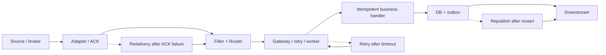
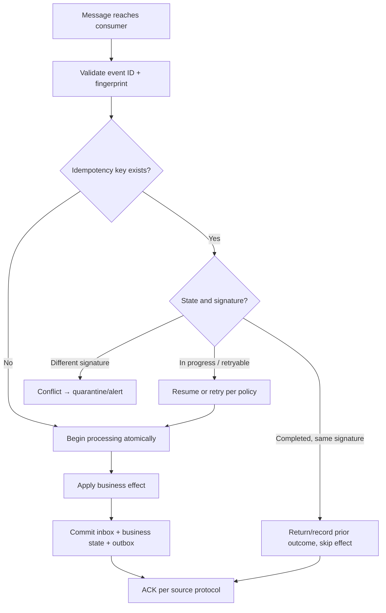

# Testing Duplicates and Idempotency

In the **Pattern Testing** chapter of **SPRING_INTEGRATION_PATTERN**, a system that processes messages in the right order does not necessarily process them the right **number of times**. The same business event may be redelivered after an ACK failure, a Gateway retry, a consumer restart, or a replay from a dead-letter queue (DLQ). If an operation that credits funds, reserves inventory, or sends an email re-applies its full effect every time a message arrives, the system can produce wrong outcomes even when every Router, Filter, Transformer, Splitter, Aggregator, or Resequencer works as configured.

This lesson focuses on **testing duplicates and idempotency** in Spring Integration: defining event identity, distinguishing redelivery from conflict, verifying processing atomicity, intentionally injecting failures at dangerous moments, and proving business effects are never duplicated. These principles apply across message channels, Gateways, retries, error channels, correlation, and asynchronous branches.

> **Conclusion to prove by tests:** Receiving a message twice is not necessarily an error. **Producing two business effects for the same event when the contract permits only one** is an idempotency bug.

## 1. Concepts and Invariants to Test

### 1.1. What Is a Duplicate Message?

*Duplicate delivery* occurs when the same logical event or unit of work is delivered to a consumer multiple times. Two messages may share the same payload yet differ in `MessageHeaders.ID`, timestamp, delivery tag, or retry count.

Example of an account credit event:

```text
Business event: CreditPosted(eventId="evt-100", accountId="A", +100)

Delivery 1: messageId=m-1, eventId=evt-100 → consumer processes it
             ... business state committed, ACK lost ...
Delivery 2: messageId=m-2, eventId=evt-100 → broker redelivers

Goal: total balance increases by only 100, not 200.
```

Do not identify duplicates merely because two messages have similar-looking payloads. Two independent transactions each adding 100 to account A are **not duplicates** if they have two distinct business `eventId` values.

### 1.2. What Is Idempotency?

An operation is *idempotent* if repeating it with the same logical request does not further alter the achieved outcome. With a state-transition function `f`, the mathematical intuition is:

```text
f(f(state, event), event) = f(state, event)
```

However, you must define **which outcomes** must remain stable:

- **Business state:** balances, orders, inventory, or domain state receive no additional mutations.
- **External side effects:** do not send a payment charge, email, or warehouse dispatch command twice if the contract mandates once.
- **Outbound events:** do not publish two independently effective outcomes for the same event; if outbound redelivery occurs, downstream consumers must be able to recognize it.
- **Acknowledgment/recovery:** a message is ACKed only once processing has been committed or durably handed off, never ACKed away before real processing occurs.
- **Conflict:** the same `eventId` carrying different immutable content must be detected, not ignored as a harmless redelivery.

**Do not equate "processed once" with "handler called only once."** In an at-least-once system, a handler may be invoked multiple times; proper tests must prove that the **final effective impact** occurs only according to contract.

### 1.3. Vocabulary in Tests

| Term | Meaning | How to Measure |
| --- | --- | --- |
| Delivery attempt | One time a message is delivered to a consumer | Delivery count, retry trace |
| Logical event | A business event with a stable identity | `eventId` / idempotency key |
| Duplicate | Multiple deliveries of the same logical event | Same key and immutable content |
| Conflict | Same key with mismatched content/version | Compare fingerprint/schema/version |
| Accepted | Consumer received or recorded in inbox | Acceptance record |
| Committed | Business effect is durable | Database/side-effect ledger |
| Acknowledged | Transport source knows responsibility was accepted | Broker ACK/offset |
| Replayed | Event resent from source, retry, or DLQ | Source event ID and retry reason |

## 2. Choosing the Idempotency Key Before Writing Assertions

A duplicate test is meaningful only if the contract defines **what constitutes the same unit of work**.

| Chosen Key | What Can Go Wrong? | Better Approach |
| --- | --- | --- |
| `MessageHeaders.ID` | Retries may create a new Spring Message with a different ID | Use `sourceEventId` or a stable business key |
| Plain payload hash | Two distinct events with identical data get wrongly merged | Combine event ID and fingerprint |
| Plain `orderId` | Two valid steps of the same order are treated as duplicates | Use `orderId + actionId/version` per contract |
| Plain `correlationId` | Splitter creates multiple valid parts in the same group | Include `sequenceNumber` and part identifier for slot-level work |
| Plain `sequenceNumber` | Many batches all have part `#1` | Use `batchRunId + sequenceNumber` |
| Delivery timestamp | Redelivery gets a new timestamp | Never use transport timing as identity |
| Immutable `sourceEventId` | Usually fits a single business event | Add consumer scope/tenant when needed |

A common design:

```text
consumer-scope key = (consumerName, tenantId, sourceEventId)

If deduplicating per item in a sequence:
slot key = (tenantId, batchRunId/correlationId, sequenceNumber)
signature = (sourceEventId, normalizedPayloadFingerprint, sequenceSize)
```

**Why include `consumerName`?** The same event can be legitimately processed by two independent consumers (for instance, an accounting consumer and a reporting consumer). Each consumer must be idempotent within the scope of its own side effects; do not use a single shared `eventId` table that blocks the second consumer by mistake.

For versioned mutable data, specify whether a modification event is a **new event** or an **invalid replay**. Never pick a generic key and arbitrarily apply "first wins" or "last wins."

## 3. Where Do Duplicates Arise Across Integration Patterns?



Duplicate entry points vary by boundary:

- **Broker/adapter:** consumer finishes but ACK is not recorded; broker redelivers the same event.
- **Gateway:** downstream succeeds but the reply times out, causing the client to resend the request.
- **Retry advice:** a callback is retried; if an external call succeeded before throwing, the next attempt may repeat the effect.
- **Splitter:** an entire batch is re-split, regenerating fragments already processed. Distinguish replaying an old run from a new run.
- **Router/fan-out:** one business event dispatched to multiple consumers is legitimate; never deduplicate blindly across consumers.
- **Aggregator/Resequencer:** messages for the same slot may arrive multiple times or after group completion; correlation and idempotency must be designed separately.
- **Error channel/DLQ:** an operator replays a failed message, though business state prior to the failure may have partially committed.
- **Outbound publisher:** an event may be republished if the application crashes before marking it "published."

What must be verified is not merely **whether duplicates arrive**, but **whether each boundary preserves identity and processing state**.

## 4. Test Architecture: From Receiving a Message to Committed Effect

To test accurately, separate three responsibilities:

1. **Admission/dedup:** classify an event as new, redelivery, or conflict.
2. **Business effect:** apply the business mutation or call an external service.
3. **Commit/acknowledgment:** durably record the outcome, emit events per contract, and then allow the source to mark delivery acknowledged.



This diagram depicts the **processing contract**, not the default behavior of any single Spring Integration endpoint. Path `J → D` requires transactions, locks/leases, and coordination so two processes cannot commit concurrently.

### 4.1. Four Common Failure-Injection Points

| Failure Point Injected in Tests | Risk | Expectation After Retry |
| --- | --- | --- |
| Before inbox record | No receipt state exists | Can reprocess and commit once |
| `RECEIVED` recorded before business effect | Redelivery is wrongly dropped as "already processed" | Resumable; event is not lost |
| Effect applied before ACK | Broker redelivers | Committed effect is not applied again |
| Business state saved before emitting next event | Downstream never sees outcome | Outbox or recovery emits outcome properly |

A test that merely sends the same message twice inside one JVM is **not enough** to prove safety across restarts, transaction rollbacks, or ACK failures.

## 5. Java Example: In-Memory Model to Learn Invariants

The following example intentionally uses an in-memory ledger to illustrate duplicate semantics. Two distinct events may both credit an account; the same `eventId` is applied only once. This is **not a production implementation** because it is not durable across restarts and does not coordinate across multiple instances.

```java
import java.util.HashMap;
import java.util.Map;

record CreditPosted(String eventId, String accountId, long amountCents) { }

enum ApplyResult {
    APPLIED, DUPLICATE
}

final class FakeLedger {
    private final Map<String, CreditPosted> committed = new HashMap<>();
    private final Map<String, Long> balances = new HashMap<>();

    synchronized ApplyResult apply(CreditPosted event) {
        if (event == null || event.eventId() == null
                || event.eventId().isBlank()
                || event.accountId() == null
                || event.accountId().isBlank()
                || event.amountCents() <= 0) {
            throw new IllegalArgumentException("Invalid event");
        }

        CreditPosted previous = committed.get(event.eventId());

        if (previous != null) {
            if (!previous.equals(event)) {
                throw new IllegalStateException(
                        "Same event ID, conflicting business data");
            }
            return ApplyResult.DUPLICATE;
        }

        balances.merge(event.accountId(),
                event.amountCents(), Math::addExact);
        committed.put(event.eventId(), event);
        return ApplyResult.APPLIED;
    }

    synchronized long balance(String accountId) {
        return balances.getOrDefault(accountId, 0L);
    }

    synchronized int committedEventCount() {
        return committed.size();
    }
}
```

The `synchronized` blocks serialize operations on this fake model **within a single Java instance**. In a real system, the business mutation and the processed marker must commit inside the same durable boundary; a `HashMap` cannot replace database transactions or external API idempotency.

### 5.1. JUnit: Same Event Multiple Times, Only One Effect

```java
import static org.junit.jupiter.api.Assertions.*;

import org.junit.jupiter.api.Test;

class FakeLedgerTest {

    @Test
    void sameEventRedeliveredDoesNotCreditTwice() {
        FakeLedger ledger = new FakeLedger();
        CreditPosted event = new CreditPosted("evt-100", "A", 100);

        assertEquals(ApplyResult.APPLIED, ledger.apply(event));
        assertEquals(ApplyResult.DUPLICATE, ledger.apply(event));
        assertEquals(ApplyResult.DUPLICATE,
                ledger.apply(new CreditPosted("evt-100", "A", 100)));

        assertEquals(100L, ledger.balance("A"));
        assertEquals(1, ledger.committedEventCount());
    }

    @Test
    void differentEventsWithSameAmountAreBothValid() {
        FakeLedger ledger = new FakeLedger();

        ledger.apply(new CreditPosted("evt-100", "A", 100));
        ledger.apply(new CreditPosted("evt-101", "A", 100));

        assertEquals(200L, ledger.balance("A"));
        assertEquals(2, ledger.committedEventCount());
    }

    @Test
    void sameEventIdWithDifferentPayloadIsConflict() {
        FakeLedger ledger = new FakeLedger();
        ledger.apply(new CreditPosted("evt-100", "A", 100));

        assertThrows(IllegalStateException.class,
                () -> ledger.apply(
                        new CreditPosted("evt-100", "A", 999)));

        assertEquals(100L, ledger.balance("A"));
        assertEquals(1, ledger.committedEventCount());
    }
}
```

These three tests verify **accurate deduplication**, **not deduplicating new business events by mistake**, and **not swallowing conflicts**. Asserting only `balance == 100` after duplicate delivery would miss bugs like "all events with the same amount are collapsed" or "conflicting payloads are silently ignored."

### 5.2. Distinguish Execution Counters from Effects

In tests, you can track separately:

```text
inputDeliveryCount  = 3
handlerInvocation   = 3
committedEventCount = 1
businessBalance     = +100
```

Do not require `handlerInvocation == 1` in an at-least-once model; brokers rarely guarantee that. What must be protected is **committing one effect**, or one idempotent *outcome*, per the consumer's contract.

## 6. Spring Integration Example: Testing Duplicate Filtering at a Channel

To learn how to use `IntegrationFlow` and check outputs, you can place an in-memory filter in front of a `QueueChannel`. This example **only illustrates detecting the second appearance of an event ID**, not an end-to-end safe consumer.

```java
import java.util.Set;
import java.util.concurrent.ConcurrentHashMap;

import org.springframework.context.annotation.Bean;
import org.springframework.context.annotation.Configuration;
import org.springframework.integration.channel.DirectChannel;
import org.springframework.integration.channel.QueueChannel;
import org.springframework.integration.config.EnableIntegration;
import org.springframework.integration.dsl.IntegrationFlow;

final class DemoDuplicateGate {
    private final Set<String> seen = ConcurrentHashMap.newKeySet();

    boolean firstOccurrence(CreditPosted event) {
        if (event.eventId() == null || event.eventId().isBlank()) {
            throw new IllegalArgumentException("eventId is required");
        }
        return seen.add(event.eventId());
    }
}

@Configuration
@EnableIntegration
class DuplicateTestFlowConfiguration {

    @Bean
    DirectChannel incomingCredits() {
        return new DirectChannel();
    }

    @Bean
    QueueChannel acceptedCredits() {
        return new QueueChannel();
    }

    @Bean
    DemoDuplicateGate demoDuplicateGate() {
        return new DemoDuplicateGate();
    }

    @Bean
    IntegrationFlow duplicateTestFlow(
            DirectChannel incomingCredits,
            QueueChannel acceptedCredits,
            DemoDuplicateGate demoDuplicateGate) {

        return IntegrationFlow.from(incomingCredits)
                .filter(CreditPosted.class,
                        demoDuplicateGate::firstOccurrence)
                .channel(acceptedCredits)
                .get();
    }
}
```

**Caveat to watch for:** The `seen.add(eventId)` filter marks an ID as seen **before downstream durably processes it**. If the application crashes after enqueuing into `acceptedCredits` or a downstream handler fails, a redelivery may be dropped even though the business effect never occurred. The filter also does not compare fingerprints when the same ID carries different data.

Therefore, this is a **minimal test harness for learning filter mechanics**, never standalone proof of exactly-once guarantees. In production, explore `IdempotentReceiverInterceptor` and corresponding `MetadataStore` implementations, while still understanding exactly when the "seen" marker is written, when a message is deemed a duplicate, discard/duplicate header handling, and transaction boundaries. **A deduplicating interceptor alone does not guarantee that business effects were committed.**

### 6.1. Integration Test for the Illustrative Filter

```java
import static org.junit.jupiter.api.Assertions.*;

import org.junit.jupiter.api.Test;
import org.springframework.beans.factory.annotation.Autowired;
import org.springframework.beans.factory.annotation.Qualifier;
import org.springframework.messaging.MessageChannel;
import org.springframework.messaging.Message;
import org.springframework.messaging.PollableChannel;
import org.springframework.messaging.support.MessageBuilder;
import org.springframework.test.context.junit.jupiter.SpringJUnitConfig;

@SpringJUnitConfig(DuplicateTestFlowConfiguration.class)
class DuplicateFlowIntegrationTest {

    @Autowired
    @Qualifier("incomingCredits")
    MessageChannel input;

    @Autowired
    @Qualifier("acceptedCredits")
    PollableChannel accepted;

    private void send(CreditPosted event) {
        assertTrue(input.send(MessageBuilder.withPayload(event).build()));
    }

    @Test
    void onlyFirstDeliveryGoesThroughDemoFilter() {
        send(new CreditPosted("evt-100", "A", 100));
        send(new CreditPosted("evt-100", "A", 100));

        Message<?> first = accepted.receive(1_000);
        assertNotNull(first);
        assertEquals("evt-100",
                ((CreditPosted) first.getPayload()).eventId());
        assertNull(accepted.receive(100));
    }
}
```

This test verifies **the output of an in-memory Filter**, not durable commits or retries across restarts. `accepted.receive(100) == null` only proves no further output appeared **within a 100 ms wait window**; for asynchronous flows, appropriate observation windows and synchronization mechanisms are required.

## 7. Binding Idempotency to Durable Transactions

For business effects stored in the same relational database, one design pattern is writing a uniquely keyed **inbox** record **in the same transaction** as the business update and, if needed, an **outbox** record.

Illustrative schema:

```sql
CREATE TABLE consumer_inbox (
    consumer_name VARCHAR(100) NOT NULL,
    event_id VARCHAR(160) NOT NULL,
    content_fingerprint VARCHAR(128) NOT NULL,
    committed_at TIMESTAMP NOT NULL,
    PRIMARY KEY (consumer_name, event_id)
);

CREATE TABLE account_balance (
    account_id VARCHAR(160) PRIMARY KEY,
    balance_cents BIGINT NOT NULL
);

CREATE TABLE event_outbox (
    event_key VARCHAR(200) PRIMARY KEY,
    event_type VARCHAR(100) NOT NULL,
    payload_json TEXT NOT NULL
);
```

Conceptual processing flow within **a single database transaction**:

```text
BEGIN TRANSACTION;

1. Check and insert key (consumerName, eventId) under UNIQUE constraint.
2. If the key already exists:
      - same fingerprint and prior transaction committed:
          → skip re-applying business effect; return prior outcome if needed;
      - different fingerprint:
          → CONFLICT, quarantine or raise error;
      - prior transaction still in contention:
          → wait/re-read or safely retry.
3. If the key is new:
      - update business state once;
      - write outbox record for results to publish;
      - commit completion marker in the same transaction.

COMMIT;
Only ACK the incoming message once commit/durable handoff has succeeded.
```

In real implementations, the insert can use PostgreSQL's `INSERT ... ON CONFLICT` or equivalent syntax, with compatible isolation/locking settings. If the transaction rolls back, both the inbox marker and the business state update must roll back so the next attempt can retry.

**Note:** Writing a table row with `status=RECEIVED` separately and updating it to `COMPLETED` in another transaction is harder: if a crash happens between the two steps, you need leases, resumption logic, and expiration deadlines. Never drop a message merely because the key exists if the marker has not proven that the effect committed.

### 7.1. When External APIs Are Involved

A local database transaction **cannot be atomic** with an HTTP API on another service by default. If a consumer calls a payment service and times out after the remote service already executed it, retrying may charge twice.

One of the following contracts is needed:

- Pass a **stable idempotency key** to the external API and query the outcome by that key.
- Query the external transaction's status before retrying a non-safe action.
- Use an outbox to emit a command with an immutable event ID; downstream also enforces inbox/idempotency.
- If single-effect execution cannot be achieved, define a compensation workflow and an *unknown outcome* state for investigation.

**Never claim "exactly once end-to-end" merely because `@Transactional`, a broker, or `IdempotentReceiverInterceptor` is present.** Identify the guaranteed boundary and inject failures right at that boundary.

## 8. Types of Tests Required

| Testing Layer | Scope | Key Assertions |
| --- | --- | --- |
| Unit | Key rules, signatures, and state machine | Detects duplicates/conflicts without blocking new events |
| Integration — Spring Integration | Channels, Filters/Interceptors, Gateways, advice, and error flows | Messages routed properly, headers preserved, no duplicate emission at measurement boundary |
| Integration — database | Unique keys, transactions, rollbacks, concurrency | Only one marker and one business effect committed |
| Integration — broker | ACK, redelivery, retry, DLQ, consumer restart | At-least-once handled idempotently; no lost events |
| Contract — external API | Idempotency key, outcome query, timeout | External command not applied twice or clear recovery path |
| End-to-end | Full flow and downstream | Total business state accurate, outbound events deduplicable, no lost/double-counted items |

### 8.1. Test Matrix for Duplicates, Conflicts, and Failure Injection

| Test Case | Data / Injected Fault | Expectation |
| --- | --- | --- |
| Exact duplicate | Send same `eventId` twice | One effect, second classified as duplicate |
| Different Spring Message ID | Create two `Message<?>` with different UUIDs but same `eventId` | Does not apply two effects |
| Two valid events with identical payload | Different `eventId`, same `accountId` and amount | Both are processed |
| Payload conflict | Same `eventId`, different amount | Neither silently ignored nor overwritten; alerted/quarantined |
| Invalid or missing idempotency key | Blank `eventId` | Rejected/validated before processing |
| Failure before commit | Handler throws exception before transaction commit | Retry can succeed, event not lost |
| Failure after commit, before ACK | Commit succeeds then consumer dies | Redelivery adds no extra effect |
| Failure after marker, before effect | "Seen" recorded, downstream not processed yet | Must resume/retry; not dropped as complete |
| Gateway timeout | Server processed it, response lost | Retry with same key returns same outcome or checks status |
| Retry advice | Callback fails transiently then succeeds | One final business outcome, attempt count increases |
| DLQ replay | Event replayed after bug fix | Committed effects not repeated; uncommitted events resumed |
| Two concurrent consumers | Same event hits two instances | UNIQUE constraint/transaction ensures single commit |
| Instance restart | Event repeated after restart | Durable dedup store still recognizes it |
| Dedup retention expired | Resend old event past TTL | Follows retention/reconciliation policy |
| Multi-part group | Same `correlationId`, distinct `sequenceNumber`s | Valid parts not wrongly blocked |
| Duplicate same slot | Same `batchRunId + sequenceNumber` | Classified as duplicate or conflict by signature |
| Late arrival | Message arrives after Aggregator/Resequencer completion | Follows late-arrival policy; does not publish a second batch |
| Partial result then replay | Missing part arrives after expiry | Clear correction/recovery, no duplicate final result |
| Outbox republish | DB committed, publisher crashes before marking sent | Downstream consumer deduplicates by event ID |

### 8.2. Concurrency Tests Must Verify Final State

When testing two consumers processing the same `eventId`, do not assert only "one call returned `APPLIED`." More importantly:

```text
T0: threads A and B prepare to receive the same event.
T1: release both simultaneously (barrier/latch).
T2: artificially slow one path briefly to widen the race window.
T3: wait for both to finish or time out.
T4: re-read committed state from the database.

Assert:
  consumer inbox count for event == 1
  business delta for event == applied once
  outbox logical event count == 1
  no hanging transactions or indeterminate side effects
```

In Java, you can use `CountDownLatch` or `CyclicBarrier` to coordinate contention timing. When testing databases, use **two truly separate transactions/connections**, not two calls inside the same test transaction. Run repeatedly under varying scheduling because races can be rare.

### 8.3. Fault Injection Must Hit the Exact Boundaries

Testing "handler throws exception" is not enough. Distinguish:

1. Failure before writing the marker.
2. Failure after writing the marker but before the effect succeeds.
3. Failure after the effect succeeds but before commit, where rollback applies.
4. Failure after commit but before ACK.
5. Failure after writing the outbox but before the publisher sends.
6. Failure after the publisher sends but before marking the outbox published.
7. Failure after external processing succeeds but the HTTP response is lost.

Each checkpoint poses a distinct problem for **resumption, rollback, deduplication, and uncertain outcome states**. Verify both "no duplicate effect" and "no valid event lost."

## 9. Interactions with Splitter, Aggregator, Resequencer, and Filter

### 9.1. Splitter: One Batch Has Multiple Valid Events

When a Splitter emits three parts with the same `correlationId` and sequence numbers `1, 2, 3`, those are **three valid elements**, not three duplicates. Deduplicating solely on `correlationId` would wrongly drop the second and third parts.

Tests must assert:

```text
batch=run-7:
  #1 sourceEventId=part-A → accepted
  #2 sourceEventId=part-B → accepted
  #3 sourceEventId=part-C → accepted
  #2 sourceEventId=part-B → duplicate
  #2 sourceEventId=part-X → conflict
```

If an entire batch is re-split after a retry, keep `batchRunId` and source event IDs stable for parts belonging to the same run; if it is genuinely a new run, use a new run key.

### 9.2. Aggregator: A Group Can Release Twice Without Guards

An Aggregator builds an aggregated outcome from parts. Duplicates or replays can increase the received message count without increasing the number of unique positions. Tests should verify *manifest/unique slots*, the release strategy, and idempotency of the **aggregated outcome**.

When a group expires and emits a partial result, late parts must follow the published correction or rejection policy. Never assume the Aggregator automatically knows whether an outcome was already posted in an external database.

### 9.3. Resequencer: Ordering Is Not Deduplication

A Resequencer orders messages by `sequenceNumber`; it **does not automatically replace** a business idempotency key. Sending `3,1,2,2` can expose both ordering and duplicate bugs. Tests must separate:

- Emission order within the same `correlationId`.
- Each slot having one accurate payload/event ID identity.
- No duplicate downstream side effects from replays or late arrivals.

### 9.4. Filter and Retry: Do Not Create Gaps or Drop Valid Messages

If a Filter intentionally rejects a part after the Splitter assigns sequence numbers, the Aggregator/Resequencer may wait forever for that position. Additionally, a duplicate filter that marks messages before commit can block retries and lose a part **due to broken idempotency**.

Tests must cover policy-driven Filter rejection, in-flight retries, and already-committed events separately, rather than lumping all three into "no message appeared" and treating that as success.

## 10. Observing and Diagnosing Test Outcomes

Place metrics/logs at observable boundaries using business trace keys:

| Signal | Explanation |
| --- | --- |
| `input.deliveries.total` | Total deliveries received, including redeliveries |
| `idempotency.applied.total` | Newly committed logical events |
| `idempotency.duplicates.total` | Redeliveries matching already-processed data |
| `idempotency.conflicts.total` | Same key with inconsistent signature |
| `idempotency.inprogress.total` | States requiring resumption/waiting |
| `retry.attempts.total` | Number of callback or transport retries |
| `outbox.pending` | Events committed but not yet successfully published |
| `consumer.commit.duration` | Latency to commit business outcome |
| `late.arrivals.total` | Messages arriving after group closure |
| `downstream.duplicate_prevented.total` | Downstream effects avoided thanks to idempotency |

Metric names are **application suggestions**, not built-in defaults provided automatically by Spring Integration.

**Avoid using `eventId`, `orderId`, or `correlationId` as metric labels** because they have very high cardinality. Use low-cardinality labels like `flow`, `consumer`, `outcome`, and `errorCategory`; look up specific events via structured logs, traces, and inbox/audit tables.

A test or audit record might look like:

```json
{
  "consumer": "account-credit",
  "eventId": "evt-100",
  "messageId": "delivery-2",
  "attempt": 2,
  "classification": "DUPLICATE",
  "businessEffect": "NOT_REAPPLIED",
  "inboxState": "COMMITTED",
  "acknowledgment": "AFTER_STATE_CHECK"
}
```

These fields are generated by the application. `attempt=2` does not automatically create a second business event. When inspecting logs across multiple threads or nodes, do not rely on log line order to prove commit; verify against committed records and the source event ID.

## 11. Common Mistakes That Skew Idempotency Tests

**1. Asserting only the output message count.** An event may be processed twice in the database while only one outbound message escapes after a Filter drops the second. Always verify the **business effect**.

**2. Sending the exact same Java object instance twice.** Retries may construct a new message with a different UUID. Test redeliveries reconstructed from serialized payloads.

**3. Using `orderId` as the idempotency key for every action.** Accidentally blocks two distinct business events belonging to the same order.

**4. Treating every matching `eventId` as safe to ignore.** Same ID with a different payload must be caught as a conflict.

**5. Marking as processed before actually committing.** After a crash, retries get dropped, causing silent data loss.

**6. Skipping restart and multi-instance tests.** An in-JVM `HashSet` only proves demo behavior, not production safety.

**7. Wrapping both consumer and assertion in one test transaction.** Can mask real isolation/commit behavior. Use independent transactions when testing concurrency and crash recovery.

**8. Ignoring ACK or lost Gateway responses.** "Committed, yet caller thinks it failed" is where many dangerous duplicates originate.

**9. Not testing expired retention records.** A dedup marker purged too early causes an old message to be accepted as new.

**10. Equating an `ErrorMessage` with a new business event.** Error flows carry exceptions and failed messages; replaying requires restoring the **original business identity** and processing state, not just resending an arbitrary payload.

## 12. Test Completion Checklist

1. **Define logical event:** stable idempotency key and clear consumer scope.
2. **Distinguish duplicate from new event and conflict:** compare both identity and immutable fields/fingerprint.
3. **State measurable invariants:** business state, outbound events, return values, ACK state, and retries.
4. **Test newly constructed duplicate messages:** different `MessageHeaders.ID` but same source event ID.
5. **Test two valid look-alike events:** never merge them by mistake.
6. **Test failures between steps:** before/after marker, before/after commit, before/after ACK, and during outbox publish.
7. **Test concurrency/multi-instance:** unique constraints, transactions/leases, and re-reading final state.
8. **Test restarts and DLQ replay:** markers persist long enough, with a resumption path when interrupted.
9. **Test EIP with correlation:** Splitter, Aggregator, Resequencer, and Filter do not confuse slots.
10. **Verify external boundaries:** Gateways/APIs require idempotency keys and outcome-query mechanisms when responses are lost.
11. **Do not equate broker delivery with business commit:** multiple handler invocations can still be valid.
12. **Observability and audit:** duplicate/conflict metrics, event-ID-indexed logs, and alerts rather than silently swallowing errors.

**Remember:** Testing duplicates and idempotency is not about proving a message traverses the system only once. It is about proving that **even when the same event is redelivered, retried, or replayed, the system never re-applies committed effects, never drops valid events by mistake, and never loses unprocessed events**. With Spring Integration, patterns can collaborate on loosely coupled message handling, but transaction boundaries, business identity, ACKs, and recovery still have to be explicitly designed and tested.
