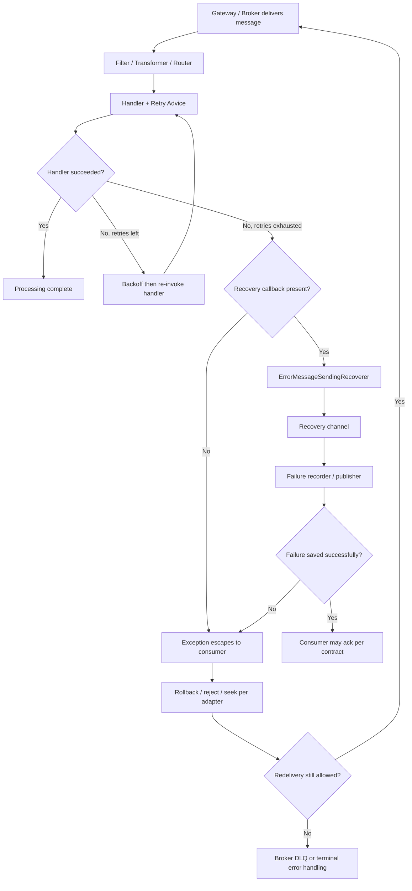

# Testing Retry, Recovery, and Dead Letter in Spring Integration

## 1. Why Must All Three Branches Be Tested?

In an **Enterprise Integration Patterns (EIP)** flow, a message may pass through a Filter, Transformer, and Router before a handler calls a partner API. When the API returns HTTP 503 or times out, the handler is configured to retry. If every attempt fails, the system must record the failure via recovery or move the message to a dead-letter destination for later handling.

A test that only checks "the handler eventually returns success" is not enough. It does not prove downstream invocation counts, rollback on failure, durability of the failure record, or protection against duplicate processing when a broker redelivers the message.

The topic **"Testing Retry, Recovery, and Dead Letter"** belongs to the **Pattern Testing** chapter of the `SPRING_INTEGRATION_PATTERN` module. The module focuses on implementing Enterprise Integration Patterns with Spring Integration to create loosely coupled, extensible message flows—combining Router, Filter, Transformer, Splitter, Aggregator, Gateway, retry, error channel, correlation, and per-branch observability.

After this lesson, you will be able to:

- Build a retry test matrix by exception type, attempt count, and backoff.
- Verify that a recovery callback is invoked only when the policy stops without handler success.
- Distinguish a **Spring Integration recovery/error channel** from a **broker dead-letter queue (DLQ)**.
- Test rollbacks, acknowledgements, redeliveries, and poison-message handling.
- Use JUnit 5 and the Spring Integration Java DSL to test a realistic flow with fake handlers.
- Design integration tests with a broker and fault injection to catch lost messages, duplicate side effects, and recovery failures.

## 2. Identifying the Exact Layers to Test

A message can be processed across several layers:



The diagram shows **possible** branches, not identical default behavior across all adapters. `RequestHandlerRetryAdvice` manages attempts at the **handler**; whether a broker redelivers or routes to a DLQ is governed by the message source, consumer error handler, and broker configuration.

### Three Counts Easily Confused

| Counter | Meaning | Example |
| --- | --- | --- |
| **Handler attempts** | Number of times the handler runs in one retry operation | 3 calls to the carrier |
| **Broker deliveries** | Number of times the source delivers a message, including initial delivery | 2 deliveries: initial delivery and one redelivery |
| **Business side effects** | Number of real transactions committed downstream | 1 shipment label created, despite 6 API calls |

If each delivery allows up to `A = 3` attempts and the broker delivers up to `D = 2` times, the handler may be invoked up to `A × D = 6` times **when retry is stateless**, every attempt fails, and the escaping exception keeps triggering broker redelivery. That number does **not** mean 6 real transactions were created; side effects must be measured separately.

## 3. Layered Testing Strategy

Not every scenario requires starting a real broker or database. Partition tests by the kind of guarantee being verified:

| Test Layer | Suggested Tools | What It Proves | What It Does Not Prove |
| --- | --- | --- | --- |
| **Retry policy unit test** | JUnit 5, Spring Retry `RetryTemplate` or the retry framework of your version | Attempt count, exception classification, recovery callback | That advice is wired onto the handler and broker redelivery |
| **Spring context flow test** | `@SpringJUnitConfig`, `DirectChannel`, `QueueChannel`, fake handler | Message hits the right endpoint, retry/recovery channels receive expected errors | Real broker ack, retry topics, or DLQ |
| **Transaction/broker integration test** | Testcontainers, JMS/RabbitMQ/Kafka test adapters, test database | Commit/rollback, ack/nack/seek, redelivery, DLQ, crash windows | Full multi-node production system |
| **End-to-end/fault test** | Staging environment, simulated timeout/crash/partition | Cross-service behavior, idempotency, observability, recovery runbooks | Should never claim absolute exactly-once from a few tests alone |

Practical rule: **test fast, decide with data**, then add targeted broker tests capable of reproducing failures when the system is interrupted. Tests that only mock APIs are insufficient to conclude that broker redelivery works properly.

## 4. Writing a Behavior Matrix Before Writing Code

Suppose a handler calls a shipping carrier, and the policy allows **3 attempts including the initial call**, retrying only `TemporaryCarrierException`. Baseline scenarios:

| ID | Scenario | Expected Handler Calls | Expected Recovery Messages | Meaning |
| --- | --- | ---: | ---: | --- |
| R1 | Succeeds immediately | 1 | 0 | No wasted retries |
| R2 | Transient error once, then succeeds | 2 | 0 | Retries exactly once |
| R3 | Transient error twice, third succeeds | 3 | 0 | Succeeds on final attempt |
| R4 | Transient error on all 3 attempts | 3 | 1 if recoverer present | Exhausted and triggers recovery |
| R5 | Non-retryable validation error | 1 | 1 if recovery configured for this error | Does not retry permanent errors |
| R6 | Recovery recorder throws exception | Per policy | Recovery send/save fails | Exception is not silently swallowed |
| R7 | Retry succeeds, then Gateway times out | Per flow | Possibly 0 | Caller does not know outcome; needs idempotency |
| R8 | Broker redelivers after rollback | Per delivery | Depends on config | Total calls may exceed `maxAttempts` |
| R9 | Exceeds broker redelivery limit | Per policy | May bypass application recovery | Message reaches DLQ if broker is configured |
| R10 | Same event resent after downstream commit | Possibly many | Depends | Must not create duplicate business side effects |

Tests should explicitly note three parameters: **handler policy**, **source policy**, and **recovery mechanism**. Without stating them, it is easy to end up with two tests both named "retry exhausted" that actually exercise two completely different branches.

## 5. Practical Example: Configuring a Flow with Retry and Recovery

The following example targets **Spring Integration 6.x and Spring Retry 2.x**, using Java 17+ and JUnit 5. To keep focus on semantics, we simulate the carrier with `FakeCarrier` and use a `QueueChannel` as the **application recovery channel**.

The `QueueChannel` in this example is **not a broker DLQ**. It simply lets the test consume the `ErrorMessage` after `ErrorMessageSendingRecoverer` dispatches the error information; it does not replace persistence or redelivery from RabbitMQ/JMS/Kafka.

### 5.1. Test Configuration Running in a Spring Context

```java
import java.util.Map;
import java.util.concurrent.atomic.AtomicInteger;

import org.junit.jupiter.api.BeforeEach;
import org.junit.jupiter.api.Test;
import org.springframework.beans.factory.annotation.Autowired;
import org.springframework.beans.factory.annotation.Qualifier;
import org.springframework.context.annotation.Bean;
import org.springframework.context.annotation.Configuration;
import org.springframework.integration.channel.DirectChannel;
import org.springframework.integration.channel.QueueChannel;
import org.springframework.integration.dsl.IntegrationFlow;
import org.springframework.integration.handler.advice.ErrorMessageSendingRecoverer;
import org.springframework.integration.handler.advice.RequestHandlerRetryAdvice;
import org.springframework.messaging.Message;
import org.springframework.messaging.MessageChannel;
import org.springframework.messaging.PollableChannel;
import org.springframework.messaging.support.ErrorMessage;
import org.springframework.messaging.support.MessageBuilder;
import org.springframework.retry.backoff.NoBackOffPolicy;
import org.springframework.retry.policy.SimpleRetryPolicy;
import org.springframework.retry.support.RetryTemplate;
import org.springframework.test.context.junit.jupiter.SpringJUnitConfig;

import static org.junit.jupiter.api.Assertions.*;

@SpringJUnitConfig(classes = ShipmentRetryFlowTest.Config.class)
class ShipmentRetryFlowTest {

    @Autowired
    @Qualifier("shipmentIn")
    MessageChannel input;

    @Autowired
    @Qualifier("shipmentRecovery")
    PollableChannel recovery;

    @Autowired
    FakeCarrier carrier;

    @BeforeEach
    void resetState() {
        carrier.reset();
        while (recovery.receive(0) != null) {
            // Drain leftover messages from previous tests.
        }
    }

    @Test
    void succeedsOnThirdAttemptWithoutRecovery() {
        carrier.failFirst(2);

        input.send(MessageBuilder.withPayload(
                new ShipmentCommand("evt-101", "idem-101")).build());

        assertEquals(3, carrier.calls());
        assertNull(recovery.receive(0));
    }

    @Test
    void sendsExactlyOneErrorMessageWhenExhausted() {
        carrier.failFirst(10); // Exceeds maxAttempts=3.

        input.send(MessageBuilder.withPayload(
                new ShipmentCommand("evt-102", "idem-102")).build());

        assertEquals(3, carrier.calls());
        Message<?> recovered = recovery.receive(1_000);
        assertInstanceOf(ErrorMessage.class, recovered);
        Throwable error = ((ErrorMessage) recovered).getPayload();
        assertTrue(containsCause(error, TemporaryCarrierException.class));
        assertNull(recovery.receive(0));
    }

    @Test
    void doesNotRetryPermanentValidationError() {
        carrier.failWithValidationError();

        input.send(MessageBuilder.withPayload(
                new ShipmentCommand("evt-103", "idem-103")).build());

        assertEquals(1, carrier.calls());
        assertInstanceOf(ErrorMessage.class, recovery.receive(1_000));
        assertNull(recovery.receive(0));
    }

    private static boolean containsCause(
            Throwable error, Class<? extends Throwable> type) {
        for (Throwable current = error;
                current != null; current = current.getCause()) {
            if (type.isInstance(current)) {
                return true;
            }
        }
        return false;
    }

    record ShipmentCommand(String eventId, String idempotencyKey) {}

    static final class TemporaryCarrierException extends RuntimeException {
        TemporaryCarrierException(String message) {
            super(message);
        }
    }

    static class FakeCarrier {
        private final AtomicInteger calls = new AtomicInteger();
        private volatile int transientFailures;
        private volatile boolean validationError;

        void reset() {
            calls.set(0);
            transientFailures = 0;
            validationError = false;
        }

        void failFirst(int count) {
            transientFailures = count;
        }

        void failWithValidationError() {
            validationError = true;
        }

        int calls() {
            return calls.get();
        }

        public void send(ShipmentCommand command) {
            int attempt = calls.incrementAndGet();
            if (validationError) {
                throw new IllegalArgumentException("invalid shipment");
            }
            if (attempt <= transientFailures) {
                throw new TemporaryCarrierException("carrier unavailable");
            }
        }
    }

    @Configuration
    static class Config {

        @Bean
        MessageChannel shipmentIn() {
            return new DirectChannel();
        }

        @Bean
        PollableChannel shipmentRecovery() {
            return new QueueChannel();
        }

        @Bean
        FakeCarrier fakeCarrier() {
            return new FakeCarrier();
        }

        @Bean
        RequestHandlerRetryAdvice retryAdvice(
                @Qualifier("shipmentRecovery") MessageChannel recovery) {
            RetryTemplate template = new RetryTemplate();
            template.setRetryPolicy(new SimpleRetryPolicy(
                    3,
                    Map.of(TemporaryCarrierException.class, true),
                    true));
            template.setBackOffPolicy(new NoBackOffPolicy());

            RequestHandlerRetryAdvice advice = new RequestHandlerRetryAdvice();
            advice.setRetryTemplate(template);
            advice.setRecoveryCallback(
                    new ErrorMessageSendingRecoverer(recovery));
            return advice;
        }

        @Bean
        IntegrationFlow shipmentFlow(FakeCarrier carrier,
                                     RequestHandlerRetryAdvice retryAdvice) {
            return IntegrationFlow.from("shipmentIn")
                    .handle(carrier, "send",
                            endpoint -> endpoint.advice(retryAdvice))
                    .get();
        }
    }
}
```

In a real project, add compatible dependencies for Spring Integration Java DSL, Spring Retry 2.x, `spring-test`, and JUnit Jupiter. The test above uses `NoBackOffPolicy` so it executes deterministically without depending on wall-clock time. With `DirectChannel`, the handler runs synchronously, so once `send(...)` completes, the test can immediately inspect the call count and recovery channel.

### 5.2. What the Example Proves and Does Not Prove

- **R3:** `FakeCarrier` fails twice and succeeds on the third attempt; the recovery channel receives no message.
- **R4:** All three attempts fail; the callback delivers one `ErrorMessage` into `QueueChannel`.
- **R5:** `IllegalArgumentException` is not in the retryable set; the handler runs only once. With the illustrative recoverer configuration, policy-stopping errors also enter the recovery branch.
- **Not yet proven:** Broker rollback, ack, DLQ, database transactions, durable failure persistence, or real side effects. Those require dedicated integration tests.

The `getPayload()` of an `ErrorMessage` is a `Throwable` and may wrap a `MessagingException` or another wrapper. Therefore, the test searches the **cause chain** rather than forcing the payload to always be one concrete exception type. During investigation, you can inspect `ErrorMessage.getOriginalMessage()` or `MessagingException.getFailedMessage()`, though you should not assume they are always populated.

### 5.3. If Using Spring Integration 7.x

Starting with Spring Integration 7.x, retry advice relies on Spring Framework's `org.springframework.core.retry.RetryPolicy` rather than Spring Retry 2.x's `RetryTemplate`. You can replace the policy/advice declaration with:

```java
import org.springframework.core.retry.RetryPolicy;
import org.springframework.integration.handler.advice.ErrorMessageSendingRecoverer;
import org.springframework.integration.handler.advice.RequestHandlerRetryAdvice;
import org.springframework.messaging.MessageChannel;

RequestHandlerRetryAdvice newRetryAdvice(MessageChannel recoveryChannel) {
    RetryPolicy policy = RetryPolicy.builder()
            .maxRetries(2) // Two retries after initial attempt: 3 total attempts.
            .includes(TemporaryCarrierException.class)
            .build();

    RequestHandlerRetryAdvice advice = new RequestHandlerRetryAdvice();
    advice.setRetryPolicy(policy);
    advice.setRecoveryCallback(
            new ErrorMessageSendingRecoverer(recoveryChannel));
    return advice;
}
```

This snippet illustrates a configuration method inside a valid Java class. **Do not mix imports from Spring Retry 2.x and Spring Framework 7.x** within the same advice configuration. `SimpleRetryPolicy(3)` in 6.x counts total attempts, whereas `maxRetries(2)` in 7.x counts retries **after** the initial attempt.

## 6. Testing Backoff and Timeouts Without Flaky Tests

Backoff affects not only invocation counts, but also Gateway deadlines, thread hold times, and retry-storm risk.

Concrete example:

| Attempt | Handler Execution | Backoff Before Next Attempt |
| --- | --- | ---: |
| #1 | Error 503 | 200 ms |
| #2 | Error 503 | 400 ms |
| #3 | Succeeds or retries exhausted | None |

With exponential backoff `initialInterval=200ms`, `multiplier=2`, and up to three attempts, total sleep time is **600 ms**. That is not total latency yet: add downstream call duration and framework overhead.

### How to Test Reliably

1. **Unit test attempt counts:** use `NoBackOffPolicy` to avoid real wall-clock waits; verify policy and callbacks.
2. **Unit test backoff calculation:** extract parameter calculation and use a fake clock/sleeper if supported by your API version; verify expected delay ranges rather than millisecond-exact timestamps.
3. **Timing integration tests:** measure elapsed time with generous tolerances accounting for scheduling/CI load. Never use `Thread.sleep(600)` and assume the handler must have finished.
4. **Gateway timeouts:** use a mock downstream with deterministic completion delay, verify the timeout path and actual post-timeout state. A caller-side timeout **does not guarantee** backend work stops immediately.
5. **Jitter:** verify durations fall within expected bounds and reasonable distribution rather than demanding a fixed random sequence.

A sound design bounds `maxAttempts`, per-attempt timeout, overall deadline, and concurrency. Tests verify **no further attempts occur after the policy finishes**; avoid asserting only "eventually succeeds" while ignoring downstream overload.

## 7. Recovery Callbacks Must Be Tested as Their Own Business Flow

When retries are exhausted, `ErrorMessageSendingRecoverer` sends an `ErrorMessage` to a channel. However, "send succeeded" and "a durable failure record exists" are two different outcomes.

### Questions Tests Must Answer

- Is there **exactly one** recovery event per exhausted retry operation?
- Does the `ErrorMessage` retain the final exception, event ID, correlation ID, and original message when context permits?
- Does the recorder persist a `PENDING_REVIEW`/`FAILED` record to a database or acknowledged queue?
- If the recorder fails, does the exception propagate back to the source as designed?
- If the callback returns normally, does the inbound consumer ack/commit, and does that match the contract?
- When replaying a failure, is the idempotency key preserved so no duplicate transaction is created?

### Caution When Using `DirectChannel` for Recovery

`DirectChannel` runs subscribers synchronously on the same thread. If the subscriber recorder throws, that error normally propagates back through the recoverer's send call. That is convenient for tests detecting recorder failures. However, do not assume every recovery channel is synchronous: an `ExecutorChannel` or broker publisher may acknowledge buffering the message before final persistence finishes.

**Separating two outcomes by design:**

| Outcome | Meaning | Action |
| --- | --- | --- |
| `BUSINESS_SUCCESS` | Downstream finished and outcome is trustworthy | Acknowledge message per contract |
| `FAILURE_RECORDED` | Business failed, but failure was safely saved | May acknowledge message to hand off to failure workflow |
| `FAILURE_NOT_RECORDED` | Neither primary processing nor failure persistence succeeded safely | Do not silently ack success; let source/error handler handle it |
| `UNKNOWN` | Timeout after sending request; unknown whether downstream committed | Reconcile before replaying |

These outcomes are **application-designed business states**, not a built-in Spring Integration enum.

## 8. How Do a Recovery Channel and a Broker Dead-Letter Queue Differ?

Many testing bugs stem from treating a `QueueChannel` named "deadLetter" as a broker DLQ.

| Characteristic | Spring Integration recovery/error channel | Broker DLQ |
| --- | --- | --- |
| Mechanism | In-application `MessageChannel` passing `ErrorMessage` | Broker-managed destination queue/topic for failed messages |
| Payload type | Usually an `ErrorMessage` wrapping a `Throwable` | Usually the original message or an adapter-wrapped message |
| Trigger | Configured recovery callback / error flow | Reject/nack without requeue, delivery limit, TTL/DLX, or error handler depending on broker |
| Always durable? | **No**; in-memory `QueueChannel` only holds data in-process | Depends on durability, persistence, and broker configuration |
| When callback succeeds | Error may be considered "handled", consumer may ack | Once consumer acks, broker normally will not route that message to DLQ via reject |
| How to test | Flow test with `QueueChannel`/recorder | Integration test with a real broker or test container |

### Two Designs Requiring Separate Tests

**Option A — Application-managed recovery:** Retry advice uses `ErrorMessageSendingRecoverer`. Once attempts are exhausted, the callback writes a failure record or explicitly publishes an error message via a reliable publisher, after which the consumer acks if permitted by contract. Tests must verify **the record was persisted**, not just sent to an in-memory channel.

**Option B — Broker-managed dead lettering:** No callback swallows the final error, or the configuration lets the exception escape to the source. The consumer rolls back/rejects per policy. After reaching the redelivery limit or dead-letter condition, the broker moves the message to the DLQ. Tests must verify the path **from source queue to DLQ queue**, rather than inferring it from an in-app `ErrorMessage`.

Both options can be combined, but the final decision owner must be explicit. If a callback handles the failure and the adapter acks, the broker may **never receive the reject signal** needed to dead-letter the message.

## 9. Testing a Real Broker DLQ

A broker DLQ test should include at least:

- Explicitly configured source queue/topic and DLQ destination.
- A consumer with transaction/ack/retry/error-handler settings matching production.
- A source message with stable `eventId`, `correlationId`, and `idempotencyKey`.
- A fake handler capable of failing transiently, failing permanently, or succeeding after N deliveries.
- Listeners/probes measuring attempts, deliveries, committed records, and messages in the DLQ.

### Sample Test Procedure

```text
Given:
  Broker source queue holds message eventId=evt-500
  Handler will always throw TemporaryCarrierException
  Handler retry allows up to 3 attempts per delivery
  Broker/consumer allows 2 deliveries total
  Afterward dead-letter to the failure queue

When:
  Publish evt-500 once
  Consumer processes and fails; broker redelivers per policy

Then:
  Total handler calls under stateless assumption = 3 × 2 = 6
  DLQ destination holds the exact message corresponding to evt-500
  Source queue does not retain a message causing an infinite loop
  Headers and reconciliation data are preserved per adapter contract
  Inventory/payment/shipment side effects are not duplicated
```

This is the **expected scenario for one specific configuration**. Never assume every broker counts "2 deliveries" identically: some systems define `maxRedeliveries = 2` as **two redeliveries after the initial attempt**, meaning three total deliveries. Tests must state explicitly whether the limit **includes the first delivery**.

### Broker-by-Broker Specifics

| Broker/Source | Mechanism to Test | Common Metadata | Notes |
| --- | --- | --- | --- |
| **JMS** | Session/transaction rollback, redelivery policy, broker DLQ | `JMSRedelivered`, delivery-count property if provider supports it | Enable transactions at the exact message consumption boundary |
| **RabbitMQ** | Ack, reject/nack, requeue, dead-letter exchange, retry queue | `x-death` on dead-lettered messages if provided by broker | Immediate requeue can cause a hot loop; no bounded redelivery counter by default |
| **Kafka** | Consumer error handler, seek/reposition, retry topics, dead-letter publishing | Topic, partition, offset, error handler headers | DLT typically needs a dedicated publisher/error handler; broker does not auto-DLT after N reads |

To test real behavior, use Testcontainers with the target broker, initialize topics/queues/exchanges in test setup, and verify messages at the dead-letter destination using a separate consumer. Avoid fixed waits to conclude "no more messages," especially when brokers use retry delays or retry topics. Use bounded condition waits and sensible observation windows.

## 10. Transactions, Rollbacks, and Final State

With a transactional inbound JMS consumer or poller, test the interaction between retry and transactions rather than checking attempt counts alone.

### Retry Outside Transaction, Transaction Per Attempt

```text
Retry Advice
  ├─ Attempt #1 → BEGIN T1 → handler fails → ROLLBACK T1
  ├─ Attempt #2 → BEGIN T2 → handler fails → ROLLBACK T2
  └─ Attempt #3 → BEGIN T3 → handler succeeds → COMMIT T3
```

In this structure, transient database errors get a chance to retry in a fresh transaction. However, if the consumer already opened an outer transaction spanning the entire flow and services use `PROPAGATION_REQUIRED`, attempts may still share the same physical transaction. Tests must verify actual propagation and advice ordering.

### Transaction Outside Retry

```text
BEGIN T1
  Retry Advice
    Attempt #1 → failure marks T1 rollback-only
    Attempt #2 → handler returns normally
COMMIT T1 → possible UnexpectedRollbackException
```

A test that asserts only attempt #2 succeeded will **miss** the fact that the actual commit fails. Re-read data after the transaction ends using an independent transaction/connection.

### Critical Failure Windows

| Failure Window | What to Verify |
| --- | --- |
| DB commits before broker ack, app crashes | Broker may redeliver; idempotent consumer does not apply side effect twice |
| Broker acks before DB commit, then rollback | Business event must not be lost |
| Recovery sends error message then transaction rolls back | Does the failure record truly survive; does recorder use the right transaction? |
| Outbox publisher sends then crashes before marking `published` | Downstream consumer deduplicates the repeated message |
| Gateway times out while handler still runs | Do not report definite failure if downstream may have committed |

Atomicity between a database and a broker cannot be inferred from `@Transactional` alone. Tests must identify which resources participate in a local transaction, whether XA/JTA is used, or whether outbox/inbox is employed.

## 11. Testing Idempotency Before Replaying Dead Letters

Retaining a failed message in a dead-letter queue **does not mean** replaying it is always safe. For example, a shipment-creation API may succeed even though the response was lost; the message lands in the DLQ because the app timed out. If an operator replays with a new key, the partner may create a second shipment.

Minimal test design:

1. Handler sends a message with `idempotencyKey = "shipment:evt-501"` to a fake provider.
2. Provider **stores the created shipment result** but throws a timeout on the first call before returning the response.
3. Retry/recovery routes the event to a failure record or DLQ per configuration.
4. Replay with the **same event ID and same idempotency key**.
5. Fake provider returns the original transaction ID and creates **no** additional side effect.

Also test **same key with different payload**: changing `orderId` or amount must be treated as a conflict rather than silently returning success. With a Splitter, the key should include `eventId + partId + operation` if each part is an independent action; the group's correlation ID is not a deduplication key for every individual part.

### Replay Matrix

| Post-Failure State | Safe to Replay? | Conditions |
| --- | --- | --- |
| Definitely unprocessed, transient failure | Yes, bounded | Proper retry policy and idempotency |
| Already committed in DB, broker redelivers | Can be received again, without re-applying side effects | Inbox/unique key |
| Provider timed out, outcome `UNKNOWN` | Do not blindly replay with a new key | Reconcile or retry with the same key if provider supports it |
| Invalid validation data | Do not auto-retry infinitely | Fix data or route to manual handling |
| Key TTL expired at provider | Risk of duplicate creation | Check retention window and transaction status |
| One Splitter part succeeded, another failed | Replay only the missing part | Clear part identity and Aggregator state |

## 12. Common Testing Mistakes

| Mistake | Consequence | Fix |
| --- | --- | --- |
| Using `QueueChannel` and calling it a broker DLQ | Fails to test nack/redelivery/durability | Use a broker test container for real DLQ paths |
| Asserting only the final exception | Unknown how many times the handler ran | Use fake/spy to count attempts and check ordering |
| Asserting `ErrorMessage` payload is always one concrete exception | Test breaks when wrapped in `MessagingException` | Inspect cause chain and message context |
| Enabling recoverer yet expecting auto broker DLQ | Callback handles error and source acks | Choose either app recovery or broker-managed DLQ explicitly |
| Using fixed `Thread.sleep` in async tests | Flaky tests under high CI load | Await conditions with timeout, latches, or proper wait tools |
| Testing attempt count without testing commit | Test stays green despite rollback-only transaction | Query actual committed data |
| Retrying every exception | Invalid validation gets retried repeatedly | Classify exceptions and test non-retryable branches |
| Leaving broker redelivery unbounded | Poison message loops forever | Delivery limit, DLT/DLQ, and alerts |
| Enabling multi-layer retry while counting only one layer | Unexpectedly heavy load on downstream | Measure total calls per event and per adapter |
| Testing recovery recorder only with mocks | Does not prove durable failure persistence | Test DB/queue with confirmation and fault injection |
| Replaying DLQ without keeping idempotency key | Duplicate shipments or payments | Preserve the same key and reconcile state before replay |
| Sharing queues/contexts across tests without cleanup | Later tests see messages from prior tests | Reset fakes, drain queues, isolate consumer groups/queues |

## 13. Observing Test Results and Operations

A well-instrumented flow needs enough telemetry to explain why an event entered recovery, how many times it was attempted, and whether it is safe to replay.

- **`retry_attempts_total`**: counts handler invocations by endpoint and exception group.
- **`retry_exhausted_total`**: number of operations exhausting attempts, separate from non-retryable validation errors.
- **`recovery_success_total` / `recovery_failure_total`**: counts of successful/failed failure persistence.
- **`broker_deliveries_total`** and DLQ/DLT message count: measured at the source, not inferred from retry count.
- **`side_effects_committed_total`** and `duplicates_blocked_total`: verifies real idempotency.
- **`retry_operation_latency`**: includes handler, backoff, and overhead; track closely against Gateway deadlines.

These metric names are **recommendations**, not signals automatically emitted out of the box by Spring Integration. Use Micrometer, tracing, and instrumentation suited to your adapters and versions. Do not put `eventId`, `orderId`, or `idempotencyKey` directly in metric labels due to high cardinality; keep them in access-controlled logs and traces.

In tests, log `eventId`, `correlationId`, endpoint, broker delivery count, attempt count, final outcome, and recovery record ID. On failure, test output should distinguish "handler did not retry," "recovery ran but failed to persist error," "message never reached DLQ," and "message reached DLQ but side effect already occurred."

## 14. Comprehensive Practice Exercise

Build a flow receiving `ShipmentCommand` from a broker, using a Filter to validate payload, Transformer to normalize address, Router to pick carrier A/B, and `RequestHandlerRetryAdvice` on handler A. Configure transient failures to retry up to **3 attempts**; validation errors must not retry. When attempts are exhausted, implement two approaches in turn:

1. **Application recovery:** `ErrorMessageSendingRecoverer` sends errors to `shipmentRecoveryErrors`, and a recorder persists `PENDING_REVIEW` to a database. Test both recorder success and recorder failure. Verify broker ack/rollback per contract after each outcome.
2. **Broker dead lettering:** Remove the error-swallowing recoverer so exceptions escape to the consumer; configure the broker with a redelivery limit and DLQ/DLT. Test with a real broker via Testcontainers. Verify the message leaves the source queue and arrives at the error destination with the required event ID/correlation ID.

At a minimum, exercise: handler succeeding on first attempt, succeeding on third attempt, retry exhausted, validation error, recorder failure, broker redelivery, crash after database commit before broker ack, timeout after downstream side effect, and replaying a dead-lettered message. Add a Splitter branch to verify which part is retried and how the Aggregator handles a group with a failing part.

**Completion criteria:** Attempt counts, delivery counts, recovery messages, and business side effects are tracked separately and match the expected matrix; recovery never drops failures; DLQ/DLT is verified only via broker tests; non-retryable errors do not loop needlessly; replays preserve identity/idempotency without duplicate effects; and Gateway/transaction/ack outcomes report the accurate state.

## References

- [Spring Integration — Retry Advice](https://docs.spring.io/spring-integration/reference/handler-advice/classes.html): `RequestHandlerRetryAdvice`, retry/recovery, and `ErrorMessageSendingRecoverer`.
- [Spring Integration — Testing Support](https://docs.spring.io/spring-integration/reference/testing.html): testing message flows and Spring Integration Test tools.
- [Spring Integration — Error Handling](https://docs.spring.io/spring-integration/reference/error-handling.html): `ErrorMessage`, error channels, and error strategies.
- [Spring Integration — Transaction Support](https://docs.spring.io/spring-integration/reference/transactions.html): transactions/rollbacks in message flows.
- [Spring AMQP — Message Listener Container and Error Handling](https://docs.spring.io/spring-amqp/reference/amqp/receiving-messages/async-consumer.html): consumers, acknowledgements, and error handling in RabbitMQ flows.
- [Spring for Apache Kafka — Handling Exceptions](https://docs.spring.io/spring-kafka/reference/kafka/annotation-error-handling.html): error handlers, seek/retry, and dead-letter publishing.
