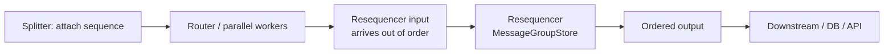
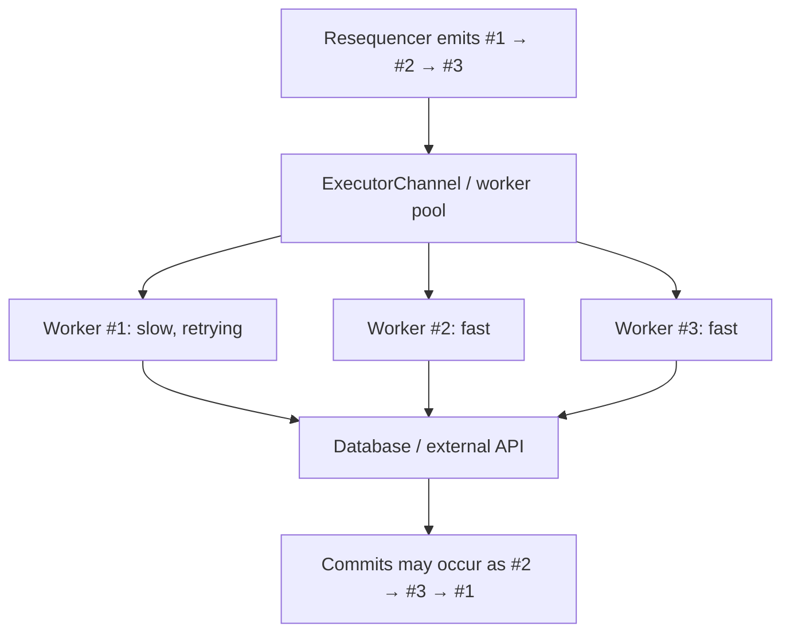

# Testing Ordering with a Resequencer

In the **Pattern Testing** chapter of **SPRING_INTEGRATION_PATTERN**, a Resequencer is used to restore the order of messages arriving out of sequence. However, one point is easy to miss: merely configuring a Resequencer is **not enough to prove** that an integration flow satisfies its ordering contract—especially when combined with a Splitter, Router, Filter, Transformer, Gateway, retry, and parallel branches.

This lesson explains how to **test ordering with Spring Integration's Resequencer**: defining invariants, crafting intentionally out-of-order inputs, observing outputs at the exact right boundary, verifying multiple correlation groups, and covering missing parts, duplicates, timeouts, late arrivals, retries, error channels, and asynchronous downstream processing.

> **Testing principle:** Do not merely prove that messages appear as `1, 2, 3` in one favorable example. Prove **right group, right position, right content, right count**, and know the exact boundary where that claim holds.

## 1. What Does a Resequencer Guarantee, and What Lies Outside Its Scope?

A typical flow:



Messages in the same batch typically carry these headers:

| Header | Role | Example |
| --- | --- | --- |
| `correlationId` | Groups messages that must be ordered together | `batch-42:run-1` |
| `sequenceNumber` | Position of the message within the group | `3` |
| `sequenceSize` | Total expected parts when known in advance | `4` |

For example, a Splitter produces four parts `A, B, C, D` and workers return them in order `C, A, D, B`. The Resequencer must emit **released messages** in position order according to its configured policy.

```text
One correlation group G, size = 4

Source creates:     A(#1)     B(#2)     C(#3)     D(#4)
Input received:     C(#3) --> A(#1) --> D(#4) --> B(#2)
                                            |
                                       Resequencer
                                            |
Expected output:    A(#1) --> B(#2) --> C(#3) --> D(#4)
```

**Distinguish three boundaries:**

1. **Arrival order:** order in which messages arrive **before** the Resequencer. Out-of-order arrival is the normal input to test.
2. **Emission order:** order in which the Resequencer **emits** messages to the downstream channel. This is the core invariant of the pattern test.
3. **Commit order:** order in which downstream actually writes to a database, calls an API, or completes business effects. If an `ExecutorChannel`, multiple consumers, or multi-partition broker follows the Resequencer, commit order **does not automatically match** emission order.

When business rules require in-order commits, test the third boundary as well and design a per-key sequential consumer, version check, or sequencing mechanism at commit time.

## 2. Writing the Ordering Contract Before Writing Tests

### 2.1. Four Distinct Invariants

| Invariant | Description | How to Assert |
| --- | --- | --- |
| **Order** | Within the same group, a later position must not emit before a required earlier position | Compare `sequenceNumber` sequence |
| **Completeness** | A required complete batch must contain all positions `1..N` | Compare exact expected set/sequence |
| **Uniqueness** | Each logical part has only one permitted effect | Count unique positions/event IDs, verify business effects |
| **Content identity** | Payload at position `k` is the exact part produced by the Splitter | Cross-check `sourceEventId` or payload against manifest |

**Asserting `1 < 2 < 3` alone is not enough** if `#4` is missing from the output, `#2` is emitted twice, or the data of `#2` and `#3` was swapped. Completeness and uniqueness assertions require a **group completion contract**; if configuration permits partial release, do not equate an emitted segment with a completed batch.

For a group confirmed complete with `N` parts, a clear target is:

```text
output.position == [1, 2, ..., N]
output.eventId  == [sourceId(1), sourceId(2), ..., sourceId(N)]
output.groupId  == [G, G, ..., G]
extra effects   == 0 per idempotency contract
```

### 2.2. Per-Group Ordering, Not Global Ordering

Given independent groups A and B:

```text
Input:  A#2, B#2, B#1, A#1
Valid output: B#1, B#2, A#1, A#2

Another interleaving may also be valid,
as long as each group emits its own positions in order.
```

Do not assert that group A must always finish before group B just because A's first part arrived earlier. **Correlation defines the ordering scope**; cross-group ordering depends on message arrivals and release conditions.

### 2.3. Partial Release vs. Completion

Depending on the release strategy, a Resequencer can emit contiguous segments before the entire group arrives. A test asserting "no output before all `N` parts arrive" is **valid only if you configured a full-completion waiting policy**.

Therefore, write two separate sets of checks:

- **Ordered emission:** observed messages still have increasing sequence numbers per contract.
- **Group lifecycle:** when the group is deemed complete/expired, whether partial release is permitted, and how late missing messages are handled.

Never infer default behavior from the name Resequencer alone; verify the release strategy, Spring Integration version, and exact endpoint configuration in use.

## 3. Preparing Reproducible Test Data

A good fixture carries both the sequence number and original data identity, verifying payloads as well as headers:

```java
public record OrderPart(
        String batchRunId,
        int position,
        String sourceEventId,
        String value) {
}
```

Each test run should use a unique `batchRunId`, such as `"test-" + UUID.randomUUID()`, so it never collides with completion markers from an earlier run. Parts must share the same `correlationId`, while each part has its own `sequenceNumber` and consistent `sourceEventId`.

**Never use `MessageHeaders.ID` as a business event ID.** Two redeliveries of the same part can create Spring Messages with different UUIDs while business logic still treats them as the same element.

### 3.1. Creating Messages with Valid Sequence Headers

```java
import org.springframework.integration.IntegrationMessageHeaderAccessor;
import org.springframework.messaging.Message;
import org.springframework.messaging.support.MessageBuilder;

public final class PartMessages {

    private PartMessages() { }

    public static Message<OrderPart> of(
            String group, int position, int total,
            String eventId, String value) {

        if (group == null || group.isBlank()
                || eventId == null || eventId.isBlank()
                || total < 1 || position < 1 || position > total) {
            throw new IllegalArgumentException("Invalid sequence data");
        }

        return MessageBuilder
                .withPayload(new OrderPart(group, position, eventId, value))
                .setHeader(
                        IntegrationMessageHeaderAccessor.CORRELATION_ID,
                        group)
                .setHeader(
                        IntegrationMessageHeaderAccessor.SEQUENCE_NUMBER,
                        position)
                .setHeader(
                        IntegrationMessageHeaderAccessor.SEQUENCE_SIZE,
                        total)
                .build();
    }
}
```

For instance, `PartMessages.of("batch-42", 3, 4, "evt-C", "C")` is the third part of a four-part batch. Keeping `position` and `batchRunId` inside the payload is intentional **for cross-checking**, preventing a header-only test from passing when payloads were mapped wrongly.

## 4. Java DSL: Placing the Observation Boundary Right After the Resequencer

A minimal integration test setup can use a `DirectChannel` as input and a `QueueChannel` as output:

```java
import org.springframework.context.annotation.Bean;
import org.springframework.context.annotation.Configuration;
import org.springframework.integration.channel.DirectChannel;
import org.springframework.integration.channel.QueueChannel;
import org.springframework.integration.config.EnableIntegration;
import org.springframework.integration.dsl.IntegrationFlow;

@Configuration
@EnableIntegration
public class ResequencerOrderTestConfig {

    @Bean
    DirectChannel shuffledParts() {
        return new DirectChannel();
    }

    @Bean
    QueueChannel orderedParts() {
        return new QueueChannel();
    }

    @Bean
    IntegrationFlow resequenceFlow(
            DirectChannel shuffledParts,
            QueueChannel orderedParts) {

        return IntegrationFlow.from(shuffledParts)
                .resequence()
                .channel(orderedParts)
                .get();
    }
}
```

**Why does this configuration suit testing?**

- `DirectChannel` feeds messages synchronously in the example, eliminating reordering sources *before* the boundary under test.
- `resequence()` is the endpoint under verification.
- `QueueChannel` lets the test actively call `receive(timeout)` and observe the exact order placed into the queue **immediately after the endpoint**.
- Only one test thread reads the queue; if multiple consumers pull messages concurrently, **completion** order can differ from queue insertion order.

This is an **illustrative test harness**, not a complete production system. It does not configure a persistent group store, retry/error paths, timeouts, group cleanup, or sensitive data protection. Resequencer behavior regarding partial release and expiry must be checked against your actual library version. Never assume production needs only these three beans.

## 5. JUnit 5 Integration Test: Intentionally Sending Out of Order

To prove the Resequencer is actually working, **inputs must arrive intentionally out of order**. The snippet below uses Spring Test with JUnit Jupiter, assuming `OrderPart` and `PartMessages` above reside in a matching package.

```java
import static org.junit.jupiter.api.Assertions.*;

import java.util.ArrayList;
import java.util.List;
import java.util.UUID;

import org.junit.jupiter.api.Test;
import org.springframework.beans.factory.annotation.Autowired;
import org.springframework.beans.factory.annotation.Qualifier;
import org.springframework.integration.channel.DirectChannel;
import org.springframework.integration.channel.QueueChannel;
import org.springframework.messaging.Message;
import org.springframework.test.context.junit.jupiter.SpringJUnitConfig;

@SpringJUnitConfig(ResequencerOrderTestConfig.class)
class ResequencerOrderIntegrationTest {

    @Autowired
    @Qualifier("shuffledParts")
    DirectChannel input;

    @Autowired
    @Qualifier("orderedParts")
    QueueChannel output;

    private void send(
            String group, int position, int size,
            String eventId, String value) {

        assertTrue(input.send(
                PartMessages.of(group, position, size, eventId, value)));
    }

    private List<OrderPart> take(int count) {
        List<OrderPart> results = new ArrayList<>();

        for (int i = 0; i < count; i++) {
            Message<?> message = output.receive(2_000);
            assertNotNull(message, "Missing output at index " + i);
            results.add((OrderPart) message.getPayload());
        }

        return results;
    }

    @Test
    void emitsOneCompleteGroupInSequenceOrder() {
        String group = "test-" + UUID.randomUUID();

        // Input C, A, D, B; NOT natural order.
        send(group, 3, 4, "evt-C", "C");
        send(group, 1, 4, "evt-A", "A");
        send(group, 4, 4, "evt-D", "D");
        send(group, 2, 4, "evt-B", "B");

        List<OrderPart> actual = take(4);

        assertEquals(List.of(1, 2, 3, 4),
                actual.stream().map(OrderPart::position).toList());

        assertEquals(List.of("evt-A", "evt-B", "evt-C", "evt-D"),
                actual.stream().map(OrderPart::sourceEventId).toList());

        assertEquals(List.of("A", "B", "C", "D"),
                actual.stream().map(OrderPart::value).toList());

        assertTrue(actual.stream()
                .allMatch(part -> group.equals(part.batchRunId())));

        // Confirms only that no extra part appeared within a short window.
        assertNull(output.receive(100));
    }
}
```

**What this test verifies:**

1. The Resequencer received four messages sharing `correlationId` with distinct positions.
2. Output sequence is `1, 2, 3, 4` even though input was `3, 1, 4, 2`.
3. `sourceEventId` and payload match their positions accurately.
4. No extra output appeared within `100 ms` after the four parts.

**Limitation:** `assertNull(output.receive(100))` **does not prove** no duplicate message will ever arrive. If the system includes retries, timers, or asynchronous adapters, increase the observation window per contract or inspect durable state/idempotency stores. This test also does not verify commit order at a downstream database/API.

## 6. Integration Test: Multiple Interleaved Correlation Groups

A frequent bug is mixing parts that share a `sequenceNumber` across two different groups. With two batches `A` and `B`, you can send:

```text
Input order:   A#2, B#2, B#1, A#1

Expected:
  A: #1 → #2
  B: #1 → #2

No fixed requirement that A must emit completely before B.
```

You can add the following test method **inside the same `ResequencerOrderIntegrationTest` class** that already defines `send()` and `take()`:

```java
@Test
void preservesOrderSeparatelyForEachGroup() {
    String a = "batch-A-" + UUID.randomUUID();
    String b = "batch-B-" + UUID.randomUUID();

    send(a, 2, 2, "A2", "payload-A2");
    send(b, 2, 2, "B2", "payload-B2");
    send(b, 1, 2, "B1", "payload-B1");
    send(a, 1, 2, "A1", "payload-A1");

    List<OrderPart> emitted = take(4);

    Map<String, List<Integer>> byGroup = new HashMap<>();
    for (OrderPart part : emitted) {
        byGroup.computeIfAbsent(
                part.batchRunId(), ignored -> new ArrayList<>())
                .add(part.position());
    }

    assertEquals(List.of(1, 2), byGroup.get(a));
    assertEquals(List.of(1, 2), byGroup.get(b));
    assertEquals(2, byGroup.size());
}
```

When adding this snippet to the test class, add imports for `java.util.Map` and `java.util.HashMap`. Assertions inspect **the sequence observed per group**, not a single combined order across all four parts.

For stronger verification, cross-check `sourceEventId` against each group's manifest. Both `sequenceNumber=1` in A and `sequenceNumber=1` in B are valid; never use `sequenceNumber` alone as a system-wide deduplication key.

## 7. Property-Based Test Design, Not Just One Permutation

One fixed example is necessary but not sufficient. Test multiple permutations to catch edge-only bugs:

| Input Pattern | Example with N=5 | What It Exposes |
| --- | --- | --- |
| Fully reversed | `5,4,3,2,1` | Wrong ordering or mistaking the head element |
| Position 1 arrives last | `2,3,4,5,1` | Premature release while head of group is missing |
| Position N arrives first | `5,1,2,3,4` | Stuck tail or broken release strategy |
| Middle part arrives late | `1,3,4,2,5` | Gap in the middle |
| Single part | `1/1` | Sequence-size boundary condition |
| Multiple interleaved groups | `A2,B2,A1,B1` | Cross-correlation mixing or false global ordering |
| Identical payloads | Two positions with same value, distinct event IDs | Content verification or faulty dedup bugs |

A *property-based* strategy:

```text
For each N in {1, 2, 3, 5, 10}:
  1. Generate a manifest of N unique event IDs.
  2. Generate a seeded permutation for reproducibility.
  3. Attach identical correlationId, sequenceSize=N, position=1..N.
  4. Send messages following the permutation.
  5. Read N messages from output and assert:
       positions == [1..N]
       event IDs == manifest in position order
       correlationId matches and payloads match.
  6. Use a fresh group ID for the next iteration.
```

For small N, you can test **all permutations**; for larger N, use seeded randomness plus known boundary patterns. On failure, log **seed, group ID, permutation, expected, and actual** for reproduction.

Never use random sleep durations to create "out-of-order arrivals": send according to a fixed permutation. Concurrency or timeout tests should be written as a separate group with deterministic synchronization.

## 8. Testing Groups Missing One or More Parts

An incomplete group may wait for more parts, trigger expiry handling, or release partially depending on configuration. Tests must state the **completion condition** explicitly; never silently treat "no output" as success.

Example:

```text
Expected size: 4
Received inputs: #4, #1, #3
Missing:         #2

Must verify:
  - Is the group keyed by the right correlationId?
  - Are any already-emitted outputs (if any) still in order?
  - Does the endpoint falsely mark the group complete?
  - How is timeout/expiry handled under the chosen policy?
  - If #2 arrives later, what happens?
```

### 8.1. Avoiding False Assertions with Partial Release

If configuration allows emitting contiguous prefixes, receiving `#1` may cause the endpoint to emit the beginning **before** all remaining parts arrive. Therefore, asserting `assertNull(output.receive(...))` on an incomplete group can **fail against a valid release policy**.

To test "no release before full group," **explicitly configure a release strategy that releases only upon completion** and test that. To test partial release, specify expectations by **contiguous segments** and the exact release conditions.

### 8.2. Timeout Does Not Prove Permanent Loss

A message may be sitting in a broker/DLQ or retrying when a group times out. Expiry tests must clarify:

- `groupTimeout` and ensuring the timeout scheduler is active in the test environment.
- `sendPartialResultOnExpiry` and group cleanup options.
- Final business state (full, partial, failed, recovering).
- Behavior of messages arriving after expiry, especially once the group has been cleaned up.
- Error notifications or business events that the application **explicitly** emits.

Never assume every expiry automatically produces an `ErrorMessage` on `errorChannel`; message-processing error paths and group-timeout events are separate mechanisms that must be wired and tested independently.

## 9. Duplicates, Conflicting Sequences, and Late Arrivals

A Resequencer **handles ordering**, not business idempotency. For a group with positions `1..3`:

| Scenario | Input | Invariant to Test |
| --- | --- | --- |
| Exact redelivery | `1:A, 2:B, 2:B, 3:C` | B's business effect is not applied twice |
| Duplicate slot, different data | `1:A, 2:B, 2:X, 3:C` | Conflict detected/quarantined |
| Conflicting size metadata | `1/3, 2/4, 3/3` | Validation rejects mismatched metadata |
| Already-completed group | Emit `1,2,3` then receive `2` again | Does not open a second batch outside policy |
| Finalized partial group | Finalize `1,2` then `#3` arrives late | Correction/reject per contract, never silently alters result |
| Retry generates new message ID | Same event ID and slot, different `MessageHeaders.ID` | Redelivery recognized via business key |

In integration tests, include an **admission gate/inbox** or idempotency component whenever the application must prevent duplicate effects. Sending duplicates straight into a Resequencer and assuming `.resequence()` will filter every case is an unfounded assertion.

If an adapter retries after a business effect already committed, inspect **state outside the endpoint** (database, idempotency store, outbound events), not only message counts read from a `QueueChannel`.

## 10. Post-Resequencer Testing: Right Emission Order, Wrong Commit Order

A real-world failure mode:



A test right after the Resequencer can pass because emission order is correct, while business rules requiring commit order are still violated.

If end-to-end ordering is required, design a **per-group sequential lane**, partition by `correlationId`, or enforce expected version checks in the database. Then add assertions:

```text
commitLog(group G).sequenceNumber == [1, 2, 3]
finalAggregateVersion == 3
businessSideEffects == exactly those allowed by the contract
```

Inspect the **commit log or committed state**, not merely console log line order across multiple threads. Centralized logs can arrive out of order due to buffering, clock skew, or asynchronous exporters.

## 11. MessageGroupStore, Restarts, and Multiple Instances

A Resequencer uses a `MessageGroupStore` to manage message groups. In test environments:

- **In-memory store:** fast and simple, though pending state is lost on JVM restart.
- **Persistent store:** can recover group data across restarts given proper configuration and transactions; introduces storage management, locking, and cleanup concerns.
- **Multiple instances:** requires coordination so a group is not released twice or the same slot processed inconsistently across two nodes.
- **Completion markers and cleanup:** affects how messages arriving after group completion are classified.
- **Reaper and timeouts:** can purge long-lived groups; behavior must be verified against the specific store, version, and endpoint.

Cases to test:

1. Store receives `#3`, application restarts, then `#1` and `#2` arrive.
2. Final message arrives right around timeout expiry.
3. Two workers submit the same slot nearly simultaneously.
4. Group completes and the broker redelivers one part.
5. Store is slow, fails a transaction, or becomes temporarily unreachable.

**Do not run a restart test on an in-memory store and conclude Spring Integration "unexpectedly lost messages."** That is simply the non-durable nature of the chosen implementation. The goal is to validate behavior against recovery SLAs and replay policies.

## 12. Building Non-Flaky Tests

### 12.1. Avoid Sleeping to "Guess" When Output Is Ready

Instead of:

```java
Thread.sleep(500);
assertEquals(4, output.getQueueSize());
```

receive with a finite timeout:

```java
Message<?> message = output.receive(2_000);
assertNotNull(message, "Timed out waiting for resequenced output");
```

Timed reads fail with clear diagnostics and return immediately when output is already present. Still, choose timeouts suited to CI load and actual processing time; avoid overly tight timeouts for asynchronous adapters.

### 12.2. Timeout Tests Need Controllable Scheduling

For application-built timeout decision logic, inject a `Clock` or controllable scheduler in tests. When testing Spring Integration endpoints directly, observe real timers/expiries without assuming millisecond-exact execution schedules.

Use synchronization primitives such as `CountDownLatch` for worker concurrency and "entered handler" barriers instead of chains of `Thread.sleep`. Keep error tests isolated so they do not slow down or pollute state in regular ordering tests.

### 12.3. Isolating Groups and State Across Tests

- Use unique `correlationId` values.
- Define cleanup policies and bound output receive waits.
- Do not run tests in parallel when they share a single `QueueChannel` and consume each other's outputs.
- When parallel testing is needed, use a thread-safe per-group recorder or create isolated contexts/endpoints.
- Do not manually mutate `MessageGroupStore` state in tests with arbitrary deletes if you are verifying real lifecycle behavior.

`assertNull(output.receive(100))` only shows **no extra output within a 100 ms window**, not that the system will never emit again.

## 13. Practical Test Matrix

| Test Case | Input / Condition | What to Verify |
| --- | --- | --- |
| Basic out-of-order | `3,1,4,2` / size 4 | Output `1,2,3,4` and exact payloads |
| Fully reversed | `4,3,2,1` | Output strictly ascending |
| Single-part group | `1/1` | Completes validly |
| Interleaved groups | `A2,B2,B1,A1` | Both A and B emit `1,2` |
| Identical payloads | Two positions with same value, different IDs | Identities never swapped |
| Missing head of group | `3/3,2/3` | Not marked complete; partial handled per contract |
| Missing middle of group | `1/4,3/4,4/4` | Gap detected, wait/expiry follows policy |
| Duplicate delivery | `1,2,2,3` | No duplicate business effect |
| Conflicting slot | Two #2 messages with different payloads | Controlled quarantine or error flow |
| Conflicting size | `1/3,2/4,3/3` | Validation blocks inconsistent metadata |
| Filter drops a part | Splitter creates `1..4`, Filter drops `#2` | Explicit skip/reindex/fail policy, never hangs forever |
| Retry before resequencing | `#2` fails then succeeds | Retains right correlation and position 2 |
| Retry after resequencing | `#1` commits after `#2` | End-to-end test catches violation if commit order is required |
| Timeout | Incomplete group past deadline | Expiry, partial/fail/recovery follows policy |
| Late message | `#3` arrives after finalization | Does not emit a second final result |
| Crash / restart | Incomplete group then restart | Recovers or replays per store type |
| Two instances | Same group received concurrently | No lost or duplicate results |
| Broker output | Same group spread across partitions | Never assert global ordering without partitioning design |

## 14. Observing Outcomes and Diagnosing Failures

A useful failure report should include:

```json
{
  "testCase": "resequence-out-of-order",
  "groupId": "test-42",
  "inputPositions": [3, 1, 4, 2],
  "expectedOutputPositions": [1, 2, 3, 4],
  "actualOutputPositions": [1, 3, 2, 4],
  "observationBoundary": "resequencer-output",
  "releasePolicy": "configured-test-policy",
  "note": "illustrative failure record"
}
```

This is a **test-defined diagnostic schema**, not default output from Spring Integration. When a test fails, check in order:

1. **Input metadata:** are `correlationId`, `sequenceNumber`, `sequenceSize`, header types, and source event IDs accurate?
2. **Where reordering occurred:** are you measuring right after the Resequencer or after a downstream `ExecutorChannel`/broker?
3. **Release strategy:** does it allow partial release, timeout/expiry, or was the group already completed?
4. **Duplicate/conflict:** are two messages contesting one slot, or is an old message left over from a prior run?
5. **Error branch:** did Retry/Gateway/Filter drop a part or alter headers?
6. **MessageGroupStore:** is stale state present, is a cleanup/reaper running, or is there multi-instance contention?
7. **Test harness:** is another consumer reading the output channel, did another test leave messages behind, or was the timeout too short?
8. **Business commit:** did the endpoint emit in order while downstream wrote out of order?

Production metrics should track `groupWaitTime`, timed-out groups, incomplete groups, missing positions, duplicates/conflicts, late arrivals, and emission/commit order violations **per group scope**. Avoid using `correlationId` as a high-cardinality metric label; look up specific batches via structured logs and traces.

## 15. Checklist Before Concluding Tests Pass

1. **Ordering contract written:** per `correlationId`, are all `1..N` and one effect per slot required?
2. **Truly out-of-order inputs:** not just sending `1,2,3` as an easy case.
3. **Cross-checked payloads/event IDs:** not just inspecting header numbers.
4. **Measured at the right boundary:** right after Resequencer for emission, at DB/API for commit.
5. **Tested multiple groups:** never forcing global order across independent batches.
6. **Release policy explicit:** full/partial, timeout, and expiry handling.
7. **Failure scenarios included:** missing parts, duplicates, conflicts, Filter drops, and retries.
8. **Late arrivals and restarts covered:** completed once, no second batch emitted outside contract.
9. **Sensible concurrency tests:** no random sleeps to prove correctness.
10. **Isolated test state:** fresh group IDs, properly managed queues and test contexts.
11. **Do not equate output with business commit:** async downstream needs its own invariants and tests.
12. **Reproducible diagnostics:** input permutation, seed, expected/actual, release policy, and measurement boundary.

**Remember:** Testing a Resequencer must verify **per-correlation-group ordering** using intentionally out-of-order data, while also confirming each part's identity and content. A good test clearly states its observation point, completion condition, and behavior under missing/duplicate/late data. When downstream processing is asynchronous, commit ordering is an **additional contract** that must be designed and tested separately; a Resequencer cannot replace idempotency, recovery, or business transaction coordination.
