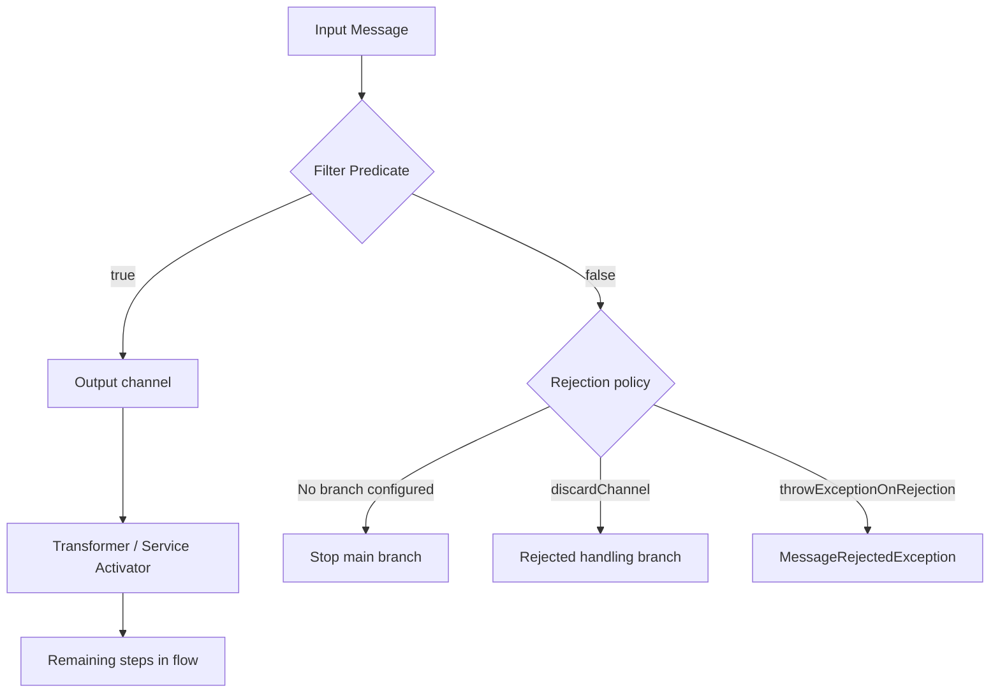
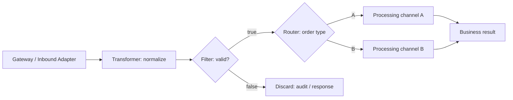
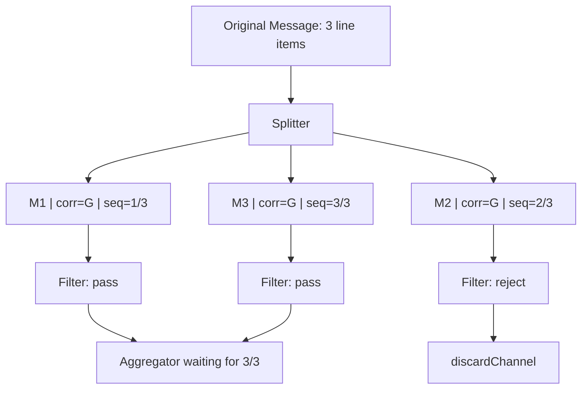

# Filters and Flow Continuation Conditions in Pipes and Filters

The **Pipes and Filters** architectural pattern builds a processing flow by connecting *filters* (processing steps) through *pipes* (data transport channels). Each step focuses on a single responsibility: validating data, normalizing, routing, splitting items, invoking services, or aggregating results. In Spring Integration, these steps are typically **message endpoints**, and the links between them are **message channels**.

Within this model, the **Message Filter** is a specialized step: it decides **whether a Message qualifies to continue along the main branch of the flow**. A misplaced condition or an unclear rejection path can cause Messages to silently disappear, a Gateway to wait indefinitely, or an Aggregator to miss items needed to complete a group.

This lesson belongs to the `SPRING_INTEGRATION_PATTERN` module: learning to implement Enterprise Integration Patterns with Spring Integration to build loosely coupled and extensible message flows; practicing Router, Filter, Transformer, Splitter, Aggregator, Gateway, retry, error channels, correlation, and testing and monitoring processing branches. The focus here is **designing flow continuation conditions**, from predicates to the behavior of downstream steps after a Filter.

## 1. A Filter Is a Decision Gate in a Pipeline

A Spring Integration Message carries two main parts:

- **Payload:** the business data to process, such as `Order`, `PaymentEvent`, or an order line item.
- **Headers:** metadata such as `id`, `timestamp`, `correlationId`, `sequenceNumber`, `replyChannel`, and business keys.

A **Predicate** (filter condition) is a function returning a boolean value. If it returns `true`, the Message is allowed to enter the next endpoint. If it returns `false`, the Message **does not exit to the main output channel**; subsequent behavior depends on the rejection configuration.



For example, a system receives order events and only processes orders in `NEW` status with a positive total:

```text
Order(id="ORD-101", status=NEW, total=250000)       -> PASS  -> continue
Order(id="ORD-102", status=CANCELLED, total=250000) -> REJECT -> rejection branch
Order(id="ORD-103", status=NEW, total=-500)         -> REJECT -> rejection branch
```

Distinguish three outcomes:

1. **Accepted:** the condition returns `true`; the Message continues along the main branch.
2. **Rejected:** the condition returns `false`; this can be a completely normal business decision.
3. **Failed:** evaluating the condition throws an exception, such as failing to connect to a policy verification service; this is an execution error that must follow the error policy.

`false` is not by default a technical error. Conversely, swallowing exceptions and returning `false` can hide operational incidents.

## 2. Filter Placement Determines the Behavior of the Entire Flow

A pipeline can have many steps, but not every placement carries the same meaning:



In this diagram, data normalization sits **before the Filter** if the predicate needs normalized values. The Filter sits **before the Router** if both branches A and B must follow the same policy. If each branch has its own criteria, a Filter can be placed after the Router.

| Filter Placement | Purpose | Risks to Consider |
| --- | --- | --- |
| Before Transformer | Reject junk data early, reducing transformation cost | Predicate must correctly handle unnormalized payloads |
| After Transformer | Validate against consistent data | Wastes transformation resources on Messages that will be discarded |
| Before Router | Apply a common rule across all branches | Might block a Message that one specific branch could have handled |
| After Router | Apply branch-specific conditions | Harder to aggregate rejection reasons without monitoring |
| Before Splitter | Reject the whole group before creating child Messages | Unsuitable if only one child item is invalid |
| After Splitter | Validate individual items | Risks causing an Aggregator to miss Messages in the group |
| Before external side-effect steps | Avoid calling database/API for invalid data | Must distinguish normal rejections from policy lookup errors |

The goal is not to place a Filter as early as possible, but to **place it where enough data is available to make an accurate decision and where the impact on downstream steps is clearly understood**.

## 3. How Filter, Router, and Transformer Differ

In Pipes and Filters, the word *filter* is sometimes used broadly to mean any data-processing step. However, **Spring Integration's Message Filter** specifically means accepting or discarding a Message.

| Component | Question It Answers | Typical Output |
| --- | --- | --- |
| `Filter` | May this Message proceed? | Original Message on main branch or rejected Message |
| `Router` | Which branch should this Message go to? | One or more selected channels |
| `Transformer` | What representation should the data become? | Transformed payload/Message |
| `Splitter` | What items can this Message be split into? | A sequence of child Messages |
| `Aggregator` | Which items belong to the same group and is it complete? | One aggregated result |
| `Service Activator` | What business operation needs to execute? | Business side effect or result Message |

If all order statuses must be processed via different channels, use a Router. If only valid orders may reach the persistence step, a Filter fits. If `OrderRequest` must become `OrderCommand`, use a Transformer. Distinguishing them properly makes flows easier to read, test, and change.

## 4. Configuring a Conditional Flow with the Java DSL

The following example uses Java 17+, Spring Integration, and Spring Messaging. The flow receives an `Order`, filters by a condition, and then transforms accepted orders into `AcceptedOrder`. Rejected orders go to `rejectedOrders` for system tracking; valid orders go to `acceptedOrders`.

```java
package example.integration;

import java.math.BigDecimal;

import org.springframework.context.annotation.Bean;
import org.springframework.context.annotation.Configuration;
import org.springframework.integration.channel.DirectChannel;
import org.springframework.integration.channel.QueueChannel;
import org.springframework.integration.config.EnableIntegration;
import org.springframework.integration.dsl.IntegrationFlow;
import org.springframework.messaging.MessageChannel;
import org.springframework.messaging.PollableChannel;

@Configuration
@EnableIntegration
public class OrderPipelineConfiguration {

    public enum OrderStatus { NEW, CANCELLED, COMPLETED }

    public record Order(String id, BigDecimal total, OrderStatus status) {}

    public record AcceptedOrder(String id, BigDecimal total) {}

    @Bean
    public MessageChannel ordersInput() {
        return new DirectChannel();
    }

    @Bean
    public PollableChannel acceptedOrders() {
        return new QueueChannel(20);
    }

    @Bean
    public PollableChannel rejectedOrders() {
        return new QueueChannel(20);
    }

    @Bean
    public IntegrationFlow orderPipeline() {
        return IntegrationFlow.from("ordersInput")
                .filter(Order.class,
                        order -> order.id() != null
                                && !order.id().isBlank()
                                && order.total() != null
                                && order.total().signum() > 0
                                && order.status() == OrderStatus.NEW,
                        spec -> spec.discardChannel("rejectedOrders"))
                .transform(Order.class,
                        order -> new AcceptedOrder(
                                order.id(), order.total()))
                .channel("acceptedOrders")
                .get();
    }
}
```

This flow has the following characteristics:

- `DirectChannel` synchronously routes the Message from the producer into the pipeline.
- `filter(Order.class, ...)` evaluates the predicate on an `Order` payload. The condition checks `id` and `total` before using them to avoid errors from missing fields.
- If the predicate returns `false`, the original Message is sent to `rejectedOrders`; it **does not pass through the Transformer**.
- If the predicate returns `true`, the Transformer creates an `AcceptedOrder` payload and sends the output to `acceptedOrders`.
- The two `QueueChannel` beans only serve as observation points in this example. In real deployments, a consumer or poller is required to drain those channels.

Nesting `record` definitions inside the configuration keeps the example self-contained; real applications can place DTO/domain types in separate files. `@EnableIntegration` is used in Spring configurations that do not rely on existing auto-configuration. The example can be tested without calling databases or external services.

### 4.1. Sending Messages Manually to Observe Both Paths

```java
package example.integration;

import java.math.BigDecimal;

import org.springframework.context.annotation.AnnotationConfigApplicationContext;
import org.springframework.messaging.Message;
import org.springframework.messaging.MessageChannel;
import org.springframework.messaging.PollableChannel;
import org.springframework.messaging.support.MessageBuilder;

import example.integration.OrderPipelineConfiguration.Order;
import example.integration.OrderPipelineConfiguration.OrderStatus;

public class OrderPipelineDemo {

    public static void main(String[] args) {
        try (var context = new AnnotationConfigApplicationContext(
                OrderPipelineConfiguration.class)) {
            MessageChannel input =
                    context.getBean("ordersInput", MessageChannel.class);
            PollableChannel accepted =
                    context.getBean("acceptedOrders", PollableChannel.class);
            PollableChannel rejected =
                    context.getBean("rejectedOrders", PollableChannel.class);

            input.send(MessageBuilder.withPayload(new Order(
                            "ORD-101", new BigDecimal("250000"), OrderStatus.NEW))
                    .setHeader("businessOrderId", "ORD-101")
                    .build());

            input.send(MessageBuilder.withPayload(new Order(
                            "ORD-102", new BigDecimal("-1"), OrderStatus.NEW))
                    .setHeader("businessOrderId", "ORD-102")
                    .build());

            Message<?> ok = accepted.receive(0);
            Message<?> rejectedOrder = rejected.receive(0);

            System.out.println(ok.getPayload());            // AcceptedOrder(...)
            System.out.println(rejectedOrder.getPayload()); // Order(..., total=-1)
        }
    }
}
```

The code snippets use the illustrative package `example.integration` and should be placed in corresponding Java files within this package. `receive(0)` calls only return a Message if the queue already holds data; real applications must check for `null` before calling `getPayload()`.

**Key result:** `ORD-102` is rejected by the predicate and does not appear in `acceptedOrders`; `ORD-101` is transformed into `AcceptedOrder`. `businessOrderId` can be used to correlate decisions across both branches and in monitoring systems.

## 5. What Actually Happens When a Predicate Returns `false`?

A rejection can be handled in several ways, each carrying very different business meanings.

### 5.1. No `discardChannel`

Under standard filtering behavior, the Message does not exit the Filter's output. Downstream endpoints are **not invoked** for that Message. Stopping the main branch can suit fire-and-forget flows, such as ignoring irrelevant data that the system does not need to store.

However, if this is a customer request expecting a response, dropping a Message without a reply branch can cause the Gateway to hit its timeout.

### 5.2. With `discardChannel`

When `discardChannel` is configured, Messages failing the condition are routed to a separate branch. This branch can:

- Write an audit entry with the violated rule code.
- Produce a business rejection response.
- Push to a queue for manual review.
- Collect statistics on invalid input data.

The discard branch **is itself an integration flow** if it has consuming endpoints. It needs monitoring, an error handling policy, and sufficient consumption capacity. A `QueueChannel` on the discard branch can fill up or lose data on JVM shutdown if stored only in memory.

### 5.3. Throwing an Exception on Rejection

The Filter supports `throwExceptionOnRejection` when a `false` outcome should be treated as an error condition. This mechanism can throw `MessageRejectedException` instead of treating rejection as a silent decision. This choice suits contracts where certain invalid requests are errors that must be returned to the caller.

Do not enable exception throwing on every Filter out of habit. For instance, ignoring an event outside the service's topic of interest is a normal outcome; by contrast, an invalid payment request may need to return a structured error.

### 5.4. The Predicate Itself Throws an Exception

If a predicate accesses a missing field, times out calling another service, or handles the wrong payload type, it may throw an exception. That is an **evaluation failure**, distinct from a valid rejection. In a synchronous flow via `DirectChannel`, the error can propagate back to the producer. In flows using pollers, executors, or brokers, errors follow the configured asynchronous component's error handling mechanism.

| Scenario | Main Branch | Typical Handling |
| --- | --- | --- |
| Predicate `true` | Continues | Invoke Transformer/Service Activator |
| Predicate `false`, no discard | Stops at Filter | Count, log, or ignore per policy |
| Predicate `false`, with discard | Stops main branch; sends to discard | Audit or rejection response |
| Predicate `false`, throw configured | Does not continue normally | Handle `MessageRejectedException` per contract |
| Predicate throws exception | Decision incomplete | Retry if transient, or route to error flow |

**`discardChannel` and `errorChannel` have different roles.** `discardChannel` is for rejection decisions; `errorChannel` handles failures when infrastructure/endpoints produce an ErrorMessage per configuration. Do not assume an error anywhere will automatically arrive at a desired error channel.

## 6. Flow Continuation Conditions with Gateways and Replies

A Gateway typically converts a Java method call into a Message and waits for a result when declared as request-reply. When a Filter drops a Message before a reply-producing step, the Gateway may wait until `replyTimeout`.

For example, a service receives an `approve(order)` request: if a Filter only allows `OrderStatus.NEW` to proceed, every `CANCELLED` request must be handled with a clear contract. There are at least three options:

1. **Return a business result** such as `REJECTED`, `reason=INVALID_STATUS` via a reply-producing branch.
2. **Throw an exception mapped to an API error** if the request is considered invalid.
3. **Accept the event as fire-and-forget**, where the producer only needs to know the system accepted it without requiring a business reply.

If `replyChannel` or `errorChannel` exists in the headers, design an appropriate return path for each branch. Do not use a logging-only `discardChannel` as a substitute for replying to a waiting Gateway.

With `QueueChannel` or `ExecutorChannel`, the Filter may run after the producer sends the Message. Therefore, **a successful `send()` does not mean the predicate returned `true` or the business logic completed**. API contracts must distinguish “accepted for ingestion,” “approved after validation,” and “processed.”

## 7. Filter with Router and Transformer Branches

A Filter does not decide which channel an accepted Message goes to; that responsibility usually belongs to a Router or the flow structure. A straightforward composition is:

```text
input
  |
  v
Transformer (normalize)
  |
  v
Filter (valid?) ---- false ----> discard/audit
  |
 true
  v
Router (standard / priority)
  |             |
  v             v
StandardFlow   PriorityFlow
```

When a condition applies across all branches, placing a Filter before the Router avoids repeating the rule in every branch. When a condition is specific to each branch, place Filters in the respective branches and tag rule names in logs/metrics so you know exactly where decisions are made.

A Transformer often gives the Filter consistent data, but it can also build a new Message or change the payload type. Before using input headers in a predicate, verify that the Transformer preserves the required metadata—especially business headers and context used for correlation.

### Example: A Time-Varying Condition

If a Filter only allows an event whose `occurredAt` is within the last 15 minutes to proceed, the condition depends on the clock. Separate business event time (`occurredAt`) from Message creation time (`timestamp`), inject a testable `Clock`, and define how late events are handled:

```java
import java.time.Clock;
import java.time.Duration;
import java.time.Instant;

public boolean recentEnough(Instant occurredAt, Clock clock) {
    if (occurredAt == null) {
        return false;
    }
    Instant now = clock.instant();
    return !occurredAt.isAfter(now)
            && !occurredAt.isBefore(now.minus(Duration.ofMinutes(15)));
}
```

Predicates depending on external state or time can return different results upon retry. If the system requires immutable decisions, record the decision or use versioned input data rather than assuming retries will yield the same outcome.

## 8. Filter After Splitter: Risk of Aggregator Waiting Forever

This is a critical pitfall when combining Pipes and Filters with **correlation**.

Suppose a Splitter receives an order with three line items and emits three child Messages:



If the Aggregator uses a completion condition based on expected item count (`sequenceSize=3`), it may receive only two Messages and never satisfy the normal release condition. A Filter placed on a **child branch** changed the actual set of items reaching the join point, but **did not automatically update `sequenceSize`**.

Several design options exist, depending on requirements:

| Approach | Suitable When | Caveats |
| --- | --- | --- |
| Filter the entire group before Splitter | The whole order is ineligible | Rule cannot replace per-item filtering |
| Remove unwanted items **before splitting** | Eligible subset is known up front | `sequenceSize` reflects the actual emitted set |
| Adjust the release strategy | A partial group result is still valid | Explicitly define what “complete” means and handle arrival order |
| Add timeout and expired-group handling | Missing Messages are unavoidable | Must decide whether to error, compensate, or emit partial results |
| Emit a rejected outcome as a processed item | Aggregator needs status for every item | Must define a result type carrying `ACCEPTED`/`REJECTED` |

A frequently useful approach is to **turn a rejected item into a “rejected” business result** so the Aggregator still receives all three outcomes rather than dropping the child Message completely. This is a flow-design decision; do not assume merely adding a `discardChannel` informs the Aggregator that the group is complete.

## 9. Filter, Retry, and Idempotency

Retries only make sense for **recoverable failures**, such as a timeout when querying status from a downstream service. If a predicate always returns `false` for `total <= 0`, retrying the same Message will not make the order valid.

Handling guidelines:

- **Intentional `false` result:** route to the discard flow or reply per contract, usually without retrying.
- **Transient technical failure:** retry with bounded attempts and reasonable backoff, then route to an error flow once exhausted.
- **Unrecoverable data error:** return an explicit error or send for manual inspection.
- **Business step with side effects:** use a stable idempotency key whenever re-execution is possible.

Do not use the framework-generated Message ID as the sole deduplication key in all scenarios. The same event may be re-sent as a new Message. An `eventId` or a deterministic business key is better suited for idempotency across deliveries.

### Does Rejecting a Message Require a Dead-Letter Queue?

**Not by default.** A dead-letter queue is typically for messages that remain unprocessable after retry policies or fail according to system conventions. An out-of-scope event can be validly dropped. If audit requirements mandate retaining all rejected events, you must have durable storage/transport and an appropriate consumer. An in-memory `QueueChannel` does not guarantee that.

## 10. Observing Decisions at Each Filter

When an integration flow has multiple Filters, a log saying “Message missing” is insufficient to find the root cause. Decisions must be recorded **at each gate**.

| Signal | Interpretation | Usefulness |
| --- | --- | --- |
| `filter.evaluated` | Number of Messages evaluated by the Filter | Measures input throughput |
| `filter.accepted` | Number of Messages returning `true` | Computes pass-through rate |
| `filter.rejected` | Number of Messages returning `false` | Identifies non-conforming input |
| `filter.errors` | Number of times predicate threw an exception | Detects technical failures |
| `filter.duration` | Predicate execution duration | Identifies bottlenecks |
| `discard.queue.depth` | Messages waiting in the discard branch | Detects congested rejection handling |
| `gateway.reply.timeout` | Gateway received no reply within deadline | Checks if a Filter stopped a request-reply flow |
| `aggregator.expired.groups` | Groups timed out before completion | Detects missing Messages after Filter/Splitter |

The metric names above are **instrumentation suggestions**, not guaranteed built-in Spring Integration metric names. You can use Micrometer, Spring Boot Actuator, logging, or tracing at appropriate measurement points.

A structured decision log entry:

```json
{
  "stage": "order-validation-filter",
  "decision": "REJECTED",
  "rule": "ORDER_MUST_BE_NEW_AND_POSITIVE",
  "messageId": "<uuid>",
  "businessOrderId": "ORD-102",
  "correlationId": null,
  "reasonCode": "NON_POSITIVE_TOTAL"
}
```

When logging, retain enough keys to correlate with Gateway, Router, and Aggregator. `correlationId` may be absent if the Message is not yet part of a group; do not fabricate dummy values. Avoid logging full payloads, tokens, payment details, or personal data.

## 11. Testing Continuation Conditions and Rejection Branches

Besides unit-testing predicates in isolation, write tests verifying that Messages actually traverse the pipeline properly. Below is a JUnit 5 test using the configuration from Section 4:

```java
package example.integration;

import static org.junit.jupiter.api.Assertions.*;

import java.math.BigDecimal;

import org.junit.jupiter.api.Test;
import org.springframework.context.annotation.AnnotationConfigApplicationContext;
import org.springframework.messaging.Message;
import org.springframework.messaging.MessageChannel;
import org.springframework.messaging.PollableChannel;
import org.springframework.messaging.support.MessageBuilder;

import example.integration.OrderPipelineConfiguration.Order;
import example.integration.OrderPipelineConfiguration.OrderStatus;
import example.integration.OrderPipelineConfiguration.AcceptedOrder;

class OrderPipelineTest {

    @Test
    void acceptedContinuesAndRejectedSkipsTransformation() {
        try (var context = new AnnotationConfigApplicationContext(
                OrderPipelineConfiguration.class)) {
            MessageChannel input =
                    context.getBean("ordersInput", MessageChannel.class);
            PollableChannel accepted =
                    context.getBean("acceptedOrders", PollableChannel.class);
            PollableChannel rejected =
                    context.getBean("rejectedOrders", PollableChannel.class);

            Order valid = new Order(
                    "ORD-101", new BigDecimal("250000"), OrderStatus.NEW);
            Order invalid = new Order(
                    "ORD-102", BigDecimal.ZERO, OrderStatus.NEW);

            assertTrue(input.send(MessageBuilder.withPayload(valid).build()));
            assertTrue(input.send(MessageBuilder.withPayload(invalid).build()));

            Message<?> passed = accepted.receive(0);
            Message<?> discarded = rejected.receive(0);

            assertNotNull(passed);
            assertNotNull(discarded);
            assertInstanceOf(AcceptedOrder.class, passed.getPayload());
            assertEquals("ORD-101",
                    ((AcceptedOrder) passed.getPayload()).id());
            assertEquals(invalid, discarded.getPayload());
            assertNull(accepted.receive(0));
            assertNull(rejected.receive(0));
        }
    }
}
```

The test runs a synchronous flow over `DirectChannel`; reading `QueueChannel` immediately after `send` works because intermediate processing steps are not handed off to another thread. For asynchronous flows, use wait conditions with finite timeouts.

Additional scenarios worth testing:

1. **Boundary values:** `total=0`, `total<0`, `status=CANCELLED`, blank ID, missing required fields.
2. **Accepted branch:** expected transformed payload, required business headers preserved or regenerated properly.
3. **Rejected branch:** exact Message lands in the discard flow; Transformer/business handlers do not execute.
4. **Exceptions:** predicate throws errors along the configured error path rather than being recorded as a normal rejection.
5. **Gateway:** valid responses exist for both accepted and rejected requests; no unintended timeouts.
6. **Splitter/Aggregator:** Filter drops a child Message; verify release/timeout strategies and group output.
7. **Retry:** transient errors are retried within limits; `false` decisions are not pointlessly retried.
8. **Backpressure:** discard channel is full or consumer is slow; application handles overload according to contract.

The goal of testing is not merely confirming `predicate.test(value)` returns the right boolean. Tests must prove **which Message reached which endpoint**, that rejected items cause no business side effects, and that required metadata still supports traceability.

## 12. Design Mistakes to Avoid

| Symptom | Cause | Fix |
| --- | --- | --- |
| Message never appears downstream | Predicate returns `false` with no audit trail | Configure a discard policy and decision metrics |
| Gateway times out | Message was filtered out before a reply-producing step | Design a structured rejection response |
| One Router branch never receives data | An upstream Filter dropped valid items for that branch | Separate shared rules from branch-specific rules |
| Aggregator never completes a group | Filter dropped child Messages after Splitter | Filter before Splitter or adjust aggregation release strategy |
| System keeps retrying an invalid event | Treating `false` as a technical failure | Distinguish rejections from exceptions |
| Rejected messages lost on restart | Discard queue only stored in memory | Use durable storage if audit/recovery is required |
| Slow predicate bottlenecks input | Synchronous API/DB call inside filter condition | Move slow checks to a dedicated step with timeouts |
| Logs cannot trace rejection causes | Missing rule ID, business key, or correlation | Emit structured metrics/logs per Filter |

## 13. Pre-Production Checklist for Adding a Filter to a Flow

- **Define the meaning of `true`, `false`, and exceptions.** Every case must have an explainable business outcome.
- **Choose the right Filter placement.** Check data availability before/after Transformer, Router, and Splitter.
- **Design the destination for rejected Messages.** If auditing is required, ensure a consumer and durable storage policy exist.
- **Preserve request-reply contracts.** A waiting Gateway must receive either a reply or an intentional error.
- **Verify group correlation.** A Filter after Splitter can alter the actual item count reaching the Aggregator.
- **Separate retry from rejection.** Only retry recoverable errors; use idempotency where business side effects occur.
- **Test both branches and failure scenarios.** Do not stop at predicate unit tests.
- **Instrument the flow.** Track accepted/rejected/error counts and traceability keys at each step.

A Filter is a small decision point in a pipeline, yet it directly affects every downstream step. When continuation conditions, rejection branches, error mechanisms, and correlation are clearly designed, Pipes and Filters in Spring Integration remain easy to extend, test, and operate even as flows grow to involve many Routers, Transformers, Splitters, Aggregators, and Gateways.
