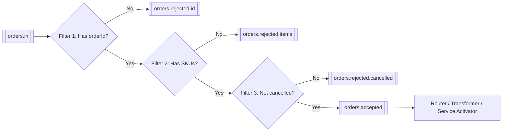
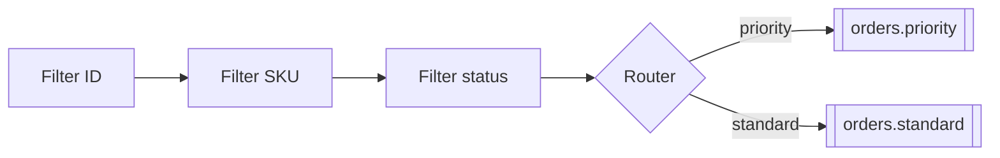
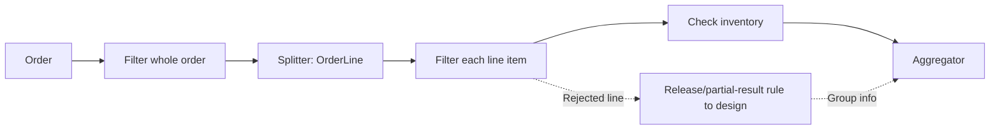

# Sequential Filter Chains

An integration system often cannot decide whether to accept or reject a message using a single condition. For example, before forwarding an order to a warehouse system, we may need to check **whether the order ID is valid**, **whether the order has line items**, and **whether the order is in an eligible status for processing**. These checks can be arranged into a **sequential filter chain**: only a message that passes the preceding step is evaluated by the next step.

In the **Pipes and filters** chapter of the `SPRING_INTEGRATION_PATTERN` module, this is one way to apply **Enterprise Integration Patterns (EIP)** with Spring Integration. Instead of packing every condition into one giant `if` statement, we organize filters with distinct responsibilities, connected by **Message Channels** and endpoints. This reduces coupling, makes adding conditions easier, simplifies testing, allows observing which step dropped a message, and integrates cleanly with Router, Transformer, Gateway, Splitter, Aggregator, retry, error channels, and correlation.

> **Key takeaway:** A filter in a processing chain acts like a checkpoint gate. **True (`true`) → proceed; false (`false`) → stop at that step or route to the configured rejection branch.** Subsequent filters do not receive a rejected message. The chain is sequential in the **logical order of checks**, not an automatic guarantee that all messages run on a single thread or are processed in global FIFO order.

## 1. Learning Objectives

After this lesson, you will be able to:

1. Explain the **Pipes and Filters** pattern and the difference between a single filter and multiple chained filters.
2. Describe the **short-circuit** rule: failing at one filter prevents reaching downstream filters on the success path.
3. Implement a `.filter(...)` chain in the Spring Integration Java DSL and assign a `discardChannel` for each rejection reason.
4. Design a sensible filter ordering based on cost, safety, and data dependencies.
5. Distinguish rejected messages from **technical errors**, timeouts, retries, and error channels.
6. Test the success path, each rejection path, absence of side effects, and flow observability.

## 2. What Is Pipes and Filters?

**Pipes and Filters** decomposes a large processing task into smaller steps:

- **Pipe:** the path transferring data/messages from one step to the next. In Spring Integration, a `MessageChannel` typically plays this role.
- **Filter (in the general architectural sense):** a processing step with a clear responsibility that receives input and either produces output or decides not to let the data continue.
- **Pipeline:** a chain of linked steps where the output of the preceding step becomes the input of the next step.

In EIP / Spring Integration terminology, distinguish the **Pipes and Filters architectural pattern** from the concrete **Message Filter** endpoint:

| Concept | Meaning | Example |
| --- | --- | --- |
| *Pipes and Filters* | Decomposes a flow into small composable processing steps. | `Validate → Normalize → Route → Handle`. |
| *Message Filter* | Endpoint evaluating a condition to decide whether a message proceeds or is rejected. | `orderId != null`, `!items.isEmpty()`. |
| *Transformer* | Endpoint producing a new payload/data type for the next step. | Convert incoming JSON into a normalized `OrderCommand`. |
| *Router* | Endpoint selecting target channels/branches. | Priority orders go to `orders.priority`, standard orders to `orders.standard`. |

Therefore, a sequential filter chain is **a specific case** of Pipes and Filters: multiple `MessageFilter` endpoints wired in sequence, each with an allow/reject predicate.

## 3. Scenario: Filtering Orders Before Sending to ERP

Suppose an application receives an order creation event `OrderCommand` containing an order ID, a list of SKUs, and a cancellation flag. The system only admits a message to downstream processing when all three conditions hold:

| Order | Filter | Valid Condition | When Unmet |
| --- | --- | --- | --- |
| 1 | **Check order ID** | `orderId` is non-`null` and non-blank. | Route to `orders.rejected.id`. |
| 2 | **Check line items** | SKU list exists and has at least one item. | Route to `orders.rejected.items`. |
| 3 | **Check status** | Order is not cancelled (`cancelled == false`). | Route to `orders.rejected.cancelled`. |
| Final | **Accepted path** | All three filters pass. | Send to `orders.accepted`. |

Logical flow:



If an order **lacks an order ID and also has no SKUs**, it is rejected **at the first filter**. The second filter never receives that order and cannot report an additional reason. This is intentional **short-circuit** behavior, not a full evaluation of all conditions.

### 3.1. What Happens to Each Message?

| Sample Message | Filter 1 | Filter 2 | Filter 3 | Outcome |
| --- | --- | --- | --- | --- |
| Valid ID, has SKUs, not cancelled | Pass | Pass | Pass | `orders.accepted` |
| Missing ID, has SKUs, not cancelled | **Fail** | Not run | Not run | `orders.rejected.id` |
| Has ID, empty SKU list | Pass | **Fail** | Not run | `orders.rejected.items` |
| Has ID, has SKUs, cancelled | Pass | Pass | **Fail** | `orders.rejected.cancelled` |

A dropped message is not by default an exception. If business requirements demand reporting *all* errors at once rather than only the first error, consider a **consolidated validation step** returning a list of violations, followed by a Router directing based on the result. Do not expect a short-circuit filter chain to collect every error once an earlier condition blocks the message.

## 4. Why Split Into a Chain Instead of One Large Predicate?

A single boolean expression can perform the same check:

```java
boolean accepted = command.orderId() != null
    && !command.orderId().isBlank()
    && command.skus() != null
    && !command.skus().isEmpty()
    && !command.cancelled();
```

However, when conditions grow and multiple teams own different rules, splitting into individual filters brings several benefits:

1. **Clear responsibility names:** one step checks structure, another checks status.
2. **Separate rejection routes:** track messages missing IDs separately from cancelled orders without re-parsing the entire expression.
3. **Localized policy changes:** add SKU validation rules without modifying the ERP dispatch flow.
4. **Per-branch testing:** write targeted tests for each failure mode and assert no downstream side effects occur.
5. **Observability:** count messages passing each step and rejections grouped by reason.

Still, **having three `if` checks does not automatically justify creating three endpoints**. If each predicate is trivial, configuring many channels/handlers can make diagrams and operations harder to understand. Choose filter boundaries around **meaningful rules that merit independent observation**, not line count.

## 5. Implementation with Spring Integration Java DSL

The following example presents a pure flow inside a Spring application without a broker. Result channels use bounded `QueueChannel` beans for straightforward testing. In production, replace them with appropriate rejection-handling or business-processing endpoints.

### 5.1. Input Data Type

```java
import java.util.List;

record OrderCommand(
    String orderId,
    List<String> skus,
    boolean cancelled
) {}
```

This is an illustrative DTO. There is no personal data or token in the payload; the example is intentionally minimal to focus on filter ordering.

### 5.2. Defining Channels and the Filter Chain

```java
import org.springframework.context.annotation.Bean;
import org.springframework.context.annotation.Configuration;
import org.springframework.integration.channel.QueueChannel;
import org.springframework.integration.config.EnableIntegration;
import org.springframework.integration.dsl.IntegrationFlow;

@Configuration
@EnableIntegration
class OrderFiltersConfiguration {

    @Bean("orders.accepted")
    QueueChannel acceptedOrders() {
        return new QueueChannel(32);
    }

    @Bean("orders.rejected.id")
    QueueChannel rejectedMissingId() {
        return new QueueChannel(32);
    }

    @Bean("orders.rejected.items")
    QueueChannel rejectedMissingItems() {
        return new QueueChannel(32);
    }

    @Bean("orders.rejected.cancelled")
    QueueChannel rejectedCancelled() {
        return new QueueChannel(32);
    }

    @Bean
    IntegrationFlow sequentialOrderFilters() {
        return IntegrationFlow.from("orders.in")
            .filter(OrderCommand.class,
                cmd -> cmd.orderId() != null && !cmd.orderId().isBlank(),
                spec -> spec.discardChannel("orders.rejected.id"))
            .filter(OrderCommand.class,
                cmd -> cmd.skus() != null && !cmd.skus().isEmpty(),
                spec -> spec.discardChannel("orders.rejected.items"))
            .filter(OrderCommand.class,
                cmd -> !cmd.cancelled(),
                spec -> spec.discardChannel("orders.rejected.cancelled"))
            .channel("orders.accepted")
            .get();
    }
}
```

Reading the flow from top to bottom:

1. `IntegrationFlow.from("orders.in")` is the **messaging entry point**; senders must deliver `OrderCommand` to this channel.
2. The first filter evaluates `orderId` validity. If `false`, the message goes to `orders.rejected.id` via `discardChannel` and **does not continue along the success path**.
3. The second filter runs only on messages that passed step 1. It checks the SKU list, rejecting to `orders.rejected.items` if empty or null.
4. The third filter runs only on messages that passed both prior steps; cancelled orders go to `orders.rejected.cancelled`.
5. Messages satisfying all three conditions reach `orders.accepted`, where another consumer/poller or downstream flow can continue.

**Example limitations:** The `QueueChannel(32)` beans serve as simple observation points. They do not call an ERP, persist across restarts, produce HTTP responses, or replace an audit/DLQ system. If a rejection queue fills up, delivery failures must be handled; do not assume `discardChannel` guarantees event persistence under all conditions. In production applications, configure proper consumers, timeouts/backpressure, and durable storage whenever zero data loss is required.

### 5.3. What Does Each `.filter(...)` Do?

A call to `.filter(PayloadType.class, predicate, endpointSpec)` creates a filtering endpoint in the flow. Logically:

```text
Message<OrderCommand> → Filter
    predicate == true  → output continues to next step
    predicate == false → discardChannel if configured
```

`discardChannel` is not `errorChannel`: **policy-based rejection** is a valid predicate outcome; a **technical error** is an exception or system failure managed via a dedicated error path. If no discard behavior is specified, non-matching messages may be dropped from the flow without producing a business result, depending on endpoint configuration.

### 5.4. Why Use Separate Result Channels?

Separating `orders.rejected.id`, `orders.rejected.items`, and `orders.rejected.cancelled` allows downstream handlers to attach **distinct rejection codes** and collect metrics. For example, a handler on `orders.rejected.items` can emit a `MISSING_ITEMS` event, whereas the `orders.rejected.cancelled` branch can record `ORDER_ALREADY_CANCELLED`.

However, **do not log entire messages** in rejection branches. An order may contain sensitive data or authentication headers propagated from an inbound adapter. Log only standard error codes, filter names, an opaque correlation ID, and explicitly permitted fields.

## 6. Testing Paths and Ordering with JUnit 5

Because the example uses `QueueChannel`, tests can send messages to the input channel and read from result channels. Tests require no ERP service or external network.

### 6.1. Test Setup

Place the test in the same package as `OrderCommand` and `OrderFiltersConfiguration`:

```java
import static org.junit.jupiter.api.Assertions.*;

import java.util.List;
import org.junit.jupiter.api.Test;
import org.springframework.beans.factory.annotation.Autowired;
import org.springframework.context.ApplicationContext;
import org.springframework.integration.channel.QueueChannel;
import org.springframework.messaging.MessageChannel;
import org.springframework.messaging.support.MessageBuilder;
import org.springframework.test.context.junit.jupiter.SpringJUnitConfig;

@SpringJUnitConfig(OrderFiltersConfiguration.class)
class SequentialOrderFiltersTest {

    @Autowired
    ApplicationContext context;

    private MessageChannel input() {
        return context.getBean("orders.in", MessageChannel.class);
    }

    private QueueChannel channel(String name) {
        return context.getBean(name, QueueChannel.class);
    }

    @Test
    void validOrderPassesAllFilters() {
        var valid = new OrderCommand("ORD-42", List.of("SKU-01"), false);

        assertTrue(input().send(MessageBuilder.withPayload(valid).build()));

        var accepted = channel("orders.accepted").receive(0);
        assertNotNull(accepted);
        assertEquals(valid, accepted.getPayload());
        assertNull(channel("orders.rejected.id").receive(0));
        assertNull(channel("orders.rejected.items").receive(0));
        assertNull(channel("orders.rejected.cancelled").receive(0));
    }

    @Test
    void missingIdStopsAtFirstFilter() {
        var invalid = new OrderCommand("", List.of(), true);

        assertTrue(input().send(MessageBuilder.withPayload(invalid).build()));

        assertNotNull(channel("orders.rejected.id").receive(0));
        assertNull(channel("orders.rejected.items").receive(0));
        assertNull(channel("orders.rejected.cancelled").receive(0));
        assertNull(channel("orders.accepted").receive(0));
    }

    @Test
    void missingItemsStopsAtSecondFilter() {
        var invalid = new OrderCommand("ORD-43", List.of(), false);

        assertTrue(input().send(MessageBuilder.withPayload(invalid).build()));

        assertNotNull(channel("orders.rejected.items").receive(0));
        assertNull(channel("orders.accepted").receive(0));
    }

    @Test
    void cancelledOrderStopsAtThirdFilter() {
        var invalid = new OrderCommand("ORD-44", List.of("SKU-02"), true);

        assertTrue(input().send(MessageBuilder.withPayload(invalid).build()));

        assertNotNull(channel("orders.rejected.cancelled").receive(0));
        assertNull(channel("orders.accepted").receive(0));
    }
}
```

**What these tests prove:**

- Valid messages traverse the entire chain.
- A message missing an ID is dropped at the first filter, even when later conditions would also fail.
- A message passing step 1 but missing SKUs is dropped at step 2.
- A message passing the first two steps but marked cancelled is dropped at step 3.
- No invalid message is emitted to the accepted output channel.

**What they do not yet prove:** queue durability, multi-producer concurrency, downstream exception handling, safe logging, or request–reply gateway behavior. Those aspects require additional tests at their respective boundaries. When running multiple tests sharing Spring's cached context, avoid leaving leftover messages in queues or running in parallel against the same queue; the example above drains each test's sent message, while real projects should isolate fixtures and test state cleanly.

### 6.2. Stricter Verification That Downstream Filters Do Not Run

Inspecting rejection channels is an indirect proof. If you need strict proof that **downstream filters were not invoked**, you can supply an instrumented predicate using a test counter (such as `AtomicInteger`) in test configuration and assert it stays at 0 when an earlier filter fails. Never add counters or side effects to production predicates purely for testing. In most cases, verifying **actual message routing and absence of downstream side effects** is more valuable.

## 7. Filter Ordering: Optimizing Cost Without Changing Semantics

In a sequential chain, **order matters**. If the first filter blocks most messages, downstream checks execute less often; however, reordering is not purely a performance question.

### 7.1. Ordering Criteria

| Criterion | Rationale | Example |
| --- | --- | --- |
| **Data dependencies** | Later steps can assume prior checks already succeeded. | Verify `skus != null` before reading the SKU list. |
| **Evaluation cost** | Cheap filters with high rejection rates save load when placed first. | Validate required fields before calling an external lookup service. |
| **Data safety** | Avoid processing unvalidated or unauthorized data. | Enforce schema/authorization at the boundary before calling ERP. |
| **Rejection reason** | Ordering determines which failure is reported when multiple exist. | Order missing ID and cancelled: which error takes precedence? |
| **Side effects** | Earlier steps must not mutate state only to reject the message later. | Do not deduct inventory before checking order status. |

A practical guideline: **structural validation → general conditions → policy/eligibility checks → business processing**. However, if authorization is required before any data may be read, enforce access checks at the appropriate security boundary **before steps that could expose data**. No single rigid ordering fits every system.

### 7.2. Why Avoid Side Effects Inside Predicates?

A predicate should be **predictable, fast, and side-effect-free**. If a filter calls a payment API or updates inventory before returning `true/false`, retries or replays can trigger duplicate side effects; network errors also blur the line between **“failed the condition”** and **“could not evaluate the condition”**.

If you need to query external state, consider separating a dedicated enrichment/check endpoint with explicit timeouts and error policies, and then Filter on the **normalized result**. This does not mean every lookup inside a predicate is strictly forbidden, but cost, concurrency, transactions, and idempotency must be carefully accounted for.

### 7.3. A Filter Is Not an Aggregating Validator

A filter chain answers: *“Is this message allowed to proceed?”* If the requirement is *“return all validation errors on the order,”* use a validation step returning a list of `ValidationError` objects, then use Router/Transformer/Gateway to build the response.

Do not try to force a Filter-rejected message to “keep going to collect more errors” unless you are deliberately designing a validation-result pipeline separate from the main business flow.

## 8. Filter Rejection vs. Exceptions and Error Channels

This is a critical distinction in Spring Integration:

| Situation | Meaning | Handling Approach |
| --- | --- | --- |
| Predicate returns `true` | Message meets the condition. | Proceed to next filter/endpoint. |
| Predicate returns `false` | Message fails the policy. | Send to `discardChannel`, drop per contract, or return business rejection. |
| Predicate throws exception | Check could not complete normally. | Handle via synchronous/asynchronous error boundaries of the flow. |
| No consumer on target channel | Routing/wiring or dispatch/waiting issue. | Reconfigure endpoint, inspect logs, run integration tests. |
| Outbound ERP timeout | External service failure/uncertainty. | Timeout, conditional retry, and state reconciliation; do not treat as “predicate false”. |

### 8.1. `discardChannel` Is Not `errorChannel`

A Filter's `discardChannel` receives messages that **failed the filter condition**. `errorChannel` receives error messages according to the error handling configured for the corresponding endpoint/adapter. When a predicate returns `false`, no exception is thrown by default and nothing automatically goes to an error channel.

Some Filter configurations can **throw an error on rejection**, such as `throwExceptionOnRejection(true)`. This is an **alternative design choice** when the application wants rejections to propagate as errors; do not enable it indiscriminately across all three filters if the real requirement is routing each rejection reason separately.

### 8.2. Behavior by Execution Model

Across endpoints connected via `DirectChannel` or equivalent synchronous links, exceptions can propagate back to the sender. Across asynchronous boundaries (`ExecutorChannel`, pollers, adapters), errors can be wrapped as `ErrorMessage` and sent to an appropriate error flow when configured. **Do not assume every exception reaches a single shared `errorChannel`**, and do not assume a send timeout can interrupt a synchronously executing handler.

### 8.3. What If a Gateway Is Waiting for a Reply?

Suppose `@MessagingGateway` declares:

```java
@MessagingGateway(defaultRequestChannel = "orders.in")
interface OrderGateway {
    OrderReceipt submit(OrderCommand command);
}
```

The illustrative flow in Section 5 only places accepted or rejected messages into **queues for observation**. It **does not produce an `OrderReceipt`**, so it is **not sufficient** as a request–reply flow for this interface. If the caller expects a result, design handlers that produce replies on the accepted branch **as well as on rejection branches per contract**, while preserving reply paths and correlation. Otherwise, the gateway may receive no reply or time out depending on channel configuration.

Never replace a “missing order ID” message by letting the client wait for a reply timeout. **Valid rejections should be represented as explicit business outcomes.**

## 9. How Filter Chains Interact with Transformer, Router, and Splitter

### 9.1. Transformer Before or After Filter?

If the input is raw JSON while the filter expects `OrderCommand`, you must **transform/deserialize according to contract** first. Still, input checks can be staged: enforce size limits and payload validation at the adapter, decode safely, validate the DTO, and then apply business filters.

```text
Inbound Adapter
    → Boundary input validation
    → Transformer: JSON → OrderCommand
    → Filter: Valid ID
    → Filter: Has line items
    → Filter: Not cancelled
    → Router: priority / standard branch
    → Service Activator
```

**Do not use Filter to replace all data validation or security validation.** It is only one control point in your data and access-control design.

### 9.2. Router Differs from a Sequential Filter Chain

A Filter chain decides whether a message **may continue**; a Router decides **where** a message goes. If two processing paths follow three filters, a Router is clearer than placing independent Filters and hoping one branch happens to be selected.



### 9.3. Filter Before or After Splitter

Suppose an order contains five line items:

- **Filter before Splitter:** checks conditions for the **entire order** (order ID, status, authorization).
- **Filter after Splitter:** checks conditions for **each individual line item** (SKU, quantity, delivery zone).

If one of the five items is discarded, an **Aggregator** may not receive the original item count. In that case, define explicitly: does a discarded item count as a rejected result in the group, is a placeholder reply needed, and when is the Aggregator allowed to release?



**Common pitfall:** A Splitter may attach correlation/sequence metadata for the Aggregator, yet a downstream filter after the Splitter can drop one item. **Never assume** the Aggregator will automatically detect the dropped item and release on time. Design completion, timeout/expiry, and rejected-item representation per business requirements.

## 10. Concurrency, Ordering, and State Pitfalls

**Sequential topology** is not the same as **the whole system running only one thing at a time**.

- If producers A and B send concurrently, messages may interleave depending on channels and executors.
- If a flow includes `ExecutorChannel` or async boundaries, completion order across different messages need not match arrival order.
- If a filter accesses shared mutable state (counters, unsynchronized caches), outcomes may suffer from race conditions.
- If a Router sends messages to branches with different processing speeds, results may return out of request order.

### 10.1. Prefer Pure Predicates

A filter like:

```java
boolean hasOrderId(OrderCommand cmd) {
    return cmd.orderId() != null && !cmd.orderId().isBlank();
}
```

is typically easier to test and more stable than a predicate accessing mutable global state. **Idempotency of validation** does not imply idempotency of handlers after the filter. If a message is replayed, Filters can safely run again, but a downstream “charge payment” step still needs its own protection.

### 10.2. When Ordering Must Be Guaranteed

If business logic requires processing events in order per `orderId`, you must design partitioning or serialization mechanisms at the broker or consumer level, alongside transactions and error handling. **Do not treat chaining `.filter()` calls in order** as proof that all messages are processed globally in FIFO order.

## 11. Retries and Timeouts in a Filter Chain

A fast, pure filter rarely needs its own retry logic. But when a filter depends on an external lookup or policy service, multiple failure modes appear:

| Scenario | Recommended Action |
| --- | --- |
| Predicate deterministically finds invalid data. | Reject with the defined reason; retrying the same input is usually pointless. |
| Validation service times out. | Classify as **unable to verify**, not “invalid”; bounded retry or route to a waiting/retry queue. |
| Rejection channel is full. | Handle backpressure or durable storage per contract; do not silently drop messages. |
| Downstream succeeded but reply was lost. | Reconcile state and retry with an **idempotency key**; do not assume timeout means unprocessed. |
| Splitter created a group but one item was filtered out. | Define correlation, group completion/expiry, and partial outcomes. |

In Spring Integration, timeouts have multiple meanings: `MessageChannel.send(timeout)` governs sending, `PollableChannel.receive(timeout)` governs waiting for messages, Gateway request/reply timeout governs waiting for replies, while HTTP client/broker/DB timeouts are separate limits. **There is no single global `timeout` that automatically bounds every endpoint in the chain**.

When using retry advice, place it at the **actual failure boundary**, cap attempt counts, apply appropriate backoff, and protect side effects. Do not blindly retry an entire pipeline after earlier handlers have already written to external systems.

## 12. Observability: Which Filter Rejected the Message?

A major benefit of a filter chain with clear boundaries is measuring **accept/reject rates** per step. Useful metrics include:

- Message count entering `orders.in` and reaching `orders.accepted`.
- Count dropped at `orders.rejected.id`, `.items`, and `.cancelled`.
- Per-step rejection rate and unusual shifts over time.
- Processing latency per endpoint and queue wait times after filters.
- Error, timeout, and retry counts of participating endpoints or adapters.
- Opaque correlation/trace IDs to follow messages across steps, especially across Splitter/Aggregator branches.

Example structured log entry:

```text
event=integration_filter_rejected
flow=orderIntake
filter=hasItems
reason_code=MISSING_ITEMS
correlation_id=96cdf626-00f6-4ff3-8b03-b541174cfb87
```

This is only a **suggested format**. Spring Integration does not emit these fields in logs automatically unless you configure instrumentation/logging. Avoid logging raw `Message` objects, payloads, or headers containing tokens/emails, and avoid using per-request correlation IDs as **metric labels**, which causes high cardinality and may expose linkable data.

### 12.1. A Frequently Misleading Metric

If Filter 1 rejects 40% of messages, and Filter 2 rejects 20% **of the remaining messages**, you cannot say Filter 2 rejects 20% of total input. Distinguish:

- **Step rejection rate:** `rejected_at_step / received_by_step`.
- **Overall input rejection rate:** `rejected_at_step / total_flow_input`.

For example, given 100 orders: Filter 1 rejects 40, leaving 60; Filter 2 rejects 12, which is **20% of Filter 2's input** but only **12% of total initial orders**. Using the wrong denominator can cause dashboards to misjudge data quality or misidentify problematic branches.

## 13. Common Mistakes

### Mistake 1 — Confusing Filter with Transformer

In EIP, a Filter only decides whether a message continues or is dropped. If you need to normalize payloads before checking, use a Transformer or dedicated step; avoid hiding data mutations inside a predicate.

### Mistake 2 — Assuming a Failing Filter Sends an `ErrorMessage`

A `false` predicate is a normal control branch. To handle rejections, configure `discardChannel` or an explicit rejection policy. `errorChannel` is a separate concept tied to exception paths.

### Mistake 3 — Using a Filter Chain to Collect All Validation Errors

Because of short-circuiting, only the first failing filter is observed on the main path. If an API must return every violation, design a consolidated validation step instead of forcing a sequential pipeline to do it.

### Mistake 4 — Placing Expensive Checks Before Basic Conditions

Do not call external services for costly checks before performing basic data validation. At the same time, do not defer required **authorization** checks until after steps that could expose sensitive data.

### Mistake 5 — Putting Side Effects Inside Filters

A predicate that mutates a database and then returns `false` makes replays/retries and state debugging difficult. Keep predicates simple; put business operations in handlers/services with proper transactions, timeouts, and idempotency.

### Mistake 6 — Naming a Rejection Channel Without a Consumer

A name like `orders.rejected.items` does not guarantee messages are stored or handled. Define subscribers, pollers, queue capacity, retention, and operational policies when the rejection branch backs up.

### Mistake 7 — Assuming “Sequential” Means Global FIFO

Steps are declared in logical order, yet multiple messages can interleave, run on different threads, or finish out of order. If per-business-key ordering is required, design and test dedicated ordering mechanisms.

## 14. Practice Exercises

**Exercise 1 — Extending the input filter.** Add the condition `market != null` to `OrderCommand`. Decide whether to combine this check into Filter 1 or create Filter 4; justify based on separation of concerns, rejection reason reporting, and testability.

**Exercise 2 — Rejection branches with replies.** Replace the rejection `QueueChannel` beans with handlers producing `OrderRejected(reasonCode)`. If requests enter via a `@MessagingGateway` with a return type, design the reply path so callers receive clear business errors rather than waiting for a timeout.

**Exercise 3 — Splitter and Aggregator.** An order with three line items is split. A Filter after the Splitter rejects an out-of-stock SKU. Propose how to represent the rejected item's outcome so the Aggregator neither waits forever nor marks the whole order successful with missing items.

**Exercise 4 — Error testing.** Write a test for the case where Filter 2 throws an exception (as opposed to returning `false`). Observe caller/error-branch behavior under the actual configuration; do not assume exceptions always route to an error channel across all execution models.

**Exercise 5 — Dashboard metrics.** Given 1,000 input messages: Filter 1 drops 100, Filter 2 drops 90 out of the 900 remaining, and Filter 3 drops 81 out of the 810 remaining. Calculate each filter's rejection rate relative to **that filter's input** and the final acceptance rate relative to **the entire flow**.

Hint for Exercise 5: per-step rejection rates are **10%**, **10%**, and **10%** respectively; ultimately **729/1,000 = 72.9%** of messages are accepted. Never sum the three per-step rates to obtain an overall rejection rate, because their denominators differ.

## 15. Pre-Production Checklist for Filter Chains

| Question | Expectation |
| --- | --- |
| Does each filter have one meaningful responsibility? | Clear predicate/endpoint name, no unnecessary routing or side effects mixed in. |
| Is ordering grounded in data and security? | Later steps rely only on guaranteed preconditions; access checks sit at the right boundary. |
| How is `false` handled? | Explicit rejection route, standard reason code, or documented drop policy. |
| Are `false` and exceptions distinguished? | Separate error flow, retry policy, and rejection handling. |
| Do you need to return all validation errors? | If yes, use consolidated validation instead of expecting short-circuit filters to do it. |
| Do result channels have consumers? | No unbounded waiting, missing subscribers, or unintended buffering. |
| Do filters have side effects or slow lookups? | Prefer pure predicates; enforce timeouts/idempotency if external dependencies exist. |
| Is there a request–reply Gateway? | Both accepted and rejected paths have explicit reply contracts, avoiding vague timeouts. |
| Are Splitter/Aggregator involved? | Define correlation, completion, expiry, and rejected-item handling. |
| Are all branches tested? | Happy path, every rejection branch, exceptions, timeouts, retries, and concurrency as needed. |
| Are logs/metrics sufficient and safe? | Measured per filter/flow, without leaking secrets/PII or exploding metric label cardinality. |

## Conclusion

**Sequential filter chains** apply Pipes and Filters by linking multiple **Message Filters** in an explicit order: a message advances only when each predicate accepts it; failing at any step **stops at that step** and follows the configured rejection route. The Spring Integration Java DSL expresses these chains directly using `.filter(...)` combined with `discardChannel` and Message Channels to create testable boundaries.

A solid pipeline needs more than just filters. It also requires **sensible ordering, transparent rejection policies, separation of errors from unmet conditions, timeout/retry management, idempotency protection, correlation, and observability**. Combined with Transformer, Router, Gateway, Splitter, and Aggregator, a filter chain becomes a clear building block in an integration architecture that is **loosely coupled, extensible, and maintainable**, rather than a tangle of hard-to-trace conditions inside a monolithic business method.
