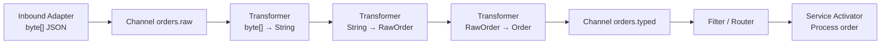
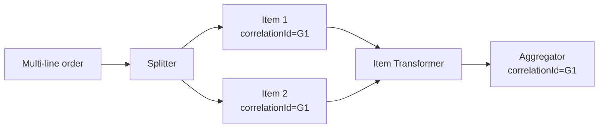

# Transformers Between Payload Types

## 1. Why Does a Flow Need Payload Type Conversion?

In a **Pipes and Filters** architecture, each processing step receives a message, performs a well-defined task, and passes the result to the next step via a *pipe* (typically a `MessageChannel`). Integrated systems rarely share a single data representation: files may provide `byte[]`, HTTP delivers JSON, adapters produce `String`, while Java business logic expects a DTO or *domain object*.

**Transformer** is the *Enterprise Integration Pattern* (EIP) that converts a message's content or shape so components at both ends can communicate. In Spring Integration, a Transformer is typically a message endpoint: it receives `Message<TIn>`, converts the data, and sends the resulting message with payload type `TOut` to the next channel.

Example order intake flow:

```text
byte[]                    String                  RawOrder                  Order
UTF-8 JSON         →      JSON text        →     Source DTO          →    Domain type
{"orderId":"..."}          {"orderId":"..."}      amountVnd: String        amountVnd: long
```

In the **Pipes and filters** chapter of the **SPRING_INTEGRATION_PATTERN** module, the goal is to implement Enterprise Integration Patterns with Spring Integration to build loosely coupled and extensible message flows. Understanding Transformers is foundational for combining Router, Filter, Splitter, Aggregator, Gateway, retry, error channels, and correlation, as well as testing and monitoring flow branches.

After this lesson, you will know how to:

1. Distinguish **payload**, **headers**, Transformer, and Converter.
2. Chain Transformers whose inputs and outputs are different Java types.
3. Use Spring Integration **Java DSL** and `@Transformer`.
4. Preserve important metadata when changing payload types while handling parse/validation errors.
5. Unit-test individual conversions independently and integration-test message flow propagation.

## 2. Mental Model: Change the Payload, Preserve Message Meaning

A `Message<T>` in Spring Messaging consists of:

| Part | Before Transformation | After Transformation |
| --- | --- | --- |
| **Payload** | `byte[]` containing order JSON | `Order(orderId, amountVnd)` |
| **Payload type** | `byte[]` | `Order` |
| **Business/routing headers** | `tenantId=store-hcm`, `eventId=evt-42` | Usually propagated according to endpoint rules |
| **Format headers** | `contentType=application/json` | Needs review: new payload is no longer raw JSON |
| **Framework-managed headers** | Message ID, timestamp, and routing headers | May be regenerated, inherited, or modified depending on how the message is built |

A Transformer needs to answer three questions:

- **What to convert?** The input and output payload values and types.
- **What to preserve?** Business keys, correlation, trace, and headers with explicit contracts.
- **What on failure?** Unparseable messages, wrong types, missing required fields, or invalid data.

Architecture diagram:



Key point: **a Transformer makes data conform to the next step's contract**; it is not responsible for sending data to a broker itself, catching every exception, or guaranteeing transactions.

### 2.1. How Transformer Differs from Filter and Service Activator

| Pattern | Primary Question | Typical Output |
| --- | --- | --- |
| **Transformer** | What shape/type should this data have? | New payload, possibly with a new type |
| **Filter** | Does this message qualify to proceed? | Keeps or drops the message per policy |
| **Router** | Which branch should this message go to? | Selects target channel(s) |
| **Service Activator** | What behavior should the application execute? | Business result or no reply |
| **Splitter/Aggregator** | Which units need to be split/combined? | Multiple child messages or an aggregated message |

For example, **converting `"125000"` to `125000L`** is type conversion/payload normalization. **Rejecting an order with a negative amount** belongs to validation (which can be enforced in a Transformer when establishing target type invariants, or in a dedicated Filter/validator). **Saving the order to a database** is the behavior of a Service Activator; do not bury this side effect inside a Transformer meant solely for data mapping.

## 3. Common Payload Type Conversions

| From Type | To Type | When Used | Key Considerations |
| --- | --- | --- | --- |
| `byte[]` | `String` | Decoding body/file into text | Charset must be explicitly defined, e.g., UTF-8 |
| `String` | DTO / `record` | Deserializing JSON/XML/CSV | Schema, missing fields, wrong types, format versions |
| Source DTO | Target DTO | Adapting contracts between two apps | Complete mapping, defaults, data loss |
| DTO | Domain object | Normalizing and enforcing invariants | Prevent invalid values from entering the domain layer |
| Domain object | Target DTO | Preparing outbound API/broker events | Avoid leaking internal fields |
| Java object | `String`/`byte[]` | Serializing for wire transport | Content type, charset, format, and version |

### 3.1. Type Conversion Is Not Mere Casting

A Java cast like `(Order) payload` only works when the object **is already** an `Order`. It cannot turn a JSON `String` into an `Order` instance.

```java
Object payload = "{\"orderId\":\"ORD-42\"}";
// Invalid: String is not an Order.
// Order order = (Order) payload;
```

To convert JSON into a Java type, you must **deserialize** with an appropriate parser and then validate the data. Similarly, `Long.parseLong("125000")` is a format-checked value conversion, not a cast.

### 3.2. Transformer, Converter, and Serializer Are Related but Distinct

**Transformer** is an endpoint/pattern at the message-flow level. Internally, it may invoke:

- **Converter/mapper**: transforms data from one type to another.
- **Serializer/deserializer**: encodes or decodes a data format (JSON, XML, Avro, bytes, etc.).
- **Validator**: verifies the structure and invariants of the result.

Spring Integration includes both built-in transformers (e.g., JSON/object transformations per module and configuration) and the option to write transformers using Java methods or DSL lambdas. Which mechanism to choose depends on customization needs and existing libraries. For domain-specific business rules, a pure Java mapper is often easier to test.

## 4. Practical Example: `byte[] → String → RawOrder → Order`

Suppose an adapter receives UTF-8 JSON like this:

```json
{
  "orderId": "ORD-42",
  "amountVnd": "125000",
  "currency": "VND"
}
```

The system receives `amountVnd` represented as a **string** because that is the external source's contract. Internally, we want to store the amount as a `long` in **VND units**, require a positive value, and accept only `currency=VND` for this example. Accordingly, we define two distinct types:

```java
// External source schema: amountVnd is a string.
record RawOrder(String orderId, String amountVnd, String currency) {}

// Normalized internal schema.
record Order(String orderId, long amountVnd) {}
```

There is no universally safe automatic conversion for every case. If input contains `"125.5"`, `"12,500"`, `null`, or `"-1"`, the converter must have an explicit policy: reject, route to a data-cleansing branch, or apply an agreed conversion rule.

### 4.1. Extracting the Mapper into Pure Java Code

Place the conversion steps in an easily testable class:

```java
import com.fasterxml.jackson.core.JsonProcessingException;
import com.fasterxml.jackson.databind.ObjectMapper;
import java.nio.charset.StandardCharsets;

record RawOrder(String orderId, String amountVnd, String currency) {}
record Order(String orderId, long amountVnd) {}

final class OrderPayloadMapper {
    private final ObjectMapper objectMapper;

    OrderPayloadMapper(ObjectMapper objectMapper) {
        this.objectMapper = objectMapper;
    }

    String decode(byte[] bytes) {
        return new String(bytes, StandardCharsets.UTF_8);
    }

    RawOrder parseJson(String json) {
        try {
            return objectMapper.readValue(json, RawOrder.class);
        } catch (JsonProcessingException e) {
            throw new IllegalArgumentException("Invalid order JSON", e);
        }
    }

    Order normalize(RawOrder raw) {
        if (raw == null || raw.orderId() == null
                || raw.orderId().isBlank()) {
            throw new IllegalArgumentException("orderId is required");
        }
        if (!"VND".equals(raw.currency())) {
            throw new IllegalArgumentException("Unsupported currency");
        }

        final long amount;
        try {
            amount = Long.parseLong(raw.amountVnd());
        } catch (NumberFormatException e) {
            throw new IllegalArgumentException(
                    "amountVnd must be an integer", e);
        }
        if (amount <= 0) {
            throw new IllegalArgumentException(
                    "amountVnd must be positive");
        }
        return new Order(raw.orderId().trim(), amount);
    }
}
```

The three methods return the exact types expected by the subsequent step:

| Method | Parameter Type | Return Type |
| --- | --- | --- |
| `decode` | `byte[]` | `String` |
| `parseJson` | `String` | `RawOrder` |
| `normalize` | `RawOrder` | `Order` |

**Note on charset:** `new String(bytes, UTF_8)` is concise, but the default decoder may replace malformed byte sequences with replacement characters. In systems requiring text integrity verification, use `CharsetDecoder` with `CodingErrorAction.REPORT` to *reject* invalid UTF-8 byte sequences instead of silently replacing them.

**Note on monetary amounts:** the example uses whole VND units, `long`, and `Long.parseLong` to avoid floating-point inaccuracy. When working with fractional currencies or multiple units, consider `BigDecimal` with explicit scale/rounding rules; never cast `double` to `long` and drop fractional parts.

### 4.2. Wiring Transformers with Spring Integration Java DSL

The following configuration targets a Spring application with **Spring Integration** and **Jackson**. `AcceptedOrderService` is the business contract for which the application must provide an implementing bean. The `RawOrder`, `Order`, and `OrderPayloadMapper` declarations from the previous section are reused.

```java
import com.fasterxml.jackson.databind.ObjectMapper;
import org.springframework.context.annotation.Bean;
import org.springframework.context.annotation.Configuration;
import org.springframework.integration.channel.DirectChannel;
import org.springframework.integration.config.EnableIntegration;
import org.springframework.integration.dsl.IntegrationFlow;
import org.springframework.messaging.MessageChannel;

interface AcceptedOrderService {
    void accept(String tenantId, Order order);
}

@Configuration
@EnableIntegration
class OrderTransformerConfig {

    @Bean("orders.raw")
    MessageChannel ordersRaw() {
        return new DirectChannel();
    }

    @Bean
    OrderPayloadMapper orderPayloadMapper(ObjectMapper objectMapper) {
        return new OrderPayloadMapper(objectMapper);
    }

    @Bean
    ObjectMapper objectMapper() {
        return new ObjectMapper();
    }

    @Bean
    IntegrationFlow transformOrderFlow(
            OrderPayloadMapper mapper,
            AcceptedOrderService service) {
        return IntegrationFlow.from("orders.raw")
                .transform(byte[].class, mapper::decode)
                .transform(String.class, mapper::parseJson)
                .transform(RawOrder.class, mapper::normalize)
                .handle(Order.class, (order, headers) -> {
                    String tenantId = (String) headers.get("tenantId");
                    if (tenantId == null || tenantId.isBlank()) {
                        throw new IllegalArgumentException(
                                "tenantId is required");
                    }
                    service.accept(tenantId, order);
                    return null; // Terminal endpoint of a one-way flow.
                })
                .get();
    }
}
```

With Spring Boot already auto-configuring an `ObjectMapper`, use that bean and **omit the `objectMapper()` declaration unless custom configuration is needed**. Record declarations require Java support for `record` (typically Java 17+) and a Jackson version capable of reading records. This code illustrates an in-memory synchronous flow; no database, broker, or transaction manager is configured in the example.

A producer sends a message to the input channel:

```java
import java.nio.charset.StandardCharsets;
import org.springframework.beans.factory.annotation.Qualifier;
import org.springframework.messaging.Message;
import org.springframework.messaging.MessageChannel;
import org.springframework.messaging.MessageHeaders;
import org.springframework.messaging.support.MessageBuilder;
import org.springframework.stereotype.Component;
import org.springframework.util.MimeTypeUtils;

@Component
class OrderProducer {
    private final MessageChannel rawChannel;

    OrderProducer(@Qualifier("orders.raw") MessageChannel rawChannel) {
        this.rawChannel = rawChannel;
    }

    void sendExampleOrder() {
        String json = """
                {"orderId":"ORD-42","amountVnd":"125000","currency":"VND"}
                """;

        Message<byte[]> incoming = MessageBuilder
                .withPayload(json.getBytes(StandardCharsets.UTF_8))
                .setHeader("tenantId", "store-hcm")
                .setHeader("eventId", "evt-42")
                .setHeader("traceId", "trace-42")
                .setHeader(MessageHeaders.CONTENT_TYPE, MimeTypeUtils.APPLICATION_JSON)
                .build();

        rawChannel.send(incoming);
    }
}
```

Expected outcome at the final Service Activator:

```text
order: Order(orderId="ORD-42", amountVnd=125000)
tenantId: "store-hcm"
```

Conversions are applied **in sequence**. Each step's output becomes the next step's input. For example, after `decode` the payload is `String`, so `parseJson` receives the expected type; after `parseJson` the payload is `RawOrder` so `normalize` can run.

With `DirectChannel`, an exception in a Transformer normally propagates back to the sending thread (possibly wrapped in a messaging framework exception). Returning `null` in the final handler signifies no reply is generated; a synchronous Gateway expecting a reply requires a different flow and reply contract.

### 4.3. Choosing the Granularity of Each Transformer

Splitting into three Transformers provides:

- **Reusability**: the JSON parsing step can be reused across different input flows.
- **Independent testing**: byte → text, text → DTO, and DTO → domain each have separate test suites.
- **Clear naming**: logs and error monitoring easily identify decoding errors, JSON errors, or data errors.
- **Pipeline flexibility**: Filters, Routers, or validators can be inserted wherever needed.

However, a handler that merely renames a few simple fields might not warrant a separate endpoint. In high-throughput applications, more steps also increase processing overhead and observability complexity. Choose boundaries based on data contracts, reusability, and failure recovery needs.

## 5. Writing Transformers with `@Transformer`

In addition to the Java DSL, Spring Integration supports the `@Transformer` annotation on Java methods. This is convenient when you want to explicitly state input/output channels and keep mapping logic inside a class.

```java
import org.springframework.integration.annotation.Transformer;
import org.springframework.stereotype.Component;

@Component
class OrderTransformEndpoint {
    private final OrderPayloadMapper mapper;

    OrderTransformEndpoint(OrderPayloadMapper mapper) {
        this.mapper = mapper;
    }

    @Transformer(
            inputChannel = "orders.json",
            outputChannel = "orders.normalized")
    public Order transform(String json) {
        RawOrder raw = mapper.parseJson(json);
        return mapper.normalize(raw);
    }
}
```

**This is an alternative approach**, taking `String` JSON and producing `Order`. In real use, channels `orders.json` and `orders.normalized` plus a downstream consumer must exist; do not register this method alongside the flow in Section 4.2 unless you intentionally wire a corresponding channel chain. Otherwise, you risk creating two competing subscribers or duplicate transformations.

Spring Integration invokes the method with a matching payload and builds an output message to send to the output channel. If the method needs to read a header, you can use `@Header` or accept `Message<T>` per the framework's method-mapping rules. Do not couple the domain layer to `Message` solely to fetch a `tenantId` value.

### 5.1. When Should a Transformer Return `Message<T>` Instead of a Payload?

When only transforming content, typically **return the new payload object** so Spring Integration infrastructure builds the output message and handles header propagation. When you need to **deliberately modify metadata**, construct the output message explicitly:

```java
import org.springframework.messaging.Message;
import org.springframework.messaging.support.MessageBuilder;

Message<Order> toDomainMessage(
        Message<RawOrder> input, OrderPayloadMapper mapper) {
    return MessageBuilder
            .withPayload(mapper.normalize(input.getPayload()))
            .copyHeaders(input.getHeaders())
            .setHeader("schemaVersion", "2")
            .build();
}
```

This is a standalone illustrative method that can serve as logic inside an appropriate Transformer. When copying headers, pay special attention to framework-managed headers (`id`, `timestamp`, `replyChannel`, `errorChannel`) and the new payload format. Never blindly copy every header onto messages sent to external systems.

## 6. How Headers Flow Through a Transformer

The payload changes, yet **orchestration context** often needs to be retained. For instance, `eventId` enables deduplication, `tenantId` selects data for the right tenant, `traceId` tracks a request, and `correlationId` groups messages from a Splitter.

Spring Integration generally **propagates appropriate headers** when a Transformer returns only a payload, though exact handling depends on the transformer type, header propagation settings, and how messages are constructed. Never assume every header (especially non-serializable objects) survives every endpoint or broker.

| Header | Should It Be Kept on Payload Change? | Notes |
| --- | --- | --- |
| `eventId` | Usually yes | Stable idempotency key on redelivery |
| `tenantId` | Depends on contract, usually yes | Source of the header must be authenticated |
| `traceId` | Yes if flow uses tracing | Avoid losing trace context across steps |
| `correlationId` | Yes in flows needing correlation | Do not randomly generate a new group mid-flow |
| `contentType` | Needs review | `application/json` may no longer fit an `Order` payload |
| `replyChannel` / `errorChannel` | Per internal messaging mechanics | Not values that can be sent raw over every broker |
| `id` / `timestamp` | Managed by framework | Do not use message ID as a cross-system event ID |

### 6.1. `contentType` Should Match the **Representation**

At the start of the flow, `contentType=application/json` describes bytes containing JSON. After converting into an `Order` (a Java object), leaving a wire-format header intact can cause confusion if downstream components use it for serialization or converter selection.

Therefore:

1. Distinguish **input** representation metadata from the **output** contract.
2. Update or strip format headers at appropriate boundaries, especially before outbound adapters.
3. Test actual adapters/serializers to avoid a situation where headers claim JSON while the payload is an object unsupported by the converter.

### 6.2. Transformer with Splitter and Aggregator

If a Splitter emits child messages carrying `correlationId`, `sequenceNumber`, and `sequenceSize`, any Transformer sitting between the Splitter and Aggregator must avoid destroying the metadata the Aggregator uses to identify groups and release conditions:



Transforming each line item's payload can still preserve `correlationId=G1` to reassemble parts of the same order. If a Transformer arbitrarily regenerates the group ID or drops sequence metadata, the Aggregator may never meet its release condition or may group the wrong items together.

## 7. Transformation Errors and Recovery Policies

Not every error inside a Transformer should be retried. Distinguish:

| Error | Example | Usually Appropriate Handling |
| --- | --- | --- |
| **Invalid encoding** | Malformed UTF-8 bytes | Reject/quarantine; avoid decoding with silent character loss |
| **Format syntax error** | JSON missing a closing brace | Return parse error; do not retry indefinitely |
| **Schema mismatch** | `amountVnd` is an array instead of a string | Validation / schema-mismatch branch |
| **Invariant violation** | `amountVnd=-100`, unsupported currency | Business rejection, record reason |
| **Transient dependency error** | Transformer calls external service and times out | Bounded retry if the operation is safe |
| **Oversized payload** | Tens of MB of JSON exceeding limits | Enforce size limits, split lines, or stream-process |

If a Transformer is a **pure function**, data errors will reproduce identically on every call; retrying solves nothing. For complex mappings requiring external lookups, consider separating I/O work into a Service Activator so retries, circuit breakers, and timeouts can be applied transparently.

In a synchronous flow over `DirectChannel`, exceptions can propagate to the caller; in executors, pollers, or asynchronous adapters, verify how the error handler dispatches `ErrorMessage` to an error channel. Configuring an `errorChannel` **does not automatically persist errors** and **does not automatically retry**. For recovery, persist the source payload or a reference to it, error category, attempt count, `eventId`, and `traceId` in durable storage, then support controlled replay.

### 7.1. Avoid Transformations That Cause Side Effects

A Transformer converting DTO → domain is normally deterministic:

```text
normalize(RawOrder("ORD-42", "125000", "VND"))
  → Order("ORD-42", 125000)
```

If normalizing also sends an email or charges money, retrying parse/mapping could trigger those side effects multiple times. Keep Transformers pure and put side effects in business handlers with proper idempotency keys and transactions.

## 8. Testing Transformers at Two Levels

### 8.1. Unit Testing Conversion Functions

Because `OrderPayloadMapper` is a plain Java class, we can test it without starting a Spring context:

```java
import com.fasterxml.jackson.databind.ObjectMapper;
import org.junit.jupiter.api.Test;
import static org.junit.jupiter.api.Assertions.*;

class OrderPayloadMapperTest {
    private final OrderPayloadMapper mapper =
            new OrderPayloadMapper(new ObjectMapper());

    @Test
    void convertsJsonIntoDomainOrder() {
        String json = """
                {"orderId":" ORD-42 ","amountVnd":"125000","currency":"VND"}
                """;

        RawOrder raw = mapper.parseJson(json);
        Order actual = mapper.normalize(raw);

        assertEquals("ORD-42", actual.orderId());
        assertEquals(125_000L, actual.amountVnd());
    }

    @Test
    void rejectsInvalidAmount() {
        RawOrder raw = new RawOrder("ORD-42", "12.5", "VND");
        assertThrows(IllegalArgumentException.class,
                () -> mapper.normalize(raw));
    }

    @Test
    void rejectsBrokenJson() {
        assertThrows(IllegalArgumentException.class,
                () -> mapper.parseJson("{bad json"));
    }
}
```

These tests verify **transformation correctness**: schema, output values, and error rules. They do not yet prove that headers propagate across endpoints.

### 8.2. Integration Testing the Flow and Header Propagation

When running inside a Spring Test context with `OrderTransformerConfig` and a mock `AcceptedOrderService` bean, send messages to `orders.raw`, then verify the service receives the expected `Order` and `tenantId`, and is never invoked on invalid data.

| Scenario | Expected Outcome |
| --- | --- |
| Valid JSON, valid VND | `AcceptedOrderService.accept("store-hcm", Order("ORD-42", 125000))` |
| Malformed JSON | Flow enters error policy; service is not called |
| Missing `orderId` | Transformation raises error; no invalid `Order` created |
| Unparseable `amountVnd` | Rejection branch; no pointless retry of data errors |
| Missing `tenantId` | Final handler raises error per contract |
| Payload through multiple Transformers | Correct type at each step; required `traceId`/`eventId` preserved |
| Payload via broker/other adapter | Verify charset, schema, content type, and header mapping |
| Splitter/Transformer/Aggregator | Correlation and sequence intact for accurate aggregation |

**Specific check needed:** a test verifying only `OrderPayloadMapper.normalize(...)` will not catch header loss between two endpoints. Inspect messages or assert required headers in the final handler/Service Activator according to the flow's contract.

### 8.3. Observing the Pipeline at Runtime

With multiple Transformers, monitor at least in/out message counts per step, parse errors, schema errors, processing duration, payload sizes, quarantined message counts, and retry metrics for steps performing I/O. Carry `eventId` and `traceId` throughout the flow to pinpoint whether failures occur during decoding, deserialization, or normalization. Avoid logging full payloads containing sensitive data.

## 9. Common Design Mistakes

1. **Using a cast instead of deserialization.** A `String` cannot be cast directly to a DTO.
2. **Using `double` for money.** Causes precision errors or unintended rounding.
3. **Performing I/O inside pure Transformers.** Makes retries and determinism hard to control.
4. **Forgetting to update `contentType`.** An inbound format header may no longer describe the outbound payload.
5. **Losing `correlationId`/sequence headers.** Splitter/Aggregator cannot reassemble groups properly.
6. **Mutating shared mutable payloads.** Message envelopes do not deep-copy payloads automatically; concurrent paths can corrupt data.
7. **Catching all exceptions and returning an empty DTO.** Hides data errors, feeding downstream steps seemingly valid messages.
8. **Testing only the mapper and skipping integration tests.** Misses channel wiring, header loss, and endpoint configuration issues.

## 10. Practice Exercise and Completion Criteria

**Exercise:** Build a flow receiving invoice JSON `byte[]` from an adapter, converting it to `InvoiceInput`, normalizing it into `Invoice`, and having a Service Activator call a ledger-posting service.

Requirements:

1. Explicitly declare input and output types for each Transformer.
2. Use `MessageBuilder` to send a UTF-8 byte payload with `tenantId`, `eventId`, `traceId`, and `contentType`.
3. Separate `decode`, `parseJson`, and `normalize` into independent functions with minimal side effects.
4. Reject malformed data, missing required fields, and invalid amounts.
5. Verify the Service Activator receives the exact domain object and `tenantId` header.
6. Add a data-error handling branch with suitable persistence; do not infinitely retry broken JSON messages.
7. Place a Splitter and Aggregator on either side of a Transformer and verify correlation and sequence metadata remain intact.

A well-designed Transformer has a **clear input/output contract**, converts data predictably, preserves essential metadata, and produces observable errors on invalid inputs. Chaining Transformers by payload type helps build EIP pipelines with clear responsibilities that can be tested independently and extended cleanly as data sources or schemas evolve.
