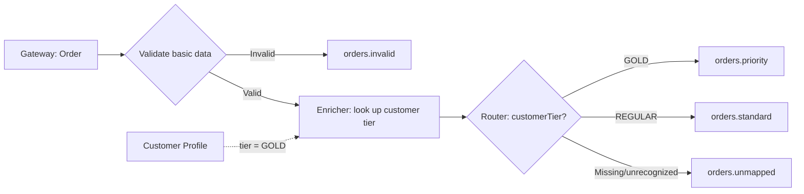
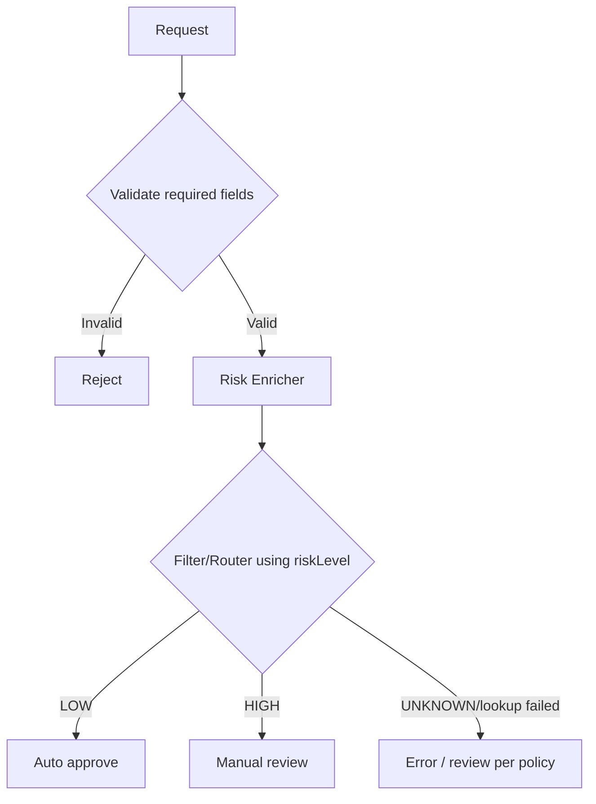
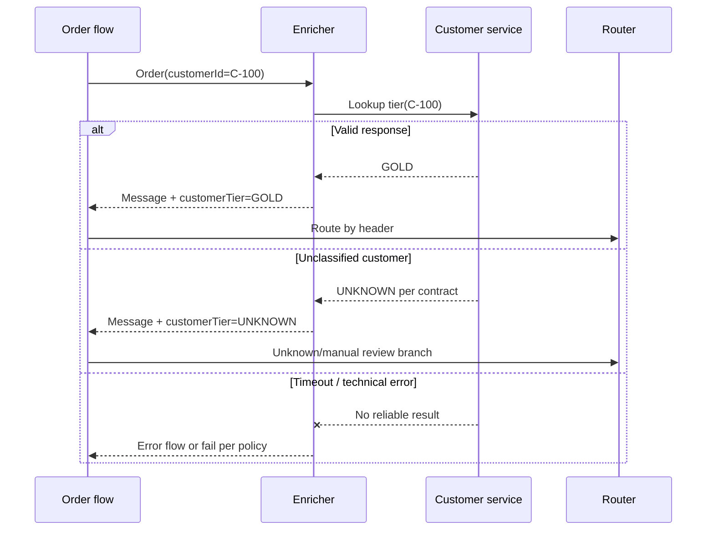

# Placing Enrichment Before Steps That Need Metadata

> **Chapter:** Pipes and filters  
> **Module:** `SPRING_INTEGRATION_PATTERN` — learning to implement Enterprise Integration Patterns with Spring Integration to build loosely coupled, extensible message flows; practicing Router, Filter, Transformer, Splitter, Aggregator, Gateway, retry, error channels, correlation, and testing and observing branches. This lesson explains **why and where to place enrichment steps** so downstream endpoints have sufficient metadata before making decisions.

## 1. Learning Objectives

After this lesson, you will be able to:

1. Explain how a **Message Enricher** supplements missing information on a message in a Pipes and Filters architecture.
2. Distinguish **Header Enricher**, **Content Enricher**, and Transformer; decide whether metadata belongs in headers or the payload.
3. Order **validation → enrichment → metadata-consuming step** properly when implementing Filter, Router, Service Activator, or outbound Gateway.
4. Write an `IntegrationFlow` using `enrichHeaders(...)` so a Router selects channels based on data looked up from another system.
5. Design policies for missing/stale metadata, slow or failed lookups, retries, idempotency, correlation, security, and flow observability.
6. Verify through tests that metadata is present **before** the endpoint using it, rather than only asserting the final outcome of a branch.

## 2. Problem: A Decision Requires Information Not Yet in the Message

Suppose an ordering system receives the following message from a Gateway:

```json
{
  "orderId": "ORD-701",
  "customerId": "C-100",
  "amount": 1500000,
  "destinationCountry": "VN"
}
```

A Router needs to know whether the customer's order belongs to **GOLD or REGULAR tier** to pick a priority processing channel. However, customer tier data is not inside the order request; it lives in the customer profile service.

If the Router itself calls the profile service on every routing decision, that endpoint performs both **data lookup** and **destination selection**. If another Filter also needs customer tier, it would have to call the service again. That design duplicates logic, increases latency, complicates testing, and makes handling temporary profile-service outages harder.

Instead, we insert an **Enricher** before the point that consumes the metadata:



**Core principle:** before an endpoint uses an attribute to decide, there must be a step that **produces or verifies that attribute** at a location with clear responsibility. In the example above: *validate input → look up tier → attach tier to message → Router reads tier*.

## 3. What Is Enrichment in Pipes and Filters?

In the **Pipes and Filters** model, a flow is organized into independent processing steps (**filters**, in the broad architectural sense) linked by **pipes/channels**. Each step receives a message per a contract and produces output for the next step. **Enrichment** is a step that **adds information**, rather than merely choosing a route or dropping a message.

Sources of enrichment data can be:

- **Within the message itself:** deriving a shipping zone from a country code; adding a payload type tag or schema version.
- **From trusted configuration/context:** authenticated tenant, source application, processing rule version.
- **From another service or datastore:** customer tier, transaction limits, shipping config, product rules.
- **From an earlier processing branch:** SKU lookup result, risk-check status, outbound Gateway response.

Example data after enrichment:

```text
Before enrichment:
  payload: Order(orderId=ORD-701, customerId=C-100, amount=1500000)
  headers: sourceSystem=web-store

After enrichment:
  payload: Order(orderId=ORD-701, customerId=C-100, amount=1500000)
  headers:
    sourceSystem=web-store
    customerTier=GOLD

Router:
  customerTier=GOLD -> orders.priority
```

In this example, the payload **does not need to change**; the new metadata is added to headers. When you need an order complete with normalized shipping address, promotions, or inventory details to send to another system, that information may belong in an **enriched payload**.

### 3.1. Header Enricher vs. Content Enricher

| Criterion | Header Enricher | Content Enricher |
| --- | --- | --- |
| Target | Adds metadata to **message headers** | Adds data to the **business content/payload** |
| Examples | `customerTier`, `routingZone`, trusted tenant label | Adding customer details, product info, normalized address to an order object |
| Downstream consumers | Header-based Router, branch control, logging/tracing | Target APIs needing full data, calculations, or saving an aggregate |
| Benefits | Keeps business payload lean; routing requires no extra payload fields | Payload contract explicitly expresses the full dataset required at destination |
| Risks | Headers can be lost across adapters/protocols; can be spoofed at ingress | Payload bloat; schema coupling, stale or sensitive data |

**Header does not mean “unimportant data.”** When a Router, security check, or correlation relies on a header, that header becomes **part of the flow's contract**. You must verify its origin, define its semantics, version it, and control how it maps across system boundaries.

### 3.2. How Enricher Differs from Transformer

| Pattern | Primary Intent | Illustration |
| --- | --- | --- |
| **Enricher** | Add missing information for downstream steps to use | Look up customer tier and attach `customerTier` |
| **Transformer** | Convert data representation, type, or structure | `ExternalOrder` → `NormalizedOrder` |
| **Filter** | Keep or drop a message based on a condition | Reject orders with a negative amount |
| **Router** | Select target channel | Tier GOLD → priority branch |
| **Gateway** | Bridge code/protocol and messaging flow; may be request–reply | Query customer service and receive profile |

One step can technically transform and enrich at once, yet **separating responsibilities** improves clarity when multiple endpoints share metadata. In Spring Integration, `enrichHeaders(...)` supports header enrichment; a **Content Enricher** can query a request–reply flow and merge returned data into the target payload as configured. For simple conversions, a `Transformer` building a new payload can also satisfy enrichment needs, provided naming and contracts stay clear.

## 4. Placement Rules: Enrich Close to Need, Yet Before It Is Needed

Having an Enricher does not mean putting it at the very start of the flow. Good placement depends on **where metadata is consumed**, **lookup cost**, and **whether messages can be rejected earlier**.

### 4.1. Run Basic Checks Before Expensive Lookups

If an order lacks `customerId`, calling the customer service is pointless. Prefer:

```text
Gateway -> Validate structure -> Filter invalid -> Enrich(customerTier)
        -> Router by tier -> Downstream
```

Avoid:

```text
Gateway -> Enrich(customerTier via remote API) -> Validate/Filter invalid
```

Unless validation **requires the enriched data itself**, reject structurally invalid or malformed requests before performing I/O. This reduces load on lookup services and keeps failure paths crisp.

### 4.2. But If a Filter Needs Metadata, Enrichment Must Precede That Filter

Suppose only orders with `riskLevel=LOW` qualify for auto-approval, while `riskLevel=HIGH` routes to manual review. `riskLevel` comes from a risk scoring service. If a Filter inspects this field **before** the Enricher, the result may be wrong or rely on a dangerous default.



In short, **“Filter before Enricher” only holds for Filters that do not depend on enriched data**. For metadata-dependent Filters, the reverse order is required.

### 4.3. Enrich Once Before a Branching Point When Multiple Branches Need the Same Data

If both `orders.priority` and `orders.standard` use `customerTier`, enriching **before the Router** provides a consistent value and avoids duplicate lookups:

```text
                       +--> Priority handler
Enrich(customerTier) -> Router
                       +--> Standard handler
```

Conversely, if only one branch needs expensive data, you can **Route first using already-available metadata** and enrich only on the branch that needs it. Avoid eagerly enriching every field from every external system at ingress when most messages never use them.

### 4.4. Choose Enrichment Timing Based on Data Freshness

Tiers, inventory, transaction limits, or security policies can change between order creation and execution. Fetching metadata too early and holding messages in a queue for a long time can cause decisions to rely on stale data. Clarify:

- Is the metadata a **snapshot at intake time**, or must it be **current at decision time**?
- Do you need `metadataVersion`, `resolvedAt`, TTL, or an ETag?
- If a message retries minutes later, should it reuse the snapshot or look up again? Could re-lookup alter a business decision?
- For critical transactions, must the receiver re-verify conditions before committing?

Placing enrichment closer to consumption keeps data fresher, though it may increase lookups across concurrent branches. This is a trade-off among **consistency, latency, and load**—there is no single optimal position for every flow.

## 5. Spring Integration Java DSL Example: Enrich Headers Before a Router

Let us build a flow that receives an order, checks basic fields, retrieves customer tier from a catalog, and routes based on the `customerTier` header. The catalog in this example is an **in-memory stub** to illustrate ordering clearly; with a real API, add timeouts, retries, and error policies.

### 5.1. Message Contract and Lookup Service

```java
import java.math.BigDecimal;
import java.util.Map;

record PurchaseOrder(String orderId, String customerId,
                     BigDecimal amount) {}

class CustomerTierCatalog {
    private final Map<String, String> tiers = Map.of(
        "C-100", "GOLD",
        "C-200", "REGULAR"
    );

    String resolveTier(String customerId) {
        // UNKNOWN is a business lookup result, not disguised as a valid tier.
        return tiers.getOrDefault(customerId, "UNKNOWN");
    }
}
```

Here, `customerId` lives in the payload; `customerTier` is not chosen by the client but resolved from an application-controlled source. When backed by a cache or external service, the catalog must ensure an explicit return contract for unknown customers or access failures.

### 5.2. Gateway and `IntegrationFlow`

```java
import org.springframework.context.annotation.Bean;
import org.springframework.context.annotation.Configuration;
import org.springframework.integration.annotation.Gateway;
import org.springframework.integration.annotation.IntegrationComponentScan;
import org.springframework.integration.annotation.MessagingGateway;
import org.springframework.integration.config.EnableIntegration;
import org.springframework.integration.dsl.IntegrationFlow;

@MessagingGateway
interface PurchaseOrderGateway {
    @Gateway(requestChannel = "orders.input")
    void submit(PurchaseOrder order);
}

@Configuration
@EnableIntegration
@IntegrationComponentScan
class OrderFlowConfiguration {

    @Bean
    CustomerTierCatalog customerTierCatalog() {
        return new CustomerTierCatalog();
    }

    @Bean
    IntegrationFlow orderFlow(CustomerTierCatalog catalog) {
        return IntegrationFlow.from("orders.input")
            // 1. Validate only existing fields before looking up metadata.
            .filter(PurchaseOrder.class,
                order -> order.orderId() != null
                    && !order.orderId().isBlank()
                    && order.customerId() != null
                    && !order.customerId().isBlank()
                    && order.amount() != null
                    && order.amount().signum() > 0,
                spec -> spec.discardChannel("orders.invalid"))

            // 2. Enricher must run before the Router that reads customerTier.
            .enrichHeaders(spec -> spec.headerFunction(
                "customerTier",
                message -> catalog.resolveTier(
                    ((PurchaseOrder) message.getPayload()).customerId())))

            // 3. Router simply reads the header already populated.
            .route("headers['customerTier']", spec -> spec
                .channelMapping("GOLD", "orders.priority")
                .channelMapping("REGULAR", "orders.standard")
                .defaultOutputChannel("orders.unknownTier"))
            .get();
    }

    @Bean
    IntegrationFlow priorityOrders() {
        return IntegrationFlow.from("orders.priority")
            .handle(message -> System.out.println(
                "PRIORITY tier=" + message.getHeaders().get("customerTier")
                    + " order=" + message.getPayload()))
            .get();
    }

    @Bean
    IntegrationFlow standardOrders() {
        return IntegrationFlow.from("orders.standard")
            .handle(message -> System.out.println(
                "STANDARD tier=" + message.getHeaders().get("customerTier")
                    + " order=" + message.getPayload()))
            .get();
    }

    @Bean
    IntegrationFlow invalidOrders() {
        return IntegrationFlow.from("orders.invalid")
            .handle(message -> System.out.println(
                "INVALID order=" + message.getPayload()))
            .get();
    }

    @Bean
    IntegrationFlow unknownTierOrders() {
        return IntegrationFlow.from("orders.unknownTier")
            .handle(message -> System.out.println(
                "UNKNOWN TIER order=" + message.getPayload()))
            .get();
    }
}
```

Example invoking the gateway from an application bean injected with `PurchaseOrderGateway`:

```java
purchaseOrderGateway.submit(new PurchaseOrder(
    "ORD-701", "C-100", new BigDecimal("1500000")));

purchaseOrderGateway.submit(new PurchaseOrder(
    "ORD-702", "C-200", new BigDecimal("400000")));

purchaseOrderGateway.submit(new PurchaseOrder(
    "ORD-703", "C-999", new BigDecimal("200000")));

purchaseOrderGateway.submit(new PurchaseOrder(
    "ORD-704", "C-100", BigDecimal.ZERO));
```

Illustrative output:

```text
PRIORITY tier=GOLD order=PurchaseOrder[orderId=ORD-701, ...]
STANDARD tier=REGULAR order=PurchaseOrder[orderId=ORD-702, ...]
UNKNOWN TIER order=PurchaseOrder[orderId=ORD-703, ...]
INVALID order=PurchaseOrder[orderId=ORD-704, ...]
```

**Key takeaway:** `orders.priority` and `orders.standard` do not call the catalog themselves. The Router reads `customerTier` attached by the Enricher. Structurally invalid orders are dropped **before lookup**; unclassified customers route to **unknown**, rather than silently defaulting to REGULAR.

### 5.3. Intentional Limitations of This Example

- The catalog is a `Map`, with no network I/O. In production, design timeouts, bulkheads, caches, and protection for the lookup service.
- Sinks only print to the console. `void submit(...)` does not confirm completion of a distributed transaction.
- Routing key `customerTier` is an application header, not a mandatory framework header. Across HTTP/brokers, configure header mapping if external consumers also rely on it.
- The example omits retry/error channels and durable persistence. A technical failure during lookup is **different** from the catalog validly returning `UNKNOWN` per contract.
- Do not stuff an entire customer profile into headers; add only minimal data required for decisions.

## 6. When to Enrich the Payload Instead of Headers?

Headers suit flow-control metadata like `customerTier`, `routingZone`, `sourceSystem`, and `correlationId`. However, if a shipping system requires a normalized address and package dimensions directly in its API contract, put that content into a **strongly typed payload**, for example:

```java
record ShippingOrder(PurchaseOrder order, String normalizedAddress,
                     String serviceLevel) {}

// Build a new payload instead of mutating PurchaseOrder in place.
ShippingOrder enrichPayload(PurchaseOrder order,
                            String normalizedAddress,
                            String serviceLevel) {
    return new ShippingOrder(order, normalizedAddress, serviceLevel);
}
```

The snippet above is a pure function illustrating the **payload-enrichment outcome**, not a full Content Enricher configuration. In Spring Integration, you can use a **Content Enricher** to query a lookup flow and merge data into the target object; for simpler cases, a Transformer creating a new immutable payload is also clear. Either way, decide whether headers are preserved, whether the payload schema/version changes, and whether consumers accept the new type.

**Avoid:** placing addresses, API tokens, payment info, full customer profiles, or sensitive data into headers solely so a Router can read them easily. Headers are frequently copied, logged, and mapped across adapters, risking leakage beyond intended boundaries.

## 7. Enrichment via External Services: Request–Reply and Lookup Failures

In production, enrichment often reads from another system such as a customer profile service, shipping routing service, or policy engine. This introduces a new **runtime dependency**, so failure modes and timeouts must be specified.



### 7.1. Separating “Metadata Absent” from “Metadata Inaccessible”

| Scenario | Example | Behavior That Should Be Designed |
| --- | --- | --- |
| **Validly missing data** | Customer ID does not exist | Return meaningful `UNKNOWN`/`NOT_FOUND` or business rejection branch |
| **Lookup service failure** | HTTP 503, timeout, connection refused | Bounded retry for recoverable errors; then error/review/dead-letter per contract |
| **Invalid metadata** | API returns unsupported tier `PLATINUM` | Validate/allowlist, route to fallback with alert; never route blindly |
| **Stale metadata** | Cached tier outdated right after customer upgrade | TTL/version/freshness check; policy for stale values |
| **Unauthorized metadata** | Source asks for another tenant's tier | Authenticate and reject; never treat permission errors as REGULAR tier |

Defaulting to `REGULAR` when a lookup fails might look convenient, yet it can violate SLAs, access rules, or risk policies. Use a fallback only when it is an **approved business decision** with auditing, metrics, and recovery paths.

### 7.2. Retries Must Not Multiply Side Effects

If an Enricher calls a pure read API, bounded retries with backoff can be sensible. But if the lookup step also **writes state, reserves quota, or allocates resources**, retrying after a timeout can duplicate actions that already succeeded remotely. Separate read APIs from side-effecting commands, or use idempotency keys and state checks per contract.

Do not implement retries by looping messages back to the start of the entire pipeline indefinitely: you could re-run Filters, Routers, Splitters, and handlers that already completed. Place retries **around the failing dependency**, cap attempts, and define the terminal path once exhausted.

### 7.3. Timeouts, Latency, and Backpressure

An Enricher calling a customer service synchronously over `DirectChannel` prolongs the sender thread's execution time; concurrent orders can exhaust thread pools and cause cascading stalls. If decoupled across queues/executors, manage queue depth, concurrency limits, ordering, and asynchronous error handling.

You can reduce cost with TTL caches, batch lookups, or trusted data preloading. Still, performance optimizations **must not break correctness** when policies demand fresh data. Measure cache hit ratio, p95/p99 lookup latency, timeouts, retry counts, and messages routed to unknown/error branches.

## 8. Headers and Metadata Across Steps: Correlation, Security, Immutability

### 8.1. Enrichment Must Not Accidentally Break Correlation

A flow with Splitter/Aggregator can generate multiple child messages for the same order. To reassemble accurately, messages must preserve or set **correlation keys** and sequences per contract, or use a dedicated correlation strategy. If messages cross brokers/HTTP, verify headers map across boundaries.

```text
Order ORD-701
  -> Enrich(customerTier=GOLD)
  -> Splitter(lineItems)
      -> Line A: correlation=ORD-701, tier=GOLD
      -> Line B: correlation=ORD-701, tier=GOLD
  -> Handlers
  -> Aggregator(group by ORD-701)
```

If all child messages share the same tier, enrich **before the Splitter** to avoid redundant lookups. If tier depends on **each SKU or warehouse**, enrich **after the Splitter** on the item branch. For metadata used by the Aggregator's release logic, ensure it reaches every correlated result or configure a dedicated strategy on the Aggregator.

Spring's generated `messageId` is not guaranteed to stay stable across steps constructing new messages; **do not rely on message ID as a business correlation key**. `correlationId` links related parts together, whereas an **idempotency key** prevents duplicate business execution—two distinct purposes.

### 8.2. Be Careful When Overwriting Headers

`MessageHeaders` is immutable from the caller's perspective; when adding headers, the framework typically creates a **new message** with the updated metadata. Never attempt to mutate `message.getHeaders().put(...)` directly. For existing headers such as tenant, trace, security context, or correlation, define clearly **which source is allowed to set or overwrite them**, rather than trusting client-supplied headers.

For instance, a client could send `customerTier=GOLD` trying to enter the priority branch. If the flow only sets the header when absent, the client's value could survive. Define a policy to **strip untrusted headers at ingress or intentionally overwrite them with values from a trusted source**, and test that behavior. Specific overwrite semantics depend on the Header Enricher API configuration chosen by your application.

### 8.3. Minimal Metadata, Sufficient for Purpose

Do not carry full PII profiles on every message just so a Router can inspect one small label. Scope data to its purpose, mask logs, exclude secret tokens from broadly propagated headers, and define metadata lifetimes.

Metadata sometimes acts as **policy-driving data** (such as permissions, quotas, tenant isolation), not just logging helpers. Security-critical decisions must be verified at trust boundaries and protected against spoofed or stale metadata.

## 9. Observing Enrichment to Prove Correct Ordering

Suppose a Router picks the wrong branch. To diagnose it, logging just `orderId` is not enough—you need visibility showing the Enricher ran **before** the Router and what value it produced.

| Measurement Point | Signal | Question Answered |
| --- | --- | --- |
| Ingress/Gateway | `orderId`, `customerId`, source, schema | What fields were in the initial input? |
| Validation/Filter | accepted/rejected, reason code | Did the message qualify for lookup? |
| Enricher request | Data source name, safe lookup key, start time | Was the catalog/service actually called? |
| Enricher result | Allowed `customerTier` value, metadata version, latency | Which value was attached; was it stale/unknown? |
| Router | Routing key, chosen channel name | Was routing based on the enriched header? |
| Outbound handler | Business outcome, latency, retry attempts | Did the target succeed? |
| Error flow | Failure type, correlation, retry count | Did the failure happen at lookup or post-routing? |

You can use `ChannelInterceptor`, Wire Tap, logging, metrics/tracing, and test endpoints to observe channels, while avoiding logging sensitive payloads. For metrics, use low-cardinality tags (`channel`, `lookupStatus`, `tier`) instead of `orderId`/`messageId`.

**Verifiable observability:** the message passed through the channel *before* the Router, metadata was attached, and the Router selected the matching destination. Merely seeing `postSend(sent=true)` on a channel **does not prove** the final ERP/warehouse outcome committed, especially across executors, queues, or external brokers.

## 10. Testing: Verifying Ordering and Behavior When Metadata Is Missing

Testing an Enricher is more than verifying a lookup service returns the right tier. You must prove **the flow uses the right tier after enrichment**. Tests can be organized into three layers:

1. **Unit tests** for lookup/classification logic: `C-100 → GOLD`, `C-200 → REGULAR`, unknown code → `UNKNOWN`.
2. **Integration tests** with the Spring Integration flow: send messages via the Gateway, capture messages on output branches, and assert both the `customerTier` header and payload.
3. **Failure/timeout tests** for dependencies: check retry limits, error flows, and verify unreliable metadata never sends messages down valid branches.

### 10.1. Recommended Test Matrix

| Input / Condition | Post-Enricher Data | Expected Branch | Must Verify |
| --- | --- | --- | --- |
| `ORD-701`, `C-100`, positive amount | `customerTier=GOLD` | `orders.priority` | Not sent to `orders.standard` |
| `ORD-702`, `C-200`, positive amount | `customerTier=REGULAR` | `orders.standard` | Not sent to `orders.priority` |
| `ORD-703`, `C-999` | `customerTier=UNKNOWN` | `orders.unknownTier` | Not silently classified as REGULAR |
| `ORD-704`, `amount=0` | **No lookup** | `orders.invalid` | Catalog invoked 0 times; no fabricated tier |
| Catalog timeout / HTTP 503 | No trusted tier | Error/retry per policy | Not sent to success branch |
| Client sends `customerTier=GOLD` while real source returns REGULAR | Trusted value per policy | `orders.standard` | Spoofed header cannot hijack route |
| Router placed before Enricher (fault test) | `customerTier` absent | Fallback/error | Test immediately catches ordering bug |
| Message traverses broker/adapter | Header mapped per contract | Correct branch post-deserialize | Required metadata not lost |

### 10.2. Example Unit Test for the Catalog

```java
import static org.junit.jupiter.api.Assertions.assertEquals;

import org.junit.jupiter.api.Test;

class CustomerTierCatalogTest {
    private final CustomerTierCatalog catalog = new CustomerTierCatalog();

    @Test
    void resolvesKnownCustomerTiers() {
        assertEquals("GOLD", catalog.resolveTier("C-100"));
        assertEquals("REGULAR", catalog.resolveTier("C-200"));
    }

    @Test
    void unknownCustomerIsNotSilentlyPromotedOrDowngraded() {
        assertEquals("UNKNOWN", catalog.resolveTier("C-999"));
    }
}
```

This is only a **lookup unit test**. In integration tests, use a fake service recording invocation counts; send an invalid order to assert **the catalog is called 0 times**, send a valid order to assert **the catalog is called 1 time**, and use test handlers to assert headers and message counts on each channel.

### 10.3. Testing with Splitter/Aggregator

For an order with three line items, place the Enricher before the Splitter if tier applies to the whole order. Assert child messages carry the same tier and business correlation key; for SKU-specific metadata, place enrichment after the Splitter and assert each item gets its proper value. The Aggregator must assemble groups accurately and be tested for missing, late, or redelivered parts; never conclude a group was definitely released solely because enough messages entered a channel.

## 11. Anti-Patterns to Avoid

| Anti-Pattern | Problem | Improvement |
| --- | --- | --- |
| **Route before enrich** | Router reads `null`, wrong default key, or untrusted data | Enrich and validate metadata before the router needing it |
| **Eagerly enrich everything too early** | Wastes I/O on dropped messages or branches that do not need it | Validate first; enrich at the right consumption point |
| **Duplicate lookups per handler** | Higher latency, inconsistent metadata across branches | Enrich once before branching when branches share metadata |
| **UNKNOWN = STANDARD on API failure** | Masks incidents and risks policy violations | Separate not-found, timeout, stale, and authorization errors |
| **Trusting client-supplied headers** | Tier/tenant/route spoofing | Verify/strip/overwrite from trusted sources |
| **Bloated headers** | Larger messages, PII leaks, broken adapter compatibility | Keep metadata minimal; put contract data in payload |
| **Infinite whole-flow retries** | Repeats side effects and amplifies load | Bound retries around dependencies; enforce idempotency on side effects |
| **Grouping by message ID** | Child messages have separate IDs that can change across steps | Use business correlation keys and sequence/release strategies |
| **Calling slow APIs in hot-path Enricher** | Blocks producers, causes cascading timeouts | Add timeouts, bulkheads, TTL caches, latency metrics, proper async boundaries |

## 12. Production Design Checklist

- [ ] Identify exactly which endpoints **need which metadata**, along with trust and freshness requirements.
- [ ] Validate basic input fields before lookups unless validation depends on the enriched metadata.
- [ ] Place the Enricher **before** the Filter/Router/handler that consumes that metadata.
- [ ] Choose headers vs. payload based on business contracts, not mere coding convenience.
- [ ] Define `UNKNOWN`/not-found outcomes and technical errors **separately**.
- [ ] Configure timeouts, bounded retries, backoff, and failure paths when lookups fail.
- [ ] Account for idempotency on side effects; preserve correlation/sequence across split/aggregate steps.
- [ ] Identify when metadata can go stale and define caching, TTL, and versioning strategies.
- [ ] Never trust unverified inbound headers; limit PII and header size.
- [ ] Measure latency, lookup error rates, routing branches, queue depth, and business outcomes at the right boundaries.
- [ ] Write unit, integration, and failure tests proving **enrichment → consumption ordering**, including invalid and error cases.

## 13. Practice Exercise

A system receives a `CreateShipment` message from a website. The message contains `orderId`, `customerId`, a list of SKUs, and a destination country. A Router must pick an international/domestic branch; a fraud-check Filter needs `riskScore` from a Risk Service; each SKU has a preferred warehouse; results from warehouses must be aggregated back into one order.

Design the flow and answer:

1. Which metadata can be derived directly from the payload (e.g., country), and which requires external lookup (e.g., `riskScore` and preferred warehouse)?
2. Which Filters can run **before enrichment**, and which must run **after enrichment**?
3. If `riskScore` is unavailable due to an API timeout, should the Router automatically route to the low-risk branch? What policy should apply?
4. Should **order-level** info be enriched before the Splitter, or **per-SKU warehouse** after the Splitter? Why?
5. What metadata/correlation is required before the Aggregator, and what tests prove results belong to the right order?
6. Where would you attach a `ChannelInterceptor`, Wire Tap, or tracing to diagnose slow lookups or lost headers across a broker?

**One reference approach:**

```text
Gateway
   -> Structural validation / reject invalid inputs
   -> Enrich(riskScore from Risk Service)
   -> Filter/Router by riskScore
        -> Manual review branch when HIGH/UNKNOWN per policy
        -> Eligible branch:
             Country Router (data already present)
             -> Splitter per SKU
             -> Enrich(warehouse per SKU)
             -> Router to warehouse
             -> Idempotent calculation/reservation
             -> Aggregator by orderId
             -> Final outcome / completion event
```

No single ordering fits every problem: the right order depends on **contracts and the data each step actually uses**. Always define clearly **who produces metadata, when it is valid, and which endpoints may trust it**.

## 14. Summary

**Placing enrichment before steps that need metadata** is a core design principle in Pipes and Filters. An Enricher supplies missing context so a Router, Filter, handler, or outbound Gateway can make accurate decisions. Placing it too late forces downstream steps to guess or misroute; placing it too early or too broadly slows the flow, risks stale data, and creates unnecessary lookup dependencies.

With Spring Integration, you can use a **Header Enricher** (`enrichHeaders`) or contract-driven payload enrichment. To keep flows loosely coupled and testable, separate **validation, enrichment, routing, and business processing**; proactively handle **missing/failed/stale metadata, retries, error channels, correlation, and idempotency**; and instrument and test the exact order in which messages traverse channels.

**References:** Gregor Hohpe & Bobby Woolf, *Enterprise Integration Patterns* (Content Enricher, Pipes and Filters); Spring Integration documentation on Header Enricher, Content Enricher, Java DSL, Message Channels, Routers, Splitters/Aggregators, and Error Handling.
