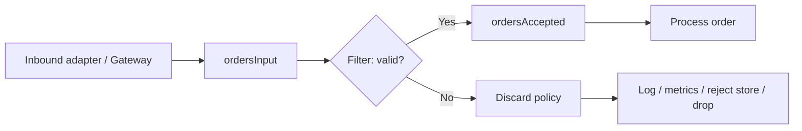
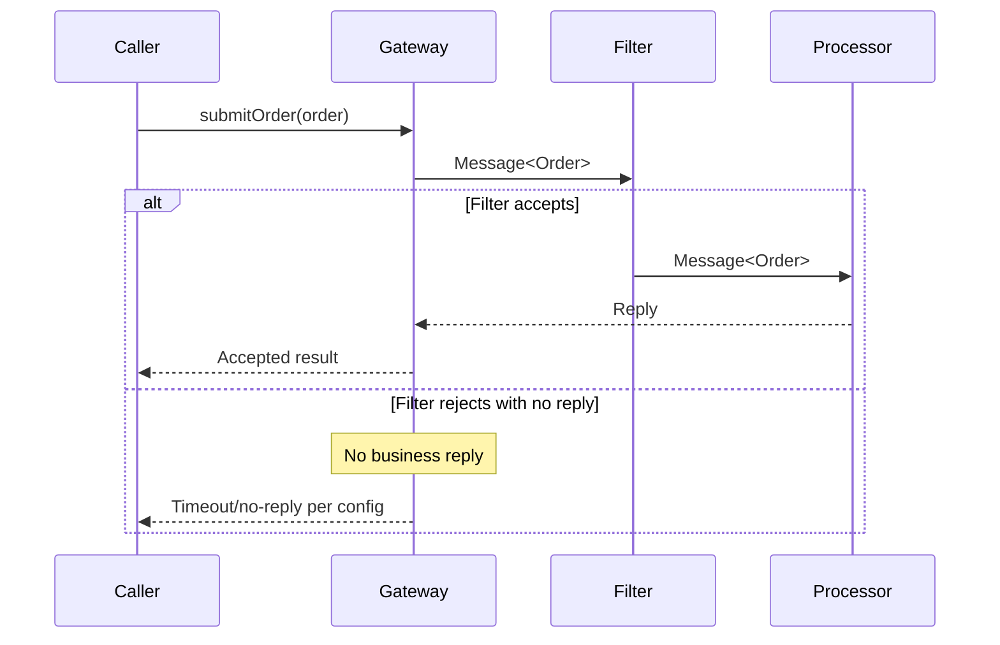
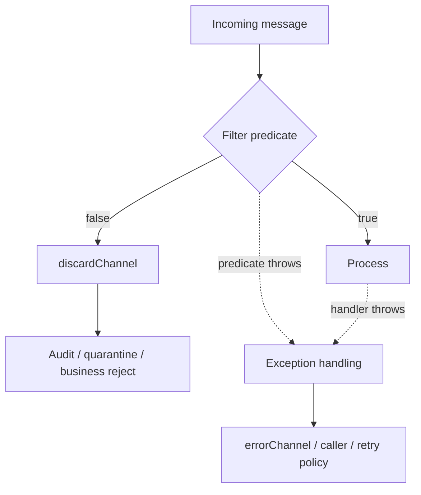
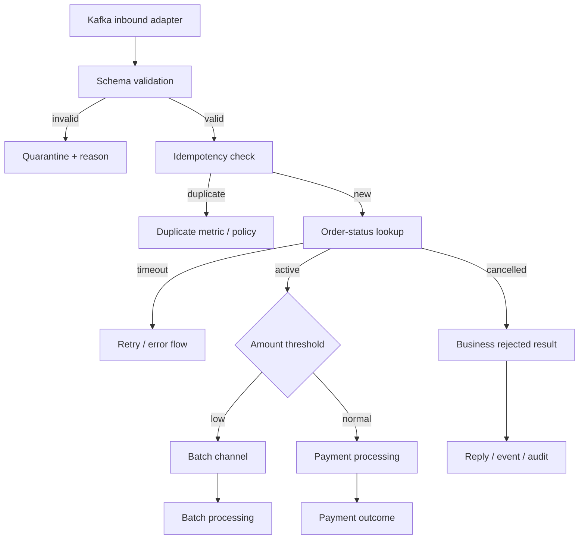

# Handling Messages Filtered Out of a Flow

In a **Pipes and Filters** architecture, messages travel through a sequence of independent processing steps (*filters*) connected by channels (*pipes*). A step can accept a message, transform its contents, route it, or decide **not to let the message continue along the main branch**. With **Spring Integration**, writing the filter predicate is only half the work—you must also define explicitly whether a filtered-out message **vanishes intentionally, routes to another branch, gets recorded for review, or raises an error**.

This lesson belongs to the **Pipes and filters** chapter of the `SPRING_INTEGRATION_PATTERN` module. The goal is to use Enterprise Integration Patterns—especially **Filter, Router, Transformer, Splitter, Aggregator, and Gateway**—to build loosely coupled, extensible, testable, and observable message flows. Handling discarded messages directly impacts **retries, error channels, and correlation**: mishandling them can drop data, cause gateways to hang until timeout, or prevent aggregators from ever completing a group.

After this lesson, you will be able to:

- Distinguish **rejection** (failing a condition) from **exceptions** (execution errors), **duplicates**, and **missing output messages**.
- Choose among **default discard**, `discardChannel`, `nullChannel`, `throwExceptionOnRejection`, and an explicit business outcome branch.
- Understand what actually enters a discard channel, where rejection reasons are recorded, and the impact on request–reply flows.
- Design batch processing, splitter/aggregator flows, and broker sources so filtering does not corrupt delivery state.
- Write tests proving both accepted and rejected messages reach their proper destinations rather than testing only the predicate.

## 1. What Does “Filtered Out of a Flow” Mean?

Suppose a system processes order requests. The flow only admits orders in `READY` state with a positive amount:



When a **Filter returns `false`**, it simply means the message is not forwarded to the **Filter's output channel**. It does *not automatically* mean the message is an error, that the data was persisted for reprocessing, that the sender received a rejection reply, or that a broker will redeliver the message.

Distinguish the following outcomes:

| State | Meaning | Example |
| --- | --- | --- |
| **Accepted** | Predicate returns `true`; message proceeds along main branch. | `READY` order with amount > 0. |
| **Rejected / filtered out** | Predicate returns `false`; message leaves main branch. | Order in `DRAFT` state, not ready for payment. |
| **Discarded intentionally** | Application decides no further processing is needed. | Heartbeat event irrelevant to a reporting flow. |
| **Routed elsewhere** | Message leaves main branch but still has a receiving destination. | Sending ineligible orders to a review queue. |
| **Failed** | Exception occurred in predicate, handler, transport, or send operation. | Database error while looking up filter criteria. |
| **Duplicate suppressed** | Idempotency policy detects the message was already processed. | Same `eventId` redelivered after reconnect. |
| **No reply** | Request–reply flow produces no reply message. | Gateway calls flow where Filter drops request; caller may hit timeout. |

**Key principle:** *Not forwarding* is a **routing/control decision**; *encountering an error* is an **execution failure state**. Do not conflate both onto the same path when the system needs different responses, retries, or monitoring.

## 2. How Message Filter Works in Spring Integration

In Spring Integration, **Message Filter** evaluates a condition over the payload, headers, or entire message. For a standard filter, there are three main behaviors:

1. **Accept:** message is forwarded to the output channel as usual.
2. **Reject with `discardChannel`:** rejected message is sent to the configured channel instead of continuing on the main output channel.
3. **Reject without a discard branch:** message may be dropped by default; if **`throwExceptionOnRejection`** is enabled, the Filter throws `MessageRejectedException` instead of silently dropping it.

Use these options **deliberately**. Avoid configuring a flow that expects both silent discarding and error-flow handling without checking precedence rules in your configuration.

```text
                 Message<?> (payload + headers)
                               │
                               ▼
                      Filter / predicate
                        ┌──────┴──────┐
                     true           false
                      │               │
                      ▼               ├──► discardChannel (if configured)
                 outputChannel        │
                                      ├──► drop (if policy allows)
                                      │
                                      └──► MessageRejectedException
                                             (when throwExceptionOnRejection)
```

### What Message Enters the Discard Channel?

Normally, the discard branch receives the **original message rejected by the Filter**, including its original payload and headers; it does not automatically become a new `RejectedOrder` object carrying a failure reason. To record `reasonCode`, `rejectedAt`, `filterName`, or validation details, you must **explicitly enrich metadata or transform the payload** inside the rejection-handling branch.

For example, a message with `payload = OrderRequest("ORD-7", 0, "READY")` does not automatically receive a `rejectReason = "amount must be positive"` header simply because the predicate returned `false`. You can re-evaluate rules inside the reject handler, or design a validator returning a typed result instead of a bare `boolean` when multiple reasons are needed.

## 3. Java DSL Example: Routing Rejected Messages to a Dedicated Channel

The following example uses Spring Integration Java DSL, Java 17+, and two `QueueChannel` beans so both branches can be observed accurately. The queues in this example **serve only illustration and internal testing**, not durable storage replacing a broker.

```java
import org.springframework.context.annotation.Bean;
import org.springframework.context.annotation.Configuration;
import org.springframework.integration.channel.QueueChannel;
import org.springframework.integration.dsl.IntegrationFlow;

record OrderRequest(String orderId, long amountCents, String state) {
    boolean eligible() {
        return orderId != null
                && !orderId.isBlank()
                && amountCents > 0
                && "READY".equals(state);
    }
}

@Configuration
class OrderFilterConfiguration {

    @Bean
    QueueChannel acceptedOrders() {
        return new QueueChannel();
    }

    @Bean
    QueueChannel rejectedOrders() {
        return new QueueChannel();
    }

    @Bean
    IntegrationFlow orderScreeningFlow() {
        return IntegrationFlow.from("incomingOrders")
                .filter(OrderRequest.class,
                        OrderRequest::eligible,
                        spec -> spec.discardChannel("rejectedOrders"))
                .channel("acceptedOrders")
                .get();
    }
}
```

Flow walkthrough:

- Producer sends `Message<OrderRequest>` to `incomingOrders`.
- Filter invokes `eligible()`; if `true`, the message routes to `acceptedOrders`.
- If `false`, the message routes to `rejectedOrders` via `discardChannel`.
- The `rejectedOrders` branch is the **destination for filtered-out messages**, not automatically an *error channel*.
- `QueueChannel` beans can be polled to inspect messages. Production systems typically replace them with channels or handlers providing durable persistence and monitoring per actual requirements.

In annotation-based configuration, the same idea can be expressed with `@Filter(inputChannel = "incomingOrders", outputChannel = "acceptedOrders", discardChannel = "rejectedOrders")` on a `boolean`-returning method. The core goal stays identical: **explicitly define both the accepted output and the rejected output**.

### Example Limitations

This example only wires a topology for illustration. Running it requires Spring Integration and an application context; real message processing requires producers and consumers. `QueueChannel` does not emit to HTTP/Kafka, write audit logs, or confirm business completion on its own.

## 4. Four Policies for Handling Filtered-Out Messages

### 4.1. Silent Drop: Only When Business Semantics Justify It

Silent dropping fits when a message truly **holds no value for this flow**, such as heartbeat signals in a transaction-only stream. If silent dropping is an agreed contract, it avoids unnecessary side effects.

Conversely, silent dropping makes it hard for operators to distinguish **no messages arriving** from **messages arriving and getting dropped by a Filter**. At minimum, important flows should expose counters for `accepted`/`rejected` and document the filter criteria. When losing a transaction is unacceptable, never choose silent drop as the default.

### 4.2. `discardChannel`: Routing Messages to a Separate Handling Branch

`discardChannel` fits when messages must not proceed down the main flow but require **quarantine, review, auditing, or routing to an alternate workflow**.

```text
incomingOrders -> Filter ----accepted----> processOrder
                      |
                      +----rejected----> rejectedOrders
                                           |
                                           +-> metrics + audit
                                           +-> manual review / quarantine
```

In this branch, decide:

1. Keep the original message intact for inspection, or transform it into a rejection record with its own schema?
2. Are persistent `reasonCode` and `eventId` needed for auditing/deduplication?
3. Must sensitive data be masked or stripped from logs?
4. Can the rejection branch itself fail? If so, can the source message be retried or is fallback storage needed?
5. Must the sender be notified of a `REJECTED` status?

### 4.3. `nullChannel`: Intentionally Discarding Messages

Spring Integration provides the special channel name **`nullChannel`** to receive and discard messages. When there is no need to retain or forward rejected items, you can configure:

```java
IntegrationFlow.from("incomingOrders")
        .filter(OrderRequest.class, OrderRequest::eligible,
                spec -> spec.discardChannel("nullChannel"))
        .channel("acceptedOrders")
        .get();
```

`nullChannel` does **not** mean the message payload is `null`. It is a sink channel for **discarding** messages; valid Spring Messages still have non-null payloads. Nor is it a dead-letter queue or buffer for later replay. Use it only when dropping messages is **intentional and part of the contract**.

### 4.4. `throwExceptionOnRejection`: Rejection as an Error, Not a Normal Discard

If the filter condition represents a **mandatory contract violation** and the caller/consumer must handle it as a failure, configure the Filter to throw `MessageRejectedException` when the predicate returns `false`:

```java
IntegrationFlow.from("incomingOrders")
        .filter(OrderRequest.class, OrderRequest::eligible,
                spec -> spec.throwExceptionOnRejection(true))
        .channel("acceptedOrders")
        .get();
```

When using this policy, **never assume every rejection is retryable**. For instance, an order with `amountCents = -1` is a deterministic data error; retrying it identically 100 times will never make the data valid. Retry only transient failures, not any arbitrary exception. How exceptions propagate to callers, poller error handlers, or `errorChannel` also depends on synchronous/asynchronous execution and endpoint config.

| Policy | Where Do Rejected Messages Go? | Best Suited For |
| --- | --- | --- |
| **Default discard** | Not sent to Filter output; may have no further step. | Irrelevant data safe to ignore. |
| **`discardChannel`** | Routed to a dedicated rejection channel. | Auditing, manual review, storing dropped items, alternate business branches. |
| **`nullChannel`** | Received and intentionally discarded. | Redundant signals needing neither storage nor handling. |
| **`throwExceptionOnRejection`** | Raises an error from the Filter. | Contract violations that callers or error policies must observe. |
| **Typed result (`Rejected`)** | Message continues through flow carrying accept/reject info. | Immediate business replies, accurate tracking, and aggregation. |

## 5. How Filter Differs from Router, Transformer, and Validator

Do not try to force a `boolean` Filter to handle every invalid case. Pick the EIP based on **the semantics of the outcome**:

**Filter** — decides whether to proceed or not. Ideal when downstream steps do not care about dropped messages or a dedicated discard branch handles them.

**Router** — selects one or more branches by state. For example, `READY` → process payment; `DRAFT` → save draft; `CANCELLED` → release inventory. Every branch is meaningful, so a Router expresses this problem better than a Filter dropping messages.

**Transformer** — converts payloads into another format/type. To return a **rejection result with explicit reasons**, use a validator/transformer emitting a result type such as `AcceptedOrder` or `RejectedOrder` before a Router branches.

**Validator/service** — enforces detailed rules. A `boolean` method cannot convey rich errors such as “missing address,” “out of stock,” or “below credit limit.” A result type or `ValidationIssue` list improves testability and observability.

Example typed-result model:

```java
record OrderCommand(String orderId, long amountCents) {}

sealed interface OrderDecision permits Approved, Rejected {}

record Approved(String orderId) implements OrderDecision {}

record Rejected(String orderId, String reasonCode)
        implements OrderDecision {}

class OrderPolicy {
    OrderDecision validate(OrderCommand order) {
        if (order.orderId() == null || order.orderId().isBlank()) {
            return new Rejected(order.orderId(), "MISSING_ORDER_ID");
        }
        if (order.amountCents() <= 0) {
            return new Rejected(order.orderId(), "INVALID_AMOUNT");
        }
        return new Approved(order.orderId());
    }
}
```

In this model, `Rejected` is a **valid business payload**, not an `ErrorMessage` or a Spring message with a `null` payload. A Router can send `Approved` to payment and `Rejected` to response/audit handling. This approach shines when the system must preserve **rejection reasons** that a plain Filter does not supply out of the box.

## 6. Filtered-Out Messages and Gateways / Request–Reply

A **Gateway** often exposes a request–reply API. If a Filter drops the request and no reply message is produced, the caller **does not automatically receive a `Rejected` result**.



Establish an explicit **contract with the caller**:

- If the caller must know the order was rejected: return `Rejected(reasonCode)` or a contractually defined error.
- If it is a fire-and-forget API: document clearly that the call only submits the request, not confirms processing completion.
- If no-reply is possible: configure timeouts/no-reply policies and test them so callers never block indefinitely.
- If rejection throws an exception: define which exceptions propagate to callers and which are handled asynchronously on an error channel.

**Common trap:** Sending `Message<OrderCommand>` through a Gateway, having the Filter drop the message, and seeing the caller receive `null` or time out. That **does not mean** a Spring `Message<?>` with a `null` payload was produced; it proves the request–reply branch failed to deliver the reply the caller expected.

## 7. Splitter/Aggregator: Filtering Out One Child Message Can Stall the Whole Group

This is a critical consequence in EIP systems. Suppose a Splitter breaks a four-line order into four child messages. An Aggregator reassembles them using `correlationId` and a group-completion condition:

```text
Order#A contains 4 items
      │
      ▼
   Splitter
      │
      ├── Item 1 ─────► Processor ─────► Aggregator
      ├── Item 2 ─────► Processor ─────► Aggregator
      ├── Item 3 ─X   Filter drops
      └── Item 4 ─────► Processor ─────► Aggregator

Aggregator receives 3/4 items; if waiting for sequenceSize=4, the group may never complete.
```

Headers like `correlationId`, `sequenceNumber`, and `sequenceSize` help the Aggregator recognize child messages in the same group, but **they do not automatically update just because a Filter dropped one item**. Thus, you cannot casually insert a Filter between Splitter and Aggregator and assume groups will still finish properly.

Several design options exist depending on requirements:

1. **Filter before splitting:** if eligible items can be identified inside the original payload, filter the collection first and then split. Then `sequenceSize` reflects the filtered items.
2. **Produce an outcome even for rejected items:** instead of dropping the child message, emit an `ItemRejected`/`ItemSkipped` carrying the required correlation and sequence headers so the Aggregator receives every item's outcome.
3. **Define an independent completion condition:** design a release strategy or group-completion signal based on explicit rules rather than relying solely on the Splitter's count.
4. **Configure timeouts and incomplete-group handling:** set group timeouts, partial-result/rejection policies, and business state tracking; avoid waiting forever or silently emitting incomplete results.

No single solution fits every case. When the goal is reporting line-by-line errors across an order, **modeling `ItemRejected` as an explicit outcome** is usually much clearer than dropping messages and guessing why items are missing.

## 8. When Is a Filtered-Out Message Considered “Processed” at the Source?

Filters evaluate messages **inside the application**, whereas external sources like Kafka, RabbitMQ, file pollers, or databases have their own delivery and progress-tracking mechanisms. Once a Filter rejects a message, define clearly **whether the source is allowed to mark it as processed**.

| Source | Question to Clarify When a Message Is Filtered Out |
| --- | --- |
| **Kafka** | When is the offset committed? If rejected due to unfixable bad data, is it sent to quarantine/DLT before commit? |
| **AMQP/RabbitMQ** | Ack, reject, requeue, or dead-letter? Avoid infinite redelivery loops on poison messages. |
| **File inbound adapter** | Is the file marked as seen? Moved to a rejected folder, audited, or re-scanned on restart? |
| **JDBC polling** | Is the filtered row marked `REJECTED`/`PROCESSED`? If not, will the next poll fetch the exact same row again? |
| **HTTP inbound gateway** | Which status and body does the caller receive? Dropping without a reply can trigger unintended timeouts. |

For instance, retrying a permanently schema-invalid Kafka record inside the application can cause a **poison-message loop**. A sensible policy sends the record plus minimal error metadata to a DLT/quarantine, confirms persistence per contract, and only then advances consumer offsets. Exact ack/commit behavior depends on the adapter, container, transactions, and configuration; **there is no universal guarantee that discarding in a Spring Filter always triggers ack or always triggers redelivery**.

### Dropping a Message Does Not Guarantee Idempotency Control

If a Filter tries to deduplicate messages solely by Spring's `headers.id`, it can fail when an adapter reconstructs messages with new IDs. For business deduplication, use a **durable `eventId`/command ID** or key specified by the source contract. The metadata store must survive restarts if the source can replay; consider an idempotent receiver and appropriate transaction boundaries.

## 9. Discard Flows, Error Flows, and Retries Must Stay Separate

### A Discard Flow Is Not an Error Flow

`discardChannel` receives **messages rejected by a Filter** based on a condition. `errorChannel` typically participates in exception handling via `ErrorMessage` when the endpoint/invocation mechanism supports and configures it. These two flows mean different things:



**Not every exception automatically goes to `errorChannel`**. In synchronous flows over `DirectChannel`, exceptions can propagate to the caller. Asynchronous endpoints and pollers have different error handling mechanisms; inspect your exact configuration. Likewise, `discardChannel` does not automatically record stack traces or exceptions because a `false` predicate is not an exception.

### Classify Retries Properly

| Case | Should Retry? | Reason |
| --- | --- | --- |
| Deterministic business ineligibility | Usually no | Re-running the same payload will not change the condition. |
| Invalid schema / missing required field | Usually no | Source must be fixed or record quarantined. |
| Filter condition lookup timed out | Yes, bounded | Transient failure of an external dependency. |
| Sending message to discard store failed | Yes, per policy | Must preserve rejection evidence if contract requires it. |
| Already-processed duplicate event | Usually no | Record duplicate and terminate idempotently. |

When `throwExceptionOnRejection(true)` is enabled, avoid configuring retries indiscriminately over every `MessageRejectedException` regardless of cause. When detailed rejection responses are needed, typed business outcomes are easier to observe than turning every rejection into a technical failure.

## 10. Recording Rejection Reasons: Designing Meaningful Audits

A log entry saying `message rejected` is insufficient for auditing and operations. For critical flows, consider producing a **rejection record** with an explicit schema:

```json
{
  "eventId": "evt-6d12",
  "orderId": "ORD-77",
  "decision": "REJECTED",
  "reasonCode": "INVALID_AMOUNT",
  "filterName": "orderEligibility",
  "rejectedAt": "2026-11-21T03:00:00Z",
  "correlationId": "batch-21"
}
```

This is an **example of an application-defined audit contract**, not an automatic format emitted by Spring Filter. In production:

- `eventId`/`orderId` carry business meaning and must remain stable across tracing or replay.
- `reasonCode` should be a stable code (`INVALID_AMOUNT`, `NOT_READY`) rather than a free-form log sentence that changes or leaks sensitive data.
- `rejectedAt` is when **the system decided to reject**, not necessarily when the business event occurred.
- `correlationId` links processing steps, but does not replace an idempotency key.
- If the schema evolves across versions, ensure audit consumers can still interpret older fields.

**Never log full sensitive payloads** without strict necessity and access controls. For orders containing personal data, logs may only need IDs, event types, reason codes, and trace IDs; full payloads needed for remediation belong in access-controlled storage with retention limits.

### Do Not Turn the Discard Handler into a New Data-Loss Point

Suppose a Filter rejects an invalid order and attempts to audit it via an external service. If writing the audit record fails, define a clear policy: withhold source ACK, retry with limits, write to a durable fallback queue, or alert operations. Merely placing `.log()` on the discard branch neither guarantees data persistence nor satisfies audit requirements.

## 11. Metrics and Tracing to Detect Abnormal Filtering

A system tracking only `processed_total` hides incidents: after a predicate change, throughput drops, yet you cannot tell whether traffic declined or the Filter started dropping everything.

Measure at minimum:

| Metric / Signal | Question Answered |
| --- | --- |
| `messages_received_total` | How many messages entered screening? |
| `messages_accepted_total` | How many proceeded down the main branch? |
| `messages_rejected_total{reasonCode}` | How many were rejected and why? |
| `messages_failed_total{stage}` | How many hit exceptions during evaluation/forwarding? |
| `discard_delivery_failed_total` | How many rejected messages failed to reach audit/storage? |
| `filter_duration` | Is condition evaluation becoming a performance bottleneck? |

For Micrometer or another metrics library, the names above are **application naming conventions**. Instrument each branch explicitly and verify metrics do not double-count on retries. Never use `orderId`, `eventId`, or arbitrary payload values as metric tags, as that causes **high cardinality**; use bounded reason groups like `INVALID_AMOUNT`, `NOT_READY`, `DUPLICATE`.

When messages traverse executor or reactive channels, header `traceId` and tracing contexts may require explicit propagation. Never assume `ThreadLocal`/MDC automatically follows across threads. Across multi-branch Routers/Filters, traces should distinguish **intentional rejection** from **pre-send failure**.

## 12. Testing Filter Policies: Proving Where Messages Go

Do not stop at unit tests like `assertFalse(order.eligible())`. Predicate unit tests are necessary, yet they do not prove **`discardChannel`**, **routing**, **timeouts**, or **error handling** in the flow work properly.

### Rule Unit Tests

```java
import static org.junit.jupiter.api.Assertions.assertFalse;
import static org.junit.jupiter.api.Assertions.assertTrue;

import org.junit.jupiter.api.Test;

class OrderPolicyTest {

    @Test
    void acceptsReadyOrderWithPositiveAmount() {
        assertTrue(new OrderRequest("ORD-1", 100, "READY").eligible());
    }

    @Test
    void rejectsInvalidOrNonReadyOrder() {
        assertFalse(new OrderRequest("ORD-1", 0, "READY").eligible());
        assertFalse(new OrderRequest("ORD-1", 100, "DRAFT").eligible());
    }
}
```

### Integration Test Inspecting Both Accepted and Rejected Channels

The following JUnit 5 + Spring Test example uses `OrderFilterConfiguration` from Section 3. The two queues at the ends of the flow verify no message enters the wrong branch:

```java
import static org.junit.jupiter.api.Assertions.assertEquals;
import static org.junit.jupiter.api.Assertions.assertNotNull;
import static org.junit.jupiter.api.Assertions.assertNull;
import static org.junit.jupiter.api.Assertions.assertTrue;

import org.junit.jupiter.api.Test;
import org.springframework.beans.factory.annotation.Autowired;
import org.springframework.beans.factory.annotation.Qualifier;
import org.springframework.integration.channel.QueueChannel;
import org.springframework.messaging.Message;
import org.springframework.messaging.MessageChannel;
import org.springframework.messaging.support.MessageBuilder;
import org.springframework.test.context.junit.jupiter.SpringJUnitConfig;

@SpringJUnitConfig(OrderFilterConfiguration.class)
class OrderFilterFlowTest {

    @Autowired
    @Qualifier("incomingOrders")
    MessageChannel input;

    @Autowired
    @Qualifier("acceptedOrders")
    QueueChannel accepted;

    @Autowired
    @Qualifier("rejectedOrders")
    QueueChannel rejected;

    @Test
    void routesValidOrderToAcceptedOnly() {
        OrderRequest order = new OrderRequest("ORD-1", 100, "READY");
        assertTrue(input.send(MessageBuilder.withPayload(order).build()));

        Message<?> acceptedMessage = accepted.receive(1_000);
        assertNotNull(acceptedMessage);
        assertEquals(order, acceptedMessage.getPayload());
        assertNull(rejected.receive(0));
    }

    @Test
    void routesInvalidOrderToDiscardChannelOnly() {
        OrderRequest order = new OrderRequest("ORD-2", 0, "READY");
        assertTrue(input.send(MessageBuilder.withPayload(order).build()));

        Message<?> rejectedMessage = rejected.receive(1_000);
        assertNotNull(rejectedMessage);
        assertEquals(order, rejectedMessage.getPayload());
        assertNull(accepted.receive(0));
    }
}
```

In real applications, pay attention to channel/test context configuration, bean lifecycles, and asynchronous sources. This example tests a synchronous flow into two `QueueChannel` beans; it **does not automatically verify** broker ACKs, file checkpoints, or retries when a target fails. For asynchronous flows, use conditional timeouts, Awaitility, or suitable integration test tools; avoid arbitrary `Thread.sleep()`.

### Pre-Production Test Suite

1. **Accepted path:** valid message reaches output, preserves payload and key headers, and skips the reject path.
2. **Rejected path:** invalid message reaches the right discard channel or is dropped per policy, skipping the main branch.
3. **Predicate throws:** exception behaves differently from returning `false`; confirm error policy matches channel/endpoint execution semantics.
4. **Reject sink failure:** simulate audit store/broker rejection and verify no data trace is lost when retention is required.
5. **Gateway no reply:** verify timeout and error/rejection replies match the caller's contract.
6. **Splitter/Aggregator:** with one item filtered out, verify release strategy/timeout and result completeness.
7. **Restart/replay:** verify rejected messages are reprocessed or stably marked per source policy; never assume exactly-once.
8. **Load/metrics:** accepted + rejected + failed counts match input volume per measurement definitions without double-counting on retries or fan-out.

## 13. Common Design Mistakes

| Mistake | Risk | Fix |
| --- | --- | --- |
| Silently dropping all filtered-out messages by default | Lost business data, no support visibility. | Classify reasons; pick discard/audit/quarantine per contract. |
| Treating predicate `false` as an exception | Pointless retries, noisy error logs, confusing caller errors. | Separate business rejections from technical failures. |
| Sending to `nullChannel` expecting replay later | `nullChannel` is not a message store. | Use durable storage or a discard channel with a real consumer. |
| Using Filter instead of Router for all statuses | Valid business branches get lost. | Route by status or use an explicit result type. |
| Assuming Filter attaches `reasonCode` | Rejected records cannot explain why they failed. | Generate rejection reasons via validator/transformer/audit handler. |
| Filtering child messages after Splitter while Aggregator waits for `sequenceSize` | Groups hang forever or emit incomplete results. | Filter before split, return `ItemRejected`, or adjust release strategy. |
| Using `MessageHeaders.id` to deduplicate replays | Recreated messages get new IDs, letting duplicates through. | Use `eventId`/durable keys and an idempotency policy. |
| Logging entire rejected payloads | Leaks personal data or inflates storage costs. | Log IDs, reason codes, and controlled traces; mask sensitive fields. |
| Assuming dropping a message means broker ACK | Misunderstands ack/commit semantics, causing replay or loss. | Define delivery semantics at the inbound adapter/container. |
| Testing only predicates, skipping topology tests | Wrong discard channel or missing consumer goes undetected. | Integration tests verifying channels, outputs, errors, and restarts. |

## 14. Scenario Exercise: Filtering Transactions for Multiple Reasons

A system consumes `PaymentRequested` events from Kafka. Events pass through these rules:

- Events must have a valid schema and an explicit `eventId`.
- Cancelled orders must not be paid, yet must still be reported back.
- Transactions below a threshold must go to a batch processing flow without getting lost.
- Duplicate events with the same `eventId` must not be paid twice.
- If connecting to the order-status lookup service times out, the system must treat it as a transient failure, not as “order cancelled.”

### Design Approach



In this problem, a boolean Filter that drops every non-matching message is **not enough**. Some branches must be **Routed** instead of discarded; cancelled orders must emit a **business rejection outcome**; timeouts must follow an error/retry policy; contract-invalid payloads need quarantine so they do not retry forever. If Kafka redelivers, `eventId` prevents double payment. For the batch branch, confirm messages are durably persisted before considering them done.

**Self-check question:** When a Filter runs and its predicate returns `false`, does the system automatically emit an `ErrorMessage` or send the payload to a dead-letter queue? **No.** You must explicitly configure rejection, error reporting, branching, persistence, and source ACK on the proper components. Even when sent to a `discardChannel`, the message carries no automatic reason code or exception.

## Summary

- A message filtered out by a Filter is **not forwarded on the output channel**; it is not necessarily an error, nor does it automatically produce a reply or persist for reprocessing.
- **`discardChannel`** routes rejected messages to a separate branch; **`nullChannel`** intentionally drops messages; **`throwExceptionOnRejection`** turns rejections into `MessageRejectedException` per configuration.
- When callers need rejection reasons, use a **typed result / Router / validator** or an explicit reply branch; do not expect a boolean Filter to synthesize business responses.
- When filtering **after a Splitter**, check correlation, sequence headers, and the **Aggregator's** release condition so no group stalls.
- **Discard flows, error flows, retries, idempotency, and source ACK/commit** are distinct responsibilities that must be designed together at the transport boundary.
- A reliable flow requires **tests covering both accepted and rejected branches**, alongside metrics, auditing, sensitive-data controls, and clear error policies.
