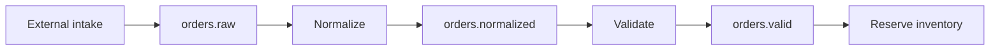
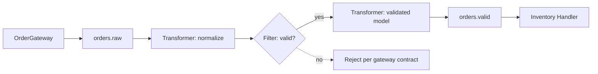
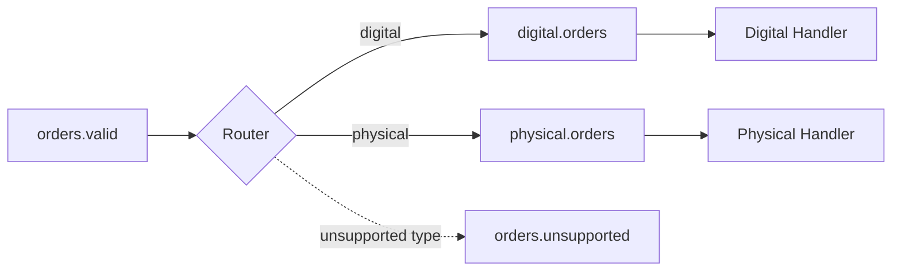
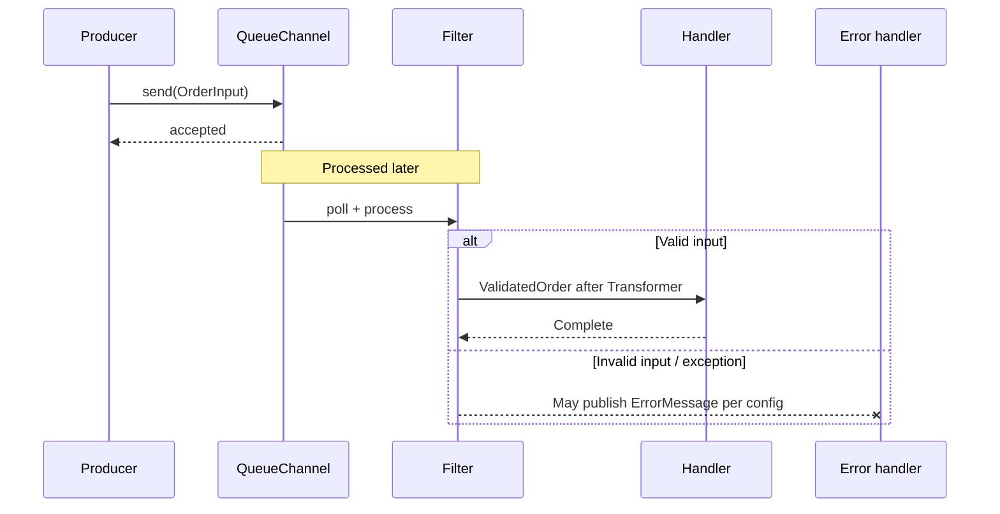

# Ensuring One Filter's Output Is Valid Input for the Next

In the **Pipes and Filters** model of Enterprise Integration Patterns (EIP), a system is divided into independent processing steps (*filters*) and the connections carrying messages between them (*pipes*). A filter receives input data, performs a defined responsibility, and passes the result to the next step. This composition is only reliable when **the message exiting the preceding step satisfies all input requirements of the subsequent step**.

In **Spring Integration**, a pipe is typically represented by a `MessageChannel`, while processing steps are implemented by endpoints such as `Filter`, `Transformer`, `Router`, `Splitter`, `Aggregator`, and `Service Activator`. A diagram wiring endpoints that runs without crashing is not necessarily safe: payloads can have the right Java type yet violate business rules, lack required headers, or lose correlation IDs across external systems.

This lesson belongs to the **Pipes and filters** chapter of the **SPRING_INTEGRATION_PATTERN** module, where you learn to build loosely coupled, extensible, and testable message flows. The goal of this lesson is to define **output/input contracts**, place validation and normalization properly, handle invalid messages transparently, and observe errors at each boundary.

After this lesson, you will know how to prove that a step only emits messages the next step can safely process; distinguish **filtering out messages** from **transforming messages**; and apply these principles in Spring Integration's Java DSL.

## 1. A Pipeline Is Only Correct When Contracts Match Across Connections

Suppose an order intake process has three steps:



The inventory reservation step cannot accept an arbitrary object that merely has `orderId` and `amount` fields. It may require:

- `orderId` must be present and not consist solely of whitespace.
- `amount` must be greater than 0.
- `currency` belongs to the supported set of currency codes.
- Formats are normalized; no extra whitespace or non-standard lowercase remains.
- Certain metadata, such as correlation IDs, must be present if downstream steps depend on them.

If the validation step only checks `amount != null` and sends the message to `orders.valid`, the channel name **cannot make the message valid**. Consumers can still receive negative amounts, orders missing IDs, or unsupported currencies.

Think of each step as a contract:

| Component | Precondition (input must satisfy) | Postcondition (output guaranteed) |
| --- | --- | --- |
| Normalize | Message carrying readable `OrderInput` | Returns `OrderInput` with strings normalized per rules |
| Validate | Normalized and matching expected structure | Passes through only data satisfying all required constraints |
| Convert to validated model | Input satisfies validation rules | Creates `ValidatedOrder` and enforces invariants in constructor |
| Reserve inventory | Receives `ValidatedOrder` with stable contract | Executes business logic or returns classified error |

**Pipeline composition rule:** the postcondition of the current step must satisfy the precondition of the next step. If one step only guarantees “has an `amount` field” while the next step requires “positive `amount`,” the pipeline has a contract gap.

Stated concisely: \(Q_i \Rightarrow P_{i+1}\), where \(Q_i\) is the output condition of step \(i\) and \(P_{i+1}\) is the input condition of the next step.

## 2. “Filter” in EIP Can Refer to Different Responsibilities

The term *filter* is sometimes used broadly for every step in a pipeline. However, in Spring Integration, **Message Filter** has a specific meaning: it decides **whether to let a message continue or reject/discard it** based on a predicate.

| Pattern / Endpoint | Function | What Gets Forwarded? |
| --- | --- | --- |
| **Filter** | Checks acceptance condition | Usually the received message if predicate is true; otherwise not sent to normal output |
| **Transformer** | Converts payload or message representation | Transformed payload/message |
| **Header Enricher** | Adds or computes headers | Message with supplemented metadata |
| **Router** | Selects one or more target channels | Message along selected branch(es), not necessarily one fixed output |
| **Splitter** | Splits one message into multiple parts | Multiple messages, each needing to satisfy the receiving branch's contract |
| **Aggregator** | Combines related messages | Aggregated message once group completion condition is met |

**Message Filter does not fix data errors on its own.** For example, the predicate `amount.signum() > 0` only accepts or rejects; it does not parse `"-10"` into `BigDecimal`, add currency, or construct a `ValidatedOrder` class.

To deliver data to downstream steps in a different structure, combine with a Transformer. To inform producers why a message was rejected, design an appropriate error path or business outcome. To route invalid messages to a separate handling system, use a discard channel or dedicated branch.

### Three Validation Levels to Distinguish

1. **Syntax and schema:** does JSON parse; does the payload have required types and fields; is the schema version compatible?
2. **Business semantics:** is the amount positive; is the status valid; is the currency accepted?
3. **Context and workflow:** is identity authenticated; is the event version still applicable; are required correlation/keys present; is the command a duplicate?

A simple Filter usually handles part of these checks well. Rules requiring databases, transactions, or authorization belong in responsible endpoints/handlers rather than hidden inside an ostensibly pure predicate.

## 3. Four Ways an Output Can Still Fail as Valid Input

### 3.1. Right Type, Wrong Value

`OrderInput("O-10", -100, "USD")` is a valid Java record instance, yet invalid for order placement. If a consumer relies solely on casting to `OrderInput`, the system can produce wrong side effects.

### 3.2. Inconsistently Normalized Data

Suppose a producer sends `currency = " usd "`. A Filter accepting only exact `"USD"` drops an otherwise valid order. Conversely, if the Filter lets arbitrary strings through and the handler assumes currency is always uppercase, two steps interpret the same field differently.

A good rule is **normalize first, validate second** whenever normalization preserves business meaning. For instance, trim leading/trailing whitespace and uppercase currency codes using `Locale.ROOT`. Never “fix” critical missing data by guessing values, such as silently replacing an empty currency with VND unless the contract specifies it.

### 3.3. Valid Payload, Missing Headers

An Aggregator may need a correlation key to group parts belonging to the same batch; a Router may pick branches using a `tenantId` header; tracing needs request correlation info.

A Filter inspecting only the payload does not prove the entire **message** is valid. Define clearly which headers are mandatory at each boundary, who creates them, and how they are preserved or mapped across Transformers, gateways, or external adapters.

### 3.4. Another Branch Still Sends Bad Data into a Shared Channel

Suppose `orders.valid` receives messages from a validated flow, while another flow sends an unchecked `OrderInput` straight into the same channel. Downstream consumers may encounter wrong types, bad schemas, or business violations.

A meaningful channel name is only an **architectural convention**. To enforce contracts, restrict channel producers, use output models that represent validity, and test all branches feeding that channel. For data from untrusted sources, consumers should re-verify essential invariants rather than blindly trusting a path name.

## 4. Spring Integration Java DSL Example: Normalize, Filter, and Convert Types

Let us build an order-processing pipeline:



In this example, invalid requests throw an exception per the Filter configuration, and the flow uses synchronous channels. The dashed line denotes **rejection**, not an `ErrorMessage` automatically sent to an error channel.

### 4.1. Two Data Types with Two Levels of Guarantees

The input allows unnormalized data. The output uses a record whose constructor enforces invariants.

```java
import java.math.BigDecimal;
import java.util.Locale;
import java.util.Set;

record OrderInput(String orderId, BigDecimal amount, String currency) {
    OrderInput normalized() {
        return new OrderInput(
            orderId == null ? null : orderId.trim(),
            amount,
            currency == null ? null
                : currency.trim().toUpperCase(Locale.ROOT)
        );
    }
}

final class OrderRules {
    private static final Set<String> SUPPORTED = Set.of("VND", "USD");

    private OrderRules() {}

    static boolean isValid(OrderInput input) {
        return input.orderId() != null
            && !input.orderId().isBlank()
            && input.amount() != null
            && input.amount().compareTo(BigDecimal.ZERO) > 0
            && SUPPORTED.contains(input.currency());
    }
}

record ValidatedOrder(
    String orderId, BigDecimal amount, String currency) {

    ValidatedOrder {
        if (!OrderRules.isValid(
                new OrderInput(orderId, amount, currency))) {
            throw new IllegalArgumentException(
                "ValidatedOrder contract violated");
        }
    }
}
```

`OrderInput` represents **potentially invalid input data**; `ValidatedOrder` represents data **satisfying invariants**. Even if another branch instantiates `ValidatedOrder`, its constructor rejects invalid values. This approach does not replace security, authorization, or stateful business checks; it protects the local constraints described in the record.

**Note on null:** the example permits `null` *fields* inside `OrderInput` so the Filter can reject them. Spring `Message<?>` generally cannot carry a `null` payload; handle empty inputs from adapters or sources before attempting to build a message.

### 4.2. Gateway and Integration Flow

```java
import org.springframework.context.annotation.Bean;
import org.springframework.context.annotation.Configuration;
import org.springframework.integration.annotation.Gateway;
import org.springframework.integration.annotation.IntegrationComponentScan;
import org.springframework.integration.annotation.MessagingGateway;
import org.springframework.integration.channel.DirectChannel;
import org.springframework.integration.config.EnableIntegration;
import org.springframework.integration.dsl.IntegrationFlow;
import org.springframework.messaging.MessageChannel;

interface InventoryService {
    void reserve(ValidatedOrder order);
}

@MessagingGateway
interface OrderGateway {
    @Gateway(requestChannel = "orders.raw")
    void submit(OrderInput request);
}

@Configuration
@EnableIntegration
@IntegrationComponentScan
class OrderPipelineConfig {

    @Bean("orders.raw")
    MessageChannel rawOrders() {
        return new DirectChannel();
    }

    @Bean("orders.valid")
    MessageChannel validOrders() {
        return new DirectChannel();
    }

    @Bean
    IntegrationFlow validateAndNormalize() {
        return IntegrationFlow.from("orders.raw")
            .transform(OrderInput.class, OrderInput::normalized)
            .filter(OrderInput.class, OrderRules::isValid,
                spec -> spec.throwExceptionOnRejection(true))
            .transform(OrderInput.class,
                input -> new ValidatedOrder(
                    input.orderId(), input.amount(), input.currency()))
            .channel("orders.valid")
            .get();
    }

    @Bean
    IntegrationFlow reserveInventory(InventoryService inventory) {
        return IntegrationFlow.from("orders.valid")
            .handle(ValidatedOrder.class, (order, headers) -> {
                inventory.reserve(order);
                return null; // terminal endpoint of one-way flow
            })
            .get();
    }
}
```

To use this, configure Spring Integration, include the gateway interface within `@IntegrationComponentScan` scope (or register equivalently), and provide an `InventoryService` bean. These classes assume Java 17+ for records and a matching Spring Integration version supporting the Java DSL.

### 4.3. Why Does This Ordering Matter?

**Step 1 — Normalize:** `" usd "` becomes `"USD"`; `" O-1 "` becomes `"O-1"`. The Transformer produces a normalized `OrderInput`, without yet claiming the whole payload is valid.

**Step 2 — Filter:** the predicate checks local conditions. Invalid messages are rejected with an exception due to `throwExceptionOnRejection(true)`. The Filter does not itself convert the payload to `ValidatedOrder` and keeps rejected messages off the normal output.

**Step 3 — Transformer:** only after the Filter accepts does the flow construct `ValidatedOrder`. The constructor re-checks invariants before the object is emitted. This data class clarifies the contract for consumers.

**Step 4 — Handoff:** `orders.valid` receives a message carrying `ValidatedOrder`. `InventoryService` receives the exact expected type. Because both channels are `DirectChannel`, callers normally wait until the handler finishes; handler exceptions can propagate back to the caller.

The actual runtime flow may connect through framework-created internal channels between steps inside one `IntegrationFlow`; we explicitly name only the two boundaries we want to observe.

### 4.4. Explicit Output Contracts

| Step | Expected Input | Output on Success | When Unsuccessful |
| --- | --- | --- | --- |
| Normalize | `OrderInput` | `OrderInput` with normalized strings | Conversion error if logic cannot handle input |
| Filter | Normalized `OrderInput` | **The original input message** passed through | `MessageRejectedException` per rejection config |
| Create validated model | Accepted `OrderInput` | Invariant-enforcing `ValidatedOrder` | Exception if invariants are violated |
| Inventory handler | `ValidatedOrder` | No reply payload emitted in example | Business/technical exception per implementation |

Do not claim “the Filter produces `ValidatedOrder`”: the new type appears only after the Transformer. Keeping this distinction straight prevents a common mistake when designing or reading Pipes and Filters diagrams.

## 5. Checking Each Pipe's Contract, Not Just Each Class

Even when each endpoint validates its own inputs, a pipeline can still break if **data semantics** differ across steps.

For example, a warehouse system expects `amount` to mean **item count**, whereas the previous step emits `amount` as **monetary total**. Both may use positive `BigDecimal` values, so predicates and type checks pass, yet the contract is completely broken.

Describe boundary contracts across these dimensions:

| Contract Dimension | What Must Be Agreed Upon |
| --- | --- |
| **Payload type/schema** | Which DTO or schema version is accepted? |
| **Field semantics** | Is `amount` a price or a quantity? Which unit of measure? |
| **Invariants** | Required conditions, value ranges, cross-field rules |
| **Headers** | Which correlation ID, message key, trace context, tenant ID are required? |
| **Cardinality** | Does one input produce 0, 1, or many outputs? |
| **Timing** | Does the result arrive immediately, later, or possibly never? |
| **Errors** | How are rejection criteria, exceptions, and business failures handled? |
| **Versioning** | Can older consumers still read new outputs? |

Write contracts so they are testable. For instance, “channel `orders.valid` only accepts `ValidatedOrder` with currency in VND/USD” is more concrete than “valid order.”

### Distinguishing Validation Layers

- **Before entering the flow:** check syntax, authentication, authorization, and schema version from HTTP/Kafka/JMS or other sources.
- **Inside the flow:** normalize and Filter rules close to the data that are deterministic enough to test cleanly.
- **Right before side effects:** verify conditions requiring current state or transactions, such as inventory counts, order status, and duplicate detection.

If state can change between the moment a Filter lets a message pass and the moment a handler writes to the database, the Filter cannot guarantee that state still holds at commit time. Enforce or re-check invariants at the appropriate transactional boundary.

## 6. Where Should Filtered-Out Messages Go?

A Message Filter can be configured in multiple ways. Which option fits depends on whether “failing the Filter” is a technical error, invalid data, or a normal business decision.

### 6.1. Throwing an Exception on Rejection

The `throwExceptionOnRejection(true)` setting above fits synchronous APIs that must reject invalid requests immediately. Callers can translate the exception into a validation response per the API contract.

In a `DirectChannel` flow, the exception usually propagates back up the call stack. **Merely declaring an error channel bean does not automatically turn this exception into an `ErrorMessage`.**

### 6.2. Sending Rejected Messages to a Discard Channel

For background data, you sometimes need to record non-qualifying messages for analysis or reconciliation:

```java
@Bean
IntegrationFlow filterToDiscard() {
    return IntegrationFlow.from("orders.raw")
        .transform(OrderInput.class, OrderInput::normalized)
        .filter(OrderInput.class, OrderRules::isValid,
            spec -> spec.discardChannel("orders.rejected"))
        .channel("orders.validatedRaw")
        .get();
}
```

This is a **separate illustrative variant**; do not register it concurrently with `validateAndNormalize()` on the same input channel in the sample app if each message should traverse only one pipeline. Provide appropriate channels/endpoints consuming `orders.rejected` and `orders.validatedRaw`. Messages entering `orders.validatedRaw` in this variant are still **`OrderInput`**, not yet `ValidatedOrder`; to feed the handler in Section 4, add a corresponding Transformer.

**A discard channel is not an error channel.** Discard receives messages rejected by a Filter, typically the original or normalized message; an error channel receives `ErrorMessage` instances published by an error-handling mechanism. A message rejected by a business rule can be normal behavior, not necessarily a failure needing retries.

### 6.3. Schema and Infrastructure Errors Should Not Retry Like Valid Data

Unparseable JSON is an input or protocol failure; it can be rejected, routed to a dedicated handling branch, or stored for investigation. Replaying the exact same schema-invalid payload will never magically make it valid.

Conversely, a timeout calling a warehouse service may be a transient failure suited to bounded retries. Retries must pair with error handling, backoff, and idempotent side effects; not every failure can be solved by re-sending messages repeatedly.

## 7. With Router, Splitter, and Aggregator, Contracts Must Be Checked per Branch

In a linear flow, you only inspect consecutive output/input pairs. In flows with branching and joining, inspect every edge of the graph.



### Router: Each Branch Has Its Own Preconditions

If the digital-goods handler requires `downloadLicense` while the physical-goods handler requires `shippingAddress`, an upstream Filter checking only `orderId` is not enough.

Two approaches:

1. Have the Filter enforce all shared invariants before the Router; after the Router, let each branch check branch-specific invariants.
2. Transform payloads into dedicated subtypes such as `DigitalOrder` and `PhysicalOrder`, letting each handler accept its exact type.

If the Router cannot find a matching branch, explicitly configure a default/unmapped channel or exception policy. Never let messages fall out of the flow without an observable status for investigation.

### Splitter: Valid Batch Input Can Still Yield Invalid Parts

A batch request contains three line items; a Splitter emits three messages. One of the three lines might lack an SKU. Checking that the batch is non-null **does not mean** every generated child satisfies the line-item handler's contract.

Validate at the batch level where appropriate and on each split child when invariants apply per item. When generating sequence/correlation metadata, verify downstream consumers receive enough data to correlate parts after asynchronous processing.

### Aggregator: An Aggregated Message Is Not Automatically Valid

An Aggregator only emits when its release strategy triggers; with timeouts or partial results, output may omit parts consumers expect. Output contracts must specify “complete” vs. “partial,” item count, correlation key, ordering, and error representation.

If consumers accept only complete sets of items, verify completion conditions before emitting to the output channel. Never treat “Aggregator emitted” as proof of a valid business result.

## 8. Headers and Correlation Are Also Part of Valid Output

In Spring Messaging, a message comprises **payload** and **headers**. A valid payload can become invalid input if downstream steps require a header that an earlier step omitted or an external adapter stripped away.

Example batch-item contract:

```text
Payload:
  PartResult(orderId="O-100", sku="SKU-1", success=true)

Headers:
  correlationId = "O-100"
  sequenceNumber = 1
  sequenceSize   = 3
```

These fields illustrate the contract needed for group assembly; **do not assume they always appear automatically** on every message. In Spring Integration, Splitter/Aggregator manage related metadata under specific configurations; verify your actual flow, especially when custom transformers, header mappers, or brokers sit in between.

Rules to follow:

- Agree on which business key or correlation ID links parts together.
- Explicitly define header enrichment and mapping at external system boundaries.
- Avoid assuming internal message IDs survive serializers or brokers unchanged.
- When tenant ID controls access permissions, validate the header from a trusted source rather than trusting client-supplied values.
- When tracing across threads or applications, test trace context propagation rather than only logging at the producer.

Message headers are technical/business metadata governed by contracts, not a security mechanism by themselves.

## 9. Designing in Synchronous vs. Asynchronous Environments

### 9.1. `DirectChannel`: Errors Can Return Immediately to the Caller

With `DirectChannel`, endpoints normally run on the sending thread. If a Filter throws an exception or a Transformer detects invalid data, the caller can receive the exception immediately.

This enables request–reply APIs to fail fast and simplifies testing. Still, if messages can be sent directly to a downstream channel or by a new producer, relying solely on an upstream Filter is insufficient: immutable records and side-effect boundary validation remain valuable.

### 9.2. `ExecutorChannel`/`QueueChannel`: Accepted Send Differs from Valid Processing

With `ExecutorChannel`, messages may run on another thread. With `QueueChannel`, messages may wait for a poller. When a producer receives a successful `send` result, downstream Filters may not have executed yet.



The diagram illustrates two points: on an asynchronous error path, there must be a **properly configured error publisher/error handling** for the error handler to receive failures. Not every Filter rejection automatically becomes an `ErrorMessage`.

From an API perspective, “accepted for processing” and “validated as valid” are distinct states. To confirm a command is valid before returning to the caller, perform required validation **before the asynchronous boundary**; state-dependent conditions still need verification when the consumer executes.

### 9.3. Crossing External Systems

A Java producer may emit a valid payload, yet an adapter might serialize the wrong version or a consumer might change schemas. Therefore:

- Document event/command schemas, versions, and required fields explicitly.
- Test serialization/deserialization and header mappings.
- Place contract checks at inbound adapters or the start of receiving flows.
- Define handling paths for schema mismatches, timeouts, and appropriate dead-lettering.
- Make consumers idempotent whenever brokers can redeliver messages.

Sharing a single DTO class between two services does not guarantee both share the same semantics after independent deployments.

## 10. Testing Strategy to Guarantee Input/Output Alignment

Do not test only isolated predicates. Verify behavior **at connection points** and the effects of failure paths.

### 10.1. Sample Test Matrix

| Case | Input | Expected Outcome |
| --- | --- | --- |
| Valid | `(" O-1 ", 120000, " vnd ")` | Normalized to `("O-1", 120000, "VND")`; reaches handler as `ValidatedOrder` |
| Missing ID | `(null, 120000, "VND")` | Rejected; `InventoryService` not called |
| Blank ID | `("   ", 120000, "VND")` | Rejected |
| Non-positive amount | `("O-2", 0, "VND")` | Rejected |
| Missing amount | `("O-3", null, "VND")` | Rejected before handler executes |
| Unsupported currency | `("O-4", 50, "XYZ")` | Rejected; reason recorded per policy |
| Producer bypasses Filter | Send invalid object directly to downstream channel | Handler / immutable model rejects contract violation |
| Handler times out | Already-valid message | Error classified separately from validation; bounded retry if appropriate |

For synchronous tests, invoke the gateway and verify a mock `InventoryService.reserve` receives the exact `ValidatedOrder` the expected number of times; for invalid data, assert the exception and confirm the handler was **not** invoked.

For queues/pollers or executors, wait conditionally within a bounded timeout. Tests should distinguish “message enqueued” from “handler executed,” and verify the error channel separately when configured.

### 10.2. Plain Java Contract Test Example

The following unit tests focus on normalization logic and invariants prior to running full-flow integration tests:

```java
import static org.junit.jupiter.api.Assertions.*;
import java.math.BigDecimal;
import org.junit.jupiter.api.Test;

class OrderContractTest {

    @Test
    void normalizedInputMeetsFilterContract() {
        OrderInput input = new OrderInput(
            " O-1 ", new BigDecimal("120000"), " vnd ");

        OrderInput normalized = input.normalized();

        assertEquals("O-1", normalized.orderId());
        assertEquals("VND", normalized.currency());
        assertTrue(OrderRules.isValid(normalized));
    }

    @Test
    void invalidAmountIsRejected() {
        OrderInput input = new OrderInput(
            "O-2", BigDecimal.ZERO, "VND");

        assertFalse(OrderRules.isValid(input.normalized()));
        assertThrows(IllegalArgumentException.class,
            () -> new ValidatedOrder(
                "O-2", BigDecimal.ZERO, "VND"));
    }
}
```

These tests verify the Java contract. They **do not prove** messages actually travel through the right channels, headers survive intact, or synchronous errors propagate to the gateway; those require integration tests.

### 10.3. Property-Based and Contract Tests as Branches Grow

For complex Transformers/Filters, supplement with property-based tests: generate boundary inputs and assert any output passing through always satisfies all `ValidatedOrder` invariants. With multi-branch Routers, give each branch its own contract test suite. For independently deployed consumers, producer–consumer schema compatibility tests catch contract drift early after version changes.

## 11. Observing Bad Data Without Polluting Error Channels

An operable pipeline needs visibility into how many messages were filtered out, failed transformation, and reached handlers successfully.

| Observation Point | What to Measure/Record | Why |
| --- | --- | --- |
| Inbound adapter | Parse/schema failures, source, version | Detects payloads violating ingress contracts |
| Normalize | Normalized message count, parse errors | Shows whether data converts to internal norms |
| Filter | Accepted/rejected counts, reason codes | Separates invalid data from infrastructure failures |
| Output-type Transformer | Model creation errors, output channel name | Ensures immutable records emit to the right destination |
| Consumer | Success/failure outcomes, business key | Verifies business results |
| Error/discard handling | Message count, retry count, final action | Prevents invalid messages from disappearing unseen |

A Filter with a boolean predicate only indicates pass or fail. If you need **reason codes** like `INVALID_AMOUNT` or `UNSUPPORTED_CURRENCY`, extract validation into a step returning structured outcomes or a dedicated component returning rich details; avoid cramming logging and side effects inside predicates.

For asynchronous rejections, maintain a **quarantine channel / dead-letter flow** to inspect messages and root causes. Retain failed payloads with care for personal data, retention limits, and safe replay. Use message IDs, correlation IDs, error codes, and safe metadata for reconciliation rather than logging sensitive full payloads.

## 12. Common Design Mistakes

**“The Filter already ran, so the output definitely matches the contract.”** A Filter only enforces its written predicate, not necessarily every precondition of downstream consumers. List invariants explicitly and verify at connection points.

**“The Filter will convert the string into a valid object.”** A Message Filter typically forwards the accepted message unchanged; payload conversion belongs to a Transformer.

**“The channel name `orders.valid` is proof enough.”** Nothing automatically stops another producer from sending an unvalidated object to that channel. Use immutable models, channel ownership rules, and multi-branch tests.

**“Just retry invalid data.”** Unparseable payloads or deterministic rule violations need rejection or investigation; reserve retries for transient failures under explicit policies.

**“Every rejected message is an ErrorMessage.”** Discard channels receive Filter-rejected messages; error channels receive failures published by error publishers. Their semantics differ.

**“Checking Java types alone is sufficient.”** Two payloads of the same Java type can differ in units, currency, field semantics, or version. Check schema and semantic contracts.

**“We validated before the queue, so the database write is safe.”** State-dependent conditions can change in flight; enforce transactions and business invariants right where side effects occur.

**“If each Splitter item is valid, the Aggregator will always succeed.”** Splitters can emit items with varying contracts, and Aggregators can emit partial results. Verify every edge and group release condition.

## 13. Self-Design Exercise

A system ingests a CSV file of orders where each row has `orderId`, `sku`, `quantity`, and `warehouseCode`. After reading the file, a Splitter splits each row and sends it to a Router selecting the warehouse. Each warehouse handler requires a valid SKU, positive quantity, and a `warehouseCode` belonging to that warehouse.

Design the flow with these boundaries:

```text
CSV Inbound
  -> Parse / Schema Validation
  -> Splitter
  -> Normalize each row
  -> Filter / Validate each row
  -> Router by warehouseCode
  -> Warehouse-specific Handler
  -> Result / Error / Rejected reporting
```

Answer for yourself:

1. Which rules apply at the file level, and which are mandatory for **each row** after the Splitter?
2. If `quantity = -3`, does the message go to normal output, a discard channel, or throw an exception? How is the caller notified?
3. If `warehouseCode` does not exist, is that invalid data or an unconfigured Router branch? How is the reason recorded?
4. If the Router has three targets, how do you guarantee the input contract of all three handlers?
5. If warehouse persistence moves behind an asynchronous queue, when can a row be declared “successfully processed”?
6. If an Aggregator must report whole-file results, how do you link rows via correlation ID and handle failed or rejected rows?
7. Which tests prove no invalid row ever gets written to a warehouse, even if a new producer sends directly to a channel?

A strong solution specifies **the contract at every pipe**, each endpoint's responsibility, and the state of rejected messages—not just connected boxes.

## Key Takeaways

To ensure **one filter's output is valid input for the next**, explicitly define **preconditions and postconditions** for every step; normalize before validating when appropriate; pass only messages satisfying invariants; use Transformers and invariant-enforcing models when changing representations; and test every connection from channels through consumers.

In Spring Integration, **Filters decide acceptance or rejection**, whereas **Transformers create new output data**. With Routers, Splitters, and Aggregators, verify contracts per branch or item. Rejection paths, error channels, retries, and correlation all require distinct roles and explicit policies. Only then does Pipes and Filters genuinely reduce coupling while keeping data flows accurate, observable, and safe to evolve.
