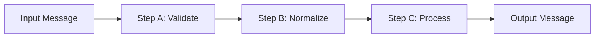
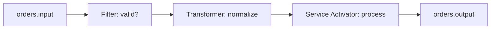
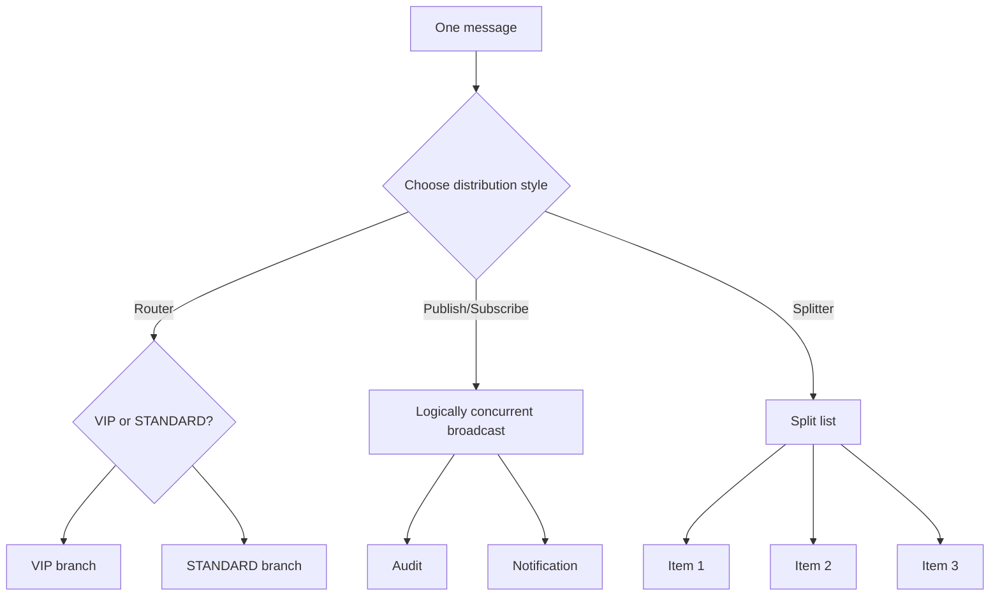
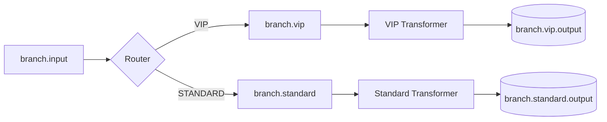
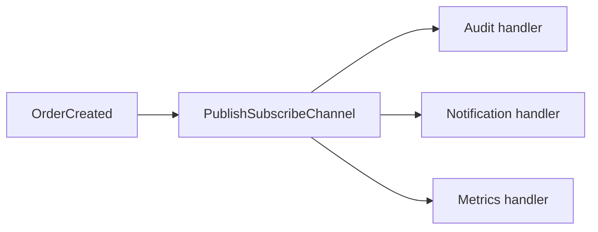
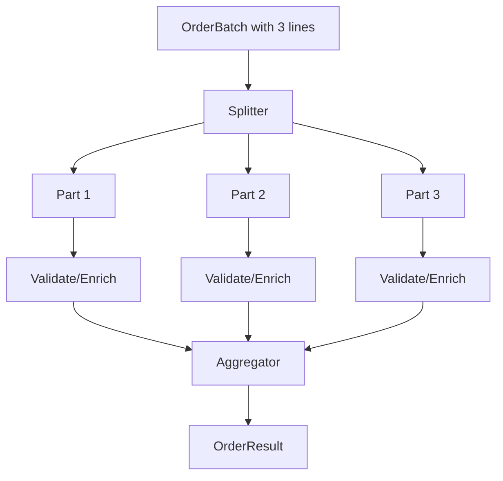
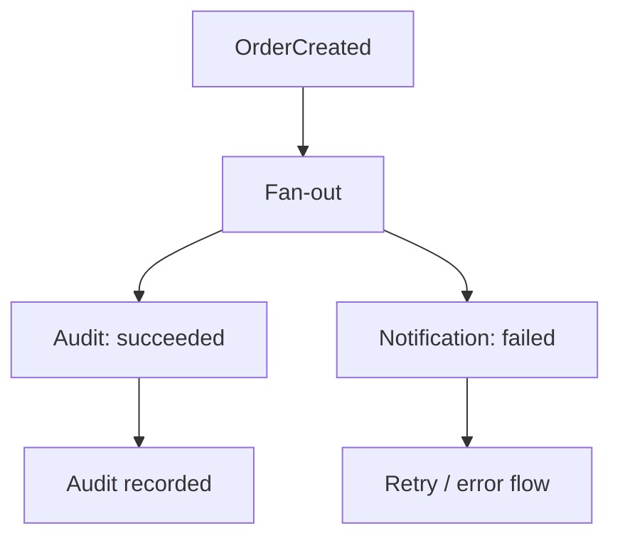

# Linear Flows and Multi-Branch Flows in Spring Integration

## Lesson Objectives

**Pipes and Filters** is an architectural pattern that composes independent processing steps (*filters*) with data transport channels (*pipes*). In Spring Integration, filters in the architectural sense can be Transformers, Filters, Routers, Service Activators, or other endpoints; capitalized **`Filter`** is also the name of a specific endpoint used to admit or drop messages.

This lesson belongs to the **SPRING_INTEGRATION_PATTERN** module: learning to implement Enterprise Integration Patterns to build loosely coupled, extensible message flows; practicing Router, Filter, Transformer, Splitter, Aggregator, Gateway, retry, error channels, and correlation; and testing and monitoring processing branches.

The focus here is on two organizational styles:

1. **Linear flow**: a message passes through a fixed sequence of steps.
2. **Multi-branch flow**: a message is routed to a branch based on a condition, broadcast to multiple receivers, or split into independent parts and then reassembled.

After this lesson, you will know when to use each style, how to wire them with the Java DSL, and which tests are needed to prevent dropped messages, duplicate side effects, or waiting forever for results.

## 1. The Pipes and Filters Model

A *pipe* carries a message from one step to the next. A *filter* in the architectural sense receives a message, performs a clear task, and may emit a message downstream. Steps stay independent through a message contract: **payload, headers, data types, and result semantics**.



Example in order processing:

```text
OrderRequest
    |
    v
Validate ──> Normalize ──> Enrich ──> Persist ──> Publish result
```

Steps can run inside one process, across multiple threads, or over a broker, yet a flow diagram on paper **does not by itself guarantee** execution ordering, a shared transaction, or exactly-once processing. Those properties depend on channel configuration, handlers, and retry mechanisms.

### Three Core Components in Spring Integration

| Component | Examples | Role |
| --- | --- | --- |
| **Message** | `Message<OrderRequest>` | Carries payload and headers such as `traceId`, `tenantId`, `correlationId` |
| **Channel** | `DirectChannel`, `QueueChannel`, `ExecutorChannel`, `PublishSubscribeChannel` | Connects endpoints and governs how messages are transmitted/dispatched |
| **Endpoint** | Transformer, Filter, Router, Service Activator, Splitter, Aggregator | Processes, transforms types, blocks, routes, or combines messages |

An `IntegrationFlow` describes a chain linking these components. You can split a long flow into multiple subflows via named channels so each part has a clear responsibility and test surface.

## 2. Linear Flow: A Single Main Processing Path

A **linear flow** has a fixed logical order: the output of one step feeds into the next.



Suppose the system receives order-code strings:

- Blank strings are dropped.
- Valid strings are trimmed and uppercased.
- Processed messages are sent to an output channel.

In the following example, we use a `QueueChannel` as the output so we can read messages and test without needing a background worker.

```java
import java.util.Locale;

import org.springframework.context.annotation.Bean;
import org.springframework.context.annotation.Configuration;
import org.springframework.integration.channel.DirectChannel;
import org.springframework.integration.channel.QueueChannel;
import org.springframework.integration.config.EnableIntegration;
import org.springframework.integration.dsl.IntegrationFlow;
import org.springframework.messaging.MessageChannel;
import org.springframework.messaging.PollableChannel;

@Configuration
@EnableIntegration
public class LinearFlowConfig {

    @Bean("linear.input")
    MessageChannel linearInput() {
        return new DirectChannel();
    }

    @Bean("linear.output")
    PollableChannel linearOutput() {
        return new QueueChannel();
    }

    @Bean
    IntegrationFlow linearFlow() {
        return IntegrationFlow.from("linear.input")
            .filter(String.class, value -> !value.isBlank())
            .transform(String.class, String::trim)
            .transform(String.class, value ->
                value.toUpperCase(Locale.ROOT))
            .channel("linear.output")
            .get();
    }
}
```

In this configuration:

1. `DirectChannel` delivers messages to flow handlers along a normal synchronous call path.
2. `filter` drops empty/blank strings; there is no reply for rejected messages.
3. Two `transform` steps convert the payload sequentially and normally propagate eligible headers to the output message.
4. `QueueChannel` holds output messages for an active consumer to retrieve via `receive()`.

`String::trim` and `String::toUpperCase` change the payload without changing the business meaning of the `traceId` header. Still, if a handler builds a `Message<?>` manually or the flow crosses a protocol adapter, verify that step's header-propagation policy.

### Logical Order and Completion Order Are Two Different Things

When consecutive steps are connected via `DirectChannel` and run synchronously, a single message traverses steps in declared order. However, if you replace a segment with an `ExecutorChannel`, switch to a queue with multiple consumers, or send messages through a broker, different requests can execute concurrently and **finish out of arrival order**.

Thus, the accurate statement is: *a linear flow describes the logical processing sequence of each message as long as it continues downstream*, not a guarantee that all messages across the system finish in global FIFO order.

### Filter Does Not Mean “Return an Error on Failure”

In the DSL above, when the Filter evaluates to `false`, the message stops by default. If the caller needs to know why, configure a `discardChannel`, or use an exception/reply mechanism per your contract. With a request-reply Gateway, dropping a message without a reply can lead to a timeout. Design an explicit rejection path whenever business logic requires confirmation.

## 3. Multi-Branch Flows: Three Patterns to Distinguish

Not every diagram with two arrows means the same thing. There are at least three common branching patterns.

| Style | Rule | Matching Pattern / Channels | Example |
| --- | --- | --- | --- |
| **Select one branch** | One message goes to one of the valid branches | `Router`, one target channel per key | VIP goes to fast track, STANDARD goes to regular track |
| **Broadcast to multiple branches** | One message goes to multiple processors | `PublishSubscribeChannel` or recipient-list router | One order event is processed by both audit and notification |
| **Split one message into parts** | One payload decomposes into multiple child messages | `Splitter`, optionally followed by `Aggregator` | Order split into line items for inventory checks |



**Branch selection**, **fan-out**, and **splitting** have different contracts for message counts, replies, and error handling. Picking the wrong one often causes duplicate data updates or dropped business branches.

## 4. Router: Choosing VIP or STANDARD Branch

Suppose messages contain strings:

```text
VIP:ORD-42
STANDARD:ORD-43
```

We want to route each message to exactly **one** branch and let that branch process it independently. Use two named channels and three `IntegrationFlow` beans:



### Java DSL Configuration

```java
import org.springframework.context.annotation.Bean;
import org.springframework.context.annotation.Configuration;
import org.springframework.integration.channel.DirectChannel;
import org.springframework.integration.channel.QueueChannel;
import org.springframework.integration.config.EnableIntegration;
import org.springframework.integration.dsl.IntegrationFlow;
import org.springframework.messaging.MessageChannel;
import org.springframework.messaging.PollableChannel;

@Configuration
@EnableIntegration
public class BranchedFlowConfig {

    @Bean("branch.input")
    MessageChannel input() {
        return new DirectChannel();
    }

    @Bean("branch.vip")
    MessageChannel vipChannel() {
        return new DirectChannel();
    }

    @Bean("branch.standard")
    MessageChannel standardChannel() {
        return new DirectChannel();
    }

    @Bean("branch.vip.output")
    PollableChannel vipOutput() {
        return new QueueChannel();
    }

    @Bean("branch.standard.output")
    PollableChannel standardOutput() {
        return new QueueChannel();
    }

    @Bean
    IntegrationFlow routeOrders() {
        return IntegrationFlow.from("branch.input")
            .filter(String.class, value -> !value.isBlank())
            .route(String.class,
                value -> value.startsWith("VIP:") ? "VIP" : "STANDARD",
                router -> router
                    .channelMapping("VIP", "branch.vip")
                    .channelMapping("STANDARD", "branch.standard"))
            .get();
    }

    @Bean
    IntegrationFlow processVip() {
        return IntegrationFlow.from("branch.vip")
            .transform(String.class, value ->
                "FAST|" + value.substring(4).trim())
            .channel("branch.vip.output")
            .get();
    }

    @Bean
    IntegrationFlow processStandard() {
        return IntegrationFlow.from("branch.standard")
            .transform(String.class, value ->
                "NORMAL|" + value.trim())
            .channel("branch.standard.output")
            .get();
    }
}
```

For `VIP:ORD-42`, the Router returns the key `VIP`, so the message enters `branch.vip`. Assuming no errors, the payload becomes `FAST|ORD-42` on `branch.vip.output`. The STANDARD branch never receives that message. For `STANDARD:ORD-43`, the Router returns `STANDARD`, producing `NORMAL|STANDARD:ORD-43`.

In real applications, treating any string without a `VIP:` prefix as STANDARD can be overly permissive. Use a validated DTO such as `OrderRequest(orderId, serviceClass)`, and reject invalid service classes **before the Router**. The string example above simply illustrates the routing mechanics.

### Headers Flowing Through a Router

A Router **selects target channels** based on payload or headers. It does not need to modify the payload to route. Headers like `traceId`, `tenantId`, and `correlationId` should continue to whichever branch needs them per the application's contract.

You can route by header instead of payload, such as by `orderType` or `region`. Before trusting a header from HTTP/Kafka, validate and normalize the value. When a route key has no mapping, configure the behavior explicitly: require valid routes and fail fast, or send to a monitored default channel. Never let unrecognized data accidentally enter a critical business branch.

### How Router Differs from Filter

- `Filter` decides **whether a message proceeds or is blocked**.
- `Router` decides **which channel a message goes to**.
- You can place a Filter before a Router to drop malformed messages, then let the Router classify the remaining messages.
- If invalid branches must be captured for investigation, add explicit error/discard handling.

## 5. Publish/Subscribe: One Event to Multiple Consumers

In many workflows, one event must reach **multiple** components: after creating an order, the system records an audit log, sends a notification, and updates a dashboard.



This differs from a single-branch Router: **each eligible subscriber** can receive a delivery of the event, depending on error policies and channel configuration.

### Configuration Example

```java
@Bean("orders.events")
MessageChannel eventChannel() {
    return new PublishSubscribeChannel();
}

@Bean
IntegrationFlow auditFlow() {
    return IntegrationFlow.from("orders.events")
        .handle(String.class, (payload, headers) -> {
            auditService.record(payload);
            return null;
        })
        .get();
}

@Bean
IntegrationFlow notificationFlow() {
    return IntegrationFlow.from("orders.events")
        .handle(String.class, (payload, headers) -> {
            notificationService.notifyOrder(payload);
            return null;
        })
        .get();
}
```

This snippet is an **excerpt pattern** meant to sit inside a configuration class annotated with `@Configuration` and `@EnableIntegration`, importing `PublishSubscribeChannel` from `org.springframework.integration.channel` with suitable `auditService` and `notificationService` beans. Both flows subscribe to `orders.events`. Handlers return `null` because these side-effecting branches produce no reply to forward.

Design details to clarify explicitly:

- `PublishSubscribeChannel` can dispatch synchronously by default. When configured with an executor, ordering and error behaviors differ.
- **Do not assume** every subscriber always completes, or completes in registration order, across every configuration.
- If one subscriber throws an exception, that failure can affect dispatching to other subscribers depending on configuration. To isolate failures, split branches through queues or brokers with independent retry policies.
- Broadcasting the same message to multiple destinations **is not a Splitter**: each subscriber typically receives the full event payload, not one element from a collection.
- If multiple subscribers update the same resource, design idempotency and transactions to prevent inconsistent state.

**Do not use fan-out to replace a workflow requiring a conditional join** without correlation and a proper join mechanism. Two independent side-effect branches may not need joining; two branches required to produce one combined result must have an explicit convergence step.

## 6. Recipient-List Router: Selective Multi-Destination Dispatch

Sometimes a message must go **simultaneously to a subset of branches determined by conditions**: every event goes to audit, while only critical events go to alerting. A recipient-list router selects target recipients dynamically based on conditions.

```text
OrderEvent
   |
   v
Recipient-list Router
   +----> audit (all events)
   |
   +----> alert (if severity = HIGH)
   |
   +----> reporting (if analytics needed)
```

Distinguish this from a standard single-key Router: a recipient list can have **multiple destinations**. When multiple branches receive messages with identical content, clarify whether branches are read-only or side-effecting, and whether a failure in one branch should fail the entire event.

A DSL example typically uses `.routeToRecipients(...)` with conditional `recipient(...)` or `recipientFlow(...)` specs; verify exact method names and overloads against your project's Spring Integration version. The key test contract is: a HIGH event reaches **both** audit and alert, whereas a NORMAL event reaches only audit if that is the stated rule.

## 7. Splitter and Aggregator: Many Parts, Then Convergence

When input is a list of line items, a Splitter turns **one message** into **many child messages**, each traversing its own processing path. When a unified outcome is needed, place an Aggregator at the end.



Conditions for accurate convergence:

1. **Correlation strategy**: identifies child messages belonging to the same group, e.g., via `correlationId` header or a business key.
2. **Release strategy**: defines when enough parts exist to emit the result; can rely on `sequenceSize` when expected count is known accurately.
3. **Message group store**: holds parts waiting for one another; requires timeouts, cleanup, and policies for late arrivals.
4. **Duplicate handling**: under retries or broker redeliveries, the same part may arrive more than once.
5. **Ordering**: if results require original order, use `sequenceNumber` or an explicit sort key.

### Common Pitfall: Placing a Filter After a Splitter

```text
Splitter creates 3 parts (sequenceSize=3)
   +-- part 1 ----------> Aggregator
   +-- part 2 --X Filter
   +-- part 3 ----------> Aggregator

Aggregator receives only 2/3, and may wait forever if releasing by full count.
```

Solutions depend on business logic: filter before splitting, convert filtered-out parts into a `SKIPPED` status outcome, or write a release strategy with timeouts that accepts partial results. Do not arbitrarily decrement `sequenceSize` by rewriting a header ad hoc: the expected-item calculation must stay consistent across the entire group.

### Joining Does Not Happen Automatically by Pointing Two Arrows at One Channel

If two Router or Publish/Subscribe branches send messages to the same channel, the target channel **receives two independent messages**—it does not merge their payloads. To combine them into one result, use an Aggregator or explicit join logic. If branches only perform side effects, no join may be needed; in that case, handle any Gateway reply contract separately.

## 8. Designing Message Contracts Between Steps

Linear flows are easy to describe as a chain of data types:

```text
OrderRequest -> ValidatedOrder -> EnrichedOrder -> OrderResult
```

Multi-branch flows can have different intermediate types:

```text
OrderRequest
   |
   +-- DIGITAL -> DigitalFulfillmentResult
   |
   +-- PHYSICAL -> WarehouseResult
   |
   v
UnifiedOrderResult
```

To reconnect branches cleanly:

- Use a DTO or sealed interface matching the allowed set of outcomes.
- If a common convergence point is needed, normalize outputs to `PartResult`/`OrderResult` before that point.
- Define minimal headers: `traceId` for tracing, `tenantId` for data scope, `orderId` for business identity, and `correlationId` for message groups when needed.
- Never use Spring `Message`'s internal `id` as a business key across steps that may construct new messages.
- Across HTTP/Kafka/AMQP/JMS, verify header mappers, serializers, type limits, and allowlisted headers.

### When Should You Split into Multiple `IntegrationFlow` Beans?

A single long flow becomes hard to test when branching proliferates:

```text
Inbound -> Filter -> Transform -> Router
                               +-> VIP Channel -> VIP Flow
                               +-> Regular Channel -> Regular Flow
```

Splitting flows at **named channels** gives each branch an explicit contract and lets you later swap a synchronous channel for a queue or broker. Still, splitting into separate flows does not automatically make execution asynchronous; thread or process handoffs are determined by channel and adapter types.

## 9. Choosing Channels: Logical Topology Differs from Execution Mechanics

The exact same architectural diagram behaves differently when backed by different channels.

| Channel | Delivery Mechanics | Impact on Flow |
| --- | --- | --- |
| `DirectChannel` | Synchronous dispatch on caller thread in typical usage | Clear call stack, exceptions propagate back; no buffering queue |
| `ExecutorChannel` | Hands dispatch off to an executor | Thread switch; completion order and transaction context may change |
| `QueueChannel` | Buffers messages waiting for `receive()`/poller | Provides buffering, capacity, and backpressure; requires active consumer |
| `PriorityChannel` | Dequeues buffered messages by priority | Dequeue order differs from arrival order; starvation possible |
| `PublishSubscribeChannel` | Broadcasts to multiple subscribers | Per-subscriber fan-out; exception/executor policy is critical |
| Broker adapter | Transfers messages across processes/services | Requires serialization, header mapping, retries, redelivery, idempotency |

**There is no rule that “linear flow = synchronous” or “multi-branch flow = parallel.”** These are two independent design axes: topology describes **the path**, while channels/executors/brokers describe **execution mechanics**.

### Degree of Sequentiality Inside a Flow

Consider a linear flow with an `ExecutorChannel` before an expensive handler:

```text
Input -> Validate -> ExecutorChannel -> Enrich -> Persist
```

Validate remains the first logical step, yet two closely arriving messages can run concurrently after `ExecutorChannel`. If updates for one order must execute strictly in sequence, add per-`orderId` ordering or constrain concurrency accordingly.

### Backpressure Across Multiple Branches

An audit branch may be fast while an email-sending branch is slow. With synchronous fan-out, the slow branch slows down the sender. With separate queues per branch, configure capacities, timeouts, retries, and queue-depth monitoring.

Do not look only at aggregate throughput. Monitor **each branch** to spot bottlenecks before one branch drags down the others.

## 10. Errors, Retries, and Transactions Across Topologies

### Linear Flows and Synchronous Failures

With `DirectChannel` and synchronous handlers, unhandled exceptions typically propagate back to the caller. An earlier handler that already wrote data may leave side effects behind even if a later step fails. True all-or-nothing behavior requires an actual transaction spanning those operations and resources; simply chaining endpoints does not create a transaction automatically.

### Multi-Branch Flows and Partial Failures



Suppose audit succeeds while notification fails. Retrying the entire event could re-run audit. Therefore:

1. Assign a stable **idempotency key** for side effects, e.g., `eventId + handlerName`.
2. Scope retries to the right level (message, branch, or handler); per-branch retries isolate failures better.
3. Use `errorChannel` or an appropriate error flow for failures at asynchronous boundaries; on synchronous paths, callers may need to catch exceptions directly.
4. Consider an outbox or message broker when reliable event publishing after database updates is required.
5. Track per-branch status if overall completion is a business requirement.

### Filters and Routers Can Create “Dead Ends”

If a Filter drops a message, a Router finds no matching route, or a handler returns `null` leaving no reply, the flow stops there. This may be intentional for one-way events, yet for a synchronous Gateway waiting on `OrderResult`, it causes a timeout.

Before using a Gateway, answer: **does every permitted branch produce a valid reply?** If multiple replies are possible, which one does the caller receive? Use an Aggregator or explicit selection contract rather than letting timing decide.

## 11. Testing Linear and Multi-Branch Flows

Topology tests should verify **content**, **path**, **copy count**, and **headers**. The examples below use the configurations from Sections 2 and 4; each configuration is self-contained and can load in its own test context.

### Testing a Linear Flow

```java
import static org.assertj.core.api.Assertions.assertThat;

import org.junit.jupiter.api.Test;
import org.springframework.beans.factory.annotation.Autowired;
import org.springframework.beans.factory.annotation.Qualifier;
import org.springframework.messaging.Message;
import org.springframework.messaging.MessageChannel;
import org.springframework.messaging.PollableChannel;
import org.springframework.messaging.support.MessageBuilder;
import org.springframework.test.context.junit.jupiter.SpringJUnitConfig;

@SpringJUnitConfig(LinearFlowConfig.class)
class LinearFlowTest {

    @Autowired
    @Qualifier("linear.input")
    MessageChannel input;

    @Autowired
    @Qualifier("linear.output")
    PollableChannel output;

    @Test
    void preservesTraceAndTransformsPayload() {
        Message<String> request =
            MessageBuilder.withPayload("  ord-42  ")
                .setHeader("traceId", "trace-42")
                .build();

        assertThat(input.send(request)).isTrue();

        Message<?> result = output.receive(2_000);
        assertThat(result).isNotNull();
        assertThat(result.getPayload()).isEqualTo("ORD-42");
        assertThat(result.getHeaders().get("traceId"))
            .isEqualTo("trace-42");

        assertThat(output.receive(0)).isNull();
    }
}
```

This test confirms a message traverses the Filter and both Transformers while retaining the tracing header. Do not assert that message `id` stays unchanged: Spring may construct new messages during transformation.

### Testing That a Router Selects Only One Branch

```java
import static org.assertj.core.api.Assertions.assertThat;

import org.junit.jupiter.api.Test;
import org.springframework.beans.factory.annotation.Autowired;
import org.springframework.beans.factory.annotation.Qualifier;
import org.springframework.messaging.Message;
import org.springframework.messaging.MessageChannel;
import org.springframework.messaging.PollableChannel;
import org.springframework.messaging.support.MessageBuilder;
import org.springframework.test.context.junit.jupiter.SpringJUnitConfig;

@SpringJUnitConfig(BranchedFlowConfig.class)
class BranchedFlowTest {

    @Autowired
    @Qualifier("branch.input")
    MessageChannel input;

    @Autowired
    @Qualifier("branch.vip.output")
    PollableChannel vipOutput;

    @Autowired
    @Qualifier("branch.standard.output")
    PollableChannel standardOutput;

    @Test
    void vipOrderOnlyGoesToVipBranch() {
        assertThat(input.send(
            MessageBuilder.withPayload("VIP:ORD-42")
                .setHeader("traceId", "trace-42")
                .build()
        )).isTrue();

        Message<?> vip = vipOutput.receive(2_000);
        assertThat(vip).isNotNull();
        assertThat(vip.getPayload()).isEqualTo("FAST|ORD-42");
        assertThat(vip.getHeaders().get("traceId")).isEqualTo("trace-42");
        assertThat(standardOutput.receive(0)).isNull();
    }

    @Test
    void standardOrderOnlyGoesToStandardBranch() {
        assertThat(input.send(
            MessageBuilder.withPayload("STANDARD:ORD-43").build()
        )).isTrue();

        Message<?> standard = standardOutput.receive(2_000);
        assertThat(standard).isNotNull();
        assertThat(standard.getPayload())
            .isEqualTo("NORMAL|STANDARD:ORD-43");
        assertThat(vipOutput.receive(0)).isNull();
    }
}
```

Both tests run flows using `DirectChannel` and `QueueChannel`; because branches complete synchronously before enqueuing output, checking the other queue is empty is meaningful. In systems with asynchronous threads or brokers, **calling `receive(0)` once cannot prove the other branch will never receive a message**. In those cases, test with proper event/ack assertions and observation windows.

### Tests for Fan-Out, Splitter, and Aggregator

| Topology | Minimum Assertions | Hard Edge Cases |
| --- | --- | --- |
| Single-branch Router | Reaches target channel, absent from wrong branches | Unmapped route or invalid header |
| Fan-out | All intended subscribers receive `eventId`; each fulfills its contract | One subscriber fails; retries risk duplicates |
| Splitter | Child message count, payloads, `correlationId`, `sequenceNumber` | Empty list, malformed item, large batch |
| Aggregator | Groups by correlation and releases strictly per rule | Missing part, late arrival, duplicate |
| Multi-branch Gateway | Valid reply within contract timeout | Branch yields no reply, multiple replies, async failure |

A thorough test suite covers both the **expected** topology and **failure paths**. Testing only the happy path misses the trickiest hazard of multi-branch flows: **partial success**.

## 12. Observing Branches and Diagnosing Failures

A multi-branch flow must be able to answer: which branch did a message take, where is it waiting, why was it dropped, and how many times has it retried?

Information worth carrying or recording:

- **Business ID:** `orderId`, `eventId`, `partId`, operation name.
- **Trace context:** `traceId` to stitch logs across endpoints and services.
- **Correlation:** `correlationId` when child messages belong to a group.
- **Branch name:** `vip`, `standard`, `audit`, `notification` in logs/metrics for clarity.
- **State:** received, filtered, routed, processing, succeeded, failed, retried, timed out.
- **Timing:** per-handler latency, queue depth, Aggregator group age.

Example useful log lines:

```text
traceId=trace-42 orderId=ORD-42 branch=vip
event=routed target=branch.vip

traceId=trace-42 orderId=ORD-42 branch=vip
event=processing_completed durationMs=37
```

Illustrative application-defined metric names:

| Metric | Question Answered |
| --- | --- |
| `flow_messages_in_total` | How many messages entered the topology? |
| `flow_messages_filtered_total` | How many messages were dropped at Filters? |
| `flow_messages_routed_total{branch}` | How are messages distributed across branches? |
| `flow_handler_latency{branch}` | Which branch is slowing down? |
| `flow_handler_errors_total{branch}` | Where are errors concentrating? |
| `flow_queue_depth{channel}` | Are queues accumulating backlogs? |
| `flow_aggregation_pending_groups` | How many groups are awaiting completion? |

These names are **metric naming examples**, not claims that Spring Integration emits all of them automatically under these exact names. Combine Micrometer, Spring Integration management/observation, and structured logging per project setup.

Never unconditionally log entire headers or payloads: they may carry tokens, personal data, internal objects, or content violating log retention policies.

## 13. Choosing the Right Architecture for Each Requirement

| Requirement | Suggested Choice | Why |
| --- | --- | --- |
| Validate → normalize → process sequentially | Linear flow with `DirectChannel` | Simple path, easy to debug and test |
| Pick branch by service tier | `Router` | One message goes to its exact business branch |
| Send one event to audit and notification | Publish/Subscribe or recipient-list router | Fan-out per subscriber or condition |
| Process independent parts of a batch | `Splitter` | Each item becomes an individual message |
| Combine results from multiple parts | `Splitter` + `Aggregator` | Explicit correlation and release rules |
| Slow branch blocks producers | Queues/executors/brokers with bounded capacity and retries | Decouples pace and controls backpressure |
| Strict per-`orderId` ordering | Key-partitioned channels/consumers or custom coordination | Neither Routers nor linear diagrams guarantee ordering under concurrency |
| Reply required for synchronous Gateway | Reply-producing routes or `Aggregator` | Gives callers an explicit reply contract |

Do not introduce branches just to split a function into fragments. Branches should reflect **routing decisions, independent responsibilities, or practical workload distribution**.

## 14. Common Mistakes

| Symptom | Root Cause to Check | Fix |
| --- | --- | --- |
| Message never appears at output | Dropped by Filter, unmapped Router key, or handler returned `null` | Check discard/default routes and reply contracts |
| Event reaches only one of two consumers | Using `DirectChannel` with multiple subscribers instead of pub-sub; dispatcher unicasts | Use `PublishSubscribeChannel` when broadcasting to all subscribers |
| Event executes twice | Two fan-out branches write to the same resource, or retries/redeliveries | Separate responsibilities and add per-handler/event idempotency |
| Slow branch stalls all ingress | Synchronous dispatch to a slow subscriber | Isolate with monitored queues, executors, or brokers |
| Gateway times out for certain requests | One branch emits no reply, or Aggregator awaits missing parts | Add explicit reply/error contracts and timeouts |
| Wrong payload type at join | Two branches emit different DTOs while downstream expects one | Normalize outputs or define a union type |
| Trace lost across thread hops | Relying on MDC/`ThreadLocal` without context propagation | Carry keys in headers and configure trace propagation |
| Unstable completion order | Executors, multiple consumers, or brokers | Design per-business-key ordering if required |
| Aggregator hangs after Filter | `sequenceSize` expects more messages than arrive | Filter before splitting, emit `SKIPPED` items, or adjust release strategy |

## 15. Practice Exercises

### Exercise 1 — Linear Flow

Build a pipeline `String -> Filter -> trim -> uppercase -> QueueChannel`. Send `"  ord-1  "`, `" "`, and `"ord-2"`. Verify only two payloads are emitted and each valid message retains its `traceId` header.

### Exercise 2 — Single-Branch Selection

Extend `BranchedFlowConfig` so the Router picks `VIP`, `STANDARD`, and `REVIEW` from a validated DTO. Add a `REVIEW` branch for manual order inspection. Test unrecognized order types as well.

### Exercise 3 — Fan-Out

Publish `OrderCreated(eventId)` to both audit and notification. Intentionally throw an error in notification and observe whether audit is affected under the current synchronous setup. Then isolate both branches with independent queues and compare retry behavior.

### Exercise 4 — Split/Aggregate

Accept an order with three line items. Have a Splitter emit three messages, a Router direct physical vs. digital items, and an Aggregator combine results. Verify correlation, sequence metadata, completion order, and the case where one item is dropped by a Filter.

### Exercise 5 — Gateway and Timeouts

Create a synchronous Gateway calling a flow with a Router. For every request type, ensure the corresponding branch returns a reply or explicit error. Measure behavior when a branch takes longer than `replyTimeout`.

### Exercise 6 — Observability

Add structured logs and message-count metrics at ingress, after the Router, and after each handler. Use `traceId` to correlate every step of a single request. Confirm no sensitive data is written to logs.

## 16. Design Checklist

Before putting a flow into production, verify:

1. **Topology:** Should messages traverse a sequence, pick one branch, fan out, or split into multiple parts?
2. **Contracts:** What payload type does each step receive and return, which headers must be preserved, and when is no reply produced?
3. **Routing:** What are the valid route keys? How are unmapped keys handled?
4. **Fan-out:** If one subscriber fails, should other branches continue? Are duplicate side effects prevented?
5. **Joining:** When is an Aggregator needed? Are correlation, release, timeouts, and message store defined?
6. **Concurrency:** Which channels are synchronous, and which use executors/queues/brokers? Is per-business-key ordering required?
7. **Reliability:** At what level do retries happen, what is the idempotency key, and how is partial success handled?
8. **Verification:** Do tests cover happy paths, wrong branches, empty payloads, per-branch failures, timeouts, and header propagation?
9. **Observability:** Can you trace which branch each message took and where it is waiting?

### Key Takeaways

**Linear flows** fit transformation chains with a single clear path; **multi-branch flows** fit routing decisions, broadcasting events to multiple consumers, or processing parts of a collection. In Spring Integration, endpoints and channels compose those steps using the Pipes and Filters pattern. Good design clearly specifies **how many downstream messages an input produces, where they go, when replies are sent, and what happens when a branch fails**. This forms the foundation for scaling Router, Filter, Transformer, Splitter, Aggregator, Gateway, retries, error channels, and correlation while keeping business outcomes under control.
