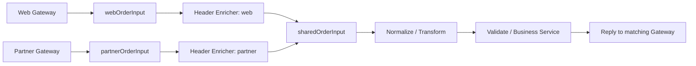
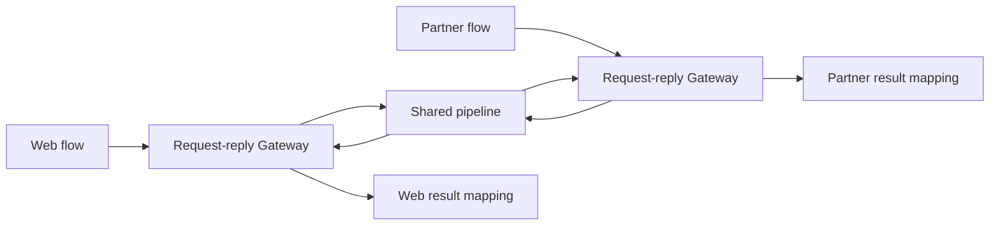
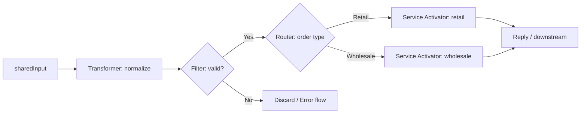
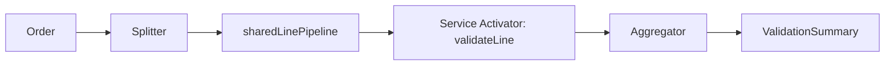

# Reusing a Subflow as a Pipeline in Spring Integration

> **Chapter:** Pipes and filters  
> **Topic:** Reusing a subflow as a pipeline  
> **Objective:** Design a reusable message-processing chain callable from multiple sources, preserving clear responsibility boundaries and input/output contracts while handling request-reply, errors, correlation, and asynchrony properly.

## 1. The Problem: Multiple Sources Need the Same Processing Chain

Suppose a system receives orders from two sources:

- A web channel receiving orders directly from customers.
- A partner channel receiving orders through an integration app.

Both need to normalize order IDs, validate business rules, and produce an acceptance receipt. Repeating the exact same `Transformer → Filter/Validator → Service Activator` chain in two places invites logic drift: one branch updates a rule while the other forgets.

Instead of duplicating, extract the shared steps into a **pipeline** and connect the sources to it via a clearly named message channel.



In Spring Integration, *pipes* are `MessageChannel` beans linking processing steps, while *filters* in the architectural sense are components that transform, validate, or process messages (distinct from the EIP **Message Filter** dedicated to allowing or dropping messages). A **reusable subflow** is a group of steps able to accept messages from multiple branches while maintaining a unified contract.

**Key takeaway:** sharing a pipeline means sharing **a single processing definition and responsibility**, not necessarily duplicating handler instances. In the illustration, different sources send to **one** pipeline entry channel.

## 2. What Do Subflow, `IntegrationFlow`, and Pipeline Mean?

In the Spring Integration Java DSL, `IntegrationFlow` describes a chain of steps that receive, process, and forward messages. A flow can start at a channel, adapter, or Gateway, then pass through components such as Transformer, Filter, Router, and Service Activator.

Related concepts to distinguish:

| Concept | Meaning | Example |
| --- | --- | --- |
| **IntegrationFlow** | Defines a processing chain in Spring Integration | `IntegrationFlow.from("input").transform(...).handle(...).get()` |
| **MessageChannel** | Handoff point for messages between steps/flows | `DirectChannel`, `ExecutorChannel`, `QueueChannel` |
| **Subflow** | Smaller processing chain inside or invoked by a larger flow | Branch after a Router or a flow with its own entry channel |
| **Reusable pipeline** | Shared group of steps with explicit input/output and error contracts | Order normalization and acceptance for web and partner channels |
| **Gateway** | Feeds calls/requests into a flow; can receive replies | `OrderGateway.place(OrderDraft)` |
| **Service Activator** | Invokes a business method from a message | `OrderStages.accept(...)` |

A reusable pipeline requires at least four parts:

1. **Entry point:** channel or gateway where sources send messages.
2. **Input contract:** payload type, required headers, and their semantics.
3. **Processing contract:** transformation, validation, and error-handling steps.
4. **Output contract:** result message, reply destination, or one-way guarantee.

Merely extracting DSL code into a shared helper method without defining these contracts still leaves flows tightly coupled.

### When Should You Create a Shared Pipeline?

- Multiple inbound adapters map data into the same business model.
- You need consistent normalization, validation, or enrichment.
- You want a single place to measure business processing duration and error rates.
- You want to deploy shared logic once and onboard new sources without editing internal logic.

Do not merge flows that merely look superficially similar when their business rules differ significantly; for example, real payment verification and sandbox test orders may need two separate contracts.

## 3. Three Common Reuse Patterns

### 3.1. Sharing One Flow via a Named Channel

Each source has its own flow to normalize source metadata, then sends to the same channel:

```text
sourceA ──> sourceAFlow ──┐
                         ├──> sharedInput ──> sharedPipeline
sourceB ──> sourceBFlow ──┘
```

This is a straightforward way to build a pipeline independent of source adapters. It works cleanly in Java DSL without mixing source logic into shared processing.

### 3.2. Calling a Pipeline as Request-Reply

If an upstream step needs the pipeline's result to continue its own work, place a Gateway / request-reply boundary instead of simple one-way forwarding.

```text
Flow A -> call pipeline -> receive Result -> A continues independently
Flow B -> call pipeline -> receive Result -> B continues independently
```

Define the reply path and timeout explicitly. A channel normally only forwards messages onward; using `.channel("sharedInput")` does not automatically mean the calling flow *resumes right afterward with the shared pipeline's return value*. To continue based on a result, use a Gateway or equivalent request-reply construct.

### 3.3. Extracting Subflows for a Router or Publish-Subscribe

A Router can direct messages to dedicated DSL subflows; Publish-Subscribe lets multiple subscribers receive the same message. These branches can share service methods and configuration components to avoid code duplication.

However, **an inline subflow written inside a Router does not automatically become a standalone bean callable from any other flow**. When sharing one pipeline across multiple sources, an explicitly named entry channel or Gateway is easier to manage.

## 4. Designing the Contract for a Shared Pipeline

Before writing DSL, assume each source maps its incoming data to a common `OrderDraft`.

| Element | Proposed Contract |
| --- | --- |
| Entry channel | `sharedOrderInput` |
| Input payload | `OrderDraft(orderId, amount, currency)` |
| Required header | `sourceSystem` set at a trusted source adapter |
| Step 1 | Normalize order ID and currency |
| Step 2 | Validate rules and accept order |
| Reply payload | `OrderReceipt(orderId, currency, sourceSystem, status)` |
| Data errors | Report validation error; no infinite retries |
| Transient errors | Bounded retries if business rules permit |
| Correlation | Preserve required reply/correlation metadata; use dedicated `businessKey` for business logic |

**Why distinguish headers from payloads?** Payloads carry business data. Headers like `sourceSystem` describe origin and processing context for Routing, tracing, and auditing. Headers are trustworthy only when created or verified at the source boundary; never accept arbitrary client-sent values as authorization credentials.

## 5. Java DSL Example: Two Gateways Sharing One Pipeline

The snippets below illustrate a Java module in package `example.integration`. Each `public` class/interface/record typically resides in its own `.java` file of the matching name. They run in an application configured with Spring Integration and Java records.

### 5.1. Shared Data Types

```java
package example.integration;

import java.math.BigDecimal;

public record OrderDraft(
        String orderId,
        BigDecimal amount,
        String currency) {}

public record NormalizedOrder(
        String orderId,
        BigDecimal amount,
        String currency) {}

public record OrderReceipt(
        String orderId,
        String currency,
        String sourceSystem,
        String status) {}
```

Both web and partner paths must map their respective inputs into `OrderDraft` before entering the pipeline. If the two sources send different JSON formats, place a Transformer or converter on each adapter branch before the merge point.

### 5.2. Bean Implementing Shared Processing Steps

```java
package example.integration;

import java.math.BigDecimal;
import java.util.Locale;

import org.springframework.messaging.handler.annotation.Header;

public class OrderStages {

    public NormalizedOrder normalize(OrderDraft draft) {
        if (draft == null
                || draft.orderId() == null
                || draft.orderId().isBlank()
                || draft.currency() == null
                || draft.currency().isBlank()
                || draft.amount() == null) {
            throw new IllegalArgumentException("Invalid OrderDraft");
        }

        return new NormalizedOrder(
            draft.orderId().trim(),
            draft.amount(),
            draft.currency().trim().toUpperCase(Locale.ROOT)
        );
    }

    public OrderReceipt accept(
            NormalizedOrder order,
            @Header("sourceSystem") String sourceSystem) {

        if (order.amount().compareTo(BigDecimal.ZERO) <= 0) {
            throw new IllegalArgumentException(
                "Amount must be greater than 0");
        }

        // Illustration: a real app calls a business repository/service.
        // Consider transactions and idempotency if side effects occur.
        return new OrderReceipt(
            order.orderId(),
            order.currency(),
            sourceSystem,
            "ACCEPTED"
        );
    }
}
```

`normalize` isolates converting raw data into normalized form. `accept` is the service method enforcing acceptance rules. Neither knows whether input arrived via HTTP, a broker, or which gateway.

In real projects, steps can be separate beans for easier testing and transaction management. Combining two methods in one class here only simplifies the lesson.

### 5.3. Declaring Message Channels and Three Flows

```java
package example.integration;

import org.springframework.context.annotation.Bean;
import org.springframework.context.annotation.Configuration;
import org.springframework.integration.annotation.IntegrationComponentScan;
import org.springframework.integration.channel.DirectChannel;
import org.springframework.integration.config.EnableIntegration;
import org.springframework.integration.dsl.IntegrationFlow;
import org.springframework.messaging.MessageChannel;

@Configuration
@EnableIntegration
@IntegrationComponentScan
public class ReusableOrderPipelineConfig {

    @Bean
    public MessageChannel webOrderInput() {
        return new DirectChannel();
    }

    @Bean
    public MessageChannel partnerOrderInput() {
        return new DirectChannel();
    }

    @Bean
    public MessageChannel sharedOrderInput() {
        return new DirectChannel();
    }

    @Bean
    public OrderStages orderStages() {
        return new OrderStages();
    }

    // Web branch: attach metadata then enter shared pipeline.
    @Bean
    public IntegrationFlow webOrderFlow() {
        return IntegrationFlow.from("webOrderInput")
            .enrichHeaders(h -> h.header("sourceSystem", "web"))
            .channel("sharedOrderInput")
            .get();
    }

    // Partner branch: uses same schema but different source.
    @Bean
    public IntegrationFlow partnerOrderFlow() {
        return IntegrationFlow.from("partnerOrderInput")
            .enrichHeaders(h -> h.header("sourceSystem", "partner"))
            .channel("sharedOrderInput")
            .get();
    }

    // Only ONE shared pipeline: called by both sources.
    @Bean
    public IntegrationFlow sharedOrderPipeline(OrderStages stages) {
        return IntegrationFlow.from("sharedOrderInput")
            .transform(OrderDraft.class, stages::normalize)
            .handle(stages, "accept")
            .get();
    }
}
```

Notice the boundaries:

- `webOrderFlow` and `partnerOrderFlow` are responsible for attaching trusted source metadata.
- Both send to one `sharedOrderInput`; the pipeline does not need to know source channel names.
- `sharedOrderPipeline` always accepts `OrderDraft`, builds `NormalizedOrder`, and calls `accept`.
- When the service returns `OrderReceipt`, the framework can route the reply back to the reply destination in message headers via request-reply mechanics.
- The pipeline does not depend specifically on either Gateway; a third source only has to satisfy the input contract.

`DirectChannel` is a unicast channel: with one subscriber endpoint at the pipeline's entry, every send dispatches once through that endpoint. If you accidentally register additional consumers on `sharedOrderInput`, `DirectChannel` may load-balance across consumers rather than sending to all of them—which is a separate concern from having multiple producers.

### 5.4. Two Messaging Gateways

```java
package example.integration;

import org.springframework.integration.annotation.MessagingGateway;

@MessagingGateway(defaultRequestChannel = "webOrderInput")
public interface WebOrderGateway {
    OrderReceipt submit(OrderDraft draft);
}
```

```java
package example.integration;

import org.springframework.integration.annotation.MessagingGateway;

@MessagingGateway(defaultRequestChannel = "partnerOrderInput")
public interface PartnerOrderGateway {
    OrderReceipt submit(OrderDraft draft);
}
```

Both Gateways accept the same input type and return type. They send to different input channels yet converge into `sharedOrderPipeline`.

Example call from an application service/controller with both gateways injected:

```java
import java.math.BigDecimal;

OrderDraft webDraft =
    new OrderDraft(" WEB-101 ", new BigDecimal("250000"), "vnd");
OrderReceipt webResult = webGateway.submit(webDraft);

OrderDraft partnerDraft =
    new OrderDraft(" PARTNER-202 ", new BigDecimal("750000"), "usd");
OrderReceipt partnerResult = partnerGateway.submit(partnerDraft);

// webResult:
//   orderId = "WEB-101", currency = "VND", sourceSystem = "web"
// partnerResult:
//   orderId = "PARTNER-202", currency = "USD", sourceSystem = "partner"
```

When a Gateway sends a request, Spring Integration provides request-reply context, including the proper reply destination. In synchronous flows via `DirectChannel`, the reply from the final `Service Activator` returns to the exact originating Gateway even though both Gateways share the pipeline. In other words, the pipeline does not need to inspect `sourceSystem` to guess whether to reply to web or partner.

**Operational requirement:** the Gateways must lie within `@IntegrationComponentScan` scope, and the beans/flows must live in the same Spring context or be connected via an appropriate integration mechanism.

## 6. What Is Actually Being Reused?

We are reusing:

- **One business flow definition:** `sharedOrderPipeline`.
- **One input/output contract:** all sources send `OrderDraft` and receive `OrderReceipt`.
- **One set of processing rules:** `OrderStages.normalize` and `accept`.
- **One observability point:** metrics, logging, or advice can wrap the pipeline steps centrally.

We do not automatically get:

- A durable queue: `DirectChannel` operates in-process and never persists messages to disk.
- Exactly-once processing: messages may be resent at adapters or retried; services must account for idempotency.
- Transactions spanning all threads/services: switching channels or calling external systems requires explicit consistency strategies.
- Infinite automatic scaling: concurrency limits, DB connections, and downstream capacity still apply.

### Does Sharing a Pipeline Tightly Couple Sources?

Sources depend on the **shared contract**, not on each handler's internal implementation. If the pipeline alters `OrderDraft` or `OrderReceipt` semantics without versioning, all sources are affected.

Therefore, when evolving contracts, consider:

1. Keeping the canonical schema stable or versioning changes in a controlled manner.
2. Placing source-specific conversions before the entry channel.
3. Avoiding scattering `if (sourceSystem.equals(...))` branches throughout the pipeline when business rules truly diverge.
4. Testing each source individually alongside testing the shared pipeline contract.

## 7. Reusing via Java Helper Functions vs. Sharing One Flow Bean?

These two approaches are easy to confuse.

**Reusing DSL configuration** extracts common steps into a helper method and builds multiple independent flows. Each flow owns separate endpoint/channel instances while reusing configuration logic. This helps when each source needs a pipeline with isolated resources and deployment control.

**Reusing one running flow** has multiple producers send to a single entry channel, as with `sharedOrderInput`. Sources share one pipeline instance, sharing resources and processing behavior.

| Criterion | Reusing Configuration Helper | Sharing One Flow via Channel |
| --- | --- | --- |
| Runtime pipelines | Multiple separate pipelines possible | Single shared pipeline |
| Logic updates | Helper is shared code; each flow can add custom steps | Pipeline changes affect all producers |
| Monitoring | Per-flow metrics easy to separate | Shared metrics; requires source metadata to slice |
| Invocation | Each flow has its own input and output | Sources send to one entry channel |
| Best suited for | Branches with distinct load profiles and SLAs | Sources sharing one contract and business logic |

Never try registering **the exact same `IntegrationFlow` bean** multiple times expecting independent copies. Components inside a flow have names, lifecycles, and ownership inside the application context. To create multiple pipeline instances, build independent flows with distinct endpoint/channel names; to share one pipeline, use one entry point.

## 8. When Sources Need Further Processing After the Shared Pipeline

In Section 5, Gateways directly receive the pipeline's final reply. Sometimes, however, the web flow must convert `OrderReceipt` into an HTTP response while the partner flow must transform the result into another format.

Intent diagram:



At the pipeline call site, two architectures are common:

**Option A — Gateway at the source boundary:** application code calls `WebOrderGateway.submit(...)` or `PartnerOrderGateway.submit(...)`, receives `OrderReceipt`, and maps the response in the adapter layer. That is the complete example in Section 5.

**Option B — Gateway endpoint inside `IntegrationFlow`:** to continue purely within the DSL, use a request-reply step targeting `sharedOrderInput`, followed by source-specific Transformers/handlers. Check the `gateway(...)` overload in your project's Spring Integration Java DSL version and configure request channels and reply timeouts properly.

Illustrative example:

```text
webInput
  -> enrichHeaders(source=web)
  -> gateway(requestChannel=sharedOrderInput)   // awaits reply
  -> transform(OrderReceipt -> WebResponse)
  -> webOutput

partnerInput
  -> enrichHeaders(source=partner)
  -> gateway(requestChannel=sharedOrderInput)
  -> transform(OrderReceipt -> PartnerResponse)
  -> partnerOutput
```

**You cannot replace `gateway` with `channel("sharedOrderInput")` and assume the DSL steps to the right will receive `OrderReceipt`.** `channel` forwards messages onward; request-reply must be explicitly configured. Confusing the two is a common pitfall when learning flow composition.

### Avoiding Reply Loops

If a message finishes a shared pipeline and somehow replies back into the pipeline's own entry channel, an infinite loop or misrouted response can occur. Use Gateway-managed reply channels or explicitly defined response channels, and test both success and failure paths.

## 9. Headers and Correlation When Reusing a Pipeline

When multiple sources share a pipeline, payloads may match while metadata differs. Agree explicitly on key headers:

| Header | Role | Policy |
| --- | --- | --- |
| `sourceSystem` | Trusted origin identifier | Set at source adapter; never trust raw client headers as proof |
| `businessKey` | Order identifier for audit/idempotency | Derived from validated data or domain ID |
| `traceId` | Cross-branch observability linkage | Follow active tracing standard; avoid regenerating at every step |
| `replyChannel` | Request-reply return path | Managed by framework/Gateway; never overwrite arbitrarily |
| `errorChannel` | Error message destination | Depends on endpoint type and error strategy |
| `correlationId` | Message grouping in Splitter/Aggregator | Preserve per framework grouping contract |
| `sequenceNumber`, `sequenceSize` | Item order and group size | Preserve accurately while processing child messages |

With these headers, a shared pipeline can still audit the source and correlate outcomes without duplicating source-specific mapping everywhere.

When Transformers inside a pipeline return only payloads, the framework builds new messages and propagates eligible headers. If you construct `Message<?>` manually or strip metadata at an adapter, verify critical headers survive across every step.

**Note:** header metadata never replaces security enforcement. Headers such as `tenantId` and `userId` must come from authenticated context; do not casually propagate secret tokens or sensitive data through shared pipelines.

## 10. Combining with Filter, Router, and Service Activator

A reusable pipeline does not have to contain only one Transformer and one method. It can coordinate multiple patterns when genuinely needed:



However, placing a Filter inside a request-reply flow requires an explicit decision for rejected messages. If the Filter drops a message with no reply, the Gateway may hit its timeout. Choose a business-meaningful exception, a discard branch, or a typed result per contract.

A Router should route by rules shared across all sources. If certain branches apply exclusively to web traffic, consider keeping that specific logic before or after the shared pipeline to avoid mixing concerns.

### When Should You Avoid Sharing a Service Handler?

If two sources diverge so sharply in transactions, SLAs, validation rules, or trust levels that service code fills up with source-based branches, splitting into two pipelines is clearer. You can still reuse genuinely shared transformations like `normalizeCurrency`.

## 11. Subflows with Splitter/Aggregator: Reusable, Yet Group-Bounded

Suppose an order has multiple product lines. After a Splitter breaks the message into individual `OrderLine` items, child messages can pass through a shared pipeline to compute tax or check inventory.



In this design, the pipeline must **preserve correlation metadata** needed by the Aggregator—such as `correlationId`, `sequenceNumber`, and `sequenceSize` set by the Splitter/framework. If only some child messages reach the Aggregator because a Filter dropped others, a `sequenceSize`-based release strategy may never complete the group.

Handling strategies include:

- Turn invalid lines into a `LineValidationFailure` outcome so the Aggregator still receives the expected item count.
- Configure group timeout/expiry and partial-completion rules when items can be missing.
- Use a dedicated correlation strategy when architecture requires grouping by business ID.
- Avoid mixing child messages from different orders into one group across a shared channel.

When adding an `ExecutorChannel` to process child messages in parallel, completion order may differ from initial order. The Aggregator must maintain grouping rules; if ordered output is required, re-sort using sequence metadata.

## 12. Synchronous, Asynchronous, and Resource Sharing in Shared Pipelines

In Section 5, `sharedOrderInput` is a `DirectChannel`, so steps normally run on the sender thread. Sometimes a shared pipeline needs to offload heavy work onto a separate pool:

```text
web / partner
      |
      v
sharedDirectChannel
      |
      v
ExecutorChannel ----> worker pool ---> business handler
```

You can swap a `DirectChannel` at an appropriate boundary for an `ExecutorChannel` backed by a managed `TaskExecutor`. Doing so introduces important trade-offs:

1. **Sender-thread transactions do not automatically propagate to workers.**
2. **ThreadLocals** (MDC, security context, transactions) require explicit supported propagation.
3. **Completion order** may vary across multiple workers.
4. **Senders may return before handlers finish**, though request-reply Gateways still wait for a reply or timeout.
5. **The executor's queue and rejection policy** govern overload; `ExecutorChannel` is not a durable broker.

If the pipeline must not lose messages during an abrupt shutdown, use a broker or persistent store with acknowledgements, retries, and recovery mechanisms. A thread pool alone does not provide durable delivery.

### One Shared Pool or Separate Pools?

A shared pipeline reduces logic duplication, yet allows a high-volume source to starve another source. For instance, a partner pushing 10,000 orders/sec can fill the queue, raising latency for web users. When SLAs differ, you can:

- Rate-limit ingress per source.
- Use separate concurrency pools per request class while sharing normalization logic.
- Partition queues by business key.
- Split heavy processing into separate pipelines while reusing genuinely shared services and transformers.

Logic reuse and resource isolation are two distinct architectural decisions that must be balanced.

## 13. Errors, Retries, and Responsibilities per Layer

A shared pipeline is a good place for uniform error handling across common steps, whereas errors at a source boundary may need source-specific responses.

| Failure | Where It Occurs | Recommended Handling |
| --- | --- | --- |
| Payload unmappable from source | Source adapter or Transformer | Return format/contract error at source |
| Business validation failure | Shared pipeline | Consistent business error outcome |
| External service timeout | Shared Service Activator | Bounded retries, idempotency, recovery |
| Gateway reply timeout | Request-reply boundary | Explicit timeout and deterministic request state |
| Executor task rejection | Async boundary | Backpressure or overload response |
| Message lost after crash | Transport durability issue | Appropriate outbox/broker/persistent store |

With `DirectChannel`, exceptions from a Service Activator can propagate synchronously to the caller. With `ExecutorChannel` or broker adapters, worker/listener errors require separate error flows and acknowledgement control; a sender that already returned will not automatically catch downstream exceptions directly.

### Scope Retries Properly

For example, `normalize` failing due to a missing order ID is a data error: retrying the same payload solves nothing. Conversely, an order verification API timing out may be transient: retrying with backoff and an idempotency key fits well.

Never accidentally retry an entire pipeline if an earlier step already executed irreversible side effects. Separate pure steps (normalize/validate) from stateful steps (DB writes, payments, publishing). Transactions or the outbox pattern help protect consistency at write boundaries.

### Preventing One Source's Errors from Affecting Another

A shared pipeline unifies processing, yet prolonged failures or slow retries can exhaust shared resources. Monitor error rates sliced by `sourceSystem`, bound retries, and prevent one failing adapter from starving threads or connections across the whole pipeline.

## 14. Testing Pipeline Contracts with JUnit 5

Test through both Gateways to prove both traverse the shared steps and preserve source metadata all the way to the reply.

Example using the classes from Section 5:

```java
package example.integration;

import static org.junit.jupiter.api.Assertions.*;

import java.math.BigDecimal;

import org.junit.jupiter.api.Test;
import org.springframework.beans.factory.annotation.Autowired;
import org.springframework.test.context.junit.jupiter.SpringJUnitConfig;

@SpringJUnitConfig(ReusableOrderPipelineConfig.class)
class ReusableOrderPipelineTest {

    @Autowired
    private WebOrderGateway webGateway;

    @Autowired
    private PartnerOrderGateway partnerGateway;

    @Test
    void webOrderUsesSharedPipeline() {
        OrderReceipt receipt = webGateway.submit(
            new OrderDraft(" WEB-101 ",
                new BigDecimal("250000"), "vnd"));

        assertEquals("WEB-101", receipt.orderId());
        assertEquals("VND", receipt.currency());
        assertEquals("web", receipt.sourceSystem());
        assertEquals("ACCEPTED", receipt.status());
    }

    @Test
    void partnerOrderUsesSameNormalizationContract() {
        OrderReceipt receipt = partnerGateway.submit(
            new OrderDraft(" PARTNER-202 ",
                new BigDecimal("750000"), "usd"));

        assertEquals("PARTNER-202", receipt.orderId());
        assertEquals("USD", receipt.currency());
        assertEquals("partner", receipt.sourceSystem());
        assertEquals("ACCEPTED", receipt.status());
    }

    @Test
    void invalidAmountFailsConsistently() {
        assertThrows(RuntimeException.class, () ->
            webGateway.submit(
                new OrderDraft("WEB-BAD", BigDecimal.ZERO, "vnd")));

        assertThrows(RuntimeException.class, () ->
            partnerGateway.submit(
                new OrderDraft("PARTNER-BAD",
                    BigDecimal.ZERO, "vnd")));
    }
}
```

The third test verifies the error path for synchronous Gateways; the framework may wrap the original exception, so verify the exact exception types expected by your project's contract.

### Additional Tests Worth Adding as You Scale

- **Two sources, one contract:** identical normalization/validation rules, differing only in source metadata.
- **Headers:** `sourceSystem` and `businessKey` preserved or normalized from trusted sources.
- **Replies:** whichever Gateway sent the request receives its own reply with zero cross-talk under concurrent calls.
- **Invocation count:** avoid unintended extra consumers subscribed to the shared input.
- **Filter/Router:** dropped or unmapped messages follow a defined error path.
- **Correlation:** with Splitter/Aggregator, concurrent groups still complete accurately.
- **Asynchrony:** use `CountDownLatch`/Awaitility to verify async results instead of fixed `Thread.sleep`.
- **Overload:** test rejection/backpressure when using `ExecutorChannel`.
- **Recovery:** with a broker, test retries, acks, and deduplication across restarts.

**Unit test vs. integration test:** calling `OrderStages.normalize(...)` directly only tests the method; calling `webGateway.submit(...)` and `partnerGateway.submit(...)` verifies how flows wire into the shared channel/pipeline.

## 15. Design Traps When Reusing Subflows

### 15.1. Sharing a Channel While Accidentally Registering Multiple Consumers

`DirectChannel` delivers each message to one subscriber, not a copy to every subscriber. Declaring two flows both starting with `from("sharedOrderInput")` causes load-balancing between consumers so neither receives every message. Use a single consumer pipeline for unified processing, or `PublishSubscribeChannel` when broadcasting is truly intended.

### 15.2. Creating Multiple Pipeline Copies via Copy/Paste

Separate copies inevitably diverge over time. Define a shared contract, adapt source formats at adapters, and build a shared pipeline whenever responsibilities genuinely match.

### 15.3. Assuming Channel Forwarding Behaves Like a Function Return

`.channel("sharedOrderInput")` forwards the message to a channel. If a calling flow needs to run its own steps on the shared pipeline's result afterward, use a request-reply Gateway or explicit reply design.

### 15.4. Using Source Headers for Authorization

`sourceSystem` or `tenantId` can be spoofed. When used for auditing or security, derive and verify them from the authenticated connection and caller identity before attaching trusted metadata.

### 15.5. Sharing Mutable State Across Concurrent Messages

Handler beans are usually singletons. Storing the current order or source context in bean fields causes concurrent messages to overwrite each other. Keep per-message state in payloads, headers, local variables, and controlled stores.

### 15.6. Neglecting Input Contract Versioning

Renaming payload fields or adding rules impacts every source. Keep mappers per source, maintain schema versions, and run contract tests before changing a shared pipeline.

### 15.7. Equating Reuse with Isolation

Multiple sources sharing a pipeline can also share queues, thread pools, DB connections, and API quotas. If one high-volume source starves smaller sources, enforce rate limits or isolate resources where needed.

## 16. Practice Exercise: Ticket Normalization and Routing Pipeline

**Context:** A system receives `TicketRequest` from a web app and a partner API. Both must validate the ticket ID, normalize priority levels, and forward to a ticket-processing service.

**Requirements:**

1. Create `TicketRequest(id, priority, description)` and `TicketReceipt(id, priority, status)`.
2. Create two entry points `webTickets` and `partnerTickets` attaching trusted source headers.
3. Define `sharedTicketInput` and a single pipeline:
   `normalizePriority → validate → accept`.
4. Ensure both the web Gateway and partner Gateway receive `TicketReceipt`.
5. Write tests for each source, validation failures, and two concurrent requests.
6. Add a Router directing `HIGH` tickets to a priority path if business rules require it.
7. Explain how `businessKey` and trace/correlation survive across the Router and Service Activator.
8. Move a heavy step onto an `ExecutorChannel`; analyze timeouts, ordering, and overload behavior.
9. Outline a broker/outbox approach if losing tickets during application shutdown is unacceptable.

A sensible target architecture:

```text
webTickets ----> source header: web -----+
                                         |
                                         v
                                  sharedTicketInput
                                         |
                                  normalizePriority
                                         |
                                    validate
                                         |
                                route by priority
                                         |
                                 Service Activator
                                         |
                                   TicketReceipt
                                         ^
                                         |
partnerTickets -> source header: partner-+
```

The diagram shows the converged path; actual replies must return to the right Gateway via the reply path rather than relying on both sources happening to share a channel.

### Self-Check Questions

**Q1.** Why do a single `sharedOrderInput` and `sharedOrderPipeline` reduce logic duplication?

*Because multiple sources conform to one input contract and share a single set of Transformers and Service Activators.*

**Q2.** If two subscribers listen on a `DirectChannel`, do both automatically receive every message?

*No. `DirectChannel` is unicast; with multiple subscribers, each message is dispatched to one handler according to the dispatcher's strategy.*

**Q3.** When a calling flow needs to process a pipeline's output right after calling it, what connection construct should you use?

*A request-reply boundary, such as a Gateway, with an explicit reply path and timeout.*

**Q4.** A shared pipeline receives messages from two sources with different transaction contexts: do they automatically share one transaction?

*Never assume so. Transactions depend on threads, channel types, and external resources; crossing threads or brokers requires dedicated consistency design.*

**Q5.** Why test through both Gateways?

*Because unit-testing helper methods does not prove both sources wire cleanly into the shared flow and receive proper replies and headers.*

## 17. Production Adoption Checklist

- **Reuse goal:** identify which steps are truly shared and which depend on the source.
- **Input contract:** payload types, required headers, schema/version, and trusted origin.
- **Entry point:** clearly named channel/Gateway; avoid duplicate competing consumers.
- **Output contract:** reply payload, one-way vs. request-reply, timeouts, and missing-reply handling.
- **Error contract:** validation, retries, error channels, discards, and backpressure.
- **Correlation:** reply/correlation headers remain intact, especially across Splitter/Aggregator.
- **Concurrency:** choose `DirectChannel`/`ExecutorChannel` based on transactions, ordering, and load capacity.
- **Idempotency:** handle duplicates whenever handlers cause side effects and transports allow redelivery.
- **Observability:** logs/metrics/tracing per pipeline and per source, avoiding sensitive data leaks.
- **Verification:** test every source traversing the shared pipeline and test distinct failure branches.

**Conclusion:** A pipeline is reusable when it accepts a well-defined message contract, executes a cohesive responsibility, and produces predictable outputs and errors. In Spring Integration, an entry `MessageChannel` connecting multiple sources into a single `IntegrationFlow` is an intuitive way to build a shared pipeline. Whenever calling flows need return values, add an explicit Gateway/request-reply contract. This keeps sources and processing steps loosely coupled while remaining extensible with Transformer, Filter, Router, Service Activator, Splitter, Aggregator, and system-wide error, retry, and tracing mechanisms.
