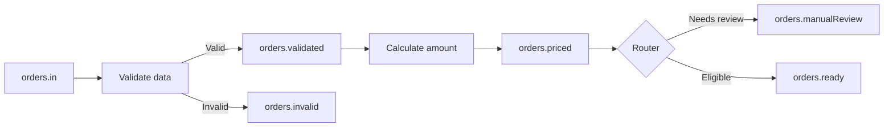
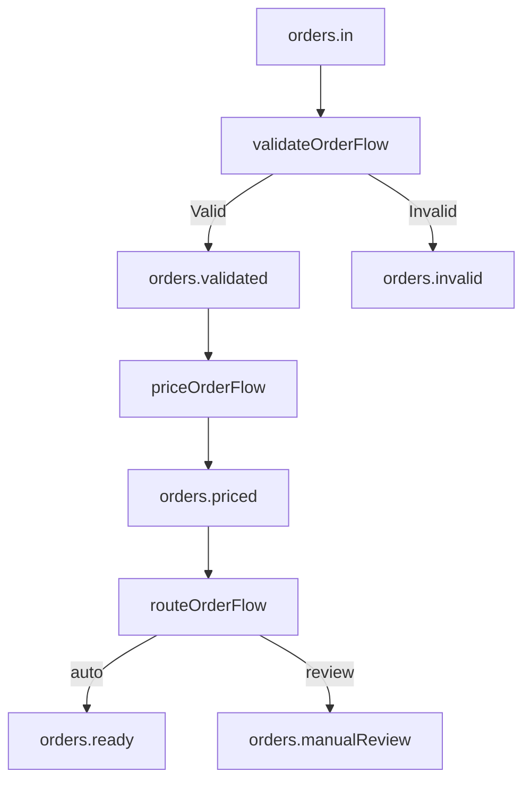
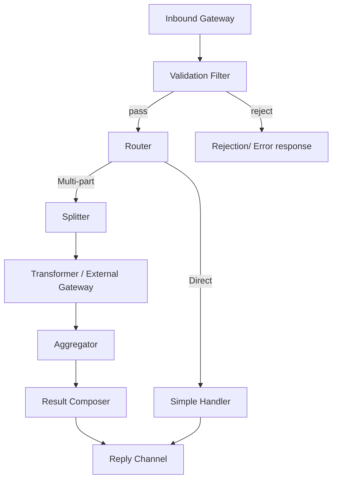

# Flow Length and Readability

## 1. Why Does Flow Length Matter?

In a **Pipes and Filters** architecture, data flows through a chain of small processing steps (*filters*) connected by transport paths (*pipes*). Each step has one responsibility: validating input, cleansing data, converting formats, routing, calling services, recording results, or handling errors.

Spring Integration implements this organization using **messages**, **channels**, and **endpoints**. The Java DSL lets you express an entire processing chain in a single `IntegrationFlow` method. As a flow grows, initially clear code can become a long pile of chained `.filter(...)`, `.transform(...)`, `.route(...)`, `.handle(...)`, `.aggregate(...)`, and nested lambdas. The code still compiles and runs, yet maintainers struggle to answer:

- What payload type does the message currently carry, and which headers are required?
- Which branch handles valid data, and which receives rejected messages?
- Does an error propagate back to the sender, enter an error channel, or get retried?
- Which operations run on the original thread, and which run on another thread?
- Where can latency build up, messages drop, replies block, or state accumulate?
- Which downstream steps break if one step changes?

This lesson belongs to the **Pipes and filters** chapter in the **SPRING_INTEGRATION_PATTERN** module. The goal of learning Enterprise Integration Patterns with Spring Integration is building loosely coupled, extensible message flows; practicing Router, Filter, Transformer, Splitter, Aggregator, Gateway, retry, error channels, correlation, and testing processing branches. **Flow readability** is the practical prerequisite for using these patterns well: a flow can be short in line count yet remain obscure if it hides critical behavior.

After this lesson, you will be able to assess flow complexity, decide whether to keep one flow or split it, pick appropriate channel boundaries, choose business-meaningful names, and preserve behavior when refactoring.

## 2. A “Long Flow” Is Not Just Many Lines of Code

There is no magic threshold like “split above 10 steps.” What matters is **how many decisions someone must hold in mind to understand and safely modify the flow**.

Consider two cases:

1. A flow with eight pure Transformers, each converting data under a clear contract with no branches or I/O: it can still be easy to read.
2. A flow with four steps, where one lambda makes an HTTP call, catches exceptions, retries manually, mutates correlation headers, and picks a route: though short in lines, this flow is hard to verify and mixes multiple responsibilities.

You can evaluate complexity along these dimensions:

| Dimension | Sign of Growing Complexity | Check Question |
| --- | --- | --- |
| **Number of data conversions** | Payload changes type repeatedly without clear intermediate schemas | What is the payload after each step? |
| **Number of branches** | Interleaved Routers, Filters, error branches, and timeouts | Can you draw every possible path a message takes? |
| **Thread boundaries** | `ExecutorChannel`, `QueueChannel`, or pollers appear mid-chain | Does the caller still wait for a result? Where do exceptions go? |
| **I/O and state** | HTTP/JMS/AMQP Gateways, Aggregators, retries, transactions | Which steps can block, replay, hold groups, or partially fail? |
| **Headers and correlation** | Multiple steps read/write `correlationId`, `replyChannel`, `errorChannel` | Could downstream-critical metadata be accidentally dropped? |
| **Business cohesion** | One flow validates orders, prices items, sends emails, writes reports | Do these steps share one goal and reason to change? |
| **Testability** | Testing one rule requires booting every adapter | Can business rules be tested independently of brokers/HTTP? |

A readable flow lets a reader grasp **the main path first**, then drill into individual steps when details matter. Channel and handler names should immediately answer *“what stage is the message at right now?”*.

## 3. Viewing a Flow as a Processing Map



The diagram shows **one primary path** and clearly named branches. A reader can quickly pinpoint where to look if an order is not priced or is misrouted.

In Spring Integration:

- **Message** carries payload and headers.
- **Message channel** connects endpoints and carries messages between them.
- **Filter/Transformer/Router/Service Activator/Gateway/Aggregator** are the endpoints doing the work.
- **IntegrationFlow** describes how components connect. One `IntegrationFlow` does not have to match an entire end-to-end business process.

An application can use **one `IntegrationFlow` for the entire path** or **multiple `IntegrationFlow` beans linked by named channels**. Both can produce the exact same message path. What matters is the contract and observable behavior, including thread boundaries and error handling.

### 3.1. Do Not Mix “Business Steps” and “Technical Steps”

For example, “validate order” is a business step; internally it may check quantity, product codes, tenant, and value limits. If all of these rules are written as inline lambdas inside a long DSL chain, readers have to trace every condition to understand intent.

Instead, extract an `isValidOrder(...)` method or a dedicated service. The flow expresses *business intent*; rule implementations live in classes that can be tested independently.

Conversely, do not turn every one-line `.transform(...)` into a separate service class. Over-fragmentation multiplies files, beans, and wiring without improving clarity.

## 4. Signs a Flow Needs Reorganization

| Sign | Impact | Improvement Direction |
| --- | --- | --- |
| One `@Bean IntegrationFlow` holds multiple independent stages | Changing feature A risks breaking configuration of B | Split by named stages such as `validateOrders`, `priceOrders`, `routeOrders`. |
| Nested lambdas doing network I/O and exception handling together | Hard to trace retries and error emission rules | Move I/O into dedicated services/gateways; declare retry/error paths explicitly. |
| Payload changes type without explicit markers | Easy to cause cast failures or feed wrong types to transformers | Use named DTOs/records and typed transformations. |
| Router returns cryptic keys `"a"`, `"b"` | Hard to understand branches and locate handlers | Name branches by business meaning and map to concrete channels. |
| Too many anonymous channels | Hard to find points to tap or debug | Create named channels at meaningful boundaries. |
| Too many named channels for tiny steps | Fragmented topology; hard to follow end-to-end | Keep cohesive filters/transformers inside one flow. |
| Mixing retries, transactions, and validation in one callback | Hard to control duplicates and rollback scope | Separate infrastructure policies from business rules; state retry scope clearly. |
| Testing one rule requires live HTTP/broker | Slow tests, hard to diagnose failures | Extract pure logic into functions/services; integration-test at boundaries. |

A practical rule: **split when each part has a distinct input/output contract, error lifecycle, or reason to change**. Never split merely to shrink line counts per file.

## 5. Initial Example: A Flow Containing Too Many Details

Problem: receive `OrderCommand`, reject invalid orders, normalize order IDs, compute totals, and route large orders to manual review.

Illustrative data types:

```java
import java.math.BigDecimal;

record OrderCommand(
        String orderId,
        int quantity,
        BigDecimal unitPrice) {}

record PricedOrder(
        String orderId,
        BigDecimal amount) {}
```

Initially, everything might live inside one flow:

```java
@Bean
public IntegrationFlow longOrderFlow() {
    return IntegrationFlow.from("orders.in")
        .filter(OrderCommand.class,
            order -> order.orderId() != null
                && !order.orderId().isBlank()
                && order.quantity() > 0
                && order.unitPrice() != null
                && order.unitPrice().signum() >= 0,
            spec -> spec.discardChannel("orders.invalid"))
        .transform(OrderCommand.class,
            order -> new OrderCommand(
                order.orderId().strip(),
                order.quantity(),
                order.unitPrice()))
        .transform(OrderCommand.class,
            order -> new PricedOrder(
                order.orderId(),
                order.unitPrice().multiply(
                    BigDecimal.valueOf(order.quantity()))))
        .route(PricedOrder.class,
            priced -> priced.amount()
                    .compareTo(new BigDecimal("1000")) >= 0
                        ? "review" : "auto",
            spec -> spec
                .channelMapping("review", "orders.manualReview")
                .channelMapping("auto", "orders.ready"))
        .get();
}
```

*This snippet assumes standard imports, Spring Integration configuration, and consumers on the output channels. It is an illustrative structure, not a full application with persistence or error policies.*

The flow above is not necessarily bad yet: it has one filter, two transforms, and one Router. However, once tenant auth, payment gateway calls, Gateway replies, retries, auditing, inventory updates, and event publishing pile on, every change accumulates inside one method. From reading the code, it quickly becomes hard to separate *validation*, *normalization*, *pricing*, and *routing*.

There are two sensible refactoring levels:

1. **Keep one `IntegrationFlow`, name the logic** using clearly typed methods or services.
2. **Split into multiple `IntegrationFlow` beans**, connected by named channels when stages represent real business or operational boundaries.

Pick the simplest level that solves the current problem.

## 6. Refactor Level 1: One Flow, Named Steps

Use dedicated methods to highlight intent. This fits well when the chain remains a cohesive processing unit sharing the same thread and error policy:

```java
import java.math.BigDecimal;

import org.springframework.context.annotation.Bean;
import org.springframework.context.annotation.Configuration;
import org.springframework.integration.config.EnableIntegration;
import org.springframework.integration.dsl.IntegrationFlow;

@Configuration
@EnableIntegration
public class ReadableOrderFlow {

    @Bean
    public IntegrationFlow orderFlow() {
        return IntegrationFlow.from("orders.in")
            .filter(OrderCommand.class,
                ReadableOrderFlow::isValid,
                spec -> spec.discardChannel("orders.invalid"))
            .transform(OrderCommand.class,
                ReadableOrderFlow::normalize)
            .transform(OrderCommand.class,
                ReadableOrderFlow::price)
            .route(PricedOrder.class,
                ReadableOrderFlow::route,
                spec -> spec
                    .channelMapping("review", "orders.manualReview")
                    .channelMapping("auto", "orders.ready"))
            .get();
    }

    static boolean isValid(OrderCommand order) {
        return order.orderId() != null
            && !order.orderId().isBlank()
            && order.quantity() > 0
            && order.unitPrice() != null
            && order.unitPrice().signum() >= 0;
    }

    static OrderCommand normalize(OrderCommand order) {
        return new OrderCommand(
            order.orderId().strip(),
            order.quantity(),
            order.unitPrice());
    }

    static PricedOrder price(OrderCommand order) {
        return new PricedOrder(
            order.orderId(),
            order.unitPrice().multiply(
                BigDecimal.valueOf(order.quantity())));
    }

    static String route(PricedOrder order) {
        return order.amount().compareTo(new BigDecimal("1000")) >= 0
                ? "review" : "auto";
    }
}
```

*`OrderCommand` and `PricedOrder` are the two records declared in Section 5. The configuration uses output channels provided by the application.*

In this form, the DSL reads almost like a business sentence: **filter → normalize → price → route**. Unit tests for `isValid`, `normalize`, `price`, and `route` need no Spring context. If pricing rules grow into multiple branches, `price` can move to a `PricingService` while the flow stays decoupled from pricing formulas.

### Naming Conventions

- Name actions after outcomes: `validateOrder`, `calculatePrice`, `routeByRisk`; avoid `step1` or `process`.
- Name channels after **message state**: `orders.validated`, `orders.priced`, `orders.ready`.
- Name pure transformation functions after the payload change, with explicit return types.
- Name side-effecting services after what they execute: `reserveInventory`, `chargePayment`, `persistOrder`.
- Give error/timeout branches dedicated names rather than dumping unrelated failure types onto one shared channel and guessing from payloads.

Names never replace contracts: always document payloads, critical headers, and failure behaviors.

## 7. Refactor Level 2: Splitting Flows Along Business Boundaries

When validation, pricing, and routing have independent testing or deployment policies, link multiple `IntegrationFlow` beans via named channels:



A Java DSL configuration reusing `OrderCommand` and `PricedOrder` above:

```java
import java.math.BigDecimal;

import org.springframework.context.annotation.Bean;
import org.springframework.context.annotation.Configuration;
import org.springframework.integration.channel.QueueChannel;
import org.springframework.integration.config.EnableIntegration;
import org.springframework.integration.dsl.IntegrationFlow;

@Configuration
@EnableIntegration
public class ModularOrderFlows {

    @Bean
    public IntegrationFlow validateOrders() {
        return IntegrationFlow.from("orders.in")
            .filter(OrderCommand.class,
                ModularOrderFlows::isValid,
                spec -> spec.discardChannel("orders.invalid"))
            .transform(OrderCommand.class,
                ModularOrderFlows::normalize)
            .channel("orders.validated")
            .get();
    }

    @Bean
    public IntegrationFlow priceOrders() {
        return IntegrationFlow.from("orders.validated")
            .transform(OrderCommand.class,
                ModularOrderFlows::price)
            .channel("orders.priced")
            .get();
    }

    @Bean
    public IntegrationFlow routeOrders() {
        return IntegrationFlow.from("orders.priced")
            .route(PricedOrder.class,
                ModularOrderFlows::route,
                spec -> spec
                    .channelMapping("review", "orders.manualReview")
                    .channelMapping("auto", "orders.ready"))
            .get();
    }

    // QueueChannel on the three sinks is only so tests/demos can poll results.
    // Production would normally attach service activators or outbound adapters.
    @Bean("orders.invalid")
    public QueueChannel invalidOrders() {
        return new QueueChannel();
    }

    @Bean("orders.manualReview")
    public QueueChannel manualReviewOrders() {
        return new QueueChannel();
    }

    @Bean("orders.ready")
    public QueueChannel readyOrders() {
        return new QueueChannel();
    }

    static boolean isValid(OrderCommand order) {
        return order.orderId() != null
            && !order.orderId().isBlank()
            && order.quantity() > 0
            && order.unitPrice() != null
            && order.unitPrice().signum() >= 0;
    }

    static OrderCommand normalize(OrderCommand order) {
        return new OrderCommand(
            order.orderId().strip(),
            order.quantity(),
            order.unitPrice());
    }

    static PricedOrder price(OrderCommand order) {
        return new PricedOrder(
            order.orderId(),
            order.unitPrice().multiply(
                BigDecimal.valueOf(order.quantity())));
    }

    static String route(PricedOrder order) {
        return order.amount().compareTo(new BigDecimal("1000")) >= 0
                ? "review" : "auto";
    }
}
```

### What Changed?

- **Validation flow** handles checking and normalizing; invalid messages go to `orders.invalid`.
- **Pricing flow** solely prices `OrderCommand` into `PricedOrder`.
- **Routing flow** only chooses the processing branch, holding no pricing formulas or validation rules.
- `orders.validated` and `orders.priced` become **named boundaries**, useful for topology visualization, logging, or team ownership changes.
- Output channels in the example are `QueueChannel` beans so tests can poll with `receive(timeout)`. Production requires appropriate consumers or outbound adapters with configured capacity and deadlines.

**Very important point:** splitting into three `IntegrationFlow` beans **does not automatically make processing asynchronous**. If intermediate channels are `DirectChannel` (typically auto-created when referenced by name without an explicit bean), handlers still run on the sender thread. Execution boundaries change only when you explicitly choose channels or endpoints such as `ExecutorChannel`, `QueueChannel` with a poller, adapters, or Gateways. Before and after refactoring, verify thread, timeout, and exception propagation behavior.

### When Is Keeping One Flow Better?

Do not split simply to have more files or beans. If two consecutive Transformers implement a single normalization rule, are pure, and always change together, keeping them in one flow can be easier to understand. Splitting genuinely helps when independent contracts or policies emerge. Over-splitting adds extra channel names, endpoint configs, and indirection for readers to trace.

## 8. Designing Intentional Channel Boundaries

An **architectural boundary** should answer: *what does the message look like here, who owns downstream processing, and what is guaranteed when sending succeeds?*

| Situation | Candidate Choice | What Must Be Documented |
| --- | --- | --- |
| Lightweight filter/transformer chain needing direct execution | `DirectChannel` or direct DSL chain | What will handler errors do to the sender thread? |
| Consumer running independently on a thread pool | `ExecutorChannel` | Task enqueued to executor does not mean processing finished. |
| Decoupling producer and polling consumer within one app | `QueueChannel` | Capacity, full-queue timeout, polling mechanics, shutdown handling. |
| Sender and receiver must rendezvous to hand off | `RendezvousChannel` | Zero buffering; sender can block until timeout. |
| Durable persistence, multiple instances, or cross-process | AMQP/JMS/Kafka adapter or suitable store | Ack, retries, ordering, idempotency, schemas, network errors. |
| Aggregating multiple results | Aggregator and `MessageGroupStore` | Correlation, release strategy, late arrivals, timeouts, cleanup. |

Named channels aid debugging, yet they also represent **contracts between two parts of a flow**. Switching a `DirectChannel` to a `QueueChannel` does not merely change naming; it changes when `send` returns, which thread runs next, and how failures report back. A refactor aiming solely for shorter files should avoid altering runtime behavior unintentionally.

### Document Contracts at Boundaries

A compact table inside module docs works well:

| Boundary | Payload | Headers to Preserve | Consumer | Errors |
| --- | --- | --- | --- | --- |
| `orders.in` | `OrderCommand` | Verified `requestId`, `tenantId` | Validation | Return input error or route to rejection branch |
| `orders.validated` | Normalized `OrderCommand` | `requestId`, `tenantId` | Pricing | Pricing error flow |
| `orders.priced` | `PricedOrder` | `requestId`, `tenantId` | Router | Routing error flow |
| `orders.ready` | `PricedOrder` | `requestId`, `tenantId` | Persistence/adapter | Retry with idempotency |
| `orders.manualReview` | `PricedOrder` | `requestId`, `tenantId` | Review worker | SLA and pending-review state |

`requestId` and `tenantId` in this table are illustrative application-verified headers; Spring Integration does not guarantee every flow has those headers by default. For routing/aggregation, also preserve Spring Integration control headers such as `correlationId` or `sequenceSize` per endpoint policy.

## 9. Reading a Flow with Router, Splitter, and Aggregator

Complex flows are rarely purely linear:



To avoid a Java DSL method spanning dozens of steps, organize around *meaningful phases*:

- **Ingress:** receive requests, validate, and normalize payloads.
- **Dispatch:** Router chooses simple handling or a multi-step pipeline.
- **Fan-out:** Splitter emits child messages and Gateways call services.
- **Fan-in:** Aggregator reassembles results once conditions are met.
- **Completion:** build reply payloads, manage headers, send to reply channel.
- **Recovery:** handle timeouts, retries, and errors per step policy.

These are **conceptual phases**, not a mandate that every phase be a separate `IntegrationFlow`. Turn phases into separate flows only when doing so clarifies dependencies, ownership, and testing.

### With Splitter/Aggregator, Do Not Refactor Mechanically

Splitters typically attach `correlationId`, `sequenceNumber`, and `sequenceSize` headers for Aggregators to reassemble groups. If a refactor inserts a Filter, Router, or Transform between Splitter and Aggregator:

1. Ensure every message needing assembly eventually reaches the right Aggregator.
2. Never drop or overwrite required correlation/sequence headers.
3. If a Filter drops messages, a `sequenceSize`-based release condition may never trigger.
4. Retrying one child message must not double-count that item.
5. Gateway request/reply timeout and Aggregator group timeout are independent mechanisms; manage end-to-end deadlines coherently.

Splitting into multiple beans does not mean sequence semantics survive automatically across protocol boundaries. Across AMQP/JMS/Kafka hops, define header mappings explicitly so consumers retain required metadata.

## 10. Keeping Flows Readable When Failures Happen

A flow that reads nicely on the happy path yet is **hard to diagnose on failure** falls short. Every major branch needs a clear answer to “where are errors handled?”.

| Context | Behavior to Distinguish |
| --- | --- |
| Filter rejects message | Not necessarily an exception; may be a business decision with `discardChannel`. |
| Handler on `DirectChannel` throws | Exception can propagate on the sender thread. |
| Handler on polling endpoint or executor throws | Error occurs off the sender thread and may route to an error channel per config. |
| HTTP/AMQP/JMS outbound fails | Needs adapter-appropriate retries, timeouts, and error branches; request may already have been sent before error arrived. |
| Aggregator waits for missing message | Not immediately an exception; needs group timeouts, metrics, and partial/expiry policies. |
| Gateway reply times out | Does not mean downstream cancelled work; late replies need explicit rules. |

**Scope retries to units that can be re-executed safely.** For example, retrying an HTTP call could reissue a payment command; use idempotency keys and explicit policies when outcomes are ambiguous. When refactoring a handler into its own flow, retry scope may change if advice/configuration attached to the old endpoint is not migrated properly.

Avoid funneling every error branch into a single `errors` channel if causes become indistinguishable. You can keep a centralized error flow, provided error events include stage, correlation, error type, retry count, and processing status, with sensitive data redacted.

## 11. Testing to Guarantee Refactoring Preserves Behavior

Before splitting or restructuring a flow, define **observable behavior**:

- For valid inputs, output payloads, routing, and business headers must remain unchanged.
- For invalid inputs, messages must enter the proper discard/rejection branch.
- For endpoint failures, exceptions/error messages and retries must run on the right thread and destination.
- For Splitter/Aggregator, assembled outputs must preserve correlation and release criteria.
- For Gateways, send and reply deadlines must align properly.
- For side effects, writes or emitted events must never accidentally multiply.

Example JUnit 5 + AssertJ test verifying the split flows from Section 7, using `QueueChannel` at the outcome branches:

```java
import static org.assertj.core.api.Assertions.assertThat;

import java.math.BigDecimal;

import org.junit.jupiter.api.Test;
import org.springframework.beans.factory.annotation.Autowired;
import org.springframework.beans.factory.annotation.Qualifier;
import org.springframework.integration.channel.QueueChannel;
import org.springframework.messaging.Message;
import org.springframework.messaging.MessageChannel;
import org.springframework.messaging.support.MessageBuilder;
import org.springframework.test.context.junit.jupiter.SpringJUnitConfig;

@SpringJUnitConfig(ModularOrderFlows.class)
class ModularOrderFlowsTest {

    @Autowired
    @Qualifier("orders.in")
    MessageChannel input;

    @Autowired
    @Qualifier("orders.ready")
    QueueChannel ready;

    @Autowired
    @Qualifier("orders.manualReview")
    QueueChannel manualReview;

    @Autowired
    @Qualifier("orders.invalid")
    QueueChannel invalid;

    @Test
    void validSmallOrderIsPricedAndReady() {
        Message<OrderCommand> request = MessageBuilder.withPayload(
            new OrderCommand("  O-42  ", 2, new BigDecimal("30")))
            .setHeader("requestId", "req-42")
            .build();

        assertThat(input.send(request)).isTrue();

        Message<?> result = ready.receive(0);
        assertThat(result).isNotNull();
        assertThat(result.getPayload()).isEqualTo(
            new PricedOrder("O-42", new BigDecimal("60")));
        assertThat(result.getHeaders().get("requestId"))
            .isEqualTo("req-42");

        assertThat(manualReview.receive(0)).isNull();
        assertThat(invalid.receive(0)).isNull();
    }

    @Test
    void invalidOrderGoesToDiscardChannel() {
        OrderCommand order = new OrderCommand(
            "O-43", 0, new BigDecimal("30"));

        assertThat(input.send(
            MessageBuilder.withPayload(order).build())).isTrue();

        Message<?> rejected = invalid.receive(0);
        assertThat(rejected).isNotNull();
        assertThat(rejected.getPayload()).isEqualTo(order);
        assertThat(ready.receive(0)).isNull();
    }

    @Test
    void largeOrderIsRoutedForManualReview() {
        OrderCommand order = new OrderCommand(
            "O-44", 2, new BigDecimal("600"));

        assertThat(input.send(
            MessageBuilder.withPayload(order).build())).isTrue();

        Message<?> result = manualReview.receive(0);
        assertThat(result).isNotNull();
        assertThat(result.getPayload()).isEqualTo(
            new PricedOrder("O-44", new BigDecimal("1200")));
        assertThat(ready.receive(0)).isNull();
    }
}
```

These tests verify internal logic and wiring; they do not replace integration tests against real databases, HTTP APIs, or brokers. When changing channel or endpoint types for concurrency, separately test ordering, timeouts, cross-thread error handling, and shutdown behavior.

### What to Verify Before and After Refactoring

| Property | How to Verify |
| --- | --- |
| Topology | Do messages from each channel reach the expected handlers/branches? |
| Payload | Correct types, values, and schemas across every major boundary? |
| Headers | Are `requestId`, tenant, trace, correlation, and reply channels still intact? |
| Threads | Log thread names or test synchronous behavior when changing channel types. |
| Errors | Verify both direct exceptions and asynchronous error flows. |
| Retries | Right attempt counts, backoff, and no unintended duplicate side effects. |
| Latency | Measure end-to-end duration; splitting boundaries must not introduce new bottlenecks. |

## 12. Observing and Debugging a Multi-Part Flow

For long flows, debugging by stepping through breakpoints in every lambda is tedious. A well-named topology supports debugging by *stage* and *correlation*.

**Practical tips:**

1. Name flows, channels, and endpoints by function. `orders.priced` means far more than `channel7`.
2. Attach a business correlation ID (e.g., `requestId`) at trusted ingress and preserve it across traced steps. Do not confuse it with `MessageHeaders.ID`, which can change when messages are rebuilt.
3. Measure inbound/outbound message counts per stage, rejection rates, retry counts, latency, and timeouts.
4. For Splitter/Aggregator, track open group counts, group age, and pending message counts.
5. Log at key boundaries recording **stage name, correlation, and status**, while avoiding sensitive payloads/headers.
6. Leverage observability/metrics, tracing, or Message History features supported by your Spring Integration version. These features may need explicit activation and carry runtime overhead; never assume every message has full tracing by default.

Systems spanning multiple threads need proper trace context propagation across executors, pollers, and transports. Propagating a `requestId` header helps business logging, yet does not by itself give full distributed tracing.

## 13. Balancing Multiple Small Flows vs. One Larger Flow

To choose an organization, weigh three criteria together:

| Criterion | Keep Together When… | Split Apart When… |
| --- | --- | --- |
| **Reason to change** | Steps belong to one business rule | Two parts are modified, deployed, or owned independently. |
| **Contracts** | Purely internal conversions unknown to outside consumers | Output is a well-defined business state consumed in multiple places. |
| **Operational policy** | Same thread, same error/retry/transaction policy | Different slow I/O, dedicated pollers, timeouts, or retry rules. |

You do not need to split at every Router. If a Router merely directs to two tiny handlers, keeping routing and handlers in one clear flow works well. Conversely, a branch calling multiple external systems with its own transactions and retries usually deserves its own flow.

**The goal of modularity is reducing how many details must be understood at once**, not increasing bean count. A good exercise is asking a teammate to open a flow and narrate a message's journey using stage names without reading every lambda's body. If they must jump across a dozen files to understand one trivial transformation, the structure is over-fragmented.

### Structure Review Checklist

- [ ] Can the flow be summarized in one short business sentence?
- [ ] Can you draw the main path and every significant branch?
- [ ] Do stage, channel, and handler names clearly communicate intent?
- [ ] Are required payloads and headers defined at each boundary?
- [ ] Are sync/async boundaries and timeouts well understood?
- [ ] Are Filter rejections, handler errors, late replies, and timeouts handled?
- [ ] Can pure business logic be tested without starting all infrastructure?
- [ ] Did splitting flows avoid unintentionally altering retries, transactions, routing, or correlation?
- [ ] Can you observe message counts, latency, errors, and backlogs?
- [ ] Does every extracted part have a clear reason to exist?

## 14. Practice Exercises

### Exercise 1 — Reading a Flow Without Stage Names

Given a pipeline: validate input → normalize payload → check quota → call inventory service → calculate shipping fee → persist order → publish event → send email. Draw a Pipes and Filters diagram and propose how to split it into stages. For each boundary, specify payload, headers, and error policies.

**Question:** Should “normalize payload” be extracted into a separate flow? When is the answer yes, and when is it no?

### Exercise 2 — Behavior-Preserving Refactoring

Starting from Section 5's example, build two versions: one flow using named helper methods, and three flows linked by named channels. Test both versions with identical inputs:

- Valid low-total order routes to `orders.ready`.
- Valid high-total order routes to `orders.manualReview`.
- Order with quantity 0 routes to `orders.invalid`.
- Header `requestId` is preserved on output messages.

Compare DSL line counts, how many places must be opened to understand the flow, and ease of isolating failures.

### Exercise 3 — Swapping Channel Types and Analyzing Impact

From the three-flow version, switch `orders.priced` from `DirectChannel` to `QueueChannel` with a polling consumer. Before running, predict differences in sender thread, when `send` returns, exception propagation, and ordering. Design tests to verify your predictions.

**Key takeaway:** changing channel type alters runtime behavior; it is not a pure refactor.

### Exercise 4 — Splitter/Aggregator and Correlation

An order with four line items is split into four messages by a Splitter. A Filter later drops one invalid line while the Aggregator keeps waiting for all four items. Do the following:

1. Identify why the Aggregator does not release.
2. Propose an appropriate release contract when items can be dropped.
3. Preserve consistent correlation across Routers/Transformers.
4. Design error/timeout handling when one line-processing service stops responding.
5. Propose how to organize into readable flows without changing semantics.

### Exercise 5 — Reviewing Someone Else's Flow

Take a real flow containing Router, Gateway, retry, or Aggregator. Summarize it in a table:

| Stage | Input | Output | Channel/endpoint | Errors and timeouts | How to test |
| --- | --- | --- | --- | --- | --- |
| Ingress | … | … | … | … | … |
| Validation | … | … | … | … | … |
| Processing | … | … | … | … | … |
| Completion | … | … | … | … | … |

Propose at most two high-value structural improvements and explain why they improve readability or testability. Never cite line count as the sole justification.

## 15. Key Takeaways

**Flow length is a signal, not a rigid rule.** A flow is readable when business logic has clear names, message paths are easy to trace, error/timeout branches are explicit, and channel boundaries have concrete contracts.

Improve readability in a sensible progression: **name logic → extract pure functions/services → identify true boundaries → split `IntegrationFlow` when business or operational needs justify it**. Structural refactoring must preserve payload, header, correlation, retry, thread, and transaction behavior unless behavioral changes are intentionally planned.

In Spring Integration's Pipes and Filters architecture, a flow's greatest value is not having a short method, but enabling maintainers to understand what every message means and verify what the system does at every step.

## References

- [Spring Integration Reference — Java DSL](https://docs.spring.io/spring-integration/reference/dsl.html)
- [Spring Integration Reference — Message Channels](https://docs.spring.io/spring-integration/reference/channel.html)
- [Spring Integration Reference — Message Routing](https://docs.spring.io/spring-integration/reference/router.html)
- [Spring Integration Reference — Message Filtering](https://docs.spring.io/spring-integration/reference/filter.html)
- [Spring Integration Reference — Message Transformation](https://docs.spring.io/spring-integration/reference/transformer.html)
- [Spring Integration Reference — Error Handling](https://docs.spring.io/spring-integration/reference/error-handling.html)
- [Spring Integration Reference — Aggregator](https://docs.spring.io/spring-integration/reference/aggregator.html)
- [Enterprise Integration Patterns — Pipes and Filters](https://www.enterpriseintegrationpatterns.com/patterns/messaging/PipesAndFilters.html)

Examples use modern Spring Integration Java DSL concepts. When applying them to a specific project, verify method overloads, endpoint options, channel semantics, and test configuration against your exact Spring Integration and Spring Framework versions.
