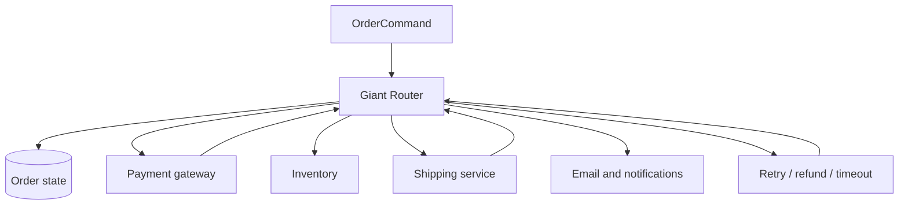
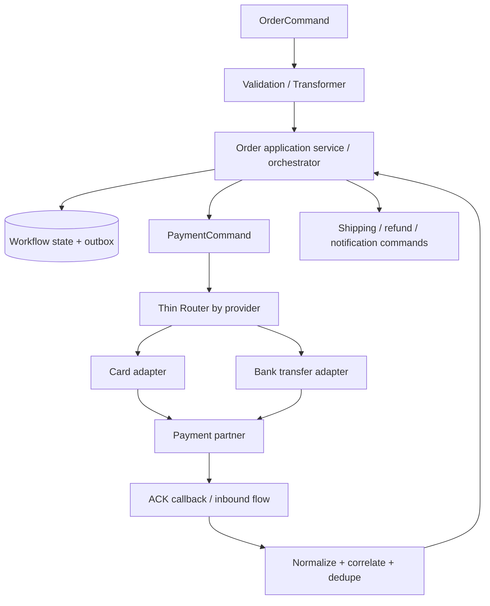
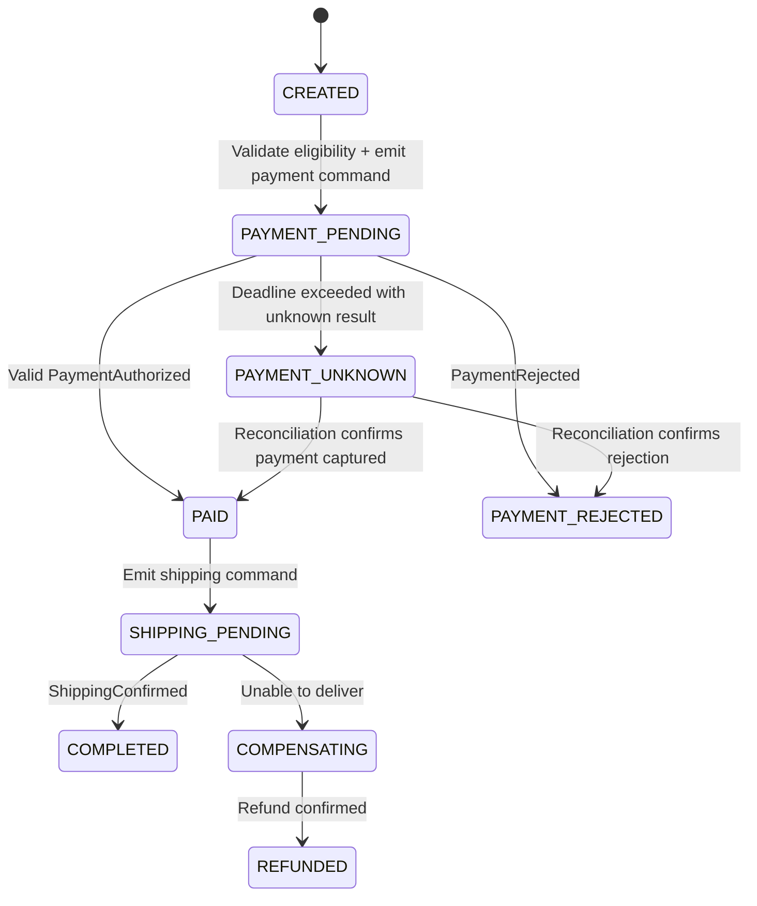

# Using a Router Instead of Oversized Business Orchestration

## 1. Problem: A Router Becomes the Place That Controls All Business Logic

In the **SPRING_INTEGRATION_PATTERN** module, we learn how to implement Enterprise Integration Patterns with Spring Integration to build loosely coupled, extensible, testable, and observable message flows. Router, Filter, Transformer, Splitter, Aggregator, Gateway, retry, error channel, and correlation are all important tools. However, **using a Router to orchestrate an entire business workflow** is an architectural mistake that very easily emerges as the number of processing branches grows.

Suppose an e-commerce system has an order processing flow:

1. Validate the order and inventory.
2. Select an appropriate payment gateway.
3. Wait for the payment result.
4. Place a shipment order with the shipping carrier.
5. Send a confirmation email.
6. When an error occurs, refund the payment or release inventory.
7. When a callback arrives late, query the status to avoid duplicate processing.

Initially, a Router only classifies orders by `paymentMethod`. After a few feature additions, the `if/else` branches start calling the inventory service, writing to the database, retrying payment, waiting for callbacks, compensating transactions, and sending emails. From there, the Router is no longer a message path selector: it becomes a hidden business orchestrator inside the integration layer.

### Lesson Objectives

After this lesson, you will be able to:

- Explain the responsibility boundary of a Router in Spring Integration.
- Identify a Router with too many branches, side effects, and state rules.
- Separate **message routing decisions** from **business state transition decisions**.
- Choose appropriate mechanisms for step-by-step orchestration, error handling, retry, correlation, and long-running workflows.
- Design a thin Router, combine it with an application service or workflow orchestrator, and test them independently.

## 2. What Does a Router Do, and What Should It Not Take On?

A **Router** receives a message, computes one or more destinations based on the characteristics of the message, and forwards the message to the appropriate channel. For example: a message with `eventType=PAYMENT_AUTHORIZED` is sent to the payment result branch; `eventType=PAYMENT_REJECTED` goes to the rejection handling branch.

A good Router typically answers the question:

> **Which processing channel should the current message go to?**

It should not have to answer all of the following questions inside a single method:

- Is the order **allowed** to transition from `PENDING` to `PAID` right now?
- Can two duplicate ACKs create two shipments?
- If payment succeeds but shipment creation fails, how should the refund be performed?
- After a restart, which step is still in progress and needs to be re-run?
- How long does the workflow wait at most, who marks the timeout, and who reconciles it?
- Should an out-of-order event be stored for later processing?

Those questions belong to **business domain rules**, workflow state, transactions, idempotency, or recovery policies. A Router can **route a message to the component that decides these things**, but it should not contain all of that logic.

| Component | Primary Responsibility | Example in Order Processing |
| --- | --- | --- |
| **Router** | Select one or more target channels | Route `CARD` to the card adapter, `BANK` to the bank transfer adapter. |
| **Filter** | Keep or discard messages based on simple conditions | Block unsupported event types or structurally invalid messages. |
| **Transformer** | Transform data shape | Convert a partner callback payload into an internal `PaymentAuthorized` event. |
| **Gateway** | Provide a request/reply interface for callers | A service invokes the integration system via a Java method, with a clear timeout/error contract. |
| **Aggregator** | Combine multiple messages with correlation and a release strategy | Wait for independent results until conditions are met to complete a step. |
| **Application service / orchestrator** | Apply state transition rules and emit the next command | Only emit the create-shipment command after confirming valid payment. |
| **Durable workflow / state machine** | Track multi-step progress, deadlines, recovery, and compensation | Recover pending orders when the application restarts. |

A Router can contain many mappings and still be reasonable, as long as each mapping expresses a clear **routing rule**. Line count is not the only criterion; the bigger issue is **mixed responsibilities**.

## 3. Signs That a Router Has Turned Into Orchestration

Symptoms that need review:

1. **Routing calls a database or external API**: determining the channel depends on writing state, reserving inventory, or calling payment.
2. **Deeply nested conditional trees**: `if/else` inspecting payment method, delivery region, transaction status, retry count, deadline, configuration flags, and many fields unrelated to channel selection.
3. **Routing mutates state**: a `route()` call inadvertently transitions an order from `PENDING` to `PAID` or issues a refund command.
4. **Routing depends on hidden history**: the same message returns a different path because a local cache or mutable flag changed.
5. **Tangled error handling**: inside the Router there is a `try/catch` to retry network calls, sleep, send to a dead-letter channel itself, and decide rollbacks.
6. **Hard to test in isolation**: testing a simple mapping requires standing up a database, broker, payment gateway, and multiple mocks.
7. **Not recoverable**: when the application restarts, the Router does not know the workflow has paid but not yet created a shipment.
8. **One channel holds "everything"**: messages are routed back to the Router after every step just so the Router can read a custom status string and figure out the next action.

### Anti-Pattern Example: A Router Performing Side Effects

The following snippet is **anti-pattern demonstration code**, intentionally combining multiple responsibilities to point out the mistakes; dependencies are hypothetical interfaces, not a complete application example:

```java
@Router(inputChannel = "incomingOrders")
public String chooseNextStep(OrderCommand command) {
    // Mistake 1: mutating data while deciding the channel.
    inventoryService.reserve(command.orderId());

    if ("CARD".equals(command.paymentMethod())) {
        // Mistake 2: calling an API with side effects from the Router.
        PaymentResponse response = paymentClient.charge(command);
        if (response.accepted()) {
            orderRepository.markPaid(command.orderId());
            return "shippingRequests";
        }
        // Mistake 3: deciding compensation inside the Router.
        inventoryService.release(command.orderId());
        return "paymentRejected";
    }

    if ("BANK".equals(command.paymentMethod())) {
        // Mistake 4: the Router has to know about timeouts and business progress.
        orderRepository.markWaitingForTransfer(command.orderId());
        return "pendingBankTransfers";
    }

    throw new IllegalArgumentException("Unsupported payment method");
}
```

The consequence is that the same message can cause multiple side effects before the Router even returns a channel. If downstream delivery fails and upstream retries the entire processing, inventory reservation or payment operations may be repeated. If the payment gateway reports a timeout, the Router does not know whether the partner has already processed the transaction. If refunds or fraud reviews are added later, those rules get nested into the same method.

In particular, **a failure when routing to a channel** does not mean the external business transaction has rolled back. A Java exception does not automatically undo an HTTP request or a transaction in another system.

## 4. Cause Diagram and Alternative Design

### 4.1. Problematic Design



The Router simultaneously executes business logic, routes messages, receives callbacks, and controls errors. Changes across multiple dependencies force one central component to change as well.

### 4.2. Design With Separated Responsibilities



In the new design:

- **Orchestrator** knows which step the order is in and which rules allow transitioning to the next step.
- **Router** only knows the message type or provider and forwards to the corresponding adapter.
- **Adapter** executes communication with external systems and translates technical errors into results/exceptions with a clear contract.
- **State store / outbox / inbox** serves as the source of truth for workflows that must survive restarts.
- **ACK flow** resolves correlation and deduplication before applying a state transition.

Depending on complexity, the orchestrator can be a simple application service, a state machine, or a workflow engine. You do not need to deploy a workflow engine just because there are a few `if/else` statements; choose the abstraction level according to the workflow's duration, scale, and recovery requirements.

## 5. Designing a Router in Its Proper Role in Spring Integration

### 5.1. Choose a Stable Routing Key With a Clear Value Set

In the payment example, we define:

- `provider` has the value `CARD` or `BANK`, produced by the validation/normalization step.
- `commandId` identifies a single request attempt and is used as the correlation key for the ACK.
- `orderId` identifies the business order.
- The rule transitioning the order to `PAID` lives in the orchestrator, **not** in the Router.

For many applications, a good Router can rely on a header classified by an upstream step. Avoid letting clients send arbitrary **Spring channel names** and using them directly as destinations without a whitelist/mapping.

### 5.2. Java Configuration: Pure Header-Based Routing

The example below illustrates Spring Integration Java DSL with predefined channels. The `paymentRouterFlow()` method only inspects the `paymentProvider` header to choose a channel; it does not call the database, does not decide whether payment is complete, and does not perform retries itself.

```java
import org.springframework.context.annotation.Bean;
import org.springframework.context.annotation.Configuration;
import org.springframework.integration.channel.DirectChannel;
import org.springframework.integration.config.EnableIntegration;
import org.springframework.integration.dsl.IntegrationFlow;
import org.springframework.messaging.Message;
import org.springframework.messaging.MessageChannel;

@Configuration
@EnableIntegration
public class PaymentRoutingConfig {

    @Bean
    public MessageChannel paymentDispatchInput() {
        return new DirectChannel();
    }

    @Bean
    public MessageChannel cardPaymentRequests() {
        return new DirectChannel();
    }

    @Bean
    public MessageChannel bankPaymentRequests() {
        return new DirectChannel();
    }

    @Bean
    public MessageChannel unsupportedPaymentRequests() {
        return new DirectChannel();
    }

    @Bean
    public IntegrationFlow paymentRouterFlow() {
        return IntegrationFlow.from("paymentDispatchInput")
                .route(Message.class,
                        m -> m.getHeaders().get("paymentProvider", String.class),
                        mapping -> mapping
                                .channelMapping("CARD", "cardPaymentRequests")
                                .channelMapping("BANK", "bankPaymentRequests")
                                .defaultOutputChannel("unsupportedPaymentRequests"))
                .get();
    }
}
```

With an already validated and normalized input message:

```java
import org.springframework.integration.IntegrationMessageHeaderAccessor;
import org.springframework.integration.support.MessageBuilder;
import org.springframework.messaging.Message;

record PaymentCommand(String commandId, String orderId, long amountMinor) {}

PaymentCommand command =
        new PaymentCommand("cmd-2026-001", "order-42", 750_000L);

Message<PaymentCommand> message = MessageBuilder.withPayload(command)
        .setHeader("paymentProvider", "CARD")
        .setHeader(IntegrationMessageHeaderAccessor.CORRELATION_ID,
                   command.commandId())
        .build();

// Send the message to the paymentDispatchInput bean from the application service.
// The Router selects cardPaymentRequests based on paymentProvider.
```

The `cardPaymentRequests` and `bankPaymentRequests` channels are consumed by their corresponding service activators/adapters. An adapter can receive `PaymentCommand` and submit the command to the external system. There is no need to put order state checking logic into the Router; the application service can check the state before emitting `PaymentCommand`.

On the unsupported branch, **a real consumer** is needed for `unsupportedPaymentRequests` to produce a contract-compliant error or forward the message into an exception handling flow. Setting a default channel with no subscriber can lead to message delivery failures on a `DirectChannel`.

### 5.3. Properly Understanding Default Route, Channel Resolution, and Send Failures

According to the Spring Integration documentation:

- `channelMapping` maps a **routing key** to a channel, decoupling business names from infrastructure names.
- When no destination is determined, the Router throws an error by default if there is no valid default path.
- `defaultOutputChannel` is used to handle keys that have no mapping. Behavior when a mapping is declared but the channel does not exist also depends on `resolutionRequired` and `channelKeyFallback`; do not assume every case automatically falls back to the default channel.
- `resolutionRequired` defaults to `true`; channel resolution failures can become a `MessagingException`.
- `nullChannel` is a path that intentionally discards messages. It should not be used as the default for important transactions without an explicit business rule.
- `ignoreSendFailures` can cause channel send failures to be ignored; you must understand the consequences when messages carry business side effects.

In the lab exercise, configure an **explicit unsupported route** and test the invalid provider case. For systems that require auditing, unroutable messages must be recorded and given an appropriate outcome state rather than being silently swallowed.

## 6. The Application Service Is Responsible for Business Orchestration

An order can transition through the following states:



This is a **business state machine defined by the application**, not states automatically managed by the Spring Integration Router. The states are persisted to answer: "Which command has been executed, which step is it currently in, and is it allowed to emit the next one?".

### 6.1. Conditional State Transition Rules

Suppose the `PaymentAuthorized(commandId, eventId, orderId)` callback is normalized into an internal message. The application service needs to:

1. Look up the payment task by `commandId`, and verify `orderId` belongs to that task.
2. Detect an already-processed `eventId` (idempotency) so it does not create a shipping command twice.
3. Only allow transitioning from `PAYMENT_PENDING` to `PAID` when the confirmation is valid.
4. Within the same transaction, persist the new state and the event to emit (outbox).
5. After commit, a worker sends the event to the broker. If redelivered, the receiver must handle duplicates safely.

Example conditional update statement:

```sql
UPDATE order_process
SET state = 'PAID',
    updated_at = CURRENT_TIMESTAMP,
    version = version + 1
WHERE order_id = :orderId
  AND payment_command_id = :commandId
  AND state = 'PAYMENT_PENDING';
```

If the updated row count is 0, the service must re-read the state to distinguish between a duplicate event, a mismatched key, or an already-changed state. It must not automatically create a shipment without confirming a valid state transition. Checking/recording `eventId` should be in the same transaction as the state change and outbox write to prevent races between duplicate callbacks.

### 6.2. Application Service Pseudocode

The following snippet is **application-layer Java pseudocode** to illustrate responsibility boundaries; repository/transaction methods represent contracts to be implemented:

```java
@Transactional
public void handlePaymentAuthorized(PaymentAuthorized event) {
    if (inbox.alreadyProcessed(event.eventId())) {
        return; // Redelivered ACK, do not emit a new command.
    }

    OrderProcess process = orders.lockByCommandId(event.commandId());
    process.assertMatchesOrder(event.orderId());

    if (process.state() == OrderState.PAYMENT_PENDING) {
        process.markPaid();
        orders.save(process);
        outbox.append(new ShippingRequested(
                process.orderId(), process.nextShippingCommandId()));
    } else {
        // Late event or wrong state: record/reconcile per business rules.
        audit.recordUnexpectedPaymentEvent(event, process.state());
    }

    inbox.markProcessed(event.eventId());
}
```

In this example, the Router's only job is **delivering `PaymentAuthorized` to the application service**. All conditions for changing state, deduplication, and emitting the next command live in a layer that is easy to test and manage transactions for.

Do not equate a method annotated with `@Transactional` with a transaction spanning multiple HTTP services. Once an external payment gateway has been called, rolling back the application's database **cannot undo** effects on the partner's side. Compensation, idempotency, and reconciliation mechanisms are required.

## 7. Retry, Errors, and Compensation Must Be Clearly Separated

A giant Router often uses a single `catch (Exception)` to retry connections, issue refunds, and mark the order failed all at once. This is dangerous because those three error groups have different meanings.

| Situation | Appropriate Handling | What Not to Do in a Router |
| --- | --- | --- |
| Transient connection error to provider | Bounded retry at the adapter, with an idempotency key and clear retry policy | Loop calling `charge()` indefinitely inside `route()`. |
| Provider returns business rejection | Convert into a `PaymentRejected` event and update valid state | Treat it as a technical exception and automatically retry payment. |
| Client times out while provider may have charged | Mark status as unknown, query/reconcile | Automatically conclude failure and immediately emit a retry payment command. |
| Payment succeeded, shipment creation failed | Orchestrator decides to retry shipping or refund | Directly call refund inside a router branch lacking state history. |
| Duplicate callback | Inbox/idempotency and conditional update | Re-emit a shipping event every time a callback arrives. |
| No matching channel | Fail fast or route to an unsupported branch and audit | Send to `nullChannel` by default, losing transaction trail. |
| Asynchronous exception | Error flow / error channel matched to the entry point | Assume exceptions always propagate back to the HTTP caller. |

Spring Integration provides advice mechanisms (such as retry advice), error channels, and gateways to wrap integration steps. Use them for **transport/technical errors**, coordinated with business rules managed by the orchestrator.

### 7.1. Saga and Compensation

When a workflow spans multiple services and each step has its own transaction, the **Saga** pattern is useful for designing compensating actions. For example:

```text
ReserveInventory  --> ChargePayment --> CreateShipment
       |                   |                 |
       +----- failure <----+                 |
       |                                     |
       +<-------- Shipment failure ----------+

Compensation may include:
- RefundPayment (if already charged)
- ReleaseInventory (if already reserved)
```

Not every operation can be reversed immediately; refunds can take time and have their own failures. The orchestrator needs to persist **which steps have completed**, **which compensations are running**, and **confirmation results**. Choose Saga choreography (each service reacts to events) or orchestration (a coordinator issues commands) according to system characteristics; a Router in Spring Integration does not turn itself into a Saga engine.

## 8. Other Patterns That Support Workflows Without Replacing Everything

To keep the flow loosely coupled and traceable, combine patterns within their proper scope:

| Problem | Pattern / Mechanism | Notes |
| --- | --- | --- |
| Which adapter should a message go to? | Router | Clear mapping, do not embed side effects in the routing function. |
| Partner payload differs from internal schema | Transformer | Preserve correlation/event IDs during transformation. |
| Reject a structurally invalid message | Filter or validation step | For request/reply flows, decide explicitly whether to return an error or stay silent. |
| A command needs to run through a Java interface | Gateway | Configure deadlines and errors; a reply might never arrive. |
| Need to wait for enough independent results | Aggregator + correlation/release strategy | Consider a MessageStore if groups must survive restarts. |
| Need to wait for a very short ACK in the same process | Thread Barrier | Waits on a thread; does not provide a persistent workflow on its own. |
| Need to retry calling a provider | Retry advice at the adapter | Bounded with idempotency; avoid duplicating side effects. |
| Errors occurring from async executors/listeners | Error channel | Separate technical errors from business rejection events. |
| Tasks spanning restarts | Workflow state + outbox/inbox/reconciler | Include deadlines, atomic state transitions, and Status API/callbacks. |

Do not split one large Router into **another chain of large Routers** just to reduce lines per method. Define the boundaries between **routing**, **command execution**, **state transitions**, and **recovery** before splitting components.

## 9. Correlation, Concurrency, and Duplicate Messages

In a workflow with asynchronous callbacks, a Router is not enough to match results back to the right operation:

- `orderId`: order identity.
- `commandId`: identity of the emitted command, suitable for correlating ACKs.
- `eventId`: identity of the received event, used for deduplication.
- `traceId`: cross-service observability purpose; not necessarily unique per command.
- `idempotencyKey`: contract between sender and receiver to safely handle retries/redeliveries.

These IDs may share values in small problems, but they should be designed with **different lifecycles and roles**. Do not use a request's `MessageHeaders.ID` expecting an out-of-process callback to automatically carry the same ID.

### 9.1. State Contention

Two callbacks `PaymentAuthorized` and `PaymentRejected` may arrive close together, or an ACK may arrive at the same time as a timeout worker. If a Router checks `if (currentState == PENDING)` and then calls multiple downstream services without atomic locking/updating, both threads can see the stale state and produce conflicting outcomes.

Move the decision into a transaction with optimistic locking or a conditional update; check the affected row count and handle win/loss cases. If a result arrives after the deadline, record it and reconcile per policy rather than deleting important messages just because they arrived late.

### 9.2. A Flow Does Not Equal a Cross-System Transaction

An integration flow can connect synchronous `DirectChannel`s, asynchronous `ExecutorChannel`s, or queues/brokers. A message passing through steps on a diagram **does not guarantee** they share a transaction, run on the same thread, or always preserve ordering. Each asynchronous boundary requires its own delivery, error, correlation, and idempotency contract.

## 10. Testing at the Right Responsibility Boundaries

When a Router is thin enough, testing route selection becomes very cheap. You can test mappings with Spring Integration Test or run a flow with target channels backed by `QueueChannel` in a test configuration. In a pure unit test, extract the classification function into a side-effect-free part:

```java
public final class PaymentRouteClassifier {
    public String classify(String paymentProvider) {
        if (paymentProvider == null) {
            return "UNSUPPORTED";
        }
        return switch (paymentProvider) {
            case "CARD" -> "CARD";
            case "BANK" -> "BANK";
            default -> "UNSUPPORTED";
        };
    }
}
```

```java
import static org.junit.jupiter.api.Assertions.assertEquals;
import org.junit.jupiter.api.Test;

class PaymentRouteClassifierTest {
    private final PaymentRouteClassifier classifier = new PaymentRouteClassifier();

    @Test
    void routesKnownProviderWithoutSideEffects() {
        assertEquals("CARD", classifier.classify("CARD"));
        assertEquals("BANK", classifier.classify("BANK"));
    }

    @Test
    void unknownProviderGoesToExplicitUnsupportedBranch() {
        assertEquals("UNSUPPORTED", classifier.classify("CRYPTO"));
        assertEquals("UNSUPPORTED", classifier.classify(null));
    }
}
```

If you apply this classifier to the Java DSL in section 5, you can route using `classifier.classify(provider)` and add `channelMapping("UNSUPPORTED", "unsupportedPaymentRequests")`. This is an **alternative to using a default channel**, consistent with the goal of handling unsupported keys explicitly.

### 10.1. Testing Matrix

| Component | Case | What to Verify |
| --- | --- | --- |
| Router | `CARD` / `BANK` | Each message goes to exactly one corresponding adapter, with no business side effects in selection. |
| Router | Missing or unknown provider | Flow reports an explicit error/unsupported path without silently dropping the message. |
| Router | Misconfigured target channel | Resolution/send error is observed; routing is not assumed successful by default. |
| Orchestrator | `PAYMENT_PENDING -> PAID` | Only emits `ShippingRequested` when the transition is valid. |
| Orchestrator | Duplicate `eventId` callback | Does not create two shipping commands. |
| Orchestrator | ACK after deadline | Recorded and reconciled, does not blindly accept an invalid state. |
| Orchestrator | Shipping fails after payment | Runs a controlled retry/compensation policy. |
| Gateway | No reply received | Caller receives a defined timeout/error, does not hang indefinitely. |
| Async error flow | Adapter throws exception | Error event is recorded at the proper entry point; does not arbitrarily become "another route". |
| Recovery | Restart while command pending | State/outbox retains sufficient data to resume or reconcile. |

For technical errors, test at the adapter and error channel boundaries. For business logic, test transitions, idempotency, and durability with a real transaction/repository at an appropriate integration level. Do not overuse Router mocks as a substitute for verifying workflow state.

## 11. Roadmap for Refactoring an Oversized Router

If a system already has a Router that has accumulated many responsibilities, change it in verifiable steps:

1. **Map the current state**: list every routing key, target channel, side-effect call, mutated state, error handling, and retry inside the Router.
2. **Classify decisions**: keep pure channel-selection predicates; mark every call that mutates state or invokes external systems.
3. **Define message contracts**: define `commandId`, `eventId`, `correlationId`, and supported events and commands. Do not let channel names become a public business API.
4. **Extract adapters**: move provider calls to dedicated Service Activators or integration flows; configure retry/error policies at that boundary.
5. **Extract state transitions**: move business rules to an application service with transactions, idempotency, and an outbox if recovery is needed.
6. **Design timeouts/compensation**: give each critical step a deadline, an unknown state, and a reconciliation action; do not treat timeout as certain failure.
7. **Write tests before changing the flow**: capture expected outcomes of existing branches, especially duplicate callbacks, unknown providers, and mid-step failures.
8. **Migrate branches gradually**: keep mappings stable initially, move one provider/event type at a time to the new handler, and monitor errors and metrics before removing old logic.

The goal is not to make the Router have the fewest lines, but to make **the blast radius of changes predictable**: adding a new provider mainly adds an adapter and mapping; changing refund rules mainly edits the orchestrator; changing brokers mainly updates transport and consumers.

## 12. Operations: Observing Routing Decisions and Business Progress

A thin Router makes logs clearer. Distinguish between two types of events:

```text
event=message_routed   commandId=cmd-2026-001 provider=CARD target=cardPaymentRequests
event=provider_ack     commandId=cmd-2026-001 eventId=ack-001 result=AUTHORIZED
event=state_transition orderId=order-42 from=PAYMENT_PENDING to=PAID
event=command_emitted  orderId=order-42 command=ShippingRequested
```

This is an example of application-emitted logs, not Spring Integration's default log format. Fields should be consistent so flows can be traced and business decisions audited. Do not put payment data, tokens, or sensitive PII into logs; avoid using `commandId` as a metric label with excessive cardinality.

Metric groups to observe: unroutable message rate, channel resolution errors, adapter send errors, provider latency, pending orders count, retry rate, timeouts, duplicate callbacks, open compensations, and unpublished outbox event backlog. If the Router has many errors while the orchestrator does not record clear state, it becomes very difficult to distinguish "message went to the wrong channel" from "order stuck after payment".

## 13. Lab Exercise: Fixing an Order Orchestration Router

Given the problem: an order has `paymentMethod=CARD/BANK`, must confirm payment before calling shipping, and occasionally receives duplicate or late callbacks. Perform the following:

1. Write a table distinguishing **routing rules** from **business transition rules**; specify who owns each rule.
2. Create `PaymentCommand` with `commandId`, `orderId`, and `paymentProvider`; use a Header Enricher or normalization step to place `paymentProvider` into a message header.
3. Configure a Router to only select `cardPaymentRequests` or `bankPaymentRequests`; create an unsupported handling branch.
4. Write an adapter to send the command to the provider; design bounded retries and an idempotency key.
5. Create an application service receiving `PaymentAuthorized` and `PaymentRejected`, updating state conditionally and emitting `ShippingRequested` via an outbox.
6. Send two callbacks with the same `eventId` and prove that the shipping command is emitted only once.
7. Simulate a timeout between provider processing and ACK arrival; record an unknown state, then reconcile.
8. Test the case where shipping fails after payment succeeds and state the order of compensation steps.
9. Add logging at the Router, adapter, and orchestrator to distinguish routing errors from business errors.

**Self-Assessment Questions**

- Is a Router with 30 simple mappings that makes no external service calls necessarily an architectural mistake? Why or why not?
- If a Router both returns a channel and calls `paymentClient.charge()`, what can message retry cause?
- Why must the `PAID` state be decided inside the application service's transaction?
- When is an Aggregator more useful than a chain of Routers looping back and forth?
- Why can a timed-out payment HTTP call not automatically be treated as a failed transaction?
- When running multiple instances, what distinct problems do correlation, idempotency, and outbox solve?

## 14. References

- [Spring Integration Reference — Router Implementations](https://docs.spring.io/spring-integration/reference/router/implementations.html): how to use HeaderValueRouter, Java DSL, Router types, and channel mapping.
- [Spring Integration Reference — Common Router Parameters](https://docs.spring.io/spring-integration/reference/router/common-parameters.html): `default-output-channel`, `resolution-required`, `ignore-send-failures`, and `channelKeyFallback`.
- [Spring Integration Reference — Messaging Gateways](https://docs.spring.io/spring-integration/reference/gateway.html): request/reply interfaces, timeouts, and exception propagation.
- [Spring Integration Reference — Aggregator](https://docs.spring.io/spring-integration/reference/aggregator.html): correlation, release strategies, message group management, and differences from Router.

> **Takeaway:** **A Router decides where a message goes; an orchestrator decides what the business is allowed to do next and why.** Keep Routers purely about routing, put state transitions and idempotency in the application service, communicate externally through adapters, and handle retries/errors/timeouts at the proper boundaries. When a workflow is long-running or needs to recover after a restart, persist progress durably instead of hiding it inside a Router branch tree.
