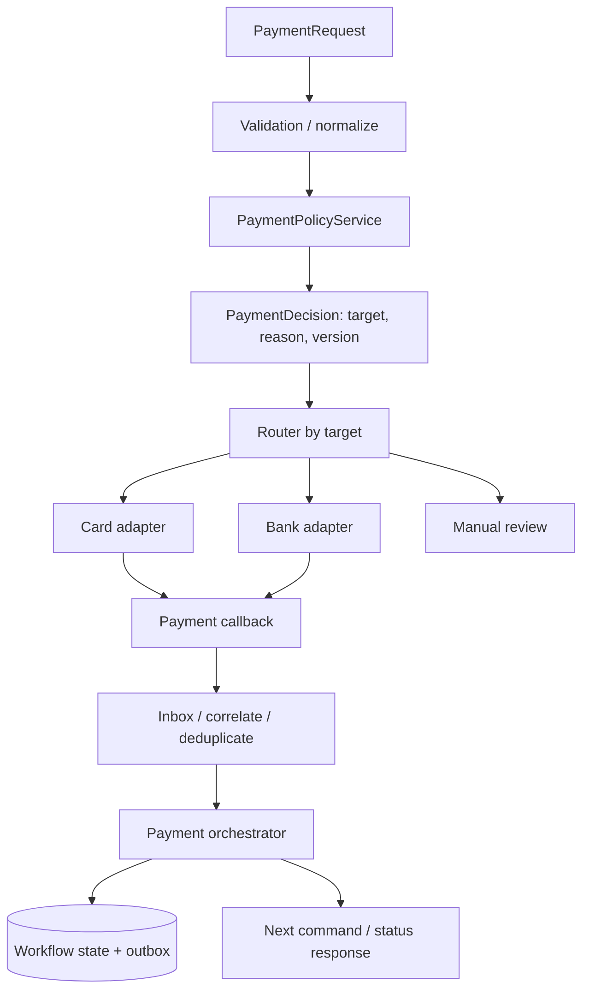

# Putting Business Logic Inside Expressions

## 1. Context and Common Mistake

In **SPRING_INTEGRATION_PATTERN**, we learn how to implement Enterprise Integration Patterns with Spring Integration to build loosely coupled, extensible, and testable message flows. Router, Filter, Transformer, Splitter, Aggregator, Gateway, retry, error channel, and correlation work together to process messages across multiple branches. Spring Integration supports **Spring Expression Language (SpEL)** to describe concise operations directly in flow configuration.

For example, a Router only needs to read the `paymentProvider` header to forward a message to the corresponding adapter:

```java
.route("headers['paymentProvider']", r -> r
        .channelMapping("CARD", "cardRequests")
        .channelMapping("BANK", "bankRequests")
        .defaultOutputChannel("unsupportedProviderRequests"))
```

This is an appropriate use of an expression: reading a clearly meaningful attribute and deciding the **technical destination** of a message. Problems start when expressions gradually become the place that checks credit limits, decides order status, writes to the database, calls a payment gateway, issues refunds, or orchestrates retries itself. At that point, a single line of SpEL can hide an entire business process without clear testability, transactional boundaries, or observability.

**The mistake analyzed in this lesson:** placing significant business decisions or side effects inside expressions of a Router, Filter, Transformer, Header Enricher, Service Activator, or similar configuration points, instead of placing them in application/domain classes with clear contracts and independent testability.

### Learning Objectives

After this lesson, you will be able to:

1. Distinguish which expressions only manipulate message data and which expressions hide business logic.
2. Explain the risks when a SpEL expression invokes a bean with side effects, updates state itself, or controls retries.
3. Move business policies into a Java service with explicit types, errors, and tests.
4. Use expressions for simple routing/transformation while combining Service Activator, Router, and Gateway in their proper roles.
5. Design correlation, idempotency, error handling, logging, and testing for workflows containing multiple asynchronous steps.

## 2. What Role Do Expressions Play in Spring Integration?

Spring Integration allows using SpEL in many components. Depending on the endpoint and library version, an expression can read `payload`, `headers`, invoke methods, or reference beans via `@beanName`. In appropriate cases, expressions reduce Java boilerplate for simple configuration operations.

| Component | Short Expression Example | Reasonable Purpose |
| --- | --- | --- |
| Router | `headers['paymentProvider']` | Read a routing key and map to a channel. |
| Filter | `payload.amountMinor > 0` | Check a simple boundary data condition, if the discard/error contract is clear. |
| Transformer | `payload.trim()` | Simple value normalization without changing business state. |
| Header Enricher | `payload.commandId` | Attach a correlation header from a validated value. |
| Service Activator with expression | `@formatter.format(payload)` | Call a pure, small formatting function with a clear contract, if the return type is controlled. |

**SpEL is not forbidden in integration flows.** What must be avoided is **business responsibility exceeding what can be cleanly expressed and managed** in an inline configuration expression.

### 2.1. Distinguishing Three Decision Layers

| Layer | Core Question | Where It Should Live |
| --- | --- | --- |
| Data/technical manipulation | Which header carries the event type? Which channel should the message go to? | Router/Filter/Transformer; a short expression may suffice. |
| Business policy | Is the order approved? Is the customer eligible? | Domain policy or application service, with typed output and tests. |
| Workflow orchestration | After payment succeeds, what is the next step? Does a shipping failure trigger a refund? | Application orchestrator, state machine, or durable workflow when needed. |

An expression that only reads data can still contain **business rules**. For example, `payload.amountMinor > 10000000 && payload.customerTier == 'VIP'` used to decide **automatic credit approval** is a business policy that needs to be named, tested, versioned, and audited. Just because logic does not write to a database does not make it suitable to stuff into SpEL.

## 3. Anti-Pattern Example: A Small Expression Hiding Big Side Effects

Suppose a team wants to route a payment request to the shipment creation step if the payment gateway reports success. They configure an expression like this:

```spel
@paymentClient.charge(payload.commandId, payload.amountMinor)
    ? 'shippingRequests'
    : 'paymentFailed'
```

This is an **anti-pattern**, not a configuration pattern to use. The expression calls `paymentClient.charge(...)`, meaning that **channel selection** simultaneously triggers a real money transaction in another service.

Problems arise when:

- The endpoint is invoked again after retry/redelivery; the charge operation may be duplicated.
- The payment gateway already charged, but the connection timed out; the expression may throw an error without knowing the actual outcome.
- The message goes to `shippingRequests` but downstream fails; rolling back the internal transaction does not undo the partner transaction.
- The team struggles to distinguish **routing** errors from **payment** errors because both happen during expression evaluation.
- Policies for allowing charges, limits, approval requirements, and compensation lack an independent name and contract.

Another expression does not directly call an external service yet still contains hidden policy:

```spel
payload.riskScore < 40
  && payload.amountMinor <= 5000000
  && headers['customerTier'] == 'GOLD'
    ? 'autoApprove'
    : 'manualReview'
```

If those thresholds decide **transaction approval**, they must be expressed as a versioned business policy with boundary tests and an explainable audit trail. If it is merely routing after another component has produced an `ApprovalDecision`, the Router can route based on `decision.status` without needing to know how the policy computes the result.

### 3.1. Another Anti-Pattern: Overly Long and Unreadable Expressions

```spel
payload != null
  && payload.customer != null
  && payload.customer.active
  && payload.items != null
  && payload.items.size() > 0
  && payload.totalMinor > 0
  && headers['region'] != null
  && @creditPolicy.isAllowed(payload.customer.id, payload.totalMinor)
  && @promotionService.consumeVoucher(payload.voucherCode)
```

Here, message structure validation, credit rules, and voucher consumption have been mixed into a single Filter condition. If a branch returns `false`, it is hard to know why: missing data, ineligible customer, or exhausted voucher? With `consumeVoucher()`, a predicate also has a **side effect**: a message may be blocked after the voucher has already been consumed.

In a Filter, clearly distinguish whether rejected messages are **invalid data**, **business rejections**, or **system errors**. Those three outcomes do not necessarily go to the same discard branch.

## 4. Subtle Consequences When Business Logic Lives in SpEL

### 4.1. No Clear Transaction Boundaries

SpEL can invoke methods on beans, but a method appearing in an expression does not automatically create a complete business transaction. If that method calls external services, commits a database transaction, and publishes a message, you must analyze the transaction boundary of each step separately. An exception in a Router or Filter **does not automatically roll back** operations that already succeeded in another system.

### 4.2. Retries Can Repeat Side Effects

A Retry Advice typically re-executes a handler when the handler throws an error. If the handler re-evaluates an expression containing `charge()`, `reserve()`, `sendEmail()`, or `consumeVoucher()`, each retry can repeat those actions. An idempotency key, command state, and an error-specific retry policy are required.

### 4.3. Expression Errors Become Flow Runtime Errors

Expressions are evaluated as messages traverse endpoints, so issues like missing properties, `null` values, incompatible types, or missing beans in the context may only surface with specific data. Spring Integration can wrap evaluation errors in messaging system exceptions. With synchronous `DirectChannel`s, errors usually propagate back to the sender; with asynchronous executors, pollers, or listeners, you must inspect the corresponding `errorChannel`/error flow.

### 4.4. Difficult and Less Meaningful Testing

If an approval policy is just a SpEL string in configuration, testing all thresholds and edge cases may require booting the Spring context, message headers, endpoints, and related beans. A pure Java service lets you test the policy independently without starting the integration flow.

### 4.5. Observability Data Fails to Explain Decisions

A log saying "routed to manualReview" does not explain why the transaction was sent for review. Produce a typed result containing `decisionId`, `reasonCode`, and `policyVersion`, then have the Router act on that result. This enables auditing, querying, and analyzing policy changes over time.

### 4.6. Difficult Change Management and Code Review

Expressions easily turn into long strings in annotations, XML, properties, or Java DSL. When a threshold changes, reviewers can struggle to see which domain rule is affected. Modifying expressions in runtime configuration also requires testing and release processes proportional to the business risk.

### 4.7. Risk When Expressions Come From Untrusted Input

SpEL can access properties and invoke methods depending on the evaluation context. Never treat **an expression string submitted by a user** as ordinary data and evaluate it directly in a context with access to beans/services. If dynamic rule configuration is needed, use a restricted operator set, validation, allowlists, and an appropriate sandbox/evaluation context; never let message payloads become SpEL programs themselves.

## 5. Recommended Architecture: Named "Decisions", Simple "Routing"

A testable design turns a business decision into a **typed data value**, then lets the Router only choose a branch based on that value.



Key responsibilities:

1. **Validation** ensures input data is complete and properly typed; data errors must return clear feedback.
2. **Policy service** returns `PaymentDecision`, potentially including a reason and policy version; the decision method should be pure when appropriate.
3. **Router** only maps `decision.target` to a predefined channel.
4. **Adapter** communicates with the payment gateway, controlling timeouts and technical retries.
5. **Orchestrator** persists state, prevents duplicates, decides next commands, and handles compensation based on business events.

Depending on complexity, an application service may combine some of the steps above. The goal is to **make clear which component owns each decision**, not to create excessive classes just to inflate interface counts.

## 6. Java Example: Separating Policy From Router

The following example illustrates a simple rule for selecting a payment branch. It does not perform a charge during routing; the decision result is represented as a data type with a reason code for inspection.

### 6.1. Request and Decision Data Types

```java
public enum PaymentRoute {
    CARD,
    BANK,
    MANUAL_REVIEW
}

public record PaymentRequest(
        String commandId,
        String orderId,
        long amountMinor,
        String paymentProvider,
        boolean requiresReview) {
}

public record PaymentDecision(
        String commandId,
        String orderId,
        PaymentRoute target,
        String reasonCode,
        String policyVersion) {
}
```

`commandId` identifies a command execution attempt and can be used to correlate the ACK; `orderId` is the business identity. `reasonCode` explains why the branch was chosen; `policyVersion` supports auditing when rules change.

### 6.2. Policy Service: Pure and Easy to Test

```java
import java.util.Locale;
import org.springframework.stereotype.Service;

@Service
public class PaymentPolicyService {

    public PaymentDecision decide(PaymentRequest request) {
        if (request == null
                || request.commandId() == null || request.commandId().isBlank()
                || request.orderId() == null || request.orderId().isBlank()
                || request.amountMinor() <= 0) {
            throw new IllegalArgumentException("Invalid PaymentRequest");
        }

        if (request.requiresReview()) {
            return decision(request, PaymentRoute.MANUAL_REVIEW, "REQUIRES_REVIEW");
        }

        String provider = request.paymentProvider();
        if (provider == null || provider.isBlank()) {
            return decision(request, PaymentRoute.MANUAL_REVIEW, "MISSING_PROVIDER");
        }

        return switch (provider.toUpperCase(Locale.ROOT)) {
            case "CARD" -> decision(request, PaymentRoute.CARD, "CARD_SELECTED");
            case "BANK" -> decision(request, PaymentRoute.BANK, "BANK_SELECTED");
            default -> decision(request, PaymentRoute.MANUAL_REVIEW, "UNSUPPORTED_PROVIDER");
        };
    }

    private PaymentDecision decision(PaymentRequest request,
                                     PaymentRoute target,
                                     String reason) {
        return new PaymentDecision(
                request.commandId(), request.orderId(), target, reason, "v1");
    }
}
```

In this lab exercise, `MANUAL_REVIEW` is an official handling branch of the example; in real production systems, a missing provider might need to be rejected immediately at validation depending on the API contract. The rule above intentionally demonstrates **purity**: calling `decide()` neither writes to the database nor invokes the payment gateway.

### 6.3. Service Activator Produces the Decision, Router Only Switches Channels

```java
import org.springframework.integration.annotation.Router;
import org.springframework.integration.annotation.ServiceActivator;
import org.springframework.stereotype.Component;

@Component
public class PaymentDecisionEndpoint {
    private final PaymentPolicyService policy;

    public PaymentDecisionEndpoint(PaymentPolicyService policy) {
        this.policy = policy;
    }

    @ServiceActivator(
            inputChannel = "incomingPaymentCommands",
            outputChannel = "paymentDecisions")
    public PaymentDecision classify(PaymentRequest request) {
        return policy.decide(request);
    }
}

@Component
public class PaymentDispatchRouter {
    @Router(inputChannel = "paymentDecisions")
    public String route(PaymentDecision decision) {
        return switch (decision.target()) {
            case CARD -> "cardPaymentRequests";
            case BANK -> "bankPaymentRequests";
            case MANUAL_REVIEW -> "manualReviewRequests";
        };
    }
}
```

The names `incomingPaymentCommands`, `paymentDecisions`, `cardPaymentRequests`, `bankPaymentRequests`, and `manualReviewRequests` are **channels that the application must declare/wire to corresponding consumers**. This is an example of two standalone endpoints, not a complete runnable configuration without creating channels, adapters, and a Spring context. You can use `DirectChannel` for synchronous segments or another channel type according to practical requirements.

Each endpoint has a verifiable responsibility: the policy selects `PaymentDecision` according to rules, the Router maps `PaymentRoute` to a channel, and only the adapter executes the call to the provider. If the selected state needs to be persisted or a command emitted, the application orchestrator manages the transaction/outbox in a well-defined step.

## 7. Spring Integration DSL Example: Keeping Expressions at the Technical Level

In a flow that only needs to select an adapter from an already **validated and normalized** header, SpEL remains a concise configuration approach:

```java
import org.springframework.context.annotation.Bean;
import org.springframework.context.annotation.Configuration;
import org.springframework.integration.config.EnableIntegration;
import org.springframework.integration.dsl.IntegrationFlow;

@Configuration
@EnableIntegration
public class TechnicalRoutingFlow {

    @Bean
    public IntegrationFlow paymentProviderRouting() {
        return IntegrationFlow.from("validatedPayments")
                .route("headers['paymentProvider']", r -> r
                        .channelMapping("CARD", "cardRequests")
                        .channelMapping("BANK", "bankRequests")
                        .defaultOutputChannel("unsupportedProviderRequests"))
                .get();
    }
}
```

This is a useful SpEL case: the expression only **reads a header to compute a routing key**. There is no `@paymentClient.charge()`, no state persistence, and no business decision about "whether payment succeeded".

**Deployment note:** target channels must exist and have subscribers/consumers. If a `DirectChannel` has no subscriber, sending may fail; if a routing key is unsupported, the default branch must be handled intentionally. Applications should define an allowed list of providers rather than taking arbitrary channel names from external input.

### 7.1. When Is SpEL Longer Than a Few Lines Still Acceptable?

There is no absolute character limit. An expression with multiple null-safe reads that only computes a **stable, side-effect-free** routing key, is well-tested, and remains readable can still be reasonable. However, when the expression no longer communicates its intent clearly, when business rules change frequently, or when decision reasons must be recorded, extract it into a named Java method.

For example, instead of stuffing a long risk-scoring expression into a Router:

```text
Policy service:
  evaluateRisk(payment) -> RiskDecision(reason, policyVersion, routeTarget)

Router:
  route(decision.routeTarget) -> manualReviewRequests | cardPaymentRequests
```

Thus, adding scoring criteria does not force the Router, shipping channel, or payment gateway to know policy details.

## 8. Validation, Filter, and Business Rejection

A common point of confusion is using a `Filter` with SpEL to drop messages based on a condition that is actually a **business rejection decision**.

Suppose a Filter contains:

```spel
payload.amountMinor <= 10000000 && payload.customerRank != 'BLOCKED'
```

If `false`, the message may be discarded or produce no reply, depending on configuration. However, in a payment application, "rejected" usually needs its state persisted, a reason code returned, and an event emitted so the caller knows why. Simply dropping the message in a Filter can leave the client waiting for a Gateway timeout without knowing whether the transaction was rejected or the message was lost.

Separate:

- **Technical validation**: payload missing required fields, wrong schema, or wrong types; return structured input errors.
- **Business policy**: limits, blocklists, approval conditions; produce `Approved`/`Rejected`/`ManualReview` with a reason.
- **Routing**: forward messages with clear outcomes to the corresponding handler or channel.

A Filter is still appropriate for dropping irrelevant events (for example, heartbeats when a pipeline only cares about business events), provided discarding is **intentional** and does not drop important transactions.

## 9. Business State, Retry, and Correlation in Asynchronous Flows

Pure expressions make flows easier to understand, but by themselves they do not solve reliability problems. A multi-step process should have contracts for:

| Concept | Purpose | Example |
| --- | --- | --- |
| `commandId` | Identify the command/attempt to track | `pay-cmd-002` |
| `correlationId` | Match callback/ACK to a request or message group | Often equal to `commandId` in the payment step. |
| `eventId` | Detect redelivered/duplicate events | `ack-event-918` |
| `idempotencyKey` | Prevent duplicate side effects on retry/redelivery | `charge-order-42` |
| `policyVersion` | Explain which rule version produced the decision | `risk-v3` |
| `workflowState` | Track current step, deadline, and recovery ability | `PAYMENT_PENDING`, `PAID`, `UNKNOWN`. |

### 9.1. Do Not Put Retries Directly Into Expressions

Do not use SpEL to invoke a method that retries multiple times itself, sleeps, or recurses. Retries belong at the adapter call boundary, with bounds, error classification, and idempotency. When a provider times out, the transaction may already have completed; unconditional retries can duplicate operations.

### 9.2. Do Not Update State Inside Predicates

A method used inside an expression to return a boolean while simultaneously mutating the database is unpredictable. If the next step does not run, the data has already changed. Instead, the orchestrator performs a conditional transition in a transaction and emits commands/outbox events after the decision is made.

Example illustrating the idea of an atomic update:

```sql
UPDATE payment_process
SET state = 'AUTHORIZED',
    updated_at = CURRENT_TIMESTAMP,
    version = version + 1
WHERE command_id = :commandId
  AND state = 'PAYMENT_PENDING';
```

After `UPDATE`, the application **checks the affected row count**. If it is 0, it must determine whether it was a duplicate ACK, an ACK arriving in the wrong state, an already-handled timeout, or a nonexistent command. Do not emit a shipping command just because a message carries the word `AUTHORIZED` if the transition is not valid.

### 9.3. A Correctly Correlated ACK Does Not Mean Business Success

A Barrier can release a request when receiving a trigger with a matching `correlationId` even if the payload is `PaymentRejected`. Routers and expressions only move data; the business service interprets the outcome and updates state. If a workflow is long-running or must survive restarts, durable state, inbox/outbox, and reconciliation mechanisms are required; a Thread Barrier does not durably persist waiting threads on its own.

## 10. Handling Expression Errors and Business Errors in the Right Place

You can use a classification table before deciding where to catch errors:

| Symptom | Nature | Suggested Handling Place |
| --- | --- | --- |
| SpEL reads a nonexistent property or wrong type | Mapping/configuration bug or unnormalized input data | Validation/Transformer, fix configuration; log technical error. |
| Router fails to resolve a channel | Technical routing error | Unsupported branch/error flow; check mapping and channels. |
| Payment policy rejects transaction | Valid business outcome | Domain/application service produces `Rejected` and reason code. |
| Payment adapter loses connection | Recoverable technical error | Bounded retry advice; log trace/correlation. |
| Gateway times out waiting for reply | Reply not received within deadline | Return unconfirmed status, reconcile when needed. |
| Duplicate callback | Normal redelivery in many protocols | Inbox/idempotency, do not apply side effects twice. |
| Payment done but shipping fails | Multi-step workflow failure | Orchestrator handles retry/compensation, do not change Router expression. |

With synchronous channels like `DirectChannel`, exceptions can propagate back to the caller. With `ExecutorChannel`, QueueChannel pollers, or inbound adapters, exceptions occur on another thread, so configure an error flow or `errorChannel` at the right entry point. Do not assume every error will become a synchronous exception at the Gateway.

Avoid catching all exceptions inside an expression and turning them into `false`: doing so makes system errors look like "business condition not met". If a fallback is necessary, explicitly document the error type, retryability, and the request state after fallback.

## 11. Layer-by-Layer Testing: Expression, Policy, Route, and Orchestration

When policies live in a Java service, they can be tested quickly without starting a Spring context for every case.

### 11.1. Unit Tests for Policy

Example with `PaymentPolicyService` from section 6:

```java
import static org.junit.jupiter.api.Assertions.*;
import org.junit.jupiter.api.Test;

class PaymentPolicyServiceTest {
    private final PaymentPolicyService policy = new PaymentPolicyService();

    @Test
    void cardGoesToCardAdapterWithReason() {
        PaymentDecision decision = policy.decide(
                new PaymentRequest("cmd-1", "order-1", 200_000L, "CARD", false));

        assertEquals(PaymentRoute.CARD, decision.target());
        assertEquals("CARD_SELECTED", decision.reasonCode());
        assertEquals("v1", decision.policyVersion());
    }

    @Test
    void flaggedPaymentNeedsManualReviewEvenForKnownProvider() {
        PaymentDecision decision = policy.decide(
                new PaymentRequest("cmd-2", "order-2", 200_000L, "CARD", true));

        assertEquals(PaymentRoute.MANUAL_REVIEW, decision.target());
        assertEquals("REQUIRES_REVIEW", decision.reasonCode());
    }

    @Test
    void invalidRequestIsExplicitlyRejectedByValidation() {
        assertThrows(IllegalArgumentException.class,
                () -> policy.decide(
                        new PaymentRequest("cmd-3", "order-3", 0L, "BANK", false)));
    }
}
```

These tests verify **business outcomes** directly. They do not need a broker, Router, database, or Gateway to validate the policy.

### 11.2. Unit Tests for Router

```java
import static org.junit.jupiter.api.Assertions.assertEquals;
import org.junit.jupiter.api.Test;

class PaymentDispatchRouterTest {
    private final PaymentDispatchRouter router = new PaymentDispatchRouter();

    @Test
    void routesOnlyByDecisionTarget() {
        assertEquals("cardPaymentRequests", router.route(
                new PaymentDecision("c1", "o1", PaymentRoute.CARD, "CARD_SELECTED", "v1")));
        assertEquals("manualReviewRequests", router.route(
                new PaymentDecision("c2", "o2", PaymentRoute.MANUAL_REVIEW, "REQUIRES_REVIEW", "v1")));
    }
}
```

For simple SpEL, an integration test can send messages with header `paymentProvider=CARD/BANK/UNKNOWN` and verify the DSL Router sends messages to the right channel. Add cases for missing headers, null payload, channels without subscribers, and adapter exceptions to clearly observe real error branches.

### 11.3. Tests for Orchestration and Operations

| Scenario | What to Assert |
| --- | --- |
| Two policy calls with same input | Same decision/reason; no hidden side effects. |
| Boundary values of business rules | Decision and reason code are accurate at the threshold. |
| Unknown provider / missing header | Routed to unsupported branch or explicit error, message not silently lost. |
| Technical expression evaluation error | Error flow is observable; not mistaken for "payment rejected". |
| Duplicate ACK callback with same `eventId` | Database is not updated and next command is not emitted twice. |
| Timeout after sending command to provider | Unknown state is recorded, with a reconciliation path. |
| Restart while workflow is waiting | Durable state allows resuming; does not depend on old expression or thread. |
| Adapter error after policy makes a decision | Policy decision record is kept distinct from command send error. |

Test business calculations in pure Java classes, state transitions with an appropriate repository/transaction, and routing flows with Spring Integration Test. You do not need to mock every endpoint to test a small condition; conversely, do not rely solely on policy unit tests and overlook the possibility of messages losing headers across multiple adapters.

## 12. Observing Business Reasons, Not Just SpEL Outcomes

A well-structured flow should log **decisions** and **routing** as two separate events. For example:

```text
event=policy_evaluated commandId=cmd-2 policy=v1 decision=MANUAL_REVIEW reason=REQUIRES_REVIEW
event=message_routed  commandId=cmd-2 source=paymentDecisions target=manualReviewRequests
event=provider_called  commandId=cmd-1 provider=CARD
event=provider_result  commandId=cmd-1 result=AUTHORIZED
event=state_changed    commandId=cmd-1 from=PAYMENT_PENDING to=AUTHORIZED
```

These are sample application-emitted logs, not Spring Integration's default log format. Do not log card numbers, tokens, or sensitive PII; avoid using `commandId` as a high-cardinality metric label.

Track `MANUAL_REVIEW` rates, common `reasonCode` values, expression evaluation error rates, missing headers, channels without subscribers, policy execution time, provider timeouts, duplicate callbacks, and workflow backlog. If an expression is unusually complex, measure processing latency and exception distribution at that endpoint before refactoring.

## 13. Process for Refactoring Existing Business Expressions

When you discover an overloaded expression, you can address it in this order:

1. **List all expressions** attached to Routers, Filters, Transformers, Enrichers, and Service Activators within the flow under review.
2. **Classify each operation**: data reading, routing key calculation, business policy, external service calls, state writes, retries, event creation.
3. **Document the current contract** including inputs/outputs, `null` behavior, exceptions, timeouts, and retries. Write tests protecting critical behaviors before changing code.
4. **Extract side effects** into adapters/application services with clearly named methods, retry policies, and idempotency.
5. **Extract policies** into Java methods returning typed decisions; add `reasonCode`/`policyVersion` if auditing is needed.
6. **Keep expressions short** for integration purposes: reading headers, mapping to channels, clear field transformations.
7. **Standardize message contracts**: correlation headers, event IDs, command IDs, data needed downstream, and exception propagation.
8. **Verify error branches and duplicates** with integration tests, then compare metrics before and after deployment.

**Signs of a successful refactor:** changing approval limits only touches/tests the policy; adding a new provider mainly adds an adapter and mapping; changing compensation rules only touches orchestration; technical channel errors are never logged as "business rejection" decisions.

## 14. Lab Exercise: Extracting Approval Rules From an Expression

Given a sales system using a SpEL Filter to automatically approve payments if the order value is below a threshold, the customer is at `GOLD` tier, and there are no fraud signals. Currently, the Filter also calls bean `@promotionService.consumeVoucher(...)` directly inside the condition. Do the following:

1. Identify which parts are data structure validation, which parts are business policy, and which parts are side effects requiring transactions/idempotency.
2. Define `ApprovalDecision` with `status`, `reasonCode`, and `policyVersion`; write `ApprovalPolicyService.evaluate()` without calling the database or external systems.
3. Create an endpoint converting requests into `ApprovalDecision`, then use a simple Router to send to `approvedRequests`, `manualReviewRequests`, or `rejectedRequests`.
4. Move voucher reservation/consumption into an application service with transactions and explicit duplicate handling. If the voucher is consumed but a later step fails, define the compensation policy.
5. Write unit tests around threshold boundaries, missing customer info, blocked customers, invalid vouchers, and different rule versions.
6. Write integration tests verifying messages arrive at the right channels while preserving `commandId`/`correlationId` across steps.
7. Simulate adapter failures, retry/redelivery, and duplicate callbacks; verify the voucher is not consumed or commands emitted twice.
8. Add separate `policy_evaluated` and `message_routed` event logs, measuring both business outcomes and technical errors.

**Self-Assessment Questions**

- Why can an expression `@paymentClient.charge(payload)` in a Router be dangerous even when the SpEL syntax is valid?
- Is an expression that reads `headers['type']` and selects a channel always wrong? What are the conditions for it to be appropriate?
- Why is a Filter returning `false` insufficient to fully represent a business rejection decision?
- Why does retrying a handler whose expression has side effects require idempotency?
- If the client needs to know the reason for `MANUAL_REVIEW`, what result should be stored instead of only logging the channel name?
- When an expression throws an exception on an asynchronous thread, where do you look for the error and what configuration should you inspect?

## 15. References

- [Spring Integration Reference — Spring Expression Language (SpEL)](https://docs.spring.io/spring-integration/reference/spel.html): mechanism for using expressions in integration components and evaluation context.
- [Spring Integration Reference — Router Implementations](https://docs.spring.io/spring-integration/reference/router/implementations.html): Router, keys, mappings, and Java DSL.
- [Spring Integration Reference — Filter](https://docs.spring.io/spring-integration/reference/filter.html): discard channel, throwing exceptions, and behavior when messages are rejected.
- [Spring Integration Reference — Transformer](https://docs.spring.io/spring-integration/reference/transformer.html): message transformation and Transformer responsibilities.
- [Spring Integration Reference — Error Handling](https://docs.spring.io/spring-integration/reference/error-handling.html): exception handling in synchronous and asynchronous flows.
- [Spring Framework Reference — Spring Expression Language](https://docs.spring.io/spring-framework/reference/core/expressions.html): SpEL syntax, property access, methods, beans, and evaluation context.

> **Takeaway:** Expressions are suitable for **expressing small, clear, side-effect-free technical operations**. Rules that affect money, order state, approval authority, retries, and compensation belong in a named service or workflow with contracts, tests, and auditability. Let integration expressions read and route messages; let business code decide what messages mean.
