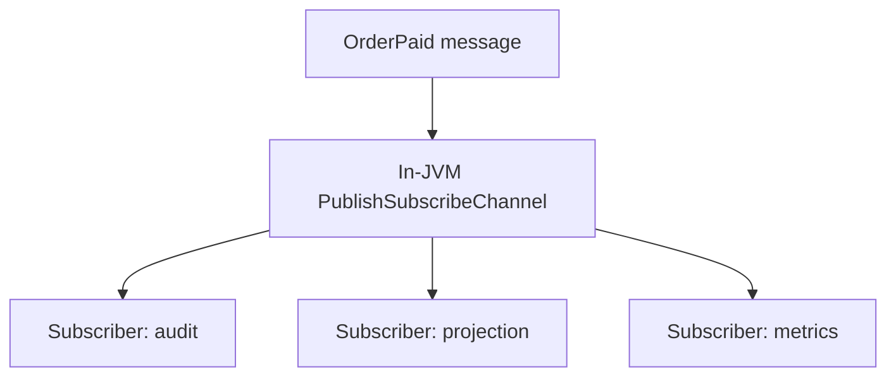
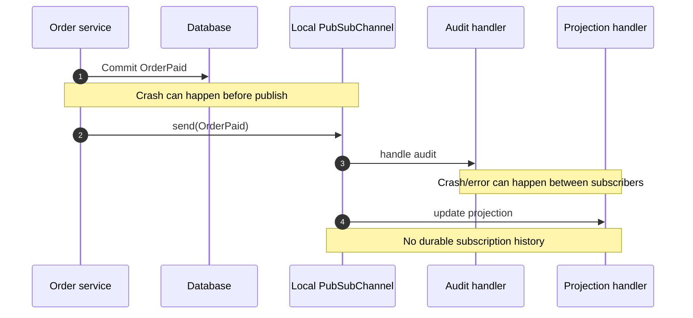
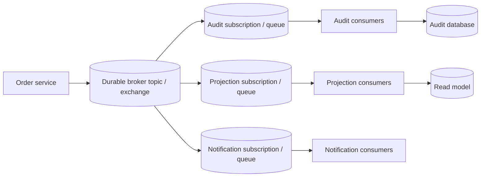
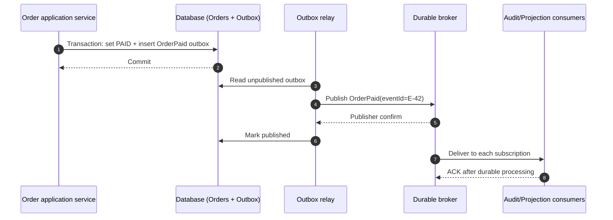
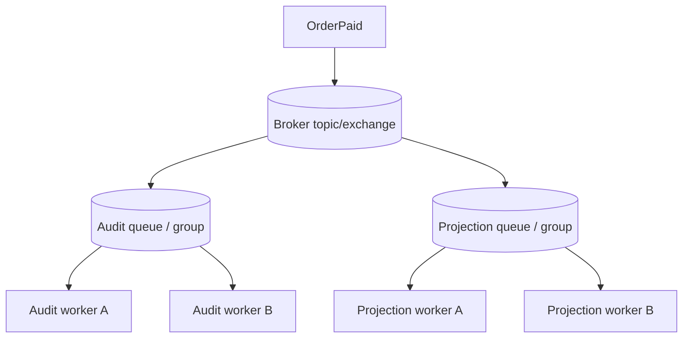

# Using Publish-Subscribe When Durable Delivery Is Needed

## 1. Problem: Broadcast Succeeds, Yet a Subscriber Missed the Event

In the **SPRING_INTEGRATION_PATTERN** module, we implement *Enterprise Integration Patterns* with Spring Integration to build loosely coupled, extensible message flows; practicing Router, Filter, Transformer, Splitter, Aggregator, Gateway, retry, error channel, correlation, and testing and observing processing branches.

A common mistake is using an **in-memory `PublishSubscribeChannel`** to distribute events to multiple places, and then implicitly expecting every destination to receive the event **even if the application or a consumer temporarily stops**. This confuses two distinct concepts:

- **Publish-subscribe** describes how to **distribute a message to multiple subscribers**.
- **Durable delivery** describes **persisting and redelivering messages under a reliability contract** when a consumer is unavailable, a process restarts, or a failure occurs mid-flight.

For example, after an order is paid, the system emits `OrderPaid` to three branches:

1. Mandatory regulatory audit logging.
2. Updating a projection for querying order status.
3. Updating a non-critical internal metric.

If all three branches subscribe to a `PublishSubscribeChannel` within the same JVM, the event may reach all three while the application runs normally. However, if the process crashes after recording the payment status and **before publishing the message**, there is no durable record in the channel to resend. If one subscriber fails after another subscriber has already processed the message, there is no default mechanism ensuring **automatic replay specifically for the failed subscriber** after a restart.

For mandatory audit or business updates, that is a critical gap. For ephemeral metrics, losing a few events may be acceptable. **Channel selection must come from the delivery requirements of each subscriber**.

### Lesson Objectives

After this lesson, you will be able to:

- Explain what `PublishSubscribeChannel` guarantees and does not guarantee.
- Distinguish in-process fan-out from durable subscriptions/queues on a broker.
- Identify data-loss windows: before publish, during fan-out, after receive but before commit, and on restart.
- Design appropriate transactional outbox, durable subscriptions, acknowledgements, retries, DLQs, and idempotency.
- Test crash/restart, redelivery, slow consumers, and error handling flows.

## 2. How Does PublishSubscribeChannel Actually Work?

`PublishSubscribeChannel` is a Spring Integration `SubscribableChannel`: it **dispatches messages to registered handlers** inside the application. When no `Executor` is configured, handlers are invoked on the **sending thread**. When an `Executor` is configured, dispatch can happen on separate worker threads. Adding an executor changes the execution model and how exceptions are observed; **it does not turn the channel into a message broker with persistence**.



Some properties and consequences to understand:

| Feature | Behavior to Understand | What Must Not Be Inferred |
| --- | --- | --- |
| Fan-out | One message is dispatched to multiple subscribers registered at processing time | Every subscriber is guaranteed to receive the message again after restart |
| Without `Executor` | Dispatch typically runs on the sender thread; downstream exceptions can propagate to the sender | Side effects of earlier subscribers are automatically rolled back |
| With `Executor` | Dispatch uses the executor; downstream errors are handled by `ErrorHandler` | The publisher knows all processing tasks have committed |
| `errorChannel` | With an async path and default error handler, an error message may be sent to the error channel | Errors are automatically durably retried or messages automatically go to a DLQ |
| `setMinSubscribers(n)` | Helps define the minimum subscriber threshold for `send()` to consider dispatch successful | Confirms subscribers durably persisted business data |
| `setApplySequence(true)` | Attaches sequence/correlation headers useful when downstream needs Aggregator/Resequencer | Creates durable subscriptions or replay |

For instance, `send()` returning `true` only reports the result of the send operation under the channel contract; **it does not mean all subscribers successfully wrote to the database and are recoverable**. With asynchronous dispatch, the publisher may even finish before subscribers complete processing.

### 2.1. Messages Arriving When There Are No Subscribers

A regular publish-subscribe channel **does not retain messages waiting for a subscriber to register later**. Spring Integration can configure how to react when subscribers are missing, such as requiring subscribers or setting a minimum threshold; however, failing at send time **is not equivalent to storing messages for replay**.

A common design mistake is believing that a consumer temporarily stopped during deployment and started back up will receive events published while it was unregistered. That is not true for a pure in-memory `PublishSubscribeChannel`.

### 2.2. Partial Delivery Across Subscribers

Suppose audit finished writing, but projection throws an exception:

```text
Publisher ── OrderPaid #E-42 ──> PublishSubscribeChannel
                                  |-- audit:      write OK
                                  |-- projection: EXCEPTION
                                  |-- metrics:    may not have run yet or already ran
```

With synchronous dispatch and default settings, an exception can stop processing and propagate back to the caller; each subscriber's outcome depends on dispatch order and configuration. With an executor, handlers can run independently; errors must be observed through async error handling. In both cases, **there is no automatic distributed transaction spanning all subscribers**.

## 3. What Is Durable Delivery?

Before choosing a technology, write down a concrete contract:

- **Delivery goal:** is message loss acceptable (*best effort*), at most once (*at most once*), or **at least once** (*at least once*)?
- **Durability scope:** must events survive publisher crashes, broker restarts, consumer shutdowns, or rolling out a new deployment?
- **Who needs each copy:** one consumer within a processing group, or must **each business capability** receive its own copy?
- **When to acknowledge:** is a message ACKed/committed after receipt, after DB write, or after emitting the next event?
- **Redelivery:** who holds pending messages, how long to retry, and what happens to unprocessable messages?
- **Ordering and latency:** is ordering required per aggregate (`orderId`), how long is the replay window, and how large a backlog is acceptable?

| Requirement | Commonly Suitable Mechanism | Notes |
| --- | --- | --- |
| Updating ephemeral metrics in the same process | `PublishSubscribeChannel` | Best effort may suffice; explicitly accept potential data loss. |
| Temporarily buffering messages for one consumer to process later | `QueueChannel` + durable `MessageStore`, or durable broker queue | One message is typically taken by one consumer; not yet fan-out for multiple groups. |
| Every independent business capability must receive the event | Broker topic/exchange + **separate subscription/queue per business capability** | Durability, retention, and acknowledgement must be configured properly. |
| Must not lose events between business commit and publish | **Transactional outbox** | Save the event in the same DB transaction as the business state change. |
| Broker may redeliver; must not execute effects twice | **Inbox / idempotent consumer** | Deduplicate by stable `eventId` and perform atomic state updates. |
| Multi-step flow, timeouts, recovery after restart | Workflow state + outbox/inbox + reconciler | Plain fan-out cannot track workflow progress. |

For business systems, a common practical target is **at least once + idempotent processing**. Claiming *exactly once* requires stating **the scope of the guarantee**: even if a broker supports internal transactions, side effects in external HTTP services and databases still require additional deduplication/transaction mechanisms.

## 4. Four Failure Windows That Local Publish-Subscribe Does Not Solve



| Failure Window | Consequence | What Must Be Added If the Event Is Mandatory |
| --- | --- | --- |
| **1. DB committed, not yet published** | `PAID` data is saved, event does not exist on the channel | Outbox written in the same transaction as the state change |
| **2. Crash mid-fan-out** | One subscriber processed, another did not | Separate durable subscriptions and redelivery |
| **3. Consumer received, DB not yet committed** | If the source ACKs too early, the event may be treated as processed before data is saved | ACK after durable processing; appropriate transaction/inbox |
| **4. Consumer committed, source not yet ACKed** | Broker may redeliver the event, causing duplicate side effects | Idempotent consumer / inbox keyed by event ID |

Merely switching `DirectChannel` to `PublishSubscribeChannel`, enabling an `Executor`, increasing `threadPoolSize`, or enabling `setApplySequence(true)` does not close these windows. Those change dispatch mechanics, not durable persistence of transactions tied to a business event.

### 4.1. A Distinction Between "Error" and "Delivery"

`errorChannel` receives error information when a processing flow fails in applicable contexts; it **does not guarantee that every original message is persisted and redelivered**. An `ErrorMessage` log aids diagnostics, but mandatory business events still require corresponding retry/DLQ, persistence, and recovery mechanisms.

## 5. Java Example: In-JVM Publish-Subscribe to Show the Boundary Clearly

The following example registers two subscribers on a `PublishSubscribeChannel`. They update an in-memory counter, suitable for demos or telemetry that do not require durability. They do **not** represent a reliable business audit system.

```java
import java.util.concurrent.atomic.AtomicInteger;
import org.springframework.context.annotation.Bean;
import org.springframework.context.annotation.Configuration;
import org.springframework.integration.channel.PublishSubscribeChannel;
import org.springframework.integration.config.EnableIntegration;

@Configuration
@EnableIntegration
public class LocalPubSubConfig {

    @Bean
    public PublishSubscribeChannel localOrderEvents() {
        PublishSubscribeChannel channel = new PublishSubscribeChannel();
        channel.setMinSubscribers(1);
        // No Executor: subscribers run on the sending thread.
        return channel;
    }

    @Bean
    public AtomicInteger localReceivedMetric() {
        return new AtomicInteger();
    }
}
```

```java
import java.util.concurrent.atomic.AtomicInteger;
import org.springframework.beans.factory.annotation.Qualifier;
import org.springframework.integration.annotation.ServiceActivator;
import org.springframework.stereotype.Component;

record OrderPaid(String eventId, String orderId, long amountMinor) {}

@Component
public class LocalOrderEventSubscribers {
    private final AtomicInteger metric;

    public LocalOrderEventSubscribers(
            @Qualifier("localReceivedMetric") AtomicInteger metric) {
        this.metric = metric;
    }

    @ServiceActivator(inputChannel = "localOrderEvents")
    public void countPaidOrders(OrderPaid event) {
        metric.incrementAndGet();
    }

    @ServiceActivator(inputChannel = "localOrderEvents")
    public void logOrderPaid(OrderPaid event) {
        System.out.println("Local event received: " + event.eventId());
    }
}
```

Here two handlers subscribe to one channel. When a message is sent to `localOrderEvents` while both handlers are active, both can process it according to the channel's dispatch behavior. Do not use the `AtomicInteger` in the example to store the count of paid orders: a restart resets the local metric to its initial value.

A message can be created and sent as follows:

```java
import org.springframework.integration.support.MessageBuilder;
import org.springframework.messaging.Message;
import org.springframework.messaging.MessageChannel;

// Example: the localOrderEvents bean is injected into a service.
OrderPaid event = new OrderPaid("evt-42", "order-42", 125_000L);
Message<OrderPaid> message = MessageBuilder.withPayload(event).build();
boolean handedToChannel = localOrderEvents.send(message);

// handedToChannel is not proof of durable delivery.
```

The final snippet illustrates code inside an application service with an injected `localOrderEvents` field of type `MessageChannel`; the snippet itself must be placed in an appropriate class/method. The code above shows **the proper API role of a local channel**, not broker persistence.

### 5.1. What If an Executor Is Added?

```java
import java.util.concurrent.Executor;
import org.springframework.context.annotation.Bean;
import org.springframework.integration.channel.PublishSubscribeChannel;

@Bean
public PublishSubscribeChannel asyncLocalOrderEvents(Executor eventExecutor) {
    return new PublishSubscribeChannel(eventExecutor);
}
```

Now dispatch depends on the executor; downstream error configuration must consider `ErrorHandler` and `errorChannel`. With Spring Integration's defaults, when an executor is present, `MessagePublishingErrorHandler` can send errors to the error channel from the header or the global error channel. Without an executor, handler errors are thrown directly back to the sender thread; the channel's `ErrorHandler` does not participate.

**This is still an in-process channel.** An executor does not make pending tasks automatically resume after a JVM crash and does not persist a separate message copy for each stopped subscriber.

## 6. Durable Fan-Out: One Copy Per Mandatory Business Capability

If both **audit** and **projection** must have the opportunity to process every `OrderPaid` even when a consumer pauses, the topology must explicitly represent each subscription:



**Design point to state explicitly:** "three independent subscribers" means **three receiving streams with independent progress tracking**. Creating three consumer instances sharing one queue/consumer group typically only load-balances work, rather than creating three event copies.

### 6.1. RabbitMQ / AMQP Example

A typical design:

- The publisher sends `OrderPaid` to an exchange with a conventional routing key.
- **Audit queue**, **projection queue**, and **notification queue** are separate durable queues bound to the exchange with the appropriate routing keys.
- Messages must be configured with persistent delivery mode according to the broker; the publisher uses publisher confirms and, when detecting unroutable messages is needed, return/mandatory mechanisms.
- Each consumer ACKs according to policy **after** sufficiently durable processing; failures have bounded retries and a DLQ/parking queue path.

Merely marking a queue "durable" while sending messages with the wrong delivery mode or without verifying publishes is not yet a complete reliability configuration. Storage limits, quorum/classic policies, TTL, and DLX also depend on the broker system.

### 6.2. Kafka Example

If audit and projection **must both receive every event**, they should use **two different consumer groups**. Multiple instances within **the same group** split partitions to process work; not every instance receives every record.

The broker retains records according to retention/compaction and replication configuration; consumers track offsets. Only commit offsets after downstream data has been processed under contract. Consumers can re-read when needed within the range of records still retained by the broker; **retention is not infinite**, so the replay window must be explicitly specified.

Kafka also does not automatically guarantee updating an external database exactly once when a consumer restarts; idempotent updates or appropriate transaction/inbox designs are still required.

### 6.3. JMS Topics and Durable Subscriptions

With a JMS broker, topic subscriptions must be configured as **durable** (or an equivalent durability mechanism) with a stable subscription identifier per broker/JMS provider if messages must be received after a subscriber temporarily disconnects. Non-durable subscribers on a topic do not automatically receive events published while they were absent.

### 6.4. Why Doesn't a Persistent QueueChannel Automatically Replace Pub-Sub?

`JdbcChannelMessageStore` can back queue-style channels with persistence; that is useful for a consumer to resume work after a restart. However, **one queue does not automatically create a durable copy for each independent subscriber group**. If you want fan-out, you must create paths delivering to separate durable queues with appropriate error and transaction policies, or use a broker with durable topics/subscriptions.

Distinguish clearly: **durability of a single message queue** is different from **durability of each subscription in a broadcast flow**.

## 7. Closing the Pre-Broker Message Loss Window: Transactional Outbox

Even when a broker has durable topics, events can still be lost if the application commits order state and crashes **before publishing**. The transactional outbox solves this exact window by writing the business state and the outbox event in **the same database transaction**.



In practice, the relay can crash **after the broker has received the event** but **before updating the published flag** in the database. After restart, the relay will resend. This is **at-least-once** behavior, requiring idempotent consumer design. Do not claim that an outbox provides "exactly-once delivery" across database and broker.

### 7.1. Illustrative SQL Schema

The following example uses PostgreSQL syntax to illustrate keys and transactions; exact type names and statements may vary by database.

```sql
CREATE TABLE orders (
    order_id       TEXT PRIMARY KEY,
    status         TEXT NOT NULL,
    paid_at        TIMESTAMPTZ,
    version        BIGINT NOT NULL DEFAULT 0
);

CREATE TABLE outbox_events (
    event_id       UUID PRIMARY KEY,
    aggregate_id   TEXT NOT NULL,
    event_type     TEXT NOT NULL,
    payload_json   JSONB NOT NULL,
    status         TEXT NOT NULL DEFAULT 'NEW',
    created_at     TIMESTAMPTZ NOT NULL DEFAULT NOW(),
    published_at   TIMESTAMPTZ
);

CREATE INDEX idx_outbox_unpublished
    ON outbox_events (status, created_at);
```

The application service updates `orders` and inserts into `outbox_events` in **the same transaction**. Failure scenarios:

| Failure Timing | Outcome With Outbox |
| --- | --- |
| Crash before transaction commits | Both the order change and outbox insert roll back. |
| Transaction committed, relay hasn't run yet | Outbox row remains for the relay to publish after restart. |
| Broker received message, relay hasn't marked published | Relay may republish; consumers must deduplicate. |
| Consumer processed, hasn't ACKed yet | Broker may redeliver; inbox prevents duplicate side effects. |

### 7.2. Application Layer Example (Ports/Repositories to Be Implemented)

```java
import java.util.UUID;
import org.springframework.stereotype.Service;
import org.springframework.transaction.annotation.Transactional;

@Service
public class OrderPaymentService {
    private final OrderRepository orders;
    private final OutboxRepository outbox;

    public OrderPaymentService(OrderRepository orders, OutboxRepository outbox) {
        this.orders = orders;
        this.outbox = outbox;
    }

    @Transactional
    public UUID recordPayment(String orderId, long amountMinor) {
        // Repository implements conditional update and validates valid state.
        orders.markPaidIfPending(orderId);

        UUID eventId = UUID.randomUUID();
        outbox.insert(eventId, orderId, "OrderPaid",
                new OrderPaidPayload(eventId, orderId, amountMinor));
        return eventId;
    }
}

// The OrderRepository, OutboxRepository interfaces and OrderPaidPayload DTO
// are project-defined ports requiring appropriate implementations.
```

**Condition to make explicit during implementation:** `markPaidIfPending` must accurately report whether a state transition occurred. Only insert the `OrderPaid` outbox row **when the state transition actually succeeded**; if reprocessing the same ACK, do not emit a new business event with a different UUID. If a service runs inside the same database transaction while a repository hides errors and always returns success, the outbox can still produce invalid events.

The outbox relay can use lock/lease-based polling or change data capture (CDC). When multiple relays run concurrently, avoid unintentionally picking the same event while still accepting that retries can produce duplicates when failures occur near publisher confirm. Each event needs a **stable `eventId`** across redeliveries.

## 8. Idempotent Consumers: Processing At Least Once Without Repeating Business Effects

Durable delivery normally leads to **redelivery**. That is expected: a broker may redeliver when a consumer committed to the DB before sending the ACK. Therefore, consumers must tolerate duplicate messages.

An inbox pattern:

```sql
CREATE TABLE consumer_inbox (
    consumer_name TEXT NOT NULL,
    event_id      UUID NOT NULL,
    handled_at    TIMESTAMPTZ NOT NULL DEFAULT NOW(),
    PRIMARY KEY (consumer_name, event_id)
);
```

The consumer executes the following logic:

```text
begin database transaction
  insert inbox(consumerName, eventId) if absent
  if eventId already exists: skip business effects
  if eventId is new:
      update read model / audit / related state
commit database transaction
ACK message on broker
```

**Important:** the inbox insert and the database effects must share the same transaction. Never mark the inbox as "processed" and then execute side effects much later outside a shared transaction; if a crash occurs between the two steps, a retry will think it was already processed even though data was never updated.

PostgreSQL SQL example for duplicate detection:

```sql
INSERT INTO consumer_inbox (consumer_name, event_id)
VALUES (:consumer, :eventId)
ON CONFLICT DO NOTHING;

-- If inserted row count = 1: continue updating projection in the same transaction.
-- If inserted row count = 0: duplicate, do not apply side effects again.
```

For side effects **outside the database**, such as sending email or calling an HTTP API, a DB inbox does not create a cross-system transaction. It is better for the consumer to write the email command into **its own outbox**, and then have an idempotent sender execute it. If the external party supports an idempotency key, pass a stable key derived from `eventId` or `commandId`. If not supported, accept the limitation and add reconciliation.

### 8.1. Distinguishing IDs

| Field | Meaning | Guidance |
| --- | --- | --- |
| `eventId` | Unique ID for an emitted event | Keep identical across retry/redelivery; use as inbox dedup key. |
| `orderId` | ID of the business entity | Use for partitioning/correlation; not enough to dedupe all events of an order. |
| `commandId` | ID of a command action or attempt | Match ACKs to commands and track retries. |
| `correlationId` | Links request/ACK or message group | Keep consistent across adapters; does not replace eventId. |
| `traceId` | Distributed observability | Do not use as dedupe key if one trace spans multiple events. |

In a large flow, `Splitter`, `Aggregator`, or `Gateway` may add or require specific headers. Do not assume all Spring Integration headers will automatically cross Kafka/RabbitMQ/JMS unless the transport adapter is configured with appropriate header mapping.

## 9. Retry, DLQ, and Per-Subscription Error Handling

Each business subscriber has different characteristics and deadlines. One `OrderPaid` event might require:

- Audit: durable storage, prioritizing zero loss, retrying on transient database errors.
- Projection: rebuildable from event logs, but must track offsets/checkpoints and progress.
- Notification: bounded retries, avoiding duplicate sends, and having a reconciliation channel.
- Metrics: best effort is acceptable, must not block the payment flow.

**Classify errors before retrying:**

| Error | Appropriate Handling |
| --- | --- |
| Database/broker temporarily unavailable | Retry with backoff, time limits, and failure count tracking. |
| Unparseable malformed schema payload | Record the failed message, route to DLQ/parking for fix or intervention. |
| Duplicate event | Inbox skips side effects; ACK succeeds after confirming dedup. |
| Business target legitimately rejects | Produce a structured rejection outcome; do not retry technically forever. |
| Consumer processing too slow | Monitor lag, scale within ordering constraints, optimize transactions and concurrency limits. |
| Poison message repeatedly blocking partition/queue | Skip/DLQ policy with auditing and safe replay procedure. |

**A DLQ does not solve business problems by itself.** It is a holding area for messages that failed under policy; a human or worker must fix the root cause, check schemas, authorize replay, and track attempt counts. Arbitrary replays that duplicate refunds/shipments must also be prevented.

### 9.1. Error Channel and Retries in Spring Integration

In Spring Integration, exceptions on a synchronous `DirectChannel` usually propagate to the sender; exceptions in flows with executors, pollers, or inbound adapters are handled by the appropriate error flow. For a `PublishSubscribeChannel` with an executor, the default `ErrorHandler` sends an `ErrorMessage` to the `errorChannel` determined by the message header or the global error channel. This is an **exception observation and handling path**, not a guarantee that the broker will redeliver the original message.

When connecting to Kafka, AMQP, or JMS, configure **acknowledgement and error handlers at the adapter/listener** consistently with data persistence. A Retry Advice on a downstream handler does not create durability if the message source resides only in RAM.

## 10. Avoiding Confusing Fan-Out With Load Balancing

Some configurations "look like broadcast" yet actually partition work:



- **Within one queue/consumer group**, multiple workers typically split work to increase throughput: each record is delivered to one worker by broker/group rules and can be redelivered on failure.
- **Across different queues/groups**, the same event can be delivered independently to both audit and projection.

If audit and projection applications use **the same** Kafka group ID, they may split partitions between them and miss records read by the other; that is a topology mistake, not a Spring Integration Router bug. If two RabbitMQ consumers share **the same queue** expecting "each gets everything", they will likewise split messages; two queues with appropriate bindings are required.

Adding workers to a group does not change the number of business copies to deliver. Clearly distinguish **a subscriber as a business capability** from **a worker as an execution instance** of that capability.

## 11. Durability Testing and Fault Injection Plan

You cannot prove durability with a unit test asserting `send()` returns `true`. Each failure window must be tested with a real broker and database or an integration environment accurately simulating ACK/commit semantics.

| Test Case | Fault Injection Action | Expected Outcome |
| --- | --- | --- |
| Local PubSub with no subscribers | Send while no handler is registered | No backlog exists for future subscribers to auto-replay; missing-subscriber policy is verified. |
| Publisher crash before outbox commit | Kill process before transaction commits | No partial order state or event is persisted. |
| Crash after DB commit, before publish | Stop relay before sending | Outbox row persists; relay publishes after restart. |
| Crash after publish, before marking sent | Stop relay after broker confirm | May republish with same `eventId`; consumer deduplicates. |
| Audit consumer offline | Stop audit while projection stays up | Durable audit subscription retains events; audit catches up on restart. |
| Projection consumer offline | Stop projection while audit stays up | Projection receives missed events via its own queue/offset. |
| Consumer crash after DB commit, before ACK | Block ACK then restart | Redelivery occurs; inbox ensures effects are not applied twice. |
| Early ACK before DB commit | Deliberately reorder ACK to test risk | Test exposes risk of lost updates; fixed by ACKing after commit. |
| Poison message | Unsupported payload schema | Bounded retry, DLQ contains record and replay procedure exists. |
| Two consumers in same group/queue | Start two workers for one capability | Load is shared, not mistaken for two copies of each event. |
| Two capabilities using separate groups/queues | Publish one valid event | Each capability gets one independent processing opportunity. |
| Broker restart or retention expiry | Stop broker/consumer per scenario | Matches configured durability and retention; does not assume infinite replay. |

When testing concurrency, use latches/barriers/hooks at commit, publish, and ACK points instead of `Thread.sleep()` to guess ordering. Assert **DB record counts, outbox/inbox state, lag, side-effect counts, and DLQ contents**; do not merely count callback method invocations. In production, test controlled recovery plans and verify replay operations do not duplicate side effects.

### 11.1. Critical Invariants

1. When an order validly transitions to `PAID`, a business event `OrderPaid` is durably persisted in the same transaction.
2. Any committed event not yet confirmed by the broker remains eligible for publication from the outbox.
3. Audit and projection have distinct subscription/queue identities; two workers of the same capability only share load.
4. An `eventId` may be received multiple times, but each consumer never applies the same database side effect twice.
5. Never ACK earlier than completion of durable processing under contract.
6. Every failed message has a transparent retry, DLQ, or processing state path; mandatory data is never silently dropped.

## 12. Observability and Operations: Knowing Which Step Lost a Message

Log `eventId`, `orderId`, `subscriber`, and `traceId` (when available) at key milestones:

```text
event=order_paid_committed  eventId=E-42 orderId=O-42 outbox=NEW
event=broker_publish_start eventId=E-42 topic=order-events
event=broker_publish_ok    eventId=E-42 brokerConfirmed=true
event=consumer_received    eventId=E-42 subscriber=audit deliveryAttempt=1
event=consumer_committed   eventId=E-42 subscriber=audit
event=consumer_ack        eventId=E-42 subscriber=audit
event=consumer_received   eventId=E-42 subscriber=projection deliveryAttempt=2
event=consumer_duplicate  eventId=E-42 subscriber=projection
```

The lines above are **illustrative application-emitted logs only**, not Spring Integration or broker default formats. In practice, all lines will not necessarily appear in the exact same order (for example, a consumer may reprocess after a crash).

Monitor:

- Count of `NEW`/retrying outbox events and age of the oldest event.
- Publisher confirm failures, unroutable messages, and publish latency to the broker.
- Consumer lag / queue depth / oldest message age **per subscription**.
- Redelivery, duplicate, timeout, retry, and DLQ rates, plus count of events needing replay.
- End-to-end latency from `OrderPaid` commit to audit/projection updates.
- Count of local handlers missing subscribers or async errors, if local pub-sub is still used.

To avoid excessive cardinality, do not use `eventId` or `orderId` as metric labels across all metrics; include them in structured logs/traces under appropriate data policies. Mask personal data and sensitive payloads.

## 13. Refactoring When a System Already Relies on PublishSubscribeChannel

Suppose a system currently has:

```text
orderService.markPaid()
    -> localOrderEvents.send(OrderPaid)
        -> auditHandler
        -> projectionHandler
        -> notificationHandler
```

A safe migration path:

1. **Classify subscribers:** audit/projection/notification/metrics have different data-loss tolerances, SLAs, and replay needs; write concrete contracts.
2. **Identify the event emission point:** create an `OrderPaid` with a stable `eventId` only when the `PENDING -> PAID` transition is valid.
3. **Add an outbox:** write the event in the same transaction as the order state rather than relying on `send()` to assert the event was saved.
4. **Build relay and broker topology:** topic/exchange, queues, or consumer groups **separate per business capability** needing an independent copy.
5. **Configure ACK, retry, DLQ, and retention:** verify these settings against the actual broker and adapter rather than assuming a durable queue alone suffices.
6. **Add inbox/idempotency:** audit, projection, and notification sides handle redelivery so the same event ID never causes duplicate effects.
7. **Move local handlers to consumer flows:** each flow handles its event type and ACKs the source after commit.
8. **Test crashes at each window:** before publish, after publish, before/after DB commit, before ACK.
9. **Observe and shift traffic:** monitor outbox backlog, consumer lag, and side effects before retiring the old mechanism; do not dual-publish simultaneously without deduplication in place.

You can continue using `PublishSubscribeChannel` **inside each consumer service** for best-effort actions such as metrics or local notifications. Durability lives in the broker/outbox/inbox and ACK contract; there is no need to discard a reasonable EIP just because it does not satisfy every requirement.

### 13.1. Solutions That Look Similar But Fall Short

| "Solution" | Why It Does Not Achieve Durable Fan-Out |
| --- | --- |
| Adding an `Executor` to `PublishSubscribeChannel` | Switches to async dispatch; does not persist backlog when the process stops. |
| Enabling `applySequence` | Only adds sequence/correlation headers; not durable. |
| Increasing `minSubscribers` | Detects missing subscribers at send time; does not replay for offline subscribers. |
| Switching to a JDBC-backed `QueueChannel` | Persists a single work queue; does not create copies for every capability. |
| Using one RabbitMQ queue for audit and projection | Consumers split messages instead of fanning out to each group. |
| Using the same Kafka consumer group for all microservices | Services split partitions and may not each see every record. |
| Enabling DLQ without replay/idempotency | Failed messages are retained, but workflow is unrecovered and replay may duplicate effects. |
| Enabling retry only at the handler | Does not close the DB commit -> publish window if the process crashes. |

## 14. Lab Exercise: From Local Fan-Out to Durable Delivery

A payment processing system emits `PaymentSettled` to audit, balance updates, email sending, and metrics. Redesign it so that **audit and balance never miss events**:

1. Write a table classifying the four subscribers by durability requirements, SLA, throughput, and replay capability.
2. Create `PaymentSettled(eventId, paymentId, amountMinor, occurredAt)`; use a stable `eventId` across redeliveries and `paymentId` for business correlation.
3. Place the `SETTLED` state transition and outbox event insert into the same database transaction.
4. Create a broker topic/exchange with separate subscriptions for `audit` and `balanceProjection`, and optionally an email subscription; metrics may still use local pub-sub.
5. Implement two independent inboxes keyed by `consumerName + eventId`, updating audit/balance in the same transaction as the processed marker.
6. Simulate audit offline for 10 minutes. Emit multiple events and verify audit catches up via the chosen retention/durable queue mechanism.
7. Simulate a crash after consumer commit but before broker ACK; verify redelivery does not double-count balances.
8. Simulate an outbox relay crash after broker confirm but before marking published; verify the event is re-sent with the **same** event ID.
9. Send a malformed-schema event to the DLQ, fix the root cause, and replay safely.
10. Record metrics for outbox backlog, consumer lag, deduplicated event count, DLQ, and end-to-end latency.

**Self-Assessment Questions**

- Why is a `PublishSubscribeChannel` with three subscribers not equivalent to three durable subscriptions?
- When an `Executor` is present, what does a successful `send()` indicate and what does it fail to guarantee?
- Why can using only a durable broker still lose events after a DB commit?
- Why does crashing after a DB commit but before the consumer ACK lead to redelivery?
- When audit and projection share the same Kafka consumer group, does each capability receive every event?
- Does adding `JdbcChannelMessageStore` to a queue automatically solve broadcasting to three business capabilities?
- Which failure window does each mechanism—outbox, inbox, and idempotency—close?
- What must be measured to tell whether a consumer is offline, slow, or stuck on a poison message?

## 15. References

- [Spring Integration Reference — Message Channel Configuration](https://docs.spring.io/spring-integration/reference/channel/configuration.html): `PublishSubscribeChannel`, `Executor`, `ErrorHandler`, `applySequence`, and subscriber configuration.
- [Spring Integration Reference — Message Channels](https://docs.spring.io/spring-integration/reference/channel.html): channel types and differences among publish-subscribe, direct, and queue channels.
- [Spring Integration Reference — JDBC Message Store](https://docs.spring.io/spring-integration/reference/jdbc/message-store.html): `JdbcChannelMessageStore`, persistent queues, and applicability/limits.
- [Spring Integration Reference — Error Handling](https://docs.spring.io/spring-integration/reference/error-handling.html): synchronous/asynchronous exceptions, error flows, global `errorChannel`.
- [RabbitMQ Documentation](https://www.rabbitmq.com/docs): exchanges, queues, publisher confirms, acknowledgements, durability, and dead lettering.
- [Apache Kafka Documentation](https://kafka.apache.org/documentation/): topics, partitions, consumer groups, offsets, retention, and delivery semantics.

> **Takeaway:** **Publish-subscribe defines who should receive an event; durable delivery defines whether they can receive and reprocess the event after failures.** `PublishSubscribeChannel` only dispatches in-process and does not persist backlogs or provide replay. For mandatory business events, use a broker with durable subscriptions per group, an outbox so events are not lost after DB commit, proper ACK timing, and inbox/idempotency to tolerate redelivery. Only crash testing at each point proves the delivery contract.
