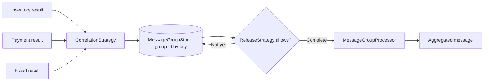
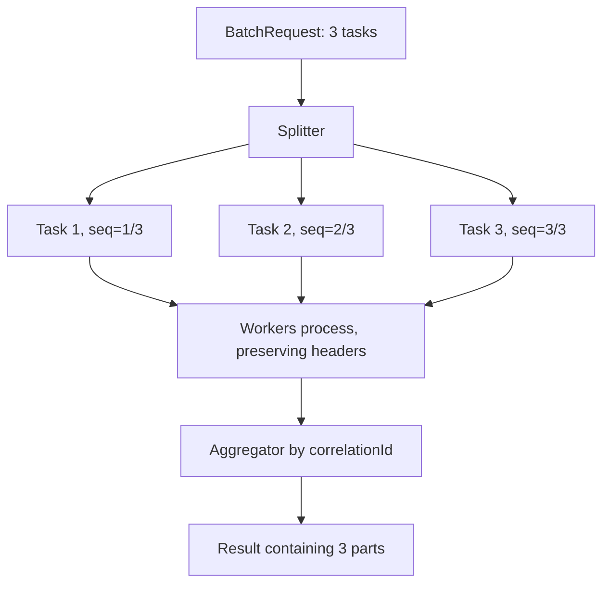

# Aggregator Missing Correlation or Release Strategy

## 1. Problem: Messages Arrived, Yet the Aggregated Result Never Appears

In the **SPRING_INTEGRATION_PATTERN** module, we learn how to implement Enterprise Integration Patterns with Spring Integration to build loosely coupled, extensible message flows, while practicing Router, Filter, Transformer, Splitter, Aggregator, Gateway, retry, error channel, correlation, and testing and observing branches.

A common mistake is adding an `Aggregator` at the end of a pipeline and expecting it to automatically know **which messages belong to the same unit of work** and **when enough have arrived to emit a result**. For example, an order processing request needs three independent responses:

- `INVENTORY`: is there enough stock?
- `PAYMENT`: is payment accepted?
- `FRAUD`: did the risk check pass?

If the three responses do not carry a stable correlation key or the Aggregator has no rule defining "complete", two serious failures can happen: **mixing responses from different orders** and **holding a message group forever without producing output**.

> **Core rule:** An Aggregator must answer three distinct questions: **which key to group by** (*CorrelationStrategy*), **when to release** (*ReleaseStrategy*), and **what content to emit** (*MessageGroupProcessor*). Missing a clear contract at any step can cause failures, even if individual messages were processed successfully.

### After This Lesson, You Will Be Able To

1. Understand default message grouping by `correlationId` and release by sequence.
2. Diagnose why an Aggregator fails to release when `sequenceSize` is missing, a Filter drops part of a group, or callbacks arrive in the wrong group.
3. Configure `CorrelationStrategy` and `ReleaseStrategy` according to business rules without mixing the two responsibilities.
4. Handle duplicates, timeouts, late-arriving messages, group state persistence, and restarts.
5. Test interleaved groups, missing results, out-of-order arrivals, and asynchronous errors.

## 2. Three Components That Govern Aggregator Behavior

A Spring Integration Aggregator is a **stateful message handler**: messages are collected in a `MessageGroupStore`, evaluated for completion, and combined into a single output. It commonly sits downstream of a Splitter or parallel processing branches, though it can also aggregate events arriving from multiple external systems.



| Mechanism | Question | Default in Spring Integration | Sign of Misconfiguration |
| --- | --- | --- | --- |
| `CorrelationStrategy` | Which group does a message belong to? | Reads header `IntegrationMessageHeaderAccessor.CORRELATION_ID` | Unable to derive a key, or two orders are put into the same group. |
| `ReleaseStrategy` | Is the group ready to be emitted? | `SimpleSequenceSizeReleaseStrategy` based on sequence metadata | Groups stall forever when sequence size is unknown or counts mismatch. |
| `MessageGroupProcessor` | How are payloads/headers combined into an output? | `DefaultAggregatingMessageGroupProcessor` creates a payload as a list of payloads | Result lacks business structure or downstream casts to the wrong type. |
| `MessageGroupStore` | Where are groups and their state stored? | Typically an in-memory store if not explicitly configured | Incomplete groups accumulate; group data is lost when the process stops. |

In the API documentation, the contract of the two primary strategies looks like:

```java
public interface CorrelationStrategy {
    Object getCorrelationKey(Message<?> message);
}

public interface ReleaseStrategy {
    boolean canRelease(MessageGroup group);
}
```

These are **abbreviated conceptual signatures** to clarify responsibilities, not two new interfaces you need to define yourself in a project. `getCorrelationKey()` must return a non-`null` key with stable `equals()` and `hashCode()`; `canRelease()` is invoked repeatedly as new messages arrive, so business side effects must not be performed inside it.

**Correlation does not mean release.** Two messages sharing the same `correlationId` are merely placed into the same group; they are not necessarily ready for the Aggregator to emit a result. Conversely, three messages that match the expected count but carry three different keys will form three separate groups, each missing the remaining parts.

## 3. Mistake #1: Missing or Misused Correlation Keys

### 3.1. Default Header Lost Along the Way

With the default Aggregator, Spring Integration reads `correlationId` from headers. Flows starting with a `Splitter` automatically populate `CORRELATION_ID`, `SEQUENCE_NUMBER`, and `SEQUENCE_SIZE` on child messages. However, if an adapter or piece of code constructs a new message and omits headers, outgoing messages can lose their correlation key.

```text
Request order-42
   |
   +-- INVENTORY result: correlationId=order-42
   +-- PAYMENT result:   correlationId=order-42
   +-- FRAUD result:     [missing correlationId]
                          |
                          +--> Cannot join group order-42 as expected
```

When the strategy cannot obtain a valid key, do not fall back to a shared default value like `"unknown"`: unrelated requests will be falsely merged into the same group. The right approach is to **detect missing headers at the Aggregator boundary**, record an error, and fix the producer/Transformer that dropped the key.

### 3.2. Using a Trace ID or Insufficiently Specific Business ID

`traceId` mainly serves observability; one trace can span multiple operations requiring independent aggregation. `orderId` only identifies the order and may be insufficient when an order is reprocessed or has multiple concurrent attempts.

| Candidate | Semantics | Suitable as Correlation Key? |
| --- | --- | --- |
| `message.getId()` | ID of an individual message | Usually **no**: each branch produces a message with its own ID. |
| `traceId` | Traces requests across services | Only when guaranteed to map 1-to-1 to a single business group. |
| `orderId` | Order entity | Conditionally; must ensure two aggregations for the same order never overlap. |
| `workflowRunId` / `batchId` | A specific aggregation session | Usually suitable: all three branches return the initially issued ID. |
| `tenantId + batchId` | An aggregation session within a tenant | Useful when IDs may collide across tenants. |

**Generate the key once** before fanning out; subsequent callbacks must return that exact key. If the key is extracted from the payload, use a consistent `CorrelationStrategy` and validate its type before inserting the message into a group.

### 3.3. Same Display Value, Different Types

`"9001"` is a `String` while `9001` is an `Integer`. Those two values are not equal under `equals()`. Similarly, `batch-01` and `BATCH-01` differ unless you have an explicit normalization rule. Standardize key formatting at external ingress points, while avoiding careless normalization that merges two distinct groups into one.

## 4. Mistake #2: Correlation Exists, But No Proper Release Condition

For instance, all three messages carry `correlationId=order-42` without `sequenceSize`. The Aggregator can still create a group keyed by `order-42`, but **the default release strategy does not know when all elements have arrived**.

When data comes from a Splitter with a known size, headers typically look like:

| Payload | `correlationId` | `sequenceNumber` | `sequenceSize` |
| --- | --- | --- | --- |
| `INVENTORY_RESULT` | `batch-42` | `1` | `3` |
| `PAYMENT_RESULT` | `batch-42` | `2` | `3` |
| `FRAUD_RESULT` | `batch-42` | `3` | `3` |

With a complete sequence and proper headers, the default `SimpleSequenceSizeReleaseStrategy` can release the group once the expected number of elements arrives. However, data from three independent inbound adapters **does not naturally carry Splitter-generated sequence headers**.

### 4.1. Splitter Usually Sets Sequences Properly

`Splitter` in Spring Integration populates `CORRELATION_ID`, `SEQUENCE_NUMBER`, and `SEQUENCE_SIZE` headers on child messages when the input collection size is known. Therefore, pipelines like the following can use the default release strategy:



The condition is that processing steps between the Splitter and Aggregator **preserve correlation and sequence headers**, do not build new messages that drop them, and do not discard an item without adjusting the release strategy.

### 4.2. Iterators/Streams May Not Know Element Counts

With certain split sources like `Iterator`, `Iterable`, or streams whose size the Splitter cannot determine upfront, `SEQUENCE_SIZE` may be set to `0`. In that case, default sequence-size release **lacks enough information to complete the group**.

Handling options depending on requirements:

- Determine the item count from the business domain when possible and carry appropriate metadata.
- Choose a custom `ReleaseStrategy` with a clear completeness condition, such as receiving all three result types.
- Use a group-completion event with a stable ID combined with custom release logic.
- Configure group timeout/expiry when upstream might not send all parts, paired with an explicit missing-data policy.

Do not set `releaseStrategy(group -> true)` to "fix" stuck groups; that turns the Aggregator into a pass-through that emits each incoming message individually, defeating aggregation.

### 4.3. Publish-Subscribe and Recipient List Router Need `applySequence`

`PublishSubscribeChannel` and Recipient List Router **do not automatically attach sequence headers for fan-out**. When response branches are later gathered by a sequence-based Aggregator, enable `applySequence=true` on the fan-out component, or use custom correlation/release strategies.

```java
import org.springframework.context.annotation.Bean;
import org.springframework.integration.channel.PublishSubscribeChannel;

@Bean
public PublishSubscribeChannel workBroadcast() {
    PublishSubscribeChannel channel = new PublishSubscribeChannel();
    channel.setApplySequence(true);
    return channel;
}
```

Here `applySequence` provides headers for re-aggregating branches; **it does not mean the fan-out is durably persisted**. Branches can fail or omit responses, so proper timeout and error handling remain necessary.

## 5. Mistake #3: Filter or Router Drops Items While Release Still Waits for All

Suppose a Splitter emits 4 messages (`sequenceSize=4`). A Filter placed between the Splitter and Aggregator discards the third message:

```text
Splitter: 1/4 ----> process --> Aggregator
          2/4 ----> process --> Aggregator
          3/4 ----> Filter drops message
          4/4 ----> process --> Aggregator

Aggregator receives 3 parts; sequenceSize header is still 4.
Default release waits for the fourth part, which was already dropped.
```

This is one of the most common causes of **stalled groups**. The fact that "the Filter decided to drop a message" does not automatically rewrite `sequenceSize` on the remaining messages.

Solutions should align with business semantics:

1. **Filter before splitting:** if you already know which items need no processing, remove them while preparing the list so the Splitter computes sequence sizes on the filtered list.
2. **Emit a compensating result ("skipped"):** the Filter discard branch can emit a message representing the skipped item, keeping the same correlation/sequence headers so the Aggregator knows all branches finished.
3. **Change the release strategy:** if the condition is "received results for all remaining valid branches", carry accurate metadata about the required branch set rather than guessing by message count.
4. **Set a deadline and handle missing parts:** if a branch can go silent or lose results, design a group timeout and an explicit `INCOMPLETE`/error outcome.

**Do not arbitrarily mutate `sequenceSize` per branch** when branches run asynchronously: two workers might observe two different expected sizes, causing output to be released too early or never.

## 6. Proper Design Example: Correlate by `batchId`, Release by Required Branch Set

Suppose a system receives three response types `INVENTORY`, `PAYMENT`, and `FRAUD` from independent adapters. Each message carries two headers:

- `batchId`: identifies one aggregation session, shared across the three branches.
- `branch`: name of the completed branch, taking one of three allowed values.

To avoid relying on `sequenceSize` from external systems, we configure custom strategies:

```java
import java.util.HashSet;
import java.util.Set;
import org.springframework.beans.factory.annotation.Qualifier;
import org.springframework.context.annotation.Bean;
import org.springframework.context.annotation.Configuration;
import org.springframework.integration.aggregator.HeaderAttributeCorrelationStrategy;
import org.springframework.integration.channel.DirectChannel;
import org.springframework.integration.channel.QueueChannel;
import org.springframework.integration.config.EnableIntegration;
import org.springframework.integration.dsl.IntegrationFlow;
import org.springframework.messaging.Message;
import org.springframework.messaging.MessageChannel;

@Configuration
@EnableIntegration
public class BatchAggregationConfig {

    private static final Set<String> REQUIRED_BRANCHES =
            Set.of("INVENTORY", "PAYMENT", "FRAUD");

    @Bean
    public MessageChannel aggregationInput() {
        return new DirectChannel();
    }

    @Bean
    public QueueChannel aggregationResults() {
        return new QueueChannel();
    }

    @Bean
    public IntegrationFlow batchAggregationFlow() {
        return IntegrationFlow.from("aggregationInput")
                .aggregate(spec -> spec
                        .correlationStrategy(
                                new HeaderAttributeCorrelationStrategy("batchId"))
                        .releaseStrategy(group -> {
                            Set<String> received = new HashSet<>();
                            for (Message<?> message : group.getMessages()) {
                                Object branch = message.getHeaders().get("branch");
                                if (branch instanceof String name) {
                                    received.add(name);
                                }
                            }
                            return received.containsAll(REQUIRED_BRANCHES);
                        })
                        // Retain completed group metadata to handle late-arriving messages.
                        .expireGroupsUponCompletion(false))
                .channel("aggregationResults")
                .get();
    }
}
```

This example uses Java 17+ and Spring Integration Java DSL. Target channels in a real application must be wired to appropriate consumers. `QueueChannel` is used here to read results in the lab exercise; production should design consumers, memory limits, and persistence policies according to requirements.

**Why are these two strategies distinct?**

- `HeaderAttributeCorrelationStrategy("batchId")` decides which messages belong to the **same group**.
- `releaseStrategy(group -> ...)` returns `true` only when the group contains all **three distinct response types**. A group with three duplicate `PAYMENT` messages is still incomplete.
- The default `MessageGroupProcessor` returns a list of payloads. The "all branches present" release condition does not automatically turn that list into an `OrderDecision`; downstream must inspect the three results and check success/rejection status for each branch.

**What to add for production deployment:** this example does not yet perform deduplication. If `PAYMENT` arrives twice, the group may contain duplicate payloads and the output may include that duplicate as well. If a duplicate callback has business impact, use a stable `eventId`, inbox/idempotency, and duplicate filtering **before** entering the Aggregator, or design a `MessageGroupProcessor` that handles duplicates deterministically.

### 6.1. Building Contract-Compliant Messages

```java
import org.springframework.integration.support.MessageBuilder;
import org.springframework.messaging.Message;

record BranchReply(
        String batchId,
        String branch,
        boolean accepted,
        String detail) {
}

final class BranchReplyMessages {
    private BranchReplyMessages() {}

    static Message<BranchReply> reply(BranchReply payload) {
        return MessageBuilder.withPayload(payload)
                .setHeader("batchId", payload.batchId())
                .setHeader("branch", payload.branch())
                .build();
    }
}
```

`BranchReply` and `BranchReplyMessages` are package-private types that can live in the same Java file for the lab exercise. When receiving callbacks over a broker/HTTP, the adapter must validate `batchId`/`branch` and rebuild headers. **Do not assume Spring headers automatically traverse every transport protocol**.

### 6.2. Having All Branches Does Not Mean Business Success

Suppose all three responses arrive, but `PAYMENT.accepted() == false`. The group is **still ready** to release, after which the application service must produce a rejection decision and must not emit a shipping command. The release strategy determines **when enough information has arrived**, while business logic decides **what that information means**.

Putting side effects like `charge()` or `ship()` directly inside `canRelease()` is an anti-pattern: this method is called repeatedly as new messages enter the group and may be called again during expiry processing. Keep group aggregation separate from business state transitions.

## 7. Aggregator Output Types and Post-Release Processing

With `DefaultAggregatingMessageGroupProcessor`, the typical output payload is a `List` of payloads held in the group. Do not immediately cast to `BranchReply` or assume elements are always ordered `INVENTORY, PAYMENT, FRAUD`, because branches may arrive out of order.

A downstream step can normalize results by `branch`:

```java
import java.util.List;
import java.util.Map;
import java.util.Set;
import java.util.function.Function;
import java.util.stream.Collectors;

record BatchDecision(
        String batchId,
        boolean approved,
        Map<String, BranchReply> details) {
}

final class BatchDecisionMapper {
    private BatchDecisionMapper() {}

    static BatchDecision combine(List<BranchReply> replies) {
        if (replies.isEmpty()) {
            throw new IllegalArgumentException("Group has no results yet");
        }
        Map<String, BranchReply> byBranch = replies.stream()
                .collect(Collectors.toMap(
                        BranchReply::branch,
                        Function.identity(),
                        (earlier, later) -> later));

        boolean complete = byBranch.keySet().containsAll(
                Set.of("INVENTORY", "PAYMENT", "FRAUD"));
        boolean accepted = complete
                && byBranch.values().stream().allMatch(BranchReply::accepted);

        String batchId = replies.get(0).batchId();
        return new BatchDecision(batchId, accepted, byBranch);
    }
}
```

The function above illustrates how to stay **independent of message arrival order**. In real usage it needs a duplicate policy: picking the "latest arrival" can be wrong if an older and newer ACK have conflicting statuses. For critical data, verify `eventId`, version, emission timestamp, and idempotency at ingress; do not treat overwriting a `Map` key as complete duplicate handling.

## 8. Group Timeout, Partial Results, and Late-Arriving Messages

Even when the release strategy is correct, branches may fail to return results due to broker errors, Filters dropping messages, or unresponsive providers. Without a group cleanup policy, incomplete groups will consume ever more memory/store capacity.

Spring Integration provides management mechanisms:

| Mechanism | Purpose | What Must Be Decided |
| --- | --- | --- |
| `groupTimeout` | Acts on groups receiving no new messages within a wait window | This is usually **inactivity** time, not an absolute SLA from workflow creation. |
| `sendPartialResultOnExpiry` | On expiry when incomplete, may emit a partial result set | Can downstream tolerate incomplete results? Must distinguish `PARTIAL` from `COMPLETE`. |
| `discardChannel` | Receives discarded messages in completed/expired group scenarios | What does the discard flow consumer do with late events? |
| `expireGroupsUponCompletion` | Decides whether to immediately delete completed group metadata | If deleted immediately, a later message with the same key can start a new group. |
| `MessageGroupStoreReaper` | Periodically scans and expires stale groups/old metadata | Requires retention thresholds, scan frequency, and incomplete-data handling. |

**Important default behavior:** `expireGroupsUponCompletion=false` retains metadata of completed groups to detect and discard late-arriving messages. If configured as `true`, completed groups are removed from the store; a later message with **the same correlation key** can create **a new group**. Therefore, think carefully when reusing IDs.

### 8.1. Do Not Use Group Timeout to Mask Correlation Bugs

For example, a group receives two of three results:

```text
t=0s  INVENTORY(batch-42) -> group waiting
t=1s  PAYMENT(batch-42)   -> group has 2/3
t=2s  FRAUD(batch-99)     -> group batch-99, does not help batch-42
t=7s  batch-42 inactivity window expires -> expiry/partial per policy
```

If you simply turn on `sendPartialResultOnExpiry=true` while downstream treats every output as "complete data", the application could mark payment successful without a Fraud result. **Partial results must be recognized as incomplete**; emit `BatchIncomplete` or route to an error/reconciliation flow as required.

A system with an **absolute business deadline** (for example, finish within 10 seconds of batch creation) should persist `deadlineAt` in workflow state and have a worker monitor wall-clock time. Do not rely on inactivity-based `groupTimeout` as the sole SLA guarantee.

### 8.2. Late Results After Group Completion

If `batchId=batch-42` has already released, a duplicate/late ACK must be handled explicitly: audited, ignored via idempotency, or reconciled if it conflicts with the finalized state. Never let it spawn a new business batch merely because group metadata was deleted and the key was reused.

## 9. MessageStore, Persistence, and Multiple Instances

Because an Aggregator holds messages between arrivals, it needs a `MessageGroupStore`. Failing to configure a durable store can lose incomplete groups on JVM crash/restart. If the application must resume after restarts, consider `JdbcMessageStore` or a durable implementation appropriate for your Spring Integration version.

| Option | Capability | Limitation |
| --- | --- | --- |
| In-memory `SimpleMessageStore` | Easy to configure, fits short-lived groups in a single process | Does not automatically recover groups after a crash. |
| `JdbcMessageStore` / durable store | Can persist message groups across restarts when properly integrated with transactions | Does not automatically guarantee broker ACK, exactly-once, or durable business side effects. |
| Shared store across multiple JVMs | Nodes can see shared groups | Requires an appropriate cross-process locking mechanism, such as a shared `LockRegistry`. |
| Workflow state / outbox / inbox | Persists business decisions and supports dedup/recovery | Application responsibility; not automatically replaced by Aggregator. |

Per Spring Integration documentation, group mutations are synchronized per correlation key using a `LockRegistry`. `DefaultLockRegistry` is **in-memory** locking; when multiple instances share a `MessageGroupStore`, a shared lock registry is required to prevent two nodes from mutating the same group simultaneously. Pointing both nodes at the same database is not enough for consistency.

When integrating with Kafka/RabbitMQ/JMS, explicitly define the commit order:

1. Message is received from the broker.
2. Aggregator writes/updates the group in the store.
3. Consumer ACKs / commits offset per reliability contract.
4. Once the group is complete, the system emits output and runs subsequent business processing.

In practice, these operations may span **multiple distinct transaction boundaries**. Test crashes at critical points and use idempotency/outbox when downstream side effects cannot execute atomically with the message store.

## 10. Duplicates, Retries, and Changing Item Counts

Another confusion is treating `group.size() == expected` as equivalent to "all branches received". If a callback is redelivered twice, the message count can reach the threshold while one result type is still missing.

```text
Expected: INVENTORY, PAYMENT, FRAUD
Received: INVENTORY, PAYMENT, PAYMENT

group.size() == 3  -> true, yet FRAUD is missing!
distinct(branch)   -> {INVENTORY, PAYMENT}, incomplete.
```

`SimpleSequenceSizeReleaseStrategy` is intended for default sequence handling, not as a system-wide business deduplication contract. Especially with branches arriving from brokers, duplicate ACKs carrying the same or different `sequenceNumber` must be handled with proper deduplication and release policies. Do not rely solely on group size.

**How to handle it:**

- Attach a stable `eventId` and `batchId` to every message.
- Deduplicate at ingress with an inbox or a constraint on `consumerName + eventId` when at-least-once delivery is involved.
- Choose a `ReleaseStrategy` expressing **all required branches have results**; if optional branches exist, specify them explicitly.
- When a retry creates a **new attempt**, decide whether a new `batchId` is issued; old ACKs must not get matched to the new attempt.
- Use error channels, DLQs, and reconciliation for failed messages; do not treat retry as successful just because a message was sent to a channel.

If a Filter drops messages, explicitly decide whether that represents an **optional branch**, **handled as SKIPPED**, or **an error preventing batch completion**. Each choice leads to a different release strategy and downstream outcome.

## 11. Testing Correlation and Release With Interleaved Groups

To test the core mechanism directly, you can use `BatchAggregationConfig` from section 6 and send messages from a Spring test context. Since `DirectChannel` processes synchronously in this example, sending inputs and reading `QueueChannel` is enough to check when a group is released without needing `Thread.sleep()`.

```java
import static org.junit.jupiter.api.Assertions.*;

import java.util.List;
import java.util.UUID;
import org.junit.jupiter.api.Test;
import org.springframework.beans.factory.annotation.Autowired;
import org.springframework.beans.factory.annotation.Qualifier;
import org.springframework.integration.channel.QueueChannel;
import org.springframework.integration.support.MessageBuilder;
import org.springframework.messaging.Message;
import org.springframework.messaging.MessageChannel;
import org.springframework.test.context.junit.jupiter.SpringJUnitConfig;

@SpringJUnitConfig(BatchAggregationConfig.class)
class BatchAggregationTest {

    @Autowired @Qualifier("aggregationInput")
    MessageChannel input;

    @Autowired @Qualifier("aggregationResults")
    QueueChannel output;

    private void send(String batch, String branch) {
        BranchReply reply = new BranchReply(batch, branch, true, "OK");
        boolean accepted = input.send(MessageBuilder.withPayload(reply)
                .setHeader("batchId", batch)
                .setHeader("branch", branch)
                .build());
        assertTrue(accepted);
    }

    @Test
    void doesNotReleaseUntilAllThreeBranchesOfSameBatchArrive() {
        String a = "A-" + UUID.randomUUID();
        String b = "B-" + UUID.randomUUID();

        send(a, "PAYMENT");
        send(b, "INVENTORY");
        send(a, "INVENTORY");
        send(b, "PAYMENT");

        // Each batch only has two branches so far, missing FRAUD.
        assertNull(output.receive(0));

        send(a, "FRAUD");
        Message<?> first = output.receive(1_000);
        assertNotNull(first);
        assertInstanceOf(List.class, first.getPayload());
        assertEquals(3, ((List<?>) first.getPayload()).size());

        // Group b is still incomplete.
        assertNull(output.receive(0));

        send(b, "FRAUD");
        Message<?> second = output.receive(1_000);
        assertNotNull(second);
        assertEquals(3, ((List<?>) second.getPayload()).size());
    }

    @Test
    void duplicateBranchDoesNotCountAsMissingRequiredBranch() {
        String key = "dup-" + UUID.randomUUID();
        send(key, "PAYMENT");
        send(key, "PAYMENT");
        send(key, "INVENTORY");

        // Group size may be 3, yet FRAUD is still missing.
        assertNull(output.receive(0));
    }
}
```

This test requires the appropriate Spring Integration Test / Spring Test and JUnit 5 dependencies. Input/output beans are declared in `BatchAggregationConfig`. Because the second test intentionally leaves an incomplete group in the in-memory store, a real test suite should isolate contexts or clean group state after tests to avoid leaking across cases.

### Additional Cases to Test

| Test Case | Data | Expected Outcome |
| --- | --- | --- |
| Valid and complete group | 3 branches, same `batchId` | One output upon full arrival, no premature release. |
| Two interleaved groups | `A/INVENTORY`, `B/PAYMENT`, `A/FRAUD`... | No cross-group mixing; each output belongs to its own batch. |
| Missing correlation key | One branch lacks `batchId` | Error/validation path detects it; not placed into a fake shared group. |
| Different key types | `"42"` and `42` | Not treated as the same batch unless normalized. |
| Missing `sequenceSize` with default | Group lacks sequence size metadata | Do not expect default release without complete conditions. |
| Filter drops part of sequence | Header `sequenceSize=4`, only 3 messages arrive | Group is not treated as complete; proper timeout/skip/strategy applies. |
| Duplicate branch | `PAYMENT` twice, missing `FRAUD` | Custom release does not emit early. |
| Rejected branch | All three types present, `PAYMENT.accepted=false` | Releases, then business logic produces a rejection outcome. |
| Group timeout | One branch never arrives | Group expires per policy; incomplete result is clearly marked. |
| Late message | ACK arrives after group completion | Goes to discard/reconciliation; does not create a second decision. |
| Restart | Durable store, app stops mid-batch | State recovers accurately without duplicating side effects. |
| Two nodes on same key | Branches hit two instances using a shared store | Lock registry and transactions prevent races. |

Do not check only the number of output messages emitted. For failure cases, also inspect the group store, discard/error flow, correlation headers, and whether duplicate business effects were triggered.

## 12. Error Channels and Observing Stuck Groups

When no output appears from an Aggregator, the first step is not increasing timeouts, but reconstructing **the message map of a batch**:

```text
event=branch_started  batchId=B42 branch=INVENTORY
event=branch_finished batchId=B42 branch=INVENTORY eventId=E1
event=branch_finished batchId=B42 branch=PAYMENT   eventId=E2
event=branch_failed   batchId=B42 branch=FRAUD     error=UPSTREAM_TIMEOUT
event=group_expired   batchId=B42 expected=3 received=2 policy=INCOMPLETE
```

These are **application-emitted logs**, not Spring Integration's default log format. Measure:

- Number of open groups and **oldest group age** per workflow type.
- Completion, timeout/expiry, and partial result rates.
- Distribution of actual branch counts per group vs. expected.
- Count of messages missing `correlationId`/`batchId` or having mismatched key types.
- Duplicates by `eventId`/`branch` and late-arriving message rate.
- Time from first message to release, and backlog in `MessageGroupStore`.
- Errors from Router, Filter, Gateway, retry, error channel, and async branches.

If a branch processes over an `ExecutorChannel`/broker, exceptions may be reported on another thread rather than returning to the Aggregator's caller. Configure error channels at the corresponding entry point and emit a **failure event carrying the correlation key** so the workflow knows why the group did not complete.

### Checklist for Diagnosing a Non-Releasing Group

1. Are messages actually reaching the **same Aggregator endpoint** and the same store?
2. Where is the key extracted from? Was `correlationId` lost or type-changed on one branch?
3. With default release, are `sequenceSize` and `sequenceNumber` created properly and preserved?
4. Is a Splitter emitting from an `Iterator` with an unknown size?
5. Did a Filter drop an element or did a Router send a branch to another channel?
6. Are duplicates making the group size misleading?
7. Are expiry, partial results, discard, retries, and consumer errors properly configured?
8. If multiple instances exist, are the store, lock registry, and transactions actually shared and synchronized?

## 13. Roadmap for Refactoring a Broken Production Aggregator

If production currently has an Aggregator that frequently hangs, fix it methodically in order:

1. **Document the message contract**: required branches, workflow session key, event ID, and expected counts.
2. **Measure real data** right before the Aggregator: log the key, key type, sequence headers, and branch name.
3. **Classify message sources**: Splitter with known count vs. independent inbound callbacks; can an element be dropped by a Filter?
4. **Normalize correlation** at the adapter/Transformer boundary; reject messages lacking required keys.
5. **Choose a release strategy** matching the business definition of "complete": sequence count, required result type set, or release event.
6. **Design missing-data paths**: timeout/expiry, partial, error, and reconciliation with explicit state.
7. **Move deduplication to ingress**, rather than only checking `group.size()`.
8. **Choose a MessageStore** matching restart needs; if shared across instances, configure a distributed lock registry.
9. **Test interleaving, late arrivals, duplicates, and crashes**, verifying no wrong outputs or repeated business effects occur.
10. **Monitor metrics post-deployment** and clean up expired group metadata per defined policy.

The goal is not merely to make groups "eventually release", but to guarantee **the right batch, complete information, exactly one contract-compliant business decision, and recoverability**.

## 14. Lab Exercise: Three Branches Aggregating Underwriting Results

Design a system that issues credit approval decisions. Because each `applicationId` may undergo multiple underwriting attempts, the application sends three requests `IDENTITY`, `CREDIT`, and `FRAUD`:

1. Issue a unique `reviewRunId` for each underwriting attempt as the correlation key. Keep `applicationId` as the business ID.
2. Build messages for each branch with `reviewRunId` and `branch`; propagate the key across RabbitMQ/HTTP using defined metadata.
3. Configure an Aggregator with a custom `CorrelationStrategy` by `reviewRunId` and a `ReleaseStrategy` that releases only when all three result types are present.
4. Run two `reviewRunId` batches interleaved to verify no results leak across applications.
5. Send two duplicate `CREDIT` messages before `FRAUD` arrives; prove there is no premature release and add `eventId` for deduplication.
6. Have the `IDENTITY` branch dropped by a Filter; design a `SKIPPED` result or explicit failure policy to avoid groups stalling forever.
7. Make the `FRAUD` branch fail without returning a result; implement expiry and an `INCOMPLETE` state, ensuring it never auto-approves when data is missing.
8. Send a `FRAUD` ACK after the batch has completed; verify it goes to discard/reconciliation without creating a bogus new record.
9. Simulate a restart with a durable store and recover groups; if running multiple instances, test cross-node locking.
10. Add metrics for group age, incomplete, duplicate, timeout, release latency, and tracing by `reviewRunId`.

**Self-Assessment Questions**

- Why do two messages with the same `correlationId` not necessarily trigger Aggregator release?
- Why can three messages with three random IDs not be aggregated into a single valid batch?
- When do you use default `sequenceSize`, and when do you need a custom `ReleaseStrategy`?
- What happens if a Filter drops element `3/4` of a sequence?
- Why can `group.size() == 3` be wrong when a callback is redelivered?
- Why should `groupTimeout` not be treated as an absolute business deadline?
- When `expireGroupsUponCompletion=true`, what can happen with a late ACK carrying the same key?
- Why is a shared JDBC MessageStore insufficient if nodes do not share locks?

## 15. References

- [Spring Integration Reference — Aggregator](https://docs.spring.io/spring-integration/reference/aggregator.html): `CorrelationStrategy`, `ReleaseStrategy`, default sequencing, `MessageGroupStore`, group expiry, timeouts, and lock registry.
- [Spring Integration Reference — Splitter](https://docs.spring.io/spring-integration/reference/splitter.html): `CORRELATION_ID`/`SEQUENCE_NUMBER`/`SEQUENCE_SIZE` headers and unknown-size Iterator cases.
- [Spring Integration Reference — Message Channel Configuration](https://docs.spring.io/spring-integration/reference/channel/configuration.html): `PublishSubscribeChannel`, `applySequence`, executors, and error handlers.
- [Spring Integration Reference — Filter](https://docs.spring.io/spring-integration/reference/filter.html): discard channel and impact when messages are dropped before an Aggregator.
- [Spring Integration Reference — Message Store](https://docs.spring.io/spring-integration/reference/message-store.html): stores, persistence, and message state management.

> **Takeaway:** **Correlation decides which group a message belongs to; release decides whether the group is complete.** Use proper sequence headers when a Splitter or fan-out produces a known set of items; choose a custom strategy when receiving callbacks from independent sources, using Filters, or having optional branches. Combine deduplication, group expiry, MessageStore, error flows, and interleaved-group tests so the Aggregator only emits valid results and operates reliably.
