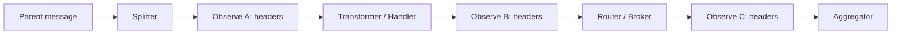
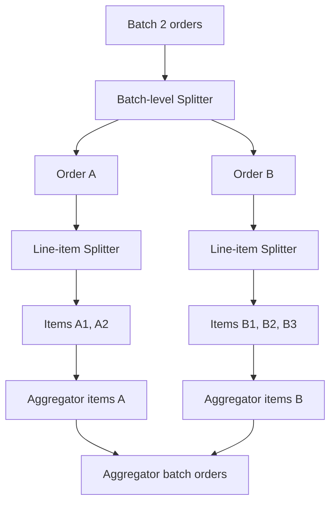

# Common Mistake: Splitter Not Propagating Sequence Metadata

> **Module:** `SPRING_INTEGRATION_PATTERN` — Learn how to implement Enterprise Integration Patterns with Spring Integration to build loosely coupled and extensible message flows. Practice Router, Filter, Transformer, Splitter, Aggregator, Gateway, retry, error channel, and correlation, along with testing and observing processing branches.
>
> **Chapter:** Common Mistakes  
> **Topic:** Splitter Not Propagating Sequence Metadata

## 1. Symptom: Child Messages Finished Processing, Yet the Aggregator Returns No Result

A system receives a list of three orders and wants to process each order in parallel, then combine the three results into one response:


During development, the team notices all three child messages passed through the handler successfully, yet the Gateway keeps waiting until it times out. Aggregator logs may show messages did not land in the right group or the group failed to meet its completion condition. One of the first causes to check is **sequence metadata being missing, inconsistent, or lost at an intermediate step**.

Sequence metadata consists of headers relating to **the same message group** and **ordering/completion information for the group**. When they are missing, the default Aggregator may fail to identify the group or not know when enough results have arrived to emit.

Not every Aggregator failure is caused by the Splitter: it could be a message dropped by a Filter, a failing branch, a timeout, release strategy configuration, duplicates/redelivery, or the message group store. This lesson guides you on **diagnosing and fixing the right layer**, instead of arbitrarily adding a `correlationId` just to make the error temporarily disappear.

### Learning Outcomes

After this lesson, you will be able to:

- Explain the meaning of `correlationId`, `sequenceNumber`, and `sequenceSize` and distinguish them from `MessageHeaders.ID`.
- Identify situations where the Splitter does not generate or downstream loses sequence metadata.
- Use standard split configurations, preserve headers during transforms, and specify appropriate release strategies when total item count is unknown beforehand.
- Inspect actual messages with Spring Integration Test / JUnit rather than relying on log guesswork.
- Design safe handling for nested splitting, Router, Filter, retry, error channel, and asynchronous processing.

## 2. Three Core Headers: correlationId, sequenceNumber, sequenceSize

When a parent message is split into parts, we need to know **which group each child message belongs to**, **its position**, and **how many messages the group is expected to have**.

| Header | Meaning | Three-Order Group Example |
|---|---|---|
| `correlationId` | Key linking messages that belong to the same group to aggregate | `group-abc` |
| `sequenceNumber` | Index of the message in the sequence, typically starting at 1 | 1, 2, 3 |
| `sequenceSize` | Expected total number of messages in the sequence when size is known | 3 |
| `MessageHeaders.ID` | ID of **each individual message**, not a stable default grouping key | Different ID on each child message |

A group might look like:

| Message | Payload | correlationId | sequenceNumber | sequenceSize |
|---|---|---|---:|---:|
| Child 1 | `order-01` | `group-abc` | 1 | 3 |
| Child 2 | `order-02` | `group-abc` | 2 | 3 |
| Child 3 | `order-03` | `group-abc` | 3 | 3 |

`correlationId` **must be consistent across children of the same batch** and must not accidentally be shared by two independent batches that must be processed separately. `sequenceNumber` distinguishes position; `sequenceSize` tells how many parts are expected if completion is based on counting all elements.

### Why Can't Message ID Replace correlationId?

Message IDs may be regenerated after a Transformer, `MessageBuilder`, or deserialization across a broker. If the Aggregator uses each **child message's ID** as the group key, three child messages can become **three separate groups**, none of which ever receives all three elements.

In Spring Integration, the corresponding header name constants are in `IntegrationMessageHeaderAccessor`. When inspecting, prefer reading via constants rather than mistyping string names:

```java
import org.springframework.integration.IntegrationMessageHeaderAccessor;
import org.springframework.messaging.Message;

Object groupId = message.getHeaders().get(
        IntegrationMessageHeaderAccessor.CORRELATION_ID);
Object number = message.getHeaders().get(
        IntegrationMessageHeaderAccessor.SEQUENCE_NUMBER);
Object size = message.getHeaders().get(
        IntegrationMessageHeaderAccessor.SEQUENCE_SIZE);
```

**Note:** `sequenceNumber` and `sequenceSize` are only meaningful within **the scope of a specific sequence**. Do not treat these numbers as system-wide sequence numbers or the guaranteed order in which messages arrive at a handler during multithreaded processing.

## 3. How Does a Splitter Generate Metadata?

With a standard Spring Integration Splitter configured to apply sequence headers, the framework creates child messages while attaching group metadata. Simple Java DSL configuration for a `Collection` payload:

```java
@Bean
public IntegrationFlow splitFlow() {
    return IntegrationFlow.from("batchInput")
            .split()                  // Collection -> individual items
            .channel("partOutput")
            .get();
}
```

This standard split can produce a child message sequence containing correlation and sequence metadata for the Aggregator to recombine. **When you need certainty about the behavior of a specific version and Splitter type, verify output messages with tests**, especially if `applySequence` is changed, non-default configuration is used, a custom splitter is written, or the payload is a source whose size is unknown upfront.

In splitter endpoint configurations supporting the `applySequence` property, **disabling** this option can leave children without the sequence metadata the Aggregator expects. When you need group aggregation after splitting, keep/enable sequence metadata generation appropriately and do not rely solely on children having the right payloads.

### Sequence Size May Be Unknown

If a splitter generates children from a `List` of 3 items, total message count can normally be determined as 3. However, when a splitter works with an `Iterator`, stream, or dynamically producing source whose end is not yet known, the total child count may be **unknown at the time each message is emitted**.

In such cases, `sequenceSize` may be a value indicating **unknown total** (such as 0 depending on implementation), or carry insufficient info for release. This is **not equivalent** to "a group of 0 messages", and the default Aggregator cannot guess when all parts have arrived.

When size is unknown, you must design one of these policies:

1. Materialize a finite group into a collection before splitting, if size is moderate.
2. Provide an **end-of-stream / end-of-group marker** and a release strategy that understands that marker.
3. Use a `ReleaseStrategy` based on count, timing, or a clearly defined business condition.
4. Configure timeout/expiry and a **partial group** handling policy if the business permits, rather than treating a timeout as "completely succeeded".

Do not hardcode `sequenceSize=3` just because test data has three elements while production batches vary in length.

## 4. Table of Easily Confused Symptoms and Causes

| Symptom | Possibility to Check | Direction to Fix |
|---|---|---|
| Aggregator reports unable to determine correlation key | `correlationId` missing on child or stripped after split | Inspect headers right after Splitter and right before Aggregator |
| Aggregator creates many single-item groups | Each child has a different correlation ID; child ID used as key | Keep one group key across the batch |
| Three children exist, yet Aggregator never releases | `sequenceSize` unknown, lost, or one child never arrived | Check all headers, group store, and release strategy |
| Child 1 and child 3 arrive, child 2 is lost | Filter, unrouted Router branch, exception, failed retry | Have an error/timeout/recovery policy; do not fake metadata to hide missing children |
| Batch A is merged with Batch B | Correlation ID reused across two independent batches | Create distinct groups and keep IDs stable per batch |
| Duplicate data after retry/broker redelivery | Duplicates aggregated as new elements | Idempotency/dedup and sequence policy for redelivered messages |
| Bug only happens when async is enabled | Race, out-of-order delivery, timeout, or store config | Test concurrency, check group completion and ordering |
| Bug only happens across broker/JSON | Only payload is serialized; headers are not carried over | Use a controlled envelope / header mapper |
| Bug after nested Splitter | Outer group metadata overwritten or misused by inner group | Separate correlation levels and restore outer context when inner finishes |
| Aggregator releases early with missing data | Release timeout/threshold does not match contract | Only allow partial results under an explicit business policy |

This is a **diagnostic hypothesis list**. An Aggregator emitting no output is not enough to conclude the Splitter "failed to propagate metadata". Gather header evidence at the connecting hops.

## 5. Most Common Mistake: Transformer Builds a New Message and Forgets to Copy Headers

Suppose the Splitter properly attached `correlationId`, `sequenceNumber`, and `sequenceSize`. A downstream handler wants to normalize payloads to uppercase.

### 5.1. Wrong Approach

```java
import org.springframework.messaging.Message;
import org.springframework.messaging.support.MessageBuilder;

public Message<String> wrongTransform(Message<String> part) {
    String value = part.getPayload().toUpperCase();

    // Wrong: creates a new payload only, does not preserve sequence headers.
    return MessageBuilder.withPayload(value).build();
}
```

In this code, the child is forwarded with newly generated headers. The original `correlationId`, `sequenceNumber`, and `sequenceSize` are **not copied**. The downstream Aggregator cannot know which group to assemble.

### 5.2. How to Preserve Headers When Transforming Payload

```java
import java.util.Locale;
import org.springframework.messaging.Message;
import org.springframework.messaging.support.MessageBuilder;

public Message<String> preserveHeaders(Message<String> part) {
    String value = part.getPayload().toUpperCase(Locale.ROOT);

    return MessageBuilder.withPayload(value)
            .copyHeaders(part.getHeaders())
            .build();
}
```

This forwards existing headers within an internal flow. Special management headers like message `id`/`timestamp` follow Spring Messaging's generation/copy rules; what matters for the Aggregator is that **the three sequence/correlation headers** are preserved accurately.

**Warning:** when communicating with external systems or crossing a trust boundary, do not unconditionally copy **all** headers. Some headers may contain security contexts, internal reply channels, or non-serializable objects. Build an envelope/mapper with an allowlist of headers, including the group metadata needed for correlation, and validate again upon entering Spring Integration.

### 5.3. Not Every Transformer Loses Headers

Standard Transformers in Spring Integration normally have appropriate header inheritance/forwarding mechanisms. Do not see an Aggregator timeout and conclude every `.transform()` strips headers. The bug usually appears when **manually constructing a new `Message`** or when an adapter passes only the payload. Tests must isolate the exact component dropping metadata.

## 6. End-to-End Example: Splitter -> Transformer -> Aggregator

Minimal example using Spring Integration Java DSL. The input is a `List<String>`, each item is transformed to uppercase, and then the Aggregator collects them back into a result collection.

### 6.1. Dependencies and Application Startup

A suitable Spring Boot application can use:

```groovy
dependencies {
    implementation "org.springframework.boot:spring-boot-starter-integration"
    testImplementation "org.springframework.boot:spring-boot-starter-test"
}
```

Enable Spring Integration and scan Gateways:

```java
package com.example.splitsequence;

import org.springframework.boot.SpringApplication;
import org.springframework.boot.autoconfigure.SpringBootApplication;
import org.springframework.integration.annotation.IntegrationComponentScan;
import org.springframework.integration.config.EnableIntegration;

@SpringBootApplication
@EnableIntegration
@IntegrationComponentScan
public class SplitSequenceApplication {

    public static void main(String[] args) {
        SpringApplication.run(SplitSequenceApplication.class, args);
    }
}
```

### 6.2. Messaging Gateway

```java
package com.example.splitsequence;

import java.util.List;
import org.springframework.integration.annotation.MessagingGateway;

@MessagingGateway(defaultRequestChannel = "batchInput")
public interface BatchGateway {
    List<String> process(List<String> items);
}
```

The Gateway illustrates a request-reply interface. If the Aggregator fails to satisfy its release condition, the call may receive no reply before its deadline and time out. Therefore, configure wait timeouts and error policies on the Gateway/caller according to system requirements—never wait indefinitely in production.

### 6.3. IntegrationFlow

```java
package com.example.splitsequence;

import java.util.Locale;
import org.springframework.context.annotation.Bean;
import org.springframework.context.annotation.Configuration;
import org.springframework.integration.dsl.IntegrationFlow;

@Configuration
public class SplitSequenceFlow {

    @Bean
    public IntegrationFlow batchFlow() {
        return IntegrationFlow.from("batchInput")
                .split()
                // Standard Transformer preserves required message metadata.
                .transform(String.class,
                        value -> value.toUpperCase(Locale.ROOT))
                .aggregate()
                .get();
    }
}
```

Suppose the Gateway receives `["a","b","c"]`:

1. The Splitter creates three child payloads `"a"`, `"b"`, `"c"`.
2. With proper sequence metadata, the children share one correlation key, have sequence numbers 1/2/3, and have size 3.
3. The Transformer normalizes payloads without dropping correlation/sequence headers.
4. The Aggregator receives children belonging to the same group, confirms all members arrived, and builds the combined result.

**This is an illustrative configuration for a finite batch of known size.** How the Aggregator combines payloads and the actual reply type depend on the processor, version, and configuration; when using it in a project, assert the return values and types in an integration test. If ordering by `sequenceNumber` rather than arrival order is required, verify the appropriate aggregation/resequencing mechanism; do not assume concurrent processing preserves input order.

### 6.4. When Should You Use a Custom Aggregator?

If child messages carry extra metadata (such as subtotals, processing status, retry status), you can use a `MessageGroupProcessor` or process them in a custom Aggregator. Even when choosing custom grouping and release strategies, you still must define:

- **CorrelationStrategy:** which children belong to the same batch?
- **ReleaseStrategy:** when is the batch complete?
- **MessageGroupStore:** where do in-flight groups live under async processing, restarts, or multiple instances?
- **Expiry/timeout:** when a child is missing, do you return partial results, mark an error, or escalate for investigation?
- **Ordering:** if the business requires original order, do you restore it by `sequenceNumber`?

Writing a custom Aggregator does not eliminate the need to design correlation.

## 7. Unit/Integration Test: Capturing Sequence Metadata Right After Splitting

Do not wait until the Aggregator times out to look at logs. Write a test that runs *only* the Splitter, receives children via a `QueueChannel`, and asserts the three headers.

### 7.1. A Dedicated Observation Flow

The configuration below is an **isolated test variant**, not registered alongside `batchFlow` sharing the same input channel in section 6:

```java
package com.example.splitsequence;

import org.springframework.context.annotation.Bean;
import org.springframework.context.annotation.Configuration;
import org.springframework.integration.channel.QueueChannel;
import org.springframework.integration.dsl.IntegrationFlow;
import org.springframework.messaging.PollableChannel;

@Configuration
public class InspectSplitFlow {

    @Bean
    public PollableChannel inspectParts() {
        return new QueueChannel();
    }

    @Bean
    public IntegrationFlow inspectFlow() {
        return IntegrationFlow.from("inspectInput")
                .split()
                .channel("inspectParts")
                .get();
    }
}
```

This setup has no Transformer or Aggregator, making it suitable for verifying **metadata generated immediately after the Splitter** before investigating later stages.

### 7.2. Testing Three Children of the Same Group

```java
package com.example.splitsequence;

import static org.junit.jupiter.api.Assertions.*;

import java.util.HashSet;
import java.util.List;
import java.util.Set;
import org.junit.jupiter.api.Test;
import org.springframework.beans.factory.annotation.Autowired;
import org.springframework.beans.factory.annotation.Qualifier;
import org.springframework.boot.test.context.SpringBootTest;
import org.springframework.integration.IntegrationMessageHeaderAccessor;
import org.springframework.messaging.Message;
import org.springframework.messaging.MessageChannel;
import org.springframework.messaging.PollableChannel;
import org.springframework.messaging.support.MessageBuilder;

@SpringBootTest
class SplitSequenceHeadersTest {

    private final MessageChannel inspectInput;
    private final PollableChannel inspectParts;

    @Autowired
    SplitSequenceHeadersTest(
            @Qualifier("inspectInput") MessageChannel inspectInput,
            @Qualifier("inspectParts") PollableChannel inspectParts) {
        this.inspectInput = inspectInput;
        this.inspectParts = inspectParts;
    }

    @Test
    void childrenShareCorrelationAndContainSequence() {
        assertTrue(inspectInput.send(
                MessageBuilder.withPayload(List.of("a", "b", "c"))
                        .build()));

        Set<Object> groupIds = new HashSet<>();
        Set<Integer> positions = new HashSet<>();

        for (int i = 0; i < 3; i++) {
            Message<?> child = inspectParts.receive(1_000);
            assertNotNull(child);

            Object group = child.getHeaders().get(
                    IntegrationMessageHeaderAccessor.CORRELATION_ID);
            Integer number = child.getHeaders().get(
                    IntegrationMessageHeaderAccessor.SEQUENCE_NUMBER,
                    Integer.class);
            Integer total = child.getHeaders().get(
                    IntegrationMessageHeaderAccessor.SEQUENCE_SIZE,
                    Integer.class);

            assertNotNull(group);
            assertNotNull(number);
            assertEquals(3, total);
            groupIds.add(group);
            positions.add(number);
        }

        assertEquals(1, groupIds.size());
        assertEquals(Set.of(1, 2, 3), positions);
    }
}
```

**What to understand:** the test checks **the same group ID, all three sequence numbers, and matching sequence size**; it does not assert that the three children must arrive in chronological 1 -> 2 -> 3 order when using an executor/broker. Nor does it prove end-to-end Aggregator behavior, because no Aggregator is present in this test flow.

When running tests with a custom splitter or one returning an `Iterator`, replace the `sequenceSize == 3` assertion with what matches the source's contract, and verify the alternative release strategy as well.

The test uses `@Autowired` on the constructor so Spring Test injects both channels. Ensure `InspectSplitFlow` is discovered by the Spring Boot test context and no other consumer reads from `inspectParts` during the test. Test/application context organization may need adjustment to fit your project.

## 8. Hop-by-Hop Diagnosis: Where Were the Headers Lost?

An effective debugging approach is observing **right after the Splitter, after the Transformer, after the Router/broker, and before the Aggregator**.



Example of a handler that simply logs the three headers:

```java
package com.example.splitsequence;

import org.slf4j.Logger;
import org.slf4j.LoggerFactory;
import org.springframework.integration.IntegrationMessageHeaderAccessor;
import org.springframework.messaging.Message;

public final class SequenceDiagnostics {

    private static final Logger log =
            LoggerFactory.getLogger(SequenceDiagnostics.class);

    public void observe(String stage, Message<?> message) {
        Object group = message.getHeaders().get(
                IntegrationMessageHeaderAccessor.CORRELATION_ID);
        Object number = message.getHeaders().get(
                IntegrationMessageHeaderAccessor.SEQUENCE_NUMBER);
        Object total = message.getHeaders().get(
                IntegrationMessageHeaderAccessor.SEQUENCE_SIZE);

        log.debug("stage={} correlation={} seq={}/{}",
                stage, group, number, total);
    }
}
```

In production logs, consider hashing/masking the correlation ID when it relates to customer data; **never log sensitive payloads**. If the three headers remain intact after the Splitter but vanish after a custom handler, fix that handler instead of inventing arbitrary metadata at the Aggregator.

### Debugging Questions in Order

1. Is the input truly a finite collection to be split? What is the input size?
2. Does the first child **immediately after the Splitter** have complete correlation/sequence headers?
3. Does the child at the Aggregator input still have **the same values as before**?
4. Is `correlationId` identical across children of the same batch and distinct from other batches?
5. Does `sequenceNumber` cover the expected positions with no duplicates or gaps?
6. Is `sequenceSize` defined; if not, does the ReleaseStrategy have another completion mechanism?
7. Did a Filter/Router drop a child or did an HTTP retry create duplicates?
8. Does the Aggregator have a group timeout, group store, or custom release strategy affecting it?

Do not look at a log saying "sent three messages" before a Router and conclude the Aggregator **received three children of the same group**. Measure right at the Aggregator input.

## 9. Custom Splitters Building Messages and Header Propagation

A custom splitter can return:

- **Payload objects**: the framework constructs child `Message`s via the Splitter mechanism.
- Pre-built **Message objects**: you must verify how the framework and configuration handle headers of returned messages, and ensure sequence metadata is not lost in subsequent steps.

With a custom splitter, **never automatically populate the same `correlationId` across all batches**. If using a business batch ID as the group key, ensure the key distinguishes independent processing runs and has a policy for reprocessing/replay.

### Anti-Pattern Example

```java
// Wrong: a fixed group ID for all orders can mix batches together.
MessageBuilder.withPayload(item)
        .setHeader("correlationId", "GLOBAL")
        .setHeader("sequenceNumber", 1)
        .setHeader("sequenceSize", 3)
        .build();
```

If multiple batches enter the system concurrently, all children can be mixed under `GLOBAL`. Furthermore, every message has `sequenceNumber` 1, failing to form a valid position sequence.

### Sound Principles

- Let the standard Splitter generate metadata whenever possible.
- If you must build sequence headers manually, generate **a distinct group key per batch**, number children consistently, and set the size accurately.
- When producing new messages from already-split messages, **preserve headers** or selectively copy required group fields.
- When crossing a broker/API boundary, define an envelope carrying group, position, count, or end marker; validate schema and deserialization.
- Never use each child's message ID as the aggregation key unless intentionally designed so they genuinely belong to a single group.

## 10. Nested Splitting and Correlation Layers

A batch contains multiple orders; each order has multiple line items. We have two splits:



There are **two independent group boundaries**:

1. Grouping *line items* of each order.
2. Grouping *orders* belonging to the parent batch.

If the inner splitter overwrites the outer splitter's `correlationId`/`sequenceNumber`, then after aggregating line items we must restore or carry along the **outer correlation context** to aggregate orders accurately. Never carelessly reuse one set of headers for both group levels.

A clean design adds explicit business headers such as `batchId` and `orderId` (validated/normalized) or preserves parent group context in a deliberate structure. However, **having `batchId` does not automatically make the default Aggregator use that header**: to group by batch ID, configure an appropriate `CorrelationStrategy`, and ensure `ReleaseStrategy` knows when completion occurs.

Tests should prove:

- Items A1/A2 only join order A's line-item group.
- Items B1/B2/B3 only join order B's group.
- Results for orders A and B retain batch-level metadata to be re-aggregated.
- Two concurrent batches do not mix messages across groups.

## 11. Router, Filter, Retry, and Messages Lost Mid-Flight

### 11.1. Router May Send Some Children to Another Branch

If a Splitter produces three children but a Router sends only two children to the Aggregator, `sequenceSize=3` cannot complete by count, even when **no metadata was lost**.

Decide whether every child sends a valid result into the Aggregator or an **explicit error/skip outcome** also enters the group. If the business allows dropping children, you may need to adjust the completion strategy, rather than arbitrarily changing `sequenceSize` to 2 on one child while leaving 3 on the others.

### 11.2. Filter Drops an Item While Aggregator Still Waits for All

```text
Splitter: seq 1/3, 2/3, 3/3
   -> Filter keeps 1/3 and 3/3, drops 2/3
   -> Aggregator waiting for 3 children
```

If `2/3` is discarded by a Filter with no compensating rule, the Aggregator will never satisfy the three-child condition. This is a **completion contract bug** between the Filter and Aggregator, not "Splitter failed to generate sequence".

Solutions depend on business rules: filter **before the Splitter** so `sequenceSize` reflects remaining items to process; or forward a `SKIPPED` result into the Aggregator; or use a custom `ReleaseStrategy` allowing completion once all unprocessed members are accounted for. Each option must be tested for missing data.

### 11.3. Retries and Redelivery Can Cause Duplicates

If child `2/3` times out after downstream already succeeded, the broker may redeliver it. When the Aggregator receives `2/3` twice, total message count no longer equals distinct position count. Relying solely on `group.size() == sequenceSize` can release incorrectly or prematurely before another position arrives.

Use idempotency/deduplication keyed by **batch + sequenceNumber** (and business ID if appropriate), rather than ignoring broker redelivery mechanics. For certain workloads, an appropriate `MessageGroupStore`/`ReleaseStrategy` or deduplication step is required.

HTTP retries inside a child handler can generate multiple outbound attempts. If a provider enforces quotas, each attempt needs a permit; sequence metadata only serves **result grouping**, not quota protection.

### 11.4. Error Channel Does Not Automatically Complete a Group

When a child handler throws an exception, the error may propagate to the caller in synchronous flows or turn into an `ErrorMessage`/adapter error in asynchronous flows. The Aggregator **does not automatically receive a child result** merely because an error was sent to `errorChannel`.

To prevent groups from hanging indefinitely, choose one of these policies:

- Perform bounded child retries and then feed either a **success result** or a **structured error result** to the Aggregator.
- After a deadline, emit a **partial result** if allowed by contract, accompanied by the list of missing children.
- Mark the entire group failed, route to DLQ/investigation, and never return a partial result as a complete one.

## 12. MessageGroupStore, Timeouts, and Multi-Instance Environments

The Aggregator persists in-flight message state in a **group**. If running a single JVM with an in-memory store, in-progress groups can be lost on restart. If multiple replicas receive children of the same batch while each Aggregator keeps local state, messages can land in **two separate stores**: neither replica ever sees the full group.

| Case | Consequence | Suggestion |
|---|---|---|
| In-memory store, restart mid-batch | Waiting groups may be lost | Persistent `MessageGroupStore` when durability is required |
| Two replicas, separate local state | Children with the same `correlationId` split across two local groups | Route groups to the same partition/consumer or use a shared store with concurrency control |
| Group timeout too short | Releases partial or expires before last child arrives | Set deadline from real latency; handle partials explicitly |
| Group timeout too long | Memory/store balloons when children go missing | Alert on backlog, TTL/expiry, and cleanup |
| Broker only serializes payload | Group headers do not exist after receive | Envelope/header mapper preserving correlation and sequence |
| Correlation ID collides across runs | Old and new batches easily get conflated | Manage uniqueness, lifecycle, and completion |

**Timeout is not proof that every element finished processing.** When designing `groupTimeout`, `expireGroupsUponCompletion`, late-arrival handling, and expiry policies, specify what happens to a message arriving after the group was marked complete. Depending on requirements, discard, audit, reconcile, or route it to a dedicated branch—avoid accidentally creating a "new" group with an old correlation ID.

A `MessageGroupStore` shared across JVMs also does not automatically solve **atomicity, ordering, idempotency, and ownership**. Test concurrency of the store/lock and adapters in use.

## 13. Diagnostic Testing: Key Scenarios

| Test | Input / Setup | Expectation |
|---|---|---|
| Split 3-item List | `["a","b","c"]` | One correlation group; sequence 1..3; size 3 |
| Two independent batches | Batch A 2 items, Batch B 3 items | Two isolated correlation groups, no mixing |
| Transformer builds new Message without copying headers | Intentionally use `withPayload().build()` | Test detects metadata vanishing at that hop |
| Transformer preserves headers | `copyHeaders(part.getHeaders())` | Group and sequence headers remain intact |
| Router splits across branches | One child does not enter Aggregator | Does not release as complete; missing-child policy applies |
| Filter discards one child | Split 3 then drop child 2 | Does not release as a full batch with only 2 items |
| Retry one child | `seq=2` arrives twice | Dedup/`ReleaseStrategy` prevents double-counting |
| Iterator of unknown size | Split dynamic source | Appropriate release strategy / end marker works |
| Two-level nested split | Batch -> orders -> items | Item groups and batch groups do not collide |
| Async out-of-order | Child 3 arrives before child 1 | Grouping and completion remain valid; ordering verified separately |
| Restart mid-batch | Store matching durability requirements | No unintended group loss |
| Two replicas | Children of the same group distributed | Not split across two independent stores |
| Group expires on timeout | Missing child or late-arriving child | Verifiable partial/failure/recovery per policy |

### Recommended Assertions

For **every** child before the Aggregator in a finite batch:

1. `correlationId != null`.
2. `sequenceNumber` is within `1` to the known total item count.
3. `sequenceSize` matches the batch and never changes across children of the same group.
4. The set of distinct `sequenceNumber` values matches the expected count after policy-compliant redelivery handling.
5. No two independent batches accidentally share a correlation key.
6. If business requires ordering, the final output is sorted/reconciled to the expected order rather than relying on thread completion order.

For **sources of unknown size**, replace conditions 3 and 4 with the end-marker contract or appropriate release strategy; do not force tests to always expect a positive size.

## 14. Low-Risk Troubleshooting Workflow

1. **Reproduce with a small batch:** use three items and note Gateway/Aggregator deadlines.
2. **Observe right after Splitter:** inspect `correlationId`, `sequenceNumber`, `sequenceSize`, and emitted child count.
3. **Observe right before Aggregator:** compare the same three headers and counts, including children from error/retry branches.
4. **If missing right after Splitter:** check Splitter type, sequence generation/`applySequence` config, unknown-size sources, and custom message factories.
5. **If lost mid-flow:** fix the Transformer, Handler, Router adapter, or broker mapping to preserve headers; do not patch the end by generating random group IDs.
6. **If metadata is complete yet no release:** inspect Filter/Router discards, failed children, duplicates, `ReleaseStrategy`, group timeout, store, and actual group count.
7. **If multiple replicas:** check group ownership, partitioning, shared store, and concurrent update handling.
8. **Add regression tests:** at minimum test headers after split, header preservation after transform, full split/aggregate groups, and missing/duplicate child cases.

### Pre-Deployment Checklist

- [ ] Every batch has a unique correlation key within the aggregation scope.
- [ ] Children carry valid `sequenceNumber`/`sequenceSize` or an alternative completion strategy exists.
- [ ] Every required hop preserves metadata; off-JVM header mappers are tested.
- [ ] Filters/Routers/retries do not silently drop children.
- [ ] Aggregator defines explicit `groupTimeout`, expiry, and partial/failure policies if needed.
- [ ] Group store/partitioning supports multi-instance deployment and restart requirements.
- [ ] Metrics exist for open groups, group age, partial/failure counts, late arrivals, and duplicates.
- [ ] Correlation logs do not leak sensitive data.

## 15. Lab Exercises

**Exercise 1 — Catch missing headers after Splitter.** Use `InspectSplitFlow` and `SplitSequenceHeadersTest`. Run with a three-item collection, inspect the children, and assert `correlationId`/`sequenceNumber`/`sequenceSize`. Explain why the test does not need to assert chronological arrival order.

**Exercise 2 — Transformer drops headers.** Create a `wrongTransform()` handler using `MessageBuilder.withPayload(...).build()` after the Splitter. Compare headers before and after. Fix with `copyHeaders`, then assert all three children enter the same group at the Aggregator.

**Exercise 3 — Filter drops a child.** Have the Splitter emit three children and a Filter drop the second item. Predict how the default Aggregator will behave, and choose one fix: pre-split filtering, a `SKIPPED` result, or a missing-child-aware `ReleaseStrategy`. Explain the trade-offs.

**Exercise 4 — Iterator with unknown total.** Replace the collection with a dynamic producer. Design an end marker or custom `ReleaseStrategy`; explain how to avoid premature release and how to handle abnormal stream termination.

**Exercise 5 — Nested split.** A batch has two orders, each with multiple line items. Design two correlation levels so the inner Aggregator groups items by order and the outer Aggregator groups orders by batch. Test with out-of-order result completion.

**Exercise 6 — Retries and multi-instance.** Configure children subject to broker redelivery and groups processed across two replicas. Propose group ownership/store, deduplication, and idempotency strategies; verify no lost or duplicated results.

### Self-Assessment Questions

1. How does `MessageHeaders.ID` differ from `correlationId` when using an Aggregator?
2. If three child messages share the same `correlationId` but lack `sequenceSize`, how does the Aggregator know when it is complete?
3. Why can the bug lie in a Transformer or broker even though the Splitter generated complete headers?
4. Why should you not hardcode `sequenceSize = 3` for a splitter whose batches vary in length?
5. Does a Filter dropping one child invalidate the `correlationId` of the remaining two children? Why can the Aggregator still stall?
6. When a child is redelivered twice, is simply counting total messages in the group safe?
7. In a nested split, why must item groups be distinguished from order groups?
8. Why does a shared persistent `MessageGroupStore` still require testing concurrency and late arrivals?

## 16. References

- [Spring Integration Reference — Splitter](https://docs.spring.io/spring-integration/reference/splitter.html): message splitting, sequencing, and correlation mechanics.
- [Spring Integration Reference — Aggregator](https://docs.spring.io/spring-integration/reference/aggregator.html): correlation, release strategies, and group stores.
- [Spring Integration Reference — Message Headers](https://docs.spring.io/spring-integration/reference/message.html): message/header semantics.
- [Spring Integration Reference — Message Routing](https://docs.spring.io/spring-integration/reference/router.html): Routers and message paths.
- [Spring Integration Reference — Filter](https://docs.spring.io/spring-integration/reference/filter.html): filtering/discarding messages.
- [Spring Integration Reference — Error Handling](https://docs.spring.io/spring-integration/reference/error-handling.html): synchronous and asynchronous error handling.
