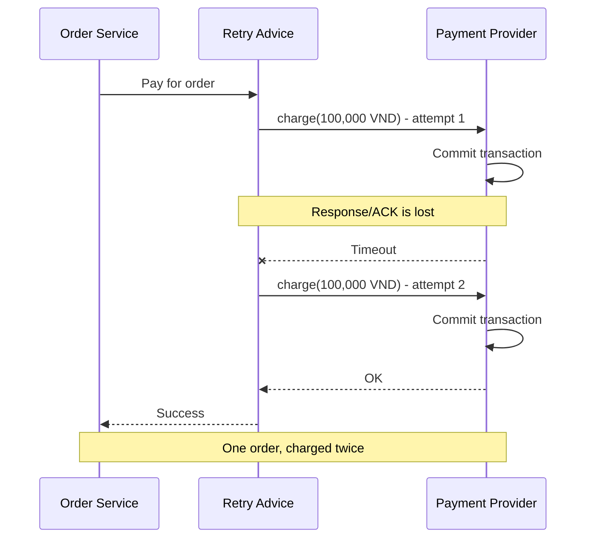
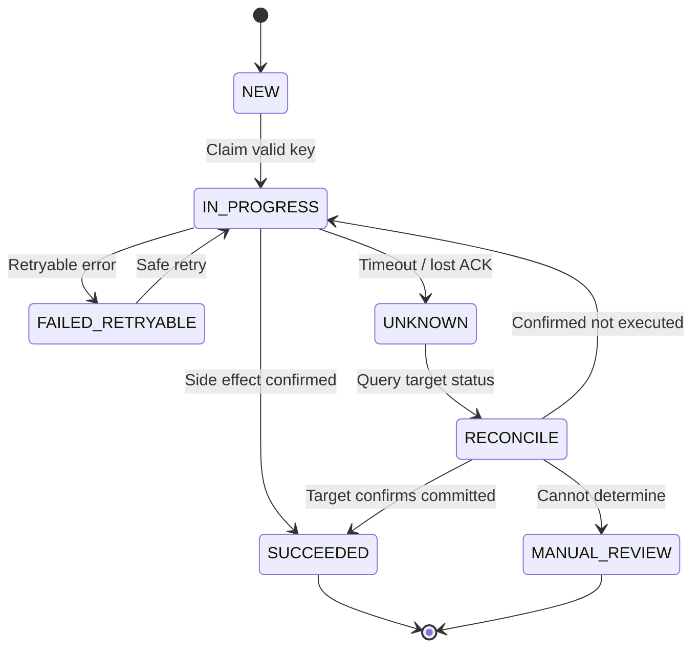
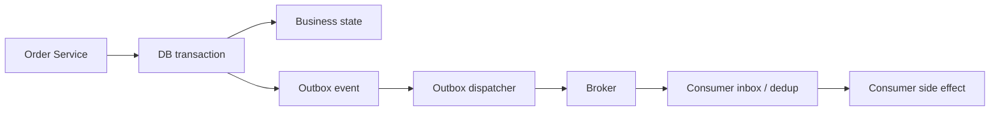

# Common Mistake: Retrying Side Effects Without Idempotency

## 1. One Timeout Can Produce Two Successful Transactions

In Spring Integration, `RequestHandlerRetryAdvice` retries a handler after it throws an exception. This is a useful tool for transient errors, yet it can also produce **repeated side effects** if the handler invokes a system that mutates state without an **idempotency** mechanism (safety when repeating the same request).

Consider a payment flow:

```text
Gateway -> Transformer -> Router -> chargePayment -> confirmationChannel
                                  |
                                  +-- retry advice: max 3 attempts
```

On the first attempt, the payment gateway **already deducted funds** but the response was lost due to a timeout. The handler throws an exception; the retry advice calls the handler again, creating another charge request. The payment gateway may record two transactions, even though the customer placed only one order.



The lesson **"Retrying Side Effects Without Idempotency"** belongs to the **Common Mistakes** chapter of module `SPRING_INTEGRATION_PATTERN`. The module's goal is practicing Enterprise Integration Patterns with Spring Integration to build loosely coupled and extensible message flows, covering Router, Filter, Transformer, Splitter, Aggregator, Gateway, retry, error channel, correlation, and testing processing branches. This lesson focuses on a mistake with severe business consequences: **treating retries as harmless operations for commands with side effects**.

After this lesson, you will be able to:

1. Distinguish **attempt**, **message delivery**, **logical operation**, and committed side effect.
2. Understand why timeouts, rollbacks, redelivery, or lost ACKs can create duplicates.
3. Choose stable idempotency keys and policies to validate payloads matching a key.
4. Use unique constraints and transactions to protect side effects **within the same database**.
5. Call external APIs with idempotency keys when providers support them; know how to handle `UNKNOWN` outcomes when they do not.
6. Evaluate the limits of `Idempotent Receiver`, `MetadataStore`, outbox/inbox, retry advice, and DLQs.
7. Write tests for post-commit timeouts, concurrent duplicates, mid-transaction failures, and dead-letter replays.

## 2. Retry Does Not Mean "Do Exactly Once"

**Retry** re-executes an operation after an error. **Idempotency** is the property allowing multiple requests with the same business intent to produce the same effective outcome as a single request, within a defined contract.

Examples:

| Operation | Safe to Re-Invoke? | Risk |
| --- | --- | --- |
| Reading data by key | Usually safe if no hidden side effects | Data may change between reads |
| Setting `order.status = PAID` | Can be idempotent with a conditional update | May emit duplicate accompanying events/notifications |
| `balance = balance - 100` | **Not** idempotent | Deducts money multiple times |
| `INSERT` row without a business unique key | **Not** idempotent | Creates multiple rows with the same meaning |
| Sending email/SMS | Not idempotent by default | Sends multiple notifications |
| Publishing event to broker | Not idempotent by default | Multiple copies may be received by consumers |
| Calling payment API with idempotency key | Depends on **provider contract** | Wrong key or expired TTL can still double-charge |

Key concepts:

- **At-least-once delivery:** messages may be sent/received multiple times to avoid drops, so consumers must be prepared for duplicates.
- **At-most-once delivery:** a message may be lost, but the transport does not intentionally redeliver.
- **Exactly-once effect:** business outcomes are guarded so only **one** valid side effect occurs; it does not mean the system runs the handler strictly once.
- **Idempotency key:** identifies **one business intent**, reused across all retries, redeliveries, and replays belonging to that intent.
- **Deduplication:** recognizing an already-seen request; dedup does not necessarily prove the side effect committed successfully.
- **Correlation ID / trace ID:** supports linking logs and traces; does not replace an idempotency key.

`RequestHandlerRetryAdvice` may invoke a handler multiple times within **the same processing turn**. A polling consumer with a transaction rollback, Kafka consumer redelivery, or DLQ replay can re-run **the entire flow** at a different time. You cannot simply enable retry advice and conclude the system is safe against duplicates.

## 3. Failure Windows That Generate Duplicates

Break a side-effecting operation into milestones:

```text
T0: Consumer receives message
T1: Begins executing side effect
T2: Side effect committed at target system
T3: Consumer receives ACK/response
T4: Consumer records message completion
```

| Where Failure Occurs | Consequence on Retry | Safety Condition |
| --- | --- | --- |
| Before T1 | Side effect has not run | Retry can usually proceed, but needs bounds |
| Between T1 and T2 | May or may not have committed | Cannot assume every error means "not executed" |
| **Between T2 and T3** | **Committed, yet caller thinks it failed** | Target-side idempotency or reliable status query |
| Between T3 and T4 | Side effect finished, consumer has not checkpointed | Consumer dedup, transaction/outbox, or replay-safe state |
| After T4 | Broker redelivers message | Mechanism recognizing the operation was already handled |

An exception like `SocketTimeoutException` only means **the caller did not receive a result in time**, not that the target system failed to commit. That is why "retrying every timeout" is especially dangerous when handlers transfer money, place orders, deduct inventory, or send notifications.

## 4. Wrong Example: Retrying a Side Effect With No Business Key

Code illustrating an anti-pattern:

```java
import org.springframework.messaging.Message;

final class UnsafePaymentHandler {
    private final PaymentClient paymentClient;

    UnsafePaymentHandler(PaymentClient paymentClient) {
        this.paymentClient = paymentClient;
    }

    void handle(Message<PaymentCommand> message) {
        PaymentCommand command = message.getPayload();
        // BUG: each call is an independent charge command.
        // If provider commits and response times out, advice will charge again.
        paymentClient.charge(command.customerId(), command.amount());
    }
}

record PaymentCommand(
        String paymentIntentId, String customerId, long amount) {}

interface PaymentClient {
    void charge(String customerId, long amount);
}
```

If this endpoint has `RequestHandlerRetryAdvice`, the advice has no idea whether `charge()` already produced a side effect. Upon hitting an exception, it only knows an error occurred and decides to call it again.

**Common but insufficient fixes:**

- "Only retry twice": can still charge **three times**.
- "Check a `processed` variable in RAM": restarts or multiple instances lose or race over state.
- "Use `message.getHeaders().getId()` as the key": a new message produced by replay or a Transformer may carry a different ID.
- "Write `processed=true` before calling the API": crashing after writing but before calling loses the business operation.
- "Write `processed=true` after calling the API": crashing after API commit but before writing causes duplicates.
- "Wrap the HTTP call in `@Transactional`": a local database transaction **cannot** roll back money deducted at an external system.

## 5. Designing Idempotency Keys Around Business Intent

A good key must stay stable across attempts and represent **one effective intent**.

For example, `paymentIntentId=pay-order-42-v1` is created when the user confirms paying order #42. Every retry, redelivery, and replay **of the same command** must reuse that ID. If the customer intentionally initiates a second payment (a new intent), a new key is needed.

### 5.1. Key Design Rules

| Rule | Good Example | Failure If Ignored |
| --- | --- | --- |
| Stable across retries | Same `paymentIntentId` across 3 attempts | Generating a new UUID per attempt renders dedup useless |
| Namespaced / scoped by tenant | `tenantId + operationType + intentId` | Two tenants may accidentally collide on keys |
| Bound to one logical content | Same key must carry same operation type, amount, currency... | One key reused with a different payload yet treated as success |
| Sufficiently long retention | Retained past the entire possible redelivery/replay window | TTL too short; an old replay can re-run the side effect |
| Authorization not trusted to caller | Server checks ownership/authorization of intent | A client could reuse another account's key |
| Never used as metric tag | ID stays in access-controlled audit/logs | Causes high cardinality and can leak data |

If the same idempotency key is sent with a **different payload**, return a **conflict** or explicit validation error—never silently allow another side effect. You can compare canonicalized contract fields or store a request fingerprint. A fingerprint is supporting data for content verification, not an authorization token.

### 5.2. Idempotent Processing States

For calls that may take time, the mere existence of a key is **not enough** to declare success:



When a duplicate request hits an `IN_PROGRESS` operation, the application can return `202 Accepted` with a status lookup endpoint, wait boundedly, or return conflict/retry-after per contract. **Never** return "success" merely because a claim row exists. When encountering `UNKNOWN` from an external system, do not blindly retry; reconcile or rely on an idempotent API at the target.

## 6. Safer Case: Side Effects Within the Same Database

If both the operation and the deduplication record live **in one transactional database**, a unique constraint can guarantee an operation applies its state change only once.

Example: reserving 3 units of stock for `operationId=res-42`. Illustrative code uses **PostgreSQL**, Java 17, Spring Boot 3.x, and Spring Integration 6.x.

### 6.1. Schema Preventing Duplicates

```sql
CREATE TABLE inventory_stock (
    sku            VARCHAR(64) PRIMARY KEY,
    available      INTEGER NOT NULL CHECK (available >= 0)
);

CREATE TABLE inventory_reservation (
    operation_id   VARCHAR(120) PRIMARY KEY,
    sku            VARCHAR(64) NOT NULL,
    quantity       INTEGER NOT NULL CHECK (quantity > 0),
    created_at     TIMESTAMPTZ NOT NULL DEFAULT now()
);
```

`operation_id` is the business unique key; `sku` and `quantity` are stored for comparison if the same operation ID is re-sent. This is a table of **executed** reservations, not just a "received message" log. For complex API responses, you can also store the committed status/result snapshot.

### 6.2. Service Using Unique Constraint and Shared Transaction

```java
import java.util.Objects;

import org.springframework.jdbc.core.JdbcTemplate;
import org.springframework.stereotype.Service;
import org.springframework.transaction.annotation.Transactional;

record ReservationCommand(String operationId, String sku, int quantity) {}

record ReservationResult(String operationId, String outcome) {}

record SavedReservation(String sku, int quantity) {}

class IdempotencyConflictException extends RuntimeException {
    IdempotencyConflictException(String message) {
        super(message);
    }
}

class InsufficientStockException extends RuntimeException {
    InsufficientStockException(String message) {
        super(message);
    }
}

@Service
class ReservationService {
    private final JdbcTemplate jdbc;

    ReservationService(JdbcTemplate jdbc) {
        this.jdbc = jdbc;
    }

    @Transactional
    public ReservationResult reserve(ReservationCommand command) {
        Objects.requireNonNull(command.operationId(), "operationId");
        Objects.requireNonNull(command.sku(), "sku");
        if (command.quantity() <= 0) {
            throw new IllegalArgumentException("quantity must be positive");
        }

        // Unique constraint arbitrates who is allowed to execute the operation.
        int inserted = jdbc.update("""
            INSERT INTO inventory_reservation(operation_id, sku, quantity)
            VALUES (?, ?, ?)
            ON CONFLICT (operation_id) DO NOTHING
            """,
            command.operationId(), command.sku(), command.quantity());

        if (inserted == 0) {
            SavedReservation previous = jdbc.queryForObject("""
                SELECT sku, quantity
                FROM inventory_reservation
                WHERE operation_id = ?
                """,
                (rs, row) -> new SavedReservation(
                        rs.getString("sku"), rs.getInt("quantity")),
                command.operationId());

            if (!Objects.equals(previous.sku(), command.sku())
                    || previous.quantity() != command.quantity()) {
                throw new IdempotencyConflictException(
                        "Same operationId with different request payload");
            }
            return new ReservationResult(
                    command.operationId(), "ALREADY_APPLIED");
        }

        int updated = jdbc.update("""
            UPDATE inventory_stock
               SET available = available - ?
             WHERE sku = ?
               AND available >= ?
            """,
            command.quantity(), command.sku(), command.quantity());

        if (updated != 1) {
            // RuntimeException -> rolls back both INSERT and UPDATE.
            throw new InsufficientStockException(
                    "Insufficient stock or SKU does not exist");
        }
        return new ReservationResult(command.operationId(), "APPLIED");
    }
}
```

**Why does this prevent duplicates?**

1. On the first request, `INSERT` succeeds and then `UPDATE inventory_stock` deducts stock **in the same transaction**. If stock is insufficient, the transaction rolls back both steps.
2. On a duplicate request after the first transaction committed, the unique constraint makes `INSERT ... ON CONFLICT DO NOTHING` return 0. The service verifies the previous payload and **does not deduct stock a second time**.
3. With two concurrent duplicate requests, PostgreSQL uses the unique index/transaction to serialize contention on the key; only the transaction winning the insert proceeds to `UPDATE`. The second request waits/reads the committed outcome per database isolation semantics.
4. If the first attempt committed and the response to the client was lost, a retry with the same `operationId` sees `ALREADY_APPLIED` instead of deducting stock again.

**Conditions that must not be overlooked:** the `@Transactional` method must be invoked through a Spring proxy from another bean; transaction manager and datasource must be configured properly; both the reservation and inventory tables must use **the same transaction**; never issue external HTTP side effects inside the transaction assuming this transaction controls them.

If the API requires returning **the exact same response as the first call**, store or deterministically reconstruct a stable result. In the example, `APPLIED` and `ALREADY_APPLIED` differ intentionally for illustration; clients must understand both mean the reservation was applied once.

### 6.3. Wiring the Service Into an IntegrationFlow

```java
import org.springframework.context.annotation.Bean;
import org.springframework.context.annotation.Configuration;
import org.springframework.integration.annotation.EnableIntegration;
import org.springframework.integration.channel.DirectChannel;
import org.springframework.integration.channel.QueueChannel;
import org.springframework.integration.dsl.IntegrationFlow;
import org.springframework.messaging.MessageChannel;
import org.springframework.messaging.PollableChannel;

@Configuration
@EnableIntegration
class ReservationFlowConfiguration {

    @Bean("reserveInput")
    MessageChannel reserveInput() {
        return new DirectChannel();
    }

    @Bean("reserveResults")
    PollableChannel reserveResults() {
        return new QueueChannel();
    }

    @Bean
    IntegrationFlow reserveFlow(ReservationService reservations) {
        return IntegrationFlow.from("reserveInput")
                .handle(ReservationCommand.class,
                        (command, headers) -> reservations.reserve(command))
                .channel("reserveResults")
                .get();
    }
}
```

If `RequestHandlerRetryAdvice` is attached to the handler above, retrying after a **caller-side timeout or retryable exception** will not deduct additional stock because the in-database side effect is protected. Still, avoid retrying `IdempotencyConflictException`, `IllegalArgumentException`, or permanent out-of-stock errors; the retry policy must classify exceptions to avoid useless load.

## 7. Side Effects Outside the Database: Keys Must Be Enforced by the Target

The local transaction pattern in section 6 is **insufficient** for charging payments, sending SMS, or creating shipments in external systems. An `operationId` row in the application's database cannot be atomic with a provider-side transaction without an additional protocol/contract.

### 7.1. Sending Idempotency Keys to Supporting APIs

Suppose the payment provider guarantees that requests with the same key and parameters are treated as one intent within the key's retention period:

```java
interface IdempotentPaymentClient {
    PaymentReceipt charge(
            String idempotencyKey,
            String customerId,
            long amountInMinorUnits,
            String currency);
}

record PaymentReceipt(String providerTransactionId, String state) {}

final class SafePaymentHandler {
    private final IdempotentPaymentClient client;

    SafePaymentHandler(IdempotentPaymentClient client) {
        this.client = client;
    }

    PaymentReceipt handle(PaymentCommand command) {
        // Key was generated/authorized from the payment intent at ingress.
        // DO NOT generate a new UUID inside each handle()/retry.
        return client.charge(
                command.paymentIntentId(),
                command.customerId(),
                command.amount(),
                "VND");
    }
}
```

The application must verify the API's **specific contract**: which header carries the key, key retention duration, concurrent request handling, status while in progress, and whether the original response is returned. Do not assume all providers implement idempotency identically.

With a reliable idempotency API, retries after timeout reuse **the same key**. If the key's TTL has expired, reconcile by transaction ID or another source of truth **before allowing another retry**.

### 7.2. If the External System Has NO Idempotency API

When a response times out, the outcome may be `UNKNOWN`. No client-side `RetryTemplate` alone can guarantee charging exactly once. Options include:

- Query status from the provider using a reliable order reference or operation ID.
- If the provider offers reliable lookup, reconcile `SUCCEEDED`/`NOT_FOUND`/`UNKNOWN`; only re-invoke with evidence that it is safe.
- If neither lookup nor target-side keys exist, route to reconciliation, compensation, or manual review according to risk level.
- Never claim "exactly once" just because the client acquired a lock or set a dedup flag.
- For long-term integrations, negotiate an idempotent API contract or design a gateway capable of resolving outcomes from target-side evidence.

**Important:** A database lock only prevents two instances of **your own application** from calling concurrently. It does not make a previously timed-out call "uncommitted" at the payment system.

## 8. Idempotent Receiver Pattern and Limits of MetadataStore

Spring Integration supports **Idempotent Receiver** via `IdempotentReceiverInterceptor` and selectors backed by `MetadataStore`, such as `MetadataStoreSelector`. This pattern detects duplicate messages by a chosen key and handles duplicates per endpoint policy.

However, **recording a key in a metadata store and executing a side effect in another system** are two operations that may not be atomic:

```text
Case A:
    Mark key=processed
    [crash]
    Side effect not yet executed
    -> later duplicate is skipped: LOST BUSINESS OPERATION

Case B:
    Execute side effect, provider commits
    [crash]
    key=processed not yet written
    -> later duplicate executes again: DUPLICATE SIDE EFFECT
```

This is why **metadata-store deduplication is only one layer of defense**, not proof of end-to-end exactly-once semantics. If both key and side effect live in the same database, use a transaction as in section 6. If the side effect is external, rely on the target's idempotency contract or reconciliation.

### When Configuring Idempotent Receiver, Check:

1. **Key extractor:** use a stable ID such as `sourceEventId`/`paymentIntentId`, not a newly generated in-flow message ID.
2. **Store:** in-memory `SimpleMetadataStore` does not survive restarts and cannot coordinate multiple instances; consider JDBC/Redis/shared stores suited to deployment.
3. **Atomic claim:** does the store API handle concurrent consumers safely? Non-atomic read-then-write has race conditions.
4. **Side-effect scope:** does it share a transaction with the dedup marker? If not, handle failures between the two steps.
5. **Duplicate policy:** discard, mark a duplicate header, return the prior result, or route to review? Do not automatically treat all duplicates as errors.
6. **TTL/cleanup:** expired keys may let a very old replayed message execute again; tie retention to redelivery and business windows.
7. **Content conflict:** same key with different payload is a problem to report, not silently return "already processed".

With Reactor, brokers, pollers, or `ExecutorChannel`, switching threads does not alter these safety requirements. `ErrorMessage`, retry advice, and trace context only aid handling/observability; they do not make side effects idempotent.

## 9. Outbox, Inbox, and Consumer-Side Deduplication

When a system must both save to a database and emit an event, **Transactional Outbox** reduces the risk of "DB committed, message lost" by writing business state and the outbox record in the same transaction:



However, the dispatcher can publish the same outbox event **multiple times** if the broker received it but the ACK back to the dispatcher was lost. Thus **an outbox does not automatically make downstream consumers exactly-once**.

A consumer can use an **Inbox / Processed Events** table:

```sql
CREATE TABLE processed_event (
    consumer_name VARCHAR(80) NOT NULL,
    source_event_id VARCHAR(120) NOT NULL,
    received_at TIMESTAMPTZ NOT NULL DEFAULT now(),
    PRIMARY KEY (consumer_name, source_event_id)
);
```

When handling an event, the consumer must claim the inbox record and **mutate business state in the same transaction** if both belong to the same database. On a duplicate, verify content/contract and return the appropriate outcome rather than re-running side effects. If the consumer also calls an external API, API-side idempotency from section 7 is still required.

Points to reconcile:

| Scenario | What Can Happen | Required Protection |
| --- | --- | --- |
| DB committed, dispatcher hasn't sent | Outbox backlog grows | Dispatcher retry, monitor oldest outbox age |
| Broker received, dispatcher missed ACK | Outbox event is re-sent | Consumer inbox/dedup |
| Consumer committed DB, hasn't ACKed broker | Broker redelivery | Inbox + business effect in same transaction |
| Consumer called external API, lost response | Uncertain whether committed | External idempotency key / reconcile |
| DLQ replay after many days | Old key may have passed TTL | Appropriate retention and replay policy |

**Do not use trace ID as the inbox key** because one business event may span multiple traces; use a stable publisher-assigned event ID.

## 10. Retry Policy Must Classify Error Types and Bound Time

Even after protecting side effects, you still need to **choose which errors are worth retrying** and bound load.

| Error | Should Retry? | Why |
| --- | --- | --- |
| Network timeout when provider has idempotency contract | Yes, with same key and bounds | Avoids creating a new side effect |
| Transient database deadlock / connection issue | Yes, with transaction rollback and stable key | Usually transient; still check commit ambiguity |
| Invalid data validation failure | Usually no | Retrying does not fix the payload |
| Same key with different payload | **No** | Contract conflict on idempotency |
| True out-of-stock | Usually no immediate retry | Depends on restock policy |
| HTTP 429 | Yes, honoring Retry-After / rate limit | Prevents retry storms |
| Lost ACK after non-idempotent side effect | **Do not blindly retry** | Target state is unknown |

Example bounded `RequestHandlerRetryAdvice` configuration (illustrative; safe only when the handler is already protected by idempotency):

```java
import org.springframework.context.annotation.Bean;
import org.springframework.integration.handler.advice.RequestHandlerRetryAdvice;
import org.springframework.retry.backoff.ExponentialBackOffPolicy;
import org.springframework.retry.policy.SimpleRetryPolicy;
import org.springframework.retry.support.RetryTemplate;

@Bean
RequestHandlerRetryAdvice safeRetryAdvice() {
    RetryTemplate retry = new RetryTemplate();

    // Up to 3 total attempts, not 3 retries + initial attempt.
    retry.setRetryPolicy(new SimpleRetryPolicy(3));

    ExponentialBackOffPolicy backoff = new ExponentialBackOffPolicy();
    backoff.setInitialInterval(200L);
    backoff.setMultiplier(2.0);
    backoff.setMaxInterval(2_000L);
    retry.setBackOffPolicy(backoff);

    RequestHandlerRetryAdvice advice = new RequestHandlerRetryAdvice();
    advice.setRetryTemplate(retry);
    return advice;
}
```

The snippet above is an **illustrative skeleton**: `SimpleRetryPolicy(3)` may retry exceptions that should not be retried by default. In production, classify by **exception cause chain**, exclude validation/idempotency conflict errors, and enforce retry budgets/time limits per SLO. The backoff above has no jitter; when many workers hit the same dependency, use a jittered strategy if supported.

### Retries in Spring Integration Have Multiple Scopes

- **Synchronous advice:** attaching `RequestHandlerRetryAdvice` to a handler may re-invoke it on the same thread.
- **Polling consumer:** rollback can lead to redelivery, re-running all preceding steps.
- **Error channel:** whether errors publish to `errorChannel` depends on the processing path and sync/async channels; not every exception automatically reaches the global error channel.
- **Dead letter / replay:** after exhausting retries, messages may be sent to an error store for later handling. Replay must preserve the original operation ID and source of truth for outcomes.
- **Splitter / Aggregator:** one parent request produces multiple fragments; retrying one fragment does not mean repeating the whole operation if group state has already changed.

If a workflow has multiple Router, Filter, and Transformer branches, identify **which step carries the real side effect** and place guards right at that boundary. Do not assume an idempotent filter at ingress protects every downstream handler when independent retries, failovers, or replays exist.

## 11. Case Study: Reserve Stock Then Send Notification

Suppose the flow is:

```text
orderInput
  -> validationFilter
  -> routeByWarehouse
  -> reserveInventory (DB)
  -> createShipment   (external HTTP)
  -> sendEmail        (external API)
  -> confirmation
```

Three side effects need **three separate idempotency contracts**, because one operation may complete while a subsequent one fails:

| Step | Suggested Key | Protection | On Timeout |
| --- | --- | --- | --- |
| Reserve inventory | `reservationIntentId` | Unique constraint + same DB transaction | Query reservation by key; do not deduct again |
| Create shipment | `shipmentIntentId` | API idempotency key or lookup by reference | Reconcile shipment status |
| Send email | `notificationIntentId` | Dedup/outbox + provider contract if any | May accept at-least-once or check send status |

If `reserveInventory` succeeds but `createShipment` fails:

1. Retry shipment with **the same shipment key** if supported by the provider.
2. Do not re-run reservation automatically just because the overall flow received an exception.
3. If shipment cannot succeed, execute a **compensating action** releasing the reservation, which also requires idempotency.
4. Avoid sending an "order completed" email before the business outcome is actually confirmed.

**Saga/compensation is not automatic rollback**: compensation itself can fail, be retried, and cause new side effects. Audit step-by-step state, execution order, and keys for the compensating actions themselves.

## 12. Monitoring Retry-Without-Idempotency Bugs

Metrics help detect duplicates and retry storms, though they do not replace an audit store:

| Suggested Metric | Type | Meaning |
| --- | --- | --- |
| `app.eip.handler.attempts` | Counter | Total handler executions, including retries |
| `app.eip.handler.attempt.errors` | Counter | Failed attempts |
| `app.eip.idempotency.applied` | Counter | New operations that actually applied side effects |
| `app.eip.idempotency.duplicate` | Counter | Valid duplicates detected |
| `app.eip.idempotency.conflict` | Counter | Same key with mismatched content |
| `app.eip.idempotency.inprogress` | Gauge | Operations without a final outcome yet |
| `app.eip.external.unknown` | Counter/Gauge per contract | Unknown outcomes needing reconciliation |
| `app.eip.reconcile.pending` | Gauge | Operations awaiting reconciliation |
| `app.eip.dlq.pending` | Gauge | Messages awaiting recovery |
| `app.eip.replay.outcomes` | Counter | Replay results (success/error/skipped) |

**Do not use** `paymentIntentId`, `orderId`, `messageId`, `traceId`, or payloads as metric tags. Tags should come from bounded sets such as `flow=orders`, `stage=reserveInventory`, `outcome=duplicate|applied|conflict`.

### PromQL Examples

If the application exports the Counters above via Micrometer/Prometheus, exporter names typically use underscores and a `_total` suffix. Verify actual exported names:

```promql
sum(rate(app_eip_idempotency_duplicate_total{
  flow="orders"
}[5m]))
```

Duplicate ratio among classified requests (not the double-charge rate):

```promql
sum(rate(app_eip_idempotency_duplicate_total{
  flow="orders"
}[5m]))
/
clamp_min(
  sum(rate(app_eip_idempotency_duplicate_total{flow="orders"}[5m]))
  +
  sum(rate(app_eip_idempotency_applied_total{flow="orders"}[5m])),
  0.000001
)
```

Useful alerts include: sustained `UNKNOWN` counts, rising attempts without rising logical throughput, rising conflicts, growing DLQ backlog/oldest age, and reconciliation failures. **High duplicate detection** may reflect legitimate broker redeliveries, yet you must still verify there are no **duplicate side effects**; those two numbers are different.

### Audit Events for an Operation

An audit trail might include:

```json
[
  {"eventType":"OPERATION_RECEIVED","operationId":"res-42","attempt":1},
  {"eventType":"SIDE_EFFECT_COMMITTED","operationId":"res-42","attempt":1},
  {"eventType":"RESPONSE_LOST","operationId":"res-42","attempt":1},
  {"eventType":"DUPLICATE_DETECTED","operationId":"res-42","attempt":2},
  {"eventType":"RESULT_RETURNED","operationId":"res-42","attempt":2}
]
```

This is an **illustrative schema**, not built-in Spring Integration events. `RESPONSE_LOST` may **not be directly observable** on the server side; real audits should log observable milestones and infer lost responses only after reconciliation. Persist audit events durably, control access, and avoid letting logging failures erase business evidence.

## 13. Mandatory Tests Before Enabling Retries

Testing only "handler fails once then succeeds on the second attempt" is insufficient. You must proactively simulate **failures occurring after the side effect**.

### 13.1. Local Transaction Testing With PostgreSQL

Suppose you use Testcontainers PostgreSQL or a real test database supporting `ON CONFLICT`. After seeding data:

```text
inventory_stock(sku="BOOK", available=10)
```

Core assertions:

```java
import static org.assertj.core.api.Assertions.assertThat;
import static org.assertj.core.api.Assertions.assertThatThrownBy;

void duplicateReservationMustNotReduceStockTwice(
        ReservationService service, JdbcTemplate jdbc) {
    ReservationCommand command =
            new ReservationCommand("res-42", "BOOK", 3);

    ReservationResult first = service.reserve(command);
    ReservationResult duplicate = service.reserve(command);

    Integer available = jdbc.queryForObject(
            "SELECT available FROM inventory_stock WHERE sku = ?",
            Integer.class, "BOOK");

    assertThat(first.outcome()).isEqualTo("APPLIED");
    assertThat(duplicate.outcome()).isEqualTo("ALREADY_APPLIED");
    assertThat(available).isEqualTo(7);

    assertThatThrownBy(() ->
            service.reserve(new ReservationCommand("res-42", "BOOK", 4)))
            .isInstanceOf(IdempotencyConflictException.class);
}
```

This is an **illustrative test body**; to run in CI, provision a PostgreSQL test fixture, apply the schema, and invoke through a Spring-managed service proxy. Do not wrap the entire test in a single rolling-back transaction if the goal is verifying commit behavior across separate calls.

### 13.2. Scenario Matrix to Verify

| Test Case | Expectation |
| --- | --- |
| Single successful operation | Side effect applied exactly once |
| Re-send same key, same payload | Side effect not repeated; returns appropriate outcome |
| Re-send same key, **different** payload | Clear conflict; no new side effect applied |
| Two workers concurrently process same key | Unique/atomic claim guarantees single application |
| Failure after dedup insert but before DB update | **Both roll back**, subsequent retry can succeed |
| DB commits then response is lost | Retry observes committed outcome, does not mutate state again |
| External HTTP commits then times out | Retry with same key if guaranteed by provider; otherwise reconcile |
| Idempotency TTL expires before redelivery | Must not execute duplicate; retain longer or query additionally |
| Broker redelivery after consumer commits | Inbox/dedup protects side effect |
| DLQ replay after new version rollout | Preserves original business operation ID; handles schema/rule migration |
| One Splitter fragment retries | Does not duplicate side effects even if fragment/message ID changes |
| Aggregator releases repeatedly due to incident | Downstream outputs/side effects guarded by logical group ID |
| Compensation retry | Compensating action also has an independent idempotency key |
| MetadataStore loses data on restart | Test proves RAM-only storage cannot protect against duplicates |

### 13.3. Fault Injection at Commit Milestones

Inject faults **before side effect**, **after side effect but before ACK**, and **after ACK but before saving consumer state**. When simulating off-DB side effects, use a fake provider that counts actual commits and can intentionally return a timeout **after committing**.

A good test suite verifies all of:

- **Operation outcome:** is the business result right?
- **Number of committed side effects:** how many exact times did the side effect occur?
- **Retry behavior:** which cases retry and which stop/reconcile?
- **Audit/correlation:** is there sufficient evidence linking attempts to the same intent?
- **Metrics:** are attempts, duplicates, conflicts, and unknown/recovery recorded at the right spots?

Do not assert only exception counts or how many times `channel.send()` was invoked. Those metrics cannot prove you did not double-charge or double-deduct stock.

## 14. Pre-Production Anti-Mistake Checklist

- [ ] Identify exactly which handlers have side effects and each endpoint's retry scope.
- [ ] Define business operation ID / idempotency key **before** entering retry; never generate a new key per attempt.
- [ ] Same key represents only one business payload; detect conflicts on different payloads.
- [ ] Within the same database, use a unique constraint + shared transaction for dedup record and business update.
- [ ] For external APIs, verify provider idempotency contracts/TTLs; have a reconciliation process for `UNKNOWN` states.
- [ ] Do not confuse `IdempotentReceiverInterceptor`/MetadataStore with cross-system exactly-once effects.
- [ ] With outbox/inbox, prevent consumer duplicates and handle lost ACKs after commit.
- [ ] Retry policy classifies transient vs. permanent errors and bounds attempts/backoff/time budgets.
- [ ] Dead letter / replay preserves operation IDs and bounds redrives; compensation is also idempotent.
- [ ] Test concurrent duplicates, crashes before/after commit, post-side-effect timeouts, and replays after restart.
- [ ] Emit dedicated metrics for attempts, duplicates detected, side effects applied, conflicts, and unknown/reconcile.
- [ ] Do not use business IDs/trace IDs/raw payloads as metric tags; use access-protected audits/logs for detailed lookups.
- [ ] Do not treat a single ACK or exception as sole proof of actual side effects; verify commit/reconciliation milestones.

## 15. References

- [Spring Integration — Handler Advice and Retry](https://docs.spring.io/spring-integration/reference/handler-advice/classes.html)
- [Spring Integration — Idempotent Receiver](https://docs.spring.io/spring-integration/reference/handler-advice/idempotent-receiver.html)
- [Spring Integration — Error Handling](https://docs.spring.io/spring-integration/reference/error-handling.html)
- [Spring Integration — Transaction Support](https://docs.spring.io/spring-integration/reference/transactions.html)
- [Spring Retry Reference](https://docs.spring.io/spring-retry/reference/)
- [Spring Framework — Declarative Transaction Management](https://docs.spring.io/spring-framework/reference/data-access/transaction/declarative.html)
- [PostgreSQL — INSERT and ON CONFLICT](https://www.postgresql.org/docs/current/sql-insert.html)
- [Enterprise Integration Patterns — Idempotent Receiver](https://www.enterpriseintegrationpatterns.com/patterns/messaging/IdempotentReceiver.html)

**Takeaway:** retry only repeats a call; it **does not know** whether the previous side effect already committed. To avoid duplicate charges, stock reservations, or shipments, use **a stable idempotency key**, enforce constraints **right where the side effect commits**, and have a **reconciliation workflow for unknown states**. Only then do retries, error channels, and replays aid recovery without turning a transient glitch into two real side effects.
