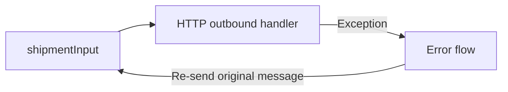
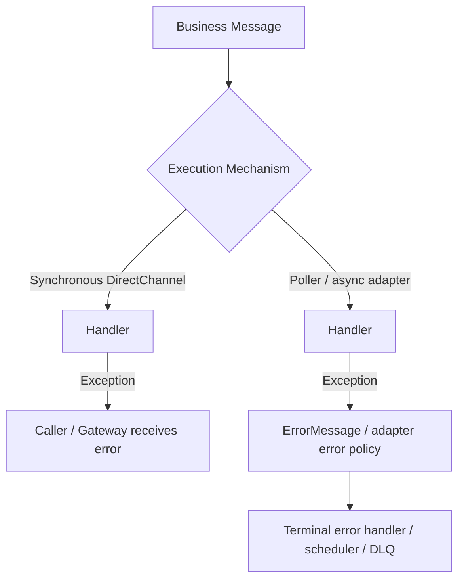
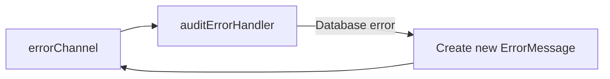
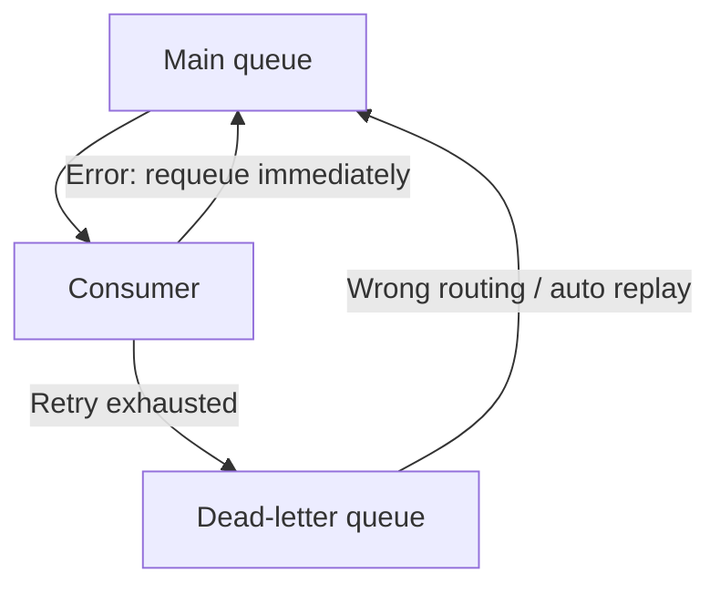
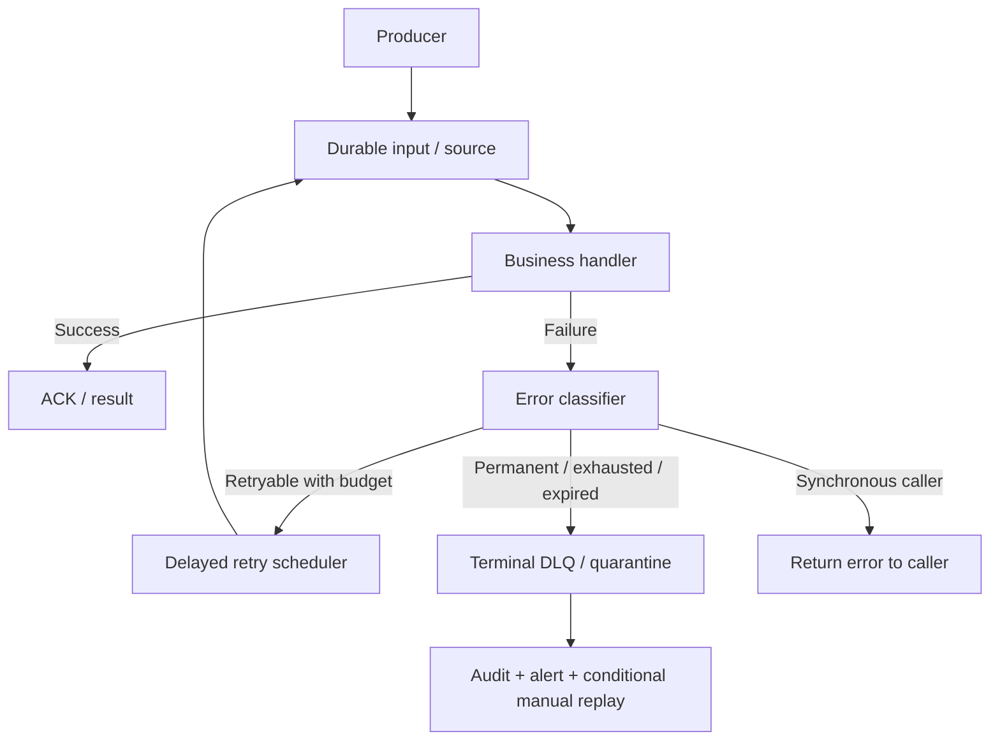

# Common Mistake: Error Flow Creating Loops in Spring Integration

> **Module:** `SPRING_INTEGRATION_PATTERN` — Learn how to implement Enterprise Integration Patterns with Spring Integration to build loosely coupled and extensible message flows. Practice Router, Filter, Transformer, Splitter, Aggregator, Gateway, retry, error channel, and correlation, along with testing and observing processing branches.
>
> **Chapter:** Common Mistakes  
> **Topic:** Error Flow Creating Loops

## 1. Scenario: Errors Are Being Handled, Yet Error Message Counts Grow Without Bound

An integration flow receives a shipment creation request, calls a partner API, and handles errors via an error flow. When the partner returns HTTP 503, the development team wants to "retry immediately", so they route the failing message back to the input channel:



If the API stays broken, the process keeps returning to the same spot. Consequences can include:

- The same `businessId` or `correlationId` appears thousands of times in logs.
- Outbound request traffic surges even though only a single new message arrived from the producer.
- CPU, thread pools, queues, or broker backlogs spike abnormally.
- A secondary error in the error handler produces a new `ErrorMessage`, causing nested logs.
- Once the network glitch clears, the system may send duplicate business effects due to retries lacking idempotency.

This is a **feedback loop** mistake: the error handling path leads back to a point that can keep reproducing the very same error without a stopping condition or safe recovery schedule.

This lesson explains how to identify loops in Spring Integration, distinguish them from bounded retries, design *terminal* error sinks, handle delayed retries and DLQs, and test error paths by actual invocation counts rather than just reading logs.

## 2. Four Types of Loops to Distinguish

| Type | Loop Mechanism | Common Symptoms |
|---|---|---|
| **Error-to-input loop** | Error handler sends the original message back to the same input channel that failed | One message triggers very many calls to the same handler |
| **Error-handler failure loop** | Error channel handler throws an exception itself, triggering error handling again | Repeated or nested chains of exceptions/error messages |
| **Unbounded retry loop** | `RetryAdvice`, scheduler, or SDK lacks proper retry budget/backoff | Continuous retries; attempt count grows without end |
| **Broker/DLQ routing loop** | Immediate NACK/requeue or DLQ routed back to the source queue | Messages continuously redelivered; redelivery count climbs |

A system can suffer from **multiple types simultaneously**. For example, an error flow pushes the message straight back to the broker, the broker redelivers it, the HTTP handler fails, and the error flow emits another error event onto a channel that is also failing.

To solve it properly, identify **who owns the message**, **where the return path goes**, **what the stopping condition is**, and **what side effects each attempt has**.

## 3. How Do ErrorMessage and Error Channels Actually Work?

Spring Integration uses `Message<?>` for business flows. When processing fails, some components may emit an `ErrorMessage`, whose payload is a `Throwable` (often a `MessagingException`). That exception may carry a reference to the failing message (*failed message*) for investigation.

Key concepts:

- **ErrorMessage:** a message about an error, *not* a repaired business message.
- **errorChannel:** a logical address to forward `ErrorMessage`s per flow/adapter configuration or the default error channel in supported situations.
- **Failed message:** the message associated with the exception; must be inspected before extracting payload and headers.
- **Recovery:** the next business decision: return an error, bounded retry, move to DLQ, compensate, alert, or wait for manual handling.

**Not every exception automatically goes to the global `errorChannel`.**

With a `DirectChannel`, handlers typically execute on the sender's thread; exceptions can propagate directly back to the Gateway/caller. In asynchronous flows like executors, pollers, or inbound adapters, errors may be wrapped in an `ErrorMessage` and sent to an error channel, or handled by the adapter/broker per its own policy. Exact details depend on the component, version, and configuration.



Therefore, when an error flow "does not receive errors", do not immediately wire the global `errorChannel` back to the input. First confirm the **actual exception path**.

### Distinguishing Two Object Types in a Handler

Example handler invoked when receiving an `ErrorMessage`:

```java
import org.springframework.messaging.MessagingException;
import org.springframework.messaging.Message;
import org.springframework.messaging.support.ErrorMessage;

public void inspect(ErrorMessage errorMessage) {
    Throwable cause = errorMessage.getPayload();

    Message<?> failed = null;
    if (cause instanceof MessagingException messagingException) {
        failed = messagingException.getFailedMessage();
    }

    // failed can be null: never assume the original message is always present.
    // Log reason/correlation safely; DO NOT blindly send failed back to input.
}
```

When exceptions are wrapped multiple layers deep or `ErrorMessage`s are created by another adapter, the original message may sit at a different level or not exist. Use the APIs and metadata of the adapter in use rather than assuming `getFailedMessage()` always returns a message.

## 4. Anti-Pattern 1: Error Flow Pushes Back to the Input Channel

This is a dangerous structure:

```text
shipmentInput ──> validate/transform ──> HTTP handler
     ^                                    |
     |                                    | error
     +──────── errorHandler <── errorChannel
                 "re-send original message"
```

A conceptually broken snippet:

```java
// INTENTIONALLY WRONG PSEUDOCODE, never use in production.
void onError(ErrorMessage error) {
    Message<?> failed = findFailedMessage(error);

    // No attempt count, backoff, time limit, or DLQ.
    shipmentInput.send(failed);
}
```

As long as the error persists, the handler re-runs and can emit the exact same error. With a synchronous `DirectChannel`, nested calls also risk blowing up call stack depth or throwing errors back across multiple layers. With executors/brokers, it can create a prolonged asynchronous loop that is hard to spot from stack traces.

### Why Is "Forward Back to Retry" Wrong?

- No **stopping condition**: no limit on attempt count or message age.
- No **retry timing**: if the failure is due to quota or transient 503, immediate retries worsen overload.
- No **transient vs. permanent classification**: invalid payloads are retried infinitely.
- No **clear message ownership**: messages may be lost if re-sending fails or duplicated on improper ACKs.
- No **idempotency**: if the HTTP outcome is ambiguous, retries can produce duplicate side effects.

**Fix:** never wire an error sink directly back to input. Replace it with an **error decision** step enforcing max attempts, next eligible retry time, TTL/deadline, durable recording, and a final path (terminal/DLQ). Then retry only when a scheduler/broker redelivers the message according to an explicit policy.

## 5. Anti-Pattern 2: Error Handler Emits a New ErrorMessage Itself

Suppose the error channel handler persists an audit record to a database. When the database also fails, the handler tries to emit a new `ErrorMessage` back into **the same error channel**:



This is **an error-reporting loop inside the error reporter itself**. Depending on channel type and exception handling, the system may recurse, queue endless tasks onto an executor, or loop across subscribers. Do not assume the framework will block all such loops.

### Three Principles for Terminal Error Handlers

1. **Never publish back into the source of the error.** A terminal handler should record the classification, audit, or send once to a dedicated DLQ.
2. **Bound complexity.** Do not start a chain of network/DB calls with unbounded retries just to log an error; if the audit dependency is unavailable, have an independent, bounded fallback.
3. **Never swallow critical business errors.** Logging does not mean the message succeeded or was safely saved to a DLQ. ACK/rollback decisions must follow the producer/broker contract.

A simple error sink that only writes structured logs is usually safer than an error handler continuously pushing more events through the very system that just failed. However, **log-only does not guarantee final processing** for orders/payments; a durable, operable error store is needed.

## 6. Anti-Pattern 3: Unbounded Retries Without Backoff

Retry is a **conditional re-attempt**, not an endless wire from the error channel back to input.

Two patterns that easily cause hot loops:

```text
onError:
    while true:
        attemptAgain()          # No limit, no backoff
```

```text
HTTP 429 -> retry immediately -> HTTP 429 -> retry immediately -> ...
```

Impacts:

- Many HTTP attempts can be fired from a single business message.
- A local Rate Limiter can exhaust permits, causing a loop of out-of-permit errors instead of aiding recovery.
- When many consumers retry simultaneously, a *retry storm* occurs.
- Permanent errors (HTTP 400, bad schema, missing credentials) are never fixed by retrying.
- Gateway deadlines or message age limits may be exceeded before any outcome arrives.

### Safer Retry Policy

| Case | Reasonable Default Action |
|---|---|
| HTTP 502/503, transient network errors | Bounded retry + exponential backoff + jitter |
| Remote HTTP 429 | Respect `Retry-After` if valid; delay instead of retrying immediately |
| Local Rate Limiter out of permits | Wait boundedly for a permit or schedule a delayed retry; no hot loop |
| HTTP 400/422 invalid data | Do not blindly retry; return error or DLQ to fix data |
| HTTP 401/403 | Investigate authentication/authorization; avoid continuous retries |
| Unfixable business error | Terminal failure or compensation/investigation workflow |
| Exhausted attempts or deadline | DLQ/quarantine + alert/replay per policy |

A retry policy needs an **attempt counter**, **deadline or TTL**, **retryable classification**, and **terminal path**. Whether retries count per **business operation** or per **outbound attempt** must be defined explicitly so counters do not reset each time a message crosses an adapter.

## 7. Anti-Pattern 4: Broker Requeue and DLQ Looping Back to Source Queue

In systems using RabbitMQ, Kafka, or other brokers, loops can occur **outside Spring Integration**.



Examples:

- Consumer hits an invalid message and immediately does `nack/requeue=true` with no delay and no retry counter increment.
- Dead-letter exchange/routing key is configured to route back to the source queue; messages cycle endlessly between main queue and DLQ.
- A DLQ consumer defaults to re-sending every message to the main queue even though the root cause is unfixed.
- A scheduled retry copies a new message and then ACKs the old one, but crashing between the two steps risks losing or duplicating messages without transactions or safe design.

**A DLQ is not a place that magically "heals" messages.** It holds messages classified for investigation, data repair, or policy-controlled replay. Replaying from a DLQ back to the main queue must be conditional, with data-version checks and retry budgets.

**Broker-specific note:** exact behavior of NACK, dead-letter exchanges, delayed queues, visibility timeouts, and delivery counts depends on the product/adapter. Do not assume one generic ACK/NACK rule applies across all brokers.

## 8. Proper Design: An Error Flow With a Terminal Endpoint

A controllable topology:



The `R -> Q` edge is **not an infinite feedback loop** provided every return trip:

1. Is tracked with an **attempt count that cannot be arbitrarily reset**.
2. Waits **until an eligible time**, avoiding hot immediate requeues.
3. Obeys a **deadline/TTL** and maximum attempt limit.
4. Preserves the **idempotency key** / business ID to prevent duplicate side effects.
5. Has a **stopping point** on permanent failure, exhausted retries, or expiration.

You can use `RequestHandlerRetryAdvice` for a few short attempts, then move messages to scheduled retry/DLQ per policy. If you enable retries in Spring Integration while also having hidden retries in an HTTP SDK and the broker, total attempts can exceed expectations because **retry layers multiply together**.

### Estimating Total Attempts Across Multiple Retry Layers

If Spring Retry allows up to 3 attempts and an HTTP SDK silently tries twice per handler invocation, one business message can fire up to **6 HTTP attempts** before broker redelivery. If the broker redelivers 4 more times, that can theoretically reach **24 attempts**, not counting other logic.

Therefore, maintain **one overall retry map** documenting who owns the budget at each layer. Every HTTP attempt must pass through the provider quota if the API limits by actual requests.

## 9. Java Example: Terminal Error Channel That Never Feeds Back to Input

The following example uses Spring Boot / Spring Integration to build an **observation-only error sink**. It **does not automatically subscribe to all exceptions across the entire application**; any adapter/poller/Gateway wishing to use it must route `ErrorMessage`s to `shipmentErrors` via that endpoint's mechanism.

### 9.1. Dependencies and Application

```groovy
dependencies {
    implementation "org.springframework.boot:spring-boot-starter-integration"
}
```

```java
package com.example.errorloop;

import org.springframework.boot.SpringApplication;
import org.springframework.boot.autoconfigure.SpringBootApplication;
import org.springframework.integration.config.EnableIntegration;

@SpringBootApplication
@EnableIntegration
public class ErrorLoopApplication {

    public static void main(String[] args) {
        SpringApplication.run(ErrorLoopApplication.class, args);
    }
}
```

### 9.2. Isolated Error Channel

```java
package com.example.errorloop;

import org.springframework.context.annotation.Bean;
import org.springframework.context.annotation.Configuration;
import org.springframework.integration.channel.DirectChannel;
import org.springframework.messaging.MessageChannel;

@Configuration
public class ErrorFlowChannels {

    @Bean
    public MessageChannel shipmentErrors() {
        return new DirectChannel();
    }
}
```

`shipmentErrors` is a channel declared **exclusively for `ErrorMessage`s**. It is not wired back to `shipmentInput` and has no default output channel pointing back to the failing handler.

### 9.3. Terminal Handler Only Observes Errors, Never Loops

```java
package com.example.errorloop;

import org.slf4j.Logger;
import org.slf4j.LoggerFactory;
import org.springframework.integration.annotation.ServiceActivator;
import org.springframework.messaging.MessagingException;
import org.springframework.messaging.Message;
import org.springframework.messaging.support.ErrorMessage;
import org.springframework.stereotype.Component;

@Component
public class TerminalErrorObserver {

    private static final Logger log =
            LoggerFactory.getLogger(TerminalErrorObserver.class);

    @ServiceActivator(inputChannel = "shipmentErrors")
    public void onError(ErrorMessage error) {
        Throwable cause = error.getPayload();

        Message<?> failed = null;
        if (cause instanceof MessagingException messagingException) {
            failed = messagingException.getFailedMessage();
        }

        Object messageId = (failed != null)
                ? failed.getHeaders().getId()
                : "unknown";

        // Do not log sensitive payloads; do not send back to the input channel.
        log.warn("shipment error: failedMessageId={} type={}",
                messageId, cause.getClass().getSimpleName());

        // Demo only logs. Production needs a durable DLQ/audit connection
        // and safe ownership/ACK handling at the adapter.
    }
}
```

Why doesn't this handler loop?

- It does not call `shipmentInput.send(...)` to immediately re-execute the failing logic.
- It does not send a new `ErrorMessage` back into `shipmentErrors`.
- It does not run an unbounded retry loop.
- It does not equate logging with completing the business message.

**Limitation:** If the logging backend fails or another interceptor throws an exception, the error handler can still fail. Control fallbacks and avoid letting exceptions from the error sink publish back into that same sink. For critical business flows, logging **is not enough** to decide to ACK a failed message; design a DLQ/persistent error record and adapter-specific error policy.

### 9.4. Sending an ErrorMessage Manually in Tests/Demos

```java
import org.springframework.messaging.MessageChannel;
import org.springframework.messaging.support.ErrorMessage;

// errorChannel here is the "shipmentErrors" bean:
boolean accepted = errorChannel.send(
        new ErrorMessage(
                new IllegalStateException("Simulated provider failure")));

if (!accepted) {
    throw new IllegalStateException("Error sink unavailable");
}
```

This simulates the **`ErrorMessage` receiving path** to test the sink, not an automatic hook for all handler errors. Framework-emitted `ErrorMessage`s arrive here only when real adapters/flows configure their error channel to `shipmentErrors`.

## 10. Pure-Code Example of Error Classification and Retry Bounds

To avoid an error handler that "re-sends immediately on any error", first create a pure decision function that can be unit tested independently of any broker.

### 10.1. Defining Decision State

```java
package com.example.errorloop;

public enum ErrorDecision {
    RETRY_LATER,
    DEAD_LETTER
}
```

```java
package com.example.errorloop;

public record FailureFacts(
        int attemptsSoFar,      // How many attempts have actually run?
        int maxAttempts,        // Maximum total attempts.
        long nextAttemptAtMs,   // Computed next retry timestamp (backoff).
        long expiresAtMs,       // Business deadline.
        boolean retryable
) {
    public FailureFacts {
        if (attemptsSoFar < 1 || maxAttempts < 1
                || nextAttemptAtMs < 0 || expiresAtMs < 0) {
            throw new IllegalArgumentException("Invalid retry facts");
        }
    }
}
```

```java
package com.example.errorloop;

public final class FailureClassifier {

    private FailureClassifier() {}

    public static ErrorDecision decide(FailureFacts f, long nowMs) {
        if (!f.retryable()
                || f.attemptsSoFar() >= f.maxAttempts()
                || nowMs >= f.expiresAtMs()
                || f.nextAttemptAtMs() >= f.expiresAtMs()) {
            return ErrorDecision.DEAD_LETTER;
        }
        return ErrorDecision.RETRY_LATER;
    }
}
```

Meaning:

- Never retry **unrecoverable** errors.
- Never retry once total attempts are exhausted.
- Never continue once the message has expired.
- Never schedule a retry at or after the deadline.
- When `RETRY_LATER` is chosen, **do not send immediately**; let a scheduler/broker redeliver after `nextAttemptAtMs`.

`FailureFacts` is demo business data, not a built-in Spring Integration record. When crossing a broker, attempt counts and deadlines must be **stored durably and reliably**, not taken solely from headers a caller could tamper with. If the business operation already completed earlier, idempotency/dedup must stop retries from repeating side effects.

### 10.2. JUnit 5 Verifying Stopping Conditions

```java
package com.example.errorloop;

import static org.junit.jupiter.api.Assertions.assertEquals;
import org.junit.jupiter.api.Test;

class FailureClassifierTest {

    @Test
    void retryableErrorWithBudgetIsDelayed() {
        FailureFacts f = new FailureFacts(
                1, 3, 2_000L, 10_000L, true);
        assertEquals(ErrorDecision.RETRY_LATER,
                FailureClassifier.decide(f, 1_000L));
    }

    @Test
    void retryExhaustionStopsTheLoop() {
        FailureFacts f = new FailureFacts(
                3, 3, 4_000L, 10_000L, true);
        assertEquals(ErrorDecision.DEAD_LETTER,
                FailureClassifier.decide(f, 3_000L));
    }

    @Test
    void permanentErrorNeverRetries() {
        FailureFacts f = new FailureFacts(
                1, 3, 2_000L, 10_000L, false);
        assertEquals(ErrorDecision.DEAD_LETTER,
                FailureClassifier.decide(f, 1_000L));
    }

    @Test
    void expiredMessageNeverRetries() {
        FailureFacts f = new FailureFacts(
                1, 3, 11_000L, 10_000L, true);
        assertEquals(ErrorDecision.DEAD_LETTER,
                FailureClassifier.decide(f, 9_000L));
    }
}
```

These tests verify **stopping-condition logic**, not crash durability or framework `ErrorMessage` routing. To verify the whole flow, add integration tests with the Gateway, adapter/broker, and HTTP stubs.

## 11. Error Handling Pseudocode With DLQ and Delayed Retry

For a broker supporting retry/delay mechanisms, the concept is:

```text
onDelivery(delivery):
    try:
        result = provider.sendOnce(
            delivery.payload,
            idempotencyKey = delivery.businessOperationId
        )
        persistResult(result)
        broker.ack(delivery)
    catch error:
        classification = classify(error)
        nextAt = calculateBackoffAndRetryAfter(error)
        facts = loadTrustedAttemptBudget(delivery, nextAt)

        if FailureClassifier.decide(facts, now) == RETRY_LATER:
            broker.deferDeliverySafely(delivery, nextAt)
            # Do NOT ACK before the message is safely stored elsewhere.
        else:
            broker.deadLetterSafely(delivery, error, facts)
            # Terminal: never auto-send DLQ -> input immediately.
```

**This is pseudocode**, not standard Spring Integration or broker APIs. `deferDeliverySafely` and `deadLetterSafely` must be implemented using the specific broker's atomic/transactional/ack semantics so crashing between "writing retry message" and "ACKing original" never loses a message. Redelivery may still occur; every attempt keeps a **stable idempotency key**.

Error-to-input paths must be replaced solely with **bounded scheduled redelivery**. A terminal DLQ must be separate from normal retry paths; replaying from DLQ requires human/workflow approval and fixing the root cause first.

## 12. Why Can Retry Budgets Be Accidentally Reset?

This bug often appears when developers rely on headers:

```text
attempt = message.headers["retryAttempt"] or 0
attempt += 1
sendBackToInput(message)
```

If a step creating a new `Message` fails to copy headers, `retryAttempt` disappears. The next run starts at 0 again, so `maxAttempts = 3` is **never reached**.

Other causes:

- Broker adapter serializes only the payload, dropping attempt/deadline metadata.
- A Router switches to another channel where a retry policy creates a fresh `RetryContext`.
- Consumer restarts and the counter lived only in RAM.
- SDK retries, `RetryAdvice`, and broker redelivery all exist while each layer counts independently.
- An HTTP endpoint receives the same operation again with a brand-new message ID.

**Remedies:**

1. Use the business operation ID as the stable key; deduplicate/enforce idempotency per operation.
2. Persist attempt count/deadline in trusted storage capable of surviving restarts as required.
3. Count **total outbound attempts** across layers and classify retryable errors explicitly.
4. On deserialization, verify metadata is intact and was neither spoofed by callers nor reset.
5. Terminate into DLQ/quarantine when budget is exceeded.

Note: Spring Retry's `RetryContext` is scoped to a single execution of a retry template; **it does not automatically become a durable attempt counter across broker redeliveries**.

## 13. Interactions With Other Enterprise Integration Patterns

| Pattern | How a Loop Forms | How to Prevent It |
|---|---|---|
| **Router** | Default rule routes `ErrorMessage` back to a business input channel | Separate error rules; route to terminal/delayed-retry |
| **Filter** | Post-Filter errors get sent back upstream and keep failing the same condition | Classify permanent errors; avoid retrying invalid data |
| **Transformer** | Building a new `Message` drops attempt/deadline/correlation | Preserve trusted metadata across hops |
| **Splitter** | Parent spawns N children; one failing child retries before Splitter and multiplies N times again | Retry the specific **child/attempt** or group policy; avoid unintended re-splitting |
| **Aggregator** | Incomplete group times out; error flow replays whole batch into Splitter | Recover per child/group; guard duplicates and release strategy |
| **Gateway** | Client times out and re-submits operation while prior run is still active | Clear reply contract; idempotency/correlation |
| **RetryAdvice** | Retries every exception (including quota errors) with inappropriate counts/timeouts | Error-classifying `RetryPolicy`, finite attempts |
| **Rate Limiter** | Out-of-permits throws; error flow retries immediately and keeps running out of permits | Delayed retry or bounded wait; meter quota on each HTTP attempt |
| **Error Channel** | `ErrorMessage` is sent back to the same error channel or input | Separate terminal sink; never wire an unguarded cycle |
| **Correlation** | Retries lose business ID or generate a new ID, evading dedup | Keep IDs stable and record attempt/trace metadata |

### When Splitter/Aggregator Combines With Error Flows

A three-item batch produces children with `sequenceNumber=1..3`. The second child fails and the error handler re-sends **the entire parent batch**. The Splitter recreates all three children, potentially re-sending children 1 and 3 even though they previously succeeded. The Aggregator receives duplicates, and the group may release incorrectly or time out if batch metadata becomes inconsistent.

Instead of blindly re-running the entire batch, choose **per-child retries** with idempotency, or deliberately reprocess the batch as a new business run with clear deduplication, compensation, and correlation.

## 14. Observing Loop Signals With Metrics and Tracing

An error loop is usually easy to spot via the ratio of **many attempts per single business message**.

| Metric / Signal | Used to Detect |
|---|---|
| `incoming_business_messages_total` | Valid new messages arriving from producers |
| `handler_attempts_total` | Total handler invocations, including redeliveries |
| `outbound_http_attempts_total` | Actual outbound requests sent |
| `error_messages_total{type,flow}` | `ErrorMessage` frequency by type |
| `retry_attempts_total` and `retry_exhausted_total` | Retry counts and budget exhaustion rate |
| `redelivery_count` | Messages redelivered repeatedly by the broker |
| `dlq_depth` and `dlq_replayed_total` | Terminal failures and replay counts |
| `oldest_message_age_seconds` | Failing messages stuck for a long time |
| `local_rate_limit_rejected_total` | Hot-loop retries when out of permits |
| `remote_http_429_total` | Provider returning quota errors after HTTP send |

**Warning sign:** If incoming new message rate is flat while `handler_attempts_total` and `error_messages_total` climb rapidly, a feedback/retry loop is likely active.

In logs/traces, include:

- `businessId` or `operationId` stable across redeliveries.
- `messageId`, `correlationId`, `flowName`, `attemptNumber`.
- `errorType`, `errorPhase` (before-send, HTTP, after-send), `decision` (retry-later, terminal).
- `nextAttemptAt`, `deadline`, and current message owner.

Never write credentials, API keys, full sensitive payloads, or exception details containing secrets into uncontrolled logs. With multi-tenancy, avoid unbounded tenant ID labels on metrics.

## 15. Debugging Procedure for Error-Flow Loops

1. **Pick one specific business ID** that is looping. Distinguish genuinely new producer messages from redeliveries/retries of the same operation.
2. **Trace the actual path** from input channel/adapter through handlers, error channels, routers, retry schedulers, and queues/DLQs.
3. **Check exception type and emission point**: synchronously returned to caller or asynchronously wrapped into `ErrorMessage`/adapter error handling?
4. **Check if the error handler has an output**: does it accidentally send the failed message back to input/error channel or a route leading back to the source?
5. **Inspect `RetryAdvice`/HTTP SDK/broker**: how many attempts per layer, is there backoff/jitter/TTL, is any layer unbounded?
6. **Inspect message headers and state**: do attempt counters, business IDs, correlation, and deadlines survive transforms/serialization/restarts?
7. **Inspect broker bindings and DLQ**: is any dead-letter/requeue path wired back to the main queue without guards?
8. **Count actual HTTP attempts** at a fake provider or reliable logs; do not count only `ErrorMessage`s.
9. **Add stopping conditions and a terminal sink**; once budget is exhausted, move to DLQ/quarantine—never immediately auto-replay.
10. **Re-run tests with deterministic failures** (such as always returning 503), then permanent errors, 429s, timeouts, and crashes before ACK.

### Diagnostic Matrix

| Symptom | Suspect | How to Verify |
|---|---|---|
| Same stack trace repeats rapidly in logs | Error-to-input or error-handler recursion | Trace channel edges; cap handler invocations in tests |
| Ready queue drops then immediately refills; redelivered climbs | Hot NACK/requeue | Check broker adapter policy and actual delay |
| DLQ stays nearly empty while errors repeat endlessly | DLQ routed to main or non-terminal recovery | Inspect DLQ bindings and consumers |
| Loops only when retry is enabled | Nested `RetryPolicy`/HTTP SDK retries | Count outbound attempts on stub server |
| Attempt header is always `= 1` | Counter lost in transform/serialization | Assert metadata at each hop |
| One batch spawns multiple sub-batches | Retry loops back before Splitter | Track correlation and created child counts |
| Frequent rate limiter rejections | Retrying immediately when out of permits | Delay until permit available or fail fast per contract |
| Retries after HTTP 200 and crash | Unrecorded ACK, at-least-once redelivery | Idempotency key and reconciliation |

## 16. Anti-Loop Testing

### 16.1. Conditions to Verify

- For permanent errors, **one** business operation ends in a terminal state without infinite retries.
- For persistent transient errors, attempt count never exceeds `maxAttempts` and eventually moves to DLQ/quarantine.
- For HTTP 429, retries never fire earlier than allowed when a valid `Retry-After` is present.
- Error sink records **one incoming `ErrorMessage`** in a simple test and never emits a new `ErrorMessage` itself.
- When the error sink is unavailable, the adapter has a clear fallback/ack policy; messages are not silently dropped.
- When the broker redelivers after a crash, the business operation retains its original idempotency key and accurate retry budget.
- When a Splitter creates N children, one child failing does not accidentally re-split and re-send all N children.
- Rate limiter is enforced on **every actual HTTP attempt**, including retries.

### 16.2. Testing a Non-Looping Error Sink

JUnit 5 example verifying one `ErrorMessage` sent to a `DirectChannel` with a single subscriber:

```java
import static org.junit.jupiter.api.Assertions.assertEquals;
import static org.junit.jupiter.api.Assertions.assertTrue;

import java.util.concurrent.atomic.AtomicInteger;
import org.junit.jupiter.api.Test;
import org.springframework.integration.channel.DirectChannel;
import org.springframework.messaging.support.ErrorMessage;

class ErrorSinkTest {

    @Test
    void terminalSubscriberDoesNotRepublishError() {
        DirectChannel errors = new DirectChannel();
        AtomicInteger observed = new AtomicInteger();

        errors.subscribe(message -> {
            observed.incrementAndGet();
            // Do not republish to 'errors' or input channel.
        });

        assertTrue(errors.send(
                new ErrorMessage(new IllegalStateException("simulated"))));

        assertEquals(1, observed.get());
    }
}
```

This test does **not** prove real error routing of pollers/Gateways/brokers; it only verifies that a simple terminal subscriber does not emit additional messages. Integration tests must exercise the actual flows and adapters.

### 16.3. Testing an Error Flow With No Uncontrolled Return Path

With a fake provider **always returning HTTP 503**, verify:

1. One business operation makes at most N HTTP attempts per policy.
2. Attempt timestamp sequence exhibits proper minimum backoff intervals; no hot retries.
3. After N attempts, exactly one terminal failure record/DLQ entry exists per business key.
4. After reaching terminal state, zero new attempts occur over a sufficiently long observation window.
5. If DLQ is manually replayed, the action starts one newly approved bounded processing cycle rather than looping endlessly.
6. With multiple replicas, counters and idempotency keys are appropriately shared.

Beyond 503, also test HTTP 400 (stop immediately), 429 (delay), timeouts after provider success (idempotency), crashes after send before ACK, and cases where the audit/DLQ sink itself fails.

## 17. Production Checklist

- [ ] Error channels/routes never unconditionally forward back to the input channel.
- [ ] Terminal error handlers never emit `ErrorMessage`s back into that same error channel.
- [ ] Every error category has an explicit policy: retry-later, reject, DLQ, compensate, or alert.
- [ ] Total retry budget and deadline/TTL never reset across transforms, brokers, or restarts.
- [ ] Retries use backoff/jitter and honor `Retry-After` for HTTP 429 per contract.
- [ ] Multiple hidden retry layers are not enabled without computing total combined attempts.
- [ ] Every outbound attempt passes through the provider rate limiter under the proper quota key.
- [ ] DLQ is not configured for unbounded auto-replay back to the main queue.
- [ ] ACK/NACK/transactions and delayed retries preserve message ownership across errors/crashes.
- [ ] Idempotency and correlation IDs remain stable for the same business operation.
- [ ] Metrics distinguish local quota rejections, HTTP 429s, handler errors, redeliveries, and exhausted retries.
- [ ] Integration tests prove both permanent and persistent transient errors eventually terminate.

## 18. Lab Exercises

**Exercise 1 — Trace the loop on a diagram.** A handler reads from `ordersIn`, errors go to `ordersError`, and the error handler sends failed messages back to `ordersIn`. Draw the path of a persistently failing message and explain why it never terminates.

**Exercise 2 — Fix the error handler.** Starting from the anti-pattern in section 4, propose an error classifier with `maxAttempts=3`, retry delay, and terminal DLQ. Explain how to preserve attempt counts when a broker serializes/deserializes messages.

**Exercise 3 — Build a deterministic 503 test.** Have a fake provider return 503 on every request, allowing at most three attempts. Measure HTTP request counts, backoff, and verify zero outbound attempts after moving to terminal state.

**Exercise 4 — Failure inside the error sink itself.** Simulate the audit database being unavailable. Design a bounded fallback and explain why sending an `ErrorMessage` back into the same audit channel is wrong.

**Exercise 5 — Broker/DLQ cycle.** Have a consumer immediately NACK/requeue a malformed-data message; observe redelivery. Replace it with a non-auto-replaying DLQ route carrying error codes and manual investigation support.

**Exercise 6 — Splitter and retry.** A batch has 20 children; one child fails. Compare retrying at the child handler vs. having the error flow re-send the parent batch before the Splitter. Count potential outbound attempts and propose appropriate idempotency/correlation.

**Exercise 7 — Rate Limiter + retry.** Outbound quota is 5 attempts/second; HTTP 429 requests `Retry-After: 2`. Design a retry schedule without hot loops, ensuring every attempt passes through the limiter and never holds Gateway threads past deadlines.

### Self-Assessment Questions

1. Why does an error handler forwarding failed messages back to the input channel easily create a feedback loop?
2. Does an `ErrorMessage` always guarantee the original failed business message is its payload?
3. Why might errors from a synchronous `DirectChannel` not appear on the global `errorChannel`?
4. What is the difference between delayed retry with `maxAttempts` and continuous requeuing?
5. If a counter lives only in a header and a Transformer drops that header, how is the retry stopping condition affected?
6. If a DLQ routes back to the main queue, why doesn't the name "DLQ" guarantee terminal handling?
7. Why is "error logged" insufficient to ACK a critical order message?
8. Why can an API timeout still require idempotency even when a rate limiter is working properly?
9. When a Splitter spawns multiple children, why can re-sending the parent batch cause duplicates?
10. Which metrics distinguish an error loop from genuinely high volumes of new producer messages?

## 19. References

- [Spring Integration — Error Handling](https://docs.spring.io/spring-integration/reference/error-handling.html): `ErrorMessage`, error channels, and error handling by flow type.
- [Spring Integration — Message Channels](https://docs.spring.io/spring-integration/reference/channel.html): `DirectChannel`, PubSub, and channel execution semantics.
- [Spring Integration — Request Handler Advice](https://docs.spring.io/spring-integration/reference/handler-advice.html): retry/error advice and wrapping handlers.
- [Spring Integration — Messaging Gateways](https://docs.spring.io/spring-integration/reference/gateway.html): exception propagation and request-reply.
- [Spring Integration — Message Routing](https://docs.spring.io/spring-integration/reference/router.html): Routers and conditional message routing.
- [Spring Integration — Splitter/Aggregator](https://docs.spring.io/spring-integration/reference/splitter.html): fan-out, correlation, and group processing.
- [Spring Retry](https://github.com/spring-projects/spring-retry): retry policies, backoff, and attempt bounds.
