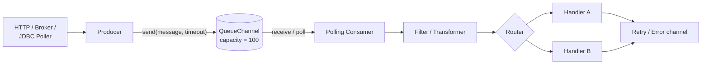
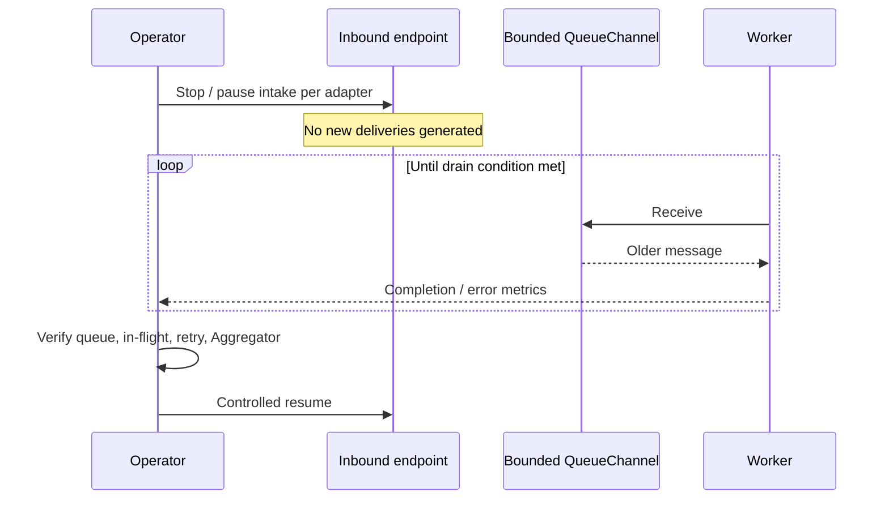

# Queue Channel Full With No Overflow Policy

## 1. Problem: A Queue Limit Is Not an Overload Handling Policy

In a Spring Integration system, `QueueChannel` is a **pollable** channel capable of buffering messages waiting for a consumer to pick them up. It decouples the pace of message production from the pace of processing. However, if producers emit messages faster than consumers handle them, the backlog grows until the queue runs out of capacity.

A common design mistake is adding `new QueueChannel(100)` and considering the load problem solved. In reality, the number `100` only caps how many messages can wait **on that channel**. It does not specify:

- What should the producer do if the queue already holds 100 messages?
- Should it wait, and for how long at most?
- Will rejected messages stay at the source, be durably stored, or be dropped?
- Do HTTP callers, brokers, or polling adapters receive an accurate overload signal?
- When workers slow down or stall for long periods, when should we alert, throttle, or scale capacity?
- On retry/replay, how do we avoid duplicate processing and preserve business ordering?

The lesson **"Queue Channel Full With No Overflow Policy"** belongs to the **Common Mistakes** chapter of module **SPRING_INTEGRATION_PATTERN**. The module focuses on practicing Enterprise Integration Patterns with Spring Integration to build loosely coupled, extensible message flows: Router, Filter, Transformer, Splitter, Aggregator, Gateway, retry, error channel, and correlation, along with testing and monitoring processing branches.

After completing this lesson, you will be able to:

1. Explain what happens when a bounded `QueueChannel` fills up, as opposed to an unbounded queue.
2. Design explicit **overflow policies** per message category and source.
3. Use `send(message, timeout)` to avoid accidentally waiting forever or ignoring unaccepted messages.
4. Combine backpressure, bounded retries, durable storage, idempotency, and acknowledgement policies.
5. Test queue saturation, message rejection, draining capacity, and resuming consumers.
6. Build dashboards/runbooks that detect nearly full queues before cascading overload occurs.

## 2. Understanding QueueChannel: Producers and Consumers Have Separate Lifecycles

`QueueChannel` is a `PollableChannel`. Producers **send** messages into the channel; consumers **receive** them or a polling endpoint pulls them on its own schedule. Unlike `DirectChannel`, sending into a queue does not mean the final handler has finished.



A message can be in various states:

| State | Where Is the Data? | What to Watch Out For |
| --- | --- | --- |
| Not yet delivered by source | Broker, DB table, file, upstream service | Can stay at source if source supports holding backlog |
| Waiting to send | Inside producer thread calling `send` | Thread may block if policy permits waiting for capacity |
| Inside queue | Inside `QueueChannel` | Does not yet mean business processing finished or was durably persisted |
| Left queue | Inside worker/handler/executor | Queue size drops, yet in-flight work remains |
| Succeeded | Completed under business contract | Must define when ACK/commit is permitted |
| Failed | Retry, error channel, DLQ, or needs redelivery | Needs its own policy; leaving the queue does not resolve failures |

### Bounded vs. Unbounded Queues

Depending on instantiation and backing store, a queue may be bounded or unbounded. For an in-memory `QueueChannel`:

```java
// Caps how many messages may wait.
QueueChannel bounded = new QueueChannel(100);

// By default, sets no finite cap on the in-memory queue.
// That does not mean JVM memory is infinite.
QueueChannel unbounded = new QueueChannel();
```

**Unbounded queues can still fail:** backlogs can grow until they exhaust heap, causing GC pressure or `OutOfMemoryError`. A bounded queue **caps waiting volume**, but requires designing behavior when that limit is reached.

If messages must survive JVM restarts, an in-memory `QueueChannel` is not enough. Consider durable sources/brokers, a `MessageStore`, or a storage solution designed for durability.

## 3. Symptoms When Full Without a Policy

Suppose:

- The queue holds at most 100 messages.
- The source produces around 500 messages/second.
- Workers process only around 100 messages/second.
- There is no inbound rate limit or durable backlog store.

In a simple steady state, backlog can grow at roughly 400 messages/second until the queue is full. With bursts, concurrency, and varying processing times, the real rate can differ significantly.

You can approximate:

\[
t_{\text{fill}} \approx
\frac{C-Q_0}{\lambda_{\text{in}}-\lambda_{\text{out}}}
\]

Where `C` is capacity, `Q_0` is initial queued count, and `λ_in` and `λ_out` are average arrival/departure rates while arrivals exceed departures. This formula is only a **rough estimate**, not a substitute for load testing, because systems experience bursts, retries, multiple workers, and resource limits.

Without a policy, these symptoms can appear:

- Sending threads **block** too long when the queue has no room.
- `send(message, timeout)` fails to accept messages within the deadline; callers ignore the return value.
- Pollers slow down or block downstream, distorting the cadence of reading from sources.
- Inbound HTTP/Gateway calls time out; clients have no idea whether their message was accepted.
- Brokers redeliver messages when consumers fail/roll back; **redeliveries and duplicates** can occur.
- Unbounded queues let in-memory message retention grow unchecked.
- Workers slow down due to failing partner APIs, long retry backoffs, or downstream bottlenecks.
- Monitoring watches only queue size without watching in-flight work or branches downstream of a Router.

**Key takeaway:** "queue full" is not necessarily a bug in `QueueChannel`. It is often a signal of imbalanced capacity design or downstream failure. Overload behavior must be defined **explicitly and observably**, rather than relying on implicit thread behavior.

## 4. Queue Sending Mechanics and What Timeout Means

`MessageChannel` provides a send method with a timeout:

```java
boolean accepted = ordersBuffer.send(message, 200);
```

Here `200` is the wait limit in **milliseconds**. When a `QueueChannel` has finite capacity and no space left, `send` can wait up to this duration for a consumer to free a slot. If the timeout expires before the message is accepted, the result can be `false`; other errors may still throw exceptions.

To attempt sending without actively waiting for capacity:

```java
boolean accepted = ordersBuffer.send(message, 0);
```

When a finite wait window is desired, use a positive timeout designed around SLAs and source contracts. **Do not rely on default timeouts** or write `send(message)` without knowing which timeout policy the caller/endpoint uses.

### Never Misinterpret the Return Value

| Outcome | What You Can Conclude | What You Must Not Conclude |
| --- | --- | --- |
| `send(...) == true` | Channel accepted the message under the send contract | Consumer processed it, DB committed, or message survives restart |
| `send(...) == false` | Message was not accepted by the channel within that condition/timeout | Message was processed elsewhere or automatically sent to a DLQ |
| Throws exception | Error during send or related infrastructure | Safe to retry unconditionally without checking source/transaction |

A producer ignoring `false` and returning HTTP 200 or ACKing a broker as if it succeeded is a latent source of data loss.

### Anti-Pattern: Calling Send and Silently Moving On

```java
// Wrong if contract requires never losing orders.
ordersBuffer.send(message, 0);
return "ACCEPTED";
```

This returns "accepted" even when the queue is full and the message was rejected. There is no guarantee the framework automatically emits an `ErrorMessage` to the global `errorChannel` when the caller ignores the boolean return value.

### Intentional Handling

```java
boolean accepted = ordersBuffer.send(message, 200);

if (!accepted) {
    // Throw so the adapter/caller applies retry policy,
    // rollback/nack, or overload response.
    throw new MessageDeliveryException(
            message, "ordersBuffer capacity exhausted");
}
```

If the source is HTTP, return an appropriate overload status; if it is a broker/DB poller, ensure the message **remains at the source or can be replayed**. Simply throwing an exception does not automatically guarantee proper rollback/ACK: verify each adapter's contract.

## 5. Policies When the Queue Is Full: Choose Before Production

No single choice fits every message type. At minimum, define among these policies:

| Policy | Behavior When Full | Pros | Risks and Conditions |
| --- | --- | --- | --- |
| **Reject / fail fast** | Do not accept message, error immediately | Explicit, avoids tying up threads | Caller/source must be able to retry or hold data |
| **Wait with bounded timeout** | Wait for space within a finite duration | Absorbs small bursts, reduces rejections | Holds threads, raises latency; needs timeouts and concurrency limits |
| **Source backpressure** | Slow down or pause pulling new messages | Prevents backlog spilling into memory | Requires source throttling mechanics and a resume plan |
| **Durable buffering** | Persist into durable broker/store before further processing | Fits data that must survive restarts | More complex; requires ACK, retries, transactions, and capacity |
| **Quarantine / DLQ** | Route classified messages to separate handling | Preserves evidence for investigation | Error store can also fill up; do not use to hide poor capacity |
| **Intentional drop** | Discard messages per published rules | Useful for non-mandatory telemetry | Unacceptable for orders/payments when loss is a business bug |
| **Load shedding** | Reject a lower-priority traffic class | Preserves resources for critical flows | Requires prioritization, metering, and upstream retry mechanics |

These options can be combined: for instance, **wait 100 ms**, then **reject with an explicit response**, while **throttling intake above a threshold**. Still, avoid uncoordinated retry layers causing retry storms.

### 5.1. Classifying by Data Type

- **Orders / payments:** normally must never be dropped. Prefer durable sources, contract-compliant retry/redelivery, and idempotency.
- **Sampled logs / metrics:** may allow dropping under overload if SLAs and loss measurement are clearly defined.
- **Non-urgent notifications:** can enter durable queues or be rate-paced; require TTL and dedup policies.
- **Synchronization batches:** can pause pollers or shrink batch sizes, while preserving checkpoints and ordering.
- **Multi-tenant data:** requires quotas/fairness so one tenant cannot consume all capacity for others.

Simply setting `QueueChannel(100)` without specifying which messages may be rejected and who owns redelivery means **having no overflow policy**.

## 6. Java DSL Example: Bounded Queue and Separate Worker

This example creates a `QueueChannel` with capacity 2 to make saturation easy to simulate. The worker is a separate polling endpoint, initially stopped so the test can fill the queue before draining.

Assumes Spring Boot 3.x, Java 17+, and Spring Integration version managed by Spring Boot.

```gradle
dependencies {
    implementation("org.springframework.boot:spring-boot-starter-integration")
    testImplementation("org.springframework.boot:spring-boot-starter-test")
}
```

Create `BoundedQueueConfiguration.java`:

```java
package example.queuepolicy;

import java.time.Duration;

import org.springframework.context.annotation.Bean;
import org.springframework.context.annotation.Configuration;
import org.springframework.integration.channel.QueueChannel;
import org.springframework.integration.config.EnableIntegration;
import org.springframework.integration.dsl.IntegrationFlow;
import org.springframework.integration.dsl.Pollers;

@Configuration
@EnableIntegration
public class BoundedQueueConfiguration {

    // Only 2 messages can wait in the queue at the same time.
    @Bean
    public QueueChannel ordersBuffer() {
        return new QueueChannel(2);
    }

    // Output channel for testing; unbounded, do not use
    // this configuration as a production storage queue.
    @Bean
    public QueueChannel processedOrders() {
        return new QueueChannel();
    }

    @Bean
    public IntegrationFlow ordersWorkerFlow() {
        return IntegrationFlow
                .from("ordersBuffer", spec -> spec
                        .id("ordersWorker")
                        .autoStartup(false)
                        .poller(Pollers.fixedDelay(
                                Duration.ofMillis(100))
                                .maxMessagesPerPoll(1)))
                .channel("processedOrders")
                .get();
    }
}
```

Here:

- `ordersBuffer` holds at most two messages **not yet picked up by the worker**.
- `ordersWorker` is a polling consumer; while stopped, the queue is not drained by this demo flow.
- `processedOrders` is a destination for the test to verify messages left the source queue. It does not replace verifying real business success.
- `maxMessagesPerPoll(1)` limits messages per poll for easy observation; real throughput also depends on poll schedule and processing duration.
- `autoStartup(false)` is not the default for all workers; used specifically for the test and must be started explicitly.

**Why create two queues?** To distinguish "accepted into buffer" from "processed by consumer". In production, if the output buffer `processedOrders` lacks consumers or durable storage, it can become a new bottleneck itself. Draining one queue only pushes pressure downstream if downstream lacks capacity.

## 7. Producer With an Explicit Contract When the Queue Is Full

Create `OrderIngress.java`:

```java
package example.queuepolicy;

import org.springframework.beans.factory.annotation.Qualifier;
import org.springframework.messaging.Message;
import org.springframework.messaging.MessageChannel;
import org.springframework.messaging.MessageDeliveryException;
import org.springframework.messaging.support.MessageBuilder;
import org.springframework.stereotype.Service;

@Service
public class OrderIngress {

    private static final long OFFER_TIMEOUT_MS = 50L;

    private final MessageChannel ordersBuffer;

    public OrderIngress(
            @Qualifier("ordersBuffer") MessageChannel ordersBuffer) {
        this.ordersBuffer = ordersBuffer;
    }

    public void accept(String orderId) {
        Message<String> message = MessageBuilder
                .withPayload(orderId)
                .setHeader("source", "orders-api")
                .build();

        boolean accepted = ordersBuffer.send(
                message, OFFER_TIMEOUT_MS);

        if (!accepted) {
            // Fail explicitly so the caller or adapter decides retry/nack.
            // Never return success and never silently drop.
            throw new MessageDeliveryException(
                    message, "ordersBuffer is full");
        }
    }
}
```

This is a **wait up to 50 ms, then reject** policy. `50` is only an example; production must choose according to SLAs and real load. If many requests wait 50 ms concurrently, thread pools can still be exhausted. Short timeouts and worker tuning do not always substitute for rate limits or durable brokers.

What matters is that the source knows sending failed. In a real API, the layer translating exceptions to HTTP needs clear rules, such as:

| Scenario | Suggested Response |
| --- | --- |
| Queue full, caller can resend | `429 Too Many Requests` when enforcing quotas/rate limits, or `503 Service Unavailable` during transient overload |
| Schema-invalid message | `400 Bad Request`; do not retry invalid requests endlessly |
| Message **durably persisted** to source/broker | `202 Accepted` if the API has an async processing contract and status lookup |
| Source cannot confirm whether message saved | Do not promise "received"; use request ID for reconciliation and duplicate prevention |

Do not return `202` merely because `QueueChannel.send()` returned `true` on an in-memory queue: acceptance into RAM does not survive crashes. If an HTTP client retries after `503`, include an idempotency key to avoid duplicate orders.

## 8. Testing Saturation, Rejection, and Drain

Create `BoundedQueueTest.java`. The test performs four actions: fills two slots, verifies the third message is rejected, starts the worker to drain, and then sends again once capacity is free.

```java
package example.queuepolicy;

import static org.assertj.core.api.Assertions.assertThat;
import static org.assertj.core.api.Assertions.assertThatThrownBy;

import org.junit.jupiter.api.Test;
import org.springframework.beans.factory.annotation.Autowired;
import org.springframework.beans.factory.annotation.Qualifier;
import org.springframework.context.ApplicationContext;
import org.springframework.context.Lifecycle;
import org.springframework.integration.channel.QueueChannel;
import org.springframework.messaging.Message;
import org.springframework.messaging.MessageDeliveryException;
import org.springframework.test.context.junit.jupiter.SpringJUnitConfig;

@SpringJUnitConfig({
    BoundedQueueConfiguration.class,
    OrderIngress.class
})
class BoundedQueueTest {

    @Autowired
    OrderIngress ingress;

    @Autowired
    @Qualifier("ordersBuffer")
    QueueChannel ordersBuffer;

    @Autowired
    @Qualifier("processedOrders")
    QueueChannel processedOrders;

    @Autowired
    ApplicationContext context;

    @Test
    void rejectsWhenFullThenAcceptsAfterWorkerDrains() {
        Lifecycle worker = context.getBean(
                "ordersWorker", Lifecycle.class);

        assertThat(worker.isRunning()).isFalse();

        ingress.accept("ORD-001");
        ingress.accept("ORD-002");

        assertThat(ordersBuffer.getQueueSize()).isEqualTo(2);

        assertThatThrownBy(() -> ingress.accept("ORD-003"))
                .isInstanceOf(MessageDeliveryException.class);

        // The third message is not in the queue.
        assertThat(ordersBuffer.getQueueSize()).isEqualTo(2);

        try {
            worker.start();
            assertThat(worker.isRunning()).isTrue();

            Message<?> first = processedOrders.receive(2_000);
            Message<?> second = processedOrders.receive(2_000);

            assertThat(first).isNotNull();
            assertThat(second).isNotNull();
            assertThat(first.getPayload()).isEqualTo("ORD-001");
            assertThat(second.getPayload()).isEqualTo("ORD-002");

            // Caller still holds ORD-003 because the prior send failed.
            // This is an intentional new send, not an automatic retry.
            ingress.accept("ORD-003");

            Message<?> third = processedOrders.receive(2_000);
            assertThat(third).isNotNull();
            assertThat(third.getPayload()).isEqualTo("ORD-003");
        } finally {
            worker.stop();
        }

        assertThat(worker.isRunning()).isFalse();
    }
}
```

Test assumptions:

- Single consumer; queue and context start empty.
- No external actors insert/remove messages.
- Worker processing is trivial and throws no exceptions.
- `receive(2_000)` has a 2-second timeout so the test never hangs indefinitely.
- The first `ORD-003` is rejected; the test re-sends it after the worker can consume.

**Interpreting results accurately:** the test proves the bounded channel policy and rejection behavior when full. It does **not** prove data is durably stored, consumers finished business side effects, or requests across multiple instances preserve ordering.

### 8.1. Additional Tests Needed

| Scenario | Expectation to Verify |
| --- | --- |
| Full capacity and timeout = 0 | Send rejects message; caller observes rejection |
| Full capacity with finite timeout | Can wait for room; never waits beyond policy |
| Worker stops under high load | Backlog grows; producer handles overload properly |
| Worker throws exception | Error/retry policy activates; no false ACK |
| Durable buffer write fails | Caller never returns fake success |
| Two producers send concurrently | Never rely on `getQueueSize()` as a lock/reservation check |
| App restarts with in-memory queue | Demonstrates data loss if source keeps no copy |
| HTTP client retries after timeout | Idempotency prevents duplicate processing |
| Backlog grows after Router/Splitter | Each branch has its own policy and metrics |

## 9. Backpressure From Producer to Source

**Backpressure** means the system slows down or rejects in a controlled way when downstream cannot keep up. It is not simply putting a bigger queue in place.

### 9.1. Pull Sources: Polling DB, Files, or an API

A poller can slow down or stop fetching new items when downstream is overloaded. However, changing poll schedules or calling Control Bus `stop()` only helps if **data at the source is safely retained**.

Key questions:

1. Does the poller fetch a record destructively (removing it from source) or read via checkpoint?
2. If `send()` returns false, does the adapter roll back, keep the record for the next poll, or lose the data?
3. Does a transaction span fetching from source and sending the message?
4. Can `maxMessagesPerPoll` be lowered and delay increased dynamically with load?
5. When a source stops, how long is backlog kept at the source and what is the resume policy?

**Never treat "read and push back into the source queue" as a safe transaction.** If the source supports rollback/redelivery, use its exact contract. For files/DB/brokers, design explicit checkpoints and idempotency.

### 9.2. Push Sources: HTTP or Message Brokers

For HTTP, the receiver cannot "make the client wait forever". Return consistent overload responses, optionally with retry guidance and request IDs. If the client resends, messages must carry idempotency keys.

For brokers, choose ack/nack, manual commit, retry queues, or pausing/resuming consumers per adapter. **Never ACK a message as processed if the application has not safely persisted required state**. If a handler already executed a side effect and timed out before ACK, the source may redeliver, requiring deduplication.

Do not treat `errorChannel` as magic: a rejected `send` call does not mean the framework automatically moved the original message to a DLQ. Producers or adapters must handle failures along a designed path.

### 9.3. Control Bus and Endpoint Lifecycle

For a lifecycle-managed inbound endpoint, Control Bus can send expressions such as:

```text
@ordersInbound.stop()
@ordersInbound.start()
@ordersInbound.isRunning()
```

However, stopping the source **does not empty `QueueChannel`** and does not cancel in-flight work. Once overload subsides, restart in the proper order, observe endpoint status, and verify the source has valid replay/backlog state.

Only send fixed control expressions over authorized channels; never accept raw SpEL from untrusted APIs or brokers.

## 10. What to Do With Messages That Cannot Enter the Queue?

An overflow policy must align with **message ownership**:

| Where Is the Message When Send Fails? | What Can the Source Do? | When Does Data Loss Occur? |
| --- | --- | --- |
| HTTP request not yet accepted | Return clear error; client retains request and retries with idempotency key | Server returns fake success or client drops request |
| Broker not yet ACKed | Nack/rollback/await redelivery per adapter | Wrongly ACKing before message is safely persisted |
| JDBC row still in DB | Do not advance checkpoint/commit unless send succeeded | Marking processed before placing into queue |
| In-memory destructive source poll | Needs custom logic to retain or durably save message | `poll()`ed from source with no store/fallback |
| File inbound | Depends on adapter, filter, and rename/checkpoint mechanics | File marked processed/deleted before successful processing |

No single `QueueChannel` API rolls back all source types. Policies belong at the **adapter/transaction boundary**, not solely inside downstream consumers.

### 10.1. Bounded Retries and DLQ/Quarantine

When retrying because a queue is full, producers must obey a **retry budget**:

- Retry only when the message truly was not accepted or send status is unambiguously known.
- Use proper backoff and jitter so multiple producers do not wake up simultaneously.
- Cap attempt count or total retry duration; avoid building an infinite loop.
- When unable to proceed, keep messages at a durable source or move them to a designed error handler.
- Avoid dumping all overload messages into a DLQ and replaying immediately, repeating the overload spike.

DLQ/quarantine is especially useful for **corrupted messages or persistent errors**. For pure overload, prioritize source throttling and durable buffering; routing large volumes of valid messages into quarantine merely hides capacity limits.

## 11. Relationship With Router, Splitter, Aggregator, and Other EIPs

Having a queue policy at the start of a flow does not guarantee the entire flow is safe. Load can amplify or shift across later components:

| EIP Pattern | Issue That Can Fill Queues | Policy to Observe |
| --- | --- | --- |
| **Filter** | Buggy/filter logic does not shed load as expected | Measure accepted, dropped, and discard reasons |
| **Transformer** | CPU-heavy conversion or slow I/O | Timeouts, processing optimization, and concurrency limits |
| **Router** | One branch receives most traffic and fills while others stay idle | Per-branch queues and backpressure |
| **Splitter** | One message produces many fragments; fan-out causes sudden load spikes | Batch limits, fragment counts, capacity, and correlation |
| **Aggregator** | Groups wait for all fragments; `MessageStore` grows when one branch slows | Monitor incomplete groups, expiration, and release strategy |
| **Gateway** | Synchronous caller holds threads while queue or downstream waits | Overall deadline, timeouts, and structured error responses |
| **Retry** | Continuous retries amplify load instead of reducing it | Budget, backoff, circuit breaker, and idempotency |
| **Error channel** | Error flow also builds backlog or error store fills up | Capacity, error-handler failure policy, and fallbacks |
| **Correlation** | Rejected messages leave a batch missing fragments | Track original ID, correlation ID, and partial-group handling |

For example, a Splitter divides each order into 20 line items, while downstream only has `QueueChannel(100)`. Just a few concurrent orders can push waiting **fragments** to the limit. You cannot size downstream capacity solely by "incoming order count"; account for **amplification ratio** and per-branch backlogs.

If one fragment is rejected and not saved/recovered, the Aggregator may wait forever. Define timeout/expiration policies and incomplete-group handling rather than merely increasing capacity.

## 12. Choosing Capacity and Consumer Concurrency

Queue capacity is not "bigger is always better". Balance **burst absorption**, **latency**, **memory**, **recoverability**, and SLAs.

### 12.1. Factors to Measure

- Incoming message rates: average, percentiles, and peak bursts.
- Consumer processing rate/second under normal conditions and when partners are slow.
- Per-message processing time, P95/P99, retry delays, and timeouts.
- Actual in-memory message footprint, including object graphs and headers.
- Worker count, in-flight executor tasks, and CPU/network/DB utilization.
- Ability to hold backlog at external brokers or stores.
- Maximum duration the system is allowed to delay a message.

### 12.2. Little's Law Is Only an Estimation Tool

In a steady-state system, Little's Law states:

\[
L = \lambda W
\]

Where `L` is average messages in the system, `λ` is throughput, and `W` is time spent in the system. Never use this formula to guarantee a queue will not fill during bursts; run load tests for disconnects, slow workers, and retries.

A larger queue can absorb short bursts, yet it can also cause **higher queuing latency**, delay failure detection, and raise memory retention cost. With in-memory queues, bounding capacity still does not provide crash durability.

### 12.3. Adding Workers Does Not Always Fix the Problem

Increasing consumers can improve throughput if CPU and downstream have spare capacity. However, if the bottleneck is a database or partner API, adding workers can raise error rates, exhaust quotas, or deplete connection pools.

Additionally, parallel processing can **alter message completion order**. If the business requires ordering per account/order ID, partition by key, limit concurrency per key, or add resequencing where appropriate. Never trade correctness just to watch queue size drop.

## 13. Observability and Alerting: Don't Wait Until Send Fails

A useful dashboard combines queue state with processing capacity and business outcomes.

| Suggested Metric | Meaning | Warning Sign |
| --- | --- | --- |
| `queue_depth` | Messages currently waiting | Rising steadily |
| `queue_capacity` | Configured capacity | Baseline for fill ratio |
| `queue_fill_ratio` | `queue_depth / queue_capacity` | Sustained high, near max threshold |
| `queue_send_rejected_total` | Times channel rejected messages | Starting to climb |
| `queue_send_wait_duration` | Time producer waits to send | P95/P99 increasing |
| `queue_oldest_message_age` | Age of oldest waiting message | Exceeding SLA |
| `consumer_throughput` | Messages consumed/second | Sustained below arrival rate |
| `consumer_inflight` | Messages dequeued but unfinished | Climbing even as queue depth drops |
| `consumer_errors_total` | Handler errors | Rising alongside backlog |
| `retry_pending` / `error_backlog` | Unfinished work outside main queue | Growing or not draining |
| `aggregator_pending_groups` | Unreleased correlation groups | Growing when a branch stalls |

These are **suggested metric names**, not built-in metrics across all Spring Integration versions. Collect them via Micrometer, producer/consumer instrumentation, channel interceptors, or your monitoring stack. Avoid high-cardinality metric labels like message IDs or payloads.

`QueueChannel.getQueueSize()` is useful for observation, but **it is not a reservation operation**. In concurrent systems, between reading queue size and calling send, another producer may take the remaining space. Acceptance/rejection decisions must still rely on `send` results and source-side policies.

### Illustrative Alert Set

- Early warning when queue fill ratio stays above an empirically chosen threshold.
- Critical alert when `send` rejections occur or message age exceeds SLA.
- Distinguish brief bursts from prolonged consumer throughput drops.
- When downstream fails, correlate queue metrics with retries, circuit breakers, and error channels.
- With multiple replicas, observe each instance; instance A being full does not mean every instance is full.

Do not hardcode 80% or 95% for every system. Set thresholds from burst profiles, recovery times, and real limits.

## 14. Runbook When a Queue Is Already Full

When production reports rising `queue_send_rejected_total`, proceed in order:

1. **Identify the exact queue:** which bean/channel, what capacity, which instance, and how many active consumers?
2. **Confirm impact:** are callers seeing clear errors? Are sources wrongly ACKing or losing unsent messages?
3. **Isolate the bottleneck:** stopped consumers, slow handlers, prolonged retries, skewed Router load, waiting Aggregator, or unavailable downstream?
4. **Protect data:** for critical flows, verify sources retain messages or durable buffers exist; avoid silent drops.
5. **Throttle load safely:** rate-limit, pause polling, pause intake, or shed load under approved policy.
6. **Restore consumers:** fix downstream failures, connection pools, quotas, or bugs; increase concurrency only if infrastructure permits.
7. **Monitor draining:** queue depth dropping is not enough; also watch in-flight work, retries, message stores, and correlation groups.
8. **Resume gradually:** avoid releasing a huge backlog burst that immediately re-saturates the system.
9. **Reconcile:** compare source messages, accepted, rejected, processed, errored, DLQ, and still-pending counts.
10. **Review policy:** update thresholds, capacity, retry budgets, and tests if unforeseen scenarios surfaced.

Never restart a JVM just to "clear the queue" if the queue is in-memory and messages have no durable copy elsewhere: that turns transient overload into permanent data loss.

### Controlled Drain Recovery Scenario

When stopping a source for maintenance:



This workflow is **designed by the application and operations team**. Spring Integration has no universal command guaranteed to `pause()` every endpoint, queue, and running task simultaneously.

## 15. Common Mistakes and How to Fix Them

| Mistake | Consequence | Fix |
| --- | --- | --- |
| Using unbounded `QueueChannel()` assuming it "cannot fill" | May exhaust heap when consumers slow down | Use calculated capacity or durable buffers |
| Using `QueueChannel(100)` without handling `send=false` | Important messages silently dropped | Fail explicitly, return overload, or rollback/nack at source |
| Using `send(message)` without considering timeout | Threads hang or behave unpredictably | Send with finite timeout and test saturation |
| ACKing broker before queue accepts/persists durably | Data loss on send failure/crash | Align ACK with acceptance policy and proper transactions |
| Immediate, unbounded retries | Retry storms and worse congestion | Retry budget, backoff, jitter, circuit breaker |
| Only increasing capacity when downstream fails | Hides bottlenecks, increases latency/memory | Fix root cause; monitor throughput and age |
| Treating queue size 0 as done | Messages may still be inside workers/executors | Track in-flight work and commits |
| Using Filter to drop orders under overload | Unaudited message loss | Drop only if business allows; audit discards |
| Stopping consumers without stopping producers | Queue fills rapidly | Coordinate intake and consumers deliberately |
| Dumping all overload into DLQ | DLQ fills too; replay causes storms | Prioritize backpressure / durable upstream |
| Adding workers without considering ordering | Messages with same key finish out of order | Partition / bound concurrency per ordering requirements |
| Never testing full queues | Bugs appear only under production load | Add saturation, redelivery, recovery, and chaos tests |

## 16. Lab Exercises

**Exercise 1 — Explicit rejection when full.** Run `BoundedQueueConfiguration` and `OrderIngress`. Keep the worker stopped and send three messages. Verify the first two are in the queue, the third is rejected, the caller receives an error, and there is no "fake success".

**Exercise 2 — Different timeouts.** Test `send(message, 0)` and `send(message, 200)` on a full queue. Have a consumer dequeue a message within the wait window and compare outcomes. Bound test durations so tests never hang.

**Exercise 3 — HTTP contract.** Design an order-intake API with an idempotency key. When the buffer is full, return an appropriate overload response; only return `202` per contract once durably written to a broker. Write a test where the client retries without creating duplicate orders.

**Exercise 4 — Broker ACK.** Describe three cases: `QueueChannel` send succeeds then JVM crashes; send fails before ACK; handler completes side effects then ACK fails. Design redelivery and idempotency policies for each.

**Exercise 5 — Splitter causing load burst.** One input message splits into 20 fragments, and a Router sends 80% of fragments to one branch. Estimate required capacity and throughput, then design branch-head backpressure to avoid fragment loss and indefinitely waiting Aggregators.

**Exercise 6 — Practical runbook.** Simulate downstream 503s for 2 minutes. Observe queue depth, send rejections, pending retries, age, and error channels. Propose when to pause intake, when to resume, and how to confirm draining finished.

**Exercise 7 — Multi-tenancy.** Two tenants share a queue of capacity 100. Tenant A floods messages, causing Tenant B to be rejected. Design quotas, rate limits, or separate queues, and describe metrics to detect resource unfairness.

## 17. Self-Assessment Questions

1. Why is `QueueChannel(100)` not yet a complete overflow policy?
2. What is the fundamental difference between unbounded `QueueChannel()` and `QueueChannel(100)`?
3. Does `MessageChannel.send()` returning `true` prove the handler committed business results?
4. If `send(..., timeout)` returns `false`, why must you never immediately ACK the broker or return HTTP success?
5. When should you reject immediately, when should you wait with a finite timeout, and when is durable buffering needed?
6. Why can `QueueChannel.getQueueSize()` not be used as a reservation check before sending?
7. Does stopping an inbound endpoint automatically drain messages already inside `QueueChannel` and in retry?
8. Why can a Router branch or Aggregator still suffer issues even after the input queue drops back to 0?
9. Why does adding workers sometimes overload partner APIs and cause more errors?
10. What must be verified to prove no orders were lost or duplicated after a queue filled up?

**Takeaway:** a bounded-capacity queue is merely a **resource limit**. A safe Spring Integration system also needs an **explicit overflow policy**, accurate send timeouts and return handling, source-side message ownership, backpressure, durability, retry/idempotency, and end-to-end pipeline monitoring. Never let a failed `send` turn into a success response or lose track of business messages.
